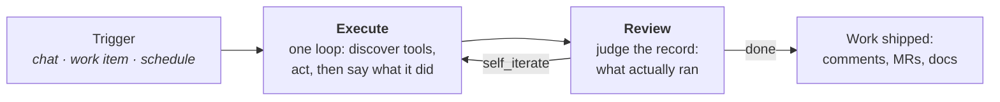
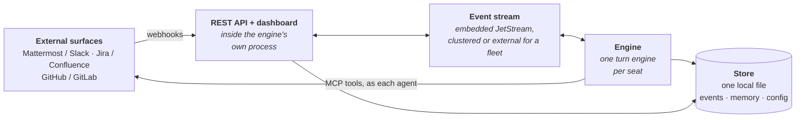

<div align="center">


# Crewlet

**Run an AI agent company.**

Crewlet is an open-source Go engine for orchestrating hierarchically organized
AI agent companies. You describe a company in YAML — mission, org chart, roles,
policies, integrations — and Crewlet runs it: one persistent agent per seat,
planning and executing real work in chat, your issue tracker, and your code host,
learning from what it did, and escalating to the humans in the org chart when stuck.

[](https://github.com/crewlet/crewlet/releases)
[](https://github.com/crewlet/crewlet/actions/workflows/ci.yml)
[](LICENSE)
[](go.mod)
[](docs/index.md)

<a href="docs/getting-started/quickstart.md"><b>Quickstart</b></a> ·
<a href="docs/getting-started/choosing-your-stack.md"><b>Choosing your stack</b></a> ·
<a href="docs/concepts/overview.md"><b>Concepts</b></a> ·
<a href="docs/index.md"><b>Documentation</b></a> ·
<a href="CONTRIBUTING.md"><b>Contributing</b></a>

</div>

---

## The org chart is the execution graph

Identity, delegation, communication, and knowledge are all scoped by where a seat
sits in the hierarchy. The chart you draw is the graph the engine runs.

<table>
<tr>
<td width="33%" align="center" valign="top">
<br>
<b>The org chart runs the work</b><br>
<sub>Departments, teams, and seats nest to any depth. Leads assign work by reasoning
about their reports — not by a routing algorithm.</sub>
</td>
<td width="33%" align="center" valign="top">
<br>
<b>Company as code</b><br>
<sub>The whole company is versioned YAML the engine stores and serves — live-editable
through a REST API, with no restart for role, provider, or integration changes.</sub>
</td>
<td width="33%" align="center" valign="top">
<br>
<b>Execute → Review</b><br>
<sub>One agentic loop decides and acts with everything it has read still in front of
it, then an adversarial reviewer judges the record — and loops it back when the
work isn't done.</sub>
</td>
</tr>
<tr>
<td width="33%" align="center" valign="top">
<br>
<b>Agents that ship code</b><br>
<sub>Every agent seat works as its coding CLI's own run in a box — on your host, in a
container or in a remote VM — and an engineer seat opens the merge request under
its own identity, not yours.</sub>
</td>
<td width="33%" align="center" valign="top">
<br>
<b>Memory that compounds</b><br>
<sub>Agents search the team knowledge base at query time, keep a private diary, recall
similar past turns, and synthesize reusable skills.</sub>
</td>
<td width="33%" align="center" valign="top">
<br>
<b>Humans hold seats too</b><br>
<sub>Put yourself in the chart. Human seats lead units and receive escalations on the
surfaces you already use.</sub>
</td>
</tr>
</table>

---

## How a turn works

A trigger — a chat message, a work-item webhook, a schedule — wakes exactly one
agent, which runs a two-stage turn:



Deciding and acting are ONE conversation, so a tool result the agent read is still
in front of it when it acts on that result — and it discovers the tools it needs
as it goes instead of naming them in advance. The reviewer is a separate, narrower
prompt on its own model — a frontier model to work, a cheap one to check. See
[Turn Engine](docs/concepts/turn-engine.md).

---

## Quickstart

There is no infrastructure to bring up. Crewlet is one binary: it embeds its
event stream (a NATS JetStream server) and its database is a local file it
creates. Its models run through the **coding CLI** each vendor ships — Claude
Code, Codex or OpenCode, installed beside it — so the vendor's own harness
drives every model, on your plan or your key. Describe a company and run it:

```bash
go install github.com/crewlet/crewlet/cmd/crewlet@latest
# or grab a signed binary from the releases page, or run
# ghcr.io/crewlet/crewlet

crewlet secrets keygen -key-id 2026-01    # prints the export line below
export CREWLET_SECRET_KEY_2026_01="<the base64 key it printed>"
export CREWLET_API_TOKEN_FOUNDER="$(openssl rand -hex 32)"
export ANTHROPIC_API_KEY="sk-ant-..."     # Claude Code's key — or sign it in on your Claude plan
export OPENAI_API_KEY="sk-..."            # embeddings

crewlet llm doctor     # the model end to end: the CLI, its sign-in, a real tool call
crewlet run            # reads ./crewlet.yaml (Tier A) and ./company.yaml (Tier B)
```

Those two filenames are the defaults, so nothing needs naming when they sit in
the working directory; `-config` and `-company` point elsewhere. The Tier A
file is the short one — where this node's store, stream and API live — and the
[quickstart](docs/getting-started/quickstart.md) writes it out in full. Four
things in it are not optional on a node that serves the dashboard: the
**keyring** (`secrets.keys`, which signs every state-log record and every
session cookie — every node needs it), `api.external_url`, the node's admin
posture `api.auth.admin` (`serve` or `refuse`), and at least one
`api.auth.tokens` entry — the token
above, which is how the first person is invited onto their seat.

The company file is a **bootstrap seed**: it starts a company that does not
exist yet — in the node's store or anywhere in its fleet — and is ignored once
one does, so a restart never reverts a change made live.
The store is the source of truth at runtime. To change a running fleet, run
`crewlet config import company.yaml` — it goes through the node's API and every
node converges with no restart. To make the file win on a restart instead, pass
`-import-company`.

A four-agent company, with a seat for you, is about 40 lines of YAML:

```yaml
name: "Acme AI"
mission: "Ship AI-powered products fast"

providers:
  llm:
    default:             # Claude Code, the default CLI
      model: sonnet
      auth: { mode: api-key }   # reads ANTHROPIC_API_KEY; drop it to run on your plan
  sandbox:               # where every agent seat's executor runs: Claude Code's
    local: {}            #   own fully permissioned run, as you on this host —
    default_run_in: direct   # a first run on your own machine while its seats
                             #   take work from you alone; container or e2b
                             #   before a seat takes work from anyone else

roles:
  - name: Your Name
    handle: founder
    kind: human          # your seat: a person joins the company on one
    manages: [ceo]
  - name: CEO
    handle: ceo
    goal: "Set product vision and make final calls"
    manages: [cto, pm]
  - name: PM
    handle: pm
    goal: "Turn business goals into clear specs and prioritized backlogs"

units:
  - name: Core Engineering
    id: core-eng
    type: team
    lead: cto
    roles:
      - name: CTO
        handle: cto
        goal: "Set technical direction and unblock engineers"
        manages: [eng]
      - name: Engineer
        handle: eng
        goal: "Implement features, write tests, ship quality code"
```

`manages:` and `lead:` name a seat by its **handle** and a unit by its **key**
(`id`), never by a display name, and a handle is the seat's identity for good
([ADR-0013](adr/0013-a-seats-identity-is-derived.md)). Every person holds a
`kind: human` seat ([ADR-0032](adr/0032-every-person-holds-a-human-seat.md)) —
you join on yours from the org chart, invited under the founder token — so a
company that declares none admits nobody.

The dashboard and webhook API come up with the engine, and the dashboard
opens on **Home**: how the company is, and the decisions waiting on you. The full
[Quickstart](docs/getting-started/quickstart.md) walks through watching an agent's
first turn with no integrations at all, then wiring in the real ones.

> **Want a whole company to run?** Two complete seven-seat reference orgs ship
> in `examples/`, the same company at both ends of the stack.
> `nimbus.company.yaml` is the full one — GitLab, Mattermost, open models
> through OpenCode on an OpenRouter key, and Worklet and Doclet, the engine's
> own work tracker and knowledge base.
> `nimbus-claude-cli.company.yaml` is the short path: chat on Mattermost, its
> model Claude Code on the Claude plan you already pay for, and every seat running
> that same CLI as its own agentic run in a box on the engine host, on
> that same login — no API key, and no service beyond the chat server in this
> repo's compose file. Neither needs a tracker or a wiki account: both run Worklet
> and Doclet, and [Jira](docs/integrations/jira.md) /
> [Confluence](docs/integrations/confluence.md) are the blocks that move those
> halves to Atlassian. Every setting in both carries its reasoning in a comment.

> **Rather not write it by hand?** An AI assistant can interview you and author
> both files, checking its own work against the shipped JSON Schema — see
> [Authoring with an AI assistant](docs/getting-started/ai-authoring.md) for a
> step-by-step walkthrough.

---

## Plug in your stack

Crewlet is the engine; the surfaces your agents work on are yours to choose — see
[Choosing your stack](docs/getting-started/choosing-your-stack.md).

**Routed end to end** — a delivery from one of these wakes the seat it concerns:

| | Options |
|---|---|
| **LLM** | Every model through the vendor's own [coding CLI](docs/concepts/llm-backends.md) — Claude Code for Anthropic's models (on a Claude plan or an API key), Codex for OpenAI's, **OpenCode for open models** on OpenRouter, a hosted provider or your own server. Claude Code or OpenCode runs each seat's executor; Codex can serve a seat's reviewer, workers and side passes |
| **Tracker** | [Jira](docs/integrations/jira.md) — Cloud or Data Center — or [GitLab](docs/integrations/gitlab.md) / [GitHub](docs/integrations/github.md) issues |
| **Knowledge base** | [Confluence](docs/integrations/confluence.md) — searched at turn start and on demand, run as the asking seat |
| **Code host** | [GitLab](docs/integrations/gitlab.md) — gitlab.com or self-hosted — or [GitHub](docs/integrations/github.md), github.com or Enterprise Server |
| **Chat** | [Mattermost](docs/integrations/mattermost.md) — self-hosted, one bot identity per agent — or [Slack](docs/integrations/slack.md), one app per agent |
| **Code sandbox** | [The engine host](docs/concepts/code-sandbox.md), as a process tree or a container; Claude Code or OpenCode as the coding agent |

The knowledge base is **single-homed** — one searcher per company, because two would
make an agent's answer to "what do we already know about this" depend on which one was
asked. It sits behind the backend-neutral `knowledge.Searcher` seam, so a second
backend is a new implementation rather than a rewrite of everything that searches.
Everything else composes: a company can run GitHub beside GitLab, or Slack beside
Mattermost, which is what a migration and an open-source presence both look like.

One command provisions the whole fleet — a bot or
service account per seat, memberships, per-agent tokens minted into your config's own
`${VAR}` references, and the webhooks:

```bash
crewlet mattermost provision company.yaml -env-file .env
crewlet gitlab     provision company.yaml -public-url <url> -env-file .env
crewlet jira       provision company.yaml -public-url <url> -env-file .env
crewlet slack      provision company.yaml -public-url <url> -env-file .env
crewlet github     provision company.yaml -public-url <url> -env-file .env
```

Each run records what it mints where you send it — an env file (`-env-file`),
the fleet's encrypted secret store (`-secret-store`) or your terminal
(`-print`) — and a run that would mint takes exactly one of the three. It reads
the company's values the way the engine does, the secret store before the
environment: through the running engine, with `CREWLET_API_TOKEN` set to one
of its Tier A tokens carrying `admin`, or through the running node `-api URL`
names — and with the engine stopped from the fleet's store itself, which the
command reaches through the node's own broker or the external one. A member of
a cluster whose engine is stopped cannot reach the store alone, so a run there
that reads it is refused before it changes anything, naming `-api`: every
`gitlab`, `github` and `jira` run, its `-dry-run` included, and a `mattermost`
or `slack` run with something to provision. A `mattermost` or `slack` run with
`-dry-run` or nothing to provision reads nothing of the store and runs on any
node
([where a command reads the company's values](docs/reference/cli.md#where-a-command-reads-the-companys-values)).
Beside a running engine, `-secret-store` is the sink the engine reads with no
restart, at its next configuration apply; an env file reaches it only when it
restarts from a shell that sourced the file.

What each command can actually do differs by what the vendor allows: Mattermost and
GitLab create an account per seat and mint its token; Jira and GitHub issue no
credential on a provisioner's behalf, so those runs report which account each seat's
own credential authenticates as and register the webhooks.

Mattermost takes no URL because nothing has to reach the engine: it holds one
outbound websocket per agent seat instead of receiving webhooks, so that loop
runs behind NAT with no tunnel.

Add `-secret-store` and the minted credentials go straight into the encrypted
[secret store](docs/concepts/secret-store.md) the engine reads `${VAR}` from —
no env file to source, no shell to be in.

---

## Architecture



That is the glance; **[Architecture](docs/concepts/architecture.md)** draws the
same engine at six zoom levels — the process boundary, one node's interior, the
path a trigger takes across a fleet, the path a turn takes, where every table
and bucket lives, and what changes when a second node appears.

Agents are callback-driven: messages on an agent's inbox topic invoke its handler,
and events that piled up while it was busy are batched into a single digest turn.
Config lives in two tiers — an ops-owned bootstrap file on disk, and a versioned,
live-editable company document in the store that can be
[encrypted at rest](docs/concepts/configuration.md#secrets) as a single opaque blob.

---

## CLI

```bash
crewlet run                                   # boot; seeds the store from company.yaml
crewlet run -roles data,ingress               # API + webhooks only (split deployments)
crewlet validate                              # check both tiers before booting
crewlet schema company                        # JSON Schema (editors, CI, agents)

crewlet config import | show | export | revisions | diff | activate
crewlet secrets keygen                        # a keyring key — REQUIRED on every node: it signs every
                                              #   state-log record and session cookie, and seals the config
crewlet secrets set ANTHROPIC_API_KEY         # a secret the engine reads ${VAR} from

crewlet confluence import company.yaml docs/  # publish knowledge docs + tool skills
crewlet gitlab provision company.yaml -env-file .env
                                              # reconcile the company's seats into GitLab,
                                              #   minting their tokens into .env
```

Full reference: [CLI](docs/reference/cli.md) ·
[API endpoints](docs/reference/api-endpoints.md) ·
[Environment variables](docs/reference/environment-variables.md).

---

## Documentation

<table>
<tr>
<td valign="top" width="62%">

**Start here**
- [Installation](docs/getting-started/installation.md) — prerequisites and infrastructure
- [Quickstart](docs/getting-started/quickstart.md) — a company running in minutes
- [Choosing your stack](docs/getting-started/choosing-your-stack.md) — every external dependency, and what you set up yourself
- [Authoring with an AI assistant](docs/getting-started/ai-authoring.md) — let an AI write your company config
- [Configuration reference](docs/getting-started/configuration.md) — every YAML field

**Core concepts**
- [Overview](docs/concepts/overview.md) · [Organization model](docs/concepts/organization-model.md) · [Humans in the org chart](docs/concepts/humans-in-the-org.md)
- [Agent runtime](docs/concepts/agent-runtime.md) · [Turn engine](docs/concepts/turn-engine.md) · [LLM backends](docs/concepts/llm-backends.md) · [Code sandbox](docs/concepts/code-sandbox.md)
- [Knowledge system](docs/concepts/knowledge-system.md) · [Agent learning](docs/concepts/agent-learning.md) · [Tool skills](docs/concepts/tool-skills.md)
- [Event system](docs/concepts/event-system.md) · [Scheduling](docs/concepts/scheduling.md) · [Configuration](docs/concepts/configuration.md)
- [Dashboard Assistant](docs/concepts/assistant.md): ask questions and approve changes, acting as you

**Guides**
- [Tools & MCP](docs/guides/tools-and-mcp.md) · [Deployment](docs/guides/deployment.md) · [Running a Fleet](docs/guides/fleet.md) · [Running the Dashboard Assistant](docs/guides/assistant.md)

</td>
<td valign="top" align="center" width="38%">

</td>
</tr>
</table>

---

## Contributing

Issues and pull requests are welcome. [CONTRIBUTING.md](CONTRIBUTING.md) covers the
dev setup, conventions, and the checks CI runs:

```bash
make build    # go build ./...
make check    # every gate CI runs: gofmt, go mod tidy -diff, the DCO
              #   sign-off, vet, golangci-lint, build, the race suite,
              #   and a cross-compile of every release target
make help     # everything else
```

Commits are signed off (`git commit -s`), which certifies the
[DCO](DCO) over them — CI checks it.

Releases are cut by pushing a `v*` tag — see [RELEASING.md](RELEASING.md).

Security issues: please report them privately — see [SECURITY.md](SECURITY.md).

## License

[MIT](LICENSE)

The dashboard's glyphs are [Lucide](https://lucide.dev) (ISC, Feather-derived)
via `@crewlethq/icons`, and its typefaces are Geist and Geist Mono (OFL) via
`@crewlethq/tokens`; the full texts ship in every build as
`THIRD_PARTY_NOTICES.txt`.
