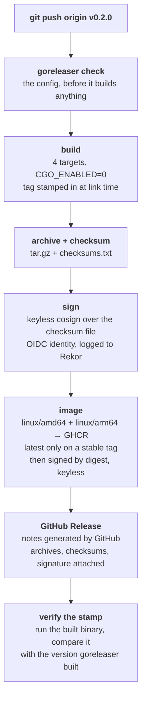

# Releasing

Maintainer runbook for publishing Crewlet. A release is one command, pushing a
`v*` tag; [`.github/workflows/release.yml`](.github/workflows/release.yml) does
the rest, driving [goreleaser](https://goreleaser.com) from
[`.goreleaser.yaml`](.goreleaser.yaml). The image of `main`, rebuilt on every
push to `main` by
[`.github/workflows/main-image.yml`](.github/workflows/main-image.yml), is not
a release ([Images from main](#images-from-main)).

Nothing here is needed to *use* Crewlet; it is for people with commit rights,
so it lives beside [CONTRIBUTING.md](CONTRIBUTING.md) rather than in `docs/`.

---

## How a release flows



Pushing the tag is the whole release. The **GitHub Release is created
automatically**; never open the *Draft a new release* form. goreleaser titles
it from the version, has GitHub generate the body from the pull requests merged
since the previous tag, and attaches every archive, the checksum file and its
signature.

**The tag is the version.** Nothing in the tree records one, so there is no
version bump. goreleaser stamps the tag, `v` included, into
`internal/version.value` at link time, so `crewlet version` from the release,
`go install …@v0.2.0`, the image tag `v0.2.0` and the Go module version read
the same string. A binary built any other way (`go install`, a local
`go build`) reports its module build info instead.

A mistyped tag is not caught by any comparison: delete it and re-tag ([If a release goes
wrong](#if-a-release-goes-wrong)).

---

## One-time setup

### Nothing, and that is the point

There is **no credential to provision**. The workflow authenticates with the
run's own short-lived identity:

| What | How |
|---|---|
| Creating the GitHub Release | `GITHUB_TOKEN`, `contents: write` |
| Pushing to `ghcr.io/crewlet/crewlet` | the same token, `packages: write` |
| Signing the checksums and the image | an OIDC token, `id-token: write` — cosign mints a short-lived certificate from it |

No API token, stored key, `~/.docker/config.json` or cosign private key: a
compromised workflow has nothing long-lived to steal.

Check once, in **Settings → Actions → General**, that the default workflow
token may write packages, or the image push fails at the end of an otherwise
complete release. The first push to `main` after `main-image.yml` lands, which
uses the same token, is usually where a missing permission shows first.

Once the package exists, check in **Package settings** for
`ghcr.io/crewlet/crewlet` that its visibility is **public** (GHCR makes a
workflow-created package private, so nobody without a token can pull it) and
that **Manage Actions access** gives this repository the **Admin** role: the
release needs write access to push, and `main-image.yml` needs Admin to delete
the images `main` no longer names, which fails with a 403 under less.

Releasing from a workstation is not supported: it skips the signature and
provenance the OIDC identity carries and produces binaries nobody checksummed.

---

## Cutting a release

1. **Pick the version.** [Semantic versioning](https://semver.org/): the
   **minor** number moves for features, the **patch** number for fixes. A
   pre-release (`v0.3.0-rc.1`) is released the same way and takes neither
   "Latest" on GitHub nor the `latest` image tag, so an operator who pinned
   nothing never receives one.

   While the major number is `0`, a **break in a surface an earlier tag
   shipped** moves the minor too, and merits a paragraph in `release.header`
   (see [Release notes](#release-notes)), since a title cannot tell an operator
   what to change. A change to a surface **no tag has shipped** is not a break
   and needs no paragraph, no `!` and no `BREAKING CHANGE:` footer. Settle which
   it is by whether the previous tag carried the path:
   `git log <previous tag>..HEAD -- <path>`.
   [CONTRIBUTING.md](CONTRIBUTING.md#nothing-is-released-until-a-tag-ships-it)
   has the contributors' rule.

   The first tag that carries Go code is also the first that owes an **upgrade
   in place**. Until then nothing an older unreleased build wrote is read or
   migrated, and none of its peers joins a fleet beside a newer one. From that
   tag on, the next release must read what the tag wrote and run beside it in
   one fleet; a change breaking either is a break in a shipped surface. The
   forward mechanisms that allow it are listed in
   [CONTRIBUTING.md](CONTRIBUTING.md#nothing-is-released-until-a-tag-ships-it).
   One is the operator's to plan for: a data node of the older build refuses a
   newer node's request, write or read, that sets a field its build does not
   declare, so a release that adds a field to a routed request is rolled out to
   the data nodes first. That order has its own cost: once a newer data node
   holds a newer field set, a not-yet-upgraded node is refused the answers it
   would carry into another request (a publish keeping a version's files, a
   view save and the views listed to make one, a catalogue sent back whole)
   until it is upgraded too. What is owed is owed to a TAG: an unreleased build
   between two tags is owed nothing.

2. **Skim the merged pull requests** since the previous tag; they *are* the
   release notes. GitHub assembles the body from their titles at release time,
   so edit a title that reads as a commit log on the pull request *before* you
   tag.

3. **Run the checks CI runs:**

   ```bash
   make check
   ```

   Run that target, not its commands: a bare `go test ./...` runs the
   cluster-forming packages beside everything else and bypasses
   `internal/skipgate`, and `gofmt -l .` reads every nested checkout under
   `.claude/worktrees/` as this tree. [CONTRIBUTING.md](CONTRIBUTING.md) says
   what `make check` runs.

   Then ask whether the git the image builds is still upstream's newest of its
   series, which `make check` cannot answer because it reads no network:

   ```bash
   scripts/git-pin-check.sh
   ```

   Exit 0 is current. Exit 1 prints each pin that is behind, with the two lines
   of the bump and its pull request's title (the weekly issue
   `git pin behind upstream` says it too); a pin behind a security patch of its series is a
   release to hold (see [What ships in a
   release](#what-ships-in-a-release)). Exit 2 could not tell (kernel.org
   unreachable, a signature that does not verify) and is never a pass.

4. **Rehearse the release itself** if anything about the release surface
   changed (see below). It is cheap and offline; do it whenever unsure.

5. **Freeze the issue report catalogue this tag publishes**, and merge the file:

   ```bash
   go run ./cmd/crewlet schema issue-report-catalogue \
     -o "schema/issue-report-history/$(jq -r .schema schema/issue-report-catalogue.json).json"
   ```

   A release keeps sending reports of this shape after the code moves on, so the
   relay needs this copy ([ADR-0101](adr/0101-an-engine-reports-its-own-defects-as-typed-records-a-relay-files.md)),
   and `TestAPublishedClassShapeIsImmutable` holds the catalogue to it from now on.
   The relay takes the same file before the tag is pushed. The release job refuses
   a tag whose export differs from it. Nothing changed since an earlier tag at the
   same schema leaves the file as it is.

6. **Merge to `main`, then tag it:**

   ```bash
   git tag v0.2.0
   git push origin v0.2.0
   ```

7. **Watch the run.** When green, the archives, checksums and signature are on
   the Release and `ghcr.io/crewlet/crewlet:v0.2.0` is pullable; nothing is
   published by hand.

---

## Rehearsing a release

The whole pipeline runs in **snapshot mode** without a tag and without
touching GitHub:

```bash
make snapshot   # goreleaser check
                # goreleaser release --snapshot --clean --skip=sign
```

`check` runs first so a config error reads as one. **`--skip=sign` is not optional**: `--snapshot` does
not skip signing, so without it the rehearsal runs `cosign sign-blob --yes` and
tries to mint a real Sigstore certificate from a machine with no OIDC token.

It builds all four targets, the archives, the checksums *and the container
image*. buildx cannot assemble a multi-platform manifest without pushing it, so
`dockers_v2` builds and pushes in goreleaser's **publish** phase, and
`--skip=publish` would skip the image build and leave the `Dockerfile` untested;
hence both the CI job and `make snapshot` skip only signing. A snapshot still
pushes nothing: it loads each architecture into the local Docker under suffixed
tags, `ghcr.io/crewlet/crewlet:v0.2.0-SNAPSHOT-<commit>-amd64` and `-arm64`
after a `v0.2.0` tag (the version every binary of the build reports), with
`latest-amd64` and `latest-arm64` beside them, and no multi-platform manifest
exists afterwards. (A shallow clone has no tag and builds `v0.0.0-SNAPSHOT-…`.)

Building the `linux/arm64` image on an amd64 machine needs binfmt registered
(`docker run --privileged --rm tonistiigi/binfmt --install all`), or the arm64
leg fails inside `apt-get` with an exit code and no explanation. Add
`--skip=docker` if you only want the binaries.

CI runs the snapshot job on demand (**Actions → release → Run workflow**) and
on any pull request touching `.goreleaser.yaml`, `Dockerfile`, `go.mod`,
`internal/version/**`, `scripts/notices/**`, the git pin or its recipe
(`scripts/git-pin.env`, `scripts/git.sh`) or the workflow, so the pipeline never
first runs on the tag that publishes.

Neither release job saves a cache. Both restore, read-only, the module cache
`ci.yml`'s `build + vet` job saves on `main`, and no build cache: goreleaser
builds with `-trimpath` and its own `-ldflags`, which share no build action with
any `ci.yml` job. A release compiles its four targets cold (a few minutes, once
per tag), and a pull request touching the release surface stores no entry only
its own ref could read.

---

## Images from main

`ghcr.io/crewlet/crewlet:main` is the engine image of `main`, from
[`.github/workflows/main-image.yml`](.github/workflows/main-image.yml). **It is
not a release**: no Release page, no notes, none of what a tag promises (see
[CONTRIBUTING.md](CONTRIBUTING.md#nothing-is-released-until-a-tag-ships-it)).
It is ONE tag, and it moves:

- **It sends engine issue reports**, for a company that opted in, like a release
  does ([ADR-0101](adr/0101-an-engine-reports-its-own-defects-as-typed-records-a-relay-files.md)),
  so `crewlet-operator`'s suites, which run this image, never start an engine with
  the setting on. Its workflow proves the build recorded the commit it stamps,
  since a report names it.
- **Every push to `main` rebuilds it** from the push's head commit and moves
  `main` to that build. Nothing else is pushed: no tag per commit, never
  `latest`, never a release's tag.
- **A newer push cancels the run before it.** All runs share one concurrency
  group with `cancel-in-progress`, so only the newest of close pushes is built.
- **A commit that starts no run is never built.** Dependabot's bumps merge with
  `GITHUB_TOKEN`, and GitHub starts no workflow for a push that token made, so
  `main` keeps the last pushed commit's image until the next push.
- **Re-run only the newest run.** A re-run builds the commit it ran on and
  moves `main` to it, so re-running an older one moves `main` backwards until
  the next push, and it joins the concurrency group, cancelling a newer run in
  flight.

### What the binary reports

`crewlet version` in the image prints `main-` and the first twelve hex digits
of the commit, then Go's record of the whole commit:
`crewlet main-4e45c6b992a2 (4e45c6b992a2133639abebeec271236969b4ead4)`. The
commit is a build of `main`'s only identity. `main-` says where it came from and
has no leading `v`, so nothing (reader, version comparison, `latest` guard)
takes it for a release; twelve hex digits is Go's pseudo-version length and
never names two commits of this repository. The image's
`org.opencontainers.image.revision` label carries the whole commit too.

### How it is built

Not by goreleaser, which fits neither way it runs: a release run needs a semver
tag on the commit, and a snapshot run pushes nothing. The workflow runs the same
build plainly, in four steps:

1. **The binaries.** `make image-context` builds the two linux targets with
   `.goreleaser.yaml`'s settings (`CGO_ENABLED=0`, `-trimpath`, `-s -w`, the
   version stamped with `-X`) and stages them with the license, its notice and
   both notices files the way goreleaser stages a release's image context. The
   binary the runner can run must report the commit's version before anything
   is pushed: an unstamped build reports a module version, never
   `main-<commit>`, and that is the only symptom a stamp that applies to
   nothing has.
2. **The image.** `docker/build-push-action` builds the same `Dockerfile` for
   linux/amd64 and linux/arm64, pushes it and tags it `main`.
3. **The signature**, keyless, by the digest the push reported, as
   `docker_signs` signs a release's image.
4. **The cleanup.** Every image no tag names any more (the earlier images of
   `main`) is deleted once it is an hour old, with the signatures of the
   images deleted.

A release-build change touches both `.goreleaser.yaml` and the
Makefile's `image-context`, and each says so. `main` moves at the push and is signed later,
so a failed or cancelled run in between leaves `main` on
an image `cosign verify` refuses until a later run signs one. A failed run is
red on `main`'s commit; a cancelled one was superseded by a newer push.

### Verifying the image of main

```bash
cosign verify ghcr.io/crewlet/crewlet:main \
  --certificate-identity 'https://github.com/crewlet/crewlet/.github/workflows/main-image.yml@refs/heads/main' \
  --certificate-oidc-issuer https://token.actions.githubusercontent.com
```

The identity names `main-image.yml` on `main`, which no release image carries,
so a release never passes a check for `main`, nor the reverse. To bind the check to one commit, add
`--certificate-github-workflow-sha` with the commit's **full** hash (Fulcio
writes the run's base commit into the certificate). Use cosign
3, or cosign 2 with `--new-bundle-format`. The previous `main` image is deleted within the hour, so
never pin a digest of `main`; a deployment that must keep one build runs a release.

### What it costs

Each run compiles two targets and builds the two-platform image once (arm64 under QEMU). Cancelling a superseded run keeps a burst of merges to
one build. The package keeps `main`'s image and the releases:
each run deletes images no tag names once an hour old (the hour
covers an image mid-push, whose platform manifests upload
just before the index that tags them).

### Rehearsing it

The workflow runs only on a push to `main`. A pull
request changing what the image is built from (the `Dockerfile`,
`go.mod`, `internal/version/**`, `scripts/notices/**`) runs release.yml's
snapshot job, which builds the release image from the same `Dockerfile` and
checks the binary's version. A change to `main-image.yml` is first
exercised on `main`: read its run after the merge. Locally,
`make image-context VERSION=main-dev` stages the context in `build/image`, and
`docker buildx build --platform linux/amd64 --load -f Dockerfile build/image`
builds the image from it; push, signature and cleanup run on
`main` only.

---

## What CI already guards

[`ci.yml`](.github/workflows/ci.yml) runs the build, the race suite, the
end-to-end gates, a cross-compile of every release target and the linter on
every pull request. The release surface is guarded only by what the
release pipeline does when it runs:

- **`goreleaser check`** runs first in both release jobs, so a malformed or
  unknown field in `.goreleaser.yaml` is a config error.
- **The publish job holds a tag to its frozen issue report catalogue**: it
  refuses a tag whose export differs from `schema/issue-report-history/<schema>.json`.
- **The snapshot job builds everything** (four targets, archives,
  checksums, container image) on demand and on any pull request
  touching `.goreleaser.yaml`, `Dockerfile`, `go.mod`, `internal/version/**`,
  `scripts/notices/**`, `scripts/git-pin.env`, `scripts/git.sh` or the
  workflow. A dependency needing cgo, or a `Dockerfile` that no longer
  copies from `${TARGETPLATFORM}`, fails there, not at tag time.
- **The image checks its own git** in the `Dockerfile`'s last git step, on
  both platforms, every build: its `git version` is the
  node pin's, `git-remote-https` links nothing the image lacks — GnuTLS's
  libcurl, and no OpenSSL of git's own — and reaches curl's connect on a
  loopback port, its checksums are block-sha1 (`git version
  --build-options`), it reads its system configuration from `/etc`, git's
  licence is there, and the source tarball beside it hashes to the pin's
  SHA-256. A stage that stopped building the pin, built another, dropped
  the recipe's choices, or linked a library the runtime stage does
  not install fails the snapshot job on that pull request.
- **Both release jobs run the built binary** and compare its report with
  the version goreleaser recorded in `dist/metadata.json`: the only
  symptom of a broken ldflags stamp. Rename `internal/version.value`, move the
  package or change the module path and `-X` silently applies to
  nothing; the binary falls back to its build
  info. The comparison is equality, never a sentinel (since Go 1.24 an unstamped build reports a tag-derived pseudo-version, so sniffing for
  `dev` passes it). The publish job also checks that the tag
  goreleaser built is the ref that triggered the run. Only the **snapshot**
  comparison catches an inapplicable stamp: a release builds at
  its tagged commit, where an unstamped binary's fallback version
  is the tag itself, so the publish check proves the binary
  names its tag, not that `-X` put it there. Keep the snapshot
  job's paths covering `internal/version/**` for that reason.
- **The binary of `main` is checked before its image is pushed.** The amd64
  binary must report `main-<commit>` on every push to `main`, which catches an
  inapplicable stamp like the snapshot comparison. Then the image is pushed
  and signed by its digest.

### What nothing guards — check these by hand

No actionlint, yamllint or schema validation exists in the tree (`internal/version` asserts none of these), and GitHub accepts
each mistake below as valid configuration. Each fails **silently**
unless its bullet says otherwise (the pipeline stays green and stops
doing the thing, or does more), so read the file when you touch it:

- **`.github/release.yml` keeps its catch-all `*` category.** Without it an
  unlabelled pull request is omitted from the release body without warning, and
  nothing diffs that body against the merged pull requests. The
  notes are the release's only record.
- **`prerelease: auto`, and the `latest` image tag stays guarded on the release
  being stable.** Lose either and a release candidate becomes GitHub's "Latest"
  or answers `docker pull crewlet` for everyone who pinned nothing.
- **The `signs:` arguments match the cosign the publish job installs.** The
  snapshot job and `make snapshot` both pass `--skip=sign`, so the checksum
  signature is first exercised by the publishing tag. cosign 3 (from
  `sigstore/cosign-installer` v4) writes one `.sigstore.json` bundle and
  refuses the older `--output-signature`/`--output-certificate` pair without
  `--bundle`. A later cosign major arrives as a green
  Dependabot bump of the installer: read its release
  notes against `signs:` before merging, and update the verify
  commands here and in `docs/getting-started/installation.md`.
- **`changelog.use: github-native`.** Any other mode builds the body from commit
  subjects, not pull request titles, leaving `.github/release.yml` dead.
- **Exactly one workflow carries `push: tags: ["v*"]`.** Two race to create one
  Release and the loser fails after building; a trigger
  somewhere Actions ignores publishes nothing. Both `.yml` and `.yaml` count.
- **`main-image.yml` runs only on a push to `main`.** Its job holds
  `packages: write` and `id-token: write`, and the trigger list is the only
  guard (the job has no event condition), so a `pull_request`,
  `pull_request_target`, `workflow_run` or `workflow_dispatch` trigger would
  hand the registry and an OIDC signing identity to a run something other than
  a merge started. Its `if:` checks only the repository's name, which keeps a
  fork's `main` from running a job that holds the fork's token and could
  only fail.
- **Its runs keep ONE concurrency group with `cancel-in-progress`.** Key the
  group per run or commit and two runs push side by side, the older able
  to land last and move `main` backwards. Every run stays green.
- **The sign step signs the digest the push reported.** Signing `:main` by tag
  lets a newer run's push in between get this run's signature
  over an image it did not build. It stays green.
- **`make image-context` builds as `.goreleaser.yaml` does.** The flags, the
  `-X` stamp's path, the platforms and the staged context are written in both,
  uncompared: changing one gives `main`'s image a
  different build from a release's, and the run passes while the binary
  reports its version.
- **The cleanup deletes untagged IMAGES, never untagged package versions.**
  GHCR lists each platform manifest, attestation and signature of a tagged
  image as its own version, so deleting every untagged version
  (`actions/delete-package-versions` with `delete-only-untagged-versions`)
  removes them from under `main` and every release, and the next pull
  fails with *manifest unknown*. Its `older-than` keeps an image mid-push. The run stays green.
- **The image of `main` is its own workflow, named `main image`.** Folded into
  `release.yml`, it would make `docs-publish.yml` (which reads every completed `release`
  run whose event was a push as a new tag) republish the docs site on every
  merge.
- **`docs-publish.yml` watches the release workflow by its exact `name:`.**
  GitHub reports nothing when that string matches no workflow, so a rename on
  either side stops the trigger: the site has no
  schedule, so a release is not published until something else
  rebuilds it.
- **Every dependency surface has a `.github/dependabot.yml` entry.** An
  unlisted manifest produces no pull requests, like one with
  nothing to update. Ecosystem names must match whole: as a
  substring, `docker` is satisfied by the `docker-compose` entry.
- **`.github/workflows/dependabot-merge.yml`'s guard and its merge flags.** The
  job holds `contents: write` and `pull-requests: write` and approves a pull
  request; its `if:` alone stops it approving a commit a person
  pushed onto a Dependabot branch, and `--auto` queues the merge behind the checks
  `main` requires (drop it and, while `main` requires them, the step goes red;
  with no such rule it would merge before a check reported). It
  approves only while `reviewDecision` is neither `APPROVED` nor
  `CHANGES_REQUESTED`, and an EMPTY decision must keep approving: GitHub has been
  reported to leave it empty while a ruleset still blocks the merge,
  so skipping would stall every bump with nothing red. Loosening
  the `if:` makes the workflow run *more*; narrowing the approval silently stops
  it approving. Its `paths-ignore` keeps it off a bump of the Playwright tree a
  seat's box installs, which a person lands: drop it and that bump is approved
  and queued, and merges itself once anything pushed onto its branch turns it
  green.
- **`.github/workflows/dependabot-recreate.yml`'s filter, its command and its
  environment.** It comments `@dependabot recreate` on a bump in
  conflict that Dependabot will not rebase itself: one holding a commit that is
  neither Dependabot's nor marked `[dependabot skip]`. Widen the filter and it races
  Dependabot; narrow it and a stuck bump is never
  asked. `recreate` overwrites every commit on the branch. Each request carries the head
  it was made for in a hidden marker: one request per head, three per bump. The comment must come from a user account, with
  `DEPENDABOT_RECREATE_TOKEN`: fine-grained, this repository alone, Pull requests:
  read and write, as a secret of the `dependabot-recreate` ENVIRONMENT limited to
  the selected branch `main`, because that scope can also approve pull requests.
  Create the environment first (a workflow naming a missing one creates it
  open to every branch) and never reuse the bundle token, which can push. An empty
  secret fails the run, and so does Dependabot answering "only users with push
  access"; weakening the filter, the environment or the token's scope stays
  green.
- **`.github/workflows/dependabot-dashboard.yml`'s guard, its two-job split and
  the token's scope.** The `push` job holds a personal access token that can
  write to a branch; its `if:` (author AND actor both Dependabot, repeated on the
  job holding the token, not only the builder) stops a run a person
  triggered reaching it. The `build` job runs a dependency's install scripts, so
  it keeps `contents: read`, no secrets and no persisted checkout credential.
  The `push` job's file-name allowlist stays an allowlist: every tree it
  writes is inside the Go module, so a `.go` file would run on every
  contributor's machine. Where it writes stays its own reading of the
  Makefile's `UI_OUT`, as text from its own checkout, held to directories
  directly under `static/` and refusing a file outside them; never a list the
  `build` job hands over, and never `make`, which would run the checkout beside
  the token. The token stays fine-grained, this repository alone, at
  Contents: read and write (Workflows would let it rewrite workflows, a
  classic token reaches every repository its account can, Pull
  requests would let it approve them), and `v*` needs a tag ruleset its account
  cannot bypass. It expires, so the date wants a calendar entry. While `main`'s
  ruleset keeps approvals across pushes, anything pushed onto an open Dependabot
  branch merges once CI is green, so the token's scope is the only limit on what
  it can land. Weakening any of these makes the workflow reach *more*, never fail.
- **`.github/workflows/pins.yml` runs, on its schedule, with `contents: read`
  and `issues: write` and no secret.** It is the only watcher of
  `scripts/git-pin.env`, `scripts/chromium-pin.env` and
  `scripts/node-pin.env`, one matrix leg each; `scripts/git-pin_test.sh`,
  `scripts/chromium-pin_test.sh` and `scripts/node-pin_test.sh` hold the
  scripts it runs, and nothing holds the workflow. Each leg finds its issue by
  an exact title, `git pin behind upstream`, `chromium pin behind upstream` or
  `node pin behind upstream`, so renaming a title in one place opens a second
  issue; each reports a pin behind by that issue and a failed run, the git and
  floor Node legs a key near expiry by a failed run alone (notified to
  whoever last edited the schedule). GitHub DISABLES a public repository's
  scheduled workflows after 60 days without activity, saying so only
  by e-mail, after which a pin falls behind with nothing red. Before
  a tag, `scripts/git-pin-check.sh` (step 3 above) asks the git leg's question
  by hand; the Chromium and floor Node pins ship in no release, so no tag
  waits on them.

---

## What ships in a release

| | Contents |
|---|---|
| **archives** (`crewlet_X.Y.Z_<os>_<arch>.tar.gz`) | one `crewlet` binary, `LICENSE`, `NOTICE`, `README.md`, `THIRD_PARTY_NOTICES.txt` (the license and notice files of the Go toolchain and every Go module the binary and the note helper link, written by `scripts/notices` in goreleaser's before hook) and `dashboard/THIRD_PARTY_NOTICES.txt` (the embedded dashboard's bundled packages, fonts and icon paths, from the committed bundle), and the note helper a box runs, `notehelper-linux-amd64` and `notehelper-linux-arm64` (`scripts/notehelper` in the before hook), in every archive whatever its platform, since a box is Linux and its arch is its own. Four of them: linux and darwin × amd64 and arm64. **No Windows**, and **no musl**; see below |
| **`checksums.txt`** | SHA-256 over every archive |
| **`checksums.txt.sigstore.json`** | the keyless cosign signature, its certificate and its Rekor entry, as one Sigstore bundle |
| **`ghcr.io/crewlet/crewlet:vX.Y.Z`** | a multi-arch image (linux/amd64, linux/arm64), tagged with the release tag itself, also `:latest` on a stable tag, and signed by digest with the same keyless identity as the checksums. The note helper's two builds are under `/usr/local/share/crewlet/`. `LICENSE`, `NOTICE` and both notices files are under `/usr/share/doc/crewlet/`; the git it builds carries its own under `/usr/local/share/doc/git/` — git's licence texts, its source tarball, the recipe that built it and a `SOURCE` file saying which is which |

The binary is self-contained: dashboard assets embedded, the store a file it creates, the event stream an embedded NATS JetStream server. There is no runtime to install and no DSN.

The image is `debian:trixie-slim` with `ca-certificates`, `libcurl3t64-gnutls` and `tini`, not `distroless` or `scratch`, because the engine **spawns process trees**: the local sandbox backend runs a harness as a child process, setup recipes are shell, stdio MCP servers are child processes the config names, and Gitlet runs git. On `scratch` all four fail when used, from an image that started fine. Reasoning is at the top of the [`Dockerfile`](Dockerfile).

**Its git is the pin's, built rather than installed.** Debian trixie ships git 2.47. The image builds the release [`scripts/git-pin.env`](scripts/git-pin.env) names, from its checksummed tarball, with [`scripts/git.sh`](scripts/git.sh) (the recipe CI and `make git` run, so the suite tests the git the image ships), in a `Dockerfile` stage that runs on the build platform and cross-compiles per target. Under QEMU, compiling git for linux/arm64 took 812 s against 87 s cross-compiled, and the cross-compiled stage runs beside the runtime stage's emulated `apt-get`. Measured on one four-vCPU machine (cold cache, both platforms in one buildx run): 187-191 s with Debian's git, 246-248 s with the pin's, so **about a minute more a release**, where a QEMU-built stage would add about fourteen minutes. On the release runner (`ubuntu-24.04`, the snapshot job of `release.yml`, whose goreleaser step builds the four binaries, archives and both platforms' images) the step took 10 min 31 s with the pin's git ([run 39377818703](https://github.com/crewlet/crewlet/actions/runs/39377818703), commit `5ccb7d89a`) against 9 min 46 s with Debian's ([run 39258293385](https://github.com/crewlet/crewlet/actions/runs/39258293385), the newest successful snapshot run without the git stage). These are single shared-runner runs, so read it as about a minute; every pull request touching the pin or recipe reruns the snapshot job for a later figure. A builder that keeps its layer cache pays none of it.

The image checks its own git as it is built (see [What CI already guards](#what-ci-already-guards)). It carries git's licence texts, source tarball, the recipe and a `SOURCE` file under `/usr/local/share/doc/git/`, because it redistributes a git binary it built and owes the source (GPLv2 §3).

**What of OpenSSL a git process holds.** git is GPLv2-only; OpenSSL 3 is Apache-2.0, which the FSF reads as not combinable with GPLv2. So the recipe builds git with no OpenSSL of its own (`NO_OPENSSL`) and the image's libcurl does TLS through GnuTLS (`libcurl3t64-gnutls`), Debian's own pairing. That keeps OpenSSL out of everything git links itself, but not out of git's processes: libcurl's dependencies link it (on trixie, libssh2 links `libcrypto.so.3`; OpenLDAP links `libssl.so.3` and `libcrypto.so.3`), so every `git-remote-https` maps both, as Debian's git does, and `libssl3t64` is in the image as their dependency. For that transitive load the image relies on Debian's reading of the licence, not its own. No OpenSSL at all in git's processes would need a libcurl built without libssh2 and LDAP, which the image does not build.

**A git security release is an engine release.** Every Gitlet node runs the image's git, so a git CVE reaches a deployment only through a pin bump and an image built from it; Debian's security updates never do. Hold a release cut while the pin is behind a security patch of its series until the pin moves. A bump changes a version and its SHA-256 together in `scripts/git-pin.env`; the pull request runs the snapshot job (the image builds and checks the new git on both platforms) and the suite, and lands before the tag. Nothing has to remember to look: [`pins.yml`](.github/workflows/pins.yml) runs [`scripts/git-pin-check.sh`](scripts/git-pin-check.sh) every Monday, and while any pin is behind it keeps ONE issue open, `git pin behind upstream`, naming each stale pin's two new lines (the SHA-256 of a tarball whose signature it verified against the git maintainer's key) and the pull request that moves it, and fails its run; it closes the issue once every pin is current. The run also fails 60 days before the key's signing subkeys expire, because after that no release can be verified and every later run fails (CONTRIBUTING.md, "The git pin is checked every week", says how to refresh it).

### Verifying a download

```bash
cosign verify-blob checksums.txt \
  --bundle checksums.txt.sigstore.json \
  --certificate-identity 'https://github.com/crewlet/crewlet/.github/workflows/release.yml@refs/tags/v0.2.0' \
  --certificate-oidc-issuer https://token.actions.githubusercontent.com

sha256sum -c checksums.txt --ignore-missing
```

One signature covers every artifact: verify the checksums file, then the checksum of what you downloaded. The identity flags are required: without them `verify-blob` accepts a signature from *any* identity. The identity names the release workflow at the one tag you downloaded, exactly, not the repository (any workflow here granted an OIDC token can sign) and not a `refs/tags/v` prefix (that accepts any release's run for this one). The bundle is cosign 3's format; an older cosign reads it only with `--new-bundle-format`.

### Verifying an image

```bash
cosign verify ghcr.io/crewlet/crewlet:v0.2.0 \
  --certificate-identity 'https://github.com/crewlet/crewlet/.github/workflows/release.yml@refs/tags/v0.2.0' \
  --certificate-oidc-issuer https://token.actions.githubusercontent.com
```

goreleaser signs every image it pushes by **digest** (`docker_signs` in [`.goreleaser.yaml`](.goreleaser.yaml)), so the signature covers the bytes, not the tag: `cosign verify` resolves the tag to its digest and checks that, and a deployment pinning the digest it verified gets those bytes for good. The identity is the release workflow at that exact tag, so an image signed by another workflow or another release carries a different one, and a `v0.2.0` tag moved onto another release's image fails rather than passing a `refs/tags/v` prefix.

The signature is written by cosign 3 (`sigstore/cosign-installer` v4's default) in the Sigstore bundle format (`cosign sign` stores it so). Verify with cosign 3, or cosign 2 with `--new-bundle-format`; cosign 2 without it looks for the older layout and finds nothing.

---

## Release notes

The Release body is [generated by
GitHub](https://docs.github.com/en/repositories/releasing-projects-on-github/automatically-generated-release-notes) from the pull requests merged since the previous tag. Nothing is hand-assembled.

**They are the whole record of a release** (there is no `CHANGELOG.md`), so pull request titles carry the weight: a title is what a reader deciding whether to upgrade sees, and it is fixed once merged. `CONTRIBUTING.md` asks for titles written as release notes for that reason.

[`.github/release.yml`](.github/release.yml) groups the list into two categories: everything substantive first, then Dependabot's bumps (matched on the `dependencies` label it applies) at the bottom. The last category carries the catch-all `*`, so an unlabelled pull request still appears.

**A release that changes what the fleet keyring signs needs a paragraph**, the one operator consequence a title cannot reliably carry. The keyring signs every state-log record, the two per-run sandbox tokens and every session cookie, and the rotation runbook's last step, dropping the old key, now also ends every session still signed under it. An operator reading only titles would do that step at the old cadence and sign the whole company out.

For other prose titles cannot carry (a migration note, a breaking change), put it in `release.header` or `release.footer` in `.goreleaser.yaml`, which wrap the generated list. Editing the body on GitHub afterwards works but is lost if the tag is re-run: `release.mode` is `replace`, so a re-run regenerates the body rather than duplicating it.

---

## If a release goes wrong

**Before the workflow reached the release step**: delete the tag (`git push --delete origin v0.2.0 && git tag -d v0.2.0`), fix the problem, re-tag. Nothing is published yet.

**After the Release exists**: the artifacts and image tag are public, so treat the version as spent and fix forward with a new patch release. Deleting a Release and re-pushing the tag is the wrong instinct: anyone who pulled the image by digest or scripted the download URL is left with something that no longer matches what the tag means.

If the bad release is actively harmful (broken binary, wrong contents, a leaked credential), mark the Release as a pre-release so it stops being "Latest", cut the fix immediately, and say so in the fixing release's notes. Container tags are mutable and binaries are not, so re-point `latest` by releasing the fix, not by retagging the image by hand.

**The image push was rejected**: the run's token could not write packages. Check **Settings → Actions → General** (workflow permissions) and that the package at `ghcr.io/crewlet/crewlet`, if it exists, lists this repository under its *Manage Actions access*.

**A signature step failed** (the checksums' or the image's): cosign could not mint a certificate, so the job got no OIDC token. Confirm `id-token: write` is still in the `publish` job's `permissions`; it is not inherited from the workflow-level block.
