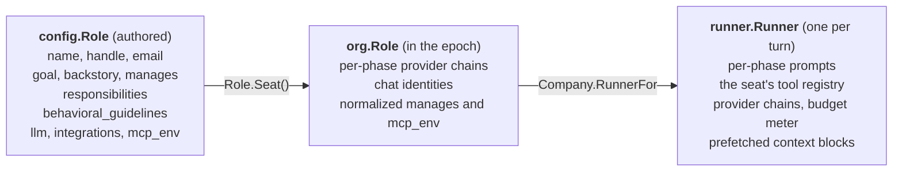
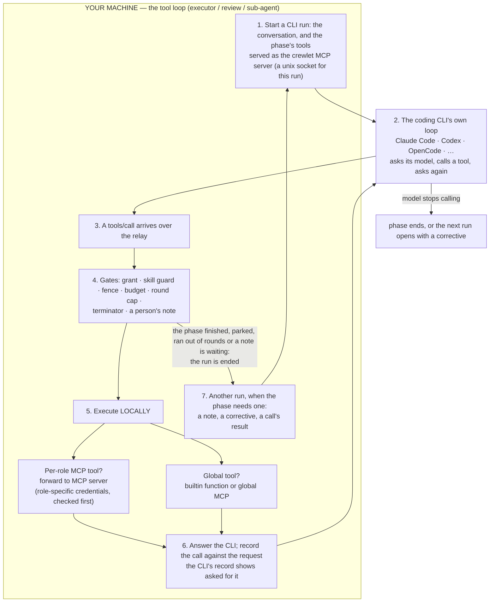
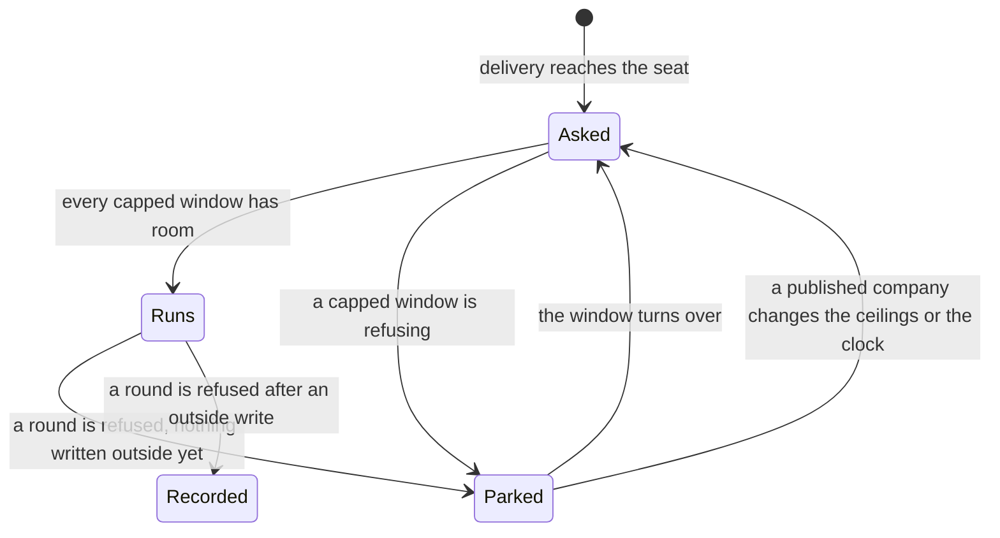
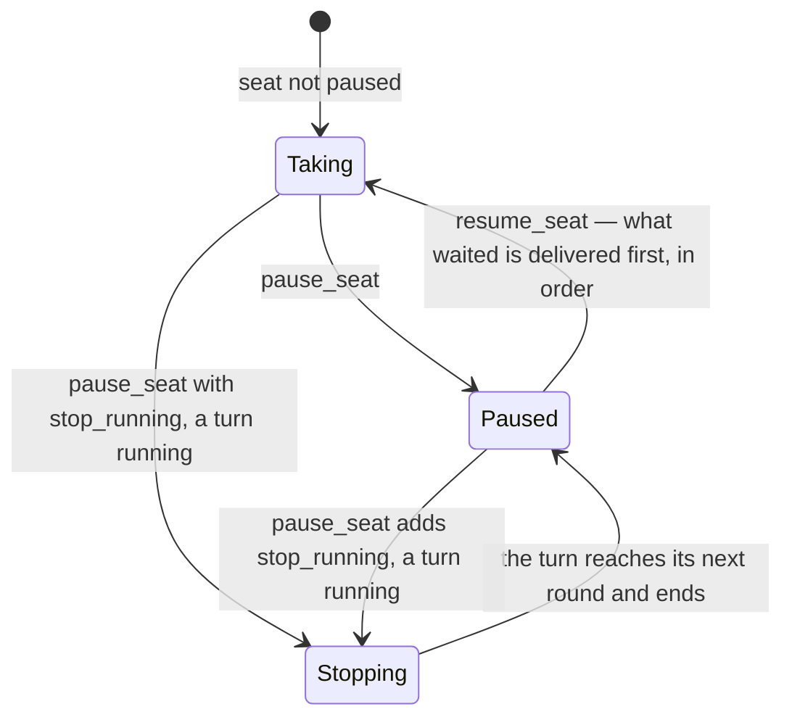
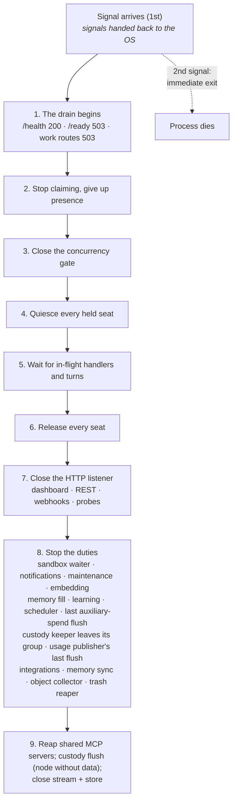

# Agent Runtime

The agent runtime (`internal/agent`, wired together by `internal/engine`) runs a seat's turns: what wakes a seat, what a turn is handed, and how the process stops without abandoning one.

> **Per-turn execution:** every agent turn runs through the two-stage **Executor and Reviewer** [Turn Engine](turn-engine.md). A seat's inbox partition reaches `engine.Dispatcher.Dispatch`, which screens it (ownership, posture, duplicates, the completion ledger), merges a coalesced conversation, restores the trigger's trace and hands one request to the turn. The turn pins the epoch, builds the seat's runner, runs the onboarding pass when one is due, and then calls `turn.Run`, which owns the rounds: the delegation-depth check, the wall-clock cap, the engine's own delivery check, the stall guard and the iteration cap. The sections below describe the surrounding lifecycle; the turn-engine doc describes what happens inside a turn.

---

## Seat Definition and the Runner

Each **agent seat** (`kind: agent`, the default) is one `roles:` entry, and there is no long-lived agent object behind it. The authored `config.Role` becomes an `org.Role` in the epoch's `Organization`, and every turn builds a fresh **runner** for that seat from the epoch it pinned. [Human seats](humans-in-the-org.md) are never run: they exist in the `Organization` and resolve through the party registry (`notify.Registry`).

**Identity is deterministic.** A seat's agent id is `org.DeriveAgentID(company name, handle)`: a UUIDv5 over `"<company name>:<handle>"` in a fixed namespace (`org.Organization.AgentIDFor` applies it to an agent seat). The same seat in the same company lands on the same UUID across processes, machines and restarts, which is what lets any node address a seat another node is running. A handle is immutable: a document that changes one removes the seat and creates another ([ADR-0013](https://github.com/crewlet/crewlet/blob/main/adr/0013-a-seats-identity-is-derived.md)). The seat's memory is keyed by that id or by the handle itself: `agent_diary` and `agent_onboarding_markers` rows by the agent id; `episodes`, `synthesized_skills` and their versions, and the conversation ledger by the handle; and `counterparty_profiles` by the observing seat's handle and, where the person observed is a colleague, theirs. All of it survives engine restarts.

> **Company-rename caveat.** The company's `name` is the other input to
> the id: changing it gives *every* agent seat a new id at once, and
> what is keyed on the id — each seat's mailbox, its diary, its
> onboarding markers and the memory changelog that carries its rows
> between nodes — is left under the old one. The seats keep working;
> they have simply lost that half of their memory, so settle `name`
> before the company runs. Nothing pins it.



For a seat with direct reports, the executor prompt includes a **team roster**: each report's name and handle with a compact profile (background, goal, responsibilities), rendered from the in-memory `Organization` so the lead can reason about who to assign work to.

---

## Agent States

The engine keeps no per-seat state machine in the turn path. What a seat is doing is computed by the live projection (`internal/api/livestate`) that every node serving the API holds, and it is served as **one word per seat** — `activity` — on every seat row: the handshake snapshot's, [`GET /agents`](../reference/api-endpoints.md#what-the-handshake-snapshot-carries) and every `agents` push. The dashboard maps the word to a colour and a label and derives nothing itself, so no two screens can disagree about a seat.

| `activity` | When | `stopped_reason` |
|---|---|---|
| `working` | A turn is running on the seat (from `agent_turn_started`, so the prefetch counts as work), or a [coding run](code-sandbox.md) it launched is `launching` or `running`. | `null` |
| `needs` | A coding run the seat launched is waiting on a person: `awaiting_clarification`, or `reseed` (the box was reclaimed and only the question survives). | `null` |
| `stopped` | The seat cannot take work. | `paused`, `unplaced`, `budget` or `provider` |
| `idle` | None of the above: the seat is held somewhere in the fleet and waiting for work. | `null` |

The rows are checked **in that order**, and the order is the rule. A seat whose turn is still running is `working` even while a person's pause waits for that turn to end, or while an older run of its waits on a question: what it is doing now is the truer word, and `paused` and the running-runs panel say the rest. The one turn that does not make a seat `working` is the probe of a seat parked on its models' limit (`provider`, below): the seat is still waiting for the limit, and drawing each probe as work would make it blink at every one.

The four reasons a seat is `stopped`, in the order they are stated when more than one holds:

- **`paused`** — a person [paused the seat](#pausing-a-seat). Its mail waits on its inbox until somebody resumes it.
- **`unplaced`** — no node in the fleet holds the seat's lease, so nothing will run it however much mail it has. This is read from the **seat leases** (the same table [`fleet`](../reference/api-endpoints.md#fleet-sandbox-runs--schedules) reads), never from which seats the node serving the dashboard runs: a seat a peer holds is placed and reads `idle` or `working` like any other. The leases are read on every snapshot and on the dashboard's five-second tick, because a seat moves between nodes on a lease and publishes nothing. A read that fails changes nothing, and before the first read no seat is called unplaced — "no node holds it" is a fact about a lease table somebody read.
- **`budget`** — a capped token window the seat is charged against, its own or the company's, is refusing: the seat is [parked](#the-budget-park) until the window resets or the ceiling is raised. Read from the live meter's per-window `state`, and only while that window lasts.
- **`provider`**: every model of the seat's chain is at its usage limit, and the engine has [parked the seat](llm-backends.md#falling-back-between-entries) until the first is tried again (`seat_provider_parked`). It clears when a phase completes through the seat's models (the limit has lifted), when the park is released for another reason (`seat_provider_released`: the company's models changed, or the node gave the seat up), or when a new instance of the seat is spawned. The seat's `provider_limit` says which entries, the CLI the limited one drives and whether it signs in on a plan (`cli`, `subscription`), whether the seat waits or runs on a fallback (`parked`, `running_on`), and when the vendor said the limit lifts (`resets_at`, null where it did not say). A chain that merely failed (`llm_unavailable`) is not a stop: nothing says that failure lasts, and it is the seat's `last_error`.

**How much a seat has done is a different question, with a different source.** The state is the projection's, and describes now; a seat's turns over days — how many ended, how many failed, what share a reviewer approved on the first pass, how long they take — are summed from every data node's replicated usage days by [`seat_activity`](../reference/api-endpoints.md#queries), so they are the same on whichever node is asked and still count a node that has left.

**A failed last turn is not a stop.** A turn guard that fired (stall, max iterations, the delegation-depth cap, a scheduled turn's wall-clock cap, an unhandled exception) fails that turn, and the seat takes its next wake like any other: it reads `idle`, and why its last turn failed is `last_error` and `last_turn.outcome`, which are separate fields.

**The runs are read from the durable record**, not from the turn's stage. A turn that launched a detached coding run is `parked`, and a park says only that a run was launched; the run record — reconciled into the projection at boot and every thirty seconds, and never aged out — says whether that run is still running, has stopped to ask somebody, or is gone. A run parked on a question for thirteen hours is exactly the seat a person most needs to see, and it reads `needs` for as long as it waits.

Beside the state, the projection holds **the turn the seat is on** and **the last turn it ended**. Both are on every seat row of the `agents` push:

- `turn` is `{turn_id, work_item, work_item_basis, started_at, stage, node}`. `stage` is one of three values. `context` means the turn has started and is assembling what it knows. `phase` means a phase is running. `parked` means the turn launched a detached [coding run](code-sandbox.md) and is suspended until the run is collected. The run is collected later, possibly on another node or after a restart, and the same turn resumes then. A parked turn therefore stays the seat's turn, and it is not reported as an end. The suspension publishes a turn completion with `suspended: true`, and the projection used to read that completion as the end of the turn, so the seat said it was idle while its work ran on in a box. When a parked turn resumes, its `started_at` is still the turn's first start and not the segment's. `node` is the node that published the turn's newest event. A turn whose coding run is lost (`sandbox_run_failed`) has nothing left to resume it, so the loss ends that turn.
- `last_turn` is `{turn_id, ended_at, outcome}`. `outcome` is `completed` or `failed`, and a turn is `failed` when any of its events was a failure. That is the same rule the turn list applies, so a seat seeded from the store and a seat watched live report the same outcome. `ended_at` is the turn's newest event: its completion, or the reflection pass that runs after the completion.

A third key says whether a person has **paused** the seat: `paused` is `{by, by_kind, operator_id, at, reason, stop_running}` — who paused it (`by`: the seat of the person who did, or of a token or service account the identity directory binds to one, and otherwise the whole login of the credential bound to no seat; `by_kind` says which, `human` or `operator`, and `operator_id` is the credential they came through, such as `session:<lineage>` or `pat:<id>`, absent when none made it), when, why, and whether the pause also ended the turn the seat was on — and `null` while nobody has. It is an input to the seat's state: a paused seat reads `stopped` with `stopped_reason: "paused"` once it is not working. See [Pausing a seat](#pausing-a-seat).

`activity`, `stopped_reason`, `turn`, `last_turn` and `paused` are always present, and each of the last four is `null` when it has no value. The client merges each pushed row over the row it holds, so an omitted key would leave a finished turn, or a lifted stop, on the card. After a restart, the turns are seeded from the fleet's turn list: each seat's newest turns are read from every live data node — where every node's events are kept, a node without `data` having its own in one data node's [custody](../guides/deployment.md#custody-the-rows-of-a-node-without-data) — so the "last turn 24m ago" line survives a restart, and so does a turn that is still parked.

How a seat comes to be held, and what happens when it is released, is [Seat Ownership](seat-ownership.md).

---

## Agent Execution Loop

Each agent, when triggered (by event or task assignment), executes a **turn** through the two-stage [Turn Engine](turn-engine.md):

```
1. Collect context (task, knowledge, trigger event, delegation chain),
   and derive from the trigger WHO IS WAITING for this turn and WHICH
   WORK ITEM it is on (the trigger's, a colleague's ask's, or a parked
   run's) — announced on agent_turn_started before the prefetch

2. Executor phase
   ├── Tool surface = every first-party tool except mark_onboarded —
   │     and run_sandbox unless the seat's gate is enabled and the
   │     executor is not in box mode — plus submit_work,
   │     activate_tool, list_mcp_server_tools. A tool left out is out
   │     of reach too, and activate_tool cannot reach it
   ├── The system prompt lists no tool the surface holds — each one's
   │     definition rides every request — only the MCP SERVER names
   │     to discover, never the 50-150 MCP tool schemas
   ├── To use an MCP tool: list_mcp_server_tools(server) to discover
   │     names, then activate_tool(name) to make it callable from the
   │     next round. Nothing is named in advance, so nothing has to be
   │     reconciled afterwards.
   └── Ends by calling submit_work: outcome, summary, deliveries,
         checked against the engine's own record of the turn — every
         round of it, so a delivery an earlier round made is citable.
         A round that ends in prose instead is not an end: the loop
         asks again, naming submit_work, at most twice in a row, before
         the phase is rescued as incomplete

3. Engine check (no model call), over the whole turn's record
   ├── no_action nobody asked for and nothing acted on -> the turn ends
   └── a claim the record refutes -> loop back with a correction
         naming the tools that deliver where the asker is waiting

4. Reviewer phase
   ├── submit_review emits a decision
   └── done | self_iterate (loop back, carrying the prior-work ledger
         so the next round does only the gap) | failed

5. Publish agent_turn_completed and turn_completed; reflection consumes the latter.
   A turn nothing named an item for is charged here to the one task its
   writes committed to, if there was exactly one
```

Every turn is charged to **one work item or to none** — see [Which work a turn is on](turn-engine.md#which-work-a-turn-is-on).

The executor and the reviewer can run on different LLM models — see the [Turn Engine](turn-engine.md#per-phase-llm-models) doc.

---

## The LLM ↔ Tool Proxy

The LLM is reached through a coding CLI the engine drives as a process, and the CLI runs its own loop: it asks its model, calls tools, and asks again. In host mode its own tools are denied — all but the web — and it cannot reach MCP servers or engine internals directly. What it can call is the phase's tool surface, which the shared tool loop (`internal/agent/toolloop`, driven by each phase of the [Turn Engine](turn-engine.md)) serves to it as **one MCP server**, `crewlet`, for the length of each CLI run. The loop is the **proxy**: every call the CLI makes arrives there, passes the phase's gates, and is executed locally:



No tool rides the prompt and no call is read out of the model's prose: the CLI calls the seat's tools natively, the way it calls any tool, and the CLI's own record — its output stream or a session file — tells the loop what each model request said, asked for and cost. A round is one such request. Each records **why the model stopped** — an answer (`end`), calls to run (`tool_use`), or the CLI's own turn cap (`cap`) — and a tool call whose arguments did not parse is answered with a failed result saying why rather than run with none. See [How a round ends](turn-engine.md#how-a-round-ends) and, for the route, the relay and every gate, [Tool calls in host mode](llm-backends.md#tool-calls-in-host-mode).

Both builtin and MCP tools produce identical tool definition schemas. From the LLM's perspective, `lookup_colleague` (builtin) and an MCP server's issue-creation tool look the same: two tools of the one `crewlet` server its CLI lists.

---

## System Prompts (per phase)

Under the two-stage [Turn Engine](turn-engine.md), each phase builds its own narrow system prompt — there is no single monolithic prompt for a turn. Each builder lives in `internal/agent/prompts/`; the detail layer is in `internal/agent/prompts/sections.go`. Founder-defined role/org context (mission, vision, policies, backstory, responsibilities, behavioral guidelines, team roster) renders **directly from the in-memory `Organization` model into the executor's prompt** via the section builders — no DB seed step, no reconcile pass.

| Phase | What's in the prompt |
|---|---|
| **Executor** | Identity (role, unit, goal, manager, direct reports, team channel), company mission and vision, full policy text, role profile (backstory, responsibilities, behavioral guidelines), unit context (purpose, goals), team roster with per-member profile (leads only), the `## Human colleagues` note (only in a company with human seats), the executor's contract, ``## When a decision is not yours to make`` (the escalation guidance below; only when the seat holds `comment_on_work_item`), ``## Text somebody else wrote`` (the one sentence that says how to read a fence; see [text somebody else wrote](#text-somebody-else-wrote) below), ``## Sandbox code work`` (only when the seat is offered `run_sandbox`), ``## Your workers`` (the seat's `workers:` templates, one line each; only when it holds `delegate`), [Tool Skills](tool-skills.md) **catalogue** (one-line summary per triggered skill), ``## Tools to discover`` (MCP server names, their tool names hidden behind ``list_mcp_server_tools``; no first-party tool, since every one is offered from the first round with its whole definition). Plus ``## The thread so far``, the chat thread the turn was woken in, read at turn start and handed over rather than left for the agent to fetch (see [the thread block](#the-thread-a-turn-was-woken-in) below); it is not a learning prefetch but the trigger's own context, which is why it leads. Then the five learning prefetches, in the order they render: ``## Personal memory`` (diary), ``## Synthesized skills you've learned``, ``## Relevant knowledge`` (a knowledge-base search built from the trigger), ``## Similar prior work`` (episodes), and ``## Known counterparty``. A first turn's onboarding is not among them: it is [a pass of its own](turn-engine.md#first-turn-onboarding) that runs before the executor, which never reaches `mark_onboarded` and is not told to onboard. On rounds after the first, the user message also carries the [prior-work ledger](turn-engine.md#prior-work-ledger-across-self_iterate-rounds) as ``## Already done earlier in this turn``. |
| **Review** | One-line identity, the rules that decide its decision (what each decision means is `submit_review`'s schema; the rule for judging a sandbox run renders only where the executor was offered `run_sandbox`, and `a2a_ask` is named only where the seat holds it), the round's own account of what it set out to do, the outcome word (and who wrote it), the verbatim tool log, the text it produced, and the [Tool Skills](tool-skills.md) catalogue for MCP-server-keyed skills (operator-scoped to the review phase). On rounds after the first, a `## Earlier rounds (already delivered)` section carries the [prior-work ledger](turn-engine.md#prior-work-ledger-across-self_iterate-rounds) so the duplicate-delivery rule holds turn-wide. No tool catalogue, no policies, no roster, no prefetch. |
| **Worker** (`delegate`) | The worker's persona (a `workers:` template or the parent's inline prompt), the [Tool Skills](tool-skills.md) catalogue scoped to the tools the worker was granted, ``## Tools to discover`` (what it can reach and was not granted, for a worker that can discover), then the mandated runtime rules (no further delegation, no colleague contact, no write to a shared surface, how to discover where there is something to, the same sentence about fenced text the executor carries, and end by calling `submit_result`, whose own description says only its fields are passed back). |

Why the split: the executor is the frame making every ownership / delegation / policy-sensitive decision AND acting on it, so it gets the whole picture — the two-prompt engine's real cost was never the tokens saved by splitting them, it was sending the identity scaffold twice and throwing away everything the planner had read. The reviewer's question is narrower: is this round's work right, given what the record says it did. Standing memory, the team's docs and the requester's traits are what the executor needed to DO the work; in front of a reviewer they compete with the evidence it is meant to judge.

Every builder returns its prompt with an **outline** beside it — the parts it appended, each with a stable key, a title and its length — and the phase record publishes both, so a screen shows a prompt as the parts the engine assembled rather than guessing them from `##` lines that embedded content brings with it. The outline never changes a byte of the prompt. See [a prompt carries its outline](turn-engine.md#what-streams-during-a-turn).

### Built-in engine scaffolding

Engine guardrails (event triage, tool usage, knowledge-system usage) are carried by tool descriptions (`search_knowledge`, colleague-surface tools) and by the executor and review contracts themselves, not by dedicated prompt prose. Each tool's one-line description tells the LLM when to use it; the per-phase contract tells the LLM what output shape is expected.

**Escalation is the one piece of guidance with a section of its own**, ``## When a decision is not yours to make``, rendered right after the executor's contract whenever the seat holds `comment_on_work_item`. It exists because the *shape* of an escalation is the engine's rather than any role's: a question that needs somebody to choose is a [structured ask](../guides/worklet.md#asking-for-a-decision) (the question, two to four options, the one the seat recommends and why, the evidence it looked at, and the role the person is asked in, `approver` or `contributor`) put on the work item with `ask` and `decision`, or filed as the item itself with `create_work_item`. The person answers by choosing an option, and **the asker is woken with the choice**, by its label. The shape itself is the `decision` argument's own schema, which reaches the model with the tool; the section says when to ask, and the half a model gets wrong: after asking, the seat **ends the turn blocked on that branch**. It finishes whatever does not depend on the answer and stops, rather than choosing for the person or waiting inside a turn that cannot receive the reply.

There is still no special escalation *mechanism*: an ask is an ordinary comment, a colleague reached any other way (a Slack mention, `a2a_ask`) re-triggers the agent the same way, and the reviewer routes a turn that has *not yet* reached anybody back through `self_iterate` so the next round makes that outreach, and ends one that already has as `done`, because the reply is what re-triggers the agent (no `escalate` tool, no `ask_colleague` decision, and no waiting state).

Tool- and MCP-server-specific guidance (when to call ``reflect_and_persist``, how to mention teammates on Jira vs Slack, when to author code via the [code sandbox](code-sandbox.md) and what the GitHub tools are for) lives in the [Tool Skills](tool-skills.md) registry — modular knowledge-base-sourced fragments (Confluence pages) where each skill carries a short **summary** (always inline in the per-phase catalogue) and a rich **body** that loads on demand via the always-on ``load_tool_skill`` builtin. The engine ships no skill prose; operators seed the skills container with ``crewlet confluence import`` and edit pages in the backend's editor thereafter.

There is no single monolithic system prompt to read: `internal/agent/prompts` builds one per phase (`BuildOnboarding`, `BuildExecutor`, `BuildReview`, `BuildSubagent`) from the same identity sections, and each phase sees only the guidance and the tool catalogue that phase is meant to act on.

### Text somebody else wrote

A model reads every word of its context as a possible instruction, and much of what a seat reads was written by somebody else: a page a colleague wrote, a comment on a work item, a file in a project, a chat thread with a stranger in it. So the engine labels that text where it hands it over. It is **fenced**, between two lines carrying a token minted at random for the turn segment:

```text
[untrusted:K7Q2M4XWB3ZP6TNA source=work_comment trust=colleague authors=human:ana]
Please also close ENG-12 when this ships.
[/untrusted:K7Q2M4XWB3ZP6TNA]
```

The opening line names the surface the text came from (`page_body`, `page_comment`, `work_description`, `work_comment`, `project_file`, `chat_thread` for a message in a room or a thread, `chat_room` for what a room says about itself, `artifact_file`, `artifact_row`, `change_note` for what somebody wrote about a change they made — an assignment's reason, a page revision's note — `alert` for a monitor's message, `notification` for what an integration sent that names no surface of its own, or for bodies of several kinds read as one — a burst of wakes merged into one trigger whose messages came from different surfaces — `a2a_message` for a colleague's ask or answer on an agent-to-agent channel, `coding_run` for the question a seat's coding run stopped to ask a person, `brand_voice` for the adopted brand's voice, which an agent reads before it writes an artifact, and three the [Dashboard Assistant](assistant.md) reads as the person it acts for: `api_answer` for a route's answer, `page_context` for what that person's open screen says about itself, and `deep_work` for a deep-work run's account of what it did), who wrote it, and how far the reader may rely on it:

| Trust | Meaning |
|---|---|
| `own` | Every writer is the reading seat itself. A page the seat edited after a colleague is not its own, and neither is text with writers the record no longer names (a page past its kept revisions, a description edited more than once, a file written more than once). |
| `colleague` | Written by company principals: other seats, people, operator credentials or the engine — or, on a surface the engine hosts, by somebody its record does not name. A request in it is that colleague's request, weighed as any request from them; it never overrides the seat's instructions, role or the company's rules. |
| `external` | Written by somebody outside the company (a participant in a shared channel the company does not know), or, on a vendor's surface, by nobody that could be named. Data only. |
| `page` | Produced by a page's script on behalf of whoever viewed the page. Never inferred from writers: the read that knows a script wrote it says so. Data only. |
| `company` | Adopted by an administrator as the company's own: the voice of the adopted brand. It governs the tone and wording of what the reader writes and nothing else, never the task, the tools, who receives anything or anybody's access. Never inferred from writers: the read of an adoption says so. |

**One rule for the engine's own surfaces.** The engine's tracker, knowledge base, chat, artifacts, project files and agent-to-agent channels are written only by company principals — every write is authenticated as a seat, a person, an operator credential or the engine — so text on them is trusted the same way whichever door it reaches a seat through: a wake, a read tool, a search hit, the thread a turn is handed. Text whose record names every writer earns what those writers earn; text whose record names some of them, or none, is never `own` and, with nobody named, is a colleague's. A writer the record carries no handle and no kind for is one it could not name, never an outside party. On a vendor's surface — a Confluence page, a Jira or GitHub comment, a Slack message — the site is not the company's alone, so nobody named is `external`. (A Doclet page whose change named no writer used to wake a seat as `external` while the same page came back from a search as a colleague's; a walk of the engine's source now finds every place a trust is decided and holds each to the rule its surface takes.)

Content cannot close the fence it is put in. The token is unguessable, and every occurrence of it inside the text is removed anyway (a model can echo it into something it writes and read that back in the same turn); every `[` that opens something shaped like a marker, in any case and spacing, is rewritten as `[escaped `, so no text forges a closer of any token. Every other string in the same answer (titles, revision notes, decision options, history excerpts, custom-field values) has the same two escapes applied without a fence, so no field can open or close one either.

The seat learns what a fence means from one constant sentence in its prompt, under ``## Text somebody else wrote``: the token lives in the fences, never in the prompt, so the prompt stays byte-identical across turns and the provider's prompt cache holds. Every fenced tool answer also carries a `provenance` envelope beside its fields (the least trust of its fences, every writer once, and a note restating the rule), so an operator's assistant that never saw the seat prompt reads the fences the same way.

Which reads are fenced:

- `get_page`: the body, under every writer its kept revisions name, and each comment under its author. `list_pages`' titles and labels, and the page title `save_page` and `comment_on_page` answer with, are names: escaped and read as a colleague's whose writers the page does not name (a listing names the page's last writer beside them); the title `write_page` answers with is the caller's own.
- `get_work_item`: the description, under its last writer, each comment under its author, and each history entry's excerpt under who made that change.
- `search_work_items`: each hit's snippet, which is the opening of its description, as `work_description` at a colleague's trust with nobody named — only company principals write the tracker, and the index keeps no writer. The titles beside it have the two escapes applied.
- `task_activity` and `work_inbox`: each change's excerpt — the comment, the description or the note it carried — under whoever made the change, as `work_comment`, `work_description` or `change_note` by its kind; an excerpt summing up an answer that chose quotes the asker's option, so it is never the reader's own alone.
- `my_work`: each ask waiting on the seat, under the person who asked it.
- **A tracker listing's names** — a task's title in every listing (`list_work_items`, `my_work`, `search_work_items`, `get_work_item`), a project's name and purpose (`list_projects`, `describe_project`), a view's name and saved filter (`list_work_views`), a file's path (`list_project_files`), a checklist line, what a change moved — are somebody's words too, which no row records the writer of: they have the two escapes applied and the answer's envelope reads them as a colleague's with nobody named, so an answer carrying one is never the reader's own.
- `read_project_file`: text content, under the file's writers. Content read as base64 is not fenced (it is bytes, and its alphabet holds no bracket) but the envelope still labels it.
- `read_channel`: each message of the room or of the thread, under its author and the kind the transcript recorded for them, the engine's own narration as `system`. A deleted message says nothing and is not fenced.
- `search_messages`: each hit's snippet, which is the message itself cut only where it is long, under its author.
- `list_channels`: a room's topic and its purpose, each as `chat_room` — a person sets them, the room keeps no record of which person, and only the company's own principals can, so they read as a colleague's with no author named — and the last thing said in the room under its author. `update_channel`'s answer fences the topic and the purpose it leaves standing the same way, since the call may have set only one of them.
- The [artifact tools](artifacts.md#agents): a version's file under its writers, and every datastore row under its creator and last writer; an artifact's title, description and label, in `list_artifacts` and `get_artifact`, are names read as a colleague's whose writers the head does not name.
- ``## The thread so far``: the messages, as one fence naming every speaker (see below).
- ``## Relevant knowledge`` and `search_knowledge`: the hits — each page's title and snippet — as one fence (`knowledge.Render`), labelled `page_body` at the trust the backend that found them stamped on every hit: the engine's own pages a colleague's with nobody named, since every write there is a company principal's and the index says nothing of which, and a Confluence page `external` with nobody named, since a search result never says one person wrote every word and the site is not the company's alone. The query `search_knowledge` echoes back is the seat's own and has the two escapes applied.
- **The body every wake carries**, on every surface: the one part of the trigger the engine did not write — a chat message, a comment on a work item or a page, the description a task or an issue was filed with, the note an assignment or a page revision carried, a monitor's message, whatever an integration with no prompt of its own sent. The notification service fences it before the surface's prompt renders it, so no prompt can hand a seat somebody's words bare. Its label names the surface it came from and, only where the payload says one person wrote every word of it, who: a comment or a review just written, a message, an issue's or a page's text on the event that created it. An edited comment, a description on any later event and an alert name nobody — the person who assigns an issue did not write its description — and on a vendor's surface read `external`, the direction to err in; on the engine's own tracker, knowledge base and chat, nobody named reads as a colleague's, by the one rule above. A writer whose account a seat holds reads as that colleague, and an engine-hosted record whose writer the chart no longer holds reads as the kind of writer the record says they were — the engine or an operator credential included, which a record names by kind alone. The trigger is built where the delivery is routed, before any turn exists, so it is fenced under a token minted for that wake and recorded on it, and the turn moves those fences onto its own token; a burst of wakes merged into one trigger has every body fenced the same way. Everything else in a wake's trigger, on every surface — a title, a sender's display name, a room's name, a decision's options — has the fence's two escapes applied, so nothing a sender chose opens or closes a fence.
- **What the turn was asked, as the models that judge for it read it.** Before a turn starts, three auxiliary calls decide what the seat is shown: the memory filter picks which of its memories, the knowledge-query writer which pages, and the episode summary writes a briefing of its past work into its prompt (see [Agent Learning](agent-learning.md#salient-body-sourcing)). Each is handed what the turn was asked rather than its trigger, and on most wakes that is somebody else's words, so each reads them fenced exactly as the trigger labels them — the same surface, the same writers, the same trust, a burst of wakes merged into one fence naming every writer at the least trust any of them earns — and the standing sentence is in its system prompt. The fence is under a token minted for that one call, never the turn's, because a model can echo the token it was handed into what it writes and the summary's briefing goes into the seat's prompt; that briefing has the fence's two escapes applied under the turn's token before the seat reads it. What the turn embeds and records as asked is the same text with no fence.
- **What a turn was told, as the post-turn workers read it.** The persist decider, the profiler, the skill synthesizer and the skill refiner run after the turn on the seat's auxiliary model and write facts, traits and skills the seat later reads as its own (see [Agent Learning](agent-learning.md#salient-body-sourcing)). Each reads every inbound message fenced under the label the turn read it under and the ask under the label the turn recorded, under a token minted for that call, with the standing sentence in its system prompt; everything else it is shown — a sender's name, an earlier pass's memories, traits and skills — has the two escapes applied.
- **What a past turn was asked**, wherever a seat recalls its own history: ``## Similar prior work``, the briefing the episode summary writes of it, and `query_episodes`. The episode a turn writes keeps the label its ask was read under (`ask_provenance`), so a stranger's message from a month ago comes back fenced as that stranger's — never as the seat's own memory, which is the voice it trusts most — under the turn's token for the block and the tool and under a token minted for the call for the summary's input. An ask that was the company's own words (a schedule's task) and everything else on the line — what woke the turn, what it did, a compacted row's summary — have the two escapes applied, and all three render a past turn through one function (`learning.RenderPastTurn`).
- **What a seat remembers, wherever it is handed back.** A memory, a counterparty's traits, a synthesized skill and a past turn's account are each what a model wrote after reading other people's words — the post-turn workers read the turn's messages, and the seat wrote its own notes about what it read — so each can carry what it read. ``## Personal memory``, the counterparty profile, the skills menu, `use_skill` and `refresh_memory` have the two escapes applied under the turn's token, as the memory filter's candidates do under its own, so nothing a store holds opens or closes a fence.
- **The sources of an answer, and a phase's task as its judge reads it.** `answer_knowledge` reads every source fenced under a token minted for its call, labelled as the search that found it labels it, and its answer has the two escapes applied (see [Knowledge System](knowledge-system.md#answering-a-question)); the [round-cap extension judge](turn-engine.md#round-cap-extension-judge) reads the task's fences moved off the turn's token onto its own, and the reason it gives is escaped under the turn's token before the seat reads it.
- **A rewrite of any of it.** Where a text is condensed to fit a budget — a long thread's middle, a page an answer reads, a past turn's ask — the seat's auxiliary model reads it inside a fence of a token minted for that rewrite alone, labelled as its caller knows it, with the standing sentence in its system prompt, and its rewrite has the two escapes applied before the caller places it (inside the original's fence, where it goes on standing for those writers).
- `answer_run`: the question the parked coding run stopped to ask, as `coding_run` under the seat whose run asked it — the coding agent writes in the seat's name, and whoever answers it from the dashboard is usually reading through an assistant.
- **A colleague's ask and a colleague's answer** (`a2a_ask`): the other agent's words, fenced as a colleague's — an agent that read an outsider's page can carry what it read into an ask. The question an answer comes back under is the seat's own and has the two escapes applied instead. A schedule's task is the company's own instruction to the seat and is not fenced; it too has the escapes applied, so nothing it says passes for a fence's line.

Which model calls read somebody else's words is not a list anybody keeps: a walk of the engine's source finds every place that builds a model request and fails the build on one that does not name the test holding its fences, or say why it reads nobody's words.

A seat that edits what it read and sends the fence back with it does not store the fence: `save_page`, `write_page`, `create_work_item`, `update_work_item`, `write_project_file`, `post_message`, `reply_in_thread` and `send_dm` take off a fence of the turn's own token that wraps the whole body or content. A fence of any other token, or one quoted inside a longer text, is the writer's to keep — which is every fence on the operator surface, where no turn's token is shared between two calls, so a person's assistant sending a read back has the fence stored with it.

A fence is a model's, never a person's. A write's answer that echoes words somebody else wrote (a room's topic and purpose on `update_channel`, a page's title on `save_page` and `comment_on_page`, a parked run's question on `answer_run`) labels them for whichever model reads it, a seat's in a turn or an assistant's over `/operator/mcp`. The act route and the human write surface answer a person the same receipt with those words as they were stored, with no fence, no escape and no envelope: the labels tell a model how far to believe what it reads, and a person reads the words on their own screen ([ADR-0060](https://github.com/crewlet/crewlet/blob/main/adr/0060-a-caveat-or-a-refusal-is-worded-for-each-reader-and-a-person-is-never-shown-a-models.md)).

Fencing reduces prompt injection; it does not remove it. The structural defences hold whatever a model does: every write a seat makes is still authorized as that seat, so a seat persuaded by a page can do no more than its grants allow.

### The thread a turn was woken in

A chat thread reply is usually thin — "yes", "+1", "what about the other one" — and the thread is the context. The engine used to say so in the prompt and tell the agent to go and read the thread with its chat tools. On a company whose chat tools come from a per-role MCP server that costs **three rounds** before a word is read: `list_mcp_server_tools`, then `activate_tool`, and only then the call, with the tool's schema arriving on the *next* message. An agent that skipped the trip answered the eleven words of trigger text with no idea what the thread was about.

So the engine reads it instead, at turn start, and renders it as ``## The thread so far``. Everything it needs is already on the node: the channel and the thread root are stamped on the trigger's own metadata by the chat parser, and each seat's authenticated client is held by its transport — so **the read is made as that agent**, on that bot's own token and its own channel membership. No new credential, and no new scope: [Mattermost](../integrations/mattermost.md) reads `GET /api/v4/posts/{root}/thread` on the bot token it already holds, and [Slack](../integrations/slack.md) reads `conversations.replies` on the `*:history` scopes the app manifest already requests. The engine's [own chat](chatlet.md) reads the thread through the company's estate as the seat it woke — so a private room answers only its members — and from its **newest** end: the root and as many of the newest replies as one read answers (up to 500), stepping over a deleted one, with any the read leaves out counted rather than walked, so a Chatlet thread never stops short of the message that woke the turn — and, read that deep, its middle is condensed by the block below rather than left out. A node that holds no data reads it from a data node, like every other read its seats make. It is the only thread context a Chatlet wake gets — the message's own record carries none, so one thread is never in a prompt twice.

What lands in the prompt:

- **Oldest first**, with the thread's root always kept — it is what the thread is about — and then the newest messages. The root keeps its place even when there is nothing to render in it: an alert app posts its payload in blocks or attachments and no text at all, a system line is channel bookkeeping, and Mattermost leaves a *deleted* root out of its answer while every reply to it stays. The block then carries one line saying the first message could not be shown, which is the honest alternative to the silent one — dropping it promotes the oldest surviving reply into the root's slot, where every bound protects it and the preamble calls it what the thread is about.
- **Bounded by whole messages, never a cut inside one**: 8000 bytes. A thread within it is handed over whole, however many messages it has. Past it, the root (or the line standing in for it) and the newest messages that fit take three quarters of the room verbatim, and the messages between them are **condensed** into one account by the seat's auxiliary model in the last quarter, marked as a rewrite and with the number of messages it stands for — so the decision made in the middle of a long thread is still in front of the seat. Only where no rewrite can be had are those messages left out, and the block then **says how many it dropped**. The root and the newest message survive however long they are. 8000 is one third of the conversation ledger's 24000-byte budget, because both blocks are frozen into the same system prompt and re-sent on every round of every phase, and the thread must not crowd out the seat's own cross-turn history. It is not configurable. A second bound of 30 messages used to drop everything older whatever its size; with the middle condensed rather than dropped it bounded nothing the bytes do not.
- **Fenced as somebody else's words**: the messages sit inside one [fence](#text-somebody-else-wrote) carrying the segment's token, with every speaker as its authors (the seat itself, a colleague the party registry knows, or, on a vendor's chat, `external` for anybody else — on the engine's own chat a sender the roster no longer names is a colleague nobody named, by [the one rule](#text-somebody-else-wrote) for its surfaces), so a message that spells a closing marker or an instruction to the seat stays a line somebody said. The preamble and the engine's own notices (how many messages were left out, which ones the turn answers) stay outside it, because they are the engine telling the seat how to read the thread.
- **Senders resolved through the party registry**, so a colleague reads as `Tech Lead (lead)` rather than an opaque platform id; a stranger renders as whatever the backend volunteered and then as the raw id, and never as a blank.
- **The seat's own earlier replies marked `**you**`**, resolved by the transport from the identity it learned at connect. On Slack that takes *both* the bot user id and the app id, because a `bot_message` echo of the seat's own post carries the app id and no user id at all.
- **A thread too long to read says so, in place of the claim it would otherwise make.** (The engine's own chat reads the newest end directly, so this is the vendor surfaces' case.) Slack pages `conversations.replies` from the *oldest* end, 100 messages at a time, up to 10 pages — so a thread past ~1000 messages cannot be reached at its newest end at all. The walk keeps the root and the newest of what it did reach rather than the oldest of the thread, and the block then drops its ordinary "the newest messages are what woke you" framing for one that says it stops short and tells the seat to read the rest with its chat tools: on that path the newest message is exactly what is missing, so the ordinary sentence would be guaranteed false. Everything either end dropped is in the count. The page size is 100 rather than the 200 Slack recommends because the client reads at most 1 MiB of a response before decoding it, and 200 messages carrying blocks, attachments or unfurls exceed that — which fails the read outright rather than shortening it. Mattermost has no such bound: `GET /api/v4/posts/{root}/thread` answers the whole thread in one response.

**It says which waiting messages it showed.** A message in the thread that was still waiting for this seat — somebody else's, after the seat's own last reply, before the message that woke the turn — is one the turn answers whether it was woken for it or not, because it answers the thread as the block shows it. That matters when the earlier message's own turn failed: a failed delivery comes back *behind* its conversation's newer mail, so the newer message's turn runs first. The block reports those messages (by the chat backend's own ids — never one a bound dropped, and none at all when the read stopped short or did not reach the trigger), and when the turn completes they are recorded in the [completion ledger](seat-ownership.md#the-completion-ledger) as worked through, so the earlier message is dropped when it comes round instead of being answered a second time, out of order.

**It is best effort, always, and it waits five seconds.** A thread that could not be read — a node in maintenance mode runs no chat transport, a chat instance unreachable at boot leaves the company running without its chat surface, a seat whose token was refused has no client, a channel the bot is not in, a data node serving the engine's own chat that did not answer in time — renders a *different* sentence from a thread that was read and had nothing in it. Five seconds covers a Chatlet read a data node is answering (it may wait up to two seconds for its floor and two for the level before running the query); it does not cover a failover to another data node, which the router gives ten seconds per node, because that is a turn a person is waiting on — the seat is told to read the thread itself instead. "There is nothing earlier" says answer the trigger as it stands; "it could not be read from this node" tells the seat to go and read the thread itself, which is the one case where the old instruction was right. Neither ever fails a turn.

**It does not make the trigger thick.** `RequiresRecon` still gates the three relevance prefetches on a chat thread reply, and deliberately so: that flag describes the trigger *body*, which this block does not change, and those filters judge relevance against the trigger *text* — "+1" is exactly as useless a search query with the thread in the prompt as it was without. The flag is also stored on every past event and read by the dashboard, so flipping its meaning would rewrite what every historical turn claims about itself. The block is reported separately on `prefetch_summary` (`thread_context_hit` / `_bytes` / `_posts` / `_read` / `_stopped_short`). `_hit` and `_bytes` cannot separate the block's states on their own — every path renders non-empty prose — so `_read` says whether a backend answered at all, which is what tells a thread that was read and empty from one the seat was told to go and find, `_posts` says how much was handed over, and `_stopped_short` says the read could not reach the thread's newest message.

---

## Built-in Tools

The engine ships these tools (`internal/agent/builtin`, registered in the epoch's `tools.Registry` with the origin `builtin`). A tool whose dependency is absent is **omitted** rather than registered and broken, so a company without a store, a knowledge backend or a sandbox gets exactly the tools it can serve, and the node logs the list it registered (`builtin_tools_registered`).

| Tool | Registered when | Purpose |
|------|-----------------|---------|
| `lookup_colleague` | always | Resolve any colleague identifier (handle, role name, a human's contact ID) to one seat, case-insensitively, with partial and fuzzy fallbacks; a handle a seat **used to** answer to resolves too, ranked below every live match and above every approximate one; returns the candidate list when more than one seat matches. A seat whose holder the identity directory withholds (suspended, retired or removed) is found by name and handle but shows no accounts, and an id copied from one of them names nobody — see [Humans in the Org Chart](humans-in-the-org.md#a-suspended-holder-is-withdrawn-with-no-configuration-change) |
| `a2a_ask` | the node has a stream and a coordination store | Ask one AI colleague one question. The colleague is woken on its own inbox and answers in its own turn, so the call returns as soon as the question is sent |
| `use_skill` | a learning store | Load one of the seat's own [synthesized skills](agent-learning.md#5-synthesizer-skill-induction) on demand |
| `refine_skill` | a learning store | Replace a synthesized skill's body with a corrected procedure; the previous version is kept |
| `query_episodes` | a learning store | Recall the seat's own past turns: by meaning (`query`), by conversation, or most recent first |
| `refresh_memory` | a learning store | Re-run the personal-memory filter mid-turn with a context hint |
| `reflect_and_persist` | a learning store | Keep a durable fact in the seat's private diary (`kind`: `long`, the default, or `short`) |
| `mark_onboarded` | a learning store | Stamp the seat's onboarding marker after reading the relevant knowledge-base pages (offered to the onboarding pass, not to the executor) |
| `run_sandbox` | `providers.sandbox` is configured | Hand a code task to a coding agent in a [sandbox](code-sandbox.md); the executor suspends until the run reports |
| `load_tool_skill` | the company publishes [Tool Skills](tool-skills.md) | Load the full body of a Tool Skill by exact key (the catalogue carries only the summary). Required skills (the default; `required: false` opts out) must be loaded this way before the tools they cover can be called, and the engine rejects earlier calls with a "load this skill first" error |
| `search_knowledge` | a knowledge backend | Search the company knowledge base on a query the executor writes itself, over the same seam as the turn-start `## Relevant knowledge` prefetch. It is what a seat woken by a bare pointer uses once it knows what the task actually needs: the prefetch's own search is gated off on such a trigger, because a query built from "PR #42 got a comment" matches the wrong pages or none |
| `list_artifacts`, `get_artifact`, `list_dashboard_sources`, `get_artifact_format`, `get_company_brand`, `create_artifact`, `publish_artifact`, `update_artifact`, `share_artifact`, `unshare_artifact`, `upload_artifact_asset`, `create_artifact_folder`, `move_artifact` | the node takes artifact uploads: an object store, a coordination store and the estate router | Read, publish, share and file the company's [artifacts](../guides/tools-and-mcp.md#artifacts): interactive pages, documents and sheets, and read the company's adopted brand. Each is decided on the stored artifact (and a folder on its top-level folder) for the seat and again for whoever woke the turn, and every byte goes through the one publish pipeline |
| `read_artifact_data`, `query_artifact_data`, `write_artifact_data`, `set_artifact_schema` | the same, beside the artifacts tools | Read, ask, write and reshape an artifact's [datastore](../guides/tools-and-mcp.md#artifacts), each row decided by its collection's rules for the seat and for whoever woke the turn, every row fenced as text its writers wrote, and at most 1,000 ops a turn |
| `post_message` | the company runs [Chatlet](chatlet.md) | Say something new in a room, as a top-level message. `@handle` reaches one colleague; writing `@channel` in the text is what addresses the whole room, and the receipt says so back |
| `reply_in_thread` | the company runs Chatlet | Answer a message under its own thread, beside the question. Threads are one level deep — a reply to a reply carries the same root |
| `send_dm` | the company runs Chatlet | Say something privately to one colleague or a few, opening the conversation if it is not open. Never the place for an answer that was asked for in the open |
| `read_channel` | the company runs Chatlet | Read a room, newest first, or one thread in it, oldest first. A seat woken in a thread is handed that thread at turn start ([above](#the-thread-a-turn-was-woken-in)) and reads it here only where that block says it is incomplete; the rest of the room is not handed over |
| `list_channels` | the company runs Chatlet | The rooms this seat is in, most recently active first, with what each is for and the last thing said in it |
| `search_messages` | the company runs Chatlet | Find a message by what it SAYS, ranked across every room this seat may read. `read_channel` is the other half: one room, in order, from a point you name |
| `react_to_message` | the company runs Chatlet | Put one emoji on a message, or take yours back. An acknowledgement and **not** an answer: it wakes nobody, and it does not discharge a reply somebody is waiting for |
| `join_channel` / `leave_channel` | the company runs Chatlet | Move this seat's own membership, and nobody else's. A private room cannot be joined this way, and a unit's own room can be neither joined nor left — its membership is the org chart's, and either gesture would be undone by the next apply |
| `delegate` | per turn, executor only | Hand narrowly-scoped work to one or more short-lived [workers](turn-engine.md#workers), optionally as a dependency graph. Built per turn rather than registered once: it carries that turn's grant (the parent's own live tool set, minus the control tools and anything that writes to a shared surface) and that seat's visible worker templates, so it cannot be a shared registry entry. Absent when the seat's remaining token allowance cannot be read, because delegating with no readable ceiling is delegating with no ceiling |

The phase tools are not in the registry: the runner adds `submit_work`, `activate_tool` and `list_mcp_server_tools` to the executor's surface, `submit_review` to the reviewer's, and `submit_result` plus a discovery pair of its own to a worker's.

Colleague outreach happens through whichever surface the company actually runs. Where that surface is the engine's own, the tools are first-party and registered exactly like the ones above: Chatlet's nine are in this table, and [Worklet](../guides/worklet.md#what-a-seat-can-do)'s and [Doclet](knowledge-system.md)'s are documented with those subsystems. Where it is a vendor's, outreach goes through the upstream MCP tools directly (a chat server's post-message tool, the tracker's comment and update tools, the wiki's comment tool, the code host's review tools; these are examples, not engine-known names). `a2a_ask` is neither: it is the one colleague tool that reaches an agent rather than a surface, and it is narrowly scoped to tight-loop, mechanical sync between agents. Use whichever chat, issue-tracker, wiki or code-host tools your MCP servers expose for any collaboration a human teammate would reasonably want to see. The engine prompts name none of these: they describe the *capability* and the LLM picks the tool from its catalogue (see [Tool Capabilities](tool-capabilities.md)). See [Turn Engine: Colleague-surface tools](turn-engine.md#colleague-surface-tools) for when to use each.

A decision a seat needs from somebody is a structured ask on a work item — `comment_on_work_item` or `create_work_item` with `ask` and `decision` — answered with a `choice` that wakes the asker; how a company decides stays behavioural guidance, see [Decision Framework](decision-framework.md).

### MCP Tools

MCP tools (Jira, Slack, GitHub, and so on) are discovered from the configured MCP servers and registered alongside builtins: a shared server's tools when an epoch is applied, and a `shared: false` server's tools into the seat's own registry when the node acquires that seat's lease. The executor does **not** see every MCP tool name in its system prompt (a role with 50–150 MCP tools would push 15–25 KB of catalogue into every prompt); instead the prompt lists *MCP server names* and the LLM walks the discover-then-activate flow:

1. `list_mcp_server_tools(server)` — returns the `name: description` listing for one server.
2. `activate_tool(name)`: promotes a tool from the catalogue onto the phase's active tool list so the LLM can call it on the next round.

Both meta-tools are available to the executor and to the onboarding pass. A worker cannot use the parent's pair (`activate_tool` and `list_mcp_server_tools` are on the worker denylist, because they would activate tools onto the parent's surface); it gets a pair of its own, bound to its filtered grant, so it can discover and activate only read-only tools the parent could already reach.

Roles with GitHub credentials in `mcp_env.github` get a per-role instance of the [remote GitHub MCP server](https://github.com/github/github-mcp-server) (declared as a `shared: false` `http` entry in `mcp_servers`), giving them the full GitHub toolset for reading/reviewing/tracking code (issues, PRs, repos, code search, actions); code authoring goes through the [code sandbox](code-sandbox.md). See [GitHub Integration](../integrations/github.md).

---

## Agent Registry

There is no pool of agent instances. Three structures answer the questions a pool would:

- **Which seats exist**: the epoch's `Organization`. `Company.Seats()` lists its agent seats for placement; human seats are left out.
- **Which seats this node runs**: the seat host (`internal/seat`), from the leases it holds. A node claims its fair share, attaches each seat's mailbox last, and releases a seat whose role an apply removed. See [Seat Ownership](seat-ownership.md).
- **Who an event is for**: the party registry (`notify.Registry`), rebuilt on every apply, which resolves a handle, a role name, a derived agent id, an email or an external ID on any connected surface. Resolution is derived from the organization, so the node that consumes a delivery can route to a seat it is not running.

A failure is scoped to a turn, not to an instance: a phase that breaks fails that turn (see [Turn Engine](turn-engine.md)), and a seat whose acquire hook fails is released and not re-attempted on that node for one lease TTL, which gives a peer a clear run at it.

Since each agent is a unique individual, there is no load-balancing or role-based routing. Task assignment is a team lead decision, not an engine algorithm.

---

## Execution Model

Agents are **callback-driven**. When a node acquires a seat it attaches a handler to the seat's durable subscription (`agent-{seat-id}`) on its inbox topic (`crewlet.agent.{seat-id}.inbox`), and the queue invokes that handler as messages arrive. There is no per-agent loop to run.

Inbox delivery is **batched per conversation** (see [Event System — Inbox batching](event-system.md#inbox-batching--coalescing)): events that queued up while the agent was busy — or within the configured linger window — are drained together and partitioned by partition key, so ten comments on one Jira issue or Slack thread reach the handler as ONE batch and trigger ONE digest turn instead of ten. Every partition — one event or several — reaches the same dispatcher and runs one [Turn Engine](turn-engine.md) turn; what differs is only the ask it is handed. A single-event partition is handed its own event, and a multi-event one is merged into a single coalesced notification first, so the third-party app's scaffolding renders once and the seat is told to treat the thread as one piece of work.

### Concurrency

The engine runs **genuinely parallel** work within a single process:

- Each delivery is handled in its own goroutine, so seats make progress independently rather than taking turns
- Multiple agents can be in the `Working` state simultaneously
- A **per-node concurrency gate** limits how many agent turns run at once: Tier A's `node.max_concurrent` (default 32)
- A turn takes a slot after the ownership check and before its first model round-trip, and releases it when the turn ends

**What the gate is for, and what already bounds itself.** A seat's mailbox is a durable subscription whose handler runs one batch at a time, so a *seat* is already serial — it never runs two turns at once. What is not bounded is how many seats run at once: that is [placement](seat-ownership.md)'s arithmetic over the company's seat count and the live node count, not a statement about the machine this process is on. A node handed forty seats would open forty simultaneous model round-trips and their tool loops. `max_concurrent` is the knob that says how many the host can actually take.

**A turn past the ceiling waits, in this process.** It is not handed back for the broker to redeliver on the broker's own schedule — for a chat message someone is waiting on, that turns a busy moment into a visible stall. The waiting turn starts the instant a slot frees. The one exception is a drain, below.

**What it does not gate, and why that is not an oversight.** Post-turn [reflection](agent-learning.md) does not take a slot. It does not need one: it consumes `turn_completed` through a single durable subscription whose handler runs one delivery at a time, so a node runs at most one reflection pass at a time however many turns finish at once. Making it compete for turn slots instead would let a backlog of completed turns starve live seats — a company under load would stop answering people in order to finish learning from what it already answered — and the reverse, learning starved indefinitely by traffic, is what the separate consumer group exists to prevent. Auxiliary spend is bounded where it belongs, by the [token budget](../guides/deployment.md), and every learning worker resolves its model through the engine's one auxiliary seam, so that counter sees it and every spend figure records it ([Budgets and spend § Auxiliary spend](../guides/budgets-and-spend.md#auxiliary-spend)).

**Sizing it.** It is per *node*, so a fleet's ceiling is N × the value — see [Scaling Out](scaling.md#what-stays-per-process-deliberately). The default of 32 is above the seat count of a single-node company (the example company runs a handful of seats; a large one runs tens) so it changes nothing for a company running today, while still bounding a node that has been handed far more seats than its host can serve. Raise it on a bigger host; lower it on a satellite running one agent. There is no "unbounded" — `0` means "take the default", and effectively-no-limit is a large number you can see in your config. Note this is a *different* knob from a `providers.llm` entry's own `max_concurrent`, which caps that entry's CLI processes; see [LLM Backends](llm-backends.md).

That is real parallelism rather than one cooperative loop, which is the
single biggest behavioural difference from the engine's first
implementation: anything shared between turns is guarded rather than
safe-by-construction, and the whole suite runs under the race detector for
exactly that reason.

### The budget park

A [token ceiling](../getting-started/configuration.md#token-budgets) is per
calendar window — the day, the ISO week and the month on the company's clock —
so a seat that has run out of room has not run out for good: it has room again
when the window turns over, or as soon as somebody raises the ceiling. The
dispatcher acts on that **before a delivery is claimed**: before the completion
ledger reads it, before it is offered to a parked coding run as an answer
(resuming one charges tokens exactly as a turn does), and before any model is
asked anything.



- **Asked.** The node reads the seat's counters and the company's, in the
  current windows. A window is refusing when it has no room left for a single
  token — and a window that refused a round always has none, because the
  refused round is counted past its ceiling. The refusal stamp is not asked:
  after a ceiling is raised it stays until an admitted charge clears it, and a
  park taken on it would hold the seat back from the very charge that could. A
  counter that cannot be read parks nothing: the turn runs and its own meter,
  which fails closed, is the gate.
- **Parked.** The seat's inbox takes a pause hold (`budget_window`), the
  delivery is **deferred** — handed back unacked, for one of its deliveries,
  with a reason naming the window: `budget: day window 2026-09-23 resets
  2026-09-24T07:00:00Z` — and an alarm is set for the end of the refusing
  window, the one that ends **last** where several refuse, since nothing can run
  before it. `seat_budget_parked` is logged with the scope, the window, its
  figures and the reset. And the park is **recorded as the gate's refusal**:
  the delivery it defers is the turn whose first charge would have been
  refused, so the window's `refused_at` — "last refused" on every screen and
  in `crewlet budgets show` — is stamped on the scope a charge would be refused
  by, the company's before the seat's, exactly as that charge would have
  stamped it. A window a coding run or a background pass filled used to park
  every delivery its seat was sent while reading as one that had refused
  nothing.
- **Released.** At the reset, or at once when a published company changes the
  ceilings of either scope or the company's clock (which moves every window's
  end) — the apply of the revision that changed them — the hold
  is lifted, `seat_budget_park_released` is logged, and the held mail is
  delivered again in order and asked again. A change that lowers a ceiling
  parks it again at the cost of one delivery.
- **Refused mid-flight.** A window that had room when the delivery was claimed
  can run out during the turn. That turn stops with `budget_exhausted` and makes
  no model call after the refusal — its meter holds it, so the next phase, the
  round-cap judge and the turn's other workers are refused before they are sent,
  and the first call it holds in a window is recorded on the counter as the
  gate's refusal, the stamp a refused charge would have written
  ([Turn Engine](turn-engine.md#runtime-invariants), invariant 4) — and the
  seat is parked exactly as above — unless the turn had already written outside
  the engine (an MCP write, a colleague ask, a coding run), in which case the
  trigger is recorded and acked, because running it again after the reset would
  repeat those writes.

**Why a park and not a retry.** Before the park, a wake reaching a spent seat
ran a turn that was refused on its first charge, and a refusal proves nothing
left the engine, so the delivery was NAKed and redelivered — and refused again,
twenty-five times over about ten minutes, until the broker dead-lettered a
perfectly healthy message. A seat that ran out at ten in the morning lost every
message it was sent for the rest of the day.

**Two stops with two owners.** The deferral quiesces the attachment, and that
quiesce is the seat host's: it is resumed on the next lease renew, as every
deferral is. The pause hold is the park's, and it is what keeps the resumed
attachment from being handed anything until the release. So a park costs one
delivery per message, not one per renew, and the release never resumes a
consumer the seat host stopped because it could not prove it owns the seat.

**This node alone agrees on it.** A park is a hold in this process's queue
client and an alarm in its memory, derived from the fleet's shared counters on
every delivery. A restart, or the seat moving to a peer, simply asks the
counters again on the first delivery. It is not an [alarm](../reference/alarms.md):
nothing is wrong with the node when a ceiling does its job.

### Pausing a seat

A person can **pause** a seat — from its profile, from their own assistant
through the operator catalogue, or with `crewlet seats pause` — and resume it
later. While it is paused the seat starts no new turn, its incoming mail waits
on its inbox in order, and its scheduled runs are skipped. The turn it is on
finishes first, unless the pause also asked to **stop** it (`stop_running`), in
which case that turn ends at its next round.

**Who may pause a seat** is the seat's holder — the person the identity
directory binds to it — whoever leads it, or an administrator (`admin`);
resuming it is the same, and neither is ever a seat's to do. No app is asked:
a lead who uses no app still runs their team. Everybody signed in holds a
credential, so "any operator" would let every reader of the board stop any
seat in the company. A refusal names the permission that would have admitted
the caller. See [the authority table](identity-and-access.md#the-sixteen-rules).



- **The pause is one record for the whole company.** It lives in the
  coordination store (`seat_pause`), keyed by the seat's **id**, as its
  mailbox is. It has no age: it ends when somebody resumes
  the seat, or when the seat leaves the company — the apply that
  removes a seat clears its pause. It is written by
  compare-and-set, so two people pausing one seat at once make one change: the
  second is told it was already paused. The writer whose change won publishes
  `seat_paused` or `seat_resumed`, naming the person as every write does
  (`paused_by`, `paused_by_kind`) and the credential they came through
  (`operator_id`).
- **Every node carries it out from its own copy.** Each node watches the
  records and, the moment a pause lands, takes a pause hold (`seat_paused`) on
  the seat's inbox; the resume lifts it and the mail that waited is delivered.
  A node that acquires a paused seat — placement moved it, or its holder
  restarted — takes the hold **before** attaching the seat's mailbox, so the
  mail it has been holding is never the first thing the new holder runs. A
  delivery that races the hold is held and parked by the inbox screening. A
  node that has not yet read the pauses at all (the seconds after a boot) defers
  its deliveries rather than guessing. A store that cannot be reached is not a
  resume: a node keeps the pauses it last read, and a paused seat stays paused.
- **Stop now.** The fence every tool call passes, before it runs and after —
  the same one that stops a turn whose seat moved to another node — also closes
  on a pause that asked to stop, so the turn ends at its next call, never
  between a tool call and its result. What it had not yet done is lost. The trigger is recorded as
  worked and acked, not retried: a person who stopped a turn did not ask for it
  to run again the moment they resume the seat. The turn's completion reads
  `stopped` rather than `failed`, and `agent_turn_stopped` names who stopped it.
  A detached [coding run](code-sandbox.md) is not fenced — it outlives its turn
  by design — but the turn that resumes it is, and ends there with the run.
- **Answers wait too.** An answer to a parked coding run, by chat or by turn,
  is held behind the pause like the seat's other mail: resuming a run is work.
  A chat reply already recorded as a run's answer before the pause waits the
  same way — the coordinator does not retry its resume while the seat is
  paused, and charges the wait to none of the answer's attempts.
- **Scheduled runs are skipped, not queued.** A fire that comes due on a paused
  seat is recorded `skipped_paused` in the dispatch ledger and not sent — a
  standup held behind a week's pause would otherwise run once for every day of
  it. See [Scheduling](scheduling.md).

### Steering a running turn

Short of stopping a turn, a person can **steer** it: send a note that the turn
reads as soon as its tool calls in flight have their answers, and keeps to for
the rest of the turn — from
the live view, or from their own assistant with `steer_turn`. It is the
seat's holder's, its lead's or an administrator's to send, as a pause
is — decided on the turn's seat, which only the node running the turn can
name, so the note asks that node first. The note travels
on an ephemeral scatter to every node; the node running the turn is the one
that answers, and the turn's own record says what became of it
(`agent_turn_steered`: `delivered` at the round that read it, or `expired` when
the turn ended first). A turn whose executor runs as a coding CLI's own loop
cannot take one. See [Turn Engine § Steering a running
turn](turn-engine.md#steering-a-running-turn).

### Graceful shutdown

SIGINT / SIGTERM trigger a **drain with the probes up**, designed so a restart picks up cleanly without a half-finished turn: the node stops taking new work, lets the turns already running finish, hands its seats back, and only then closes its HTTP listener and its backends. The engine owns the process signals exclusively. Nothing else in the process may install a handler, the embedded API server included.

**The listener stays up for the whole drain, and the door is a refusal rather than a closed port.** An orchestrator watches a node precisely while it drains, so `GET /health` keeps answering `200` with `status: "shutting_down"`, and `GET /ready` answers `503` with `reason: "draining"`. Traffic moves elsewhere, and nothing kills the node in the middle of the turns the drain exists to finish. What the drain must not do is keep making work for itself, so from its first moment every route that would start new work answers `503` with `{"error": "draining"}` and a `Retry-After`: the webhook edge, the `/config`, `/secrets` and `/setup` writes, the operator's writes, `POST /operator/mcp` and backups. Reads keep being served, the dashboard included, and so do the sandbox bridge (`/mcp/{token}`) and the telemetry edge (`/otlp/{token}`), because those carry the tool calls and spans of coding runs that started before the drain and would only be broken by a refusal. See [During a drain](../reference/api-endpoints.md#during-a-drain) for the exact rule.



1. **The drain begins.** The engine reports that it is shutting down from this
   moment, before anything that can block: the HTTP surface starts refusing
   new work and both probes report the drain. The watchdog is disarmed, since
   the drain and the teardown legitimately block for longer than it would
   tolerate; no further config revision is applied, because everything one
   would build is about to be torn down; and the stop is announced in the
   audit log (`org_stopped`).
2. **Stop claiming and give up presence**, so peers stop reserving a share of
   the company for a node that will never claim again.
3. **Close the concurrency gate.** Turns still parked at it are released at
   once and their deliveries deferred (left unacked, so a peer picks them up
   rather than waiting out a redelivery timer) instead of starting fresh LLM
   rounds mid-drain. The gate closes *before* the mailboxes quiesce:
   quiescing stops new deliveries, but a turn already delivered and parked
   behind a slot is past that point. **The gate is every road to a turn, not
   only the mailbox's** ([ADR-0063](https://github.com/crewlet/crewlet/blob/main/adr/0063-every-turn-on-a-node-passes-the-nodes-admission.md)):
   a [coding run](code-sandbox.md) that finishes during the drain resumes its
   turn from the seat's control topic, and a person's recorded answer from a
   retry, and both ask the same gate before they claim anything. Refused, the
   completion is deferred to the head of the seat's control topic, which is
   quiesced for the rest of the drain, the run is left unclaimed, and the
   answer stays recorded on its run, so the seat's next holder resumes either
   one. The sandbox waiter keeps running meanwhile, so
   the box stays alive for it.
4. **Quiesce every held seat.** The node stops taking new work while staying
   attached. This is what makes the wait below terminate: without it the
   mailbox keeps feeding this node work for as long as its peers keep
   publishing, and "wait until nothing is running" never comes true.
5. **Wait for in-flight handlers and turns**, indefinitely: running turns
   finish their rounds until both counts hit 0, the deliveries being worked
   and the turns holding a slot of the gate (a retried answer's resume holds a
   slot and no delivery), with `drain_in_progress` logging what is still in
   flight every 10 s. The one stop that does not wait is a node that
   [stopped itself](seat-ownership.md#the-node-whose-broker-is-gone-and-why-it-leaves-too)
   because its own connection to the stream was closed for good: every
   delivery is acknowledged over that connection, so nothing a running turn
   concludes can be, and a peer runs each of them again. That drain ends this
   step at once, cancels the running turns rather than finishing them twice,
   and logs `drain_cut` (see *Watching the drain* below). A turn parked on a
   [detached coding run](code-sandbox.md) is not one of them. It suspended
   when the run detached and its trigger is already recorded as worked, which
   is exactly why coding work is detached: a drain that waited for a real
   coding job would wait for its whole runtime. The run's record lives in the
   fleet's coordination store rather than in this node, so whichever node
   holds the seat next picks it up rather than it being lost with this
   process.
6. **Release every seat**, each lease given back with its mailbox intact, so
   peers can claim them at once rather than waiting out the lease TTL, and
   each seat's last lifecycle event published. The drain then logs
   `drain_complete`.
7. **Close the HTTP listener**, and not before: until now the probes are what
   the orchestrator reads, and they read the stream and the coordination
   store the next steps close. Requests still running get a five-second grace
   and are then cut, the live feed stops, and every dashboard socket is
   closed (`api_stopped`).
8. **Stop the duties**: the sandbox waiter first (its keepalive is what stops
   a running box being reaped while turns are still finishing), then the
   notification transports, the maintenance duties and the embedding duty.
   The memory fill stops beside them — it only embeds, and spends nothing a
   usage day counts, but it reads the store step 9 closes, and the vectors it
   fills ride the memory sync, which stops after it. Then everything that
   writes a row this node's usage day counts: the learning passes and the cron
   scheduler; the auxiliary-spend
   ledger's last records — what the seats' auxiliary model spent since its last
   15-second flush — published on a budget of five seconds once every producer
   of them has stopped, and before a node without `data` flushes its
   [custody](../guides/deployment.md#custody-the-rows-of-a-node-without-data)
   batches in step 9, which carry those records too; and, on a data node, the
   custody keeper, which leaves its group — it stops taking batches, gives one
   in hand up to a second to settle, and detaches, so a batch it did not take
   goes to the data nodes still in the group. Then the
   [usage publisher](../guides/replication.md#two-compacted-domains-the-embeddings-and-each-data-nodes-day),
   which publishes what today and yesterday gained since its last 15-second
   tick on a budget of five seconds, the state log's own resolve budget — after
   every writer above, so a node stopped this way and never started again
   still leaves that day whole, and before the trim and the logs it publishes
   into. Then the integration reconcile loop, memory sync, the object store's
   collector and the trash reaper (every duty loop stops before the node gives
   its duty leases back).
9. **Close the backends**: the shared MCP servers are reaped; a node without
   `data` flushes its custody batches; and the stream connection and the store
   file are closed (`engine_stopped`).

**The stop's coordination shares one allowance.** Every lease the stop gives back — the presence and seat leases of steps 2 and 6, and in step 8 its fleet duties and the integration lease a reconcile pass still in flight gives back as its loop is stopped — draws on ONE allowance of one heartbeat interval: the lease TTL over three, 15 s at the shipped 45 s. A third of it, 5 s there, is reserved for withdrawing the node's admission to a [ceiling change](../guides/retention.md#changing-a-logs-ceiling) in step 8, and no step before it can spend that share: every lease falls back to lapsing on its TTL, but an admission has no TTL, so one that is not withdrawn stays until the node restarts under the same id or an operator excludes it (`admission_not_withdrawn` says which). The leases' two thirds are charged only while one of their round trips is in flight, so the wait of step 5 spends none of it, and seats released together are charged once for the time they overlap. On a healthy fleet each step takes milliseconds and the allowance never binds. On a member that has lost its coordination store — every step failing, each lease falling back to lapsing on its TTL — the stop's give-back costs that one allowance in total, after which every remaining step fails at once with its own `…_unavailable` / `…_not_released` warning. The integration lease is charged only from step 8, where its loop is stopped and the stop waits for the pass in flight — from that moment on, a give-back that began before it included. The loop runs through the drain, so a pass that ends on its own while step 5 waits is an ordinary pass, and its give-back ends on its own client's request timeout rather than spending what the seats are owed when the wait is over. Each step used to wait out a bound of its own, so a member whose coordination store had gone spent the sum of them on deadlines that could not succeed; one that has lost that store alone now stops in about one allowance, 15 s at the shipped TTL.

**The stop's events are not on the allowance.** The `org_stopped` announcement of step 1 and each seat's last `agent_terminated` in step 6 travel on the event stream rather than through the coordination store, and the two are separately replicated streams, so one can lose its quorum alone. Each event is therefore bounded on its own, by the five seconds the stream's client gives a request with no deadline (past it, `lifecycle_event_not_published` or `seat_lifecycle_not_published`, and a live screen ages the seat out), and published beside the give-backs rather than in front of them: the announcement while the drain runs, each seat's event while that seat is torn down — and finished before its lease is given back, so a peer that takes the seat over announces it only after this node has let it go. A stream that will not acknowledge costs the stop those bounds where nothing else is running, and never the time the leases and the admission are owed. The auxiliary-spend flush and the usage publisher's last flush in step 8 and the custody flush of step 9 are not on the allowance either: they carry records rather than give a lease back, and what they cannot publish is lost rather than lapsed, so each keeps the budget of its own named there — and so does the custody keeper's second for a batch in hand, which orders a settle before the usage flush rather than giving anything back.

**A member that has lost both stores can take about 46 s after the drain.** A lone member of an embedded fleet whose peers have gone loses the event stream and the coordination buckets together, so it spends the whole allowance and, wherever nothing overlaps them, every one of those bounds besides: the leases' share of the allowance (10 s at the shipped TTL — spent by the presence give-back in step 2 when the stores were already gone, or by the seats' give-backs in step 6, each after its 5 s last event, when they went during the drain), each seat's last event beside its last memory publish (5 s), the auxiliary-spend flush (5 s), the usage publisher's last flush when its day moved since its last tick (5 s) and the admission's share (5 s) — and up to one second more on a data node whose custody keeper had a batch in hand. Those are the stop's own steps, about 30 s at the shipped TTL — about 25 s, as such a stop was measured before the allowance existed, plus the usage flush. Step 7 adds the listeners: five seconds of grace for each (the public one first when `api.public` is set, then `api.port`), which an open [sandbox bridge](code-sandbox.md) session spends whole, and five more shared by the live projection and the sign-in surface's background writes. So what follows step 5 can take about 46 s — 15 for the seats' last events and give-backs, 15 for the listeners, 16 for the auxiliary-spend, keeper, usage and admission bounds — or about 36 s when the stores were gone before the stop began; a node without `data`, which runs no keeper and no usage publisher but flushes its custody batches in step 9 on a ten-second budget of their own, about 50 s. That is more than Kubernetes' 30 s default grace on its own. And it all comes AFTER step 5, whose wait for the turns still running has no bound of the engine's own, so a grace sized to the longest turn alone still kills such a member before its store closes: give every pod a `terminationGracePeriodSeconds` of at least its longest turn plus 60 s, plus any `preStop` sleep the pod has, since Kubernetes counts the hook inside the grace (see [Probes](../guides/deployment.md#probes)) — and a deployment whose turns finish in seconds the same 60 s.

**Let LLMs finish their rounds — but only the running ones.** The drain distinguishes two kinds of in-flight turn. Turns already past the concurrency gate (model rounds under way) run to completion: they may have fired side effects, and abandoning that work buys a faster deploy by throwing away what was nearly done. Turns delivered before the quiesce but still *waiting* for a slot abort immediately — they have called no model and fired nothing, so their trigger is simply deferred. Without this split, a backlog parked behind `max_concurrent` would run full multi-minute executor → reviewer turns one after another during a shutdown that waits for them indefinitely.

**No engine-level timeout on the drain.** On a signal, step 5 waits as long as in-flight turns need, and the listener stays up for all of it. We don't try to second-guess "too long", because the host already provides that cutoff:

- **Interactive:** a second Ctrl+C tells us you're done waiting — the first, on a drain the node started itself.
- **Kubernetes:** `terminationGracePeriodSeconds` (default 30 s) — after which the kubelet sends SIGKILL. The default is never enough: set it to your longest turn plus 60 s, plus any `preStop` sleep.
- **systemd:** `TimeoutStopSec` (default 90 s) — same SIGKILL fallback. The default covers turns up to 30 s; raise it to your longest turn plus 60 s once turns run longer.
- **Docker / Compose:** `docker stop -t`, `docker run --stop-timeout`, or Compose's `stop_grace_period` (default 10 s) — same SIGKILL fallback, and too short for any turn: set it to your longest turn plus 60 s.

Embedding our own grace window would duplicate that decision in two places and inevitably disagree. Size the orchestrator's grace period to at least your longest turn plus 60 s (a multi-tool executor → reviewer turn can comfortably take 2–5 minutes): the drain needs the longest turn, and what follows it needs up to about 50 s on a node that has lost both its stores (see "A member that has lost both stores" above, and [Probes](../guides/deployment.md#probes)).

**Force stop (second signal).** The first signal *hands the signals back to
the operating system* the moment it arrives, before the drain begins, so a
second SIGINT or SIGTERM does what it always does: the process dies
immediately, with no cleanup. A second press that lands while the hand-back is
under way is raised again once it is done rather than lost. That holds from
the first moment of `crewlet run`, while the node is still booting as much as
while it drains, because a boot can wait unboundedly too.

A process started with **SIGINT ignored** is the one exception, and it still
ends on the second press. A background job of a non-interactive shell
(`crewlet run &` in a script) starts that way, and so does anything a parent
that ignored SIGINT starts. The first SIGINT is caught and drains the node
like any other, but there is no default to hand SIGINT back to: the process
inherited "ignore", and handing back restores that. So the engine keeps its
own SIGINT handler past the first signal, and the second SIGINT exits the
process at once, with no cleanup, with status **130** (128 plus SIGINT's
number). That is the status a shell reports for a process SIGINT killed, so
`$?` and `wait` read the two the same, while a supervisor that tells an exit
from a kill sees an exit with 130 instead of the SIGINT. SIGTERM is not
affected: the runtime handles SIGTERM itself whatever the process inherited,
so a second SIGTERM always kills.
A boot that fails once the engine is up runs the same drain. An embedded
broker that is still recovering a large store cannot be interrupted, so a
first Ctrl+C during that recovery waits for it to finish (the log says
`embedded_start_cancel_waits`) before the boot gives up. The listener is
already bound by then, and from the first signal it answers a drain's answers
as far as a starting node can — `/health` `status: "shutting_down"`, still
`503` while it recovers and `200` after, `/ready` `reason: "draining"`, and
every route it would have served `503 draining` — until the boot gives up and
closes it (see
[While a node is starting](../reference/api-endpoints.md#while-a-node-is-starting)). The handover is what
makes those unbounded waits safe to offer. Without it the engine would still
be the installed handler, every further press would be swallowed, and an
operator watching a drain or a slow boot from the terminal they started it in
would have no way to abort it short of SIGKILL from somewhere else. A node
that [stops itself](seat-ownership.md#the-node-whose-broker-is-gone-and-why-it-leaves-too)
(`engine_fatal`) has had no first signal, so it hands the signals back as its
drain starts, and the FIRST SIGINT or SIGTERM during that drain is the one
that exits at once; its `engine_draining` hint says so, naming `an interrupt`
rather than `a second interrupt`.

A turn killed that way leaves its trigger **unacknowledged** rather than
NAK'd, because nothing gets to run. The broker redelivers it once its ack
window elapses, so the work is not lost — it is just slower to come back
than after a graceful drain, where each finished turn acks normally and
each turn still parked at the concurrency gate is deferred, so a peer takes
it straight over. A redelivered turn runs from scratch, and side effects the
killed turn already fired (a chat post, a work-item comment) may
duplicate — the [completion ledger](seat-ownership.md#the-completion-ledger)
covers a turn that *finished*, and this one did not. That is the trade-off
you opted into by sending the second signal.

**Watching the drain.** On the dashboard and over the API, for as long as it lasts: the listener closes only once the drain has completed, so the dashboard shows the node as draining with its in-flight count, `GET /health` reports it, and `GET /ready` names the reason. The log says the same and outlives the process: `engine_draining` on the first signal, with what is being waited for and how to stop waiting, then `drain_in_progress` with the in-flight count every 10 seconds, then `drain_complete`, `api_stopped` and `engine_stopped`. Set [`logging.file`](../guides/deployment.md#the-log-file) if you want that record to survive the terminal it was watched in: the file is closed last of everything, after the drain and after the trace flush, so `engine_stopped` is in it. A node that [stops itself](seat-ownership.md#the-node-whose-broker-is-gone-and-why-it-leaves-too) because its broker connection is gone takes the same drain with no signal behind it: `engine_fatal` comes first, naming the cause, then the same lines in the same order, and it exits with status 1. One thing differs when the connection it lost is the **queue's own**: no turn still running can be acknowledged over it, so a peer will run each of them again, and the drain does not wait for them — it cancels them and ends at once, logging `drain_cut` with the in-flight count it stopped waiting for before `drain_complete`. When only the coordination store's connection was lost, acknowledgements still land and the drain waits as above.

A node's drain is reported **by that node**: its own probes, its own dashboard and its own log. It gives up its presence at step 2, so a peer's **Settings › Nodes** screen stops listing it rather than showing it draining. On a split deployment a `-roles data,ingress` node drains the same way; it holds no seats and runs no turns, so its drain is short.

The drain is available programmatically up to the moment the listener closes:

- `Engine.ShuttingDown`: `true` from the first moment of the drain and never `false` again. The HTTP surface refuses work on it and both probes report it.
- `GET /health`: `200` throughout, with `status: "shutting_down"`, `shutting_down: true` and the in-flight count as `in_flight`.
- `GET /ready`: `503` throughout, with `draining: true` and `reason: "draining"`.

Per-agent visibility is finer-grained: each working agent's row carries `current_phase` (`onboarding`, `execute`, `review`, or `subagent` for a worker) plus the round number, derived from the `agent_phase_started` events the runner publishes at the top of each phase.
