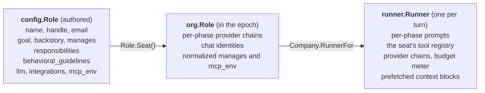
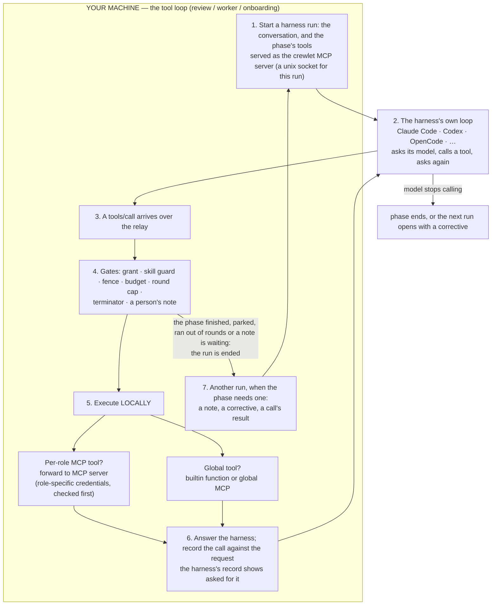
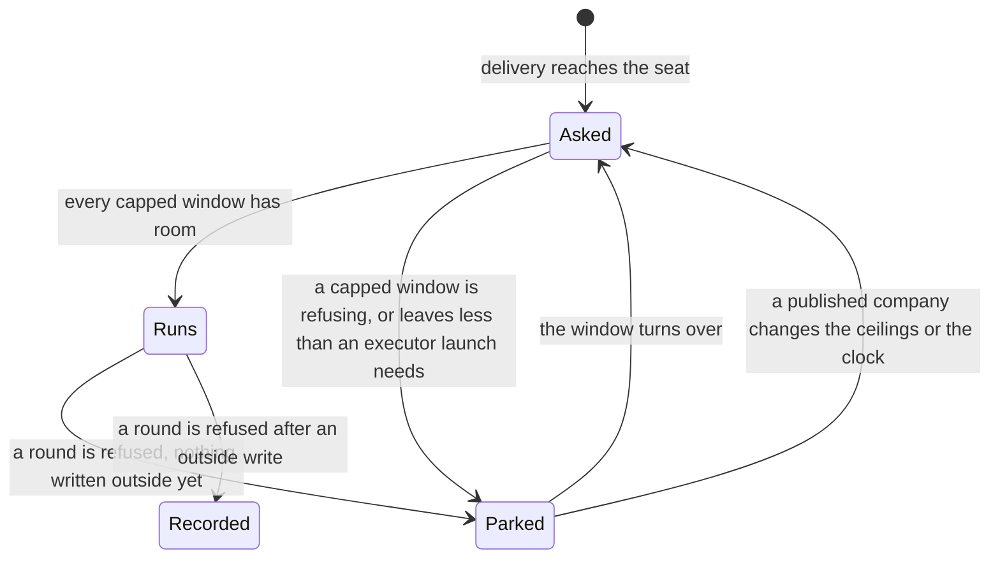
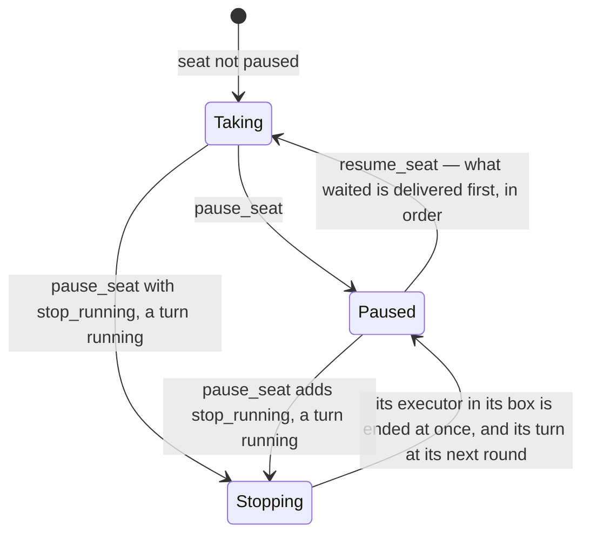
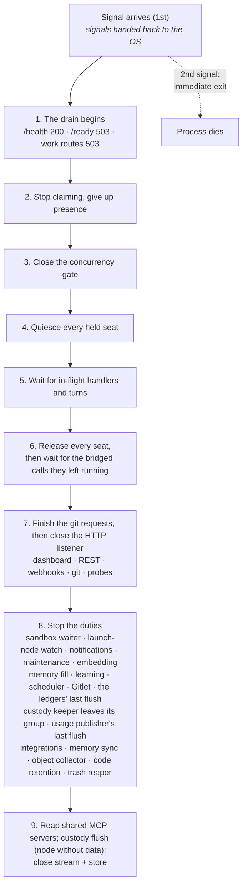

# Agent Runtime

The agent runtime (`internal/agent`, wired together by `internal/engine`) runs a seat's turns: what wakes a seat, what a turn is handed, and how the process stops without abandoning one.

> **Per-turn execution:** every agent turn runs through the two-stage **Executor and Reviewer** [Turn Engine](turn-engine.md). A seat's inbox partition reaches `engine.Dispatcher.Dispatch`, which screens it (ownership, posture, duplicates, the completion ledger), merges a coalesced conversation, restores the trigger's trace and hands one request to the turn. The turn pins the epoch, builds the seat's runner, runs the onboarding pass when one is due, then calls `turn.Run`, which owns the rounds: the delegation-depth check, the wall-clock cap, the engine's own delivery check, the stall guard and the iteration cap. This page describes the surrounding lifecycle; the turn-engine doc describes the inside of a turn.

---

## Seat Definition and the Runner

Each **agent seat** (`kind: agent`, the default) is one `roles:` entry; no long-lived agent object stands behind it. The authored `config.Role` becomes an `org.Role` in the epoch's `Organization`, and every turn builds a fresh **runner** from the epoch it pinned. [Human seats](humans-in-the-org.md) are never run: they exist in the `Organization` and resolve through the party registry (`notify.Registry`).

**Identity is deterministic.** A seat's agent id is `org.DeriveAgentID(company name, handle)`: a UUIDv5 over `"<company name>:<handle>"` in a fixed namespace (`org.Organization.AgentIDFor` applies it to an agent seat). The same seat in the same company gets the same UUID across processes, machines and restarts, so any node can address a seat another node runs. A handle is immutable: a document that changes one removes the seat and creates another ([ADR-0013](https://github.com/crewlet/crewlet/blob/main/adr/0013-a-seats-identity-is-derived.md)). Memory is keyed by the id or the handle: `agent_diary` and `agent_onboarding_markers` rows by agent id; `episodes`, `synthesized_skills` and their versions by handle; `counterparty_profiles` by the observing seat's handle and, where the person observed is a colleague, theirs. All of it survives restarts.

> **Company-rename caveat.** The company's `name` is the other input to
> the id: changing it gives *every* agent seat a new id at once, and
> what is keyed on the id — each seat's mailbox, its diary, its
> onboarding markers and the memory changelog that carries its rows
> between nodes — is left under the old one. The seats keep working;
> they have simply lost that half of their memory, so settle `name`
> before the company runs. Nothing pins it.



A seat with direct reports gets a **team roster** in its executor prompt: each report's name, handle and compact profile (background, goal, responsibilities), rendered from the in-memory `Organization`.

---

## Agent States

The turn path keeps no per-seat state machine. The live projection (`internal/api/livestate`), held by every node serving the API, computes what a seat is doing and serves it as **one word per seat**, `activity`, on every seat row: the handshake snapshot's, [`GET /agents`](../reference/api-endpoints.md#what-the-handshake-snapshot-carries) and every `agents` push. The dashboard maps the word to a colour and label and derives nothing itself.

| `activity` | When | `stopped_reason` |
|---|---|---|
| `working` | A turn is running on the seat (from `agent_turn_started`, so the prefetch counts), or its [executor](code-sandbox.md) is `launching` or `running` in its box. | `null` |
| `needs` | The seat's executor is waiting on a person: `awaiting_clarification`, or `reseed` (the box was reclaimed and only the question survives). | `null` |
| `stopped` | The seat cannot take work. | `paused`, `unplaced`, `budget` or `provider` |
| `idle` | None of the above: the seat is held somewhere in the fleet and waiting for work. | `null` |

Rows are checked **in that order**, and the order is the rule: a seat whose turn is still running is `working` even while a person's pause waits for that turn, or an older run of it waits on a question (`paused` and the running-runs panel say the rest). The one turn that does not make a seat `working` is the probe of a seat parked on its models' limit (`provider`, below), so the seat does not blink at every probe.

A seat is `stopped` for one of four reasons, stated in this order when several hold:

- **`paused`**: a person [paused the seat](#pausing-a-seat). Its mail waits on its inbox until somebody resumes it.
- **`unplaced`**: no node holds the seat's lease, so nothing will run it. Read from the **seat leases** (the table [`fleet`](../reference/api-endpoints.md#fleet-executors--schedules) reads), never from which seats the serving node runs: a seat a peer holds is placed. Leases are read on every snapshot and on the dashboard's five-second tick, because a seat moves on a lease and publishes nothing. A failed read changes nothing, and before the first read no seat is unplaced.
- **`budget`**: a capped token window the seat is charged against, its own or the company's, is refusing; the seat is [parked](#the-budget-park) until the window resets or the ceiling is raised. Read from the live meter's per-window `state`, only while that window lasts.
- **`provider`**: every model of the seat's chain is at its usage limit, and the engine has [parked the seat](llm-backends.md#falling-back-between-entries) until the first is tried again (`seat_provider_parked`). It clears when a phase completes through the seat's models, when the park is released otherwise (`seat_provider_released`: the company's models changed, or the node gave the seat up), or when a new instance of the seat is spawned. The seat's `provider_limit` gives the entries, the harness the limited one drives and whether it signs in on a plan (`harness`, `subscription`), whether the seat waits or runs on a fallback (`parked`, `running_on`), and when the vendor said the limit lifts (`resets_at`, null if unsaid). A chain that merely failed (`llm_unavailable`) is not a stop; it is the seat's `last_error`.

**How much a seat has done has another source.** The state describes now; a seat's turns over days (ended, failed, share a reviewer approved first pass, duration) are summed from every data node's replicated usage days by [`seat_activity`](../reference/api-endpoints.md#queries), so they match on whichever node is asked and still count a node that left.

**A failed last turn is not a stop.** A fired turn guard (stall, max iterations, delegation-depth cap, a scheduled turn's wall-clock cap, an unhandled exception) fails that turn; the seat takes its next wake and reads `idle`. Why the turn failed is `last_error` and `last_turn.outcome`, separate fields.

**Runs are read from the durable record**, not the turn's stage. A turn whose executor launched its detached run is `parked` (every such turn is, while the run works), which says only that a run was launched. The run record, reconciled into the projection at boot and every thirty seconds and never aged out, says whether the run is running, stopped to ask somebody, or gone. A run parked on a question reads `needs` for as long as it waits.

Beside the state, every seat row of the `agents` push holds **the turns the seat is on** and **the last turn it ended**:

- `turns` is a list, oldest first by start, of `{turn_id, work_item, work_item_basis, started_at, stage, node}`: up to the seat's `sandbox.max_concurrent_runs` at once (two by default, at most one per conversation), each read on its own, so one turn's events never order or hide another's. The dashboard lists each running turn as a row of its own, gives a seat's page a card per turn and a Steer per turn, and a seat's one-line state reads its first turn and says how many it is on. `stage` is `context` (assembling what it knows), `phase` (a phase is running) or `parked` (the turn launched its [executor](code-sandbox.md) in its box and is suspended until the launch is collected, possibly on another node or after a restart, when the same turn resumes). A parked turn stays the seat's turn and is not reported as an end: the suspension publishes a turn completion with `suspended: true`, which the projection must not read as the end. Only the turn's own phases move it on: a worker the executor delegated to finishes while the turn is parked, and each launch's own record (`executor_collected`, no phase) is published before the turn resumes, so the seat reads as parked on its executor through both. A resumed turn's `started_at` is the turn's first start. `node` is the node that published the turn's newest event. A launch ended as failed (`executor_failed`) ends the turn; a launch lost with its host (engine restart, box gone) resumes the turn to carry the round on in a fresh launch ([Code Sandbox](code-sandbox.md#durability-completion-and-observability)).
- `last_turn` is `{turn_id, ended_at, outcome}`. `outcome` is `completed`, `failed`, or `stopped` where a person ended it; a turn is `failed` when any of its own events was a failure. A worker's or a round-cap judge's record, nested under the phase that called it, fails only itself (that phase reads the failure as an answer), so it is never the seat's `last_error` either. The turn list applies the same rule, so a seeded seat and a watched seat report the same outcome. `ended_at` is the turn's newest event: its completion, or the reflection pass after it.

A third key, `paused`, says whether a person has paused the seat: `{by, by_kind, operator_id, at, reason, stop_running}`. `by` is the seat of the person who did it, or of a token or service account the identity directory binds to one, otherwise the whole login of the credential bound to no seat; `by_kind` is `human` or `operator`; `operator_id` is the credential used, such as `session:<lineage>` or `pat:<id>`, absent when none; `stop_running` says whether the pause also ended the seat's running work (the turn and its executor in its box). It is `null` while nobody has paused. A paused seat reads `stopped` with `stopped_reason: "paused"` once it is not working. See [Pausing a seat](#pausing-a-seat).

`activity`, `stopped_reason`, `turns`, `last_turn` and `paused` are always present, `turns` as `[]` and each of the others but `activity` as `null` when empty, because the client merges each pushed row over the one it holds and an omitted key would leave a finished turn or a lifted stop on the card. After a restart the turns are seeded from the fleet's turn list: each seat's newest turns are read from every live data node (a node without `data` has its events in one data node's [custody](../guides/deployment.md#custody-the-rows-of-a-node-without-data)), so "last turn 24m ago" and every still-parked turn survive. Each seat's read holds its `sandbox.max_concurrent_runs` turns, one that died mid-flight and its newest ended turn (four at the default of two).

How a seat comes to be held, and what happens when it is released, is [Seat Ownership](seat-ownership.md).

---

## Agent Execution Loop

Each agent, when triggered (by event or task assignment), executes a **turn** through the two-stage [Turn Engine](turn-engine.md):

```
1. Collect context (task, knowledge, trigger event, delegation chain),
   and derive from the trigger WHO IS WAITING for this turn and WHICH
   WORK ITEM it is on (the trigger's, a colleague's ask's, or a parked
   run's) — announced on agent_turn_started before the prefetch

2. Executor phase: the seat's harness's own run, in a box
   ├── Launched detached, from the turn's pinned revision: the turn
   │     PARKS, and the run's collection re-enters this same turn
   │     for steps 3 and 4 (see Code Sandbox)
   ├── Its own shell, editor and checkout, and every MCP server its
   │     own configuration declares; the seat's tools reach it over the
   │     tool bridge: the engine's own as one MCP server, crewlet, and
   │     each MCP server the seat holds under the server's own name
   ├── Tool surface = every tool the seat holds, first-party and every
   │     MCP server's, except mark_onboarded and the tools of a server
   │     that runs in its box, plus submit_work. A tool left out is out
   │     of reach
   ├── The system prompt lists no tool: each one's definition reaches
   │     the harness over the bridge, and the harness keeps a large
   │     server's tools out of its requests itself (Claude Code's tool
   │     search, OpenCode's Code Mode), crewlet's always in front of
   │     its model. Nothing is named in advance, so nothing has to be
   │     reconciled afterwards.
   └── Ends by calling submit_work over the bridge: outcome, summary,
         deliveries, checked against the engine's own record of the
         turn — every round of it, so a delivery an earlier round made
         is citable. A run that ends without the call is rescued as
         incomplete

3. Engine check (no model call), over the whole turn's record
   ├── no_action nobody asked for, and nothing changed outside
   │     the engine -> the turn ends
   ├── a claim the record refutes -> loop back with a correction
   │     naming what the turn did and the tools that deliver where
   │     the asker is waiting
   └── a work pickup's turn with no typed answer on its item while
         the item is still the seat's, read off the seat's own rows
         on it since the turn began -> loop back naming the five
         typed answers; a comment alone is none, and an item removed,
         finished or reassigned meanwhile ends the turn as it is

4. Reviewer phase
   ├── submit_review emits a decision
   └── done | self_iterate (loop back, carrying the prior-work ledger
         so the next round does only the gap) | failed

5. Publish agent_turn_completed and turn_completed; reflection consumes the latter.
   A turn nothing named an item for is charged here to the one task its
   writes committed to, if there was exactly one
```

Every turn is charged to **one work item or to none**: see [Which work a turn is on](turn-engine.md#which-work-a-turn-is-on). The executor and reviewer can run on different LLM models: see [Turn Engine](turn-engine.md#per-phase-llm-models).

---

## The LLM ↔ Tool Proxy

The LLM is reached through a harness the engine drives as a process; the harness runs its own loop (ask its model, call tools, ask again). A seat's executor is that loop in a box, with the harness's own shell and editor, reaching the seat's tools over the [tool bridge](llm-backends.md#the-tool-bridge). Every other phase (reviewer, delegated worker, onboarding pass) runs it on this host with the harness's own tools denied, all but the web, so it cannot reach MCP servers or engine internals. It can call only the phase's tool surface, which the shared tool loop (`internal/agent/toolloop`, driven by each of those phases of the [Turn Engine](turn-engine.md)) serves as **one MCP server**, `crewlet`, for each harness run. The loop is the **proxy**: every call arrives there, passes the phase's gates and executes locally. The bridge serves the executor's run the same surface, with the gates a detached run is owed:



No tool rides the prompt and no call is read out of the model's prose: the harness calls the seat's tools natively, and its own record (output stream or session file) tells the loop what each model request said, asked for and cost. A round is one such request. Each records **why the model stopped**: an answer (`end`), calls to run (`tool_use`), or the harness's own turn cap (`cap`). A tool call whose arguments did not parse gets a failed result saying why instead of running with none. See [How a round ends](turn-engine.md#how-a-round-ends) and, for the route, the relay and every gate, [Tool calls on this host](llm-backends.md#tool-calls-on-this-host).

Builtin and MCP tools have identical definition schemas: `lookup_colleague` and an MCP issue-creation tool look alike, both tools of the one `crewlet` server.

---

## System Prompts (per phase)

Under the two-stage [Turn Engine](turn-engine.md) each phase builds its own narrow system prompt; there is no single monolithic prompt. Builders live in `internal/agent/prompts/` (details in `internal/agent/prompts/sections.go`). Founder-defined role and org context (mission, vision, policies, backstory, responsibilities, behavioral guidelines, team roster) renders **directly from the in-memory `Organization` model into the executor's prompt**: no DB seed, no reconcile pass.

| Phase | What's in the prompt |
|---|---|
| **Executor** | Identity (role, unit, goal, manager, direct reports, team channel), company mission and vision, full policy text, role profile (backstory, responsibilities, behavioral guidelines), unit context (purpose, goals), team roster with per-member profile (leads only), the `## Human colleagues` note (only in a company with human seats), the executor's contract, ``## When a decision is not yours to make`` (the escalation guidance below; only when the seat holds `comment_on_work_item`), ``## Text somebody else wrote`` (the one sentence that says how to read a fence; see [text somebody else wrote](#text-somebody-else-wrote) below), ``## Your workers`` (the seat's `workers:` templates, one line each; only when it holds `delegate`), ``## Reading the company's code`` (that a question about the company's code is read on the server with the `code_*` tools, by commit id, never from a clone, and a change's diff, its findings and what changed since a review with `code_get_change`; only when the seat holds the code tools), ``## Searching the company's code`` (that where something is defined, used or mentioned is found with `code_search` across the repositories the seat reads, searched before reading whole trees; only when the seat holds `code_search`), and no [Tool Skills](tool-skills.md) catalogue (the triggered skills are handed to its harness as its own, which lists each to its model; [why](tool-skills.md#the-executors-skills-are-its-harnesss-own)), and no tool list: every tool the seat holds reaches its harness over the bridge with its whole definition, each MCP server's under the server's own name and with what the company says the server is for as its MCP instructions. Plus ``## The thread so far``, the chat thread the turn was woken in, read at turn start and handed over rather than left for the agent to fetch (see [the thread block](#the-thread-a-turn-was-woken-in) below); it is not a learning prefetch but the trigger's own context, which is why it leads. Right after it, ``## Your open questions to them``: the seat's own open asks to the people who triggered the turn (see [your open questions](#your-open-questions-to-the-people-in-the-turn) below). Then ``## Systems in this work``: a few lines on each entry of the company's atlas that what the turn was asked names exactly (see [systems in this work](#systems-in-this-work) below). Then the five learning prefetches, in the order they render: ``## Personal memory`` (diary), ``## Synthesized skills you've learned``, ``## Relevant knowledge`` (a knowledge-base search built from the trigger), ``## Similar prior work`` (episodes), and ``## Known counterparty``. A first turn's onboarding is not among them: it is [a pass of its own](turn-engine.md#first-turn-onboarding) that runs before the executor, which never reaches `mark_onboarded` and is not told to onboard. On rounds after the first, the user message also carries the [prior-work ledger](turn-engine.md#prior-work-ledger-across-self_iterate-rounds) as ``## Already done earlier in this turn``. In the box, this prompt goes on the harness's append channel, followed by ``## Your environment``, ``## When you need a person's answer`` and the report the run writes before it stops ([What a harness is told](code-sandbox.md#what-a-harness-is-told)). |
| **Review** | One-line identity; the rules that decide its decision (what each decision means is `submit_review`'s schema; the rule that the agent ran as a harness with its own shell, whose local work is in no log, renders on every review; `a2a_ask` is named only where the seat holds it); the round's own account of what it set out to do; the outcome word (and who wrote it); the verbatim tool log; the text it produced; and the [Tool Skills](tool-skills.md) catalogue for MCP-server-keyed skills (operator-scoped to the review phase). After the first round, a `## Earlier rounds (already delivered)` section carries the [prior-work ledger](turn-engine.md#prior-work-ledger-across-self_iterate-rounds) so the duplicate-delivery rule holds turn-wide. No tool catalogue, policies, roster or prefetch. |
| **Worker** (`delegate`) | The worker's persona (a `workers:` template or the parent's inline prompt), the [Tool Skills](tool-skills.md) catalogue scoped to the tools the worker was granted, ``## Tools to discover`` (what it can reach and was not granted, for a worker that can discover), then the mandated runtime rules (no further delegation, no colleague contact, no write to a shared surface, how to discover where there is something to, the same sentence about fenced text the executor carries, and end by calling `submit_result`, whose own description says only its fields are passed back). |

Why the split: the executor makes every ownership, delegation and policy decision and acts on it, so it gets the whole picture; the reviewer only judges whether this round's work is right given the record, where standing memory, team docs and the requester's traits would compete with the evidence.

Every builder returns its prompt with an **outline**: the parts it appended, each with a stable key, title and length. The phase record publishes both, so a screen shows the assembled parts rather than guessing from `##` lines; the outline never changes a byte of the prompt. See [a prompt carries its outline](turn-engine.md#what-streams-during-a-turn).

### Built-in engine scaffolding

Engine guardrails (event triage, tool usage, knowledge-system usage) are carried by tool descriptions (`search_knowledge`, colleague-surface tools) and by the executor and review contracts, not by dedicated prompt prose. A tool's one-line description says when to use it; the phase contract says the expected output shape.

**Escalation is the one piece of guidance with a section of its own**, ``## When a decision is not yours to make``, rendered right after the executor's contract whenever the seat holds `comment_on_work_item`. It exists because the *shape* of an escalation is the engine's rather than any role's: a question that needs somebody to choose is a [structured ask](../guides/worklet.md#asking-for-a-decision) (the question, two to four options, the one the seat recommends and why, the evidence it looked at, and the role the person is asked in, `approver` or `contributor`) put on the work item with `ask` and `decision`, or filed as the item itself with `create_work_item`. The person answers by choosing an option, and **the asker is woken with the choice**, by its label. The shape itself is the `decision` argument's own schema, which reaches the model with the tool; the section says when to ask, that **every question the seat puts to a person carries a decision**, a request it would make in words included, since the tools refuse one without it ([ADR-0100](../../adr/0100-a-question-an-agent-puts-to-a-person-offers-options-and-recommends-one.md)), and the half a model gets wrong: after asking, the seat **ends the turn blocked on that branch**. It finishes whatever does not depend on the answer and stops, rather than choosing for the person or waiting inside a turn that cannot receive the reply.

There is no special escalation *mechanism*: an ask is an ordinary comment, and a colleague reached any other way (a Slack mention, `a2a_ask`) re-triggers the agent the same way. The reviewer routes a turn that has *not yet* reached anybody back through `self_iterate` so the next round makes that outreach, and ends one that already has as `done`, because the reply re-triggers the agent (no `escalate` tool, no `ask_colleague` decision, no waiting state).

Tool- and MCP-server-specific guidance (when to call ``reflect_and_persist``, how to mention teammates on Jira vs Slack, how a seat authors code in its own checkout and what the GitHub tools are for — the `mcp:github` and `mcp:gitlab` skills) lives in the [Tool Skills](tool-skills.md) registry — modular knowledge-base-sourced fragments (Confluence pages) where each skill carries a short **summary** (always in front of the model: a catalogue line in a worker's and the reviewer's prompt, the description the executor's harness lists the skill under) and a rich **body** that loads on demand — through the ``load_tool_skill`` builtin, or the executor's harness's own skill tool. The engine ships no skill prose; operators seed the skills container with ``crewlet confluence import`` and edit pages in the backend's editor thereafter.

There is no single system prompt to read: `internal/agent/prompts` builds one per phase (`BuildOnboarding`, `BuildExecutor`, `BuildReview`, `BuildSubagent`) from the same identity sections, and each phase sees only the guidance and tool catalogue it acts on.
### Text somebody else wrote

A model reads all its context as possible instructions, and much of what a seat reads was written by somebody else. So the engine labels that text where it hands it over. It is **fenced**, between two lines carrying a token minted at random for the turn segment:

```text
[untrusted:K7Q2M4XWB3ZP6TNA source=work_comment trust=colleague authors=human:ana]
Please also close ENG-12 when this ships.
[/untrusted:K7Q2M4XWB3ZP6TNA]
```

The opening line names the surface the text came from (`page_body`, `page_comment`, `work_description`, `work_comment`, `project_file`, `chat_thread` for a message in a room or a thread, `chat_room` for what a room says about itself, `artifact_file`, `artifact_row`, `artifact_comment` for a remark in a comment thread on an artifact, `repo_file`, `repo_patch` and `repo_commit` for a file, a patch or a commit's message in one of the company's [repositories](../guides/gitlet.md), which name no writer and are read at external trust, `change_description`, `change_review` and `change_comment` for what is written on a change, `check_log` for what a check of a commit printed, which names no writer and is read at external trust, `server_output` for what a command printed on one of the company's servers through [SSH](../integrations/ssh.md), which names no writer and is read at external trust, `delegated_request` for a request a [delegate](../guides/delegated-decisions.md) decides (an agent's command, its stdin and its reason), which names the requesting seat and is read at external trust, `change_note` for what somebody wrote about a change they made (an assignment's reason, a page revision's note), `alert` for a monitor's message, `notification` for what an integration sent that names no surface of its own, or for bodies of several kinds read as one (a burst of wakes merged into one trigger whose messages came from different surfaces), `a2a_message` for a colleague's ask or answer on an agent-to-agent channel, `executor` for the question a seat's executor stopped to ask a person, or a message one run sent another ([A seat's runs see each other](code-sandbox.md#a-seats-runs-see-each-other)), `executor_session` for what one of a seat's kept executor sessions holds (a past run's transcript, what its turn was asked and how it ended) as the seat reads it back, read at external trust whichever run kept it, `brand_voice` for the adopted brand's voice, which an agent reads before it writes an artifact, `assistant_instructions` for how [Ask Crewlet](../guides/assistant.md#instructions) is asked to write, the company's at company trust and the person's own, `turn_ending` for how one of a conversation's earlier turns ended, as the engine recorded it and tells the conversation's next turn, `atlas` for entries of the company's [atlas](atlas.md) the work names, whose names and values the settings, the engine's records, people, agents and vendors' listings gave, read at the least trust their writers earn, `browser_page` for what a seat's own browser shows it (a page's text, its title and address, what it logged) as its box's browser server hands it over, which names no writer and is read at external trust, and three [Ask Crewlet](assistant.md) reads as the person it acts for: `api_answer` for a route's answer, `page_context` for what that person's open screen says about itself, and `web_page` for a page it read from a host the company lists, read at external trust), who wrote it, and how far the reader may rely on it:

| Trust | Meaning |
|---|---|
| `own` | Every writer is the reading seat itself. Not own: a page the seat edited after a colleague, or text with writers the record no longer names (a page past its kept revisions, a description edited more than once, a file written more than once). |
| `colleague` | Written by company principals (other seats, people, operator credentials, the engine), or, on a surface the engine hosts, by somebody its record does not name. A request in it is that colleague's request, weighed as any request from them; it never overrides the seat's instructions, role or the company's rules. |
| `external` | Written by somebody outside the company (a participant in a shared channel the company does not know), or, on a vendor's surface, by nobody that could be named. Data only. |
| `page` | Produced by a page's script on behalf of whoever viewed the page. Never inferred from writers: the read that knows a script wrote it says so. Data only. |
| `company` | Adopted by an administrator as the company's own: the voice of the adopted brand. It governs the tone and wording of what the reader writes, never the task, tools, recipients or access. Never inferred from writers: the read of an adoption says so. |

**One rule for the engine's own surfaces.** The engine's tracker, knowledge base, chat, artifacts, project files and agent-to-agent channels are written only by company principals (every write is authenticated as a seat, person, operator credential or the engine), so text on them is trusted the same way whichever door it reaches a seat through: a wake, a read tool, a search hit, the thread a turn is handed. Text whose record names every writer earns what those writers earn; text whose record names some or none is never `own`, and with nobody named is a colleague's. A writer the record carries no handle and no kind for is one it could not name, never an outside party. On a vendor's surface (a Confluence page, a Jira or GitHub comment, a Slack message) the site is not the company's alone, so nobody named is `external`. A walk of the engine's source finds every place a trust is decided and holds it to its surface's rule.

Content cannot close the fence it is put in. Every occurrence of the token inside the text is removed (a model can echo it into something it writes and read that back in the same turn), and every `[` that opens something shaped like a marker, in any case and spacing, is rewritten as `[escaped `, so no text forges a closer of any token. Every other string in the same answer (titles, revision notes, decision options, history excerpts, custom-field values) has the same two escapes applied without a fence.

The seat learns what a fence means from one constant sentence in its prompt, under ``## Text somebody else wrote``: the token lives in the fences, never in the prompt, so the prompt stays byte-identical across turns and the provider's prompt cache holds. Every fenced tool answer also carries a `provenance` envelope beside its fields (the least trust of its fences, every writer once, and a note restating the rule), so an operator's assistant that never saw the seat prompt reads the fences the same way.

Which reads are fenced:

- `get_page`: the body, under every writer its kept revisions name, and each comment under its author. `list_pages`' titles and labels, and the page title `save_page` and `comment_on_page` answer with, are names: escaped and read as a colleague's whose writers the page does not name (a listing names the page's last writer beside them). The title `write_page` answers with is the caller's own.
- `get_work_item`: the description under its last writer, each comment under its author, each history entry's excerpt under who made that change.
- `search_work_items`: each hit's snippet (the opening of its description) as `work_description` at a colleague's trust with nobody named, since the index keeps no writer. Titles beside it have the two escapes applied.
- `task_activity` and `work_inbox`: each change's excerpt (comment, description or note) under whoever made the change, as `work_comment`, `work_description` or `change_note` by kind. An excerpt summing up an answer that chose quotes the asker's option, so it is never the reader's own alone.
- `my_work`: each ask waiting on the seat, under the person who asked it.
- **A tracker listing's names**: a task's title in every listing (`list_work_items`, `my_work`, `search_work_items`, `get_work_item`), a project's name and purpose (`list_projects`, `describe_project`), a view's name and saved filter (`list_work_views`), a file's path (`list_project_files`), a checklist line, what a change moved. No row records their writer: they have the two escapes applied and the envelope reads them as a colleague's with nobody named, so an answer carrying one is never the reader's own.
- **Gitlet's names**: a change's title and close reason (`code_list_changes`, `code_get_change`), a finding's title and a resolution's note (`code_get_change`), a repository's description (`code_list_repos`, `code_get_repo`, and every repository write's answer that names it). Two escapes applied; the envelope reads them as a colleague's, a finding's title under its raiser; never the reader's own.
- `read_project_file`: text content under the file's writers. Base64 content is not fenced (bytes, no bracket in its alphabet) but the envelope still labels it.
- `read_channel`: each message of the room or thread under its author and the kind the transcript recorded for them, the engine's own narration as `system`. A deleted message says nothing and is not fenced.
- `search_messages`: each hit's snippet (the message, cut only where long) under its author.
- `list_channels`: a room's topic and purpose, each as `chat_room` (a person sets them, the room keeps no record of which, and only company principals can, so a colleague's with no author named), and the last thing said in the room under its author. `update_channel`'s answer fences the topic and purpose it leaves standing the same way, since the call may have set only one.
- The [artifact tools](artifacts.md#agents): a version's file under its writers, every datastore row under its creator and last writer; an artifact's title, description and label in `list_artifacts` and `get_artifact` are names read as a colleague's whose writers the head does not name.
- `get_artifact`, `read_artifact_data`, `query_artifact_data` and `get_company_brand`, and the live files a stale `publish_artifact` and the current rows a conflicting `write_artifact_data` are answered with: an artifact's file text (`artifact_file`) and its datastore's rows (`artifact_row`), each under its writers, and the adopted brand's voice (`brand_voice`) at trust `company`.
- `list_artifact_comments`: each remark under its author (`artifact_comment`), and the text a thread quotes and the element's source as the page's words (`artifact_file`) naming nobody.
- `code_read`, `code_diff`, `code_log`, `code_blame` and `code_search`: a repository file's lines (`repo_file`; a blame's every line and a search's every hit, one fence a line), a patch (`repo_patch`) and every commit subject a history or blame names (`repo_commit`), at trust `external` naming no writer: a read by commit id knows the bytes, not whose they are, and a repository routinely holds commits authored outside the company.
- `code_get_change`: a change's description (`change_description`) under its owner, at `colleague` at the most once the change has moved past its open (an edit may have rewritten it by somebody its row does not name); a review's summary and a finding's body and suggestion (`change_review`) under the reviewer and the raiser; each comment (`change_comment`) under its author. A patch it reads is fenced as `code_diff`'s is, and its `checks` part fences each check's summary as `code_get_check_failures` does.
- `code_get_check_failures`: what a check of a commit said (its summary, the tail of its output, each failure's message, every page of the log a failed run kept: `check_log`) at trust `external` naming no writer, since it is what the commit's code and tests printed, or what a person's CI sent.
- ``## The thread so far``: the messages, as one fence naming every speaker (see below).
- ``## Relevant knowledge`` and `search_knowledge`: the hits — each page's title and snippet — as one fence (`knowledge.Render`), labelled `page_body` at the trust the backend that found them stamped on every hit: the engine's own pages a colleague's with nobody named, since every write there is a company principal's and the index says nothing of which, and a Confluence page `external` with nobody named, since a search result never says one person wrote every word and the site is not the company's alone. The query `search_knowledge` echoes back is the seat's own and has the two escapes applied.
- ``## Systems in this work``, `atlas_search`, `atlas_get` and `atlas_trace`: entries of the company's [atlas](atlas.md), as one fence or one envelope labelled `atlas` at the least trust the writers of what it carries earn: the settings, the engine's records, a person and an agent by the rule for a surface the engine hosts, and a vendor's listing, which names no writer, `external`.
- **The body every wake carries**, on every surface: the one part of the trigger the engine did not write (a chat message, a comment on a work item or page, the description a task or issue was filed with, the note an assignment or page revision carried, a monitor's message, whatever an integration with no prompt of its own sent). The notification service fences it before the surface's prompt renders it, so no prompt hands a seat somebody's words bare.
  - Its label names the surface and, only where the payload says one person wrote every word, who: a comment or review just written, a message, an issue's or page's text on the event that created it.
  - An edited comment, a description on any later event and an alert name nobody (the person who assigns an issue did not write its description). On a vendor's surface these read `external`; on the engine's own tracker, knowledge base and chat, nobody named reads as a colleague's, by the one rule above.
  - A writer whose account a seat holds reads as that colleague; an engine-hosted record whose writer the chart no longer holds reads as the kind of writer the record says (the engine or an operator credential included, which a record names by kind alone).
  - The trigger is built where the delivery is routed, before any turn exists, so it is fenced under a token minted for that wake and recorded on it; the turn moves those fences onto its own token. A burst of wakes merged into one trigger has every body fenced the same way.
  - Everything else in a trigger (a title, a sender's display name, a room's name, a decision's options) has the two escapes applied.
  - A reply that answers an executor parked on a question is recorded as what was written, never as the trigger around it: the person who gave it reads it back as their reply, and the executor reads it inside a fence of its own turn's token, labelled as the trigger labels the same body.
  - An answer a person gives through `answer_executor` is that person's instruction to the run, with the escapes applied and no fence. The dashboard lists a run under what its turn was asked in a person's words (or, where it was asked nothing, the line a feed shows its trigger by), never under the fenced brief its model reads.
- **What the turn was asked, as the models that judge for it read it.** Before a turn starts, three auxiliary calls decide what the seat is shown: the memory filter (which memories), the knowledge-query writer (which pages), and the episode summary (a briefing of its past work for its prompt; see [Agent Learning](agent-learning.md#salient-body-sourcing)). Each is handed what the turn was asked, usually somebody else's words, and reads it fenced exactly as the trigger labels it (same surface, writers and trust; a merged burst in one fence naming every writer at the least trust any earns), with the standing sentence in its system prompt. The fence is under a token minted for that one call, never the turn's, because a model can echo the token into what it writes and the briefing goes into the seat's prompt; the briefing has the two escapes applied under the turn's token before the seat reads it. What the turn embeds and records as asked is the same text with no fence.
- **What a turn was told, as the post-turn workers read it.** The persist decider, profiler, skill synthesizer and skill refiner run after the turn on the seat's auxiliary model and write facts, traits and skills the seat later reads as its own (see [Agent Learning](agent-learning.md#salient-body-sourcing)). Each reads every inbound message fenced under the label the turn read it under and the ask under the label the turn recorded, under a token minted for that call, with the standing sentence in its system prompt; everything else it is shown (a sender's name, an earlier pass's memories, traits and skills) has the two escapes applied.
- **What a past turn was asked**, wherever a seat recalls its own history: ``## Similar prior work``, the briefing the episode summary writes of it, and `query_episodes`. The episode a turn writes keeps the label its ask was read under (`ask_provenance`), so a stranger's message from a month ago comes back fenced as that stranger's — never as the seat's own memory, which is the voice it trusts most — under the turn's token for the block and the tool and under a token minted for the call for the summary's input. An ask that was the company's own words (a schedule's task) and everything else on the line — what woke the turn, what it did, a compacted row's summary — have the two escapes applied, and all three render a past turn through one function (`learning.RenderPastTurn`).
- **What a seat remembers, wherever it is handed back.** A memory, a counterparty's traits, a synthesized skill and a past turn's account are each what a model wrote after reading other people's words, so each can carry them. ``## Personal memory``, the counterparty profile, the skills menu, `use_skill` and `refresh_memory` have the two escapes applied under the turn's token, as the memory filter's candidates do under its own.
- **The sources of an answer, and the turn's ask as the round-cap judge reads it.** `answer_knowledge` reads every source fenced under a token minted for its call, labelled as the search that found it labels it, and its answer has the two escapes applied (see [Knowledge System](knowledge-system.md#answering-a-question)). Sources it answers with are named by their titles (names), and its envelope says what each was read as. The [round-cap extension judge](turn-engine.md#round-cap-extension-judge), which extends the onboarding pass, reads the ask's fences moved off the turn's token onto its own, and the reason it gives is escaped under the turn's token before the seat reads it.
- **A rewrite of any of it.** Where a text is condensed to fit a budget (a long thread's middle, a page an answer reads, a past turn's ask), the seat's auxiliary model reads it inside a fence of a token minted for that rewrite alone, labelled as its caller knows it, with the standing sentence in its system prompt. The rewrite has the two escapes applied before the caller places it inside the original's fence.
- `list_sessions` and `read_session`: everything a seat's kept executor session holds, read back by the seat (every entry of a past run's transcript, and its row's words: what its turn was asked, its ending's accounts, its note on a session its turn went on past (`kept_note`, which quotes why a newer capture was not kept), a search's snippet) as `executor_session` at `external`, an entry naming the seat whose run kept it and the row's words nobody. The engine's own sentence for a session in progress (`in_progress_note`) quotes nobody and is never fenced. A transcript records a run that read outside messages, people's notes and whatever its tools returned, so it is never the reading seat's own; a person's note to that run is the history of an instruction, fenced like every other entry.
- `answer_executor`: the question the parked executor stopped to ask, as `executor` under the seat whose executor asked it, at `external`: the harness writes in the seat's name, and whoever answers from the dashboard is usually reading through an assistant. An executor's ask (question, context, options) is read at `external` through every door it reaches a model by, including Ask Crewlet's reads of the executors, of what waits on a person and of what they answered: it is a vendor harness's own account, composed from a brief that may be an outside message and from whatever it read in its box, whereas what the same harness writes through the seat's tools is a record on an engine-hosted surface, read by that rule.
- **A colleague's ask and answer** (`a2a_ask`): the other agent's words, fenced as a colleague's (an agent that read an outsider's page can carry it into an ask). The question an answer comes back under is the seat's own, with the two escapes applied. A schedule's task is the company's own instruction and is not fenced; it too has the escapes applied.

Which tools hand a model somebody else's words is not a list anybody keeps. A record declares the fields that hold somebody's words where they are declared (`untrusted:"fence"` on a body, a comment, a change's text; `untrusted:"name"` on a title, a name, a label). A read tool that answers a record holding one without fencing it or naming whose it is is refused, and the plain encoder a tool with nothing to label answers through refuses such a record outright. A sweep calls every tool a seat's registry and the operator catalogue register, against stores whose every declared field and stored body spells a forged closer, derives the set of tools whose answers carry those words, and fails the build on one whose answer is not fenced and labelled, or that no test holds the labels of.

Which model calls read somebody else's words is not a list anybody keeps either: a walk of the engine's source finds every place that builds a model's input, a provider request or the launch of a harness's run (every seat's executor), and fails the build on one that does not name the test holding its fences, or say why it reads nobody's words. An answer given by turn and a note a person sends a turn reach its run unfenced, with the escapes applied: each is the sealed instruction of a person the engine let direct the turn, and the run is told whose.

A seat that edits what it read and sends the fence back with it does not store the fence: `save_page`, `write_page`, `create_work_item`, `update_work_item`, `write_project_file`, `post_message`, `reply_in_thread` and `send_dm` take off a fence of the turn's own token that wraps the whole body or content. A fence of any other token, or one quoted inside a longer text, is the writer's to keep. That includes every fence on the operator surface, where no turn's token is shared between two calls, so a person's assistant sending a read back has the fence stored with it.

A fence is a model's, never a person's. A write's answer that echoes words somebody else wrote (a room's topic and purpose on `update_channel`, a page's title on `save_page` and `comment_on_page`, a parked run's question on `answer_executor`) labels them for whichever model reads it, a seat's in a turn or an assistant's over `/operator/mcp`. The act route and the human write surface answer a person the same receipt with those words as stored, with no fence, escape or envelope: the labels tell a model how far to believe what it reads, and a person reads the words on their own screen ([ADR-0060](https://github.com/crewlet/crewlet/blob/main/adr/0060-a-caveat-or-a-refusal-is-worded-for-each-reader-and-a-person-is-never-shown-a-models.md)).

A picture cannot be fenced: there is no line around it the picture cannot also draw, and words drawn inside it read to a model as words. So a built-in tool hands its model an image only beside its text, which says whose picture it is under the same labels, and the engine refuses an answer carrying an image with no text ([an answer's image](../guides/tools-and-mcp.md#how-tool-calls-work)). An MCP server's image is never passed on: it stays the one line that describes it.

Fencing reduces prompt injection; it does not remove it. The structural defences hold whatever a model does: every write a seat makes is still authorized as that seat, so a seat persuaded by a page can do no more than its grants allow.

### The thread a turn was woken in

A chat thread reply is usually thin ("yes", "+1") and the thread is the context. So the engine reads the thread at turn start, instead of telling the agent to fetch it with chat tools (which on a per-role MCP server cost three rounds: `list_mcp_server_tools`, `activate_tool`, then the call), and renders it as ``## The thread so far``. Everything it needs is already on the node: the channel and the thread root are stamped on the trigger's own metadata by the chat parser, and each seat's authenticated client is held by its transport — so **the read is made as that agent**, on that bot's own token and its own channel membership. No new credential, and no new scope: [Mattermost](../integrations/mattermost.md) reads `GET /api/v4/posts/{root}/thread` on the bot token it already holds, and [Slack](../integrations/slack.md) reads `conversations.replies` on the `*:history` scopes the app manifest already requests.

The engine's [own chat](chatlet.md) reads the thread through the company's estate as the seat it woke, so a private room answers only its members. It reads from the **newest** end: the root and as many of the newest replies as one read answers (up to 500), stepping over a deleted one, with any left out counted rather than walked, so a thread never stops short of the message that woke the turn; read that deep, its middle is condensed as below. A node that holds no data reads it from a data node, like every other read its seats make. It is the only thread context a Chatlet wake gets (the message's own record carries none), so one thread is never in a prompt twice.

What lands in the prompt:

- **Oldest first**, the thread's root always kept (it is what the thread is about), then the newest messages. The root keeps its place even with nothing to render in it (an alert app posting only blocks or attachments, a system line, a root Mattermost leaves out of its answer because it was *deleted*): the block carries one line saying the first message could not be shown, rather than promoting the oldest surviving reply into the root's slot.
- **Bounded by whole messages, never a cut inside one**: 8000 bytes, not configurable. A thread within it is handed over whole, however many messages. Past it, the root (or the line standing in for it) and the newest messages that fit take three quarters of the room verbatim, and the messages between are **condensed** by the seat's auxiliary model into one account in the last quarter, marked as a rewrite with the number of messages it stands for. Only where no rewrite can be had are those messages left out, and the block then **says how many it dropped**. The root and the newest message survive however long they are. 8000 is about two thousand tokens (some thirty ordinary chat messages), a third of the 24 000-byte bound on how the conversation's earlier turns ended, which the executor is handed beside it at launch and both ride every request of its session: the thread must not crowd out the account of what the conversation's turns already did.
- **Fenced as somebody else's words**: the messages sit inside one [fence](#text-somebody-else-wrote) carrying the segment's token, with every speaker as its authors (the seat itself, a colleague the party registry knows, or on a vendor's chat `external` for anybody else; on the engine's own chat a sender the roster no longer names is a colleague nobody named, by [the one rule](#text-somebody-else-wrote)). The preamble and the engine's own notices (how many messages were left out, which ones the turn answers) stay outside it.
- **Senders resolved through the party registry**, so a colleague reads as `Tech Lead (lead)` rather than an opaque platform id; a stranger renders as whatever the backend volunteered, then the raw id, never blank.
- **The seat's own earlier replies marked `**you**`**, resolved by the transport from the identity it learned at connect. On Slack that takes *both* the bot user id and the app id, because a `bot_message` echo of the seat's own post carries the app id and no user id.
- **A thread too long to read says so**, rather than claim the newest messages are what woke the seat (a vendor-surface case; the engine's own chat reads the newest end directly). Slack pages `conversations.replies` from the *oldest* end, 100 messages at a time, up to 10 pages, so a thread past ~1000 messages cannot be reached at its newest end. The walk keeps the root and the newest of what it reached, and the block says it stops short and tells the seat to read the rest with its chat tools. Everything either end dropped is in the count. The page size is 100 rather than Slack's recommended 200 because the client reads at most 1 MiB of a response before decoding it, and 200 messages carrying blocks, attachments or unfurls exceed that, which fails the read outright. Mattermost has no such bound: `GET /api/v4/posts/{root}/thread` answers the whole thread in one response.

**It says which waiting messages it showed.** A message still waiting for this seat (the waking message's writer's, written for the same requester, after the seat's own last reply, before the message that woke the turn) is one the turn answers whether it was woken for it or not, because it answers the thread as the block shows it. This matters when the earlier message's own turn failed: a failed delivery comes back *behind* its conversation's newer mail, so the newer message's turn runs first. The block reports those messages (by the chat backend's own ids; never one a bound dropped, and none when the read stopped short or did not reach the trigger), and when the turn completes they are recorded in the [completion ledger](seat-ownership.md#the-completion-ledger) as worked through, so the earlier message is dropped when it comes round instead of being answered a second time, out of order. An edited message is reported at the edit the block showed, and recorded for whom the turn worked, so the wake of a later edit (whose words the turn never saw) or of one made for another requester still runs as its own turn.

**It is best effort, always, and it waits five seconds.** A thread that could not be read (a node in maintenance mode runs no chat transport, a chat instance unreachable at boot, a seat whose token was refused has no client, a channel the bot is not in, a data node serving the engine's own chat that did not answer in time) renders a *different* sentence from a thread that was read and had nothing in it. "There is nothing earlier" says answer the trigger as it stands; "it could not be read from this node" tells the seat to read the thread itself. Neither ever fails a turn. Five seconds covers a Chatlet read a data node is answering (it may wait up to two seconds for its floor and two for the level before running the query); it does not cover a failover to another data node, which the router gives ten seconds per node, because a person is waiting on the turn.

**It does not make the trigger thick.** `RequiresRecon` still gates the three relevance prefetches on a chat thread reply: that flag describes the trigger *body*, which this block does not change, and those filters judge relevance against the trigger *text* ("+1" is as useless a search query with the thread in the prompt as without). The flag is also stored on every past event and read by the dashboard, so changing its meaning would rewrite what every historical turn claims. The block is reported separately on `prefetch_summary` (`thread_context_hit` / `_bytes` / `_posts` / `_read` / `_stopped_short`). `_hit` and `_bytes` cannot separate the block's states (every path renders non-empty prose), so `_read` says whether a backend answered at all (a thread read and empty versus one the seat was told to find), `_posts` says how much was handed over, and `_stopped_short` says the read could not reach the thread's newest message.

### Your open questions to the people in the turn

A seat asks people questions on work items, and the person it is talking to now cannot see them from a chat message or comment, nor can the seat: they live on the items. So a turn a person triggers (a chat message, a thread reply, a comment on a work item) is handed the seat's own open asks to that person, rendered once at turn start and frozen with the turn like every other block ([ADR-0124](../../adr/0124-a-question-and-a-review-say-whom-they-wait-on.md)). A question other work now covers is withdrawn rather than left waiting in the person's Inbox.

- **Who**: every sender of the trigger whom the roster holds as a human seat, in the order they spoke. An agent colleague, and a chat sender the party registry does not map to a seat, get no list.
- **What each line says**: the item, the decision's one-sentence question (a question asked without a decision is named by its comment, to read with `get_work_item`, never cut to fit), when it was asked and how long ago, and the literal `withdraw_ask` call that withdraws it.
- **Bounded at 10 across the turn**, the rest counted per person with the `list_work_items` read (`asked_by`, `asked_of`) that lists them. Ten is the page a seat acts on line by line, and keeps the block a fraction of the thread block.
- **What the seat is told to do**: check each against what it is told now; withdraw one the work moved past or other work now covers (a pull request that runs what it asked the person to run, another item), in the same step, with its reason and, in `replaced_by`, what covers it; to change a question's wording or options, withdraw it and ask again.
- **Only on Worklet's tracker**, and best effort: a failed read costs the block alone and is logged. `prefetch_summary` reports it as `open_asks_hit` and `open_asks_bytes`.

### Systems in this work

A seat asked about `orders-db` or `api.acme.example` would otherwise probe a server or vendor for what the company already knows. So a turn whose work item names entries of the company's [atlas](atlas.md), or whose ask names one exactly, is handed ``## Systems in this work``, rendered once at turn start and frozen with the turn:

- **What its work item names comes first**: the entries a person or agent [linked on the task](../guides/worklet.md#the-atlas-entries-a-task-touches), in the task's own order, each through whichever entry its id merged into. A link to an entry the seat's atlas does not hold, or a retired one, lists nothing. A turn whose ask names nothing still lists them. Only on Worklet's tracker; a task that cannot be read costs these lines alone and is logged.
- **What the ask names, after them**: an entry whose name or key stands as a whole word in what the turn was asked, compared case folded, a name before a key and the longer first. A name or key shorter than four characters names nothing, a retired entry is never listed, and only the ask is read, never the thread or the trigger's scaffolding.
- **What each line says**: the entry's name, kind and key, how sure the atlas is of it (`confirmed` or `likely`; an entry only an agent's unbacked report names is never shown to an agent), its state and health where they say something, whether it has gone unused, and what it relies on through the relations a request travels. The seat is told to read an entry in full with `atlas_get` and what depends on it with `atlas_trace` before probing a server or vendor.
- **Bounded at 8 entries and 1,200 bytes**, the rest counted with the `atlas_search` that finds them. Eight is about the most one piece of work names before it is about the company at large, which the atlas tools read better than a prompt does; 1,200 bytes (about three hundred tokens) keeps the block well under the knowledge block beside it.
- **As the seat may read it**: only in a turn whose requester may read the atlas, decided as the atlas tools decide it ([ADR-0109](../../adr/0109-a-turn-somebody-woke-is-held-to-the-apps-they-use.md)); a private address only within the seat's own reach; and no repository, which a prompt built before the turn's first call has nobody to read as.
- **Fenced as text somebody else wrote**, labelled `atlas` at the least trust the writers of the listed entries earn: a vendor's listing among them makes the whole block `external`.
- **Best effort**: an atlas that cannot be read costs the block alone and is logged. `prefetch_summary` reports it as `systems_hit`, `systems_named` and `systems_bytes`.

### What a seat is told about its own access

A seat's harness continues its session across turns, so an earlier statement about access ("agents cannot touch production") outlives a change. The engine therefore tells the seat the truth every turn and the difference once ([ADR-0104](../../adr/0104-a-seat-is-told-its-access-every-turn-and-what-changed-once.md)):

- **`## Your access`**, in every turn's system prompt after the policies: one line per integration the company connects (the level in the vendor's own words as its last sync read them, GitHub's permissions, the scope), one line per box the seat's runs use, and the integrations not granted to the seat. Byte-stable while the access is. Absent where the company connects no integration and runs no box.
- **Where a grant is decided.** The section says Crewlet narrows every credential the seat holds to the grant an administrator sets in Crewlet, so a vendor's settings never widen it, and that more is asked for with `request_access` where the seat has it. Each integration's line ends by naming where to change it: "Your Crewlet grant sets this; an administrator changes it under Settings, Integrations, GitHub, Agents." A GitHub permission the grant leaves out is "Not in your Crewlet grant"; where the seat's GitHub App is already registered with it, the line says at what level the app holds it ("the app already holds it at Read and write, so nothing at GitHub waits"). Read-only waits on nothing at GitHub, Read and write waits on an organization owner; that is distinct from a granted permission waiting on an owner accepting the app's new permissions. What the app holds is stated, never a change. Change lines name the grant likewise: "GitHub: your Crewlet grant now gives Workflows Read and write (was No access)." A built-in tool the vendor refuses for a permission the grant lacks says the fix is in Crewlet, under the integration's Agents tab. An integration that takes grants beside a level (Cloudflare) lists each grant the credential holds, where it applies and when it lapses, and says to ask for a missing one with `request_access`, not to edit the token at the vendor.
- **The box line** says where the box runs (a container on the engine host, or a directory on the engine host run as the engine's user), its memory limit, and whether its image has a browser and a container runtime. Memory comes from `--memory` or `-m` in `providers.sandbox.local.run_args` until a run reads the box; validation refuses a size there the container runtime would refuse, at its argument. A fresh box is read once, after setup and before its job, only where no reading is kept for the box as made now, with no credential in its environment, and only into closed values (a browser from a fixed list, `docker` or `podman` where its `info` answers, the smaller of the cgroup's memory limit and the machine's). The reading is kept per seat and cell in the coordination store under a fingerprint of cell, image, run arguments and setup steps (names, commands, file paths and environment keys, never a value), so a changed image, size or recipe is told as not read yet until its first run, never with an older box's reading. A box a run never read says so.
- **`## What changed since your last turn`**, in the user message of the first turn after a change, after how earlier turns ended and before the task: at most 20 change lines of up to 300 characters, saying they replace anything the seat remembers and asking it to keep the corrected fact.

The change is measured against what the seat was **last told**, not the previous company-document revision: several revisions between two turns are one difference, a revert is a change back, and re-applying an unchanged revision (how a credential is rotated) is no change. What counts is a closed list: an integration on or off, a level, a GitHub permission, a scope entry, a permission waiting on an organization owner, a tool server's state, a tool server added or removed, a tool's level, a policy added or removed, a setup step added, removed or changed, and a box added or removed, its memory, its browser or its container runtime (each only between two facts both sides know). Not counted: a credential, a sealed value, the model, the roster, mission and vision, the seat's profile, schedules and budgets. The digest a pending review is measured to covers that list alone, so a vendor renaming a level, or a change to an SSH host's read commands or to what the GitHub App holds, changes "Your access" and asks for no review.

Both sections are rendered at the turn's dispatch and frozen on it, so every launch carries the same bytes. The turn's first launch to reach a run records what the seat was told on the [access log](../../adr/0103-a-seats-access-and-its-ssh-sessions-are-records-on-a-log-of-their-own.md), once per turn; that is the baseline for the next turn on any node. A turn that never launched told nothing; a seat's first turn records its snapshot as a baseline and is told no change. Each told record is an `agent_capability_told` event on the activity trail. A change alone wakes no seat; a seat with open work is asked for one review turn, below. Where the node holds a record of the seat it cannot decode, the turn gets "Your access" alone and records nothing. A snapshot is bounded: names, notes and labels to their own bounds, a scope to 16 entries, a server's tools to 16 a level, 32 servers, policies (kept as a digest and the 300 bytes a change line shows) and setup steps; the rest is counted and digested so a change past a cap is still told in general words.

### An agent whose access changed reviews its open work

A seat whose open work waits on a person has no next turn until the person acts, and that work may assume access the seat lost (a question worded for a lost level, a call held for approval it can no longer make). So a revision that changes a seat's access, by the closed list above, asks that seat for **one review turn** when it has open work ([ADR-0111](../../adr/0111-an-agent-whose-access-changed-reviews-its-open-work-once.md)):

- **Open work** is the questions it asked that are still open, what its executor waits on a person for (a question, or a call held for approval), and the work items assigned to it that are in progress or blocked, each counted once, past the items a review lists too.
- **When**: the node holding the seat measures it once its applies have been quiet for two minutes (a run of saves is one review), when it takes the seat, and whenever a write to the seat access ledger names it (a sync finishing late, a vendor step done or retried, drift a sync observes). It compares the access with what the seat was last told. A rotation asks for nothing; a change undone before any turn was told drops its pending review; a seat with nothing open is told the change at its next turn.
- **Recorded, then asked once**: the change is recorded as the seat's pending review in the coordination store, with the instant it was first measured. Any node may write it, so every write is conditional on the revision read, and a write that loses reads again; a removed seat's record goes with it. The request is an inbound delivery (`access_review`) whose wake derives from the seat, the told record, the new access and that instant, so a republish wakes nobody twice and a change made, reverted and made again is reviewed again; every copy carries the told record's instant. Reviews waiting together are one turn, which waits out the seat's pause, budget and limits like any mail. Nobody sent it, so the turn is the company's own.
- **What it is told**: the user message carries "What changed since your last turn" and, under it, "Your open work raised under your earlier access", naming each item by key or run. Its task is to check each one, update or withdraw what the change affects saying why where the person reads it ("Updated after my access changed: ..."), and change nothing else. Any turn that tells a change lists the open work the same way, so whichever turn tells it first asks for the review. A review that finds nothing left to tell runs no turn and drops a pending review no turn was told, so a change undone and made again inside one quiet window is reviewed again.
- **How it withdraws**: `withdraw_ask` withdraws a question it asked on a work item (reason posted in its thread; question resolved as its author with a record of the reason and, in `replaced_by`, what now covers it, shown in the person's Inbox; held to whoever woke the turn as a comment is: somebody who uses Worklet, or the person the question asks) or what its executor waits on (answered by the seat itself; a held call is answered Deny, so it is never made, and the run carries on told it was withdrawn), held to whoever may answer that run (the person it asks, or whoever leads the seat). A turn nobody woke, such as the review's own, is the seat's; a turn worked for somebody outside the company withdraws nothing. A question's options never change once asked, so a reworded question is withdrawn and asked again.

The Inbox notes a question or held call raised before a pending review's change ("Asked before this agent's access changed") until the turn first told the change ends (or, where its end could not drop the record, the next check sees it ended), the person answers, or the change is undone untold. The change itself, worded about the agent, is shown only to a reader who may read the company's setup. The [Agents tab's save](../reference/api-endpoints.md#each-agents-access-to-an-integration) names each agent it will ask to review, with its open items ("at least" where the tracker stopped counting at its ceiling).

A note in the seat's memory written before a told change, whose text names what changed as a whole word (the vendor, the lane, a host, a level or a GitHub permission, a tool server, or for a box `sandbox` and what moved in it), is shown for 90 days with "(written before your *vendor* access changed on *date*; check Your access)". The note itself is never edited or deleted.

---

## Built-in Tools

The engine ships these tools (`internal/agent/builtin`, registered in the epoch's `tools.Registry` with the origin `builtin`). A tool whose dependency is absent is **omitted**, not registered broken, so a company gets exactly the tools it can serve; the node logs the list it registered (`builtin_tools_registered`).

| Tool | Registered when | Purpose |
|------|-----------------|---------|
| `lookup_colleague` | always | Resolve any colleague identifier (handle, role name, a human's contact ID) to one seat, case-insensitively, with partial and fuzzy fallbacks; a handle a seat **used to** answer to resolves too, ranked below live matches and above approximate ones; returns the candidate list when several match. A seat whose holder the identity directory withholds (suspended, retired or removed) is found by name and handle but shows no accounts, and an id copied from one names nobody — see [Humans in the Org Chart](humans-in-the-org.md#a-suspended-holder-is-withdrawn-with-no-configuration-change) |
| `a2a_ask` | the node has a stream and a coordination store | Ask one AI colleague one question. The colleague is woken on its own inbox and answers in its own turn, so the call returns once the question is sent; the engine replies on the channel with that turn's answer when it ends (for a turn parked on its executor's run, the segment that ends it, or the run's ending where the run was lost, saying so) ([Turn Engine](turn-engine.md#who-is-waiting-and-how-they-get-an-answer)) |
| `withdraw_ask` | the company runs Worklet, or the node holds a coordination store and a queue | Withdraw a question the seat asked that is still open (`item` and `ask`: reason posted in its thread, question resolved as its author, held to whoever woke the turn as `comment_on_work_item` is, or to the person the question asks) or what its own executor waits on a person for (`run`: answered by the seat itself, a held call as Deny so it is never made; held to whoever may answer the run, as `answer_executor` is). `reason` is required and is what the person reads in their Inbox; `replaced_by` names what now covers a question, another work item or a link such as a pull request, shown beside the reason. Only the seat's own; see [An agent whose access changed reviews its open work](#an-agent-whose-access-changed-reviews-its-open-work) and [your open questions](#your-open-questions-to-the-people-in-the-turn) |
| `request_access` | the company runs Worklet | Ask a person for one more kind of access, from a closed list (`access`: `grant-health`, or any permission the seat's own GitHub App can hold at any level the Agents tab offers, as `grant-github-<permission>-<read|write>`), or for one permission at an integration beside the seat's level (`integration`, `permission` as the integration's live catalogue names it, `scope`, `hours`, and `target`, what the change changes, which a permission granted for one change needs), on the work item that needs it (`item`), of a person (`ask`), saying `why`. Posted as a decision with the grant (for the integration form: for its hours, recommended, or for good, never for good for a permission granted for one change) and declining as options; the person sees the exact change first and nothing changes until they apply it ([ADR-0118](../../adr/0118-an-agent-asks-for-access-as-one-grant-a-person-previews-and-sends.md), [ADR-0150](../../adr/0150-an-agents-access-at-an-integration-is-its-level-plus-grants-a-person-makes.md)) |
| `use_skill` | a learning store | Load one of the seat's own [synthesized skills](agent-learning.md#5-synthesizer-skill-induction) on demand |
| `refine_skill` | a learning store | Replace a synthesized skill's body with a corrected procedure; the previous version is kept |
| `query_episodes` | a learning store | Recall the seat's own past turns: by meaning (`query`), by conversation, or most recent first |
| `list_sessions` | the company keeps executor sessions, on a node with an object store and the estate router | The seat's own [executor sessions](code-sandbox.md#a-seat-reads-its-own), latest begun first: what each turn was asked, how it ended, whether its transcript is still kept; `query` keeps sessions whose ask, conversation or ending holds every word |
| `read_session` | the same | A page of one of the seat's own sessions' transcript (what its run was briefed, what its model wrote, every tool called and what answered), narrowed by `kinds`, or by `match` to the entries holding every word, each as the window around the first |
| `refresh_memory` | a learning store | Re-run the personal-memory filter mid-turn with a context hint |
| `reflect_and_persist` | a learning store | Keep a durable fact in the seat's private diary (`kind`: `long`, the default, or `short`) |
| `mark_onboarded` | a learning store | Stamp the seat's onboarding marker after reading the relevant knowledge-base pages (offered to the onboarding pass, not to the executor) |
| `load_tool_skill` | the company publishes [Tool Skills](tool-skills.md) | Load the full body of a Tool Skill by exact key (the catalogue carries only the summary). Required skills (the default; `required: false` opts out) must be loaded before the tools they cover can be called; earlier calls are rejected with "load this skill first". Never listed to a seat's executor, whose harness loads skills with its own tool; a load it reports is recorded as this call |
| `search_knowledge` | a knowledge backend | Search the company knowledge base on a query the executor writes, over the same seam as the turn-start `## Relevant knowledge` prefetch. A seat woken by a bare pointer uses it once it knows what the task needs: the prefetch is gated off on such a trigger, because a query built from "PR #42 got a comment" matches the wrong pages or none |
| `list_artifacts`, `get_artifact`, `list_dashboard_sources`, `get_artifact_format`, `get_company_brand`, `create_artifact`, `publish_artifact`, `update_artifact`, `share_artifact`, `unshare_artifact`, `upload_artifact_asset`, `create_artifact_folder`, `move_artifact`, `list_artifact_comments`, `comment_on_artifact`, `resolve_artifact_comment`, `edit_artifact_comment`, `remove_artifact_comment` | the node takes artifact uploads: an object store, a coordination store and the estate router | Read, publish, share and file the company's [artifacts](../guides/tools-and-mcp.md#artifacts) (interactive pages, documents, sheets), answer their comment threads, and read the adopted brand. Each is decided on the stored artifact (a folder on its top-level folder) for the seat and again for whoever woke the turn; every byte goes through the one publish pipeline |
| `read_artifact_data`, `query_artifact_data`, `write_artifact_data`, `set_artifact_schema` | the same, beside the artifacts tools | Read, ask, write and reshape an artifact's [datastore](../guides/tools-and-mcp.md#artifacts), each row decided by its collection's rules for the seat and for whoever woke the turn, every row fenced as text its writers wrote, at most 1,000 ops a turn |
| `post_message` | the company runs [Chatlet](chatlet.md) | Say something new in a room, as a top-level message. `@handle` reaches one colleague; `@channel` in the text addresses the whole room, and the receipt says so |
| `reply_in_thread` | the company runs Chatlet | Answer under a message's own thread. Threads are one level deep: a reply to a reply carries the same root |
| `send_dm` | the company runs Chatlet | Say something privately to one colleague or a few, opening the conversation if needed. Never for an answer asked for in the open |
| `read_channel` | the company runs Chatlet | Read a room, newest first, or one thread in it, oldest first. A seat woken in a thread is handed it at turn start ([above](#the-thread-a-turn-was-woken-in)) and reads it here only where that block says it is incomplete; the rest of the room is not handed over |
| `list_channels` | the company runs Chatlet | The rooms this seat is in, most recently active first, with what each is for and the last thing said |
| `search_messages` | the company runs Chatlet | Find a message by what it SAYS, ranked across every room this seat may read. `read_channel` is the other half: one room, in order, from a point you name |
| `react_to_message` | the company runs Chatlet | Put one emoji on a message, or take yours back. An acknowledgement, **not** an answer: it wakes nobody and does not discharge a reply somebody waits for |
| `join_channel` / `leave_channel` | the company runs Chatlet | Move this seat's own membership only. A private room cannot be joined this way, and a unit's own room can be neither joined nor left: its membership is the org chart's, and the next apply would undo it |
| `code_list_repos`, `code_get_repo`, `code_resolve`, `code_read`, `code_diff`, `code_compare`, `code_landed_in`, `code_log`, `code_blame`, `code_list_changes`, `code_get_change`, `code_get_check_failures` | the node's runtime serves Gitlet (`code.backend: gitlet`), on every node whatever its roles, on the terms its `/gitlet/` reads are | Read the company's [repositories](gitlet.md): list them and one in detail, resolve a ref, and by commit id a file's lines or a directory, a diff between two commits, how two commits relate, whether a commit reached a branch and which push put it there, a path's history, per-line blame; its [changes](gitlet.md#changes): a listing, and one a part at a time (summary, merge readiness, a revision's files, a file's patch or what changed since an earlier revision, findings, reviews, comments, the head's checks); and what a check said (failures, summary, tail, kept log a page at a time). Each decided by the repository's grant on the node that answers, and in a turn somebody woke by theirs too ([Reads made for somebody else](gitlet.md#reads-made-for-somebody-else)). A file's, patch's and commit subject's text is fenced; a change's description, reviews, findings and comments are under whoever wrote each; a check's text is nobody's. See [The company's code](../guides/tools-and-mcp.md#the-companys-code) |
| `code_search` | the same, where the node can ask the fleet's code search (every node that serves the code reads) | Search the lines matching a query across every repository the caller may read that keeps a search index, or those its `repo:` filters name: the one [search](../guides/gitlet.md#finding-code) a person makes, same grammar. Each hit is read at the commit its answer names, fenced as a file's (`repo_file`), what was not searched named in its coverage, a page at a time. Judged by the grant on the answering Gitlet node, and in a turn somebody woke by theirs too; in a seat's turn every repository it names is resolved and held as the other code tools' are, and a ref it names in each, so a seat's branch is searched only in repositories the search names |
| `code_checkout` | an executor's run, where the node's runtime serves Gitlet; offered on the run's own surface alone, beside `ask_and_wait` | Check one repository out into the run's box: resolved for the seat and for whoever woke its turn, into a grant on the run's record (branch, base, access, cone, and a change to work on or to open once the run succeeds), answered with the commands that clone it. The box's git reaches nothing the run did not check out; what the box pushes and the change the run opens carry whom the turn works for ([Repositories on Gitlet](code-sandbox.md#repositories-on-gitlet)) |
| `list_runs`, `message_run`, `wait_for_run` | an executor's run whose launch found other runs in flight around it, its seat's or other seats' on its work; offered on the run's own surface alone, beside `ask_and_wait` | See the runs around it, message one working for the same requester, or park until one leaves its seat ([A seat's runs see each other](code-sandbox.md#a-seats-runs-see-each-other)) |
| `code_commit_files`, `code_revert`, `code_cherry_pick`, `code_create_branch`, `code_delete_branch`, `code_create_tag`, `code_delete_tag`, `code_create_repo`, `code_update_repo`, `code_delete_repo`, `code_restore_repo`, `code_protect_branch` | the same, where Gitlet's writes are served beside its reads | Commit a small change to a branch's files, revert or pick a commit, create or delete a branch or tag (each an [engine-built commit](gitlet.md#engine-built-commits) landed as one push, naming the seat's turn, work item and model), and create, change, archive, rename, delete, restore or protect a repository, a branch's merge gate a field at a time ([Repositories made by tools](gitlet.md#repositories-made-by-tools), [Who may change a protection](gitlet.md#who-may-change-a-protection)). Each decided by the repository's grant where the change is decided, and in a turn somebody woke by theirs too, the seat's own work excepted ([Writes made for somebody else](gitlet.md#writes-made-for-somebody-else)); a write made in such a turn carries them to every turn its push wakes; a scratch repository a call names is held from the idle expiry while the turn lives; never handed to a worker. See [The company's code](../guides/tools-and-mcp.md#the-companys-code) |
| `code_open_change`, `code_update_change`, `code_close_change` | the same, beside the code writes | Open a [change](gitlet.md#changes) of a branch (carrying the turn's work item unless the call names another, asking its reviewers once open), change one thing about one, close or reopen one, each held to the version its caller read. Decided by the repository's committer from its own chart ([Opening, editing and closing a change](gitlet.md#opening-editing-and-closing-a-change)); somebody-woke rule, carrying and worker rule as the writes above. See [The company's code](../guides/tools-and-mcp.md#the-companys-code) |
| `code_request_review`, `code_review_change`, `code_comment_on_change`, `code_delete_comment`, `code_resolve_finding` | the same | Ask reviewers or withdraw an ask; review a revision (verdict, summary, findings anchored where their lines were read and the reviewer's own findings it carries, in one record naming the seat's turn and model); comment, reply, edit a comment of its own or mark a thread; delete a comment; answer findings. Decided by the data node that commits the repository, from its own chart ([Reviews and findings](gitlet.md#reviews-and-findings)); somebody-woke rule ([Writes made for somebody else](gitlet.md#writes-made-for-somebody-else)), carrying and worker rule as above |
| `code_apply_suggestions` | the same | Apply findings' suggestions to a change's branch as one [engine-built commit](gitlet.md#engine-built-commits) of the seat's own (each where its finding was shown, all or none), then answer the findings resolved with it; the seat becomes an author of the change ([A review's suggestions applied](gitlet.md#a-reviews-suggestions-applied)). Somebody-woke rule ([Writes made for somebody else](gitlet.md#writes-made-for-somebody-else)), carrying and worker rule as above |
| `code_rebase_change` | the same | Rebase a change onto its target's tip as one [engine write](gitlet.md#a-change-rebased): commits replayed each keeping its author, branch force-pushed, the first conflict stopping it with nothing changed. Somebody-woke rule ([Writes made for somebody else](gitlet.md#writes-made-for-somebody-else)), carrying and worker rule as above |
| `code_merge_change` | the same | Merge a change into its target as one [engine write](gitlet.md#how-a-merge-is-built), or put it in its target's queue, answered with its place; a change its gate does not allow yet is refused `not_ready`, naming every unmet precondition; its work item is closed when asked, as a second write or once its queue lands it. In a turn somebody woke, carries that somebody to every turn it wakes, its queue's records about the change included, and to its queue's close of the item, decided within the apps they use ([What the home does with a queue](gitlet.md#what-the-home-does-with-a-queue)); never handed to a worker |
| `code_dequeue_change` | the same | Take a change out of its target's merge queue; carrying and worker rule as above |
| `code_revert_change` | the same | Revert a merged change by a change of its own: one [engine write](gitlet.md#a-change-reverted) undoing its merge on a new branch whose push opens "Revert <repo>!<n>" into the same target, and, asked to, merge it as a second write; carrying and worker rule as above |
| `code_rerun_checks`, `code_report_check` | the same | Run a commit's checks again, each at the attempt after the one the caller read; a seat only an attempt its infrastructure or a stop ended (`errored`, `cancelled`), on a repository it may write or a change it wrote, since a failure stands until the code changes or a person runs it again. And report a person's own CI's check onto the same rows: `code_report_check` is a person's alone and never for a check the engine queued at that commit ([External CI](../guides/gitlet.md#external-ci)). Decided by the repository's checks writer, on its committing data node, from its own chart; somebody-woke rule as above; never handed to a worker |
| `code_purge_unreachable` | the same | Ask a repository's maintainer to purge its unreachable objects (every object no branch or tag reaches, such as a secret force-pushed away) with no grace; answered once recorded, with the serving node and what still holds the objects after (Gitlet nodes' caches, earlier backups, the object store for a day: [What still holds a purged object](gitlet.md#expunge)). A person's alone, on a fresh proof of who they are and a repository they maintain, so **shown to no seat**: the authority table refuses every seat. The same call again is the same request ([The company's code](../guides/tools-and-mcp.md#the-companys-code)) |
| `code_import_repo` | the same | Create a project repository filled from one at another host, once or kept in step as a pull mirror, fetched by the repository's home Gitlet node over HTTPS with the token the variable `credential` names (one `code.remote_credentials` declares for the source's host; any other is refused by the data node that decides the create), never the token itself, which the tool refuses. A person's alone, so **shown to no seat**: an import has Gitlet dial a host a model's say-so would choose. Answered once the create is recorded, the repository `importing` until its home has landed the source ([Import from GitHub or GitLab](../guides/gitlet.md#import-from-github-or-gitlab)) |
| `fleet_health`, `code_status` | the node reads the fleet's presence (a coordination store); `code_status` where the code tools are | Read the deployment's health as an administrator does: every live node as its heartbeat states it, with the alarms its own table has firing, and the Gitlet nodes' caches and hottest repositories. **Offered only to a seat whose role carries the grant** (`health_tools`): registered for every seat, but the authority table refuses it to every other before anything is named, so it is left off their surfaces. See [The health tools](../guides/fleet.md#the-health-tools) |
| `delegate` | per turn, executor only | Hand narrowly-scoped work to one or more short-lived [workers](turn-engine.md#workers), optionally as a dependency graph. Built per turn, not registered once: it carries that turn's grant (the parent's live tool set minus the control tools and anything that writes to a shared surface) and that seat's visible worker templates. Absent when the seat's remaining token allowance cannot be read: delegating with no readable ceiling is delegating with no ceiling |

The phase tools are not in the registry: the runner adds `submit_work` to the executor's surface, `submit_review` to the reviewer's, `activate_tool` and `list_mcp_server_tools` to the onboarding pass's, and `submit_result` plus a discovery pair of its own to a worker's.

Colleague outreach goes through whichever surface the company runs. Where it is the engine's own, the tools are first-party and registered like those above: Chatlet's nine are in this table, and [Worklet](../guides/worklet.md#what-a-seat-can-do)'s and [Doclet](knowledge-system.md)'s are documented with those subsystems. Where it is a vendor's, outreach goes through the upstream MCP tools directly (a chat server's post-message tool, the tracker's comment and update tools, the wiki's comment tool, the code host's review tools; examples, not engine-known names). `a2a_ask` is neither: it reaches an agent rather than a surface, and is scoped to tight-loop, mechanical sync between agents. Use whichever chat, tracker, wiki or code-host tools your MCP servers expose for any collaboration a human teammate would want to see. The engine prompts name none of these: they describe the *capability* and the LLM picks the tool from its catalogue (see [Tool Capabilities](tool-capabilities.md)). See [Turn Engine: Colleague-surface tools](turn-engine.md#colleague-surface-tools) for when to use each.

A decision a seat needs from somebody is a structured ask on a work item (`comment_on_work_item` or `create_work_item` with `ask` and `decision`), answered with a `choice` that wakes the asker; how a company decides stays behavioural guidance, see [Decision Framework](decision-framework.md).

### MCP Tools

MCP tools (Jira, Slack, GitHub, and so on) are discovered from the configured MCP servers and registered beside builtins: a shared server's tools when an epoch is applied, and a `shared: false` server's tools into the seat's own registry when the node acquires that seat's lease.

**The executor holds every one of them from its launch**, with no catalogue in its prompt. The [tool bridge](code-sandbox.md#the-tool-bridge--a-seats-own-tools-from-inside-a-box) serves the engine's own tools as the MCP server `crewlet` and each MCP server the seat holds under the server's own name, with the server's `description` as its MCP instructions; every call on every one is decided and recorded as the seat's. A role with 50–150 MCP tools would otherwise send their definitions with every request, so the harness keeps them out of requests that do not need them, server by server: Claude Code defers every MCP server's tools behind its tool search and keeps `crewlet` loaded; OpenCode offers the seat's servers through Code Mode (one `execute` tool, a short catalogue and a `search()`) and `crewlet`'s tools directly. A server the seat runs in its box (`role.sandbox.mcp.servers`) is reached there under the same name and is not served over the bridge; the run's `## Your environment` gives its `description` beside its name ([What a harness is told](code-sandbox.md#what-a-harness-is-told)).

**A tool's level decides whether a call runs** ([Setting each tool's level](../guides/tools-and-mcp.md#setting-each-tools-level)): a blocked tool is in no seat's surface, and a call to a tool at Needs approval (`approve`, which a tool whose server does not mark it read-only starts at) is never made by the surface it reaches. The executor's call is recorded as its run's question and the run parks until a person answers ([A call held for approval](code-sandbox.md#a-call-held-for-approval)); a phase on this host is refused it, having no run to park.

The phases on this host that discover their MCP tools walk the discover-then-activate flow:

1. `list_mcp_server_tools(server)` — returns the `name: description` listing for one server.
2. `activate_tool(name)`: promotes a tool from the catalogue onto the phase's active tool list so the LLM can call it on the next round.

Both meta-tools are available to the onboarding pass. A worker gets a pair of its own, bound to its filtered grant, so it can discover and activate only read-only tools the parent could already reach; a pair from elsewhere never reaches it (`activate_tool` and `list_mcp_server_tools` are on the worker denylist by name, because a pair bound to another surface would activate tools onto that one).

Agent seats on at the GitHub integration get a per-role instance of the [remote GitHub MCP server](https://github.com/github/github-mcp-server) (a `shared: false` `http` entry in `mcp_servers`) with the full GitHub toolset for reading, reviewing and tracking code (issues, PRs, repos, code search, actions); code authoring is the executor run's own work in its box, with its own checkout, shell and git ([code sandbox](code-sandbox.md)). See [GitHub Integration](../integrations/github.md).

---

## Agent Registry

There is no pool of agent instances. Three structures answer the questions a pool would:

- **Which seats exist**: the epoch's `Organization`. `Company.Seats()` lists its agent seats for placement; human seats are left out.
- **Which seats this node runs**: the seat host (`internal/seat`), from the leases it holds. A node claims its fair share, attaches each seat's mailbox last, and releases a seat whose role an apply removed. See [Seat Ownership](seat-ownership.md).
- **Who an event is for**: the party registry (`notify.Registry`), rebuilt on every apply, which resolves a handle, a role name, a derived agent id, an email or an external ID on any connected surface. Resolution derives from the organization, so the node that consumes a delivery can route to a seat it is not running.

A failure is scoped to a turn, not an instance: a phase that breaks fails that turn (see [Turn Engine](turn-engine.md)), and a seat whose acquire hook fails, or whose lease is lost while it runs, is released and not re-attempted on that node for one lease TTL, giving a peer a clear run at it ([Seat Ownership](seat-ownership.md#establishing-a-seat-and-giving-it-back)).

Each agent is a unique individual, so there is no load-balancing or role-based routing. Task assignment is a team lead decision, not an engine algorithm.

---

## Execution Model

Agents are **callback-driven**. When a node acquires a seat it attaches a handler to the seat's durable subscription (`agent-{seat-id}`) on its inbox topic (`crewlet.agent.{seat-id}.inbox`), and the queue invokes it as messages arrive. There is no per-agent loop.

Inbox delivery is **batched per conversation** (see [Event System — Inbox batching](event-system.md#inbox-batching--coalescing)): events queued while the agent was busy, or within the configured linger window, are drained together and partitioned by partition key, so ten comments on one Jira issue or Slack thread reach the handler as ONE batch and trigger ONE digest turn. Every partition reaches the same dispatcher and runs one [Turn Engine](turn-engine.md) turn; only the ask differs. A single-event partition is handed its own event; a multi-event one is first merged into a single coalesced notification, so the third-party app's scaffolding renders once and the seat is told to treat the thread as one piece of work.
### Concurrency

The engine runs **genuinely parallel** work within one process:

- Each delivery is handled in its own goroutine, so seats progress independently.
- Multiple agents can be in the `Working` state at once.
- A **per-node concurrency gate** limits how many turn segments run at once: Tier A's `node.max_concurrent` (default 32). It covers every road to a turn ([ADR-0063](https://github.com/crewlet/crewlet/blob/main/adr/0063-every-turn-on-a-node-passes-the-nodes-admission.md)), whatever starts the segment.
- A segment takes a slot after the ownership check and before its first model round-trip, and releases it when it ends:
  - a delivery's new turn: at the park, once its executor has launched;
  - a run's completion (arriving on the seat's control topic) and a person's answer retried on the coordinator's schedule: each before it claims the run, until the resume and its settle return, including the review and any relaunch it sends back;
  - an answer carried on inline reuses its delivery's slot.
  - An executor run in its box holds no slot; each seat runs at most its `sandbox.max_concurrent_runs` at once (two by default), so the seats a node holds and their caps bound the boxes at work.

**What the gate is for.** A seat's mailbox is a durable subscription handled one batch at a time, so a *seat* is already serial. What is unbounded is how many seats run at once: that is [placement](seat-ownership.md)'s arithmetic over the company's seat count and live node count, not the machine's capacity. A node handed forty seats would open forty simultaneous model round-trips and tool loops. `max_concurrent` says how many the host can take.

**A turn past the ceiling waits, in this process.** It is not handed back for the broker to redeliver, which for a chat message someone awaits would be a visible stall. It starts the instant a slot frees. The one exception is a drain, below.

**What it does not gate.** Post-turn [reflection](agent-learning.md) takes no slot: it consumes `turn_completed` through one durable subscription handled one delivery at a time, so a node runs at most one reflection pass at a time. Competing for turn slots would let a backlog of completed turns starve live seats; the separate consumer group exists to prevent the reverse. Auxiliary spend is bounded by the [token budget](../guides/deployment.md), and every learning worker resolves its model through the engine's one auxiliary seam, so that counter sees it and every spend figure records it ([Budgets and spend § Auxiliary spend](../guides/budgets-and-spend.md#auxiliary-spend)).

**Sizing it.** It is per *node*, so a fleet's ceiling is N × the value ([Scaling Out](scaling.md#what-stays-per-process-deliberately)). The default 32 exceeds a single-node company's seat count (the example runs a handful; a large one tens), so it changes nothing today while still bounding a node handed far more seats than its host can serve. Raise it on a bigger host; lower it on a satellite running one agent. There is no "unbounded": `0` means "take the default"; effectively-no-limit is a large number you can see in your config. It is a *different* knob from a `providers.llm` entry's own `max_concurrent`, which caps that entry's harness processes ([LLM Backends](llm-backends.md)).

This is real parallelism, not one cooperative loop: anything shared between turns is guarded, and the whole suite runs under the race detector.

### The budget park

A [token ceiling](../getting-started/configuration.md#token-budgets) is per calendar window (the day, the ISO week and the month on the company's clock), so a seat out of room has room again when the window turns over, or when somebody raises the ceiling. The dispatcher acts on that **before a delivery is claimed**: before the completion ledger reads it, before it is offered to a parked executor as an answer (resuming one charges tokens as a turn does), and before any model is asked anything.



- **Asked.** The node reads the seat's and the company's counters in the current windows. A window is refusing when it has no room for a single token; a window that refused a round always has none, because the refused round is counted past its ceiling. The refusal stamp is not asked: after a ceiling is raised it stays until an admitted charge clears it, and parking on it would hold the seat back from that very charge. A window is **too short** when it has room but less than the floor of the delivery's launch:
  - `turn_engine.executor_min_budget_tokens` (default 65000) before any launch of it was refused;
  - after one was, the floor that launch was refused below: its brief beside the static floor, a continued session's context with its brief, or, where its brief takes it past the most room a window can leave, the static floor or the room below it ([What a continued launch costs](code-sandbox.md#what-a-continued-launch-costs)).

  Every turn launches an executor and the launch would be refused, so the seat is parked on it too. A counter that cannot be read parks nothing: the turn runs and its own meter, which fails closed, is the gate.
- **Parked.** The seat's inbox takes a pause hold (`budget_window`), the delivery is **deferred** (handed back unacked, for one of its deliveries) with a reason naming the window: `budget: day window 2026-09-23 resets 2026-09-24T07:00:00Z`. An alarm is set for the end of the refusing window, the one that ends **last** where several refuse, since nothing can run before it. `seat_budget_parked` is logged with the scope, window, figures and reset, plus `floor` and `starved` (set where the window was too short rather than refusing; the reason then reads `budget: day window 2026-09-23 leaves 1200 tokens, below the 65000 an
  executor launch needs (turn_engine.executor_min_budget_tokens); resets …`).
  - A park on a refusing window is **recorded as the gate's refusal**: the deferred delivery is the turn whose first charge would have been refused, so the window's `refused_at` ("last refused" on every screen and in `crewlet budgets show`) is stamped on the scope a charge would be refused by, the company's before the seat's. A too-short window is not stamped: it has room, and the counter stamps only a window with none.
  - A resumed segment (a collected run whose relaunch the floor refuses, or a person's answer waiting to carry a run on) has no delivery to park and is held on the same window instead, on the floor its launch was refused below: its brief beside `turn_engine.executor_min_budget_tokens`, the reason reading `… below
  the 67000 an executor launch needs (its brief about 2000 beside
  turn_engine.executor_min_budget_tokens, 65000); resets …`. For a relaunch that [continues the turn's
  session](code-sandbox.md#what-a-continued-launch-costs) it is the session's context with its brief where that is larger, the reason reading `… below
  the 92000 an executor launch that continues its session needs (its session
  sends 90000 tokens before its brief, which is about 2000;
  turn_engine.executor_min_budget_tokens is 65000); resets …`.
- **Released.** At the reset, or at once when the apply of a published revision changes either scope's ceilings or the company's clock (which moves every window's end), the hold is lifted, `seat_budget_park_released` is logged, and the held mail is delivered again, the seat's priority lane first, and asked again. A park taken while the release was in flight holds the seat again; the release's line then says `held_again=true` and the inbox stays held. A change that lowers a ceiling parks it again at the cost of one delivery.
  - A delivery whose launch was refused below a floor above the static one waits at most one turnover for that floor: the park keeps, on this node, the window it waited on, under the ids of its own events, and its next launch, in a later window, is held at the static floor (or the room below it) and drops a session that window still leaves no room for ([What a continued launch costs](code-sandbox.md#what-a-continued-launch-costs)). This is why: a busy company's other seats spend first after every turnover, so a floor within the room a window can leave could be short in every window, and the delivery would never run.
  - The wait is that delivery's alone: a person's message written to the seat while parked, which the release hands the seat first from its priority lane, launches on its own floor, and the delivery that waited is held at every try until worked or dead-lettered, so a try every member of the seat's chain refuses keeps the wait for the next.
- **Refused mid-flight.** A window that had room at claim can run out during the turn. The turn stops with `budget_exhausted` and makes no model call after the refusal: its meter holds it, so the next phase, the round-cap judge and the turn's other workers are refused before they are sent, and the first call held in a window is recorded on the counter as the gate's refusal, the stamp a refused charge would have written ([Turn Engine](turn-engine.md#runtime-invariants), invariant 4). The seat is parked as above, unless the turn had already written outside the engine (a delivery, a colleague ask, a reaction; never a call the engine knows is a read): then the trigger is recorded and acked, because running it again after the reset would repeat those writes.

**Why a park and not a retry.** A refusal proves nothing left the engine, so a NAKed delivery was redelivered and refused again, twenty-five times over about ten minutes, until the broker dead-lettered a healthy message; a seat that ran out at ten in the morning lost every message for the day.

**Two stops with two owners.** The deferral quiesces the attachment, which is the seat host's: it is resumed on the next lease renew, as every deferral is. The pause hold is the park's and keeps the resumed attachment from being handed anything until the release. So a park costs one delivery per message, not one per renew, and the release never resumes a consumer the seat host stopped because it could not prove it owns the seat.

**This node alone agrees on it.** A park is a hold in this process's queue client and an alarm in its memory, derived from the fleet's shared counters on every delivery. A restart, or the seat moving to a peer, simply asks the counters again on the first delivery. It is not an [alarm](../reference/alarms.md): nothing is wrong with the node when a ceiling does its job.

### Pausing a seat

A person can **pause** a seat (from its page, its panel or its row in **Company › Structure**'s Table, from their own assistant through the operator catalogue, or with `crewlet seats pause`) and resume it later. While paused the seat starts no new turn, its incoming mail waits on its inbox in order, and its scheduled runs are skipped. The turn it is on finishes first, unless the pause also asked to **stop** it (`stop_running`): that turn ends at its next round and an executor run it has out ends **at once** (see *Stop now* below).

**The engine pauses a seat too, for a failure a retry cannot cure.** When a seat's turn fails the same way twice in a row for a reason that will not go away on its own (the sandbox runtime refuses the box as configured, or every model the seat can use refuses its credential), the engine pauses the seat as `engine` (`paused_by_kind: system`) with the reason in words, instead of redelivering into the same refusal. The failed delivery waits at the head of the inbox.
- The pause records the failure and a fingerprint of the settings it depends on. A person resuming the seat ends it, and so does an apply that changes those settings (the seat's sandbox and the company's, or its models and the company's), which lifts it as the engine. If the failure still holds, the seat pauses again on its second time ([ADR-0117](../../adr/0117-a-failure-a-retry-cannot-cure-pauses-its-seat.md)).
- A person who pauses a seat the engine paused makes the pause theirs: it loses its failure, takes their stop if they ask for one, and ends only when somebody resumes it.
- The review of a finished executor job counts: it is the turn's next model call, made when the job's completion resumes the turn, so a seat whose models refuse their sign-in is paused on its second refused review as on its second refused turn. While the engine's pause stands the job waits, collected, for the pause to lift rather than having its review retried into the same refusal, and a resumed attempt that did not end the turn is never listed or counted as a turn that ended.

A conversation whose context does not fit is held rather than the seat: when a run runs out of context after the conversation's previous run did, the second time on a fresh session, the engine stops starting turns on that conversation (`conversation_hold` in the coordination store) while the seat's other conversations go on. Its wakes are recorded as skipped. A person writing on the conversation lifts the hold and runs, and so does a change of the seat's models.

A conversation whose work does not fit its box's memory is held the same way: when the kernel kills a run's harness for memory in a box held to memory of its own (a container) after it killed the conversation's previous run's, on whatever session, since a fresh session does not shrink the work. A person writing on it lifts that hold too, and so does a change of the seat's sandbox settings (its size among them), never of its models.

While a hold stands, every administrator sees it in **Needs you** as a notice of the engine's cause, which says how it failed, and the item it is about says "Held by the engine" on its page. Nothing releases it on a timer, since that would run the same brief again.

Any other failure is retried on a backoff that doubles from one second to thirty, each wait spread by a fifth either way.

**Who may pause a seat** is the seat's holder (the person the identity directory binds to it), whoever leads it, or an administrator (`admin`); resuming is the same, and neither is ever a seat's to do. No app is asked: a lead who uses no app still runs their team. Everybody signed in holds a credential, so "any operator" would let every reader of the board stop any seat. A refusal names the permission that would have admitted the caller. See [the authority table](identity-and-access.md#the-sixteen-rules).



- **The pause is one record for the whole company.** It lives in the coordination store (`seat_pause`), keyed by the seat's **id**, as its mailbox is. It has no age: it ends when somebody resumes the seat, or when the seat leaves the company (the apply that removes a seat clears its pause). It is written by compare-and-set, so two people pausing at once make one change and the second is told it was already paused. The winning writer publishes `seat_paused` or `seat_resumed`, naming the person (`paused_by`, `paused_by_kind`) and the credential they came through (`operator_id`).
- **Every node carries it out from its own copy.** Each node watches the records; when a pause lands, the node holding the seat takes a pause hold (`seat_paused`) on the seat's inbox; the resume lifts it and the mail that waited is delivered. A node that acquires a paused seat (placement moved it, or its holder restarted) takes the hold **before** attaching the seat's mailbox, so held mail is never the first thing the new holder runs. A delivery that races the hold is held and parked by the inbox screening. A node that has not yet read the pauses (the seconds after a boot) defers its deliveries rather than guessing. A store that cannot be reached is not a resume: a node keeps the pauses it last read, and a paused seat stays paused.
- **Stop now.** The fence every tool call passes, before it runs and after (the same one that stops a turn whose seat moved to another node), also closes on a pause that asked to stop, so the turn ends at its next call, never between a tool call and its result. What it had not yet done is lost. The trigger is recorded as worked and acked, not retried: a person who stopped a turn did not ask for it to run again on resume. The turn's completion reads `stopped` rather than `failed`, and `agent_turn_stopped` names who stopped it.
- **An executor running in its box is ended at once.** An [executor](code-sandbox.md) has no rounds the engine sees, so the node holding the seat ends it as soon as the stop reaches it: when the pause lands, when the node next reads every pause, or when it acquires the stopped seat. Its tool bridge is closed; its job is ended (its harness told to stop and its session packed as its own end packs it, or killed where it will not stop); what it had spent is read off its box and charged; the box is reclaimed; and the stop is announced as `executor_stopped` (never `executor_failed`: a stop is not a loss). The turn parked on the executor closes as a turn stopped at its next round does: `agent_turn_stopped` and a completion carrying `stopped`.
  - A launch the stop catches midway starts nothing, and the turn launching it ends as stopped.
  - The stop is recorded on the run with its decision, so a node that dies halfway leaves the seat's next holder to finish it.
  - A run **parked on a person's question** does no work and stays parked behind the pause.
  - A run whose job already **finished and was collected** while its turn's resume waits (held by the seat's token budget, held by its node for a model's limit, or retried) is not ended by the stop either: its turn is, at its first round, and charges the job's spend once. The stop ends whatever that resume was waiting for, so it comes round at once rather than when the window turns over or the limit lifts: a hold on the run is lifted, a completion the node kept is offered again, and the node admits a stopped seat's completion past its budget and its models' limit, which the stopped turn never reaches.
  - A resumed turn whose call was out as the stop landed, and comes back refused for a limit or the budget, has no next round for the fence to close it at: it is settled as stopped there and then, rather than held, and its seat is not parked on the limit.
  - The stop is a decision about the work, not where it runs: a seat that merely moves to another node leaves its executor running.
- **Answers wait too.** An answer to a parked executor, by chat or by turn, is held behind the pause like the seat's other mail: resuming it is work. A chat reply already recorded as an executor's answer before the pause waits the same way: the coordinator does not retry its resume while the seat is paused, and charges the wait to none of the answer's attempts.
- **Scheduled runs are skipped, not queued.** A fire that comes due on a paused seat is recorded `skipped_paused` in the dispatch ledger and not sent: a standup held behind a week's pause would otherwise run once for every day of it. See [Scheduling](scheduling.md).

### Steering a running turn

Short of stopping a turn, a person can **steer** it: send a note that the turn
reads at its next step, and keeps to for the rest of the turn. A note is sent
from the seat's page, its panel, its row in **Company › Structure**'s Table or
the turn's own page, or from the person's own assistant with `steer_turn`. It is the seat's holder's,
its lead's or an administrator's to send, as a pause is. Before the turn
launches its executor in its box, the note travels on an ephemeral scatter to
every node, decided on the turn's seat, which only the node running the turn
can name — so the note asks that node first — and that node is the one that
answers. From the launch on, the note waits sealed on the executor's record in the
coordination store, which any node files it on: its next launch's brief, a step
where its harness takes notes ([Notes to a running
run](code-sandbox.md#notes-to-a-running-run)), or the review that judges its work
reads it, and an executor parked on a question reads it once the question is
answered. The turn's own record says what became of it, the note redacted (`agent_turn_steered`:
`delivered` where it was read — the round, or the kind of step inside the launch —
and where a later launch's brief told it again after a step that took it never
handed it over; `expired` when the turn ended first; `missed` where a step took
it for a reader that never had it, or every serve of it to a Claude Code
hook was lost and a serve's session proves it absent, and no later launch
whose job started told it; or `unconfirmed` where the executor was handed it
and never confirmed reading it, a hook's note confirmed only by the job's own
session, and a note whose every lost serve its harness gave up). See [Turn
Engine § Steering a running turn](turn-engine.md#steering-a-running-turn).

### Graceful shutdown

SIGINT / SIGTERM trigger a **drain with the probes up**: the node stops taking new work, lets running turns finish, hands its seats back, and only then closes its HTTP listener and backends, so a restart picks up cleanly. The engine owns the process signals exclusively; nothing else in the process, the embedded API server included, may install a handler.

**The listener stays up for the whole drain, and the door is a refusal rather than a closed port.** An orchestrator watches a node while it drains, so `GET /health` keeps answering `200` with `status: "shutting_down"`, and `GET /ready` answers `503` with `reason: "draining"`. From the drain's first moment every route that would start new work answers `503` with `{"error": "draining"}` and a `Retry-After`: the webhook edge, the `/config`, `/secrets` and `/setup` writes, the operator's writes, `POST /operator/mcp`, backups, a new git fetch and every request of a git push (those two in git's `text/plain` form, which git prints), a box's included. Still served: reads (the dashboard, and a check's box's reads of its commit under `/box/gitlet/`), the sandbox bridge (`/mcp/{token}`) and the telemetry edge (`/otlp/{token}`), which carry the tool calls and spans of executors launched before the drain, and a git fetch already begun (a box's under `/box/git/` included), whose next request would otherwise break it half done. See [During a drain](../reference/api-endpoints.md#during-a-drain) for the exact rule.



1. **The drain begins.** Before anything that can block, the engine reports it is shutting down: the HTTP surface refuses new work and both probes report the drain. The watchdog is disarmed (drain and teardown legitimately block longer than it tolerates), no further config revision is applied, and the stop is announced in the audit log (`org_stopped`).
2. **Stop claiming and give up presence**, so peers stop reserving a share of the company for this node. A seat still being taken is [cut](seat-ownership.md#establishing-a-seat-and-giving-it-back) rather than waited for.
3. **Close the concurrency gate.** Turns parked at it are released at once and their deliveries deferred (left unacked, so a peer picks them up without a redelivery timer) instead of starting fresh LLM rounds. It closes *before* the mailboxes quiesce, because a turn already delivered and parked behind a slot is past quiescing. **The gate is every road to a turn, not only the mailbox's** ([ADR-0063](https://github.com/crewlet/crewlet/blob/main/adr/0063-every-turn-on-a-node-passes-the-nodes-admission.md)): an [executor's run](code-sandbox.md) that finishes during the drain resumes its turn from the seat's control topic, and a person's recorded answer from a retry, and both ask the gate before claiming anything. Refused, the completion is deferred to the head of the seat's control topic (quiesced for the rest of the drain), the run is left unclaimed, and the answer stays recorded on its run, so the seat's next holder resumes either. This node's sandbox waiter keeps running, so it keeps the box on its host alive and announces the run to the seat's next holder, which reads the box back through this node ([ADR-0065](https://github.com/crewlet/crewlet/blob/main/adr/0065-a-local-box-is-driven-by-the-node-that-launched-it.md)).
4. **Quiesce every held seat.** The node stops taking new work while staying attached. Without it the mailbox keeps feeding the node while peers publish, and step 5's wait never ends.
5. **Wait for in-flight handlers and turns**, indefinitely, until both counts hit 0: the deliveries being worked and the turns holding a gate slot (a retried answer's resume holds a slot and no delivery). `drain_in_progress` logs what is in flight every 10 s.
   - From its first instant the node saves the session of each `direct` run it launched whose session moved since its last save, for up to 30 s, since such a job goes with the container, unit or host being stopped and its relaunch continues its newest save ([saved as it works](code-sandbox.md#a-running-jobs-session-saved-as-it-works)). Once seats are given back (step 6) the drain waits for those saves, logging `executor_session_saves_draining`.
   - The one stop that does not wait is a node that [stopped itself](seat-ownership.md#the-node-whose-broker-is-gone-and-why-it-leaves-too) because its own stream connection closed for good: every delivery is acknowledged over it, so nothing a running turn concludes can be, and a peer runs each again. That drain ends this step at once, cancels the running turns, and logs `drain_cut` (see *Watching the drain* below).
   - A turn parked on its executor's [detached run](code-sandbox.md) is not waited for (its trigger is already recorded as worked; waiting would take the run's whole length). The run's record lives in the fleet's coordination store. Its box stays on this host, where only this node can reach its box, so the seat's next holder collects it by asking this node, which polls it again once back.
   - A `direct` job does not outlive a restart that takes the engine's container, its systemd unit's control group or its host with the process: the node finds it lost when back, and its round is carried on in a fresh run. A node removed for good has those jobs lost with it after `providers.sandbox.host_grace_seconds`, their rounds carried on by the seats' next holders. So restart a node with runs on it rather than retire it, and its runs lose nothing they had not pushed ([A box is the node's that launched it](code-sandbox.md#durability-completion-and-observability)).
6. **Release every seat**: each lease given back with its mailbox intact, so peers claim them at once rather than waiting out the lease TTL, and each seat's last lifecycle event published; and wait, within the drain's bound, for every seat step 2 cut to be given back by the claim that was taking it. The drain then logs `drain_complete`.
   - Releasing a seat ends its executor runs' sessions on the [tool bridge](code-sandbox.md#the-tool-bridge--a-seats-own-tools-from-inside-a-box) without waiting for a tool call still running, so no lease is held for one: the box is answered that the call is still running, and the call runs on here.
   - Once every seat is given back, the drain waits for each such call to finish and be recorded (an update the coordination store refused is asked again until it lands or the call's own bound passes), logging `mcp_bridge_calls_draining` with how many and whose runs, then `mcp_bridge_calls_drained`. That wait has no bound of its own; the supervisor's grace is the bound. A call it cuts never makes its update: its entry, written on its run's record before it ran, stays, the call counted by its identity and its outcome unknown.
   - The node holds its taker lease until that wait is over, so a collection of such a run on the seat's next holder waits for the call to be recorded, up to the call's own bound, rather than read it as one whose process stopped.
7. **Finish the git requests, then close the HTTP listener**, and not before: the probes the orchestrator reads depend on the stream and coordination store the next steps close.
   - The node first waits, with no bound of its own, for every git request it is serving (a clone or push cut part way restarts from nothing on a peer), then listens five seconds more for the next request of an exchange still under way, since git keeps no state between them (`git_draining`, `git_drain_complete`; a node that served no git says nothing and waits for nothing).
   - It still serves upload requests that reach it (fetches begun on a peer, which a load balancer sends here until it has acted on `/ready`), so the wait ends once that traffic has moved and what was running is done. The deployment guide's [`preStop` sleep](../guides/deployment.md#separate-processes-a-split-deployment) shortens that window; the supervisor's grace (below) is the bound.
   - Requests still running when the listener closes get five seconds and are then cut, the live feed stops, and every dashboard socket is closed (`api_stopped`).
8. **Stop the duties**, in this order:
   - The node's sandbox waiter first, with the launch-node watch it claims (its keepalive stops a running box being reaped while turns finish). Then the sandbox coordinator, which lets a session keep under way end and only then gives back the [taker lease](code-sandbox.md#each-launchs-session-kept) it held through the drain.
   - The notification transports, the maintenance duties and the embedding duty. The memory fill stops beside them: it spends nothing a usage day counts, but it reads the store step 9 closes, and its vectors ride the memory sync, which stops after it.
   - Everything that writes a row this node's usage day counts: the learning passes and the cron scheduler; Gitlet, whose clones, fetches and server-side reads of a `visibility: unit` repository record who read it ([Gitlet § Who read it](gitlet.md#who-read-it)). Its requests finished in step 7, so what stops here is its server-side reads (a peer's read in flight is cut and every later one refused, each answered unready and asked of the next Gitlet node), then its cache.
   - The two ledgers' last records (what the seats' auxiliary model spent, and who read a unit's repository, since each one's last 15-second flush), published at once on one budget of five seconds, once every producer has stopped and before a node without `data` flushes its [custody](../guides/deployment.md#custody-the-rows-of-a-node-without-data) batches in step 9, which carry those records too.
   - On a data node, the custody keeper leaves its group: it stops taking batches, gives one in hand up to a second to settle, and detaches, so a batch it did not take goes to the data nodes still in the group.
   - The [usage publisher](../guides/replication.md#two-compacted-domains-the-embeddings-and-each-data-nodes-day) publishes what today and yesterday gained since its last 15-second tick, on a budget of five seconds (the state log's resolve budget), after every writer above, so a node stopped and never restarted still leaves that day whole, and before the trim and the logs it publishes into.
   - Then the integration reconcile loop, memory sync, the object store's collector, the code-retention duty and the trash reaper (every duty loop stops before the node gives its duty leases back).
   - Everything that appends to a state log (the trim, the embedding duty, the usage publisher, the code-retention duty, the object store's collector whose passes append a barrier, Gitlet's committer and the estate subject peers route to) stops BEFORE the node withdraws its admission to a [ceiling change](../guides/retention.md#changing-a-logs-ceiling), because the admission says the process may still be publishing, and a coordinator may take its exclusion the moment it is gone.
9. **Close the backends**: the shared MCP servers are reaped; a node without `data` flushes its custody batches; and the stream connection and the store file are closed (`engine_stopped`).

**The stop's coordination shares one allowance.** Every lease the stop gives back (the presence and seat leases of steps 2 and 6; in step 8 the sandbox coordinator's taker lease, its fleet duties and the integration lease a reconcile pass still in flight gives back as its loop stops) draws on ONE allowance of one heartbeat interval: the lease TTL over three, 15 s at the shipped 45 s. So do the removals made once the seats are given back, of the MCP listings and the [status record](coordination.md#its-status-record): no reader counts either once presence has gone, so a removal that runs out of the allowance leaves them to the maintenance sweep and the record bucket's age at no cost, and neither has a bound of its own.
- A third of it (5 s there) is reserved for withdrawing the node's admission to a [ceiling change](../guides/retention.md#changing-a-logs-ceiling) in step 8; no earlier step can spend that share. Leases fall back to lapsing on their TTL, but an admission has no TTL: one not withdrawn stays until the node restarts under the same id or an operator excludes it (`admission_not_withdrawn` says which).
- The leases' two thirds are charged only while one of their round trips is in flight, so step 5's wait spends none, and seats released together are charged once for their overlap.
- The integration lease and the taker lease are charged only from step 8, where the integration loop is stopped and the stop waits for the pass in flight (a give-back that began before included); the sandbox coordinator gives the taker lease back on the lifetime it claimed it on, not on any context of the stop's. The loop runs through the drain, so a pass that ends on its own while step 5 waits is an ordinary pass, and its give-back ends on its own client's request timeout rather than spending what the seats are owed.
- On a healthy fleet each step takes milliseconds and the allowance never binds. A member that has lost its coordination store (every step failing, each lease lapsing on its TTL) spends that one allowance in total, then every remaining step fails at once with its own `…_unavailable` / `…_not_released` warning: it stops in about 15 s at the shipped TTL, up to five seconds more where it holds settles of note takes whose answers were lost (below).

**The stop's events are not on the allowance.** The `org_stopped` announcement of step 1 and each seat's last `agent_terminated` in step 6 travel on the event stream, not the coordination store, and the two are separately replicated streams, so one can lose its quorum alone. Each event is bounded on its own by the five seconds the stream's client gives a request with no deadline (past it, `lifecycle_event_not_published` or `seat_lifecycle_not_published`, and a live screen ages the seat out), and published beside the give-backs: the announcement while the drain runs, each seat's event while that seat is torn down, finished before its lease is given back so a peer that takes the seat over announces it only after this node let it go. A stream that will not acknowledge costs the stop those bounds, never the time the leases and the admission are owed.

Also off the allowance, because they carry records rather than give a lease back (what they cannot publish is lost, not lapsed), each with its own named budget: the ledgers' flush and the usage publisher's last flush in step 8, the custody flush of step 9, and the custody keeper's second for a batch in hand. Likewise the last attempts at the settles of note takes whose answers were lost ([Notes to a running run](code-sandbox.md#notes-to-a-running-run)): one that runs out leaves a take unsettled rather than a lease lapsing, and the run records are a bucket of their own that can lose its quorum alone, which is when settles are held. They run in a window of their own, five seconds from the start of step 8, beside the give-backs; the teardown waits for them once the bridge's relay has stopped, so a stop ends their wait within that window.

**A member that has lost both stores can take about 141 s after the drain.** A lone member of an embedded fleet whose peers have gone loses the event stream and the coordination buckets together, so it spends the whole allowance and, wherever nothing overlaps them, every bound above:
- the leases' share of the allowance (10 s at the shipped TTL), spent by the presence give-back in step 2 when the stores were already gone, or by the seats' give-backs in step 6, each after its last event and memory publish, when they went during the drain;
- each seat's last memory publish beside its last event (10 s: the publish sends no row after five seconds, and a row it sent just before the stream stopped answering is waited for up to five seconds more);
- the ledgers' flush (5 s, the two at once);
- the usage publisher's last flush when its day moved since its last tick (5 s);
- the admission's share (5 s);
- up to one second more on a data node whose custody keeper had a batch in hand.

Those are the stop's own steps, about 30 s at the shipped TTL. On a node that runs seats, step 8 adds the sandbox coordinator's, none on the allowance:
- a retry still running, whose every coordination-store call on the coordinator's lifetime ends as the stop begins, and everything it makes on a context of its own (a teardown's write, a capture's stamp, a box's kill) within one thirty-second grace from the stop;
- a session keep still uploading, given thirty seconds to end;
- each keep cut there, whose stamp of what came of it is held to thirty seconds.

That is up to 90 s in all, each write held to its reason alone once the coordinator stops and never given the minutes a record of megabytes takes to cross a slow link ([What a run's record and its log keep](code-sandbox.md#what-a-runs-record-and-its-log-keep)); the taker lease is given back after them on the allowance. Step 7 adds five seconds of grace per listener (the public one first when `api.public` is set, then `api.port`), which an open [sandbox bridge](code-sandbox.md) session spends whole, and five more shared by the live projection and the sign-in surface's background writes.

So what follows step 5 can take about 141 s on a member that runs seats (20 for the seats' last memory publishes and give-backs, 15 for the listeners, 16 for the ledgers', keeper, usage and admission bounds, 90 for the sandbox coordinator), about 131 s when the stores were gone before the stop began, and about 46 s and 36 s on a member that runs no seats. A node without `data` runs no keeper and no usage publisher but flushes its custody batches in step 9 on a ten-second budget of their own: about 145 s. That alone exceeds Kubernetes' 30 s default grace. The settles' window adds nothing to either figure.

All of it comes AFTER step 5, whose wait for running turns has no bound of the engine's own, so a grace sized to the longest turn alone still kills such a member before its store closes. Give every pod a `terminationGracePeriodSeconds` of at least the longer of its longest turn and 30 s, plus 150 s, plus any `preStop` sleep the pod has, since Kubernetes counts the hook inside the grace (see [Probes](../guides/deployment.md#probes)). A pod that runs no seats needs its longest turn plus 60 s. A deployment whose turns finish in seconds needs the same 150 s, or 180 s on a pod that runs `direct` executors, whose drain saves their sessions for up to 30 s.

**Let LLMs finish their rounds, but only the running ones.** Turns already past the concurrency gate (model rounds under way) run to completion: they may have fired side effects, and abandoning nearly done work only buys a faster deploy. Turns delivered before the quiesce but still *waiting* for a slot abort immediately: they have called no model and fired nothing, so their trigger is simply deferred. Otherwise a backlog parked behind `max_concurrent` would run full multi-minute executor → reviewer turns one after another during a shutdown that waits indefinitely.

**No engine-level timeout on the drain.** Step 5 waits as long as in-flight turns need, step 7 as long as the git requests being served need, and the listener stays up throughout. The host already provides the cutoff, and an engine grace window would duplicate that decision and disagree with it:

- **Interactive:** a second Ctrl+C tells us you're done waiting (the first, on a drain the node started itself).
- **Kubernetes:** `terminationGracePeriodSeconds` (default 30 s), after which the kubelet sends SIGKILL. The default is never enough: set it to the longer of your longest turn and 30 s, plus 150 s, plus any `preStop` sleep.
- **systemd:** `TimeoutStopSec` (default 90 s), same SIGKILL fallback. Too short for a node that runs seats, whatever its turns: raise it to the longer of your longest turn and 30 s, plus 150 s.
- **Docker / Compose:** `docker stop -t`, `docker run --stop-timeout`, or Compose's `stop_grace_period` (default 10 s), same SIGKILL fallback, too short for any turn: set it to the longer of your longest turn and 30 s, plus 150 s.

The rule: at least the longer of your longest turn and 30 s, plus 150 s (a multi-tool executor → reviewer turn can take 2-5 minutes). The drain needs the longest turn, or the 30 s its session saves take where longer, and what follows needs up to about 145 s on a node that runs seats and has lost both stores (see "A member that has lost both stores" above, and [Probes](../guides/deployment.md#probes)).
- On a node that serves Gitlet, the grace must also cover the longest clone or push you want a restart to finish rather than cut, which runs at the client's pace: a gigabyte at 10 MB/s is under two minutes. This overlaps the turns' wait, so the grace covers the longer of the two, not their sum.
- On a node whose seats' executors make long tool calls through the bridge, the grace must also cover the longest such call you want a stop to finish rather than cut, which the drain waits for once the seats are given back: a `delegate` call runs up to `turn_engine.delegation.call_timeout_seconds`, 900 s by default. That wait overlaps the others too.

**Force stop (second signal).** The first signal *hands the signals back to the operating system* the moment it arrives, before the drain begins, so a second SIGINT or SIGTERM does what it always does: the process dies immediately, with no cleanup. A second press that lands while the hand-back is under way is raised again once it is done rather than lost. This holds from the first moment of `crewlet run`, booting as much as draining, because a boot can wait unboundedly too.

A process started with **SIGINT ignored** (a background job of a non-interactive shell, such as `crewlet run &` in a script, or anything a parent that ignored SIGINT starts) is the one exception, and still ends on the second press. The first SIGINT is caught and drains the node, but there is no default to hand SIGINT back to: the process inherited "ignore". So the engine keeps its own SIGINT handler past the first signal, and the second SIGINT exits at once, with no cleanup, with status **130** (128 plus SIGINT's number), the status a shell reports for a process SIGINT killed, so `$?` and `wait` read the two the same, and a supervisor sees an exit with 130 rather than a kill by SIGINT. SIGTERM is not affected: the runtime handles it itself whatever the process inherited, so a second SIGTERM always kills.

A process started with **SIGHUP ignored** (`nohup crewlet run`) goes on ignoring a hangup, as nohup asks, but does not hand the ignore on: every process it starts, a box's run script among them, gets SIGHUP's default (handed on, a run script could neither trap a hangup nor die of one). A node started without nohup ends on a hangup as always.

A boot that fails once the engine is up runs the same drain. An embedded broker still recovering a large store cannot be interrupted, so a first Ctrl+C during that recovery waits for it to finish (the log says `embedded_start_cancel_waits`) before the boot gives up. The listener is already bound by then, and from the first signal it answers as far as a starting node can: `/health` `status: "shutting_down"` (still `503` while it recovers, `200` after), `/ready` `reason: "draining"`, and every route it would have served `503 draining`, until the boot gives up and closes it (see [While a node is starting](../reference/api-endpoints.md#while-a-node-is-starting)). The handover is what makes these unbounded waits safe to offer: otherwise every further press would be swallowed and an operator could only abort with SIGKILL from elsewhere. A node that [stops itself](seat-ownership.md#the-node-whose-broker-is-gone-and-why-it-leaves-too) (`engine_fatal`) has had no first signal, so it hands the signals back as its drain starts, and the FIRST SIGINT or SIGTERM during that drain exits at once; its `engine_draining` hint says so, naming `an interrupt` rather than `a second interrupt`.

A turn killed that way leaves its trigger **unacknowledged** rather than NAK'd, because nothing gets to run. The broker redelivers it once its ack window elapses, so the work is not lost, only slower to come back than after a graceful drain (where each finished turn acks and each turn parked at the gate is deferred, so a peer takes it straight over). A redelivered turn runs from scratch, and side effects the killed turn already fired (a chat post, a work-item comment) may duplicate: the [completion ledger](seat-ownership.md#the-completion-ledger) covers a turn that *finished*, and this one did not. That is the trade-off of the second signal.

**Watching the drain.** The listener closes only once the drain has completed, so for as long as it lasts the dashboard shows the node as draining with its in-flight count, `GET /health` reports it, and `GET /ready` names the reason. The log outlives the process; its lines in order:
1. `engine_draining` on the first signal, with what is waited for and how to stop waiting;
2. `drain_in_progress` with the in-flight count every 10 seconds;
3. `drain_complete`;
4. on a node whose seats' executor runs had a tool call still running on the bridge as the seats were released: `mcp_bridge_calls_draining` with the count and the runs, then `mcp_bridge_calls_drained` once each is recorded;
5. on a node serving git when the turns finished: `git_draining` with the count of git requests still running, then `git_drain_complete`;
6. `api_stopped` and `engine_stopped`.

Set [`logging.file`](../guides/deployment.md#the-log-file) to keep that record past the terminal: the file is closed last of everything, after the drain and the trace flush, so `engine_stopped` is in it.

A node that [stops itself](seat-ownership.md#the-node-whose-broker-is-gone-and-why-it-leaves-too) because its broker connection is gone takes the same drain with no signal behind it: `engine_fatal` first, naming the cause, then the same lines in order, and it exits with status 1. If the lost connection is the **queue's own**, no running turn can be acknowledged over it and a peer will run each again, so the drain cancels them and ends at once, logging `drain_cut` with the in-flight count it stopped waiting for before `drain_complete`. When only the coordination store's connection was lost, acknowledgements still land and the drain waits as above.

A node's drain is reported **by that node**: its own probes, dashboard and log. It gives up its presence at step 2, so a peer's **Settings › Nodes** screen stops listing it rather than showing it draining. On a split deployment a `-roles data,ingress` node drains the same way; it holds no seats and runs no turns, so its drain lasts only as long as the git requests it is serving when told to stop.

The drain is available programmatically up to the moment the listener closes:

- `Engine.ShuttingDown`: `true` from the first moment of the drain and never `false` again. The HTTP surface refuses work on it and both probes report it.
- `GET /health`: `200` throughout, with `status: "shutting_down"`, `shutting_down: true` and the in-flight count as `in_flight`.
- `GET /ready`: `503` throughout, with `draining: true` and `reason: "draining"`.

Per-agent visibility is finer-grained: each working agent's row carries `current_phase` (`onboarding`, `execute`, `review`, or `subagent` for a worker) plus the round number, derived from the `agent_phase_started` events the runner publishes at the top of each phase.
