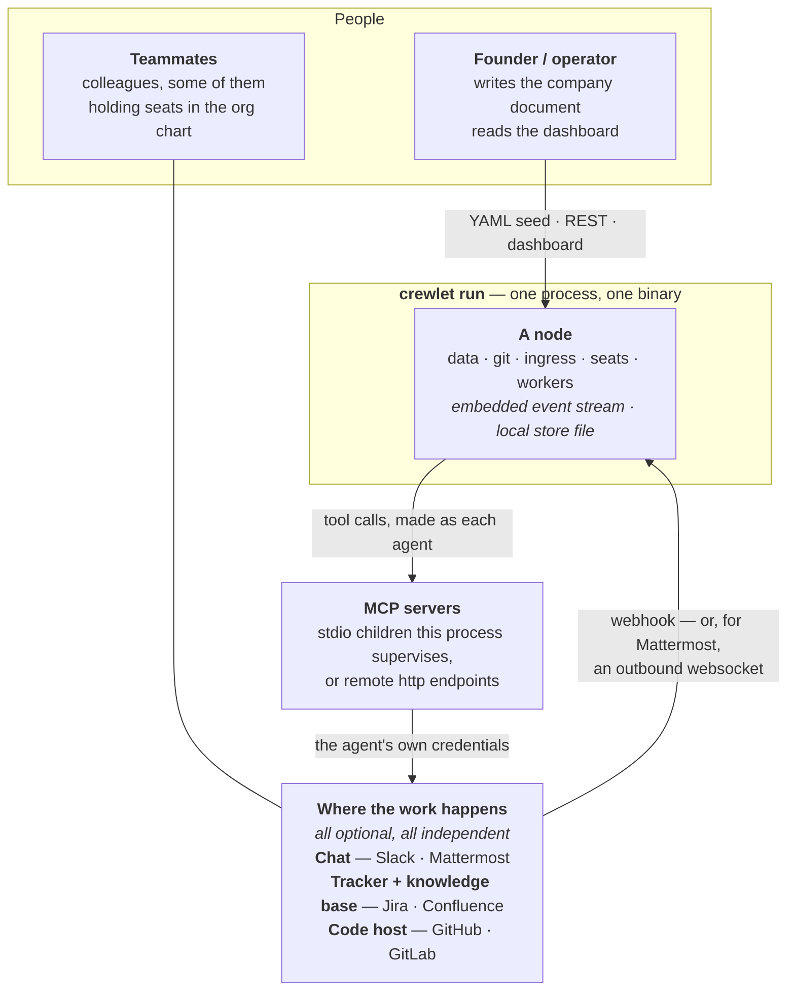
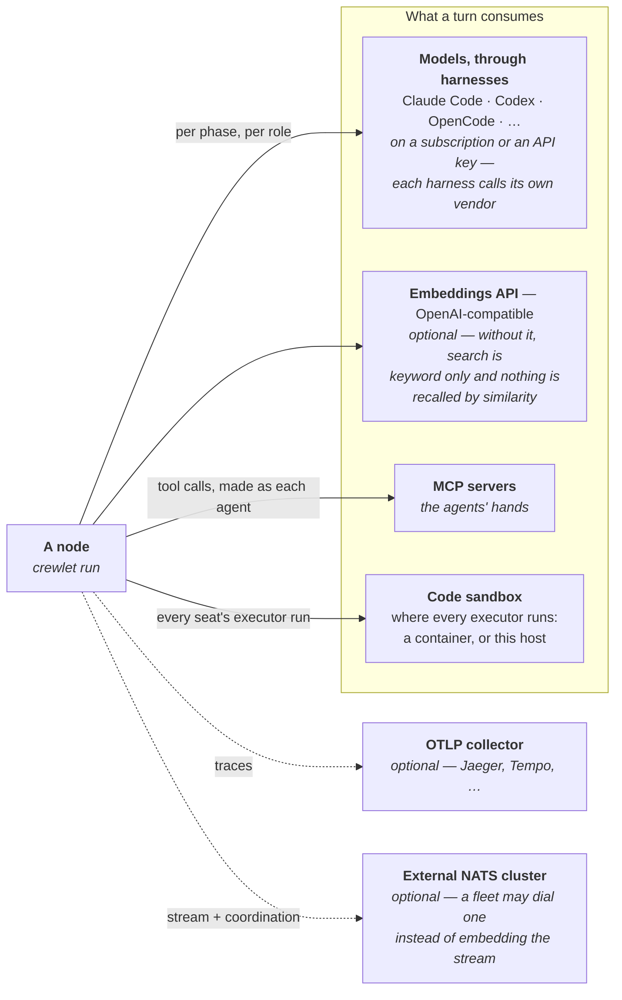
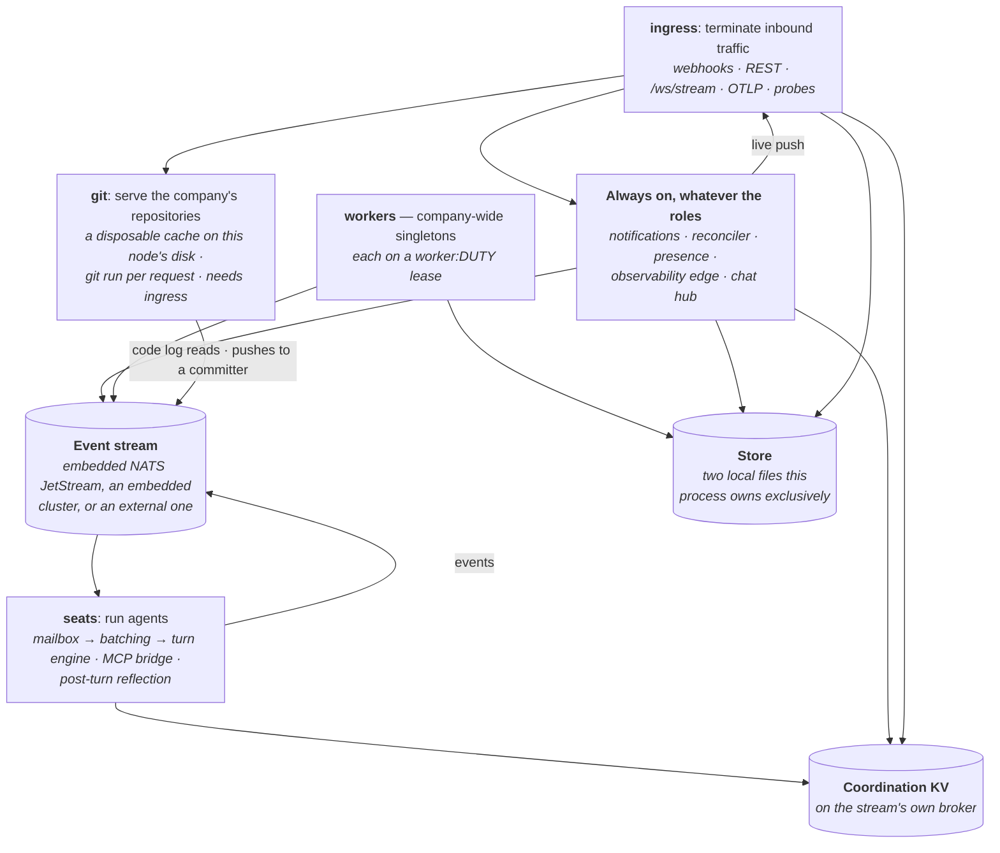
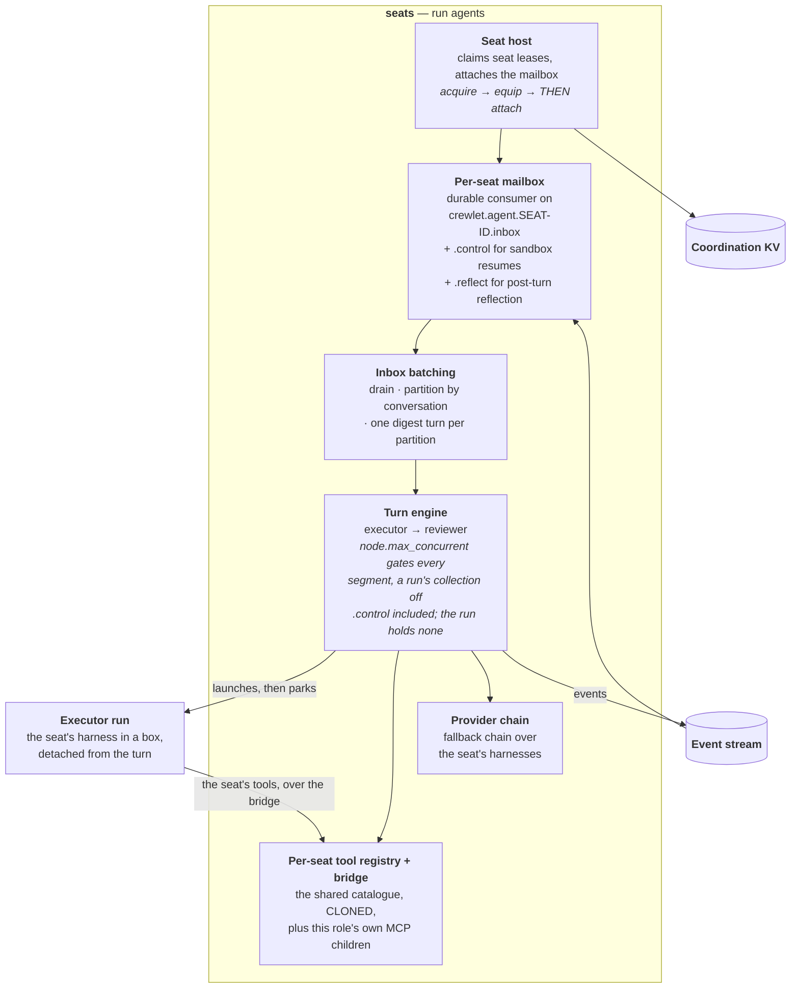
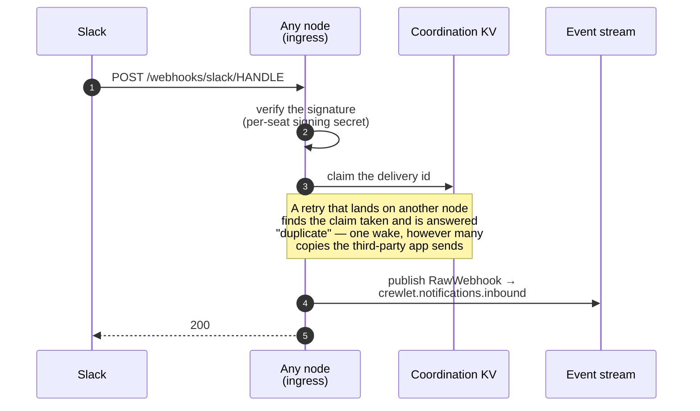
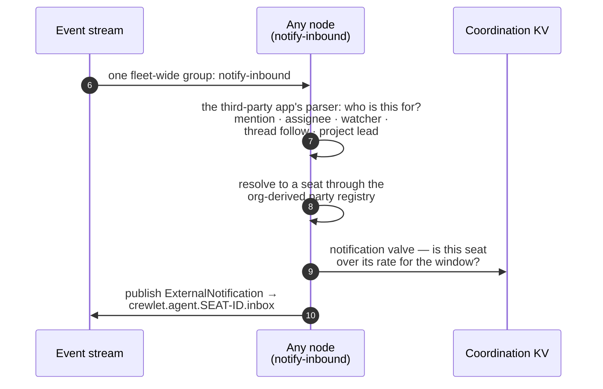
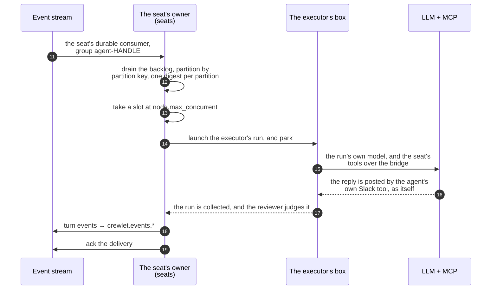
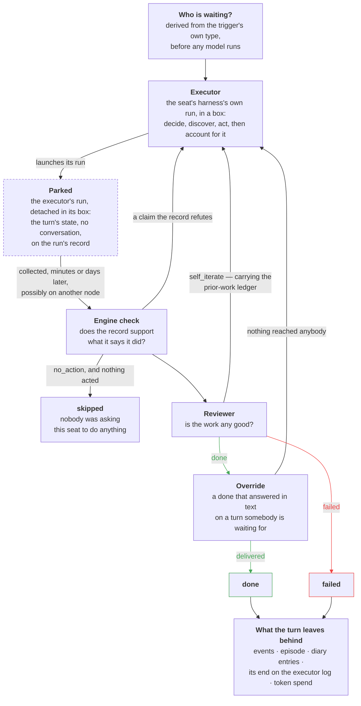
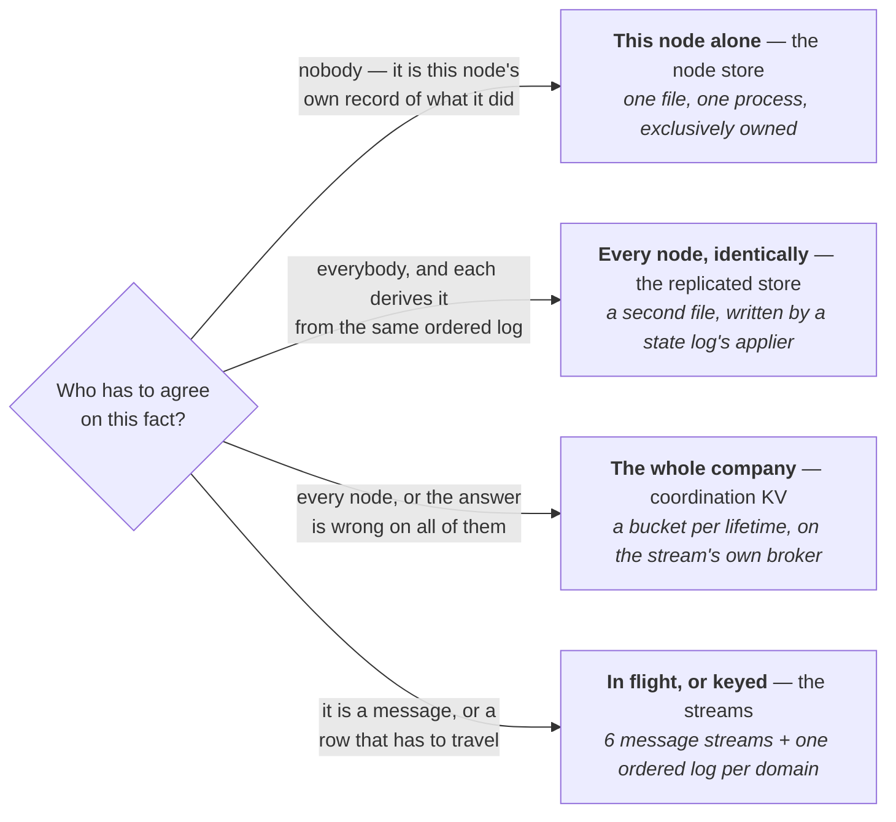
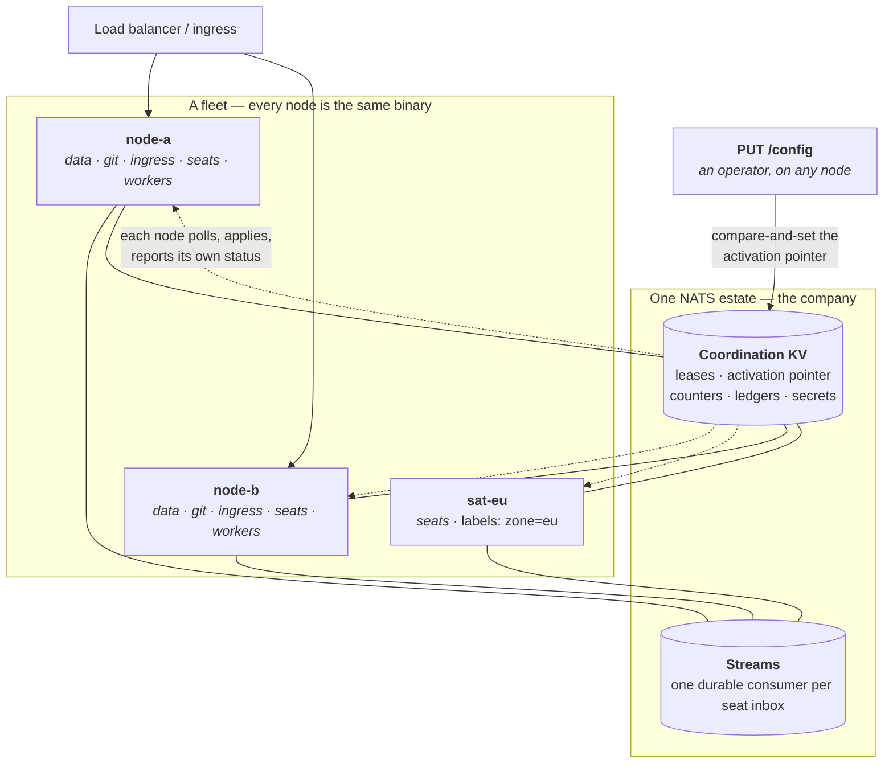

# Architecture

Crewlet is one Go binary. Start it and a company is running: an HTTP surface,
an event stream, a database, a runtime that holds seats and executes turns,
with no broker to operate, no database to provision, nothing to install beside it.

This page draws that binary at six zoom levels, from its outside boundary down
to the path of a single trigger. It is a **map**: every box belongs to a page
that goes deeper, and [the last
section](#which-page-owns-which-box) says which. The [Overview](overview.md)
carries the one-diagram version.

---

## 1. The boundary

Everything Crewlet needs to *run* is inside the process. Everything it needs to
be *useful* is outside: the surfaces your company works on, the models, and the
tool servers. Two pictures: the round trip (work arrives on surfaces and is
delivered back to the same ones), then the supply.

**The engine never calls a third-party app's API on its own account.** It calls
MCP servers, and each seat's server carries *that seat's* credentials
(`role.mcp_env`), so a comment on an issue is written by the agent, not a
service account. The engine's integration packages cover only the *inbound*
half (verifying a delivery, parsing it, deciding whose it is), provisioning,
and two calls a chat transport makes on the seat's own bot token: the working
indicator raised while the seat thinks, and reading back the thread at the
start of a turn woken in one. See [Tool
capabilities](tool-capabilities.md) for why no engine prompt names a vendor tool.

The second picture is what a node reaches while a turn runs. The two dashed
edges are connections a deployment may never make.

**The only hard dependencies are a model and a cell for its executor runs**
(the `local:` backend provides one on the engine host). No embeddings means no
similarity search: the diary's candidate pool falls back to recency and the
"similar prior work" block renders nothing, both first-class states, not
failures. No sandbox is valid only for a company with no agent seat or no model
yet. No chat, tracker or code host means fewer surfaces to be reached on and
act through; every other one still routes end to end.

| Outside the boundary | Required? | What it is for | Without it |
|---|---|---|---|
| An LLM provider | **Yes** | Every phase of every turn | Nothing runs |
| MCP servers | In practice | The agents' hands: chat, tracker, wiki, code host | Agents have only the [builtins](agent-runtime.md#built-in-tools) |
| Chat · tracker · code host | No, each | Where triggers arrive and work is delivered | That surface routes nothing |
| Embeddings provider | No | Vector recall over `agent_diary` and `episodes` | Recall degrades to recency; episodes render nothing |
| Code sandbox | Yes, with agent seats and a model (a `local:` cell is the engine host itself) | Where every agent seat's executor runs: its harness's own detached run | A company with agent seats and a model is refused at `providers.sandbox` |
| OTLP collector | No | Exported traces | Trace ids are still minted and stored on every event row |
| External NATS | No | The stream for a fleet that will not embed it | The process embeds its own (the default) |

---

## 2. Inside one node

`crewlet run` is *the* node; what it does is a config value. `node.roles` picks
from `data`, `gitlet`, `ingress`, `seats` and `workers`; declaring none means
all five, the single-process company: it holds the records, serves the API,
the dashboard and its hosted git repositories, runs every agent, and performs
the company-wide duties. A node without `data` holds no copy of the replicated
estate and answers its seats' tools through a node that does; see
[Scaling Out](scaling.md#a-node-that-holds-no-data).

The always-on set runs on every node whatever `node.roles` says. `gitlet`
serves anything only for a company that sets [`code.backend: gitlet`](gitlet.md),
and only beside `ingress`, whose listener its routes are on. The three backends
open and close together; on a node without `data` the store is scratch and
holds the node estate alone.

Four of the five groups are **inventories, not pipelines**: no box inside
`ingress`, `gitlet`, `workers` or the always-on set hands work to another box in
the same group.

**What a node holds before it serves anything.** The boot order matters; two
steps exist because of what happens if they swap.

1. The **backends** (stream, coordination, store file), opened together (below).
2. The **core runtime**, on a node that holds `data`: the state log (every registered domain's stream provisioned and its applier started), with the node gate over every identity-claiming log and the [identity estate](identity-and-access.md). On a data node this is unconditional, **with a company or without one**: an unconfigured node is where a Tier A token's session signs in to create its company, and where its first person is invited once the company declares the human seat they will hold; `ingress` requires `data`, so the node anybody signs in on always has it. A node without `data` runs no core: it applies no log, and reaches the estate, identity directory and executor log through a node that holds it. It runs every domain, not just the one a companyless node can use, because a join replaces the whole replicated file, a snapshot names every registered domain, and the trim counts nodes per log. Only **Worklet's, Doclet's and Chatlet's halves** wait for a company (their writers and readers, their lexical index and chat's own, their feeds, the embedding duty, chat's message horizon): started here when the node boots on a company that keeps them, or by the first apply that hands it one. On a node without `data` they are the router's remote halves.
3. The **tool catalogue**, equipped onto the company before anything is published: a turn can start the instant the epoch is current, and one that found an empty registry would run a seat with no tools.
4. The **epoch**, built from the revision this node boots on (the last one its engine applied, or an offline change not yet published; [Control plane](control-plane.md#a-nodes-own-store-keeps-three-facts-apart)), organization included, and published. Every reader from here on is a single atomic load. A node that boots on no revision starts unconfigured: the engine never boots on a Tier B file, so a `-company` bootstrap or an `-import-company` file comes in by its import once the node is up. The reconciler then converges the node on the revision the fleet's pointer names.
5. The **node**: its seats, duties and inbound edge.

**Two slots and a file.** The stream and coordination are the two *chosen*
backends, validated together: a multi-node fleet cannot coordinate locally, and
a two-member fleet has no quorum. The store is this node's own file, opened with
them because everything writing to it is driven by them; a node holding one
without the others could hear work it may not do, hold seats it cannot serve, or
run turns it cannot record.

**Coordination lives on the stream's broker**, never a second estate and never
the store file; see [Coordination](coordination.md) for the line between the
two estates and [section 5](#5-where-state-lives) for which fact lives where. On
an external broker it rides the queue's own connection; on the embedded one it
holds a second connection to the same in-process server, shared with the
seat-memory replay and the backup's stream copies so none sits on the read loop
every mailbox consumes through. A node's holds ride a lease connection of their
own on every topology, so no bulk the node sends queues a renewal where the path
shares fairly between connections. The
connections can fail independently, so each is watched: the NATS client closing
one for good stops the node, and a node holds leases only while its data path
answers. Only
the *lease* half follows `coordination.type`: on a single node it falls back to
an in-process store, while the shared buckets (activation pointer, ledgers,
counters, the company's secrets) are opened on every topology, because a lone
node still reads back what it wrote.

**The routes `ingress` terminates.**

| Route | What it is |
|---|---|
| `/webhooks/slack/HANDLE` · `/webhooks/github` · `/webhooks/github/HANDLE` · `/webhooks/gitlab` · `/webhooks/jira` · `/webhooks/confluence` · `/webhooks/confluence/EVENT` · `/webhooks/datadog` · `/webhooks/forge` · `/webhooks/slack-oauth` · `/webhooks/github-app` · `/webhooks/mcp-oauth` · `/webhooks/mcp-oauth/client-metadata.json` | The webhook routes. A delivery is verified, claimed once per fleet, then handed to the notification service. The last four are Slack's OAuth landing, the GitHub App return, the MCP server sign-in's callback and the engine's OAuth client metadata document. |
| `/auth` · `/iam` · `/config` · `/secrets` · `/llm` · `/setup` · `/worklet` · `/doclet/pages` · `/chatlet` · `/artifacts` · `/artifact-folders` · `/brand` · `/assistant` · `/agents` · `/org` · `/tools` · `/stream/snapshot` · `/query` · `/events` · `/turns` · `/feed` · `/budgets` · `/containers` · `/integrations` · `/link-hosts` · `/mcp-servers` · `/mcp-catalogue` · `/mcp-checks` · `/mcp-probe` · `/mcp-approvals` · `/mcp-sign-ins` · `/executors` · `/delegated-decisions` · `/growth` · `/schedules` · `/tokens` · `/viewer` · `/home` · `/fleet` · `/feeds` · `/objects` · `/backup` · `/backups` · `/diagnostics` · `/advisor` · `/inbox` · `/gitlet` · `/atlas` · `/research` | The REST plane: signing in, the identity directory, configuration (org chart included), the company's credentials and models (Settings › Models & Fleets: a credential tested and sealed, a check, a retry, a device sign-in), the human write surface over Worklet, Doclet and Chatlet, a person's inbox and Home board, what delegates decided ([delegated decisions](../guides/delegated-decisions.md)), what agents changed on the growth accounts, [Gitlet](gitlet.md)'s reads (repositories, changes, reviews, pushes, a repository's verification), the [atlas](atlas.md)'s reads, the artifacts (folders, brand, datastores), Ask Crewlet and the web pages it reads from hosts the company lists, the fleet's backups and broker membership, the wake feeds' dead letters, and reads no socket question answers. It writes through the state logs and the coordination KV, and reads the store directly. |
| `/` · `/dashboard` · `/static/` · `/favicon.ico` | The dashboard's page and assets, served without a credential: the page that asks for one cannot require one, and it ships no data (everything comes from an authenticated fetch over REST or the socket). `/` redirects to `/dashboard`. |
| `/ws/stream` | The dashboard's only read channel: live pushes (from the observability edge's projector) plus a query channel. It carries no write. |
| `/operator/mcp` · `/operator/act` | The operator catalogue (the tracker, knowledge and chat tools a seat holds), served to a person's own assistant over MCP and to the dashboard's buttons over the act route. Every call acts as the principal the guard resolved: a person writes as the seat they hold, as does a token or service account the identity directory binds to one; a credential bound to no seat writes under its own login and is refused every chat tool, because a room is read and spoken in only as a seat. Always guarded. |
| `/git/{repo}` | A person's git over HTTPS on [Gitlet](gitlet.md): a fetch or push, authenticated by the token bound to them ([Persons and their tokens](gitlet.md#persons-and-their-tokens)), plus a file's bytes and a commit's files as a ZIP, served inert (`/git/{repo}/-/raw`, `/git/{repo}/-/archive.zip`). Answered from a Gitlet node's cache, which the node a request reaches relays to. |
| `/box/git/{repo}` · `/box/gitlet/{repo}` | An executor's git and code reads from inside its box: the run's own token, minted per launch and held to the repositories its run was granted. |
| `/otlp/{token}/v1/{signal}` | Signed-token trace ingest. |
| `/mcp/{token}` | Signed-token tool bridge: one running seat's own tool surface, served to a harness in a box. Per-run, good until the run ends. A session lives in the process holding the seat, which may serve no API, so the node a call reaches relays it to that node over the broker (`internal/httprelay`) and the box dials one address for the whole fleet. |
| `/health` · `/ready` | The two probes; [section 6](#6-one-node-or-a-fleet) says why they answer different questions. |

**`workers` runs the company-wide singletons, each held on its own
`worker:DUTY` lease.** A `workers` node holds data too, because the duties read
and write this node's own copy of the replicated estate.
| Lease | Duty |
|---|---|
| `worker:scheduler` | Role- and unit-scoped cron; a fire is published to the stream. |
| `worker:launch-node-watch` | Ends the runs of a launch node gone for good: records each of its running jobs lost with it (`launch_node_gone`), or releases a parked run's box. Each node polls, keeps alive and reaps the boxes on its own host itself, with no duty. |
| `worker:maintenance` | The retention sweep over the records that answer "recently" rather than "ever", the retirement of a removed seat's mailbox, open work, executor and executor sessions, and forgetting the chat read state and Home board of a human seat the company no longer has. |
| `worker:integration-reconcile` | The [integration reconcile](integration-reconcile.md) loop: every connected third-party app's pass, on a cadence set by who has to act. |
| `worker:atlas-collect` | The [atlas collect](atlas.md#what-integrations-read) duty: each connected integration's vendor read whole for the atlas, hourly by default, with only what changed recorded on the atlas log, and the deploy and dependency files of each GitHub and GitLab repository Gitlet does not mirror, read when its default branch moved. |
| `worker:atlas-wake` | The [atlas wake](atlas.md#the-owning-agent-is-woken-when-its-entry-drifts) duty: the atlas read every five minutes for entries that drifted, and the agent seat that owns each woken, at most once an entry a UTC day. |
| `worker:learning` | Every learning background pass: skill ageing, episode compaction, clustering and cross-agent promotion. |
| `worker:retention` | The state logs' trim: each domain's floor terms evaluated, what all of them permit purged, and the conclusion published. |
| `worker:embeddings` | The knowledge base's embeddings, computed once for the company and published as records every data node applies. |
| `worker:iam_sweep` | The identity estate's retention: a sweep record for every bucket that is due, which every data node's applier carries out. |
| `worker:trash-reaper` | The trash's term and the conversations' retention: hourly, purges what has been in the knowledge base's or the artifacts' trash past thirty days, Ask Crewlet's conversations unused for thirty days or owned by a person the identity estate removed, and the seats' executor sessions untouched for `turn_engine.conversation_session.retention_days` (the setting of the revision the fleet's activation pointer names, which a holder that does not run that revision cannot know, and skips them until it can), never one whose turn's run is still live, each through its domain's own purge or delete record, as the engine. |
| `worker:object-collector` | The [object store](object-store.md)'s collection and audit: hourly, the objects no row names and the uploads that never finished; daily, that every object a row names is there and whole. |
| `worker:code-retention` | [Gitlet](gitlet.md)'s retention, every 15 minutes where the company hosts code: the rows of the packs a compaction retired, the purge of the repositories deleted past `code.deleted_retention_days`, the release of a renamed repository's old name once its redirects end, and every seat's idle scratch repository, each step one record on the code log that every data node applies. |
| `worker:delegated-decisions` | [Delegated decisions](../guides/delegated-decisions.md)' sweep: every minute, puts to people each held request that waited on its delegates past its deadline, or whose rule was turned off or its delegates changed, and records each escalation in the access log. |
| `worker:tracker-flow` | Worklet's [flow duty](../guides/worklet.md#notices): every minute, reads every item in progress, records each change of its flow state and tells a person when nobody is moving it ([ADR-0162](../../adr/0162-an-item-in-progress-says-why-it-is-not-moving.md)). Not a `workers` duty: it reads which items a turn is on and which seats are stopped from the live projection, which only a node serving the API folds, so it is held by a node that serves the API and holds the tracker's estate, whatever its roles, asked for only while that node's projection is live and given back the tick it stops being. |
| `worker:chat-prune` | Chatlet's message horizon: hourly, publishes to the chat log the cutoff each room's horizon has reached, which every data node applies as the same delete. A record rather than a sweep, because the rows are replicated and a node's own clock would delete a different set on each. The horizon is read from the revision the fleet's activation pointer names, and a node that does not run that very revision neither prunes nor claims the duty. |

**Five more services run on every node, whatever the roles say, and a sixth on every data node.**

| Always on | What it does |
|---|---|
| Notification service | One fleet-wide group, `notify-inbound`: parse → resolve → valve → wake, publishing the wake to the seat's inbox on the stream. |
| Config reconciler | Polls the activation pointer, applies an epoch, reports in the KV what it attempted and the revision it serves; once an apply succeeds, that revision is what the node boots on. |
| Node presence | The `node:ID` lease in the KV, plus the posture heartbeat. |
| Observability edge | Two routes off one published event: a publish listener writes the store row, a projector pushes it live onto `/ws/stream`. |
| Chat hub | Chatlet's live half, on every node whatever its roles. Hands each committed message to this node's sockets whose reader may see that room; puts a socket in a room's presence on the node's presence hub once the room's visibility admits its reader (who is looking, who is typing, which seat is working; told between nodes in sealed frames, ADR-0038); on a node serving sockets, pushes a person's read state to their own tabs from a watch of the coordination record every node keeps. Raises its seats' working indicators from node start, whether or not the node serves the API, because a seat raises its indicator wherever its turn runs. |
| Usage publisher (data nodes) | Derives this node's own days (what its seats, schedules and the people its auxiliary model spent for spent, ran and read) from the rows its own event log **keeps**, and republishes them to `CREWLET_USAGE_LOG` whenever they move: today and yesterday on every tick; any older day a custody batch settled as kept has changed (back to the event log's 30-day read floor); every day still owed when it stopped, from its watermark, at boot; today and yesterday once more on an orderly stop. Not a duty: a node's event log holds only what its own seats did plus the batches [custody](../guides/deployment.md#custody-the-rows-of-a-node-without-data) gave it from nodes without data, so only it can derive its day. A node without `data` keeps no event log; its spend counts in the day of the data node that keeps its events. |

`seats` is the exception, the one group whose boxes hand work to each other.
This is what a wake becomes after the stream delivers it:

**Two MCP lifetimes; the difference is a security boundary.** A
`shared: true` server is one company-wide child bound to the **config epoch**.
A `shared: false` server is a *template*: each seat it is granted to gets its
own child bound to that **seat's lease**, spawned before its mailbox opens and killed when the
lease goes. That child's credentials *are* the seat's identity, and two children of one template publish identical tool names. In one shared registry one would shadow the other, and seats would act in the tracker or chat backend as somebody else. So a claimed seat gets its own cloned registry and its own bridge.

**One model call has two layers of failure handling, each owning one
decision.** The backend *classifies* and never retries. The one thing it holds is a spent plan: a harness that reported its
vendor's rate limit (in its structured status or the vendor's words) is
`rate_limit`, and the entry sits out on this node until the reset the
vendor named (never more than an hour away), or, where none was named, for 1, 2, 5, then 15 minutes, stepping up with each probe the limit
refuses. The sit-out is node-local, not shared with the fleet: an
entry holds one login, every other node learns the same from its own
calls once per window, and a coordination read before every model call
would put the store under every turn. The fallback chain decides
whether the **model** is worth abandoning and moves to the next one in the
role's chain, publishing a `provider_fallback` event per hand-off,
addressed to the turn, phase and iteration, so a chain that flaps under load is visible on the turn that paid for it. Exhausting the chain publishes `llm_unavailable` and fails
the turn. What a classified failure *says* (log line,
`llm_unavailable`, a turn's error) is the backend's own line: how the harness
exited and the tail of what it printed, or the vendor's sentence for a
spent plan or an expired login.

**The observability edge is two routes, deliberately.**
A published event forks:
- It is written to this node's `crewlet_events` **inline,
in the publishing goroutine**, through a publish listener with no consumer
group, so no two nodes can write one row. A node without the `data`
role has no log, so its listener batches events onto the custody
topic and exactly one data node keeps each batch ([custody](../guides/deployment.md#custody-the-rows-of-a-node-without-data)).
- It is read back off the
broker by an **ephemeral broadcast** subscription on `crewlet.events.>` feeding the live projection, so a dashboard tab on node B shows turns
that ran on node A.

Swap either mechanism for the other and you lose the other's guarantee.

The two sets differ; each exception's reason is in
`internal/events`. A few types are live-only (a per-round progress signal, a
snapshot of the shared token counter): persisting them would fill the log with
intermediate states of rows it already holds finished, or replay a stale counter
as current. What the projection shows and what the store keeps are separate questions.

**The API is served inside the engine's process, and only there.** `crewlet run`
builds it over the engine's own store, broker and coordination plane. A node
without the `ingress` role serves the network only its two
[probes](../reference/api-endpoints.md#probes-on-a-node-without-ingress) on
`api.port`, plus, to its own host's loopback alone, its boxes' tool bridge and telemetry
receiver. A node with `api.port: 0`
serves nothing. `node.roles` changes what the engine
*does*, never whether there is one, so every API answers its node's in-flight
count, seats, posture and applied epoch.

**The listener binds before the boot, and the HTTP surface serves before the
engine starts.** `crewlet run` binds `api.port` (and `api.public` and
`api.artifacts`, where served) once it has checked its
Tier A. Until the node serves, that socket answers as a starting node does:
`/health` `503` while the node recovers its store, broker and copy of the estate (which only the deployment can
bound), `200` from then on while the company's configuration comes up;
`/ready` `503 starting`; every route it will serve `503 starting` with a
`Retry-After`
([While a node is starting](../reference/api-endpoints.md#while-a-node-is-starting)).
`engine.Options.Recovered`
is called once, at that boundary, so a startup probe sized for the store (and,
on a fleet's data node, its join) is never held by a tool server the
company declared.

Then the node's surface takes the socket over, and only after that does the
engine start claiming seats. A seat is not claimed until its per-role MCP
children are up (one subprocess per server per seat: spawn, handshake, `tools/list`). The example company declares no server, its chat, tracker, wiki and code being builtin tools; the same seven seats
with a vendor's chat, tracker, wiki and code host run three children
each (chat's, the Atlassian server the tracker and wiki share, the
code host's), 21 in all. Serving first means the dashboard,
REST API and every webhook route answer in that window, and `/health`
says honestly that the node holds no seats yet: its `seats` list is the seats
claimed so far, which is none. `/ready` carries no seats. Webhooks
arriving in the window are retained, because a seat's
mailbox is created before any claiming.

---

## 3. The path a trigger takes

A person mentions an agent in a Slack thread. Every hop from that
message to the agent's reply, across a fleet, where the node that *receives*
the delivery is rarely the node that *runs* the seat.

Three legs, one per process that touches the delivery (on a
fleet usually three processes; on one node, three parts of one). Each leg ends by publishing to a subject and the next
begins by consuming it; no hop hides in the seam. The coordination store and event
stream appear in more than one leg; there is one of each, company-wide. Step numbers run 1–17 straight through.

**Leg 1 — the node that took the delivery.** Verify it, claim it, publish it,
and answer the third-party app only once it is on the stream.

**Leg 2 — any node in the inbound group.** It takes the delivery off
`crewlet.notifications.inbound`, works out whose it is, and publishes a wake
onto that seat's own subject.

**Leg 3 — the node holding that seat.** Its mailbox is a durable consumer on
`crewlet.agent.SEAT-ID.inbox`. Everything from there is the turn, and the reply
leaves as the agent rather than back down the path it arrived on.

Five properties of that path, each the reason a step exists.

**The delivery is claimed before it is published.** Two concurrent retries must
not both wake a seat, and a retrying third-party app reaches whichever node a load
balancer picks, so the claim lives in the fleet's coordination store, not the
receiving node's memory. Publishing comes *before* the store row and
the live push, because the publish is the only step that must happen: a
delivery that reached the stream is worked even if the receiving process
dies next instruction. A failed publish releases the claim and
answers 503, so the app's retry finds the delivery unclaimed.

**Routing is a publish, never a call.** The inbound consumer group is
fleet-wide, so the node that wins a delivery is usually *not* the node running
the recipient. Every resolution goes through the org-derived registry (seat
ids are a UUIDv5 over `(org name, handle)`, so every node computes the same
answer with no database and no running instance), and every wake is a publish to
the seat's inbox subject. Resolving against local state would drop
most of a fleet's mail.

**The mailbox exists whether or not the seat is running.** A seat's inbox is a
durable consumer created with nothing attached; it retains what is
published while no node holds the seat. So a rolling upgrade, a seat moving between nodes and a node still booting lose nothing. Every node creates a mailbox for *every* seat in the company, not its own share: the mailbox streams use interest retention, so a
publish to a subject no durable consumer covers is dropped silently.

**One trace covers the whole path.** The webhook edge starts the span, the wake
event carries `trace_id` and `parent_span_id` forward, and every event the turn
publishes hangs beneath it, so a delivery and the turn it woke are one story at
the collector. The same ids are columns on the event rows whether or not a
collector exists.

**There are two inbound edges.** Six third-party apps plus Atlassian's Forge
relay arrive as verified HTTP on `/webhooks/*` and take every step above. Five
are verified by an HMAC over the body; Datadog by a constant-time
comparison of a shared token, because its provider attaches only fixed-value
headers, with nothing varying with the payload to sign.
Mattermost holds **one websocket per seat** on every node, outbound,
so it needs no public URL and no signing secret. It joins only
at the republish onto `crewlet.notifications.inbound`, after a
fleet-wide claim like the webhook edge's, because every node reads every seat's
socket and only one may deliver each post
([Running on a fleet](../integrations/mattermost.md#running-on-a-fleet)).
Both edges record each delivery as an `inbound_delivery` event. From that subject onward everything is identical.

A schedule firing, an `a2a_ask` from a colleague and a completed executor launch
enter further down: they publish straight to
`crewlet.agent.SEAT-ID.inbox` (or `.control`), and everything from the mailbox
onward is identical.

---

## 4. The path a turn takes

Every trigger that reaches a seat runs the same two-stage turn; a batch of
triggers for one conversation is one turn. What varies is the number of rounds and how long the executor's run works. Every turn parks on that run, so
every turn can outlive the process that started it.

**Two nested loops.** The outer loop is the turn: executor → reviewer,
re-entered on `self_iterate` up to `turn_engine.max_iterations`. The inner loop
is the model↔tool round trip *inside each phase*, with its own cap:
the executor's harness run by `role.sandbox.max_turns`, else
`providers.sandbox.default_max_turns`, and unbounded where neither sets
one; a constant for the reviewer, which holds one submission tool. A turn is
up to `max_iterations × (executor rounds + review rounds)` priced
model calls, the number to size a budget by, not
"one call per turn". An uncapped run's spend is held by the
seat's and the company's [token budget](../getting-started/configuration.md#token-budgets):
a launch below its floor waits for the window to turn over, and every run is
charged in full when collected.

**One loop where there were two.** The executor decides and acts in one place, so it
carries the whole picture: identity, policies, the team roster, and the
**turn-start prefetch**, six blocks rendered concurrently
*before the turn starts*: the chat thread the turn was woken in, personal
memory, relevant knowledge, similar prior work, known counterparty and
synthesized skills. A first turn's onboarding is not one of them; it is a
separate pass before the executor. The reviewer's question is narrower and its
prompt smaller: is this round's work right, given the record. A frontier model can do the work while a cheap one
reviews; see [Turn Engine](turn-engine.md).

**Tools are held, not enumerated.** A role with 50–150 MCP tools would send
15–25 KB of tool definitions with every model request. The executor holds every
tool from launch and no prompt lists them: the tool bridge
serves the engine's own tools as one MCP server, `crewlet`, and each of the seat's
MCP servers under its own name, and the harness keeps a large server's tools out
of requests that do not need them (Claude Code's tool search,
OpenCode's Code Mode), as it does for a person ([The tool
bridge](code-sandbox.md#the-tool-bridge--a-seats-own-tools-from-inside-a-box)). The
phases on this host that reach MCP tools by discovery walk
`list_mcp_server_tools` → `activate_tool` instead. Either way a builtin and an
MCP tool are the same to the engine: every call is decided and recorded as
the seat's ([Tool calls on this host](llm-backends.md#tool-calls-on-this-host)).

**A parked turn is why no goroutine is parked anywhere.** Every
executor launch parks its turn: the run is detached in its box, and the turn's
state (bookkeeping, no conversation, since no engine loop re-enters) is written to the run's record, not held in memory. The run
outlives the process; its turn may resume after a restart, on a different
node, days later once a person answers the agent's question. The record carries
an explicit version; a build that does not know it refuses loudly and
leaves the row untouched. A reader for an older version is kept only once a
tag has shipped it.

**Whether anything was DELIVERED is the engine's judgement, not a model's.**
Who is waiting comes from the trigger's own type before the turn starts; what
ran is the tool loop's own record. They are checked three times, in
increasing cost: a delivery claim is refused at decode time where one bounced
tool call fixes it; a claim the record refutes loops the round back without
a review call; and a reviewer's `done` on a turn that answered in text
where a tool was owed is overturned. This guards against a seat that composed a reply and never posted it, and one that posted it
twice.

**Nothing about a turn's shape is ambient.** The configuration a turn reads is
taken by value at the top of the turn from one immutable epoch, so a config
apply mid-turn cannot change the round cap between executor and
reviewer. A turn holds the company it started under until it ends.

---

## 5. Where state lives

Four estates, and which one a fact belongs to is decided by a single
question: **who has to agree on it?** — with the fourth answering a second
question the first three cannot: *and does everybody have to reach the same
answer by the same route?* Beside them sits the one thing that is **named**
rather than held by everybody — the bytes of a company's files, which a
replicated row names and one store the whole fleet shares keeps (below).

**Why the store is two files and not one.** A snapshot is a copy of ONE
estate: a node too far behind to replay fetches a peer's replicated file and
installs it wholesale, and that file must not carry the donor's audit log, its
learning rows or the bootstrap half of its secret store. Taken from a single
file the artefact would be a copy of everything followed by a delete — and
with no in-place `VACUUM`, the deleted pages ride along in the artefact, the
transfer, the checksum and the integrity check anyway. No transaction spans
the two and no read joins across them.

What each of the four holds, in full:

**This node alone — the store.**

| Tables | What they hold |
|---|---|
| **`crewlet_events`** · `crewlet_event_parties` · `crewlet_turn_origins` | The audit log and its party index: this node's own events, and on a data node the batches of a stateless node's events it **keeps** ([custody](../guides/deployment.md#custody-the-rows-of-a-node-without-data)); every row names the node that published it, so a kept row still says where it happened. The turn-origin index holds every object a turn's start record names as what started it (a chat message, a work item, a schedule, a colleague's ask, a change on Gitlet or an alarm), each message a coalesced turn took in included, which is how the turns list's `origin=` finds the turn any of them started; it is written with its record and goes with it, on the retention horizon and through custody |
| `custody_unsettled` · `custody_unsettled_rows` | The custody batches this node has written and not yet learned whether it keeps, and the identity of every row of each: the fleet decides which data node keeps each batch, create-only in coordination, and a node that crashed between writing a batch and claiming it asks at its next pass and deletes the rows if another node keeps them. The rows are keyed on the event log's own (time, id), so every count that leaves a batch in flight out seeks them from the row it counts — its cost the same beside a few identities as beside the tens of thousands a coordination outage leaves. Normally empty but for the batches of the last few moments; a coordination outage can leave tens of thousands, and a batch whose keeper record [nothing can read](../guides/deployment.md#custody-the-rows-of-a-node-without-data) stays until it ages past the event log's retention |
| `custody_settled` | The custody batches this node has **settled**, kept or not, so a batch the fleet redelivers — an acknowledgement lost — is written nothing: its kept rows stay counted, and a copy another node keeps is not written back. Swept with the event log |
| `usage_rederive` | The days a custody batch settled as **kept** has changed since this node's usage publisher last derived them. Every usage count leaves a batch in flight out, so a kept settle makes its rows count on whatever day they fall — possibly a week back — and the publisher, which fingerprints only today and yesterday, derives every day from the oldest of these through the day before yesterday again (none older than the event log's thirty-day read floor). Written in the settle's own transaction, one row per UTC day the settles' oldest rows fall on, and cleared up to the newest the publisher read once those days are published |
| `usage_day_windows` | The instants each of this node's company days was first cut on, by label. A day the usage publisher derives again — an older one a kept settle or the watermark names, or today and yesterday at the tick the company's `timezone` moves — keeps the cut its first derivation had, so a moved clock never shifts rows between days already published; a day cut for the first time abuts the cuts either side of it, and is clamped by any farther cut it would reach into after a move of more than a day, so the day the clock moved on is longer or shorter and no instant falls in two days or none. Swept with the event log |
| `usage_republished` | The usage log's generation on every data node as this node's usage publisher last republished every day its event log holds under. A data node whose usage generation rises past it re-anchored its copy and skipped what the others published after a restore, so this node publishes every day again and then records the generations it answered; kept across a restart so a reanchor seen on the first beat after one is still answered; one row |
| `usage_watermark` | The oldest of this node's days its usage publisher has not confirmed published whole — the day before the newest it fingerprinted, or an older one a tick could not settle. A start derives every day from it again, which is how the tail of the day a node stopped in reaches the fleet when it comes back days later; one row |
| **`agent_diary`** · **`episodes`** | A seat's notes and turns, each with the vector of the model it came from — recall is a per-seat scan the database ranks, with no vector index |
| **`synthesized_skills`** · `synthesized_skill_versions` · `counterparty_profiles` · `agent_onboarding_markers` | The rest of the learning subsystem — skill induction and its versions, counterparty profiles, first-turn onboarding markers |
| `memory_change_sequence` | One counter, which every new memory row, every vector set on a note or an episode, and every change to a counterparty profile, skill or onboarding marker is stamped from, so the [memory changelog](seat-ownership.md#a-seats-memory-follows-it) carries what changed since the last row it acknowledged. It only ever increases: a row's rowid is handed out again once the newest row is deleted, and a watermark over it skipped the next row written |
| `alarm_standing` | The alarm instances this node's tracker has up, each with the instant it was raised, so the first evaluation after a restart says only what changed: a standing alarm is not raised again, one that cleared while the node was down is cleared once with its original instant ([Alarms](../reference/alarms.md)) |
| `llm_sign_in_window` | The newest reading of each model sign-in's limit windows this node's calls heard, read back at each apply so an LLM fleet balances on what its members last reported after a restart; one heard over half an hour ago reads as unknown |
| `company_config` · `scheduled_runs` | Every config revision this node has met, with three facts only it can know — the revision it boots on, the fleet's revision as it last saw it, and an offline change it has not published ([Control plane](control-plane.md#a-nodes-own-store-keeps-three-facts-apart)) — and cron bookkeeping. Which revision is the company is the activation pointer, below, never a row here |
| `kb_docs` · `kb_postings` | The **lexical** half of the knowledge search index over those rows, built asynchronously behind them and droppable wholesale when the analyzer changes. The semantic half is not here — an embedding costs a provider call, so it is derived once by the fleet and lives in the estate below |
| `page_links` | Which pages and tasks link to which page: the **backlinks**, derived by the same indexer from the same bodies it tokenises (`doclet.Links`), so a page answers "linked from" with no scan of anybody's text. Cascades from `kb_docs`, and rebuilt by the same local walk |
| `chat_docs` · `chat_postings` · `chat_index_rooms` · `chat_index_terms` · `chat_index_state` | The **keyword** index over the company's own chat: its documents and postings, each room's statistics and how many of each room's documents carry each term — summed over the rooms a search searches, so a score never depends on what is said in rooms its asker cannot read — how far its two forward walks have reached, whether a rebuild is dropping it, a batch at a time, after the replicated estate under it was replaced, and which copy of that estate it was built from — compared on every sweep with the copy's own name for itself (`statelog_estate`), so a replacement is followed even when the process that installed it stopped before saying so. Its own index rather than a corner of `kb_docs`, because a message is a remark about work rather than a statement of it — the same argument that keeps a work item's comment thread out of the knowledge index — and because chat has no semantic half at all: a year of it needs several times the whole supported vector corpus ([ADR-0071](../../adr/0071-chat-is-a-keyword-corpus-and-takes-no-vectors.md)) |
| `change_docs` · `change_postings` · `change_index_state` | The index of Gitlet changes' words: each change's document (its repository, owner and state and a hash of its title and description), keyed by the millisecond its change's id was minted in, found by the change's id and keyed newest first under each of the three, and each term's postings, keyed by their document's key so that a document's postings are one range of the table's key; how far its forward walk over `code_changes.position` has reached, never past a record this node retains; where its first build began and how far back by id it has reached; the code log's position in the newest snapshot its writes were decided from; and which copy of the estate it was built from, a new copy beginning the first build again over the documents it keeps. A listing narrowed by its words reads it and judges every match in its own snapshot ([Searching changes by their words](gitlet.md#searching-changes-by-their-words), [ADR-0156](../../adr/0156-a-changes-words-are-indexed-on-each-data-node-and-every-match-is-judged-in-the-read.md)) |
| `statelog_adoption` | This node's own history of the peer snapshots it has adopted — which donor's artefact, when the join began and whether it completed. Nothing on the write path reads it: the operation ledger travels inside the snapshot with its own watermark |
| `statelog_diverged` | This node's finding that a log **diverged** from its rows — the broker was restored from an older copy and another record now sits at the node's checkpoint — keyed to the stream, the checkpoint and both records' broker instants. Kept here rather than only in memory because the log can lose the record it was found by (an evicted node's checkpoint stops pinning the trim), and a restart must not then apply the other history on top of these rows. It holds while the checkpoint names the same record, so a reanchor or an adoption is what ends it |
| `stream_identity` | What this node last saw of each stream's identity, which is how it notices one that was recreated underneath it. A per-node **observation** rather than shared state: two nodes can legitimately have seen different generations, so one agreed value would destroy the comparison it exists to make |

**Every node, identically — the replicated store.**

One file, the replicated estate, which every data node holds whole — written by
a state log's applier:
records arrive in one order from the log, every data node applies the same ones,
and the rows plus this node's position on the log commit in a single
transaction. There is no leader
and no node whose copy is the real one.

**Three schema rules hold over every replicated migration**, and they are one
rule underneath: a statement that can abort inside an apply transaction aborts
on every data node at once, so what would be a rare anomaly on one node is a
fleet-wide stalled log instead. **No foreign key** — a cascade is a delete
nobody committed, and an applier removes a row's children in its own statement
list, where the deletion is part of the record's effect. **No `UNIQUE` outside
a primary key** — uniqueness a writer has to see whole is arbitrated on the
record's subject at the broker, where exactly one of two writers wins and the
loser is told; a unique index cannot tell anyone anything, it can only wedge
every applier. **No `COLLATE`** — the default TEXT collation is BINARY, so an
`ORDER BY` reproduces the Go comparison exactly, and the pinned driver accepts
`COLLATE NOCASE`, which would silently collapse `A` and `a` against a
normalisation Go already did once. The node estate is deliberately not governed
by any of them: one file, one process, no applier and no peer, so a constraint
there fails one statement for one caller, which is what a constraint is for.
`internal/store.TestNoReplicatedMigrationDeclaresAConstraintTheApplyCannotSurvive`
is what makes the three real, and it reads past the prose that names them.

**Two writes in the engine are not records**, and each is a column or a row
no record could own: the clear of a duplicate-rank probe flag each node's own
applier sets, and the inbox sweep over rows whose class lets two nodes
legitimately hold different ones. They are named with their reasons in one
place, and a third fails the build — the rule and its exceptions are
`adr/0002`, held by `internal/store.TestOnlyTheApplierWritesTheReplicatedEstate`.
A log reanchor is not among them: it writes the framework's own checkpoint,
and the audit row a log that claims identity keeps of it is applied from the
generation record it appends to the adopted log — the vectors and the usage
days keep none.

| Tables | What they hold |
|---|---|
| **`tracker_tasks`** · `tracker_comments` · `tracker_history` · … | The company's work — the tracker's whole state, derived from `CREWLET_TRACKER_LOG` |
| **`pages_heads`** · `pages_revisions` · `pages_titles` · … | The company's knowledge base, derived from `CREWLET_PAGES_LOG`: a page's current body, the immutable revisions behind it, and the title claim that is what makes a name an address |
| **`kb_vectors`** · `kb_vectors_bin` · `kb_ivf` · `kb_ivf_centroids` · `kb_ivf_rollout` · `kb_ivf_lists` | Page and task embeddings, their 1-bit codes, and the semantic index filing those codes in lists — its head, its centroids and the re-filing its training cut are a record on the same log, and the per-list counts are kept beside the rows they count ([ADR-0028](https://github.com/crewlet/crewlet/blob/main/adr/0028-the-semantic-first-stage-is-an-index.md)) — derived from `CREWLET_TRACKER_VECTORS`. The fleet pays the provider bill **once** and every data node holds the answer, which is precisely why these are not in the node's own file |
| **`iam_people`** · `iam_credentials` · `iam_invites` · `iam_sessions` · `iam_revocation_epochs` · `iam_session_generation` · `iam_history` | The company's identity estate, derived from `CREWLET_IAM_LOG`: the people and machines who can act, the verifiers they prove themselves with, the invitations that enrolled them, their sessions, the two counters that end sessions, and the authentication trail — see [Identity and Access](identity-and-access.md#the-seven-tables) |
| **`usage_tokens`** · `usage_turns` · `usage_reads` · `usage_tool_calls` · `usage_schedule_runs` · `usage_schedule_superseded` · `usage_person_tokens` | What each node's seats, schedules and people did each company day (spend by phase, worker, model and provider slot; ended turns and how they ended; the pages seats read; their turns' calls to each MCP server's tool, counted per outcome, never an argument or a result; every fire its scheduler sent, and every fire its seats did not run because a later one ran in its place, which a schedule's history joins by trace; and what the auxiliary model spent for a person, a question answered on the operator surface, filed under the human seat they hold rather than an agent id), derived from `CREWLET_USAGE_LOG`. Every data node publishes its own days and applies everyone's (a node holding no data has its events, and so its spend, kept by a data node through custody and counted in that node's day), so spend history is answered fleet-wide and outlives the node that spent it (ADR-0020). Kept 181 days, aged out by the applier rather than a sweep |
| **`artifacts`** · `artifact_versions` · `artifact_objects` · `artifact_assets` · `artifact_source_claims` · `artifact_shares` · `artifact_pins` · `artifact_reads` · `artifact_history` · `artifact_usage` | The company's artifacts, derived from `CREWLET_ARTIFACTS_LOG`: each artifact's head and owner, its retained versions with their canonical manifests (a hundred unlabelled ones plus every labelled one), the objects those versions and its live assets name, its republish-in-place address, who it is shared with and at what role, each person's pins and when they last opened it, what happened to it (a year of history, refusals included) and the company's counters the stamped quotas are enforced against. The bytes are the [object store](object-store.md)'s, and `artifact_objects` and `artifact_assets` are declared in its references so the collector never deletes a file a retained version or a live asset still names |
| **`artifact_data_stores`** · `artifact_data_collections` · `artifact_data_paths` · `artifact_data_docs` · `artifact_data_fields` · `artifact_data_writes` · `artifact_data_touches` · `artifact_data_usage` | Each artifact's datastore, derived from `CREWLET_ARTIFACT_DATA_LOG`: the store's catalogue row (its schema version, its on-disk footprint and its state digest), its collections with their columns and rules, the field paths interned to compact integers, every document as its canonical body with who created and last changed it, the field index a query is compiled against, seven days of history (at most 8 MiB per store, each row carrying who wrote, the verdict, the values each changed field held before and after, and the digest the store held after it, which is what an undo and a cell's history read), which documents each history row changed, and the company's footprint the plan quota is enforced against. Every data node decides each write from the authority stamped into it and the rows alone, so a refusal is the same refusal on every data node |
| **`code_repos`** · `code_refs` · `code_packs` · `code_pushes` · `code_protections` · `code_changes` · … | The company's [git repositories](gitlet.md) as rows, derived from `CREWLET_CODE_LOG`: each repository's settings and protection rules, its refs, the pack bundles its pushes stored, the pushes themselves, and the [changes](gitlet.md#changes) proposed on it with their descriptions, authors and revisions. A pack's bytes are not a row: each is one object in the [object store](object-store.md), named by its `code_packs` row. `code_activation` holds the activation fence — the newest configuration activation whose reconcile of `code.repos` has published one — which refuses an older activation's decision about any repository |
| **`assistant_conversations`** · `assistant_turns` · `assistant_messages` · `assistant_steps` · `assistant_cards` · `assistant_proposals` · `assistant_files` · … | Each person's [Ask Crewlet](assistant.md) conversations, derived from `CREWLET_ASSISTANT_LOG`: every conversation and its turns, the messages, steps and cards its owner saw, the proposals they decided, the files attached to it or delivered into it, an administrator's recorded compliance reads, and the marker a purge or a person's erasure leaves, so that a redelivered record cannot bring a conversation back. What a person said and saw is sealed under the fleet keyring before it is published, so the rows are the same bytes on every data node and say nothing without the keyring. A file's bytes are the [object store](object-store.md)'s, and `assistant_files` is declared in its references. The trash reaper purges a conversation nobody has used for thirty days |
| **`chat_channels`** · `chat_members` · `chat_messages` · `chat_reactions` · `chat_deletions` · `chat_verdicts` · … | The company's own chat, derived from `CREWLET_CHAT_LOG`: its rooms and who is in each, every message with its thread, mentions and reactions, the marker an erase leaves so that a redelivered post cannot bring back what the company destroyed, and what the applier decided about each message record — applied, or refused and why — which the writer reads back and keeps for the operation ledger's thirty days, beside the highest position that horizon has let go (`chat_verdicts_lost`), so a decision nobody keeps any more reads as one nobody can vouch for rather than as a message never said |
| **`executor_sessions`** · `executor_session_tombs` · `executor_seat_removals` · `executor_session_serves` · … | Each seat's executor sessions, derived from `CREWLET_EXECUTOR_LOG`: one row per turn whose executor captured its harness's session, naming the sealed object in the object store that holds it, with the turn's ending (how it ended, whether its reply was delivered) and what its first launch read of its conversation — the position, and the turns that read handed out, which are what its end absorbs; the ended turn whose session that read handed it, which the turn's `begin` names on its row — the row's start, where the begin lands before any capture — and which that row holds against every release but a retirement while the turn has kept no session of its own; the tombstone that keeps an ended or removed turn from being captured again; where a removed seat's rows were removed, which refuses a capture or an end decided before that and landing after; and each other conversation an ended turn served, its run having read a wake of it, which reads the turn's row as its own ([ADR-0073](https://github.com/crewlet/crewlet/blob/main/adr/0073-a-seats-executor-session-is-a-sealed-object-its-turns-row-names.md)) |
| **`access_told`** · `access_certificates` · `access_commands` · `access_verdicts` · `access_growth` · `access_seat_removals` · … | Each seat's access history, derived from `CREWLET_ACCESS_LOG`: what each turn of a seat was told about its own access (the snapshot it ran under and the changes since the seat's previous told record, the newest of which is the seat's baseline), every SSH certificate the engine signed (its public facts, never a key) and every SSH command it ran or a person denied, the command's text sealed under the fleet keyring and only its stdin's and output's sizes and digests kept, and every verdict on a [delegated request](../guides/delegated-decisions.md), its subject and its giver's words sealed the same way, and every step of a growth act (a call made, a held call's ask, answer and outcome), with digests, bounded values and money in micros, never a credential, a person's data or published text. Kept for the company's `access_history.retention_days` ([ADR-0103](../../adr/0103-a-seats-access-and-its-ssh-sessions-are-records-on-a-log-of-their-own.md)) |
| **`atlas_entries`** · `atlas_claims` · `atlas_purges` · … | What people record about what the company runs on, derived from `CREWLET_ATLAS_LOG`: each entry a claim was made about, every claim with its source and when it was seen (a voice's newer claim on a fact replaces its older one, which stays as history), and a marker per purged entry or value that keeps it from coming back. What the engine already keeps is never copied here: the [atlas](atlas.md) computes it when it is read. |
| **`advisor_findings`** · `advisor_keys` · `advisor_finding_history` · `advisor_runs` · `advisor_reports` · `advisor_alarm_episodes` · … | What the [Advisor](../guides/advisor.md) found and what became of it, derived from `CREWLET_ADVISOR_LOG`: each finding key with its hold and the fixes that did not take, every episode of it with its current revision and its history (who moved it, when, and the facts that moved), the Advisor's runs, its weekly reports and the alarm episodes its detectors read. Kept on the domain's own retention: closed episodes 90 days, runs and alarm episodes 30, reports 26 weeks |
| `statelog_cursor` · each domain's operation ledger and deferred records · `statelog_ops_lost` · `statelog_ops_lost_kind` · `statelog_estate` | Where this node is on each log, which operations have already been applied — a record that travels inside a snapshot — and how far back that record may have lost rows to the sweep, so a retry older than that is answered `unknown` rather than applied twice. A ledger that sweeps one kind of operation sooner than the rest — the identity estate's sessions, after an hour — records that kind's loss on its own, so every other kind is still vouched for over the month. Any record a newer build wrote that this one cannot decode. And the one framework row that differs on every data node: which **copy** of the estate this file is, a random name minted for every snapshot a join installs, before the install (a file the node created itself has the empty name) — so what a node derives from these rows by a walk that only moves forward, the chat keyword index and the index of changes' words, can tell its rows were replaced |

**The whole company — coordination KV.**

| Bucket | What it holds |
|---|---|
| **`crewlet_leases`** | `node:` · `seat:` ownership, and nothing else. The bucket's age **is** the lease TTL |
| **`crewlet_duties`** | `worker:` ownership, and every other lease, Worklet's `move:` · `merge:` claims among them. Each record is judged by its own deadline; the bucket's age only has to outlive the longest duty |
| **`crewlet_epochs`** | The monotonic fencing counter, which a single node's in-process leases mint from too, since their tokens are written into records that outlive the process. No age at all (see below) |
| **`crewlet_config`** | The activation pointer — its own revision **is** the epoch — and the sealed company document it names, `body.<sha256>` |
| **`crewlet_status`** | One key per node: the epoch and revision it last attempted, how that went (`error` or `degraded` is a refusal), and the revision it serves. A refused re-activation of the revision a node already runs names one revision in both, so a refusal is read from the status, never from the two differing |
| `crewlet_node_status` | A node's [status record](coordination.md#its-status-record) as rows, each its own key of at most 16 KiB: `node_status.<node>` (its runners, what it runs on and the runs of its seats waiting for an operator), one `mcp_status.<node>.<server>` per MCP server, one `model_status.<node>.<entry>` per model entry and `growth_status.<node>`; beside its presence rather than on it, each row counted only at the epoch of the node's own row and its presence. The bucket's age, the same minute as `crewlet_status`, removes a dead node's |
| **`crewlet_ledger`** · **`crewlet_claims`** · `crewlet_fires` | Turn completions, webhook delivery claims, scheduled-fire claims |
| `crewlet_rebases` | The instant a unit of work's writes are minted at when its own start is older than the operation ledger remembers, so a crash re-run, a retried resume or the next half of the turn mints where the attempt before it did. The bucket's age, 30 days, is the ledger's retention |
| **`crewlet_token_windows`** · `crewlet_rate` · `crewlet_counter_windows` | The token counters (one record per scope, a slot for each calendar window, aged 32 days past its last charge), the rate windows of the notification valve and of a person's Ask Crewlet turns, each window at most a minute wide and kept three, and the counter windows up to a day wide, aged three days: the requests a [delegate](../guides/delegated-decisions.md) may allow in an hour and the records an agent may make in the [atlas](atlas.md#what-agents-record) in a UTC day |
| **`crewlet_secrets`** · `crewlet_channels` · `crewlet_sandbox_runs` | The company's sealed credentials, open A2A channels, every agent seat's executor run |
| `crewlet_follows` | The chat threads each seat follows, so the next reply wakes it whichever node claims that delivery. The bucket's age, 90 days, is the last-activity horizon |
| `crewlet_chat_reads` | Per human seat — how far its person has read in each room of the engine's own chat, what they have muted and whether they are in do-not-disturb, inherited by the seat's next holder. **Not on the chat log**, deliberately: a cursor is a fact about one reader's attention that nobody replays and every data node would otherwise apply, and at a realistic flush rate it is the highest-volume thing the company writes. **No age** — an expired cursor would mark a room its reader had finished as unread |
| `crewlet_objects` | The [object store](object-store.md)'s **backend record** (`nats` or `s3:<endpoint>/<bucket>/<prefix>`, written create-only by the first node to boot and compared by every node after it, which refuses to boot configured with another store), and the `object-collector` duty's **last report**, replaced by each pass so every node's `/fleet` shows it whoever ran it, and the `trash-reaper` duty's, which the next holder of the duty resumes from. **No age**: an expired record would let the next node record a different store and split the company's files between two |
| `crewlet_custody` | Which data node keeps each batch of a stateless node's events: claimed create-only by the data node that wrote the batch, after it wrote it, so exactly one node's log keeps it ([custody](../guides/deployment.md#custody-the-rows-of-a-node-without-data)). The bucket's age, 32 days, outlasts the event log's retention, so a node settling a batch it wrote before a crash always finds the answer |
| `crewlet_uploads` | The bytes an artifact's upload intents have **reserved** and no record names yet: one ledger of every hold the company has outstanding, written by compare-and-set so two intents racing for the last of a budget cannot both win, and one record per upload naming the keys the engine minted for it and how far each transfer got; and each seat's ledger of the sessions its runs saved as they worked, written the same way, so a seat's saves awaiting the collector stay within its session budget. The bucket's age, 30 hours, outlasts the longest hold a reservation or a save keeps (until the [object collector](object-store.md) could have deleted the bytes), so an abandoned upload's record and a removed seat's ledger go on their own |
| `crewlet_integrations` · `crewlet_mailboxes` | Each surface's reconcile status, and the seat mailboxes that may exist so a removed seat's can be retired |
| `crewlet_atlas_sources` · `crewlet_atlas_source_refreshes` · `crewlet_atlas_code_scans` | The [atlas](atlas.md)'s standings and asks: each source's standing (its last complete read, that read's calls and withheld values, its last fault, the listings it was refused, and the entries it has stopped seeing since when); a person's ask that a source be read now, until the collect duty honours it; and each scanned repository's standing, with each forge's for its repositories' files under keys of their own. **No age**: an expired standing would read as a source never read or a repository never scanned, and an expired ask would be dropped before the duty reached it |
| `crewlet_statelog_positions` | **Four key classes**, all answering what the log may delete: each node's position per domain; the trim holds a backup or a join takes; what each node's newest backup and each log's newest operator acknowledgement cover, which is the only input each log's backup term has; and the floor the trim published, with the term holding it and how long it has been holding — the last is the one nothing can re-derive, because a duty that moves on a lease carries no memory across the move. **No age at all**, and this is the one where an age would be worst — an expired position reads as a node that has applied *nothing*, which either pins the trim for ever or, read the other way, deletes records that node still needs |

Every key of every bucket is of a class its bucket declares, held to the class's bound and read in the time that bound takes to cross ([What one key holds](coordination.md#what-one-key-holds)).

**In flight, or keyed — the event stream.**

| Stream | Subjects |
|---|---|
| **`CREWLET_AGENT`** | `crewlet.agent.>` |
| **`CREWLET_NOTIFICATIONS`** | `crewlet.notifications.>` |
| **`CREWLET_EVENTS`** | `crewlet.events.>` |
| **`CREWLET_CONFIG`** | `crewlet.config.>` |
| **`CREWLET_MEMORY`** | `crewlet.memory.>` — *one message per subject: a keyed table, not a log* |
| **`CREWLET_DLQ`** | `dlq.>` — *deliberately outside* `crewlet.*`. Kept by the event stream's age, never by interest: a subscription's poison for an operator to read, and a wake feed's dead letters on `dlq.changefeed.>` — a record no node could read in the hour its feed handed it back, kept whole with its sealed frame — which the first node whose feed starts able to read one replays and drops, or an operator who has given its wake up discards (`crewlet feeds discard`) ([Dead letters](event-system.md#dead-letters)) |
| **`CREWLET_CUSTODY`** | `crewlet.custody.>` — the events of nodes without `data`, in batches, until one data node keeps each; a mailbox (interest retention) aged at the event log's horizon. *Outside* `crewlet.events.*`, whose broadcast every dashboard streams |
| **`CREWLET_FAILED`** | `failed.>` — *one message per subject*: an empty mark for each subscription message a delivery failed **as itself**, written by the member that failed it and read by whichever member's return spends the message's budget, so a message one member failed is kept with the poison though another member handed its last delivery back ([Dead letters](event-system.md#dead-letters)). Deleted once the message is settled, and kept no longer than the event stream's age |
| **`CREWLET_TRACKER_LOG`** | `crewlet.tracker.log.>` — **the write-ahead log the replicated estate's tracker tables are derived from.** One subject per object, which is what makes the subject the unit two writers contend on; retention is bounded by durability rather than by age. Two of its subjects carry no object at all: **`…log.barrier`**, which every `linearizable` read appends one record to and then waits through what precedes it — every record that writes a row committed, and no barrier's commit waited for, since a barrier writes no row on any node; the acknowledgement is what proves a quorum agrees on a position, where a field read can be served by an isolated former leader; and **`…log.rankorder.<PROJECT>`**, which is where a board drag is arbitrated, so two people reordering one project's board contend and two reordering different ones never do |
| **`CREWLET_TRACKER_VECTORS`** | `crewlet.tracker.vectors.>` — the same shape for embeddings, **compacted**: one message retained per subject, because the current embedding of a source is the only one anybody wants and a history of superseded vectors is a bill nobody asked for |
| **`CREWLET_PAGES_LOG`** | `crewlet.pages.log.>`, **the ordered log the replicated estate's knowledge base is derived from**, and the state log's third domain. The same shape as the tracker's: one subject per object, so two writers saving one page contend at the broker and two saving different pages never do. Retention is bounded by what every data node has already applied rather than by age, because a page is a fact for the life of the deployment and removing one is a decision somebody takes rather than a horizon that reaps it while a person is still reading it |
| **`CREWLET_IAM_LOG`** | `crewlet.iam.log.>`, **the ordered log the replicated estate's identity tables are derived from**, and the state log's fourth domain. It is the one where the SUBJECT IS THE CONSTRAINT: the replicated estate forbids a `UNIQUE` index outside a primary key — a constraint violation inside an apply transaction aborts it deterministically on every data node at once, which here would be every login in the company — so there is no uniqueness check anywhere in the schema, and what keeps two people from taking one address is that every write that sets or frees an address, a login or a seat is ONE record on ONE subject, `…log.directory`, decided in a snapshot of every row: two such writes contend at the broker, and the second is decided again against the first. A session arbitrates on its own lineage, `…log.session.<lineage>`, and a person's content on `…log.person.<id>`. A session writes one record when it opens and one when it closes and nothing in between — a re-issue moves a deadline inside the signed bearer and records nothing — so this log grows with sign-ins rather than with requests |
| **`CREWLET_USAGE_LOG`** | `crewlet.usage.log.>` — the state log's fifth domain, **compacted**: one message per (kind, node, company day, seat, schedule or person), each the object's whole cumulative value, republished by the node that owns the day whenever it moves and aged out after 181 days. The node is part of every subject, so each object has exactly one writer and nothing is arbitrated |
| **`CREWLET_ARTIFACTS_LOG`** | `crewlet.artifacts.log.>`, the state log's sixth domain, strict and identity-claiming: every create, publish, rollback, share, transfer, trash and purge of an artifact. Every record that adds or removes an object reference arbitrates on the artifact's own subject, `…log.artifact.<id>`, so the broker orders every carry of a file against every removal; a republish-in-place address is a create-only `…log.source.<owner>.<token>`, an asset rides `…log.asset.<artifact>.<asset>` and a person's pins `…log.reader.<seat>`. A record the applier's rows refuse (a head that moved, a carried object no longer named, a quota crossed) is applied as its history row with the reason, on every data node alike |
| **`CREWLET_ARTIFACT_DATA_LOG`** | `crewlet.artifactdata.log.>`, the state log's seventh domain, strict and identity-claiming: every write, undo, schema change and purge of an artifact's datastore, on one subject per store, `…log.store.<artifact>`, because the store is the unit a batch is atomic over. A write is **sequenced**, not arbitrated: it carries no expectation, the log orders it against every other write to that store, and the applier decides it, guards and quotas included, so two people editing one sheet never contend at the broker. A schema change is arbitrated on the same subject, so it is decided against every write it migrates. A write the rows refuse is applied as its verdict, with the reason, on every data node alike |
| **`CREWLET_ASSISTANT_LOG`** | `crewlet.assistant.log.>`, the state log's eighth domain, strict and identity-claiming: each person's [Ask Crewlet](assistant.md) conversations, their turns and the proposals they decide. A conversation's own subject, `…log.conversation.<id>`, orders its create, its title, its purge and the opening of each turn, so a conversation has one running or parked turn whichever node opens it; a turn's, `…log.turn.<conversation>.<turn>`, orders its park, resume and close and carries its messages, steps and cards; a proposal's, `…log.proposal.<conversation>.<proposal>`, orders its decision, so two approvals on two nodes come to one; and a person's, `…log.owner.<person>`, carries the one record that erases every conversation they own. Every message, card and preview is sealed under the fleet keyring before it is published. A turn's live frames never reach it: they cross the fleet on `crewlet.assistant.live`, outside this stream, and are not stored |
| **`CREWLET_CHAT_LOG`** | `crewlet.chat.log.>`, **the ordered log the replicated estate's chat tables are derived from**, and the state log's ninth domain. It carries TWO disciplines on one stream ([ADR-0046](../../adr/0046-a-message-is-sequenced-on-its-channels-subject.md)): a room's own state — topic, purpose, membership, archive, retention — arbitrates on `…log.channel.<id>` like any other object, while a message is SEQUENCED on its room's `…log.message.<id>`, one subject per room rather than per message, carrying no expectation, because two people talking in one room are not racing for anything and an expectation there would answer a conflict on a message somebody typed — and decided by the applier at its position, which writes a verdict per message record (`chat_verdicts`) that the writer reads back, so a post into a room archived just ahead of it, an edit of a message taken back just ahead of it or a reaction past the cap is refused to its writer rather than answered as said. A message's scope is its room's, because the applier numbers a room's messages in log order and that order is deterministic only while a record a node defers holds up its whole room |
| **`CREWLET_EXECUTOR_LOG`** | `crewlet.executor.log.>`, the state log's tenth domain, strict and identity-claiming: a turn's first read of its conversation (its `begin`, which the turn's first launch publishes), every capture of a seat's executor session, every turn's end and every retention or removed seat's delete. Every record about a turn arbitrates on its CONVERSATION's subject, `…log.conversation.<seat>.<digest of the conversation's key>`, so a conversation's head, what a turn's end absorbs and which attempt at one unit of work survives are decided in log order; a removed seat's delete is on `…log.seat.<handle>`. The sessions' bytes are never on it: each is a sealed object in the [object store](object-store.md) its row names |
| **`CREWLET_CODE_LOG`** | `crewlet.code.log.>` — the ordered log a repository's refs, packs and settings move on; the state log's eleventh domain, strict and identity-claiming: one subject per repository and one per repository name, so two pushes to one repository contend at the broker and exactly one record lands per round, and two creates of one name contend for it. The node that commits a repository's pushes takes them in order and puts every push queued behind a record in flight into the next one (group commit, up to 64 a record), so a burst of pushes costs a record a batch rather than a record a push, and a push is reported `ok` only once the row its record wrote is read back. A push record names its pack bundle and never carries it — the bytes are the object store's — so the log grows with how often a company pushes, not with how large its repositories are |
| **`CREWLET_ACCESS_LOG`** | `crewlet.access.log.>`, the state log's twelfth domain, strict and identity-claiming: one record per turn a seat was told something about its access (`…log.told.<seat>.<turn>`), per SSH certificate (`…log.certificate.<seat>.<serial>`) and per SSH command (`…log.command.<seat>.<id>`), each created once, so a retried write lands once and a second write for the same turn is answered as already recorded. A removed seat's told records go with a record on `…log.seat.<handle>`, and an hour of records past the retention with one on `…log.expiry.<hour>`, which the trash reaper publishes. A turn's dispatch reads its seat's baseline at `linearizable` |
| **`CREWLET_ATLAS_LOG`** | `crewlet.atlas.log.>`, the state log's thirteenth domain, strict and identity-claiming: one subject per [atlas](atlas.md) entry (`…log.entry.<entry id>`), on which every claim a person makes about it arbitrates on the entry's own version, one per purged value (`…log.value.<digest>`), and one per expired hour (`…log.expiry.<hour>`). |
| **`CREWLET_ADVISOR_LOG`** | `crewlet.advisor.log.>`, the state log's fourteenth domain, strict and identity-claiming: one subject per finding key (`…log.finding.<key id>`), on which every record about every episode of the key arbitrates on the key's own version, so a key has at most one open episode; one per run (`…log.run.<id>`), per weekly report (`…log.report.<week>`), per alarm series (`…log.alarm.<series id>`) and per day's expiry (`…log.retention.<day>`). |
| `OBJ_crewlet_files` | `$O.crewlet_files.>` — the [object store](object-store.md)'s bucket, `crewlet_files`, on the default `nats` backend only: one object per upload, named `files/<key>` by a key minted for that upload and never reused, and kept as a run of 128 KiB messages in NATS's own object store format. An ordinary stream at `stream.replicas` copies, so the company's files survive what its logs survive and every backup snapshots it with the rest. Absent when `store.objects.backend` is `s3` |

**Named, not replicated — the object store.** One kind of state answers "who
has to agree on it?" with *the row does, and the bytes do not*: the content of
a company's files, and of the sessions its seats' executors leave (sealed, one
object per capture, each named by its turn's row of the executor log). The row naming a file — its path, its version, its size and
SHA-256, and the key of the one object holding its bytes — is in the replicated
store like every other tracker row. The object itself, stored once per upload
under a key minted for it, is kept in **one store the whole fleet shares**,
named by every node's Tier A `store.objects`:
by default a JetStream object store bucket on the fleet's own broker,
`crewlet_files`, backed by the stream **`OBJ_crewlet_files`** at
`stream.replicas` copies like every other stream, or an S3-compatible bucket.
Every node reaches it directly, a node without `data` included. Nothing here is
derived by replay, and the engine places nothing: the store keeps its own
copies, and the one thing the engine runs beside it is the `object-collector`
duty, which deletes the objects no row names, abandons uploads that never
finished, and audits that every object a live row names is there and whole. See
[Object Store](object-store.md).

**Mailboxes and event history are different kinds of stream.** The two
mailbox streams use *interest* retention — a message lives until its durable
consumer acks it, which is what makes a seat's inbox a mailbox rather than a
log. The event, config, memory and dead-letter streams use *limits* retention:
events and dead letters age out, config nudges age out within the hour because
losing one costs a poll interval and never a revision, and memory has no age
bound at all — what a seat should still remember is the learning subsystem's
decision, not the broker's.

**A seat's memory follows the seat.** Memory is written to the *node's* store,
and placement moves seats — so every memory row also rides
`crewlet.memory.SEAT-ID.TABLE.DIGEST`, one subject per row, on a stream that
retains exactly one message per subject. By the seat's **id**, as its lease
and its mailbox are named. A node acquiring a seat replays that seat's rows a
table at a time, in a fixed order that writes a skill before its versions, each
table read until it has delivered a barrier at or past the one the node
published on the seat's own subject first, and then on to an end barrier it
publishes there once that barrier has arrived, and hydrates them **before** the
mailbox is attached, bounded by its progress rather than by any total (see
[A seat's memory follows it](seat-ownership.md#a-seats-memory-follows-it)).
Deletes deliberately do not travel: the lifecycle re-converges, and a tombstone
protocol would be a second thing to keep correct forever.

**The line was learned, not designed.** Migrations `0010`–`0013` are what
breaking it cost: the delivery dedupe, the completion ledger, the config
activation pointer, per-node apply status, the token counter, the A2A channel
ledger and the detached-run record all started as tables in one node's file,
where each of them answered a company-wide question with one node's opinion.
They were moved, and the rule is now the one above. See
[Coordination](coordination.md).

**Retention here is a bucket's age, never a per-write TTL.** On the embedded
broker a per-key TTL is create-only — an update clears it, leaving the key
immortal — so a horizon has to be fixed when its bucket is created, and that is
why there is a bucket per horizon rather than one with prefixes: three in the lease
store, and every other in the fleet store, each listed in the table above. The lease store is the sharpest illustration: `crewlet_leases` has an age, *and that age is the
lease TTL* — a renew rewrites the key and restarts the clock, so a node that
stops renewing stops holding and nothing has to notice it died. `crewlet_epochs`
sits beside it with no age at all, because a fence that restarts is not a fence.
And `crewlet_duties` holds the fleet singletons and every other lease apart from
the seats, because a duty's TTL follows its own tick, up to three hours, and a
tracker walk's claim its own heartbeat, and a bucket whose age is the 45-second
seat TTL refused every one longer than that. Three buckets, three retentions,
for the same subsystem.

---

## 6. One node, or a fleet

One node is the degenerate case, not a lesser path: it runs the API, every seat
and every duty, with an embedded stream and local coordination. The code path
does not change when a second node appears; ownership starts being contested,
and a lease already settles that.

**The presence lease is the membership service.** Every node claims `node:{ID}`
on the same heartbeat as its seats, carrying its roles, labels and status.
Reading `node:*` back is all of fleet discovery (no gossip, coordinator or
registry), so adding a node is starting a process and removing one is stopping
it. A drain's first act is dropping that row.

**Placement is deliberately dumb.** Every node greedily claims up to a fair
share, `ceil(seats / live nodes)`. Live nodes are the presence leases of nodes
that run seats and have not withdrawn from placement because they cannot serve
them. The share is computed **per placement group**, not fleet-wide, because one
global ratio strands pinned seats. Each group's share bounds that group alone (a
node may not spend room in one group on another's seats, or unpinned seats crowd
out a pinned one only it can run), and a seat whose teardown failed is charged
against the least constrained groups first. Every node computes the same numbers
from the same table and stops there; the lease, not the arithmetic, settles two
nodes racing for the last seat. It converges in **both** directions, because
claiming alone only converges for a shrinking fleet. A `preferred` hint
*orders* the attempt and never gates it, so a rolling deploy tends to land seats
where their MCP children are warm, and a seat whose preferred node is gone is
still taken.

**Acquire, equip, then attach, and release in reverse.** A seat is not serving
until its instance is spawned, its budget loaded, its MCP children up and its
executor recovered. Only then is the mailbox attached. Release is the mirror, so
a seat never consumes work it no longer owns. No composed package can express
that ordering alone, which is why [`internal/node`](seat-ownership.md) exists.

**Every ownership question is three-valued:** held, definitively not held, and
**unknown**. Treating unknown as loss tears a healthy company down over a
two-second store blip, so unknown is bounded on two clocks: a seat stops
*admitting* work once its last successful renew is older than the heartbeat
interval, and is given up only once that renew is older than the lease TTL. Stop
taking work early, hand the seat over late. See
[Coordination](coordination.md#the-three-valued-answer).

**`/health` and `/ready` answer different questions.** `/health` stays 200
through a drain (killing a node for reporting unhealthy mid-drain would destroy
the turns the drain exists to finish) and is where the posture is visible.
`/ready` steers traffic and fails on `shed` and `stuck` **only**. `wait` and
`isolated` stay ready: failing on ordinary rollout lag makes the fastest node
the cause of a fleet-wide outage, and leaving rotation when *no* peer has the
epoch is stopping, not shedding.

**History is read from every data node, not copied to every node.** Each data
node's event store holds only what it published plus what it keeps in custody
for a node without `data`, so a fleet has no single store of its turns. A
history read (the event log, a turn, a trace, the list of turns) is scattered to
every live data node at query time over the broker's ephemeral request/reply and
merged by the serving node. Every answer carries a `coverage` naming any node
that did not answer inside the two-second fleet read budget (ADR-0021).
Replicating the detail would put every prompt and response on every data node's
disk for a question asked a few times a minute. The price: a node that leaves
takes its detail with it, while the aggregates survive in the replicated `usage`
domain. See [Reading the fleet's history](event-system.md#reading-the-fleets-history).

**A draining node keeps answering both.** Its listener stays up until the drain
completes, because orchestrators read the probes while turns finish. It closes
the door to new work instead: every webhook and write is refused with `503` from
the drain's first moment. See [Graceful shutdown](agent-runtime.md#graceful-shutdown).

**A starting node answers both before it serves.** Its listener is bound before
the boot. `/health` answers `503` while it recovers what it holds and `200`
after; `/ready` answers `503 starting` until the node serves. The startup probe
thus bounds only what the deployment can size: recovery of the node's own store
and, on a fleet's data node, the snapshot it may fetch when the logs can no
longer level its rows, which `rejoin_window` budgets. Nothing the company
configures can hold it. See [While a node is starting](../reference/api-endpoints.md#while-a-node-is-starting).

**One config, agreed by pointer.** An activation is a compare-and-set on an
append-only pointer whose revision *is* the epoch. It lands only while the
pointer still names the revision it was built on; of two operators editing the
same revision, one lands and the other is refused `revision_advanced`: `412`
where it named that revision in `If-Match`, `409` where it named none. The
pointer **is** the company; `GET /config` answers it on every node.

Each node polls the pointer, applies, and writes its own status: the epoch it
last applied, the revision it serves and the one it would come back on. While
running, a node's boot revision moves only after a successful apply, so a node
that refuses a revision goes on serving, and would restart on, the previous one.
Exceptions: a write to its boot row still being retried, or a database discarded
at every start (`store.scratch`, every node without `data`), which restarts on
nothing. That write is local and best effort, so the status names what the node
boots on as its own fact rather than leaving a reader to infer it.

A node that is behind picks a posture, `serve`, `wait`, `shed`, `isolated` or
`stuck`, from what it sees of the pointer and its peers. A shedding node refuses
at *trigger admission*: the delivery goes straight back to the broker and the
node stops consuming, on a seat's inbox and the ingress topic alike, so a peer
that has the epoch takes the work. **Lag alone never sheds**: every rollout
produces lag, and shedding on it would make the first node to apply the cause of
a fleet-wide outage. See [Control plane](control-plane.md).

---

## Which page owns which box

Every box in the diagrams above is somebody else's subject in full. This table
is the index; each package also states its own rationale in its package doc, so
`go doc ./internal/coord` is the authority on coordination rather than any page
here.

| Box | Package | Read |
|---|---|---|
| The org chart, seats, handles | `internal/org` | [Organization model](organization-model.md) · [Humans in the org chart](humans-in-the-org.md) |
| The two config tiers, the apply | `internal/config` | [Configuration](configuration.md) |
| Webhook routes, verification, parsers | `internal/api/webhooks`, `internal/whsec` | [Jira](../integrations/jira.md) · [Confluence](../integrations/confluence.md) · [GitHub](../integrations/github.md) · [GitLab](../integrations/gitlab.md) · [Slack](../integrations/slack.md) · [Mattermost](../integrations/mattermost.md) |
| Routing a delivery to a seat | `internal/notify` | [Event system](event-system.md) |
| Subjects, streams, delivery semantics | `internal/queue`, `internal/events` | [Event system](event-system.md) |
| Inbox batching and coalescing | `internal/queue` (drain, partition), `internal/agent/inbox` (guard order), `internal/notify` (merge; defines both keys, inbox partition and conversation identity), `internal/engine` (which of the three runs when) | [Event system](event-system.md#inbox-batching--coalescing) |
| Seat leases, placement, acquire and release | `internal/seat`, `internal/node` | [Seat ownership](seat-ownership.md) |
| Leases, buckets, the three-valued answer | `internal/coord` | [Coordination](coordination.md) |
| The activation pointer and node postures | `internal/configplane` | [Control plane](control-plane.md) |
| The executor/reviewer loop, workers | `internal/agent/turn`, `runner`, `toolloop`, `subagent` | [Turn engine](turn-engine.md) · [Agent runtime](agent-runtime.md) |
| The tool registry, MCP children, A2A | `internal/tools`, `internal/mcp`, `internal/a2a` | [Tools & MCP](../guides/tools-and-mcp.md) · [Tool capabilities](tool-capabilities.md) |
| Knowledge-base-sourced prompt fragments, and keeping every node's copy current | `internal/agent/skills`, `internal/agent/skillsync` | [Tool skills](tool-skills.md) |
| Live knowledge search | `internal/knowledge` | [Knowledge system](knowledge-system.md) |
| Diary, episodes, skill induction, profiles | `internal/learning` | [Agent learning](agent-learning.md) |
| A conversation's next turn continuing its last turn's session | `internal/executordomain`, `internal/sandbox`, `internal/engine` (`conversation.go`) | [Conversation sessions](conversation-sessions.md) |
| Models, each a harness, and the fallback chain | `internal/providers` | [Provider layer](overview.md#provider-layer) · [LLM backends](llm-backends.md) |
| Every agent seat's executor run, detached in a box | `internal/sandbox`, `internal/hostbox`, `internal/agent/runner` (`agentrun.go`) | [Code sandbox](code-sandbox.md) |
| The engine's own git repositories: their rows, the committer, the activation fence, the purge | `internal/gitlet`, `internal/engine` (the reconcile of `code.repos` and the `code-retention` duty) | [Gitlet](gitlet.md) |
| A Gitlet node's cache of each repository, and the git processes it runs | `internal/gitlet/cache`, `internal/gitlet/gitproc` | [The cache on a Gitlet node](gitlet.md#the-cache-on-a-gitlet-node) |
| A person's git over HTTPS — fetch or push, their bound token, the receive pipeline — and the code reads | `internal/gitlet/host`, `internal/api/auth` (which requests are pushes, the Basic credential), `internal/api` (the `/git/` and `/gitlet/` routes) | [Persons and their tokens](gitlet.md#persons-and-their-tokens) · [Hosting Code on Gitlet](../guides/gitlet.md) |
| Cron-scoped recurring work | `internal/schedule` | [Scheduling](scheduling.md) |
| The company's sealed credentials | `internal/fleetsecrets` | [Secret store](secret-store.md) |
| The local database and its migrations | `internal/store` | [Database](overview.md#database) · [Backups & restore](../guides/backup.md) |
| REST, the dashboard, the socket | `internal/api`, `static/dashboard` | [API endpoints](../reference/api-endpoints.md) · [Dashboard design](../reference/dashboard-design.md) |
| Event rows, live projection, traces | `internal/observe`, `internal/tracing`, `internal/tokens` | [Deployment](../guides/deployment.md) |
| The fleet's turn-level history, read from every live data node | `internal/eventfan` | [Event system](event-system.md#reading-the-fleets-history) |
| Which tracker a company runs, and why one of them keeps no state | — | [The tracker](task-engine.md) |
| DACI, and the structured ask that is all the engine records of a decision | `internal/worklet` | [Decision framework](decision-framework.md) · [Asking for a decision](../guides/worklet.md#asking-for-a-decision) |
| More than one node | `internal/seat/placement` | [Scaling out](scaling.md) · [Running a fleet](../guides/fleet.md) · [Satellite nodes](../guides/satellite-nodes.md) |
| The seal every state-log record, every signed request and every sealed answer carries under the fleet's keyring: a frame naming the key it was signed under, opened into one of three verdicts | `internal/recordseal` | [ADR-0031](https://github.com/crewlet/crewlet/blob/main/adr/0031-every-state-log-record-is-signed.md) |
| What one node asks another to carry out (an estate write, a broker removal, a note to a running turn, a read of a run's box asked of the node it is on, a box's tool call relayed to the node holding its session, a replay or a stop of an Ask Crewlet turn running elsewhere, a code search of several repositories, a test of an MCP server asked of the nodes it runs on) and the live relay an out-of-service node's dashboards hear a peer through, signed and bound to one request; and the presence and Ask Crewlet frames a node broadcasts for its peers to show, sealed one way | `internal/signedask` | [Scaling out](scaling.md#how-a-request-reaches-the-estate) · [ADR-0031](https://github.com/crewlet/crewlet/blob/main/adr/0031-every-state-log-record-is-signed.md) |
