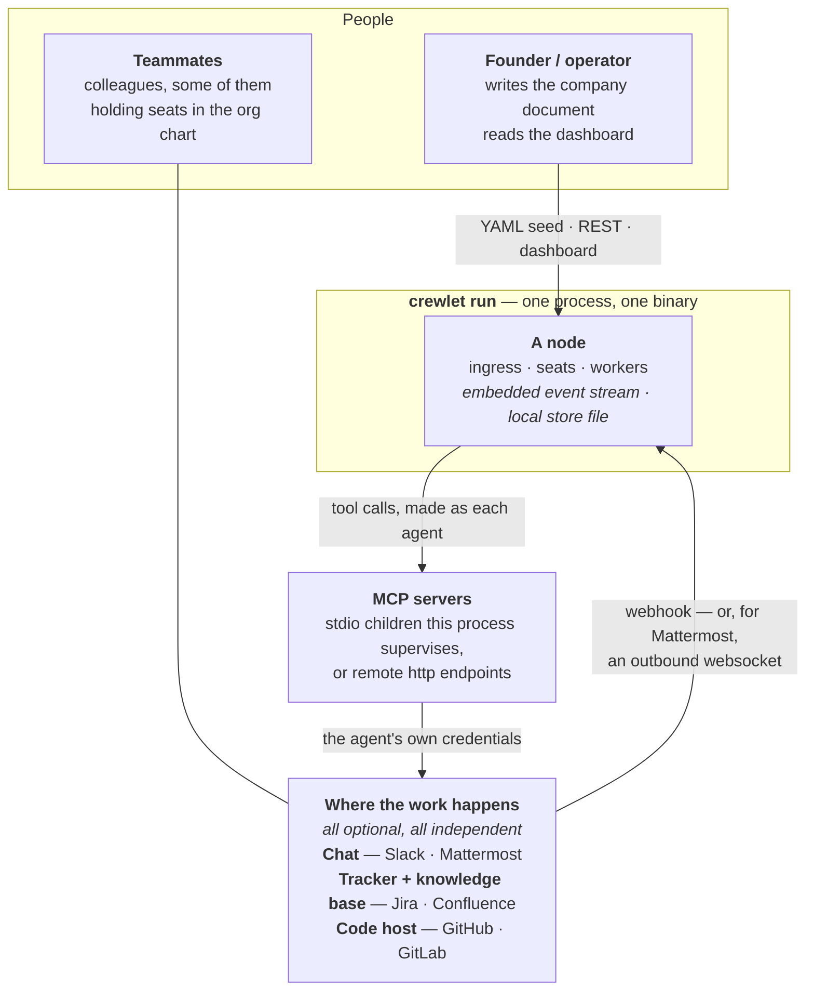
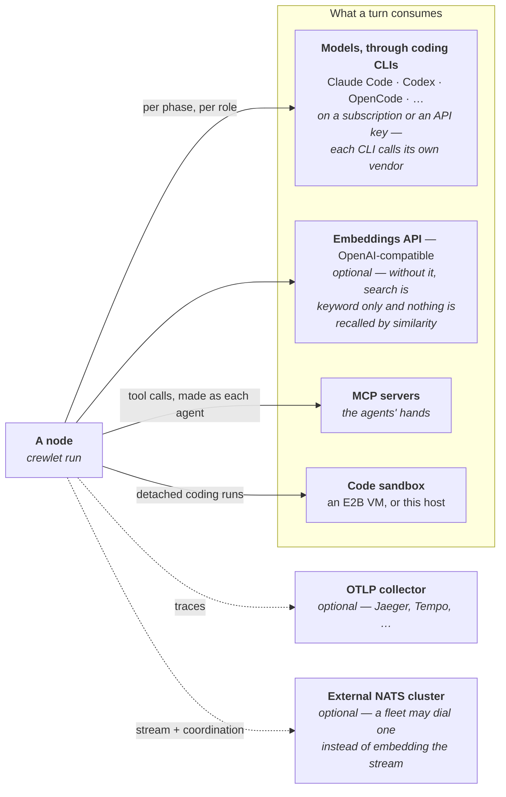
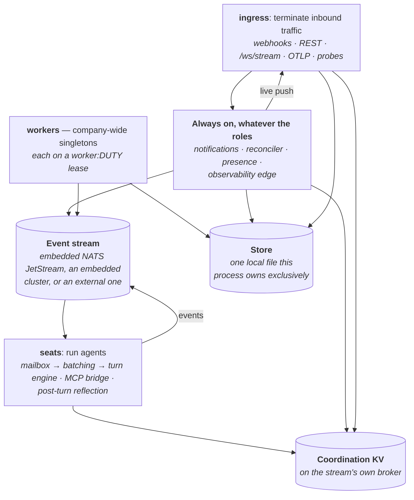
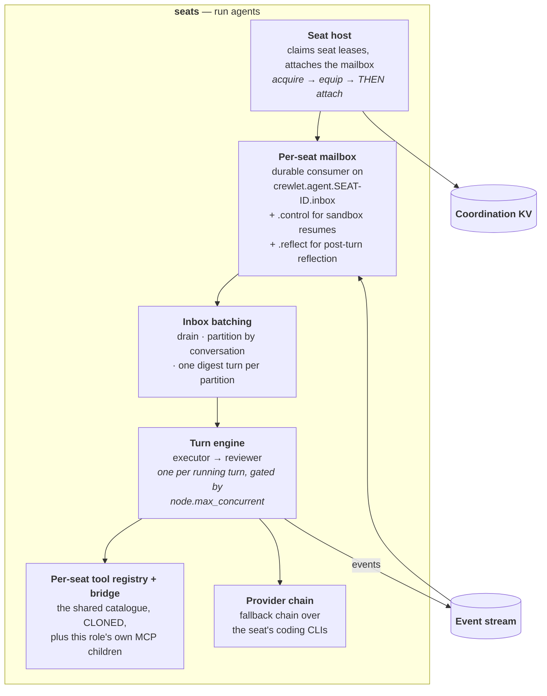
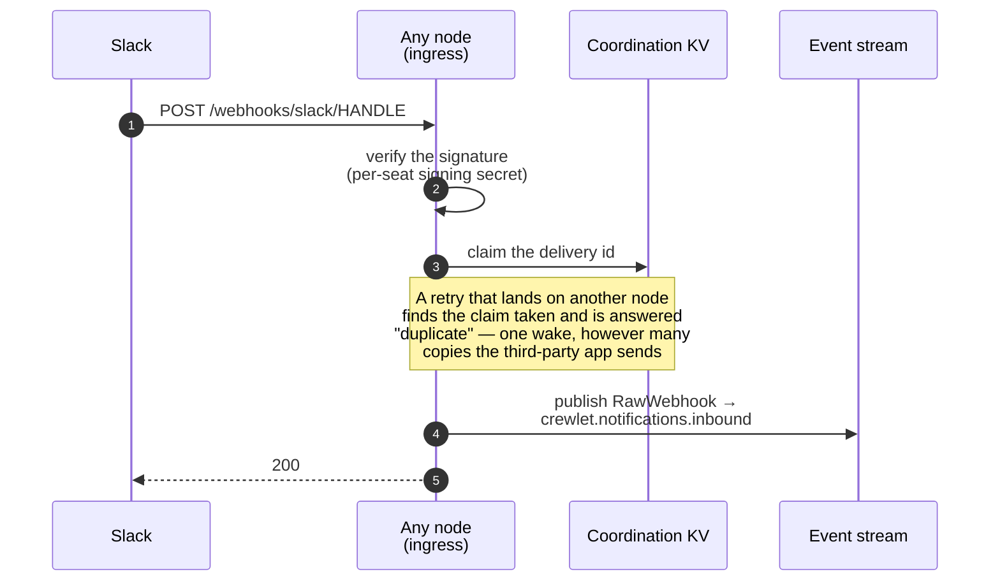
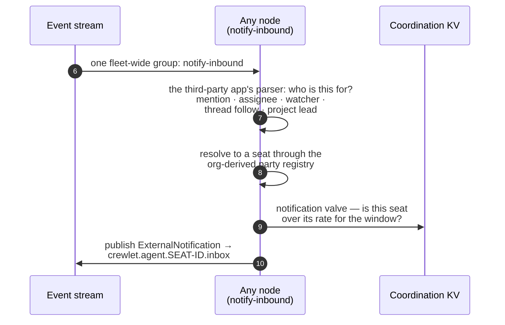
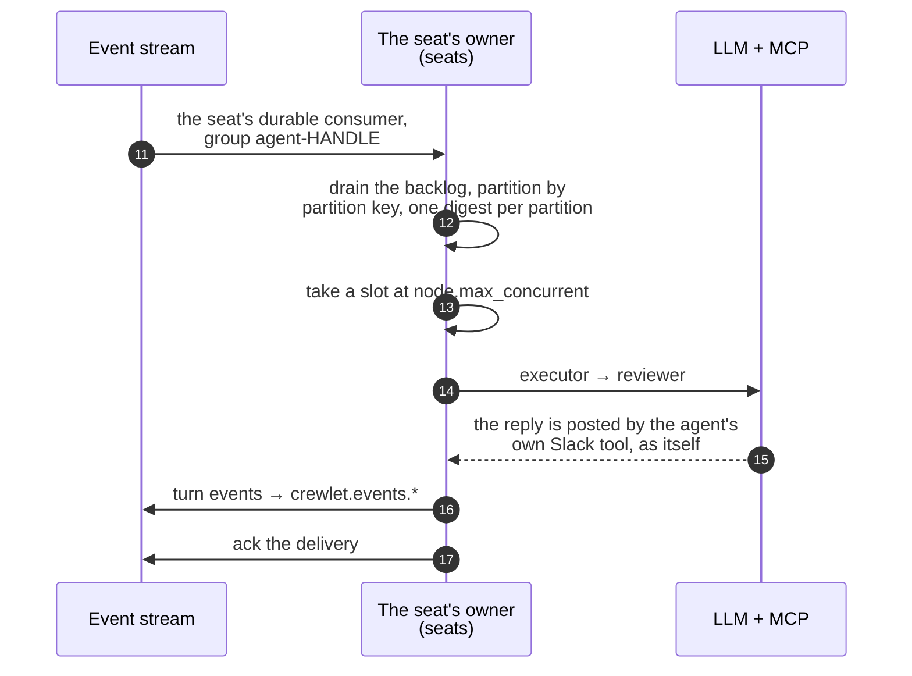
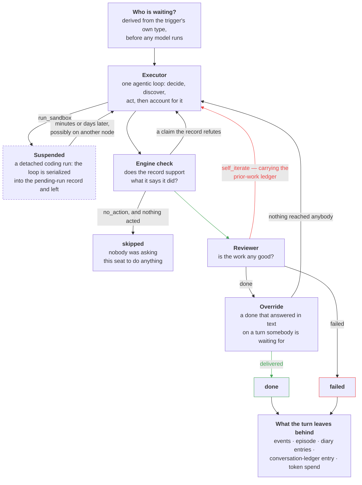
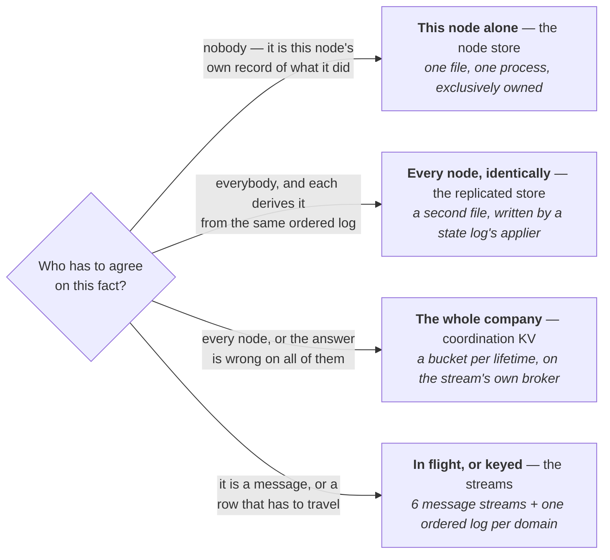
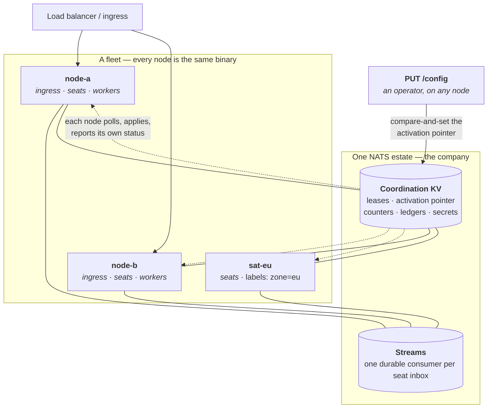

# Architecture

Crewlet is one Go binary. Start it and a company is running: an HTTP surface,
an event stream, a database, a runtime that holds seats and executes turns —
with no broker to operate, no database to provision, and nothing to install
beside it.

This page draws that binary at six zoom levels, from what sits outside its
boundary down to the path a single trigger takes through it. It is a **map**:
every box belongs to a page that goes deeper, and [the last
section](#which-page-owns-which-box) says which. The [Overview](overview.md)
carries the one-diagram version; everything past that is here.

---

## 1. The boundary

Everything Crewlet needs to *run* is inside the process. Everything it needs to
be *useful* is outside it — the surfaces your company already works on, the
models that think, and the tool servers that act.

Two things about that outside half are easy to miss and are the whole design, so
it takes two pictures. The first is the round trip — work arrives on those
surfaces, and it is delivered back to the same ones.

**The engine never calls a third-party app's API on its own account.** It calls MCP
servers, and each seat's server carries *that seat's* credentials
(`role.mcp_env`), so a comment on an issue is written by the agent, not by a
service account fronting for it. The engine's own integration packages exist for the
*inbound* half — verifying a delivery, parsing it, deciding whose it is — plus
provisioning and the two calls a chat transport makes on the seat's own bot
token: the working indicator it raises while the seat thinks, and the thread it
reads back at the start of a turn woken in one. See [Tool
capabilities](tool-capabilities.md) for why no engine prompt names a vendor tool.

The second picture is the supply — what a node reaches out to while a turn runs.
Its MCP servers are the ones above; the two dashed edges are the process-level
connections a deployment may never make at all.

**Nothing outside the boundary is a hard dependency except a model.** No
embeddings means no similarity search — the diary's candidate pool falls back to
recency and the "similar prior work" block renders nothing, both first-class
states rather than failures. No sandbox means no `run_sandbox` tool. No chat,
tracker or code host means an agent has fewer surfaces to be reached on and to
act through, and every other one still routes end to end.

| Outside the boundary | Required? | What it is for | Without it |
|---|---|---|---|
| An LLM provider | **Yes** | Every phase of every turn | Nothing runs |
| MCP servers | In practice | The agents' hands — chat, tracker, wiki, code host | Agents have only the [builtins](agent-runtime.md#built-in-tools) |
| Chat · tracker · code host | No, each | Where triggers arrive and work is delivered | That surface simply routes nothing |
| Embeddings provider | No | Vector recall over `agent_diary` and `episodes` | Recall degrades to recency; episodes render nothing |
| Code sandbox | No | Code authoring as a detached, suspended executor phase | No `run_sandbox`; agents still read and review code over MCP |
| OTLP collector | No | Exported traces | Trace ids are still minted and still stored on every event row |
| External NATS | No | The stream for a fleet that will not embed it | The process embeds its own — the default |

---

## 2. Inside one node

`crewlet run` is *the* node, and what it does is a config value:
`node.roles` picks from `data`, `ingress`, `seats` and `workers`. Declaring none
means all four, which is the single-process company — one process holding the
company's records, serving the API and the dashboard, running every agent, and
performing the company-wide duties. A node without `data` holds no copy of the
replicated estate and answers its seats' tools through a node that does; see
[Scaling Out](scaling.md#a-node-that-holds-no-data).

That is one `crewlet run` process. `node.roles` picks from `data`, `ingress`,
`seats` and `workers` — declare none and you get all four — and the always-on
set runs on every node whatever it says. The three backends are opened together
and closed together; on a node without `data` the store is scratch and holds
the node estate alone.

Three of those four groups are **inventories, not pipelines**: no box inside
`ingress`, `workers` or the always-on set hands work to another box in the same
group. They are named here rather than drawn.

**What a node holds before it serves anything.** The boot order is not a detail
of the implementation; two of its steps exist because of what happens if they
are the other way round.

1. The **backends** — the stream, coordination and the store file — opened together (below).
2. The **core runtime**, on a node that holds `data`: the state log (every registered domain's stream provisioned and its applier started), with the node gate over every identity-claiming log and the [identity estate](identity-and-access.md). On a data node this is unconditional, **with a company or without one**: a node nobody has configured yet is the one a Tier A token's session signs in on to create its company, and the one its first person is invited to and signs in on once that company declares the human seat they will hold, and `ingress` requires `data`, so the node anybody signs in on always has it. A node without `data` runs no core: it applies no log, and reaches the estate, the identity directory included, through a node that holds it. It is every domain rather than the one a companyless node can use, because a join replaces the whole replicated file, a snapshot names every registered domain, and the trim counts nodes per log. What waits for a company is only **Worklet's and Doclet's halves** (their writers and readers, their index, feeds and embedding duty), started here when the node boots on a company that keeps them, or by the first apply that hands it one; on a node without `data` they are the router's remote halves.
3. The **tool catalogue**, equipped onto the company before anything is published — a turn can start the instant the epoch is current, and one that found an empty registry would run a seat with no tools at all.
4. The **epoch**, built from the revision this node boots on — the last one its engine applied, or an offline change it has not published yet ([Control plane](control-plane.md#a-nodes-own-store-keeps-three-facts-apart)) — its organization included, and published. Every reader from here on is a single atomic load. A node that boots on no revision starts unconfigured: the engine never boots on a Tier B file, so a `-company` bootstrap or an `-import-company` file comes in by its import once the node is up. The reconciler then converges the node on the revision the fleet's pointer names.
5. The **node**, its seats, its duties and its inbound edge.

**Two slots and a file.** The stream and coordination are the two *chosen*
backends, validated together — a multi-node fleet cannot coordinate locally, and
a two-member fleet has no quorum. The store is not a third choice: it is this
node's own file, opened with them because everything that writes to it is driven
by them. A node holding one without the others could hear work it may not do,
hold seats it cannot serve, or run turns it cannot record.

**Coordination lives on the stream's broker.** Never a second estate, and never
the store file — see [Coordination](coordination.md) for the line between the
two estates and [section 5](#5-where-state-lives) for which fact lives where. On
an external broker it rides the queue's own connection; on the embedded one it
holds a second connection to the same in-process server, shared with the
seat-memory replay and the backup's stream copies so that neither sits on the
read loop every mailbox consumes through. Two connections can fail
independently, so both are watched: the NATS client closing either one for good
stops the node, and a node holding leases over one connection while the one
carrying its inbox is gone lasts no longer than a reconnect. Only the *lease* half follows `coordination.type`: on a
single node it falls back to an in-process store, while the shared
buckets — the activation pointer, the ledgers, the counters, the company's
secrets — are opened on every topology, because a lone node still has to read
back what it wrote.

**The routes `ingress` terminates.**

| Route | What it is |
|---|---|
| `/webhooks/slack/HANDLE` · `/webhooks/github` · `/webhooks/github/HANDLE` · `/webhooks/gitlab` · `/webhooks/jira` · `/webhooks/confluence` · `/webhooks/confluence/EVENT` · `/webhooks/datadog` · `/webhooks/forge` | The webhook routes. A delivery is verified, then claimed once per fleet, then handed to the notification service. Slack's OAuth landing and the GitHub App return live beside them. |
| `/auth` · `/iam` · `/config` · `/secrets` · `/setup` · `/worklet` · `/doclet/pages` · `/agents` · `/org` · `/tools` · `/query` · `/backup` | The REST plane: signing in, the identity directory, the configuration (the org chart included) and the company's credentials, the human write surface over Worklet and Doclet, and the reads no socket question answers. It writes through the state logs and the coordination KV, and reads the store directly. |
| `/ws/stream` | The dashboard's only read channel: live pushes plus a query channel. The observability edge's projector is what pushes onto it. It carries no write. |
| `/operator/mcp` · `/operator/act` | The operator catalogue — the tracker and knowledge tools a seat holds — served to a person's own assistant over MCP, and to the dashboard's buttons over the act route. Every call acts as the principal the guard resolved: a person writes as the seat they hold, and so does a token or service account the identity directory binds to one; a credential bound to no seat writes under its own login. Always guarded. |
| `/otlp/{token}/v1/{signal}` | Signed-token trace ingest. |
| `/mcp/{token}` | Signed-token tool bridge: one running seat's own tool surface, served to a coding agent in a box. Per-run, expires with the run. A session lives in the process holding the seat, which may serve no API at all, so the node a call reaches relays it to that node over the broker (`internal/httprelay`) and the box dials one address for the whole fleet. |
| `/health` · `/ready` | The two probes — [section 6](#6-one-node-or-a-fleet) says why they answer different questions. |

**`workers` is nine company-wide singletons, each held on its own
`worker:DUTY` lease.**

| Lease | Duty |
|---|---|
| `worker:scheduler` | Role- and unit-scoped cron; a fire is published to the stream. |
| `worker:sandbox-waiter` | Polls detached runs and resumes the turns waiting on them, over the stream. The same tick is the box keepalive. |
| `worker:maintenance` | The retention sweep over the records that answer "recently" rather than "ever", and the retirement of a removed seat's mailbox and coding runs. |
| `worker:integration-reconcile` | The [integration reconcile](integration-reconcile.md) loop: every connected third-party app's pass, on a cadence set by who has to act. |
| `worker:learning` | Every learning background pass: skill ageing, episode compaction, clustering and cross-agent promotion. |
| `worker:retention` | The state logs' trim: each domain's floor terms evaluated, what all of them permit purged, and the conclusion published. |
| `worker:embeddings` | The knowledge base's embeddings, computed once for the company and published as records every data node applies. |
| `worker:iam_sweep` | The identity estate's retention: a sweep record for every bucket that is due, which every data node's applier carries out. |
| `worker:object-collector` | The [object store](object-store.md)'s collection and audit: hourly, the objects no row names and the uploads that never finished; daily, that every object a row names is there and whole. |

**Four more services run on every node, whatever the roles say, and a fifth on every data node.**

| Always on | What it does |
|---|---|
| Notification service | One fleet-wide group, `notify-inbound`: parse → resolve → valve → wake, publishing the wake to the seat's inbox on the stream. |
| Config reconciler | Polls the activation pointer, applies an epoch, and reports in the KV what it attempted and the revision it serves; once an apply succeeds, that revision is what this node boots on. |
| Node presence | The `node:ID` lease in the KV, plus the posture heartbeat. |
| Observability edge | Two routes off one published event: a publish listener writes the store row, a projector pushes it live onto `/ws/stream`. |
| Usage publisher (data nodes) | This node's own days — what its seats, its schedules and the people its auxiliary model spent for spent, ran and read — derived from the rows its own event log **keeps** and republished to `CREWLET_USAGE_LOG` whenever they move: today and yesterday on every tick, any older day a custody batch settled as kept has changed (back to the event log's 30-day read floor), every day it still owed when it stopped, from its watermark, at boot, and today and yesterday once more as it stops in an orderly way. Not a duty: a node's event log holds only what its own seats did, and the batches [custody](../guides/deployment.md#custody-the-rows-of-a-node-without-data) gave it from nodes holding no data, so it is the only thing that can derive its day — a node without `data` keeps no event log, and its spend is counted in the day of the data node that keeps its events. |

`seats` is the exception — the one group whose boxes hand work to each other.
This is what a wake becomes after the stream delivers it:

**Two MCP lifetimes, and the difference is a security boundary.** A
`shared: true` server is one company-wide child bound to the **config epoch**.
A `shared: false` server is a *template*, and each seat gets its own child bound
to that **seat's lease** — spawned before its mailbox opens, killed when the
lease goes. The credentials in one of those children *are* that seat's identity,
and two children of one template publish identical tool names: in a single
registry one would shadow the other and every seat would call whichever won,
acting in the tracker or the chat backend as somebody else. So a claimed seat
gets its own cloned registry and its own bridge.

**One model call has two layers of failure handling, each owning exactly one
decision.** The backend *classifies* and does nothing else — it never retries.
The one thing it holds of its own is a spent plan: a CLI that reported its
vendor's rate limit in the vendor's own words is `rate_limit`, and the entry
then sits out on this node until the reset the CLI named (an hour at most), or
for a minute where it named none, so every round of every seat on it does not
start a process to hear the same sentence again. The fallback chain decides
whether the **model** is worth abandoning and moves to the next one in the
role's chain, publishing a `provider_fallback` event for each hand-off —
addressed to the turn, the phase and the iteration it happened in, so a chain
that only flaps under load is visible on the turn that paid for it rather than
only in aggregate. Exhausting the chain publishes `llm_unavailable` and fails
the turn. The sit-out is the node's own and is not shared with the fleet: an
entry holds one login, every other node learns the same thing from its own
calls once per window, and a coordination read in front of every model call
would put the store under every turn. What a classified failure *says* — in a log line,
`llm_unavailable`, a turn's error — is the backend's own line: how the CLI
exited and the tail of what it printed, or the vendor's own sentence for a
spent plan or an expired login.

**The observability edge is two routes, not one, and the split is deliberate.**
A published event forks. It is written to this node's `crewlet_events` **inline,
in the publishing goroutine**, through a publish listener with no consumer
group — so no two nodes can ever write one row. (A node without the `data`
role has no log to write, so its listener batches its events onto the custody
topic instead, and exactly one data node keeps each batch — see
[custody](../guides/deployment.md#custody-the-rows-of-a-node-without-data).) And it is read back off the
broker by an **ephemeral broadcast** subscription on `crewlet.events.>` that
feeds the live projection — so a dashboard tab attached to node B shows turns
that ran on node A. Swap either mechanism for the other and you lose the
guarantee the other one was providing.

The two sets are not identical, and each exception carries its reason in
`internal/events`: a few types are live-only — a per-round progress signal, a
snapshot of the shared token counter, because persisting them would fill the log with
intermediate states of rows it already holds finished, or replay a reading
of a counter that has moved on as though it were current. What the
projection shows and what the store keeps are two questions with two answers.

**The API is served inside the engine's process, and only there.** `crewlet run`
builds it over the engine's own store, broker and coordination plane; a node
without the `ingress` role serves only its two
[probes](../reference/api-endpoints.md#probes-on-a-node-without-ingress) on
`api.port`, and a node with `api.port: 0` serves nothing at all. `node.roles` changes what the engine
*does*, never whether there is one, so every API answers its node's in-flight
count, seats, posture and applied epoch rather than reporting them as
unknowable.

**The listener binds before the boot, and the HTTP surface serves before the
engine starts.** `crewlet run` binds `api.port` (and `api.public` and
`api.artifacts`, where the node serves them) as soon as it has checked its
Tier A, and until the node serves, that socket answers what
a starting node answers: `/health` `503` while the node recovers what it holds
— its store, its broker, its copy of the estate, which only the deployment can
bound — and `200` from then on, while what the company configures comes up;
`/ready` `503 starting`; every route it will serve `503 starting` with a
`Retry-After`
([While a node is starting](../reference/api-endpoints.md#while-a-node-is-starting)).
The line between the two halves is the engine's own: `engine.Options.Recovered`
is called once, at the boundary, and a startup probe sized for the store (and,
on a data node of a fleet, for its join) is never held by a tool server the
company declared.

Then the node's surface takes the socket over, and only after that does the
engine start claiming seats. A seat is not claimed until its per-role MCP
children are up — one subprocess per server per seat, each a spawn, a handshake
and a `tools/list` — and on the example company, whose one `shared: false`
server is Mattermost, that is 7 children; a company with a tracker, a wiki and
a code host wired in runs three times that. Serving first means the dashboard,
the REST API and every webhook route answer during that window, and `/health`
says honestly that this node holds no seats yet: its `seats` list is the seats
claimed so far, which is none. `/ready` carries no seats at all. Webhooks
arriving in the window are retained rather than dropped, because a seat's
mailbox is created before any claiming.

---

## 3. The path a trigger takes

A person mentions an agent in a Slack thread. Here is every hop between that
message and the agent's reply — across a fleet, where the node that *receives*
the delivery is rarely the node that *runs* the seat.

It is drawn in three legs, one per process that touches the delivery: on a
fleet those are usually three different processes, and on one node they are
three parts of the same one. Each leg ends by publishing to a subject and the next
begins by consuming from it — the seam between the pictures is the seam in the
architecture, and no hop is hiding in it. The coordination store and the event
stream appear in more than one leg; there is one of each, company-wide, not one
per picture. The step numbers run 1–17 straight through.

**Leg 1 — the node that took the delivery.** Verify it, claim it, publish it,
and answer the third-party app only once it is on the stream.

**Leg 2 — any node in the inbound group.** It takes the delivery off
`crewlet.notifications.inbound`, works out whose it is, and publishes a wake
onto that seat's own subject.

**Leg 3 — the node holding that seat.** Its mailbox is a durable consumer on
`crewlet.agent.SEAT-ID.inbox`. Everything from there is the turn, and the reply
leaves as the agent rather than back down the path it arrived on.

Five properties of that path are worth stating on their own, because each one
is why a step exists at all.

**The delivery is claimed before it is published.** Two concurrent retries must
not both wake a seat, and a third-party app retrying reaches whichever node a load
balancer picks — so the claim lives in the fleet's coordination store, not in
the receiving node's memory. Publishing then comes *before* the store row and
the live push, because the publish is the only step that has to happen: a
delivery that reached the stream will be worked even if the receiving process
dies in the next instruction. A publish that fails releases the claim and
answers 503, so the third-party app's retry finds the delivery unclaimed.

**Routing is a publish, never a call.** The inbound consumer group is
fleet-wide, so the node that wins a delivery is usually *not* the node running
the recipient. Every resolution goes through the org-derived registry — seat
ids are a UUIDv5 over `(org name, handle)`, so every node computes the same
answer with no database and no running instance — and every wake is a publish to
the seat's inbox subject. A service that resolved against local state would drop
most of a fleet's mail.

**The mailbox exists whether or not the seat is running.** A seat's inbox is a
durable consumer created with nothing attached, and it retains what is
published while no node holds the seat. That is what turns three otherwise
alarming moments — a rolling upgrade, a seat moving between nodes, a node that
has not finished booting — into non-events rather than lost messages. It is
also why every node creates a mailbox for *every* seat in the company rather
than for its own share: the mailbox streams use interest retention, so a
publish to a subject no durable consumer covers is dropped in silence.

**One trace covers the whole path.** The webhook edge starts the span, the wake
event carries `trace_id` and `parent_span_id` forward, and every event the turn
publishes hangs beneath it — so a delivery and the turn it woke are one story at
the collector, and the same ids are columns on the event rows whether or not a
collector exists.

**There are two inbound edges, not one.** Six third-party apps plus Atlassian's Forge
relay arrive as verified HTTP on `/webhooks/*` and take every step above — five
of them verified by an HMAC over the body, and Datadog by a constant-time
comparison of a shared token, because its provider attaches only fixed-value
headers and so has nothing varying with the payload to sign.
Mattermost does not: every node holds **one websocket per seat**, outbound,
so it needs no public URL and no signing secret — and it joins the picture only
at the republish onto `crewlet.notifications.inbound`, after the same kind of
fleet-wide claim the webhook edge takes, because every node reads every seat's
socket and only one may deliver each post
([Running on a fleet](../integrations/mattermost.md#running-on-a-fleet)).
Both edges record each delivery as an `inbound_delivery` event. Everything
from that subject onward is identical for both.

A schedule firing, an `a2a_ask` from a colleague and a sandbox run completing
enter further down still: they publish straight to
`crewlet.agent.SEAT-ID.inbox` (or `.control`), and everything from the mailbox
onward is identical again.

---

## 4. The path a turn takes

Every trigger that reaches a seat runs the same two-stage turn — a batch of
triggers for one conversation is one turn. What varies is how many rounds it
takes, and whether the turn survives its own process.

**Two nested loops, not one.** The outer loop is the turn: executor → reviewer,
re-entered on `self_iterate` up to `turn_engine.max_iterations`. The inner loop
is the model↔tool round trip *inside each phase*, bounded by its own cap
(`max_tool_rounds` for the executor; a constant for the reviewer, which holds
one submission tool). A turn is therefore up to `max_iterations × (executor
rounds + review rounds)` priced model calls, which is the number to reason
about when sizing a budget — not "one call per turn".

**One loop where there were two, and that is the point.** The engine used to
plan in one conversation and act in another; the actor lost everything the
planner had read, and the planner had to name its tools in advance against a
catalogue it was never shown. The executor decides and acts in one place, so it
carries the whole picture — identity, policies, the team roster, and the
**turn-start prefetch**. That prefetch is six blocks rendered concurrently
*before the turn starts*: the chat thread the turn was woken in, personal
memory, relevant knowledge, similar prior work, known counterparty and
synthesized skills. A first turn's onboarding is not one of them: it is a
pass of its own that runs before the executor. The reviewer's question is narrower and its
prompt is smaller: is this round's work right, given the record. A frontier model can do the work while a cheap one
reviews; see [Turn Engine](turn-engine.md).

**Tools are discovered, not enumerated.** A role with 50–150 MCP tools would
send 15–25 KB of tool definitions with every model request, so the executor sees
*server names* and walks `list_mcp_server_tools` → `activate_tool` to promote
what it actually needs. From the model's side a builtin and an MCP tool are the
same thing: two tools of the one `crewlet` server its CLI lists, which the
engine answers ([Tool calls in host mode](llm-backends.md#tool-calls-in-host-mode)).

**A suspended turn is the reason there is no parked goroutine anywhere.** A
detached coding run stops the executor's loop mid-round with its `run_sandbox`
call *unanswered*, and the conversation is serialized into the pending-run
record rather than held in memory. The run outlives the process: it may be
resumed after a restart, on a different node, days later once a person answers
the agent's question. The record carries an explicit version, a permanent
reader for the previous one, and a build that understands neither refuses
loudly and leaves the row untouched.

**Whether anything was DELIVERED is the engine's judgement, not a model's.**
Who is waiting comes from the trigger's own type before the turn starts; what
actually ran is the tool loop's own record. The two are checked three times, in
increasing cost: a delivery claim is refused at decode time where one bounced
tool call fixes it; a claim the record refutes loops the round back without
spending a review call; and a reviewer's `done` on a turn that answered in text
where a tool was owed is overturned. The two failure modes this exists for are
a seat that composed a reply and never posted it, and a seat that posted it
twice.

**Nothing about a turn's shape is ambient.** The configuration a turn reads is
taken by value at the top of the turn from one immutable epoch, so a config
apply landing mid-turn cannot change the round cap between the executor and the
reviewer. A turn holds the company it started under until it ends.

---

## 5. Where state lives

Four estates, and which one a fact belongs to is decided by a single
question: **who has to agree on it?** — with the fourth answering a second
question the first three cannot: *and does everybody have to reach the same
answer by the same route?* Beside them sits the one thing that is **named**
rather than held by everybody — the bytes of a company's files, which a
replicated row names and one store the whole fleet shares keeps (below).

**Why the store is two files and not one.** A snapshot is a copy of ONE
estate: a node too far behind to replay fetches a peer's replicated file and
installs it wholesale, and that file must not carry the donor's audit log, its
learning rows or the bootstrap half of its secret store. Taken from a single
file the artefact would be a copy of everything followed by a delete — and
with no in-place `VACUUM`, the deleted pages ride along in the artefact, the
transfer, the checksum and the integrity check anyway. No transaction spans
the two and no read joins across them.

What each of the four holds, in full:

**This node alone — the store.**

| Tables | What they hold |
|---|---|
| **`crewlet_events`** · `crewlet_event_parties` | The audit log and its party index — this node's own events, and on a data node the batches of a stateless node's events it **keeps** ([custody](../guides/deployment.md#custody-the-rows-of-a-node-without-data)) |
| `custody_unsettled` · `custody_unsettled_rows` | The custody batches this node has written and not yet learned whether it keeps, and the identity of every row of each: the fleet decides which data node keeps each batch, create-only in coordination, and a node that crashed between writing a batch and claiming it asks at its next pass and deletes the rows if another node keeps them. The rows are keyed on the event log's own (time, id), so every count that leaves a batch in flight out seeks them from the row it counts — its cost the same beside a few identities as beside the tens of thousands a coordination outage leaves. Normally empty but for the batches of the last few moments; a coordination outage can leave tens of thousands, and a batch whose keeper record [nothing can read](../guides/deployment.md#custody-the-rows-of-a-node-without-data) stays until it ages past the event log's retention |
| `custody_settled` | The custody batches this node has **settled**, kept or not, so a batch the fleet redelivers — an acknowledgement lost — is written nothing: its kept rows stay counted, and a copy another node keeps is not written back. Swept with the event log |
| `usage_rederive` | The days a custody batch settled as **kept** has changed since this node's usage publisher last derived them. Every usage count leaves a batch in flight out, so a kept settle makes its rows count on whatever day they fall — possibly a week back — and the publisher, which fingerprints only today and yesterday, derives every day from the oldest of these through the day before yesterday again (none older than the event log's thirty-day read floor). Written in the settle's own transaction, one row per UTC day the settles' oldest rows fall on, and cleared up to the newest the publisher read once those days are published |
| `usage_day_windows` | The instants each of this node's company days was first cut on, by label. A day the usage publisher derives again — an older one a kept settle or the watermark names, or today and yesterday at the tick the company's `timezone` moves — keeps the cut its first derivation had, so a moved clock never shifts rows between days already published; a day cut for the first time abuts the cuts either side of it, and is clamped by any farther cut it would reach into after a move of more than a day, so the day the clock moved on is longer or shorter and no instant falls in two days or none. Swept with the event log |
| `usage_watermark` | The oldest of this node's days its usage publisher has not confirmed published whole — the day before the newest it fingerprinted, or an older one a tick could not settle. A start derives every day from it again, which is how the tail of the day a node stopped in reaches the fleet when it comes back days later; one row |
| **`agent_diary`** · **`episodes`** | A seat's notes and turns, each with the vector of the model it came from — recall is a per-seat scan the database ranks, with no vector index |
| **`synthesized_skills`** · `synthesized_skill_versions` · `counterparty_profiles` · `agent_onboarding_markers` | The rest of the learning subsystem — skill induction and its versions, counterparty profiles, first-turn onboarding markers |
| `memory_change_sequence` | One counter, which every new diary note, episode and skill version — and every vector set on a note or an episode — is stamped from, so the [memory changelog](seat-ownership.md#a-seats-memory-follows-it) carries what changed since its last cycle. It only ever increases: a row's rowid is handed out again once the newest row is deleted, and a watermark over it skipped the next row written |
| **`conversation_sessions`** | What this seat already said in that thread |
| `company_config` · `scheduled_runs` | Every config revision this node has met, with three facts only it can know — the revision it boots on, the fleet's revision as it last saw it, and an offline change it has not published ([Control plane](control-plane.md#a-nodes-own-store-keeps-three-facts-apart)) — and cron bookkeeping. Which revision is the company is the activation pointer, below, never a row here |
| `kb_docs` · `kb_postings` | The **lexical** half of the knowledge search index over those rows, built asynchronously behind them and droppable wholesale when the analyzer changes. The semantic half is not here — an embedding costs a provider call, so it is derived once by the fleet and lives in the estate below |
| `page_links` | Which pages and tasks link to which page: the **backlinks**, derived by the same indexer from the same bodies it tokenises (`doclet.Links`), so a page answers "linked from" with no scan of anybody's text. Cascades from `kb_docs`, and rebuilt by the same local walk |
| `statelog_adoption` | This node's own history of the peer snapshots it has adopted — which donor's artefact, when the join began and whether it completed. Nothing on the write path reads it: the operation ledger travels inside the snapshot with its own watermark |
| `statelog_diverged` | This node's finding that a log **diverged** from its rows — the broker was restored from an older copy and another record now sits at the node's checkpoint — keyed to the stream, the checkpoint and both records' broker instants. Kept here rather than only in memory because the log can lose the record it was found by (an evicted node's checkpoint stops pinning the trim), and a restart must not then apply the other history on top of these rows. It holds while the checkpoint names the same record, so a reanchor or an adoption is what ends it |
| `stream_identity` | What this node last saw of each stream's identity, which is how it notices one that was recreated underneath it. A per-node **observation** rather than shared state: two nodes can legitimately have seen different generations, so one agreed value would destroy the comparison it exists to make |

**Every node, identically — the replicated store.**

One file, the replicated estate, which every data node holds whole — written by
a state log's applier:
records arrive in one order from the log, every data node applies the same ones,
and the rows plus this node's position on the log commit in a single
transaction. There is no leader
and no node whose copy is the real one.

**Three schema rules hold over every replicated migration**, and they are one
rule underneath: a statement that can abort inside an apply transaction aborts
on every node at once, so what would be a rare anomaly on one node is a
fleet-wide stalled log instead. **No foreign key** — a cascade is a delete
nobody committed, and an applier removes a row's children in its own statement
list, where the deletion is part of the record's effect. **No `UNIQUE` outside
a primary key** — uniqueness a writer has to see whole is arbitrated on the
record's subject at the broker, where exactly one of two writers wins and the
loser is told; a unique index cannot tell anyone anything, it can only wedge
every applier. **No `COLLATE`** — the default TEXT collation is BINARY, so an
`ORDER BY` reproduces the Go comparison exactly, and the pinned driver accepts
`COLLATE NOCASE`, which would silently collapse `A` and `a` against a
normalisation Go already did once. The node estate is deliberately not governed
by any of them: one file, one process, no applier and no peer, so a constraint
there fails one statement for one caller, which is what a constraint is for.
`internal/store.TestNoReplicatedMigrationDeclaresAConstraintTheApplyCannotSurvive`
is what makes the three real, and it reads past the prose that names them.

**Two writes in the engine are not records**, and each is a column or a row
no record could own: the clear of a duplicate-rank probe flag each node's own
applier sets, and the inbox sweep over rows whose class lets two nodes
legitimately hold different ones. They are named with their reasons in one
place, and a third fails the build — the rule and its exceptions are
`adr/0002`, held by `internal/store.TestOnlyTheApplierWritesTheReplicatedEstate`.
A log reanchor is not among them: it writes the framework's own checkpoint,
and the audit row it leaves is applied from the generation record it appends
to the adopted log.

| Tables | What they hold |
|---|---|
| **`tracker_tasks`** · `tracker_comments` · `tracker_history` · … | The company's work — the tracker's whole state, derived from `CREWLET_TRACKER_LOG` |
| **`pages_heads`** · `pages_revisions` · `pages_titles` · … | The company's knowledge base, derived from `CREWLET_PAGES_LOG`: a page's current body, the immutable revisions behind it, and the title claim that is what makes a name an address |
| **`kb_vectors`** · `kb_vectors_bin` · `kb_ivf` · `kb_ivf_centroids` · `kb_ivf_rollout` · `kb_ivf_lists` | Page and task embeddings, their 1-bit codes, and the semantic index filing those codes in lists — its head, its centroids and the re-filing its training cut are a record on the same log, and the per-list counts are kept beside the rows they count ([ADR-0028](https://github.com/crewlet/crewlet/blob/main/adr/0028-the-semantic-first-stage-is-an-index.md)) — derived from `CREWLET_TRACKER_VECTORS`. The fleet pays the provider bill **once** and every data node holds the answer, which is precisely why these are not in the node's own file |
| **`iam_people`** · `iam_credentials` · `iam_invites` · `iam_sessions` · `iam_revocation_epochs` · `iam_session_generation` · `iam_history` | The company's identity estate, derived from `CREWLET_IAM_LOG`: the people and machines who can act, the verifiers they prove themselves with, the invitations that enrolled them, their sessions, the two counters that end sessions, and the authentication trail — see [Identity and Access](identity-and-access.md#the-seven-tables) |
| **`usage_tokens`** · `usage_turns` · `usage_reads` · `usage_schedule_runs` · `usage_person_tokens` | What each node's seats, schedules and people did each company day — spend by phase, worker, model and provider slot; ended turns and how they ended; the pages seats read; every fire; and what the auxiliary model spent for a person (a question answered on the operator surface), filed under the human seat they hold rather than an agent id — derived from `CREWLET_USAGE_LOG`. Every data node publishes its own days and applies everyone's — a node holding no data has its events, and so its spend, kept by a data node through custody and counted in that node's day — so spend history is answered fleet-wide and outlives the node that spent it (ADR-0020). Kept 181 days, aged out by the applier rather than a sweep |
| **`artifacts`** · `artifact_versions` · `artifact_objects` · `artifact_assets` · `artifact_source_claims` · `artifact_shares` · `artifact_pins` · `artifact_reads` · `artifact_history` · `artifact_usage` | The company's artifacts, derived from `CREWLET_ARTIFACTS_LOG`: each artifact's head and owner, its retained versions with their canonical manifests (a hundred unlabelled ones plus every labelled one), the objects those versions and its live assets name, its republish-in-place address, who it is shared with and at what role, each person's pins and when they last opened it, what happened to it (a year of history, refusals included) and the company's counters the stamped quotas are enforced against. The bytes are the [object store](object-store.md)'s, and `artifact_objects` and `artifact_assets` are declared in its references so the collector never deletes a file a retained version or a live asset still names |
| **`artifact_data_stores`** · `artifact_data_collections` · `artifact_data_paths` · `artifact_data_docs` · `artifact_data_fields` · `artifact_data_writes` · `artifact_data_touches` · `artifact_data_usage` | Each artifact's datastore, derived from `CREWLET_ARTIFACT_DATA_LOG`: the store's catalogue row (its schema version, its on-disk footprint and its state digest), its collections with their columns and rules, the field paths interned to compact integers, every document as its canonical body with who created and last changed it, the field index a query is compiled against, seven days of history (at most 8 MiB per store, each row carrying who wrote, the verdict, the values each changed field held before and after, and the digest the store held after it, which is what an undo and a cell's history read), which documents each history row changed, and the company's footprint the plan quota is enforced against. Every node decides each write from the authority stamped into it and the rows alone, so a refusal is the same refusal on every data node |
| `statelog_cursor` · each domain's operation ledger and deferred records · `statelog_ops_lost` · `statelog_ops_lost_kind` | Where this node is on each log, which operations have already been applied — a record that travels inside a snapshot — and how far back that record may have lost rows to the sweep, so a retry older than that is answered `unknown` rather than applied twice. A ledger that sweeps one kind of operation sooner than the rest — the identity estate's sessions, after an hour — records that kind's loss on its own, so every other kind is still vouched for over the month. And any record a newer build wrote that this one cannot decode |

**The whole company — coordination KV.**

| Bucket | What it holds |
|---|---|
| **`crewlet_leases`** | `node:` · `seat:` ownership, and nothing else. The bucket's age **is** the lease TTL |
| **`crewlet_duties`** | `worker:` ownership, and every other lease, Worklet's `move:` · `merge:` · `bulk:` claims among them. Each record is judged by its own deadline; the bucket's age only has to outlive the longest duty |
| **`crewlet_epochs`** | The monotonic fencing counter, which a single node's in-process leases mint from too, since their tokens are written into records that outlive the process. No age at all (see below) |
| **`crewlet_config`** | The activation pointer and its payload — the pointer's own revision **is** the epoch |
| **`crewlet_status`** | One key per node: the epoch and revision it last attempted, how that went (`error` or `degraded` is a refusal), and the revision it serves. A refused re-activation of the revision a node already runs names one revision in both, so a refusal is read from the status, never from the two differing |
| **`crewlet_ledger`** · **`crewlet_claims`** · `crewlet_fires` | Turn completions, webhook delivery claims, scheduled-fire claims |
| `crewlet_rebases` | The instant a unit of work's writes are minted at when its own start is older than the operation ledger remembers, so a crash re-run, a retried resume or the next half of the turn mints where the attempt before it did. The bucket's age, 30 days, is the ledger's retention |
| **`crewlet_token_windows`** · `crewlet_rate` | The token counters (one record per scope, a slot for each calendar window, aged 32 days past its last charge) and the rate windows of the notification valve and of a person's Dashboard Assistant turns, each window at most a minute wide and kept three |
| **`crewlet_secrets`** · `crewlet_channels` · `crewlet_sandbox_runs` | The company's sealed credentials, open A2A channels, detached coding runs |
| `crewlet_follows` | The chat threads each seat follows, so the next reply wakes it whichever node claims that delivery. The bucket's age, 90 days, is the last-activity horizon |
| `crewlet_objects` | The [object store](object-store.md)'s **backend record** (`nats` or `s3:<endpoint>/<bucket>/<prefix>`, written create-only by the first node to boot and compared by every node after it, which refuses to boot configured with another store), and the `object-collector` duty's **last report**, replaced by each pass so every node's `/fleet` shows it whoever ran it, and the `trash-reaper` duty's, which the next holder of the duty resumes from. **No age**: an expired record would let the next node record a different store and split the company's files between two |
| `crewlet_custody` | Which data node keeps each batch of a stateless node's events: claimed create-only by the data node that wrote the batch, after it wrote it, so exactly one node's log keeps it ([custody](../guides/deployment.md#custody-the-rows-of-a-node-without-data)). The bucket's age, 32 days, outlasts the event log's retention, so a node settling a batch it wrote before a crash always finds the answer |
| `crewlet_uploads` | The bytes an artifact's upload intents have **reserved** and no record names yet: one ledger of every hold the company has outstanding, written by compare-and-set so two intents racing for the last of a budget cannot both win, and one record per upload naming the keys the engine minted for it and how far each transfer got. The bucket's age, 30 hours, outlasts the longest hold a reservation keeps (until the [object collector](object-store.md) could have deleted the bytes), so an abandoned upload's record goes on its own |
| `crewlet_integrations` · `crewlet_mailboxes` | Each surface's reconcile status, and the seat mailboxes that may exist so a removed seat's can be retired |
| `crewlet_statelog_positions` | **Four key classes**, all answering what the log may delete: each node's position per domain; the trim holds a backup or a join takes; what each owner's newest backup covers, which is the only input the backup term has; and the floor the trim published, with the term holding it and how long it has been holding — the last is the one nothing can re-derive, because a duty that moves on a lease carries no memory across the move. **No age at all**, and this is the one where an age would be worst — an expired position reads as a node that has applied *nothing*, which either pins the trim for ever or, read the other way, deletes records that node still needs |

**In flight, or keyed — the event stream.**

| Stream | Subjects |
|---|---|
| **`CREWLET_AGENT`** | `crewlet.agent.>` |
| **`CREWLET_NOTIFICATIONS`** | `crewlet.notifications.>` |
| **`CREWLET_EVENTS`** | `crewlet.events.>` |
| **`CREWLET_CONFIG`** | `crewlet.config.>` |
| **`CREWLET_MEMORY`** | `crewlet.memory.>` — *one message per subject: a keyed table, not a log* |
| **`CREWLET_DLQ`** | `dlq.>` — *deliberately outside* `crewlet.*` |
| **`CREWLET_CUSTODY`** | `crewlet.custody.>` — the events of nodes without `data`, in batches, until one data node keeps each; a mailbox (interest retention) aged at the event log's horizon. *Outside* `crewlet.events.*`, whose broadcast every dashboard streams |
| **`CREWLET_TRACKER_LOG`** | `crewlet.tracker.log.>` — **the write-ahead log the replicated estate's tracker tables are derived from.** One subject per object, which is what makes the subject the unit two writers contend on; retention is bounded by durability rather than by age. Two of its subjects carry no object at all: **`…log.barrier`**, which every `linearizable` read appends one record to and then waits for — the acknowledgement is what proves a quorum agrees on a position, where a field read can be served by an isolated former leader; and **`…log.rankorder.<PROJECT>`**, which is where a board drag is arbitrated, so two people reordering one project's board contend and two reordering different ones never do |
| **`CREWLET_TRACKER_VECTORS`** | `crewlet.tracker.vectors.>` — the same shape for embeddings, **compacted**: one message retained per subject, because the current embedding of a source is the only one anybody wants and a history of superseded vectors is a bill nobody asked for |
| **`CREWLET_PAGES_LOG`** | `crewlet.pages.log.>`, **the ordered log the replicated estate's knowledge base is derived from**, and the state log's third domain. The same shape as the tracker's: one subject per object, so two writers saving one page contend at the broker and two saving different pages never do. Retention is bounded by what every node has already applied rather than by age, because a page is a fact for the life of the deployment and removing one is a decision somebody takes rather than a horizon that reaps it while a person is still reading it |
| **`CREWLET_IAM_LOG`** | `crewlet.iam.log.>`, **the ordered log the replicated estate's identity tables are derived from**, and the state log's fourth domain. It is the one where the SUBJECT IS THE CONSTRAINT: the replicated estate forbids a `UNIQUE` index outside a primary key — a constraint violation inside an apply transaction aborts it deterministically on every data node at once, which here would be every login in the company — so there is no uniqueness check anywhere in the schema, and what keeps two people from taking one address is that every write that sets or frees an address, a login or a seat is ONE record on ONE subject, `…log.directory`, decided in a snapshot of every row: two such writes contend at the broker, and the second is decided again against the first. A session arbitrates on its own lineage, `…log.session.<lineage>`, and a person's content on `…log.person.<id>`. A session writes one record when it opens and one when it closes and nothing in between — a re-issue moves a deadline inside the signed bearer and records nothing — so this log grows with sign-ins rather than with requests |
| **`CREWLET_USAGE_LOG`** | `crewlet.usage.log.>` — the state log's fifth domain, **compacted**: one message per (kind, node, company day, seat or schedule), each the object's whole cumulative value, republished by the node that owns the day whenever it moves and aged out after 181 days. The node is part of every subject, so each object has exactly one writer and nothing is arbitrated |
| **`CREWLET_ARTIFACTS_LOG`** | `crewlet.artifacts.log.>`, the state log's sixth domain, strict and identity-claiming: every create, publish, rollback, share, transfer, trash and purge of an artifact. Every record that adds or removes an object reference arbitrates on the artifact's own subject, `…log.artifact.<id>`, so the broker orders every carry of a file against every removal; a republish-in-place address is a create-only `…log.source.<owner>.<token>`, an asset rides `…log.asset.<artifact>.<asset>` and a person's pins `…log.reader.<seat>`. A record the applier's rows refuse (a head that moved, a carried object no longer named, a quota crossed) is applied as its history row with the reason, on every node alike |
| **`CREWLET_ARTIFACT_DATA_LOG`** | `crewlet.artifactdata.log.>`, the state log's seventh domain, strict and identity-claiming: every write, undo, schema change and purge of an artifact's datastore, on one subject per store, `…log.store.<artifact>`, because the store is the unit a batch is atomic over. A write is **sequenced**, not arbitrated: it carries no expectation, the log orders it against every other write to that store, and the applier decides it, guards and quotas included, so two people editing one sheet never contend at the broker. A schema change is arbitrated on the same subject, so it is decided against every write it migrates. A write the rows refuse is applied as its verdict, with the reason, on every node alike |
| `OBJ_crewlet_files` | `$O.crewlet_files.>` — the [object store](object-store.md)'s bucket, `crewlet_files`, on the default `nats` backend only: one object per upload, named `files/<key>` by a key minted for that upload and never reused, and kept as a run of 128 KiB messages in NATS's own object store format. An ordinary stream at `stream.replicas` copies, so the company's files survive what its logs survive and every backup snapshots it with the rest. Absent when `store.objects.backend` is `s3` |

**Named, not replicated — the object store.** One kind of state answers "who
has to agree on it?" with *the row does, and the bytes do not*: the content of
a company's files. The row naming a file — its path, its version, its size and
SHA-256, and the key of the one object holding its bytes — is in the replicated
store like every other tracker row. The object itself, stored once per upload
under a key minted for it, is kept in **one store the whole fleet shares**,
named by every node's Tier A `store.objects`:
by default a JetStream object store bucket on the fleet's own broker,
`crewlet_files`, backed by the stream **`OBJ_crewlet_files`** at
`stream.replicas` copies like every other stream, or an S3-compatible bucket.
Every node reaches it directly, a node without `data` included. Nothing here is
derived by replay, and the engine places nothing: the store keeps its own
copies, and the one thing the engine runs beside it is the `object-collector`
duty, which deletes the objects no row names, abandons uploads that never
finished, and audits that every object a row names is there and whole. See
[Object Store](object-store.md).

**Mailboxes and event history are different kinds of stream.** The two
mailbox streams use *interest* retention — a message lives until its durable
consumer acks it, which is what makes a seat's inbox a mailbox rather than a
log. The event, config, memory and dead-letter streams use *limits* retention:
events and dead letters age out, config nudges age out within the hour because
losing one costs a poll interval and never a revision, and memory has no age
bound at all — what a seat should still remember is the learning subsystem's
decision, not the broker's.

**A seat's memory follows the seat.** Memory is written to the *node's* store,
and placement moves seats — so every memory row also rides
`crewlet.memory.SEAT-ID.TABLE.DIGEST`, one subject per row, on a stream that
retains exactly one message per subject. By the seat's **id**, as its lease
and its mailbox are named. A node acquiring a seat replays that
seat's rows in a single pass and hydrates them **before** the mailbox is
attached. Deletes deliberately do not travel: the lifecycle re-converges, and a
tombstone protocol would be a second thing to keep correct forever.

**The line was learned, not designed.** Migrations `0010`–`0013` are what
breaking it cost: the delivery dedupe, the completion ledger, the config
activation pointer, per-node apply status, the token counter, the A2A channel
ledger and the detached-run record all started as tables in one node's file,
where each of them answered a company-wide question with one node's opinion.
They were moved, and the rule is now the one above. See
[Coordination](coordination.md).

**Retention here is a bucket's age, never a per-write TTL.** On the embedded
broker a per-key TTL is create-only — an update clears it, leaving the key
immortal — so a horizon has to be fixed when its bucket is created, and that is
why there are twenty-one of them rather than one with prefixes: three in the lease
store, eighteen in the fleet store. The lease store is the sharpest illustration: `crewlet_leases` has an age, *and that age is the
lease TTL* — a renew rewrites the key and restarts the clock, so a node that
stops renewing stops holding and nothing has to notice it died. `crewlet_epochs`
sits beside it with no age at all, because a fence that restarts is not a fence.
And `crewlet_duties` holds the fleet singletons and every other lease apart from
the seats, because a duty's TTL follows its own tick, up to three hours, and a
tracker walk's claim its own heartbeat, and a bucket whose age is the 45-second
seat TTL refused every one longer than that. Three buckets, three retentions,
for the same subsystem.

---

## 6. One node, or a fleet

One node is the design's degenerate case, not a lesser path: it runs the API,
every seat and every duty, with an embedded stream and local coordination.
Nothing about the code path changes when a second node appears — what changes is
that ownership starts being contested, and there is already a lease for that.

**The presence lease is the membership service.** Every node claims `node:{ID}`
on the same heartbeat as its seats, carrying its roles, its labels and its
status. Reading `node:*` back is the whole of fleet discovery — no gossip, no
coordinator, no registry to configure — which is why adding a node is starting
a process and removing one is stopping it. Dropping that row is the first thing
a drain does.

**Placement is deliberately dumb.** Every node greedily claims up to a fair
share — `ceil(seats / live nodes)`, live nodes being the presence leases of
nodes that run seats and have not withdrawn from placement because they cannot
serve them, and computed **per placement group** rather than once fleet-wide,
because one global ratio strands the seats that are pinned somewhere. Each
group's share bounds that group alone — a node may not spend room it has in one
group on another's seats, or unpinned seats crowd out the pinned one only it
can run — and a seat whose teardown failed is charged against the least
constrained groups first. Every node computes the same numbers from the same
table and stops there; two nodes racing for the last seat is settled by the
lease, not by the arithmetic. It converges in **both** directions, because
claiming alone only converges for a fleet that shrinks. A `preferred` hint
*orders* the attempt and never gates it, so a rolling deploy tends to land
seats back where their MCP children are already warm — and a seat whose
preferred node is gone is still taken by somebody.

**Acquire, equip, then attach — and release in reverse.** A seat is not
serving until its instance is spawned, its budget loaded, its MCP children are
up and its sandbox runs recovered. Only then is the mailbox attached. The
release order is the mirror, so a seat is never left consuming work it no longer
owns. That ordering is the one behaviour none of the composed packages can
express alone, and it is why [`internal/node`](seat-ownership.md) exists.

**Every ownership question is three-valued.** Held, definitively not held, and
**unknown** — and treating unknown as loss tears a healthy company down over a
two-second store blip. Unknown is bounded rather than trusted, on two different
clocks: a seat stops *admitting* work once its last successful renew is older
than the heartbeat interval, and is only given up once that renew is older than
the lease TTL. Stop taking new work early, hand the seat over late. See
[Coordination](coordination.md#the-three-valued-answer).

**`/health` and `/ready` answer different questions.** `/health` stays 200
through a drain — an orchestrator that killed a node for reporting unhealthy
mid-drain would destroy the turns the drain exists to finish — and it is where
the posture is visible. `/ready` steers traffic, and fails on `shed` and `stuck`
**only**: `wait` and `isolated` stay ready on purpose, because failing readiness
on ordinary rollout lag makes the fastest node the cause of a fleet-wide outage,
and stepping out of rotation when *no* peer has the epoch is not shedding, it is
stopping.

**History is read from every node, not copied to every node.** Each node's
event store holds only what it published, so a fleet has no one store of its
turns. A history read — the event log, a turn, a trace, the list of turns — is
scattered to every live node at query time over the broker's ephemeral
request/reply and merged by the node serving it, and every such answer carries
a `coverage` naming any node that did not answer inside the two-second fleet
read budget (ADR-0021). Replicating the detail would put every prompt and
response on every node's disk to answer a question asked a few times a minute;
the price is stated rather than hidden — a node that leaves takes its detail
with it, while the aggregates survive it in the replicated `usage` domain. See
[Reading the fleet's history](event-system.md#reading-the-fleets-history).

**A draining node keeps answering both.** Its listener stays up until the drain
has completed, because the probes are what an orchestrator reads while the turns
finish. The door it closes instead is the one to new work: every webhook and
every write is refused with `503` from the drain's first moment. See
[Graceful shutdown](agent-runtime.md#graceful-shutdown).

**A starting node answers both before it serves.** Its listener is bound before
the boot, `/health` answers `503` while it recovers what it holds and `200`
once it has, and `/ready` answers `503 starting` until the node serves — so the
startup probe bounds exactly the part only the deployment can size — the
recovery of the node's own store and, on a data node of a fleet, the snapshot
it may have to fetch when the logs can no longer bring its rows level, which
`rejoin_window` budgets — and nothing the company configures can hold it. See [While a node is starting](../reference/api-endpoints.md#while-a-node-is-starting).

**One config, agreed by pointer.** An activation is a compare-and-set on an
append-only pointer whose own revision *is* the epoch: it lands only while the
pointer still names the revision it was built on, so of two operators editing
the same revision at once one lands and the other is refused
`409 revision_advanced` rather than overwriting it. The
pointer **is** the company — `GET /config` answers it on every node. Each node
polls it, applies, and writes its own status, naming the epoch it last applied,
the revision it serves and the one it would come back on;
while it runs, what it boots on moves only once an apply has succeeded, so a node that refuses
a revision goes on serving the one before it, and would restart on that one too
unless a write to its boot row is still being retried, or its own database is
discarded at every start (`store.scratch`, every node without `data`), which
restarts on nothing — that write is local and
best effort, so the status names what it boots on as a fact of its own rather
than leaving a reader to infer it from what it runs. A node that
is behind picks
a posture — `serve`, `wait`, `shed`, `isolated` or `stuck` — from what it can see
of the pointer and of its peers. A shedding node refuses at *trigger
admission*: the delivery goes straight back to the broker and this node stops
consuming, on a seat's inbox and on the ingress topic alike, so the work moves
to a peer that has the epoch rather than being run against a company this node
is no longer sure of. **Lag alone never sheds** — every rollout produces lag,
and shedding on it would make the first node to apply the cause of a fleet-wide
outage. See [Control plane](control-plane.md).

---

## Which page owns which box

Every box in the diagrams above is somebody else's subject in full. This table
is the index; each package also states its own rationale in its package doc, so
`go doc ./internal/coord` is the authority on coordination rather than any page
here.

| Box | Package | Read |
|---|---|---|
| The org chart, seats, handles | `internal/org` | [Organization model](organization-model.md) · [Humans in the org chart](humans-in-the-org.md) |
| The two config tiers, the apply | `internal/config` | [Configuration](configuration.md) |
| Webhook routes, verification, parsers | `internal/api/webhooks`, `internal/whsec` | [Jira](../integrations/jira.md) · [Confluence](../integrations/confluence.md) · [GitHub](../integrations/github.md) · [GitLab](../integrations/gitlab.md) · [Slack](../integrations/slack.md) · [Mattermost](../integrations/mattermost.md) |
| Routing a delivery to a seat | `internal/notify` | [Event system](event-system.md) |
| Subjects, streams, delivery semantics | `internal/queue`, `internal/events` | [Event system](event-system.md) |
| Inbox batching and coalescing | `internal/queue` (the drain and the partition), `internal/agent/inbox` (the guard order), `internal/notify` (the merge, and where BOTH keys — the inbox partition and the durable conversation identity — are defined), `internal/engine` (which of the three runs when) | [Event system](event-system.md#inbox-batching--coalescing) |
| Seat leases, placement, acquire and release | `internal/seat`, `internal/node` | [Seat ownership](seat-ownership.md) |
| Leases, buckets, the three-valued answer | `internal/coord` | [Coordination](coordination.md) |
| The activation pointer and node postures | `internal/configplane` | [Control plane](control-plane.md) |
| The executor/reviewer loop, workers | `internal/agent/turn`, `runner`, `toolloop`, `subagent` | [Turn engine](turn-engine.md) · [Agent runtime](agent-runtime.md) |
| The tool registry, MCP children, A2A | `internal/tools`, `internal/mcp`, `internal/a2a` | [Tools & MCP](../guides/tools-and-mcp.md) · [Tool capabilities](tool-capabilities.md) |
| Knowledge-base-sourced prompt fragments, and keeping every node's copy current | `internal/agent/skills`, `internal/agent/skillsync` | [Tool skills](tool-skills.md) |
| Live knowledge search | `internal/knowledge` | [Knowledge system](knowledge-system.md) |
| Diary, episodes, skill induction, profiles | `internal/learning` | [Agent learning](agent-learning.md) |
| What a seat already said in one thread | `internal/agent/ledger` | [Conversation sessions](conversation-sessions.md) |
| Models, each a coding CLI, and the fallback chain | `internal/providers` | [Provider layer](overview.md#provider-layer) · [LLM backends](llm-backends.md) |
| Detached coding runs | `internal/sandbox`, `internal/hostbox` | [Code sandbox](code-sandbox.md) |
| Cron-scoped recurring work | `internal/schedule` | [Scheduling](scheduling.md) |
| The company's sealed credentials | `internal/fleetsecrets` | [Secret store](secret-store.md) |
| The local database and its migrations | `internal/store` | [Database](overview.md#database) · [Backups & restore](../guides/backup.md) |
| REST, the dashboard, the socket | `internal/api`, `static/dashboard` | [API endpoints](../reference/api-endpoints.md) · [Dashboard design](../reference/dashboard-design.md) |
| Event rows, live projection, traces | `internal/observe`, `internal/tracing`, `internal/tokens` | [Deployment](../guides/deployment.md) |
| The fleet's turn-level history, read from every node | `internal/eventfan` | [Event system](event-system.md#reading-the-fleets-history) |
| Which tracker a company runs, and why one of them keeps no state | — | [The tracker](task-engine.md) |
| DACI, and the structured ask that is all the engine records of a decision | `internal/worklet` | [Decision framework](decision-framework.md) · [Asking for a decision](../guides/worklet.md#asking-for-a-decision) |
| More than one node | `internal/seat/placement` | [Scaling out](scaling.md) · [Running a fleet](../guides/fleet.md) · [Satellite nodes](../guides/satellite-nodes.md) |
| What one node asks another to carry out — an estate write, a broker removal, a note to a running turn — signed and bound to one request | `internal/signedask` | [Scaling out](scaling.md#how-a-request-reaches-the-estate) · [ADR-0031](https://github.com/crewlet/crewlet/blob/main/adr/0031-every-state-log-record-is-signed.md) |
