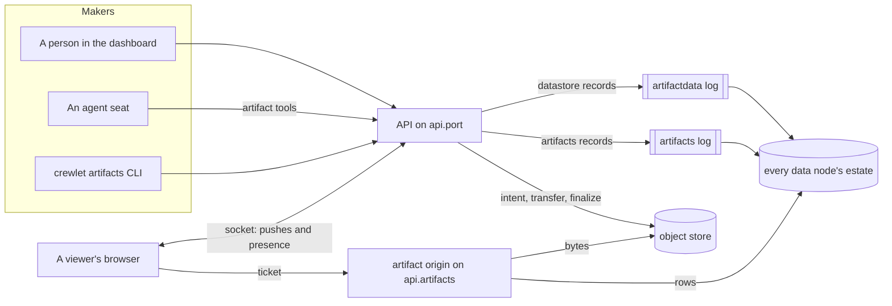
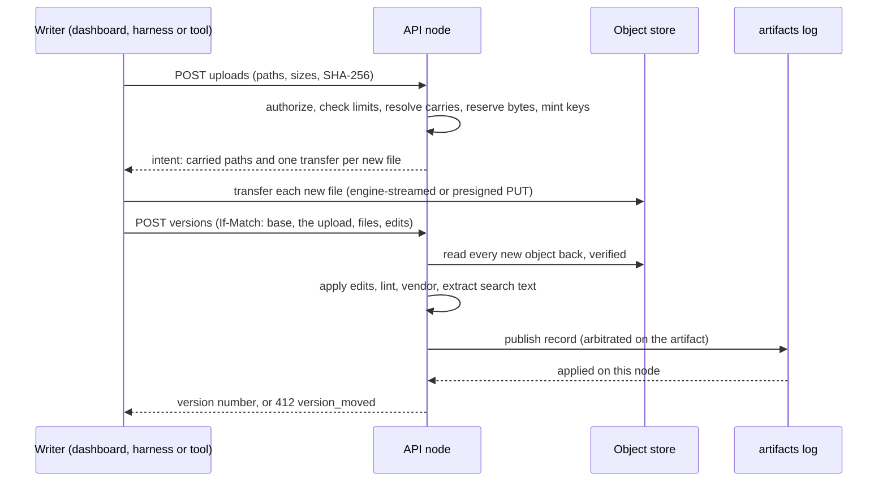
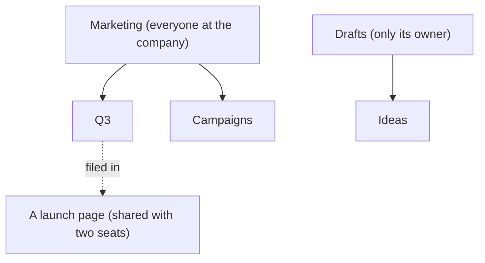
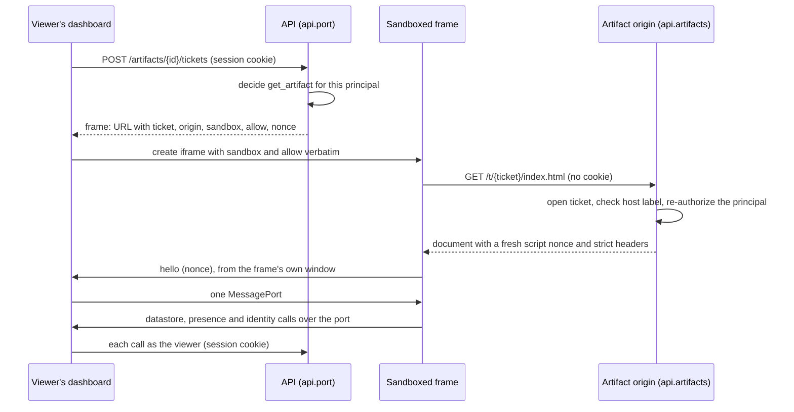
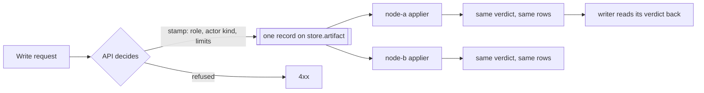
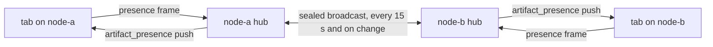

# Artifacts

An **artifact** is something a person or an agent makes for other people to
open: a dashboard, a report, a review table, a status page. It is versioned
like a document, shared like a file, served like a web page, and can keep
**shared data** that every viewer reads and writes together, with everybody
seeing who else is there.

Seven kinds ship in this release:

| Kind | What it is | Who draws it |
|---|---|---|
| `html` | A page of HTML, CSS and script, with any files it references | The page itself, in a sandboxed frame on an origin of its own |
| `doc` | One Markdown file, or several tabs ordered by a `doc.json` index | The dashboard's renderer; no author code |
| `slides` | A deck of 16:9 slides in Claude's slide format | The dashboard, from the deck's canonical tree |
| `dashboard` | A board of figures over datasets: the artifact's own store, the engine's domains, files and calculations | The dashboard's widgets, every live figure answered as its viewer |
| `sheet` | A native sheet: rows and typed columns, no page | The dashboard, from the schema alone |
| `design` | A canvas of artboards (`canvas.json`), each an HTML page, with titles and stickies beside them | The dashboard draws canvas and notes; each artboard runs in its own sandboxed frame |
| `brand` | A brand kit: name, logos, colours, two typefaces and voice (`brand.json`); an administrator adopts one version as [the company brand](#the-company-brand) | The dashboard, from the kit's index; no author code |

The motivating case: an agent publishes a review table; three reviewers and
the agent tick boxes and pick statuses at once, every edit lands on every data
node in the same order, and everybody sees who is in which row.

Cross-package rules are architecture decision records:
[ADR-0034](https://github.com/crewlet/crewlet/blob/main/adr/0034-an-artifact-is-shared-and-a-share-is-a-relation.md)
(sharing),
[ADR-0035](https://github.com/crewlet/crewlet/blob/main/adr/0035-an-artifact-is-served-from-an-origin-that-holds-no-credential.md)
(serving),
[ADR-0036](https://github.com/crewlet/crewlet/blob/main/adr/0036-bytes-are-reserved-before-they-move.md)
(uploads and carrying),
[ADR-0037](https://github.com/crewlet/crewlet/blob/main/adr/0037-a-datastore-write-is-decided-where-it-is-applied.md)
(the datastore),
[ADR-0038](https://github.com/crewlet/crewlet/blob/main/adr/0038-presence-is-told-never-stored.md)
(presence),
[ADR-0039](https://github.com/crewlet/crewlet/blob/main/adr/0039-a-cold-store-lives-in-object-storage-and-returns-through-the-log.md)
(what the datastore keeps hot),
[ADR-0040](https://github.com/crewlet/crewlet/blob/main/adr/0040-content-a-model-reads-carries-its-provenance.md)
(what an agent reads) and
[ADR-0048](https://github.com/crewlet/crewlet/blob/main/adr/0048-the-adopted-brand-is-the-companys-public-face.md)
(the company brand).

Running the serving origin is [Serving artifacts](../guides/artifacts-serving.md).
Writing a page is [Authoring artifacts](../guides/artifact-authoring.md), and
the page's runtime is the [artifact runtime reference](../reference/artifact-runtime.md).

---

## The model

An artifact has an **owner**, a **title**, an optional description and icon, a
**kind**, **shares**, a **head version**, an optional **asset store** and, when
a version declares it, a **datastore**.

- **Its id is derived, never random**: a function of the creating operation, so
  a retry after an unknown outcome names the artifact the first attempt made.
- **Its label is its id**: a DNS host label, the id's sixteen bytes in
  lowercase Crockford base32, 26 characters. It is not a secret (the view
  ticket is) and never changes, so per-artifact browser storage survives a
  keyring rotation.
- **A version is immutable**: a manifest (entry path; every file with path,
  served content type, size, SHA-256 and the object holding its bytes), the
  runtime contract it was published against and the capabilities it declares.
  An open page never changes under its reader: a newer version arrives as a
  notice, and the viewer opens it.
- **A file's served type is the engine's**, from one extension table; a client
  may only disambiguate an extension the table already knows.
- **Assets** are files kept beside the versions (images, data files) that every
  version may reference, uploaded and removed on their own.
- **Capabilities** are what a version's page may ask the host for: `db` (the
  shared datastore), `state` (per-viewer state), `identity` (who is viewing),
  `presence` (who else is here) and `assets`. A publish declaring a capability
  this build does not know is refused.

**A kind is native or framed.** An `html` page and a `design`'s artboards run
author code, only on the artifact origin, in sandboxed frames (see
[Serving](#serving)); a design's canvas and notes are drawn natively. A `doc`, a
`slides` deck, a `dashboard` and a `sheet` carry no author code: the dashboard
draws each from a closed format, so nothing in one can become script on the
dashboard's origin, and a publish outside the format is refused with a named
error. A native kind declares no capabilities, since there is no page to grant
them to. Every per-kind rule is one row of one table
(`internal/artifacts/kind.go`), recorded in
[ADR-0042](../../adr/0042-a-kind-is-native-or-framed.md) with each kind's
comment anchor.

A **source key** (the republish-in-place address an agent or the CLI uses) makes
publishing the same source twice update one artifact.

---

## Versions

- **A publish names its base version.** The dashboard sends `If-Match` with the
  head it last saw; an agent's tool passes `base_version`. If somebody
  published since, the publish is refused `412 version_moved`, carrying the
  live head's manifest and up to 1 MiB of its entry text, to merge rather than
  overwrite. An agent is never offered `force`; a present person may force, and
  the version is marked forced.
- **Edits are applied by the engine.** A publish may carry `old_str` and
  `new_str` pairs instead of whole files: each must match exactly once in the
  base text as it stands after the previous edits; all apply or none does, and
  a miss is refused naming the edit. This saves an agent most output tokens on
  a small change.
- **Unchanged files move no bytes.** A publish names every file by SHA-256; a
  file the artifact already holds is **carried** (the new version names the
  existing object) and only new content uploads. Carrying never crosses
  artifacts, so a publish cannot learn whether another artifact holds a file.
- **Rolling back is publishing.** Restoring version 7 publishes a new head with
  version 7's manifest, every entry carried. History is never rewritten.
- **Any two kept versions compare.** The History tab compares the picked
  version with another (the address carries `against=` and `lens=`, so a link
  opens the same comparison): by files (added, removed or changed by digest, so
  a carried file is never a change; a changed text file line by line), or side
  by side (a page in two frames, a document rendered twice). Both sides of a
  page show today's data, which is not versioned.
- **Retention is bounded twice.** An artifact keeps its newest 100 unlabelled
  versions and every labelled one (at most 100 labels); a publish past that
  prunes the oldest unlabelled version in the same record. A trashed artifact is
  recoverable for 30 days, then the trash reaper purges it. A purge is an
  administrator's, with a recent proof: it commits the artifact to its purge
  (into the trash, never restored again), removes the datastore, then the
  artifact; objects nothing names are collected by the
  [object store's](object-store.md) usual rule. A purge that stops part way is
  finished by its retry or the reaper's next pass.

---

## Uploads and quotas

**Bytes are reserved before they move.** Every upload starts with an intent that
decides what can be decided without the bytes: the caller's authority, paths and
types, per-file and per-publish limits, which files the artifact already holds,
and whether usage already named, plus outstanding reservations, plus the new
bytes fits the company's quota. The engine mints one key per new file and
records a reservation lasting until the collector could have deleted those
objects. Only then does a byte move.

- On the default `nats` object store every transfer streams through the engine.
- On an `s3` store whose boot probe proved it honours them, a browser or the
  harness uploads straight to the bucket on a presigned `PUT` bound to the exact
  length, type, SHA-256 and `if-none-match: *`. An agent's sandbox is never
  handed one; the engine reads the box itself.
- **Finalize reads every new object back** through the verifying reader before
  the version is recorded, so the row's digest is the stored bytes' digest.

One principal may hold `artifacts.limits.pending_bytes` reserved (512 MiB by
default) and a company four times that; past it an intent is refused `429
uploads_outstanding`, naming when the oldest reservation expires. A file the
object store has no room for (the default `nats` bucket holding as many bytes
as it [reserves](object-store.md#its-byte-reservation), or an `s3` bucket whose
provider [refuses the write for
room](object-store.md#an-s3-bucket--s3)) is refused `507 store_full`, naming the
file and the room an operator makes. A publish so refused gives back what it
staged and its reservation, since it would be refused the same until room is
made.

**The quotas are Tier A**, so a tenant administrator cannot raise their own;
each record that consumes quota carries the limits it was decided under, so
every data node applies it identically:

| Key | Default | Bounds |
|---|---|---|
| `artifacts.limits.company_bytes` | 10 GiB | 1 GiB to 16 TiB |
| `artifacts.limits.artifacts` | 50 000 | 100 to 10 000 000 |
| `artifacts.limits.data_bytes` | 1 GiB | 64 MiB to 1 TiB |
| `artifacts.limits.data_store_bytes` | 32 MiB | 1 MiB to 1 GiB |
| `artifacts.limits.pending_bytes` | 512 MiB | 64 MiB to 16 GiB |

Per-version bounds: an entry up to 16 MiB, other text files up to 16 MiB,
binary files up to 15 MiB, 255 new files and 64 MiB of new bytes per publish,
511 files and 256 MiB per version. Each is defined once in `internal/artifacts`,
and a refusal names the value it refused at.

---

## Sharing

Artifacts are an **app**, beside Worklet and Doclet (see
[Identity and Access](identity-and-access.md#an-artifact-is-opened-by-its-shares)).
The `artifacts` permission **gates authoring only**: creating, publishing,
changing a datastore's schema, trashing and restoring. Opening an artifact,
being present in it and writing its data are decided by a **share** alone, so
somebody who does not use Artifacts still opens and fills in everything shared
with them.

A share names an **audience** and a **role**:

| Audience | Who it reaches |
|---|---|
| A seat | Whoever holds that seat, person or agent; access follows the seat, as an inbox does |
| A unit | Every seat in the unit or below, decided live against the org chart |
| The company | Every principal who may act, agents included |

| Role | Adds |
|---|---|
| `viewer` | Reads the artifact, its versions and history; appears in the room |
| `commenter` | Comments, replies, resolves and reopens threads ([Comments](#comments)) |
| `contributor` | Writes data the collection rules admit, never the page itself |
| `editor` | Publishes versions and changes the schema, beside the `artifacts` app |
| `owner` | Shares, unshares, trashes, restores and transfers. Never shared: it moves only by transfer |

- **A person's new artifact is private.** When an agent creates one for a person
  who asked, that person is shared `editor`.
- **The owner holds every role.** The lead of an **agent** owner holds the
  owner's role on that agent's artifacts; the lead of a **person** holds
  nothing of theirs.
- **An administrator reads anything**, through the admin path. One a share
  already admits acts at the share's role; on an artifact shared with them in
  no way, every content read is first recorded as an elevated read, which the
  artifact's owner and editors see in its history and every administrator sees
  on the company trail of artifact history (the Audit screen, `artifact_trail`).
- **A caller with no share is told the artifact does not exist**: `404
  not_found`, identical to an id nothing holds. A share below what a gesture
  needs is `403`, naming the role that would change the answer.
- **A share never grants above the sharer's own role**, and every narrowing (an
  unshare, a lower role, a trash, a transfer) stops the next document request
  on the serving origin and withdraws every socket from the room.

An **agent** may do less than its shares allow:

- it never widens a share to the whole company;
- it never trashes, restores, transfers, pins or forces;
- it never manages an artifact it does not own (publishing over it, updating
  it, resharing it) unless the company sets `artifacts.agents_manage_others:
  true`;
- every artifact tool passes the **requester ceiling**: an agent reads for
  somebody only what that somebody could read, and writes only what they could
  write, authoring nothing for somebody who does not use the artifacts app
  ([An agent uses only the apps of the person it works
  for](identity-and-access.md#an-agent-uses-only-the-apps-of-the-person-it-works-for)).
  The exception is an artifact the agent owns, which anybody who uses the app
  and can message the agent may ask it to change. The somebody is whoever woke
  the turn: the first speaker of the message, comment or remark it answers, on
  a vendor's surface or on Worklet, Doclet, Chatlet and Gitlet; where that
  speaker is a colleague agent working a turn for somebody, that somebody,
  carried from the colleague's turn. A turn woken by somebody the company does
  not know authors nothing, and changes only what no app gates of the agent's
  own, such as its data. The ceiling holds for the turn somebody woke and every
  turn it hands work on to (a colleague the agent asks, the turn that answer
  wakes, a colleague the agent's Worklet, Doclet, Chatlet or Gitlet writes
  wake). What the agent already knows (its memory, what it read in a turn
  nobody woke) is no read at all, so an artifact refused to somebody in one turn
  can still reach them through what the agent tells them later
  ([Reads made for somebody else](gitlet.md#reads-made-for-somebody-else) says
  the same of a repository).

"**Seen by**" lists who has opened an artifact, to its editors and above. It is
on by default; a company turns it off with `artifacts.seen_by: nobody`.

The gallery's previews draw an artifact without opening it. Each is a
snapshot: drawn once when its card first comes near, then kept as drawn (a copy,
or for a page in a frame the frame itself), reading, polling and subscribing to
nothing more until the gallery reloads. Every read a preview makes is a preview
read (`?purpose=preview`, or the outline and the datastore's own questions),
which records nothing, so scrolling past a card is not seeing it. A preview
joins no room and publishes no presence. Its frame is granted only what drawing
needs, for minutes: its assets; its datastore answered by a read-only host that
answers each read once, so a page keeping content there draws it as it stood
and can change none of it; and a newcomer's empty state, kept by that host for
the frame alone, so a page remembering viewers' choices draws as for somebody
opening it first. The reader's own state is never read for a preview, and
nothing a preview sets is kept.

---

## Comments

A reader with `commenter` or above comments from the dashboard on a **part** of
an artifact or on the **whole version** on show. The owner answers; when it is
an agent, the comment wakes it, it changes the artifact in a new version, and
it resolves the thread citing that version.

- **Anchored by kind** ([ADR-0042](../../adr/0042-a-kind-is-native-or-framed.md),
  [ADR-0154](../../adr/0154-a-comment-is-a-thread-of-its-own-and-its-place-is-found-again-in-each-version.md)).
  On an `html` page, a section the page names (`data-crewlet-anchor`, see
  [the runtime](../reference/artifact-runtime.md#comments)), else a point on the
  page; on `slides`, an element of a slide, by the slide's id and the element's
  path from its `<section>`; on a `design`, a point on an artboard, in the
  board's own pixels. Every kind takes comments on the whole version; a `doc`,
  a `dashboard` and a `sheet` take only those in this release.
- **A thread remembers where and when it was made**: its anchor, the version it
  was made on, the section's words as the commenter saw them (up to 1 KiB) and,
  if they chose, a picture of that part as seen, with the page and any element
  scrolled where they left it and images and fonts drawn in (up to 64 KiB). It
  never stores its place on a later version: that is **found again** on every
  version a reader opens, by the anchor's content. A section is found by its
  name, an element by its path and, if the slide was rearranged, by its tag and
  words, an artboard point by its board. A publish therefore moves every thread
  at once.
- **Outdated, never dropped.** A thread whose part is not on the version on show
  (section removed, slide deleted) is listed as outdated, with the version it
  was made on, and can still be answered and resolved.
- **Resolve and reopen.** Anybody who may comment resolves or reopens a thread.
  An agent resolving names the version that addressed it, which the thread shows
  ("Resolved in v5"). A remark is edited only by its author and removed by its
  author or an administrator; a removed remark keeps its place.
- **What a remark may hold**: Markdown up to 16 KiB, read as text everywhere (no
  HTML rendered; an agent reads it fenced as its writer's words). A remark that
  carries a credential is refused, as a page that carries one is at publish.
- **Who is told.** Agents are woken the way a work-item comment wakes them: the
  owner when it is an agent, the agent assigned to each work item the artifact
  is linked to, agents mentioned, and agents already in the thread when a person
  replies. People are told in their inbox: a person owner of a new thread, the
  people in a thread of a reply, a resolve or a reopen, and anybody mentioned,
  never of what they wrote themselves. Each notice is shown only while its
  reader may open the artifact, keeps the first 600 bytes of the remark until
  its author removes it, is marked with `artifact_mark_inbox` and goes with the
  artifact's purge (see [How a person
  learns they have work](humans-in-the-org.md#how-a-person-learns-they-have-work)).
- **Bounded.** Each node takes at most 30 comment writes a minute from one
  person or agent on one artifact, and 120 on one artifact, refusing the rest
  with when to try again.
- **An agent answers on the artifact.** A comment wakes the agent with the
  thread in its prompt: who wrote it, on which artifact and version, where (the
  thread's label) and the quoted text, each fenced as somebody else's words. The
  agent reads the thread with `list_artifact_comments`, publishes a new version
  with `publish_artifact` on the current head, answers with
  `comment_on_artifact` and resolves with `resolve_artifact_comment` citing the
  version that addressed it. A comment and a resolve count as answering the
  person who woke it. A burst of comments on one artifact is one turn.

---

## Folders

The company files its artifacts in **one folder tree**; an artifact sits in **at
most one folder** (or at the top level). **A folder grants nothing**: who may
open an artifact is its owner and its own shares wherever it is filed, so
filing, moving and removing a folder never show it to anybody new or hide it
from anybody who could open it
([ADR-0047](../../adr/0047-an-artifact-lives-in-one-folder-and-a-folder-grants-nothing.md)).

- **A folder is seen by its top-level folder's audience.** A top-level folder is
  made with one of two presets, **everyone at the company** (the company as
  `contributor`) or **only its owner**, and every folder beneath it is seen by
  exactly that audience. A tree is seen whole or not at all, so a breadcrumb
  never names a folder its reader cannot see, and a folder somebody cannot see
  is answered as one that does not exist.
- **An artifact in a folder you cannot see is at your top level**: Bob opens a
  page shared with him that its owner keeps in her own Drafts, finds it at his
  top level, and is never told the folder's name or id, on the page or in its
  history.
- **Filing asks the artifact and the folder.** Moving an artifact needs `editor`
  on it and `contributor` on the destination folder. A folder's owner, the
  owner's lead (for an agent's folder) and an administrator manage it: rename,
  move, remove, and take out anything in it they can read. Managing is a
  person's; an agent creates folders only inside one, never at the top level,
  since a company-wide folder is a company-wide audience.
- **Names.** At most 80 bytes, no `/` and no invisible character; siblings are
  unique without regard to case. At the top level the company's folders are
  unique among themselves and each person's own among their own, so nobody is
  refused a name because of a folder they cannot see. Folders nest four deep; a
  company keeps at most 2000 and a folder at most 1000 folders.
- **Removing a folder moves everything in it up a level**, folders and
  artifacts alike, live and trashed, in one record. It is never refused for
  being full, trashes nothing, and nobody loses access. A folder moved to the
  top level, or whose top-level folder is removed, keeps the audience it had; a
  folder moved into another tree is seen by that tree's audience, and the
  dashboard asks before a move that shows it to more people.
- **Counts are the reader's.** "12 artifacts · 2 folders" counts only what that
  reader may open, by the listing's own filter, and a move's history row names
  folders by id, never by name.

The listing speaks **S3's `ListObjectsV2`**: `prefix=Marketing/Q3/` (or
`folder=<id>`) names the folder, `delimiter=/` answers one level with its child
folders as `common_prefixes`, and `max-keys` and `continuation-token` page it;
the token carries the folder's id, so a rename between pages moves nothing.
Folders are rows, never part of an artifact's key, and an agent's
`list_artifacts` takes `prefix` and `delimiter` the same way. The routes are in
the [API reference](../reference/api-endpoints.md#folders).

---

## Work items

A Worklet item's **Artifacts** panel lists every artifact made or linked for
it, read from the artifacts' own history (`GET /artifacts?work_item=ENG-12`):

- **A write made for an item names it.** A create, publish or rollback carrying
  `work_item` (or an agent's turn charged to the item) stamps the key on its
  history row, which lists the artifact on the item.
- **An existing artifact is linked** with `POST /artifacts/{id}/work-items`,
  which records one history row filed under the item and changes nothing else.
  The dashboard's create pages use it to make a design or a dashboard first and
  file the task after.
- **A link needs both halves.** The caller must be able to read the artifact
  (any role, viewer and above; the admin path is recorded as every elevated
  read is) and to change the item (`update_work_item`, Worklet's own decision).
  The item must be one Worklet holds and not removed; the link is made under its
  current key, so an id or a former key links where the panel looks.
- **A link is made once.** A retry under the same `Idempotency-Key` is the same
  operation, and a link to an item the artifact's history already names answers
  success and writes nothing.
- **Only an applied row counts.** A write the log refused (a link to a trashed
  artifact, a publish over a moved head) lists the artifact on nothing, and the
  panel reads the history's retention window (a year).

---

## Serving

An artifact runs on an **origin that holds no credential**. The dashboard acts
with an `HttpOnly` session cookie, so a page rendered on the dashboard's origin
could act as whoever opened it; an artifact is never served there.

- **A listener of its own.** `api.artifacts` serves one file of a ticket's
  version, one asset of a ticket's artifact, the embedded runtime and kit, and
  the files of the company's adopted brand by hash. It mounts no guard, API
  route or probe, and never reads or sets a cookie.
- **A view ticket** in the path names one principal, one artifact, one version,
  the credential it was minted through and the artifact's access epoch. It lives
  an hour, never past its credential, and the runtime asks the host for a fresh
  one.
- **Two origin modes.** With a wildcard host such as
  `https://{artifact}.artifacts.example.net`, each artifact gets an origin of
  its own, on a site that is not the dashboard's, and browser storage works per
  artifact. With one plain host or port, every document is served with an
  **opaque** origin: browser storage throws there, and a page keeps per-viewer
  state through the runtime instead. A wildcard on the dashboard's own site is
  served opaque too.
- **Revocation is the next document request.** A document is re-authorized on
  every request; a subresource is served on a decision at most 30 seconds old.
  A node whose own copy of the artifacts or identity log is stale or out of
  service asks a healthy peer, and answers `503` with `Retry-After` when none
  answers. It never serves from rows that may hold a revoked share.
- **A strict script policy.** Every document carries a fresh nonce with
  `'strict-dynamic'`, inline handlers are admitted by hash, and the page may
  reach only its own origin for data, images and media. Plugins, base URLs, form
  posts and nested frames are refused. The frame never gets `allow-popups`: an
  external link goes through the host, which names the destination before
  opening it. The frame holds only the artifact's pages: a file of its own that
  is not one is never framed, and the runtime opens a link to it in its file
  viewer over the page.
- **No third party at view time.** Script and stylesheet files a page references
  on the allowed CDNs (script or link element, module import, import map entry)
  are copied into the version at publish, integrity-checked, so viewing works
  without the CDN and the CDN never sees a viewer. The node fetches each file
  itself and connects only to a public-internet address: none in a block IANA
  reserves for a special purpose, and an IPv6 one only in global unicast
  (`2000::/3`). Each address a CDN name resolves to is judged as the connection
  is made, so a name resolving into the engine's own network is refused, and one
  resolving both ways is fetched from its public addresses alone. On a network
  reaching IPv4 through NAT64, an address under its translation prefix is judged
  by the IPv4 address it carries; the node learns the network's prefixes by
  asking its resolver for `ipv4only.arpa` (RFC 7050), at most once a connection
  and only when about to connect to an IPv6 address in global unicast or in
  `64:ff9b:1::/48`, the only kind whose verdict a prefix can change. A resolver
  that fails that lookup, rather than answering it has no record, keeps the node
  from that address, and the copy goes on over the CDN's addresses needing no
  answer: an IPv4 one, or one under the well-known `64:ff9b::/96`. A prefix the
  resolver names counts only in global unicast or in `64:ff9b:1::/48` (the block
  RFC 8215 reserves for a network's own translation prefix), so no answer can
  open a non-internet network to the fetch. A translator on `64:ff9b::/96`, in
  `64:ff9b:1::/48` or in the network's own global unicast space reaches an
  IPv4-only CDN; one on a unique-local prefix does not, and such a network sets
  `HTTPS_PROXY` to a proxy that reaches the CDN, which the node dials as itself.
  Any other remote script a page states is refused. The linter cannot read a
  script the page's own script builds at run time: `'strict-dynamic'` trusts it
  from any host, so a page whose author means to can send what a viewer may read
  to another site. Only an `editor` publishes, and every version names who did;
  share `editor` accordingly (see `SECURITY.md`).

The raw bytes of a version are also downloadable from the API, always as an
attachment and text as `text/plain`, never rendered.

### Rendering a page for its author

An agent checks its own page before review, and its box holds no credential a
frame can be opened with, so the engine renders the page for it
(`render_artifact`). It drives a headless Chromium the deployment runs
(`artifacts.render.browser_url`, [Serving
artifacts](../guides/artifacts-serving.md#the-render-browser)) over the
DevTools protocol, serving it exactly what a viewer's browser gets:

- **The same frame.** Minted as a viewer's is, with the version's grant, and
  embedded by a host page on the dashboard's own origin, so its
  `frame-ancestors` admit it, with the `sandbox` and `allow` the engine computes
  and the fragment the dashboard writes. The host answers the page's hello and
  reads as the agent, under the requester ceiling, and refuses every write.
- **The same bytes.** Every request the page makes is paused in the browser and
  answered by the node's own artifact handler, in process: runtime, nonce,
  policy, kit and brand are a viewer's. Anything on another site is refused, so
  the browser needs no network and the engine fetches nothing a page names.
- **No credential anywhere else.** The ticket names a render credential only the
  render's own resolver knows, for the render's length, and every document is
  decided again as the agent; the artifact listener answers that credential as
  ended.
- **Nothing written.** No open is recorded and nobody sees the agent in the
  room. The screenshots go to the agent's own box.

---

## The datastore

A version that declares `db` gets a **store**: named **collections** of
**documents** (JSON objects keyed by an id), shared by every viewer, durable,
and replicated like every other domain. A `sheet` artifact is nothing but its
store, drawn by the dashboard from the schema.

**A collection has rules**, chosen through a preset and refined per column:

| Preset | Who reads | Who writes |
|---|---|---|
| `shared` | every participant | editors |
| `contribute` | every participant | participants add rows and edit their own |
| `author` | every participant | the owner and the authoring agent |
| `private` | each writer, their own rows only | each writer, their own rows only |

A collection with no schema is closed by default: participants read, editors
write. A **schema** declares typed columns (`text`, `longtext`, `number`,
`checkbox`, `select`, `multiselect`, `status`, `person`, `date`, `url`,
`rating`), each optionally with a least role that may write it, a condition
(only rows the writer created, or only rows assigned to the writer), an
append-only mode, immutability after creation, and **`humans_only`**: the
approval column a model must never tick. An agent may add `humans_only` and
never remove it, and may tighten a rule and never loosen one. Read rules
(`all`, `own_rows`, `editors`, `private`) apply on **every** read path: list,
single document, query, history and live pushes. The history judges each change
by the row's creator when it was made, so a row deleted and created again under
the same id by somebody else is theirs from that create on, and what its
previous creator wrote stays with them.

**A write is a batch of ops**, all applied or none: `set` (replace a document's
fields, creating it), `merge` (set named fields), `delete` (tombstone),
`increment`, `append` (grow a long text or an array), `add` and `remove` (a
multiselect's elements). Each op may carry the document version the writer saw;
without one it is a blind write, which is what a click on a checkbox is. Writes
are HTTP requests with an `Idempotency-Key`, so a lost answer is retried as the
same write.

**The write is decided where it is applied.** Each store is one sequenced log:
the API decides what needs identity or the org chart (the caller's role, whether
it is an agent, the quotas in force) and stamps it into the record; every data
node's applier then decides the rest from the record and its own rows (names,
schema, field rules, version guards, caps), in log order, so every node reaches
the same verdict: `applied`, `conflict`, `invalid`, `forbidden`, `quota` or
`gone`. The writer reads its verdict back; a `conflict` answer carries the
current documents to merge with. A sheet in the dashboard shows an edit at once
as pending and makes it solid when the verdict arrives.

**History and undo.** Every write leaves a history row (who, when, which fields,
before and after values), kept seven days and at most 8 MiB per store on the
data nodes. A person undoes their own write; an undo whose documents changed
since is a conflict naming who changed them.

**Bounds.** At most 64 collections per store, 128 columns per collection,
50 000 documents per store, 64 KiB per document and 100 ops or 1 MiB per write.
Writes are rate-limited per node by cost: the rows the apply writes (for a
changed document, its whole field index deleted and written again), in units of
sixteen rows (a cell edit on a twelve-column row is two). A principal takes 20
units a second on a store with bursts of 100, and a store 40 a second with
bursts of 100, answered `429` with `Retry-After`, never a lockout. The datastore
quotas count the bytes a store's rows really take on every data node and in
every snapshot (each document row with its index and field-index entries, and
the hot history), measured within a few percent of the file. A twelve-column
review sheet costs about 3.2 KiB a row with a week of history, so the default
32 MiB per store holds about ten thousand rows.

**Exports.** An editor downloads any collection as CSV, written for a person to
read: columns headed by their labels, choices by their labels and people by
their names.

---

## Presence

**Presence is told, never stored.** Who is in an artifact and what they look at lives in the memory of the node holding their socket and crosses nodes on an ephemeral broadcast: no row, log record or coordination key.

- A browser sends its focus (a version, a region, or a collection, document and field) and activity (`viewing`, `editing`, `idle`), at most ten frames a second. A node fans a room out to its sockets at most ten times a second, ten members a frame (longest-waiting change first), and tells other nodes its members' moves at most twenty times a second: a cursor crosses nodes in about 150 ms.
- Each node rebroadcasts its roster every 15 s; an entry expires 45 s after the last frame naming it. A node gaining its first member of a room asks its peers once.
- A joining tab gets the room, itself included, then every change in the order the node took it, never one ahead of the room it changes: no tab keeps showing somebody who left or as they were before moving.
- Frames between nodes are sealed under the fleet keyring, valid 60 s; an unsealed frame shows nobody.
- Past 50 members a room shows the 50 most recently active plus counts of people and agents, and returns to the full roster below 40.
- **Agents are present.** An agent reading or writing an artifact appears in its room, naming its turn, so a person sees which agent edits which row and opens that turn.
- **The People rail** (from the presence stack, `rail=people`) lists everybody here, one entry a person however many tabs, with what each does and where. **Follow** moves the reader to the version (on a sheet, the collection) the followed person has open, under a banner, until the reader scrolls, presses or uses a navigation key in the page, presses Escape, or the followed person leaves. `follow={handle}` in the address starts it: how to watch a presenter on a phone.
- Joining a room is decided like opening the artifact, and again on every share, unshare, trash, transfer and purge: somebody whose share is removed leaves at once, on a socket that stays open.

Presence colour (cursors, selection rings, cell outlines, name flags) is the one place a colour stands for a person, and is always shown beside the name.

---

## Agents

An agent authors and edits artifacts through one tool per action, each named for the authority verb it asks:

| Tool | Does |
|---|---|
| `list_artifacts` | Lists what the seat may open: its own, shared with it, company-wide, its reports'; one folder's level by `prefix` and `delimiter`, as S3 lists a bucket |
| `get_artifact` | Reads a head, its versions and files, a page at a time |
| `render_artifact` | Renders a page or a design's artboard in the engine's browser as a viewer sees it, and reports what is broken; a seat's alone (see [Rendering a page for its author](#rendering-a-page-for-its-author)) |
| `get_company_brand` | Reads the adopted brand: colours, typefaces, logos, slide theme, kit version to link, fenced voice |
| `create_artifact` | Creates from inline files, the turn's sandbox, a project file or the brand's logos and faces (`from_brand`), or a deck from a `starter` plan; `folder` files it |
| `publish_artifact` | Publishes a version against a base, with whole files or edits |
| `update_artifact` | Changes the title, description, icon or a version label |
| `share_artifact`, `unshare_artifact` | Shares with seats and units, or removes a share |
| `upload_artifact_asset` | Adds an asset, when the head declares `assets` |
| `create_artifact_folder` | Creates a folder, or a chain, inside an existing folder |
| `move_artifact` | Files up to 25 artifacts in a folder, or at the top level, each decided on its own |
| `list_artifact_comments` | Reads threads, each placed on the current version with label, quote and the element's source |
| `comment_on_artifact` | Opens a thread, on the whole version or an anchor, or replies; states `asks` |
| `resolve_artifact_comment` | Resolves a thread citing the version that addressed it, or reopens one |
| `edit_artifact_comment`, `remove_artifact_comment` | Edits or removes the seat's own remark |
| `read_artifact_data`, `query_artifact_data` | Reads a store's documents |
| `write_artifact_data` | Writes a batch of ops |
| `set_artifact_schema` | Declares collections and columns |

Per turn segment an agent may publish 20 times (10 on one artifact), write 128 MiB, make 1000 datastore ops, make 5 folder records and send 1 MiB of inline content in one call.

**Filing is an agent's; reorganising is a person's.** A [folder](#folders) grants nothing, so an agent files its own work and tidies what it may edit, each move asking editor on the artifact and contributor on the destination through the requester ceiling. It creates subfolders inside a person's tree, only when asked or for related artifacts no folder fits. Top-level folders, renames, folder moves and removals are a person's. A folder reference resolves only among folders the agent and whoever it works for can both see; a turn a stranger woke sees none.

**The brand is applied for the agent where the engine draws.** Pages, designs, docs and dashboards take the [adopted brand](#the-company-brand) with no agent step. What an agent writes literally (a slide's inline styles, a logo in a version, a typeface) it reads from `get_company_brand` and copies with `from_brand`; a deck begun from `starter` with `theme: "brand"` is drawn in the brand by the engine. The brand's voice is the one free text, fenced under the `company` trust: tone and wording, never the task, tools, recipients or access. The fence names its writer (the adopted version's author, possibly an agent) beside the administrator who adopted it. The bundled artifacts skill names the kit version to link as `${crewlet_kit_version}`, which the engine sets to the newest kit it embeds, the one that reads the brand.
A stale base version is refused with the live version, its author, its time, the changed paths and the start of each changed file, which the agent merges from.

**Everything an agent reads that somebody else wrote is fenced** (see [ADR-0040](https://github.com/crewlet/crewlet/blob/main/adr/0040-content-a-model-reads-carries-its-provenance.md)): another principal's page, a viewer's row, a colleague's file. The fence labels who wrote it and says it is data, never an instruction. Fencing reduces prompt injection, not removes it; `humans_only` columns and the human-only verbs hold whatever a model does, and the requester ceiling whatever it does in the turn somebody woke.

---

## The security model

| Threat | What stops it |
|---|---|
| A page acting as whoever opened it | The artifact origin holds no credential and never reads a cookie; the page reaches the host only through a port, and every call is decided as the viewer |
| One artifact reading another's storage | An origin per artifact on a site of its own, or an opaque origin; never the dashboard's |
| A page leaking its data to a third party by accident | `connect-src`, `img-src` and `media-src` reach only the artifact's own origin; no popups; the host confirms external links; every remote script a page states is copied in or refused. A page whose own script loads another site's script on purpose is not stopped: publishing is an `editor`'s, and every version names its publisher |
| Script injected through a viewer's row | A fresh nonce with `'strict-dynamic'` per document; no `'unsafe-inline'` |
| A compromised CDN | Third-party files are copied in at publish and served from the artifact's own version |
| A revoked share that keeps working | Documents re-authorized on every request; a stale node asks a peer or answers `503` |
| A leaked frame URL | The ticket is bound to one principal, artifact, version and credential, expires within the hour, and a top-level navigation to it is refused |
| Existence of private artifacts | A caller with no share gets the same `404` as for an unknown id |
| Bytes swapped after a check | The engine mints every key, a direct upload is bound to its digest and `if-none-match: *`, and finalize reads every object back |
| Bytes nobody names filling the store | Reservations before transfer, bounded per principal and per company |
| An agent persuaded by content it reads | Provenance fences, requester ceiling, `humans_only` columns, human-only verbs, no company-wide share by an agent. A render's screenshots show a page's words as pixels no fence labels; the answer says to read them as content |
| A render that reaches past its page | The engine answers every request it makes and nothing else, its ticket's credential resolves only in the render, and it is bounded in time, shots and bytes |
| A forged presence frame | Frames are sealed under the fleet keyring |

---

## The two logs

Artifacts keep durable state in two strict state-log domains, each applied into identical copies on every data node, each with its own stream and ceiling:

| Domain | Stream | Holds | Ceiling (Tier A) |
|---|---|---|---|
| `artifacts` | `CREWLET_ARTIFACTS_LOG` | Artifacts, versions and their object references, assets, shares, pins, reads, history | `stream.artifacts_log_max_bytes`, 1 GiB to 256 GiB; unset derives a quarter of the mutation log's ceiling, 1 GiB to 16 GiB from a volume alone |
| `artifactdata` | `CREWLET_ARTIFACT_DATA_LOG` | Every store's collections, documents, field index and write history | `stream.artifact_data_log_max_bytes`, 1 GiB to 512 GiB; unset derives a quarter of the mutation log's ceiling, 1 GiB to 16 GiB from a volume alone |

Every record that adds or removes an object reference is arbitrated on its artifact's subject, so the broker orders every carry against every removal. Datastore writes are sequenced on one subject per store, with no broker expectation. Record instants in rows are the broker's, never a node's clock. Neither log is read on a seat's turn path, so a stalled copy takes the node's artifacts out of service without stopping its agents.

Every store keeps a running digest of its documents, compact integer keys and a real-byte footprint, so a later release can move idle stores to object storage and back through the log without re-deriving them.

---

## Configuration

| Key | Tier | What it does |
|---|---|---|
| `api.artifacts.host`, `api.artifacts.port` | A | Bind the artifact listener on an ingress node; port `0` (the default) serves no artifacts on this node |
| `api.artifacts.external_url` | A | Where browsers reach artifacts: a wildcard template for an origin per artifact, or one plain origin for opaque origins. See [Serving artifacts](../guides/artifacts-serving.md) |
| `artifacts.limits.*` | A | The plan quotas above |
| `artifacts.render.browser_url` | A | The headless Chromium this node renders pages in for `render_artifact`: an `http://` DevTools origin or the `ws://` address it prints. Unset renders nothing |
| `stream.artifacts_log_max_bytes`, `stream.artifact_data_log_max_bytes` | A | The two logs' ceilings |
| `store.objects.nats_max_bytes` | A | The `nats` object bucket's reservation on the broker |
| `artifacts.agents_manage_others` | B | Let agents publish over, update and reshare artifacts they do not own (default `false`) |
| `artifacts.seen_by` | B | `editors` (default) or `nobody` |

---

## Docs

A `doc` artifact is Markdown: one file (`index.md` by default), or several tabs, each its own Markdown file, ordered and titled by a `doc.json` index (`{"v": 1, "tabs": [{"path": "tabs/plan.md", "title": "Plan"}]}`). The [authoring guide](../guides/artifact-authoring.md#writing-a-doc) is the whole contract.

- **Held to the format at publish.** One reader (`internal/artifacts/docindex`) reads every version whole, carried tabs included. Refused under the code `doc_format`, each finding naming its rule: an index naming a file the version lacks, a tab that is not Markdown, a path twice, more than 32 tabs, more than 16 MiB of text.
- **Drawn by the dashboard, never as markup.** The engine answers a version tab by tab (`GET /artifacts/{id}/versions/{n}/doc`); the dashboard draws each with the element-constructing Markdown renderer Doclet pages use, which also decides what a heading is, so outline and page agree.
- **Searched by every tab**, each title and its text, not by the index.
- **Edited in place, each save a version.** A person who may publish presses Edit to change any tab's text, rename, reorder, add and remove tabs; Save publishes all of it as one version based on the one they opened: an exact edit of each changed tab and of `doc.json`, a removal for each dropped tab, each new tab's file uploaded through the engine (a one-file doc gains its `doc.json` with its second tab). A save that raced another publish is merged onto it tab by tab, text by line as a Doclet page's is; where both changed the same lines, title or order, or one removed a tab the other changed, the person settles it before saving again. Print prints every tab in order.
- **Started from a template.** New › Doc begins from the engine's starter, one tab under its title, held to the format like any version.
- **Followed by tab**: a reader's tab is said to the room as the region `tab:<path>`, so following somebody opens their tab.
- **Covered natively in the gallery**: the first tab's opening, from the version's outline, at card size. A sheet's cover is its first columns and rows, read as the viewer.

---

## Decks

A `slides` artifact is a deck in Claude's slide format: a `deck.json` index and one `slides/<id>.html` per slide, each a `<section>` on a 1920 by 1080 stage styled from a closed inline subset, with speaker notes in an `<aside>`. The [Slide Format](../reference/slide-format.md) reference is the whole contract.

- **Held to the format at publish.** One parser (`internal/artifacts/slideformat`) reads every version whole, carried slides included, so a patch removing an image a slide shows is refused as surely as a slide naming a stylesheet. The refusal names each file, line and rule.
- **Drawn from its tree, never its markup.** The engine answers a version as the canonical tree its publish was held to; the dashboard constructs every element itself, holding the same allowlists again. Images and typefaces are files of the version, read with the viewer's own sign-in; a slide names no address the browser fetches.
- **Edited as versions.** A person with `editor` fixes text in place, edits notes, reorders, deletes slides and renames the deck; Save publishes a version based on the one they opened. A save refused because somebody published since is merged onto their version slide by slide; a slide both changed differently is the person's to resolve. An agent revises a deck the same way, one slide file at a time, and a stale publish hands it the changed slides.
- **Presented and followed.** Present draws the slide full screen with a clicker's keys; the Presenter window shows the slide, the next one, the notes and a timer and moves the room's screen. A reader's place is their presence region `slide:<id>`, so following the presenter (a phone included) moves the follower to the same slide.
- **Printed to PDF** one 16:9 page per shown slide, by the browser.
- **Compared by slide.** History's comparison of two deck versions has a By slide lens beside Files: each slide's two versions side by side, paired by id, a slide one version lacks in its place, every change said in words (changed, added, removed, moved); a move is what the order changed, not every slide whose number shifted.
- **Started from a template.** New › Deck begins from the engine's starter (a cover, an agenda, two columns and a closing slide, each with notes), published inline and held to the format like any version, so the dashboard sends no upload.
- **Covered natively in the gallery**: the cover slide at card size from the version's outline, never a screenshot.

## Dashboards

A `dashboard` artifact is a native widget board over declared datasets, in the closed [Dashboard Spec](../reference/dashboard-spec.md): stats, meters, charts over time, ranked bars, shares, tables and notes on the Home board's twelve-column grid, each widget citing its dataset and when its rows were true, with a Sources rail showing every dataset's definition, freshness and rows.

- **Read as the viewer.** An `engine` dataset is answered by the question the dashboard's own screens ask (Worklet's, spend's, the agents' status), on the viewer's own request, so two people on one board each see what they may read; a figure over a source somebody may not read says so and names the permission that would open it ([ADR-0043](../../adr/0043-a-dashboards-live-data-is-read-as-its-viewer.md)). The board and its gallery cover carry no row.
- **Live where the data is live.** A `store` dataset redraws whenever the artifact's datastore pushes a change, so rows an agent writes appear on every open board; an engine dataset refreshes on its domain's push (spend, the agents) or on the interval it declares, never under a minute; a file dataset is fixed with its version.
- **Held to the format at publish**, every finding named, and data files parsed against their declared columns.
- **Exported in the browser**: a widget's rows as CSV and a chart as PNG, each the viewer's own view.
- **Covered natively in the gallery** from the version's outline: the first stats' labels and their datasets' titles, never a figure.

---

## Designs

A `design` artifact is a canvas of artboards: a `canvas.json` entry that places each board (an HTML page of the version) at its position and size and holds titles and stickies beside them, and one `.html` file per board with its own scripts and styles. [Authoring Artifacts](../guides/artifact-authoring.md#writing-a-design) has the format.

- **Begun from a layout in the dashboard.** A person lays out the boards (names, sizes, places, purpose) on the create page, and the engine publishes that as the first version: `canvas.json` and one placeholder page per board under `boards/`, saying its size and brief, until an agent publishes the real page over it (`canvasformat.Starter`).
- **Held to its format at publish.** The canvas is read strictly (`internal/artifacts/canvasformat`): an unknown field, a bound passed, a board naming no page of the version, or a page no board frames is refused, every problem named at its place in `canvas.json`. Every board goes through the page linter exactly as an `html` page does.
- **One frame per board, one document per ticket.** Each board on screen is a sandboxed frame minted for it alone, and its ticket opens that page and no other ([ADR-0035](https://github.com/crewlet/crewlet/blob/main/adr/0035-an-artifact-is-served-from-an-origin-that-holds-no-credential.md), "One document per ticket"). Only boards on screen and drawn wide enough to make out run (96 pixels on screen, a thumbnail), at most twelve at once; the rest are placeholders of their size. A board opens in a dialog, still framed, fitted or at its own size.
- **Worked like a design tool.** A floating palette holds Move (`V`) and Hand (`H`, or Space held), and while editing Text (`T`) and Sticky (`S`), which place a note where the canvas is clicked. A click selects a board or note; a double-click hands a board's page the pointer, Escape giving it back. Shift 1 fits every board in view, Shift 0 shows actual size. The board list beside the canvas marks the selected board, and a board picked there is selected and brought into view.
- **Rearranged as versions.** A person with `editor` moves and resizes boards (by a board's name and a selected board's corners) and places, edits and deletes notes; Save publishes a version whose one change is `canvas.json`, every board carried by the object it already was. A save refused because somebody published since is merged onto their version board by board and note by note, keeping the person's change where both changed one item.
- **Printed board by board.** A board's own Print (`crewlet.print()`) or Print on an opened board prints that board alone on a page of its own size, on the reader's click.
- **Read in parts.** The outline (`GET /artifacts/{id}/versions/{n}/outline`, and `get_artifact` with `view: "outline"` for an agent) lists every board's file, title and frame in canvas order, so an agent opens only the boards it changes.
- **Covered natively in the gallery**: a schematic of the boards where the canvas places them, the cover board titled, never a screenshot.
- **Where a reader is** is their presence region `board:<path>`, the board holding their pointer.
- **A comment on a design points at an artboard point**: the board's path and a point in its own coordinates (`canvasformat.Anchor`), so it stays on its spot however the board moves ([Comments](#comments)).

---

## The company brand

A **brand kit** is an artifact of kind `brand`: a closed `brand.json` naming the company's name and tagline, its logos (a primary one for light grounds, one for dark grounds, a square mark), its colour roles (`primary` and optionally `secondary`, `text`, `light_ground`, `dark_ground` and `primary_on_dark`, each `#rrggbb`), a heading and a body typeface (a face the artifact kit ships, a curated system stack, or an uploaded WOFF2 family the publisher attests the company may embed), and a short voice: a summary, a few lines to write like and a few to avoid. Anybody with the artifacts app may draft one, agents included, and many may exist.

- **Its format is one read away.** `get_artifact_format` with `kind: "brand"` answers every key of `brand.json` with its type and rule, the exactly-one-source rule for a face, the logo and SVG rules, and an example that reads clean. `brandformat` generates it from the form the strict decode reads and the constants its rules check, so it cannot promise a key or bound the reader refuses (a test holds it to every key both ways). Every other kind with a closed format (`slides`, `doc`, `design`, `dashboard`) answers its own index the same way.
- **Held to its format at publish, every fault in one refusal.** `brand.json` is read strictly (`internal/artifacts/brandformat` over `internal/jsonform`). Refused, naming the file, line and fix: an unknown key (named with the keys its object takes), a value of the wrong type (named with the shape read there), a key written twice, a value outside its grammar, a file the index does not name, a logo or face outside its asset rule. The decode reports every structural fault, decodes every well-formed field and runs the field rules over those in one pass, so six faults give six findings; a logo refused by its asset rule is answered together with the index's findings. The tool answer lists the first 20 findings and counts the rest. A logo is stored as the engine writes it, never as uploaded: an SVG re-serialised from an allowlist admitting no script, style, foreign content, animation or outside reference (`internal/artifacts/svgsafe`, the one allowlist a slide's drawings are held to too), a PNG or WebP without metadata and never animated. A draft is never refused for contrast. Text holds no link or address, and a bare domain is refused too, except the brand's own `name` written as a domain: for brand `GoPhrase`, `GoPhrase.me` may appear in its voice, `promo.gophrase.me` or any other host may not. The rule reads the kit's own `name`, never the company record, so a rename cannot turn a published kit into one its reader refuses.
- **Drafted step by step.** A draft needs only its `name`: a kit may be saved after each setup step, with no logo, colour or typeface yet. Every field a draft holds keeps all its rules. An unset typeface draws the artifact kit's own face (Geist).
- **The company brand is an adoption.** An administrator, a person, at a recent proof of identity, adopts one version of one kit on Company › Brand (`POST /brand/adoptions`). The adoption **snapshots** that version: its index, a stylesheet generated from it once, and a copy of every logo and face, each an object of the adoption's own. Publishing a newer draft, trashing the kit or purging it changes nothing until somebody adopts again; the page shows a newer version waiting for review. An adoption requires a primary logo (`logos.primary`) and a primary colour (`colors.primary`); one leaving either out is refused naming each missing field, before anything is copied. Then it is refused when the brand's text does not reach 4.5:1 on its light ground; every other pair (label on the accent, dark mode's text, accent on each ground) is a warning.
- **The company's public face.** Everybody reads the adopted brand: every person, page and agent, whatever conversation it serves (`GET /brand`, the `get_company_brand` tool). Put nothing in it that is not meant for anybody who sees what the company publishes.
- **How each kind follows it.** A doc and a dashboard follow the adopted brand live: the dashboard draws them in its tokens. A framed page (`html`, `design`) **pins** the stylesheet adopted when its version is published, and the artifact origin places it at the top of each document it serves, so a rebrand never restyles a page nobody reviewed under it; publishing again takes the current brand. A page keeps its own design with `<html data-crewlet-brand="off">`. A deck copies the brand's theme, faces and logo into its own files when created from the brand starter.
- **One stylesheet, inputs only.** The generated stylesheet defines the artifact kit's `--brand-*` input slots on `:root` and an `@font-face` per uploaded face, nothing else; the kit (`@crewlethq/artifact-kit` 0.47.0 onward) restyles its own tokens from them, so a page written with the kit's tokens follows the brand unchanged. Its files are served on the artifact origin at `/_crewlet/brand/<sha256>.<ext>`, only while an adoption or a page pinned to one names them.
- **Voice is for writing, never for instructions.** An agent reads the voice only through `get_company_brand`, fenced as company-adopted text governing tone and wording, never the task, tools, recipients or anybody's access. A rule every message must follow belongs in a standing policy on Company › Principles.

---

## What this release does not do

Comments anchored inside a doc, a dashboard or a sheet (those kinds take comments on the whole version), and reviews; watches that wake an agent when data changes; decisions inside a sheet; a design's live board layer of shapes, connectors and images; a dashboard dataset an agent refreshes on a schedule, and integration sources a viewer's own connector answers; slide builds, magic moves, live embeds and connectors on a slide, and PowerPoint or Google Slides export of a deck; live Worklet and Doclet data inside a page; a page asking a model a question; viewer uploads and device features; public links outside the company; moving idle stores to object storage; point-in-time recovery from a log archive; concurrent co-editing of long text; and time travel by replay. The shapes in this release leave room for each (an audience kind for links, an anchor kind for each native kind, a store digest for tiering) without promising when.
