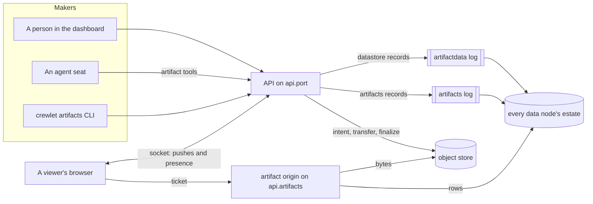
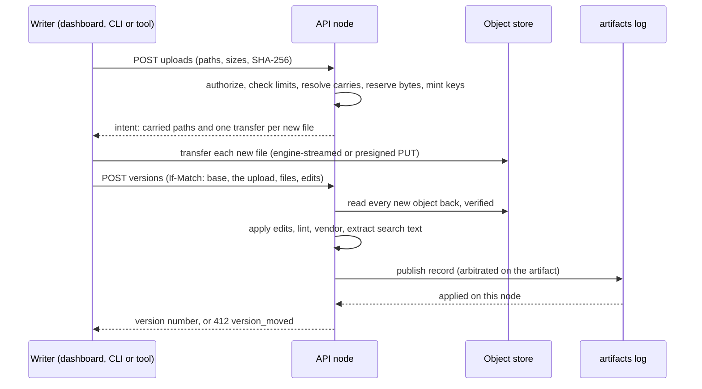
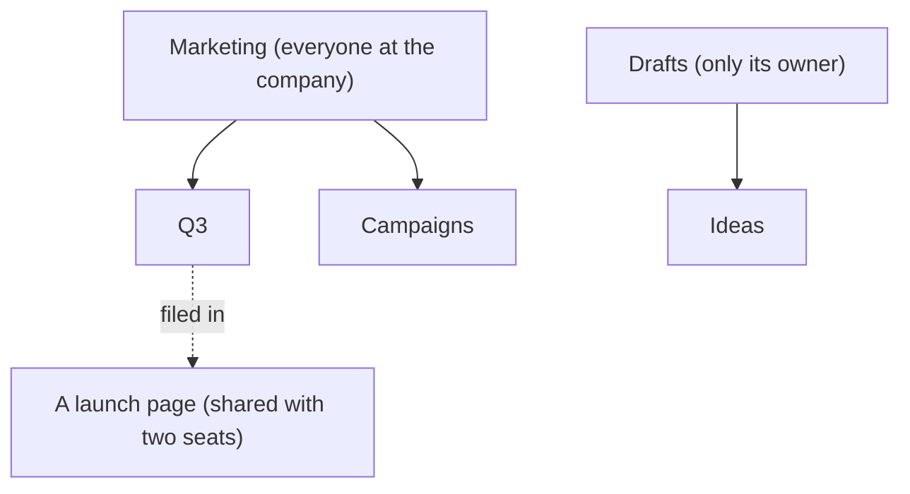
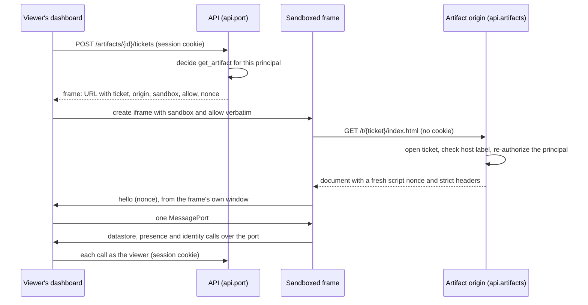
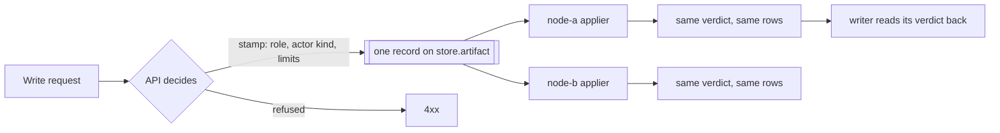
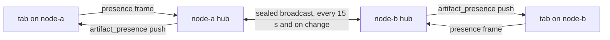

# Artifacts

An **artifact** is something a person or an agent makes for other people to
open: a dashboard, a report, a review table, a status page. It is versioned
like a document, shared like a file, served like a web page, and it can keep
**shared data** that every viewer reads and writes together, while everybody
in it sees who else is there.

Seven kinds ship in this release:

| Kind | What it is | Who draws it |
|---|---|---|
| `html` | A page of HTML, CSS and script, with any files it references | The page itself, inside a sandboxed frame on an origin of its own |
| `doc` | A document of one Markdown file, or of several tabs ordered by a `doc.json` index | The dashboard's own renderer; it carries no author code |
| `slides` | A deck of 16:9 slides in Claude's slide format | The dashboard, from the deck's canonical tree |
| `dashboard` | A board of figures over datasets: the artifact's own store, the engine's own domains, files and calculations | The dashboard's own widgets, every live figure answered as its viewer |
| `sheet` | A native sheet: rows and typed columns, with no page at all | The dashboard, from the sheet's schema alone |
| `design` | A canvas of artboards (`canvas.json`), each an HTML page, with titles and stickies beside them | The dashboard draws the canvas and the notes; each artboard runs in a sandboxed frame of its own |
| `brand` | A brand kit: the company's name, logos, colours, two typefaces and voice (`brand.json`), one version of which an administrator adopts as [the company brand](#the-company-brand) | The dashboard, from the kit's index; it carries no author code |

The motivating case is a review table an agent hands to a team: the agent
publishes it, three reviewers and the agent tick boxes and pick statuses in it
at the same time, every edit lands on every data node in the same order, and
everybody sees who is in which row.

Every decision this page summarises has one authority in the code, and the
cross-package rules are architecture decision records:
[ADR-0034](https://github.com/crewlet/crewlet/blob/main/adr/0034-an-artifact-is-shared-and-a-share-is-a-relation.md)
(sharing),
[ADR-0035](https://github.com/crewlet/crewlet/blob/main/adr/0035-an-artifact-is-served-from-an-origin-that-holds-no-credential.md)
(serving),
[ADR-0036](https://github.com/crewlet/crewlet/blob/main/adr/0036-bytes-are-reserved-before-they-move.md)
(uploads and carrying),
[ADR-0037](https://github.com/crewlet/crewlet/blob/main/adr/0037-a-datastore-write-is-decided-where-it-is-applied.md)
(the datastore),
[ADR-0038](https://github.com/crewlet/crewlet/blob/main/adr/0038-presence-is-told-never-stored.md)
(presence),
[ADR-0039](https://github.com/crewlet/crewlet/blob/main/adr/0039-a-cold-store-lives-in-object-storage-and-returns-through-the-log.md)
(what the datastore keeps hot),
[ADR-0040](https://github.com/crewlet/crewlet/blob/main/adr/0040-content-a-model-reads-carries-its-provenance.md)
(what an agent reads) and
[ADR-0048](https://github.com/crewlet/crewlet/blob/main/adr/0048-the-adopted-brand-is-the-companys-public-face.md)
(the company brand).

Running the serving origin is [Serving artifacts](../guides/artifacts-serving.md).
Writing a page is [Authoring artifacts](../guides/artifact-authoring.md), and
the page's runtime is the [artifact runtime reference](../reference/artifact-runtime.md).

---

## The model

An artifact has an **owner**, a **title**, an optional description and icon, a
**kind**, a list of **shares**, a **head version**, an optional **asset
store** and, when a version declares it, a **datastore**.

- **Its id is derived, never random.** The id is a function of the operation
  that created it, so the retry an unknown outcome asks for names the artifact
  the first attempt created rather than a second one.
- **Its label is its id.** Each artifact has a DNS host label: its id's sixteen
  bytes in lowercase Crockford base32, 26 characters. The label is not a
  secret; the view ticket is. It never changes, so per-artifact browser storage
  survives a keyring rotation.
- **A version is immutable.** It is a manifest (an entry path, and every file
  with its path, served content type, size, SHA-256 and the object holding its
  bytes), the runtime contract it was published against and the capabilities
  it declares. An open page never changes under its reader: a newer version
  arrives as a notice, and the viewer opens it.
- **A file's served type is the engine's**, from one extension table; a client
  may only disambiguate an extension the table already knows.
- **Assets** are files an artifact keeps beside its versions (images, data
  files) that every version may reference, uploaded and removed on their own.
- **Capabilities** are what a version's page may ask the host for: `db` (the
  shared datastore), `state` (per-viewer state), `identity` (who is viewing),
  `presence` (who else is here) and `assets`. A publish declaring a capability
  this build does not know is refused rather than served without it.

**A kind is native or framed.** An `html` page and a `design`'s artboards run
their author's code, and only on the artifact origin, in sandboxed frames (see
[Serving](#serving)); a design's canvas and notes are drawn natively. A
`doc`, a `slides` deck, a `dashboard` and a `sheet` carry no author code: the
dashboard draws each from a closed format with its own components, so nothing
one holds can become script on the dashboard's origin, and a publish outside
the format is refused with a named error rather than silently dropped on read.
A native kind declares no capabilities, since there is no page to grant them
to. Every rule the engine and the dashboard decide by kind is one row of one
table (`internal/artifacts/kind.go`), which
[ADR-0042](../../adr/0042-a-kind-is-native-or-framed.md) records, with the
comment anchor each kind will take.

A person may also publish to a **source key** (the republish-in-place address
an agent or the CLI uses), so publishing the same source twice updates one
artifact instead of creating two.

---

## Versions

**A publish names its base version.** The dashboard sends `If-Match` with the
head it last saw and an agent's tool passes `base_version`. When somebody
published since, the publish is refused `412 version_moved`, carrying the live
head's manifest and up to 1 MiB of its entry text, so the publisher can merge
rather than overwrite. An agent is never offered `force`; a person who is
present may force, and the version is marked forced.

**Edits are applied by the engine.** A publish may carry `old_str` and
`new_str` pairs instead of whole files: each must match exactly once in the
base version's text as it stands after the previous edits, all of them apply or
none does, and a miss is refused naming the edit. An agent saves most of its
output tokens this way on a small change.

**Unchanged files move no bytes.** A publish names every file by its SHA-256;
a file the artifact already holds is **carried**: the new version names the
existing object. Only new content is uploaded. Carrying never crosses from one
artifact to another, so a publish cannot learn whether some other artifact
holds a file.

**Rolling back is publishing.** Restoring version 7 publishes a new head whose
manifest is version 7's, every entry carried. History is never rewritten.

**Any two kept versions compare.** The dashboard's History tab compares the
version picked with another (its address carries `against=` and `lens=`, so a
link opens the same comparison): by files, every file added, removed or
changed (by digest, so a carried file is never a change) and a changed text
file line by line; or side by side, a page in two frames or a document
rendered twice. Both sides of a page show today's data, which is not versioned
with it.

**Retention is bounded twice.** An artifact keeps its newest 100 unlabelled
versions and every labelled one (at most 100 labels); a publish past that
prunes the oldest unlabelled version in the same record. A trashed artifact is
recoverable for 30 days, after which the trash reaper purges it. A purge is an
administrator's, with a recent proof; it first commits the artifact to its
purge (into the trash, never restored again), then removes the datastore, then
the artifact, and the objects nothing names any more are collected by the
[object store's](object-store.md) usual rule. A purge that stops part way is
finished by its retry or the trash reaper's next pass.

---

## Uploads and quotas

**Bytes are reserved before they move.** Every upload starts with an intent
that decides what can be decided without the bytes: the caller's authority,
the paths and types, the per-file and per-publish limits, which files the
artifact already holds, and whether usage already named, plus outstanding
reservations, plus the new bytes fits the company's quota. The engine mints
one key per new file and records a reservation that lasts until the
collector could have deleted those objects. Only then does a byte move.

- On the default `nats` object store every transfer streams through the engine.
- On an `s3` store whose boot probe proved it honours them, a browser or the
  CLI uploads straight to the bucket on a presigned `PUT` bound to the exact
  length, type, SHA-256 and `if-none-match: *`. An agent's sandbox is never
  handed one; the engine reads the box itself.
- **Finalize reads every new object back** through the verifying reader before
  the version is recorded, so the row's digest is the stored bytes' digest,
  established by the engine.

One principal may hold `artifacts.limits.pending_bytes` reserved (512 MiB by
default) and a company four times that; past it an intent is refused `429
uploads_outstanding`, naming when the oldest reservation expires.

**The quotas are Tier A**, because a tenant administrator must not raise their
own, and each record that consumes quota carries the limits it was decided
under, so every data node applies it identically:

| Key | Default | Bounds |
|---|---|---|
| `artifacts.limits.company_bytes` | 10 GiB | 1 GiB to 16 TiB |
| `artifacts.limits.artifacts` | 50 000 | 100 to 10 000 000 |
| `artifacts.limits.data_bytes` | 1 GiB | 64 MiB to 1 TiB |
| `artifacts.limits.data_store_bytes` | 32 MiB | 1 MiB to 1 GiB |
| `artifacts.limits.pending_bytes` | 512 MiB | 64 MiB to 16 GiB |

The per-version bounds are the published contract authors already know: an
entry of up to 16 MiB, other text files up to 16 MiB, binary files up to
15 MiB, 255 new files and 64 MiB of new bytes per publish, and 511 files and
256 MiB per version. Every bound has one definition, in `internal/artifacts`,
and a refusal names the value it refused at.

---

## Sharing

Artifacts are an **app**, beside Worklet and Doclet (see
[Identity and Access](identity-and-access.md#an-artifact-is-opened-by-its-shares)).
The `artifacts` permission **gates authoring only**: creating, publishing,
changing a datastore's schema, trashing and restoring. Opening an artifact,
being present in it and writing its data are decided by a **share** alone, so
somebody who does not use Artifacts still opens and fills in everything shared
with them.

A share names an **audience** and a **role**:

| Audience | Who it reaches |
|---|---|
| A seat | Whoever holds that seat, person or agent. Access follows the seat, as an inbox does |
| A unit | Every seat in the unit or anywhere below it, decided live against the org chart |
| The company | Every principal who may act, agents included |

| Role | Adds |
|---|---|
| `viewer` | Reads the artifact, its versions and its history; appears in the room |
| `commenter` | Comments (comments arrive in a later release) |
| `contributor` | Writes data the collection rules admit, and never the page itself |
| `editor` | Publishes versions and changes the schema, beside the `artifacts` app |
| `owner` | Shares, unshares, trashes, restores and transfers. Never shared: it moves only by transfer |

- **A person's new artifact is private.** When an agent creates an artifact
  for a person who asked for it, that person is shared `editor`.
- **The owner holds every role.** The lead of an **agent** owner holds the
  owner's role on that agent's artifacts; the lead of a **person** holds
  nothing of theirs.
- **An administrator reads anything**, through the admin path. An
  administrator a share already admits acts at the share's role; on an artifact
  shared with them in no way, every content read is recorded first as an
  elevated read, which the artifact's owner and editors see in its history and
  every administrator sees on the company trail of artifact history (the Audit
  screen, `artifact_trail`).
- **A caller with no share is told the artifact does not exist**: `404
  not_found`, identical to an id nothing holds. A share below what a gesture
  needs is `403`, naming the role that would change the answer.
- **A share never grants above the sharer's own role**, and every narrowing (an
  unshare, a lower role, a trash, a transfer) stops the next document request
  on the serving origin and withdraws every socket from the room.

What an **agent** may do is narrower than its shares, on purpose:

- it never widens a share to the whole company;
- it never trashes, restores, transfers, pins or forces;
- it never manages an artifact it does not own (publishing over it, updating
  it, resharing it) unless the company sets `artifacts.agents_manage_others:
  true`;
- every artifact tool passes the **requester ceiling**: an agent reads for
  somebody only what that somebody could read, and writes for them only what
  they could write, except on an artifact the agent owns, which anybody who
  can message the agent may ask it to change. The somebody is whoever woke the
  turn: a colleague's ask, or the first speaker of the message, comment or
  remark it answers, on a vendor's surface or on the engine's own tracker,
  knowledge base and chat alike. A turn woken by somebody the company does not
  know does nothing on an artifact beyond those changes to the agent's own.

"**Seen by**" lists who has opened an artifact, to its editors and above. It is
on by default, and a company turns it off with `artifacts.seen_by: nobody`.
The gallery's previews draw an artifact without opening it, and each is a
snapshot: drawn once when the card first comes near and then kept as it drew
(a copy of what it drew, or for a page in a frame the frame itself), reading,
polling and subscribing to nothing more until the gallery is loaded again.
Every read they make is a preview (`?purpose=preview`, or the outline and the
datastore's own questions, which record nothing), so scrolling past a card is not seeing
it. A preview joins no room and publishes no presence, so nobody is shown as
viewing an artifact a reader only scrolled past, and its frame is granted only
what drawing needs, for minutes: its assets, its datastore answered by a
read-only host that answers each read once, so a page that keeps its content
there draws that content as it stood and can change none of it, and a
newcomer's state, empty and kept by that host for the frame alone, so a page
that remembers each viewer's choices draws as somebody opening it for the
first time sees it. The reader's own state is never read for a preview, and
nothing a preview sets is kept.

---

## Folders

The company files its artifacts in **one folder tree**, and an artifact sits
in **at most one folder** (or at the top level). **A folder grants nothing**:
who may open an artifact is its owner and its own shares wherever it is filed,
so filing it, moving it and removing its folder never show it to anybody new
and never hide it from anybody who could open it
([ADR-0047](../../adr/0047-an-artifact-lives-in-one-folder-and-a-folder-grants-nothing.md)).

- **A folder is seen by its top-level folder's audience.** A top-level folder
  is made with one of two presets, **everyone at the company** (the company as
  `contributor`) or **only its owner**, and every folder beneath it is seen by
  exactly that audience. A tree is seen whole or not at all, so a breadcrumb
  never names a folder its reader cannot see, and a folder somebody cannot see
  is answered as one that does not exist.
- **An artifact in a folder you cannot see is at your top level.** Bob opens a
  page shared with him that its owner keeps in her own Drafts; he finds it at
  his top level, and is never told the folder's name or its id, on the page
  itself or in its history.
- **Filing asks the artifact and the folder.** Moving an artifact needs
  `editor` on it and `contributor` on the folder it goes to. A folder's owner,
  the owner's lead (for an agent's folder) and an administrator manage it:
  rename it, move it, remove it, and take out anything in it they can read.
  Managing is a person's; an agent creates folders only inside one, never at
  the top level, since a company-wide folder is a company-wide audience.
- **Names.** At most 80 bytes, no `/` and no invisible character; siblings are
  unique without regard to case. At the top level the company's folders are
  unique among themselves and each person's own among their own, so nobody is
  refused a name because of a folder they cannot see. Folders nest four deep,
  a company keeps at most 2000 and a folder at most 1000 folders.
- **Removing a folder moves everything in it up a level**, folders and
  artifacts alike, live and trashed, in one record. It is never refused for
  being full, it trashes nothing, and nobody loses access. A folder moved to
  the top level, or whose top-level folder is removed, keeps the audience it
  had; a folder moved into another tree is seen by that tree's audience, and
  the dashboard asks before a move that shows it to more people.
- **Counts are the reader's.** "12 artifacts · 2 folders" counts only what that
  reader may open, by the same filter the listing beside it uses, and a move's
  history row names folders by id, never by name.

The listing speaks **S3's `ListObjectsV2`**, so anybody who knows S3 reads it
at once: `prefix=Marketing/Q3/` (or `folder=<id>`) names the folder,
`delimiter=/` answers one level with its child folders as `common_prefixes`,
and `max-keys` and `continuation-token` page it; the token carries the folder's
id, so a rename between pages moves nothing. Folders are still rows, never part
of an artifact's key, and an agent's `list_artifacts` takes `prefix` and
`delimiter` the same way. The routes are in the
[API reference](../reference/api-endpoints.md#folders).

---

## Work items

A Worklet item's **Artifacts** panel lists every artifact made or linked
for it, read from the artifacts' own history (`GET /artifacts?work_item=ENG-12`):

- **A write made for an item names it.** A create, a publish or a rollback that
  carries `work_item` (or an agent's turn charged to the item) stamps the key on
  its history row, and that row lists the artifact on the item.
- **An artifact that already exists is linked** with `POST
  /artifacts/{id}/work-items`, which records one history row filed under the
  item and changes nothing else about the artifact. The dashboard's create pages
  use it to make a design or a dashboard first and file the task for it after.
- **A link needs both halves.** The caller must be able to read the artifact
  (any role, viewer and above; the admin path is recorded as every elevated
  read is), and must be able to change the item (`update_work_item`,
  Worklet's own decision). The item must be one Worklet holds and
  not removed, and the link is made under its current key, so an id or a
  former key links where the panel looks.
- **A link is made once.** A retry under the same `Idempotency-Key` is the same
  operation, and a link to an item the artifact's history already names answers
  success and writes nothing.
- **Only an applied row counts.** A write the log refused (a link that reached a
  trashed artifact, a publish over a moved head) lists the artifact on nothing,
  and the panel reads the history's retention window (a year).

---

## Serving

An artifact runs on an **origin that holds no credential**. The dashboard acts
with an `HttpOnly` session cookie, so a page rendered on the dashboard's origin
could act as whoever opened it; an artifact is therefore never served there.

- **A listener of its own.** `api.artifacts` serves one file of a ticket's
  version, one asset of a ticket's artifact, the embedded runtime and kit,
  and the files of the company's adopted brand by their hash.
  It mounts no guard, no API route and no probe, never reads a cookie and never
  sets one.
- **A view ticket** in the path names one principal, one artifact, one
  version, the credential it was minted through and the artifact's access
  epoch. It lives an hour, never past its credential, and the runtime asks the
  host for a fresh one.
- **Two origin modes.** With a wildcard host such as
  `https://{artifact}.artifacts.example.net`, each artifact gets an origin of
  its own, on a site that is not the dashboard's, and browser storage works per
  artifact. With one plain host or port, every document is served with an
  **opaque** origin: browser storage throws there, and a page keeps per-viewer
  state through the runtime instead. A wildcard on the dashboard's own site is
  served opaque too.
- **Revocation is the next document request.** A document is re-authorized on
  every request; a subresource is served on a decision at most 30 seconds old.
  A node whose own copy of the artifacts or identity log is stale or out of
  service asks a healthy peer, and answers `503` with `Retry-After` when none
  answers. It never serves from rows that may hold a revoked share.
- **A strict script policy.** Every document carries a fresh nonce with
  `'strict-dynamic'`, inline handlers are admitted by hash, and the page may
  reach only its own origin for data, images and media. Plugins, base URLs,
  form posts and nested frames are refused. The frame never gets
  `allow-popups`: an external link goes through the host, which names the
  destination before it opens it.
- **No third party at view time.** Script and stylesheet files a page
  references on the allowed CDNs, as a script or link element, a module import
  or an import map entry, are copied into the version when it is published,
  integrity-checked, so viewing works without the CDN and the CDN never sees a
  viewer. Any other remote script a page states is refused. What the linter
  cannot read is a script the page's own script builds at run time:
  `'strict-dynamic'` trusts it from any host, so a page whose author means to
  can send what a viewer may read to another site. Only an `editor` publishes,
  and every version names who did; share `editor` accordingly (see
  `SECURITY.md`).

The raw bytes of a version are also downloadable from the API, always as an
attachment and text as `text/plain`, never rendered.

---

## The datastore

A version that declares `db` gets a **store**: named **collections** of
**documents** (JSON objects keyed by an id), shared by every viewer, durable,
and replicated like every other domain. A `sheet` artifact is nothing but its
store, drawn by the dashboard from the schema.

**A collection has rules**, chosen through a preset and refined per column:

| Preset | Who reads | Who writes |
|---|---|---|
| `shared` | every participant | editors |
| `contribute` | every participant | participants add rows and edit their own |
| `author` | every participant | the owner and the authoring agent |
| `private` | each writer, their own rows only | each writer, their own rows only |

A collection with no schema is closed by default: participants read, editors
write. A **schema** declares typed columns (`text`, `longtext`, `number`,
`checkbox`, `select`, `multiselect`, `status`, `person`, `date`, `url`,
`rating`), each optionally with a least role that may write it, a condition
(only on rows the writer created, or only on rows assigned to the writer), an
append-only mode, immutability after creation, and **`humans_only`**: the
approval column a model must never tick. An agent may add `humans_only` and
never remove it, and may tighten a rule and never loosen one. Read rules
(`all`, `own_rows`, `editors`, `private`) apply on **every** read path: the
list, a single document, a query, the history and the live pushes. The history
judges each change by the row's creator when it was made, so a row deleted and
created again under the same id by somebody else is theirs from that create on,
and what its previous creator wrote stays with them.

**A write is a batch of ops**, all applied or none: `set` (replace a
document's fields, creating it), `merge` (set named fields), `delete`
(tombstone), `increment`, `append` (grow a long text or an array), `add` and
`remove` (a multiselect's elements). Each op may carry the document version the
writer saw; without one it is a blind write, which is what a click on a
checkbox is. Writes are HTTP requests with an `Idempotency-Key`, so a lost
answer is retried as the same write.

**The write is decided where it is applied.** Each store is one sequenced log:
the API decides what needs identity or the org chart (the caller's role on the
artifact, whether the caller is an agent, the quotas in force) and stamps it
into the record; every data node's applier then decides the rest from the record
and its own rows (names, schema, field rules, version guards, caps), in log
order, so every data node reaches the same verdict: `applied`, `conflict`,
`invalid`, `forbidden`, `quota` or `gone`. The writer reads its own verdict
back; a `conflict` answer carries the current documents to merge with. A sheet
in the dashboard shows an edit at once as pending and makes it solid when the
verdict arrives.

**History and undo.** Every write leaves a history row (who, when, which
fields, before and after values), kept seven days and at most 8 MiB per store
on the data nodes. A person undoes their own write; an undo whose documents
changed since is a conflict naming who changed them.

**Bounds.** At most 64 collections per store, 128 columns per collection,
50 000 documents per store, 64 KiB per document and 100 ops or 1 MiB per write.
Writes are rate-limited per node by their cost: the rows the apply writes,
which for a changed document are its whole field index deleted and written
again, in units of sixteen rows (a cell edit on a twelve-column row is two). A
principal takes 20 units a second on a store with bursts of 100, and a store 40
a second with bursts of 100, answered `429` with `Retry-After`, never a
lockout.
The datastore quotas count the bytes a store's rows really take on every data
node and in every snapshot: each document row with its index and field-index
entries, and the hot history, measured within a few percent of the file. A
twelve-column review sheet costs about 3.2 KiB a row with a week of history,
so the default 32 MiB per store holds about ten thousand rows.

**Exports.** An editor downloads any collection as CSV, written for a person
to read: columns headed by their labels, choices by their labels and people by
their names.

---

## Presence

**Presence is told, never stored.** Who is in an artifact and what they are
looking at lives in the memory of the node holding their socket and crosses
between nodes on an ephemeral broadcast: no row, no log record, no
coordination key.

- A browser sends its focus (a version, a region, or a collection, document
  and field) and its activity (`viewing`, `editing`, `idle`), throttled to ten
  frames a second. The node fans a room out to its sockets at most ten times a
  second, at most ten members a frame (the change that has waited longest
  first), and tells the other nodes its own members' moves at most twenty
  times a second, so a cursor crosses nodes within about 150 ms.
- Each node rebroadcasts its roster every 15 seconds; an entry expires 45
  seconds after the last frame naming it. A node gaining its first member of a
  room asks its peers once, so a newcomer sees the room at once.
- Every frame between nodes is sealed under the fleet keyring with a
  60-second validity; a frame the fleet did not seal shows nobody.
- Past 50 members a room shows the 50 most recently active plus counts of
  people and agents, and returns to the full roster below 40.
- **Agents are present.** An agent reading or writing an artifact appears in
  its room, naming the turn it is working in, so a person sees which agent is
  editing which row and opens that turn from the room.
- **The People rail** (opened from the presence stack, `rail=people`) lists
  everybody here in words, one entry a person however many tabs they have,
  with what each is doing and where. **Follow** moves the reader to the
  version, and on a sheet the collection, the followed person has open, under
  a banner, until the reader scrolls, presses or uses a navigation key in the
  page, presses Escape, or the followed person leaves; `follow={handle}` in the
  address starts it, which is how to watch a presenter on a phone.
- Joining a room is decided like opening the artifact, and decided again on
  every share, unshare, trash, transfer and purge: somebody whose share is
  removed leaves the room at once, on a socket that stays open.

Presence colour (cursors, selection rings, cell outlines and name flags) is
the one place a colour stands for a person, and it is always shown beside the
name.

---

## Agents

An agent authors and edits artifacts through one tool per action, each named
for the authority verb it asks:

| Tool | Does |
|---|---|
| `list_artifacts` | Lists what the seat may open: its own, shared with it, company-wide, its reports'; one folder's level by `prefix` and `delimiter`, as S3 lists a bucket |
| `get_artifact` | Reads a head, its versions and its files, a page at a time |
| `get_company_brand` | Reads the company's adopted brand: colours, typefaces, logos, the brand slide theme, the kit version to link and the fenced voice |
| `create_artifact` | Creates an artifact from inline files, the turn's sandbox, a project file or the brand's logos and faces (`from_brand`), or a deck from a `starter` plan; `folder` files it |
| `publish_artifact` | Publishes a version against a base, with whole files or edits |
| `update_artifact` | Changes the title, description, icon or a version label |
| `share_artifact`, `unshare_artifact` | Shares with seats and units, or removes a share |
| `upload_artifact_asset` | Adds an asset, when the head declares `assets` |
| `create_artifact_folder` | Creates a folder, or a chain of them, inside a folder that exists |
| `move_artifact` | Files up to 25 artifacts in a folder, or takes them to the top level, each decided on its own |
| `read_artifact_data`, `query_artifact_data` | Reads a store's documents |
| `write_artifact_data` | Writes a batch of ops |
| `set_artifact_schema` | Declares collections and columns |

Per turn segment an agent may publish 20 times (10 on one artifact), write
128 MiB, make 1000 datastore ops, make 5 folder records and send 1 MiB of
inline content in one call.

**Filing is an agent's; reorganising is a person's.** A [folder](#folders)
grants nothing, so an agent files its own work and tidies what it may edit,
each move asking editor on the artifact and contributor on the destination
through the requester ceiling. It creates subfolders inside a tree a person
made, and only when asked or for a set of related artifacts no folder fits.
Top-level folders, renames, moves of a folder and removals are a person's
gestures. A folder reference resolves only among the folders the agent and
whoever it works for can both see, and a turn a stranger woke sees none.

**The brand is applied for the agent where the engine draws.** Pages, designs,
docs and dashboards take the [adopted brand](#the-company-brand) with no step of
the agent's. What it writes literally, a slide's inline styles, a logo in a
version, a typeface, it reads from `get_company_brand` and copies with
`from_brand`; a deck begun from `starter` with `theme: "brand"` is drawn in the
brand by the engine. The brand's voice is the one free text, fenced under the
`company` trust: tone and wording, never the task, the tools, the recipients
or access. Its fence names who wrote it (the author of the adopted version,
possibly an agent) beside the administrator who adopted it, which the
adoption records. The bundled artifacts skill names the kit version to link as
`${crewlet_kit_version}`, which the engine sets to the newest kit it embeds,
the one that reads the brand.
A stale base version is refused with the live version, its author, its time,
the changed paths and the start of each changed file, which is what the agent
merges from.

**Everything an agent reads that somebody else wrote is fenced** (see
[ADR-0040](https://github.com/crewlet/crewlet/blob/main/adr/0040-content-a-model-reads-carries-its-provenance.md)):
another principal's page, a viewer's row, a colleague's file. The fence labels
who wrote it and says it is data, never an instruction. Fencing reduces prompt
injection and does not remove it; the requester ceiling, `humans_only` columns
and the human-only verbs hold whatever a model does.

---

## The security model

| Threat | What stops it |
|---|---|
| A page acting as whoever opened it | The artifact origin holds no credential and never reads a cookie; the page talks to the host only through a port, and every call is decided as the viewer |
| One artifact reading another's storage | An origin per artifact on a site of its own, or an opaque origin; never the dashboard's |
| A page leaking its data to a third party by accident | `connect-src`, `img-src` and `media-src` reach only the artifact's own origin; no popups; external links are confirmed by the host; every remote script a page states is copied in or refused. A page whose own script loads another site's script on purpose is not stopped: publishing is an `editor`'s, and every version names its publisher |
| Script injected through a viewer's row | A fresh nonce with `'strict-dynamic'` per document; no `'unsafe-inline'` |
| A compromised CDN | Third-party files are copied in at publish and served from the artifact's own version |
| A revoked share that keeps working | Documents re-authorized on every request; a stale node asks a peer or answers `503` |
| A leaked frame URL | The ticket is bound to one principal, artifact, version and credential, expires within the hour, and a top-level navigation to it is refused |
| Existence of private artifacts | A caller with no share gets the same `404` as for an unknown id |
| Bytes swapped after a check | The engine mints every key, a direct upload is bound to its digest and `if-none-match: *`, and finalize reads every object back |
| Bytes nobody names filling the store | Reservations before transfer, bounded per principal and per company |
| An agent persuaded by content it reads | Provenance fences, the requester ceiling, `humans_only` columns, human-only verbs, no company-wide share by an agent |
| A forged presence frame | Frames are sealed under the fleet keyring |

---

## The two logs

Artifacts keep their durable state in two state-log domains, each strict, each
applied into identical copies on every data node, and each with its own
stream and ceiling:

| Domain | Stream | Holds | Ceiling (Tier A) |
|---|---|---|---|
| `artifacts` | `CREWLET_ARTIFACTS_LOG` | Artifacts, versions and their object references, assets, shares, pins, reads, history | `stream.artifacts_log_max_bytes`, 1 GiB to 256 GiB; unset derives a quarter of the mutation log's ceiling, 1 GiB to 16 GiB from a volume alone |
| `artifactdata` | `CREWLET_ARTIFACT_DATA_LOG` | Every store's collections, documents, field index and write history | `stream.artifact_data_log_max_bytes`, 1 GiB to 512 GiB; unset derives a quarter of the mutation log's ceiling, 1 GiB to 16 GiB from a volume alone |

Every record that adds or removes an object reference is arbitrated on its
artifact's subject, so the broker orders every carry against every removal.
The datastore's writes are sequenced on one subject per store, with no broker
expectation. Record instants in rows are the broker's, never a node's clock.
Neither log is read on a seat's turn path, so a stalled copy takes the node's
artifacts out of service without stopping its agents.

Every store already keeps a running digest of its documents, compact integer
keys and a real-byte footprint, so a later release can move idle stores to
object storage and bring them back through the log without re-deriving any of
them.

---

## Configuration

| Key | Tier | What it does |
|---|---|---|
| `api.artifacts.host`, `api.artifacts.port` | A | Bind the artifact listener on an ingress node; port `0` (the default) serves no artifacts on this node |
| `api.artifacts.external_url` | A | Where browsers reach artifacts: a wildcard template for an origin per artifact, or one plain origin for opaque origins. See [Serving artifacts](../guides/artifacts-serving.md) |
| `artifacts.limits.*` | A | The plan quotas above |
| `stream.artifacts_log_max_bytes`, `stream.artifact_data_log_max_bytes` | A | The two logs' ceilings |
| `store.objects.nats_max_bytes` | A | The `nats` object bucket's reservation on the broker |
| `artifacts.agents_manage_others` | B | Let agents publish over, update and reshare artifacts they do not own (default `false`) |
| `artifacts.seen_by` | B | `editors` (default) or `nobody` |

---

## Docs

A `doc` artifact is Markdown: one file (`index.md` by default), or several
tabs, each its own Markdown file, ordered and titled by a `doc.json` index
(`{"v": 1, "tabs": [{"path": "tabs/plan.md", "title": "Plan"}]}`). The
[authoring guide](../guides/artifact-authoring.md#writing-a-doc) is the whole
contract.

- **Held to the format at publish.** Every version is read whole through one
  reader (`internal/artifacts/docindex`), carried tabs included: an index that
  names a file the version does not hold, a tab that is not Markdown, a path
  twice, more than 32 tabs or more than 16 MiB of text is refused, each
  finding naming its rule, under the code `doc_format`.
- **Drawn by the dashboard, never as markup.** The engine answers a version tab
  by tab (`GET /artifacts/{id}/versions/{n}/doc`), and the dashboard draws each
  with the element-constructing Markdown renderer Doclet pages use, which
  also decides what a heading is, so the outline and the page it points into
  cannot disagree.
- **Searched by every tab**, each title and its text, not by the index.
- **Edited in place, each save a version.** A person who may publish presses
  Edit to change any tab's text, rename, reorder, add and remove tabs, and
  Save publishes all of it as one version based on the version they opened:
  an exact edit of each changed tab and of `doc.json`, a removal for each tab
  dropped, and each new tab's file uploaded through the engine (a doc of one
  file gains its `doc.json` with its second tab). A save that raced somebody
  else's publish is merged onto theirs tab by tab, text by line as a
  Doclet page's is, and where both changed the same lines, the same title
  or the order, or one removed a tab the other changed, the person settles it
  before saving again. Print prints every tab in order.
- **Started from a template.** New › Doc begins a doc from the engine's
  starter, one tab under its title, held to the format like any version.
- **Followed by tab**: a reader's tab is said to the room as the region
  `tab:<path>`, so following somebody opens the tab they are on.
- **Covered natively in the gallery**: the first tab's opening, from the
  version's outline, drawn at card size. A sheet's cover is its first columns
  and rows, read as the viewer.

---

## Decks

A `slides` artifact is a deck in Claude's slide format: a `deck.json` index
and one `slides/<id>.html` per slide, each a `<section>` on a 1920 by 1080
stage styled from a closed inline subset, with its speaker notes in an
`<aside>`. The [Slide Format](../reference/slide-format.md) reference is the
whole contract.

- **Held to the format at publish.** Every version is read whole through one
  parser (`internal/artifacts/slideformat`), carried slides included, so a
  patch that removes an image a slide shows is refused as surely as a slide
  that names a stylesheet. The refusal names each file, line and rule.
- **Drawn from its tree, never its markup.** The engine answers a version as
  the canonical tree its publish was held to, and the dashboard constructs
  every element itself, holding the same allowlists again. Images and
  typefaces are files of the version the dashboard reads with the viewer's
  own sign-in; a slide names no address the browser fetches.
- **Edited as versions.** A person with `editor` fixes text in place, edits
  notes, reorders, deletes slides and renames the deck; Save publishes a
  version based on the one they opened. A save refused because somebody
  published since is merged onto their version slide by slide, and a slide
  both changed differently is the person's to resolve. An agent revises a
  deck the same way, one slide file at a time, and a stale publish hands it
  the slides that changed.
- **Presented and followed.** Present draws the slide full screen with the
  keys a clicker sends; the Presenter window shows the slide, the next one,
  the notes and a timer and moves the room's screen. Where a reader is in a
  deck is their presence region `slide:<id>`, so following the presenter (a
  phone included) moves the follower to the same slide with no transport of
  its own.
- **Printed to PDF** one 16:9 page per shown slide, by the browser.
- **Compared by slide.** History's comparison of two versions of a deck has
  a By slide lens beside Files: each slide's two versions side by side,
  paired by id, a slide one version lacks in its place, and every change said
  in words (changed, added, removed, moved), where a move is what the order
  changed rather than every slide whose number shifted.
- **Started from a template.** New › Deck begins a deck from the engine's
  starter (a cover, an agenda, two columns and a closing slide, each with
  notes), published inline and held to the format like any version, so the
  dashboard sends no upload.
- **Covered natively in the gallery**: the cover slide drawn at card size from
  the version's outline, never a screenshot.

## Dashboards

A `dashboard` artifact is a native widget board over declared datasets, in the
closed [Dashboard Spec](../reference/dashboard-spec.md): stats, meters, charts
over time, ranked bars, shares, tables and notes on the twelve-column grid the
Home board uses, each widget citing its dataset and when its rows were true,
with a Sources rail that shows every dataset's definition, freshness and rows.

- **Read as the viewer.** An `engine` dataset is answered by the question the
  dashboard's own screens ask (Worklet's, spend's, the agents' status), on
  the viewer's own request, so two people opening one board each see what
  they may read and nothing more; a figure over a source somebody may not read
  says so and names the permission that would open it
  ([ADR-0043](../../adr/0043-a-dashboards-live-data-is-read-as-its-viewer.md)).
  The board itself and its gallery cover carry no row.
- **Live where the data is live.** A `store` dataset redraws whenever the
  artifact's datastore pushes a change, so rows an agent writes appear on every
  open board; an engine dataset refreshes on its domain's own push (spend, the
  agents) or on the interval it declares, never under a minute; a file dataset
  is fixed with its version.
- **Held to the format at publish**, every finding named, and data files
  parsed against their declared columns.
- **Exported in the browser**: a widget's rows as CSV and a chart as PNG,
  each the viewer's own view.
- **Covered natively in the gallery** from the version's outline: the first
  stats' labels and their datasets' titles, never a figure.

---

## Designs

A `design` artifact is a canvas of artboards: a `canvas.json` entry that
places each board (an HTML page of the version) at its position and size and
holds titles and stickies beside them, and one `.html` file per board with its
own scripts and styles. [Authoring Artifacts](../guides/artifact-authoring.md#writing-a-design)
has the format.

- **Begun from a layout in the dashboard.** A person lays out the boards a
  design needs (their names, sizes, places and what each is for) on its
  create page, and the engine publishes that layout as the design's first
  version: `canvas.json` and one placeholder page per board under `boards/`,
  saying the board's size and brief, until an agent publishes the board's
  real page over it (`canvasformat.Starter`).
- **Held to its format at publish.** The canvas is read strictly
  (`internal/artifacts/canvasformat`): a field it does not know, a bound
  passed, a board naming no page of the version, or a page no board frames
  is refused, every problem named at its place in `canvas.json`. Every board
  goes through the page linter exactly as an `html` page does.
- **One frame per board, one document per ticket.** Each board on screen is a
  sandboxed frame minted for that board alone, and its ticket opens that page
  and no other ([ADR-0035](https://github.com/crewlet/crewlet/blob/main/adr/0035-an-artifact-is-served-from-an-origin-that-holds-no-credential.md),
  "One document per ticket"). Only boards on screen and drawn wide enough to
  make out run (96 pixels on screen, a thumbnail), at most twelve at once; the
  rest are placeholders of their size. A board opens in a dialog, still
  framed, fitted to it or at its own size.
- **Worked like a design tool.** A floating palette holds Move (`V`) and Hand
  (`H`, or Space held), and while editing Text (`T`) and Sticky (`S`), which
  place a note where the canvas is clicked. A click selects a board or a note
  and a double-click hands a board's page the pointer, Escape giving it back.
  Shift 1 fits every board in view and Shift 0 shows actual size. The list of
  boards beside the canvas marks the board selected on it, and a board picked
  there is selected and brought into view.
- **Rearranged as versions.** A person with `editor` moves and resizes boards
  (by a board's name and a selected board's corners) and places, edits and
  deletes notes; Save publishes a version whose one change
  is `canvas.json`, every board carried by the object it already was. A save
  refused because somebody published since is merged onto their version board
  by board and note by note, keeping the person's change where both changed
  one item.
- **Printed board by board.** A board's own Print (`crewlet.print()`) or Print
  on an opened board prints that board alone on a page of its own size, on
  the reader's click.
- **Read in parts.** The outline (`GET /artifacts/{id}/versions/{n}/outline`,
  and `get_artifact` with `view: "outline"` for an agent) lists every board's
  file, title and frame in the canvas's order, so an agent opens only the
  boards it changes.
- **Covered natively in the gallery**: a schematic of the boards where the
  canvas places them, the cover board titled, never a screenshot.
- **Where a reader is** on a design is their presence region `board:<path>`,
  the board that holds their pointer.
- **A comment on a design will point at an artboard point**: the board's path
  and a point in the board's own coordinates (`canvasformat.Anchor`), so it
  stays on its spot however the board is moved. The shape is fixed now;
  comments arrive in a later release.

---

## The company brand

A **brand kit** is an artifact of kind `brand`: a closed `brand.json` naming
the company's name and tagline, its logos (a primary one for light grounds,
one for dark grounds and a square mark), its colour roles (`primary` and
optionally `secondary`, `text`, `light_ground`, `dark_ground` and
`primary_on_dark`, each `#rrggbb`), a heading and a body typeface (a face the
artifact kit ships, a curated system stack, or an uploaded WOFF2 family the
publisher attests the company may embed), and a short voice: a summary, a few
lines to write like and a few to avoid. Anybody with the artifacts app may draft
one, agents included, and many may exist.

- **Its format is one read away.** `get_artifact_format` with `kind: "brand"`
  answers every key of `brand.json` with its type and rule, the
  exactly-one-source rule for a face, the logo and SVG rules, and an example
  that reads clean. The reference is generated by `brandformat` from the same
  form its strict decode reads with and the same constants its rules check, so
  it cannot promise a key or a bound the reader refuses (a test holds it to
  every key both ways). Every other kind with a closed format (`slides`,
  `doc`, `design`, `dashboard`) answers its own index the same way.
- **Held to its format at publish, every fault in one refusal.** `brand.json`
  is read strictly (`internal/artifacts/brandformat` over
  `internal/jsonform`): an unknown key (named with the keys its
  object takes), a value of the wrong type (named with the shape read there),
  a key written twice, a value outside its grammar, a file the index does not
  name, and a logo or face outside its asset rule are each refused, naming the
  file, the line and the fix. The strict decode does not stop at its first
  fault: it reports every structural fault, decodes every well-formed field,
  and runs the field rules over those in the same pass, so a kit with six
  faults is answered with six findings. A logo refused by its asset rule is
  answered together with the index's own findings. The tool answer lists the
  first 20 findings and counts the rest. A logo is stored in the form the engine writes, never as uploaded:
  an SVG re-serialised from an allowlist that admits no script, style, foreign
  content, animation or outside reference (`internal/artifacts/svgsafe`, the
  one allowlist a slide's drawings are held to too), a PNG or WebP without its
  metadata and never animated. A draft is never refused for its contrast.
  Text holds no link or address, and a bare domain is refused too, except the
  brand's own `name` written as a domain: for the brand `GoPhrase`,
  `GoPhrase.me` may appear in its voice, while `promo.gophrase.me` or any
  other host may not. The rule reads the kit's own `name`, never the company
  record, so a rename cannot turn a published kit into one its reader refuses.
- **Drafted step by step.** A draft needs only its `name`: a kit may be saved
  after each step of its setup, with no logo, no colour and no typeface yet.
  Every field a draft does hold keeps all its rules. A typeface left unset
  draws the artifact kit's own face (Geist).
- **The company brand is an adoption.** An administrator, a person, at a
  recent proof of identity, adopts one version of one kit on Company › Brand
  (`POST /brand/adoptions`). The adoption **snapshots** that version: its
  index, a stylesheet generated from it once, and a copy of every logo and
  face, each an object of the adoption's own. Publishing a newer draft,
  trashing the kit or purging it changes nothing until somebody adopts again,
  and the page shows a newer version waiting to be reviewed. An adoption
  requires the brand to hold a primary logo (`logos.primary`) and a primary
  colour (`colors.primary`): one that leaves either out is refused naming each
  missing field, before anything is copied. Once both are there, an adoption is
  refused when the brand's text does not reach 4.5:1 on its light ground;
  every other pair (the label on the accent, the dark mode's text, the accent
  on each ground) is listed as a warning.
- **The company's public face.** Everybody reads the adopted brand: every
  person, every page and every agent, whatever the conversation it serves
  (`GET /brand`, the `get_company_brand` tool). Put nothing in it that is not
  meant for anybody who sees what the company publishes.
- **How each kind follows it.** A doc and a dashboard follow the adopted brand
  live: the dashboard draws them in its tokens. A framed page (`html`,
  `design`) **pins** the stylesheet adopted when its version is published, and
  the artifact origin places it at the top of each document it serves, so a
  rebrand never restyles a page nobody reviewed under it; publishing again
  takes the current brand. A page keeps its own design with
  `<html data-crewlet-brand="off">`. A deck copies the brand's theme, faces and
  logo into its own files when it is created from the brand starter.
- **One stylesheet, inputs only.** The generated stylesheet defines the artifact
  kit's `--brand-*` input slots on `:root` and an `@font-face` per uploaded
  face, nothing else, and the kit (`@crewlethq/artifact-kit` 0.47.0 onward)
  restyles its own tokens from them, so a page already written with the kit's
  tokens follows the brand without a change. Its files are served on the
  artifact origin at `/_crewlet/brand/<sha256>.<ext>`, only while an adoption
  or a page pinned to one names them.
- **Voice is for writing, never for instructions.** An agent reads the voice
  only through `get_company_brand`, fenced as company-adopted text that
  governs tone and wording and never the task, the tools, the recipients or
  anybody's access. A rule every message must follow belongs in a standing
  policy on Company › Principles.

---

## What this release does not do

Comments, mentions and reviews; watches that wake an agent when data changes;
decisions inside a sheet; a design's live board layer of shapes, connectors
and images; a dashboard dataset an agent refreshes on a schedule, and
integration sources a viewer's own connector answers; slide builds, magic moves, live
embeds and connectors on a slide, and PowerPoint or Google Slides export of a
deck; live Worklet and Doclet data inside
a page; a page asking a model a question; viewer uploads and device features;
public links outside the company; moving idle stores to object storage;
point-in-time recovery from a log archive; concurrent co-editing of long text;
and time travel by replay. The shapes in this release leave room for each
(an audience kind for links, a reserved subject for comments, a store digest
for tiering) without promising when.
