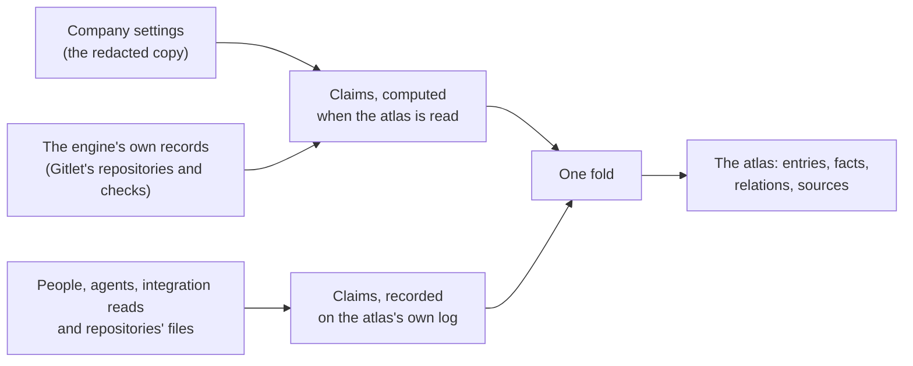

# Atlas

The atlas is the map and catalogue of everything a company runs on: its vendor accounts, domains and host names, servers, databases, repositories, pipelines, monitoring, tool servers and models, and how they depend on each other. The engine fills it from what it already knows, and every fact in it says where it came from, when it was seen, and how far it can be trusted.

This page describes the model: what the atlas holds, where each fact comes from, how one thing seen by several sources becomes one entry, and what the atlas never holds. The decision behind it is [ADR-0126](../../adr/0126-the-atlas-computes-what-the-engine-knows-and-records-what-it-is-told.md).

## What the atlas holds

An **entry** is one thing the company runs on. Its kind is one of a closed set, and each kind sits in one lane of the map, read left to right the way a request travels, with the code, monitoring, tools and models in a band beneath.

| Kind | On screen | Lane | Example |
|---|---|---|---|
| `domain` | Domain | Entry | `acme.example` |
| `hostname` | Hostname | Entry | `api.acme.example` |
| `endpoint` | Endpoint | Entry | `https://api.acme.example/v1` |
| `certificate` | Certificate | Entry | a certificate pack a vendor holds for the company's names |
| `service` | Service | Services | `checkout-api` |
| `workload` | Workload | Services | the container `acme-api` on the server `web-1` |
| `host` | Server | Runtime | `web-1` |
| `datastore` | Database | Data | `orders-db` |
| `queue` | Queue | Data | `orders` |
| `bucket` | Bucket | Data | `acme-assets` |
| `vendor_account` | Account | Platforms | the Cloudflare account, the GitHub organisation |
| `repository` | Repository | Code and delivery | `acme/api` |
| `pipeline` | Pipeline | Code and delivery | a repository's `deploy` check, an Expo project's iOS build |
| `monitor` | Monitor | Observability | "API 5xx" |
| `tool_server` | Tool server | Tools and models | an MCP server |
| `model_provider` | Model | Tools and models | a model entry and its vendor |

What a vendor does for the company (chat, tracking, code hosting, CI, monitoring, DNS, CDN, compute, a model API) is an account's **capabilities**, not a kind per product, so "which CDN do we use" is answered by the account that carries the `cdn` capability. A vendor the engine does not know yet is an account with the vendor `other` and a name.

**Relations** always point from the thing that relies to the thing relied on, so "what depends on X" is one walk against the arrows: `runs_on`, `depends_on`, `exposes`, `resolves_to`, `in_zone` and `fronted_by` are drawn on the map at rest; `served_by`, `built_from`, `deployed_by`, `monitored_by`, `belongs_to`, `documented_in` (a Doclet page) and `owned_by` (a seat or a unit) appear when an entry is selected.

**Facts** are a closed list per kind, each with a value type: a host name, an IP address, an address without credentials, a port, a version, a region, an account's own id, a branch, a container image's reference, a short label, a word from a closed set. Facts of **meaning** (purpose, environment, importance, and the owner) are decided only by people and the settings; an integration or an agent can only suggest them.

## Where each fact comes from

Every fact is a claim from one source, and the atlas is one fold over all of them.

What the engine **already keeps** is computed every time the atlas is read and never stored: it cannot drift from where it lives, and it needs nothing written. What only **somebody can tell** the engine (a person's correction, an agent's observation, an integration's read beyond what the engine keeps, what a repository's files declare) is recorded on the atlas's own log ([What integrations read](#what-integrations-read), [What a repository's files declare](#what-a-repositorys-files-declare)).

Each claim carries a confidence the engine derives from its source and the evidence it checked. Nobody, and no model, chooses it.

| Where the fact came from | Shown as |
|---|---|
| The company settings, or the engine's own records | Confirmed |
| A person | Confirmed |
| An integration's read with the company's credential | Confirmed |
| A repository's deploy and dependency files, read at its default branch | Likely |
| An agent, backed by a server's or a vendor's own answer to a tool call in the same turn | Likely |
| An agent, backed by a repository file it read in the same turn | Likely |
| An agent, backed only by text anybody could have written (a message, a page, a work item) | Unconfirmed |

An agent's fact that nothing else supports is shown as stale after 30 days and no longer counts after 180 ([What agents record](#what-agents-record)).

### What the settings and Gitlet show

The settings are read only through the same redacting copy the configuration surface serves, so a credential cannot reach the atlas even by mistake.

| From | Entries |
|---|---|
| Each connected integration | its account, keyed by the account's own id where the settings carry one (the Cloudflare account id, the AWS account, the GitHub organisation), with its capabilities and whether the integration is on. Jira and Confluence on one site are one account |
| Cloudflare | each declared zone as a domain, served by and belonging to the account |
| GitHub and GitLab | each repository the settings name, belonging to the account |
| SSH | each declared server, with its address (marked internal where no public network routes to it), its port and whether it runs containers |
| `api.external_url` and `api.public.external_url` | the host name the deployment answers at, in its zone where the settings declare that zone |
| `providers.llm` and `providers.embeddings` | each model entry, its vendor, harness, model, sign-in mode and place in the fallback chain |
| `mcp_servers` | each enabled tool server, its transport, its address or the base name of its command (never its arguments) |
| `providers.sandbox` | the E2B account, where the sandbox runs boxes there |
| Gitlet | each repository the reader may read, with its default branch, visibility, status and owner, the hosts it mirrors from and to, and each check its default branch runs, with its latest result |

Gitlet's repositories are read as the person reading the atlas, so a repository only its unit may read appears only to that unit. A value the atlas would refuse (a label shaped like a token, an address with credentials in it, a `${VAR}` reference it does not resolve) is left out, and the read says where it sat and why, never what it was.

### What the engine's records add

The engine already keeps a record of what agents and integrations use. The atlas reads it at every read and stores none of it.

| Record | What it adds |
|---|---|
| Each integration's standing | the base address its registration at the vendor points at, on the integration's account; and, for administrators only, whether it waits on a person or its last pass failed |
| The ledger of agents' accounts | on each integration's account, the agents holding an account there: which seat, on which lane, at which level, and whether it is on |
| What each node's tool servers listed | each tool server's own name, version and number of tools; its instructions and its tools' descriptions are a vendor's text and are never read |
| Each tool server's sign-in | who issued it and when it lapses; a sign-in that lapsed or failed to refresh is a signal, and one lapsing within a week a warning |
| Each node's last beat | a tool server with a failed or waiting instance, and a model entry sitting out a spent plan or whose last call failed with no answer since |
| Connection tests | a server whose last test against its current settings failed, for administrators only; a test of an address or a key since changed says nothing |
| The access log | each server's use: commands agents ran there in the last week and month, the last one, and which seats |
| The usage history | each tool server's calls and each model entry's calls over the week and the month, and which seats made them |
| Gitlet | each repository's last push |
| Each live node's presence | the engine's own infrastructure: each node as a server, the event stream as a queue on the nodes whose broker holds it (or on the servers of an external NATS cluster), the object store as a bucket (the fleet's own, or the S3 bucket by its name and region), and Crewlet itself as the service that runs on every node and depends on both. A node's address, and an external broker's server addresses, for administrators only and always marked internal |

An entry whose use the engine records (a server, a tool server, a model entry, a repository) that nothing used for 30 days is marked **not used recently**: a fact about use, never about existence. It is said only when that use was read in full; when the usage history cannot be read, the use is unknown rather than zero.

A **signal** is something on an entry that needs attention now. It is read from the record that holds it on every read, never copied, so it cannot disagree with its source, and each says who may read it: what only administrators see elsewhere (an integration's standing, a connection test), they alone see here.

**The engine draws itself from what its nodes say.** Each node publishes, on the presence row it already renews, a short summary read once from its own node file: the host its peers reach it at (what it advertises to the cluster, else the interface it binds), the hosts of an external broker's servers, and where the company's files are kept (the backend, and for S3 the bucket, its region and the endpoint's host). Hosts and names only: every URL is reduced to its host before it leaves the node, and no key or token of the node file has a field in the summary. The entries last exactly as long as a live node says them, so a node that stops is off the map when its presence lapses. A node on a build older than the summary is still drawn, without an address. Nobody is asked who owns the engine's own service unless a person has said something of it ([ADR-0142](../../adr/0142-the-engines-own-nodes-broker-and-object-store-are-atlas-entries-read-off-each-nodes-presence.md)).

**A node's address is an administrator's.** Every holder of the atlas reads the nodes, the broker and the object store and how they relate. Where each node answers is shown to administrators alone, and never to an agent, and it is marked internal whatever network it is on: it is where the engine's own members reach each other. So a node's address merges no two entries, even where a server the company declares answers at the same one.

Records are read as closed projections: the fields a map needs and nothing else. An email address is never read, whether it is a vendor account's name, the account an agent's lane observed, who signed a tool server in, who ran a test or a model plan's sign-in account; ownership and use name seats.

Every read says which of these sources it read in full and why not where it did not. A source that fails leaves the rest of the atlas answering. A company that keeps no code in Gitlet has nothing there to read, so its Gitlet is read in full for every reader, and no repository of its own is judged by pushes Gitlet never saw.

### What integrations read

Beyond what the settings and the engine's records say, the engine reads each connected integration's vendor **whole** for the atlas, under the access the company's own credential already holds, and records what it found on the atlas's own log in that integration's voice. Where a vendor gives the company no credential of its own (DigitalOcean and Expo, whose every token is an agent's), the read is made with a read-only identity a person creates for the atlas alone: it is optional, no agent's credential ever stands in for it, and it is proven to change nothing before every read (ADR-0146). A fact read this way is **confirmed**, and the entry it is about is **discovered** until a person stands behind it.

| Integration | What its read adds |
|---|---|
| Cloudflare | the account's name; every zone of the account as a domain, served by and belonging to the account; every A, AAAA and CNAME record as a host name in its zone, resolving to a server known by its address (marked internal where no public network routes to it) or to the name its CNAME points at, and fronted by Cloudflare where proxied; and every certificate pack as a certificate in its zone, with the names it covers, its type, validity, issuer and expiry, securing each name of the zone it covers. MX and TXT records name nothing, and a TXT record's content, where verification tokens sit, is never decoded; comments and tags are never read. Where the provisioner token also holds an optional read permission ([see more in Atlas](../integrations/cloudflare.md#see-more-in-atlas)), each Workers script, Pages project and Tunnel is a workload that runs on the account and each R2 bucket a bucket, by name alone; a token without them is whole, and the missing permission is a suggestion, never a refused part |
| Datadog | the organisation's name and id on the account; every monitor, belonging to the account, with its name, its state (`ok`, `warn`, `alert`, `no_data` or `unknown`) and, while it is not healthy, since when; every service of the service catalogue, watched by the account and built from the repositories its definition links; every host that reported in the last three hours, by its Datadog name, watched by the account, with its environment suggested from its `env` tag; and what each monitor watches: the service its `service:` tags name and the host its `host:` tags name, by those exact keys, and for a running Synthetic test the address it requests and that address's host name or server. A monitor's query and message, a test's request headers, body and credentials, a definition's contacts, every creator and every other tag are never decoded |
| GitHub | every repository an agent's installation covers, belonging to the organisation's account, with its default branch, whether it is archived and its visibility on GitHub; every workflow a repository declares as a pipeline built from it, with its name, whether GitHub still runs it (`active` or `disabled`) and the result of its newest completed run on the default branch; and every lasting deployment environment as a pipeline built from its repository, with its name, the state of its newest deployment, an environment suggested where its name spells one, and the address and the host name that deployment put the code behind, each deployed by the environment by its exact key. It is read through the agents' own installations, under a token minted Read-only for the read and revoked after it ([what the atlas reads](../integrations/github.md#what-the-atlas-reads)). Nobody's login, name or email address, no deployment payload, description or log address, and no secret, variable or protection rule is ever decoded |
| GitLab | every project of the company's group and of its subgroups, and each project the settings name beside them, as a repository belonging to the group's account, with its default branch, whether it is archived and its visibility on GitLab; the pipeline of each project that has finished one on its default branch, built from the repository, with that pipeline's result; and every available environment as a pipeline built from its repository, with its name, the state of its newest deployment, the environment GitLab's deployment tier says it is, and the address and the host name it serves, each deployed by the environment by its exact key. It is read with `GET` alone under the company's read credential, or under the provisioning token where there is none ([what the atlas reads](../integrations/gitlab.md#what-the-atlas-reads)). Nobody's username, name or email address, no description, no runner token, no import address and no CI variable is ever decoded |
| Google Cloud | every active project the provisioner can read, as an account, with its id and the name Google holds for it; and what each project is used for, from the APIs enabled on it: `compute`, `database`, `dns`, `model_api`, `ci`, `code_hosting` or `identity`. An API a new project already has enabled says nothing, and an API's own name is never recorded. It is read with `GET` alone as the provisioner ([what the atlas reads](../integrations/google-cloud.md#what-the-atlas-reads)). No label, no policy, nobody's email address and nothing inside a project is ever decoded. Where the company asks (`integrations.google_cloud.provisioning.atlas_read`), what each project runs is also searched in Cloud Asset Inventory by name and type, as the account `crewlet-atlas`: instances as servers with their addresses, Cloud SQL, Memorystore, AlloyDB and Spanner as datastores, Cloud Run services and functions as workloads, buckets and Pub/Sub topics ([see more in Atlas](../integrations/google-cloud.md#see-more-in-atlas-what-each-project-runs)). No configuration, label, environment or metadata is ever asked for |
| Scaleway | the Organization, and each of its projects as an account, with its id and its name. It is read with one `GET` listing under the provisioner key ([what the atlas reads](../integrations/scaleway.md#what-the-atlas-reads)). Nothing inside a project is read under that key, and no description, creator or key is ever decoded. Where the company turns on [See more in Atlas](../integrations/scaleway.md#see-more-in-atlas), the engine makes a read-only IAM application named for Atlas and reads, under its own key, each server, Kubernetes cluster and load balancer as a host, each database and Redis cluster as a datastore, each bucket by name, each DNS zone with the names its A, AAAA and CNAME records give, and each Serverless Container and Function by name. No user data, kubeconfig, environment variable, endpoint or object is read |
| AWS | only where the company adds the atlas's own role to its stack (`integrations.aws.provisioning.atlas_read`): the account's alias, the Regions something runs in and what the account is used for (`compute`, `database`, `dns`, `object_storage`); every instance as a server with its `Name` tag and addresses; every database instance with its engine, engine version and port; every load balancer as the host name a record points at; every queue and bucket by name; and every public hosted zone as a domain, with the host names its A, AAAA and CNAME records and aliases give and what they resolve to. It is read as the role `crewlet-<name>-atlas`, never as an agent ([what the atlas reads](../integrations/aws.md#what-the-atlas-reads)). No function, no user data, no tag but `Name`, no database address or user, no parameter, object or log, and no record that is not an address or a name is ever read |
| DigitalOcean | with a read-only token made for the atlas alone ([let the atlas read the team](../integrations/digitalocean.md#let-the-atlas-read-the-team)): the team's name on its account; every Droplet, Kubernetes cluster and load balancer as a server with its name, region and addresses; every managed database as a database, or a queue for Kafka, with its engine, version and region, running on the account; every domain, served by the account, and every name its A, AAAA and CNAME records give, resolving to the Droplet or the load balancer that answers on that address, to a server known by its address alone, or to the name its CNAME points at; every App Platform app as a service running on the account, with the addresses it answers on, the repositories it is built from and the managed databases it depends on; and every Spaces bucket by its name. Each belongs to the account. No connection string, user, password, environment variable, cluster endpoint or TXT record is ever decoded. Without the token nothing is read, and a token proven able to change anything reads nothing |
| Expo | as a view-only robot made for the atlas alone ([let the atlas read the account](../integrations/expo.md#let-the-atlas-read-the-account)): the account's name; every project as a service, by its slug, belonging to and depending on the account and built from the GitHub repository linked to it; and each platform a project was built for as a pipeline, keyed by the project's own address, with the result of its latest build, deploying the service. The one query names every field it is sent: no credential, secret, environment variable, message or artifact of a build is asked for. Without the robot nothing is read, and a robot with any role but Viewer reads nothing |
| Atlassian | every site of the company's organization as an account, with its cloud id, and what each product makes of the account it is on: every Jira is `tracker`, Confluence `knowledge`, Bitbucket `code_hosting`, Opsgenie `alerting`. A product on no site is said of the organization's account, and a product's own name is never recorded. A site the settings do not name is named by its host and placed at its address. It is read with one listing under the organization API key ([what the atlas reads](../integrations/jira.md#what-the-atlas-reads-of-the-organization)). Nobody who created or owns a workspace, no name, no label and no avatar is ever decoded |
| Slack | the workspace's own id, name and address, on the Slack account, asked once with the bot token of one agent's app ([what the atlas reads](../integrations/slack.md#what-the-atlas-reads)). The bot user that asked is never decoded, and no member, channel or message is ever listed |
| Mattermost | the id and the display name of the team the agents' bots belong to, on the server's account, read with one `GET` under one agent's bot token, or the provisioning token where no bot's is shown the team ([what the atlas reads](../integrations/mattermost.md#what-the-atlas-reads)). A team's contact address and invite id are never decoded, and no member, channel or post is ever listed |

The read is the `atlas-collect` duty, one node of the fleet at a time ([singleton duties](seat-ownership.md#singleton-duties)), on the company's `atlas.refresh_interval_seconds`: an hour unless the company says otherwise, and never under five minutes, since a read shares the credential's rate-limit window with the [integration reconcile loop](integration-reconcile.md). It is a duty of its own rather than part of that loop, whose contract forbids a write on a converged pass and whose cadence is tuned to catching access somebody revoked.

**A read records only what changed.** The duty diffs each read against every claim the log already holds in the integration's voice and records one entry at a time: the facts and relations that are new or changed, and the ones the read no longer holds, which move into the entry's history. An unchanged read writes nothing, so an hourly read of a few thousand DNS records costs nothing an hour. Each recorded fact shows the instant of the read that last changed it; the source's own line says when it was last read whole.

**Retirement takes two complete reads a day apart.** A read that does not list an entry the integration holds is one miss, never a removal: a vendor's listing can skip a row while it changes, and a vendor's view can lag. The entry is retired only by a later complete read, at least a day after the first miss, that misses it too; it then leaves the map and stays in history, and a read that lists it again restores it. A read that failed or was cut short retires nothing and forgets no miss. An integration never denies a fact or a relation and never outranks a person: a person's claim on the same fact stands, and the entry goes to Review with both values shown.

**An integration says an entry exists only where the entry lives at its vendor.** A Datadog monitor lives at Datadog; the service it watches does not, so the read relates the service to the monitor without claiming the service. A monitor somebody deletes therefore takes its relations with it after the same two reads, and retires nothing: an entry only its relations named leaves the map, and one another source or a person stands behind stays as it was.

**A server is read only where the company opts it in.** The SSH integration is the one source that runs commands rather than calling a vendor, so it reads nothing by default. On a server whose `inventory` is on, the engine itself runs a closed set of two read-only commands, each on a certificate signed for that one command and recorded as an agent's command is ([let the atlas read a server](../integrations/ssh.md#let-the-atlas-read-a-server), ADR-0134). The ports the server listens on beyond its loopback address become its `open_port` facts, and each running container becomes a `workload`, keyed by the server and its name there, with its image, running on the server. The server itself stays the settings' entry: the read names it and never claims it. A container's command line, its ports and its state are dropped as the answer is parsed, and what a command printed reaches no record. Each server is two parts of the read, its ports and its containers; one the engine could not read is a finding with what to do about it, and what an earlier read recorded for it stands.

**A listing the credential may not read is a finding, never a failed read.** A vendor puts each listing behind a permission of its own, and the company's credential may hold some and not others. The read completes with the listings it may read, and the source's standing names each one it was refused with the permission that restores it. What an earlier read of a refused listing recorded stays exactly as it was: nothing is withdrawn, nothing is missed and nothing is retired, however long the refusal lasts. Any other failure of a listing fails the whole read.

**Nothing a vendor returns reaches the atlas as text.** Every value a read reports goes through the vocabulary's grammars, which refuse a value or a key shaped like a credential; what is refused is counted on the source, never shown. A source maps a vendor's answer into closed fields and reads no field nobody mapped.

Each source's standing, kept on the coordination store beside the integration statuses, says when it was last read whole, what that read cost in calls and withheld values, whether its last read failed and why, which listings it was refused, and which entries it has stopped seeing since when. A source that reads its world in parts with a standing of their own, as the servers are, also says when each was last read whole and how many of its parts the last read was refused.

**A person may ask for a read now.** The dashboard's Sources page shows each standing and offers "Refresh now" ([Sources and Refresh now](../guides/atlas.md#sources-and-refresh-now)). The ask is a record of its own on the coordination store, apart from the standing the duty rewrites whole, so the node a person asks on need not hold the duty. The duty reads a source someone asked for on its next tick, once five minutes have passed since the source's last read (the floor of the refresh interval, so no gesture reads a vendor more often than the smallest cadence a company may set), and drops the ask once the read is made or the source is gone. An ask inside the floor is refused where it is made, and an agent cannot make one.

### What a repository's files declare

A repository says what it runs as and what its code calls, often before anything is deployed. The engine reads a **closed list** of deploy and dependency files from each Gitlet repository the whole company may read, and from each GitHub and GitLab repository Gitlet does not mirror, at its default branch, and records what they declare in that repository's own voice ([ADR-0133](../../adr/0133-a-repositorys-deploy-and-dependency-files-are-read-from-a-closed-list-and-what-they-declare-is-likely.md), [ADR-0136](../../adr/0136-a-forge-repository-gitlet-does-not-mirror-has-its-files-read-through-the-forge.md)).

**It is a suggestion until a person confirms it.** A file states what somebody meant to run, not what runs, so everything read this way is **likely**, shown with the repository whose files said it, and the entry is **discovered**. It is never confirmed by the files alone, it never outvotes what an integration read or a person said, and it never sends an entry to Review. A person who confirms an entry makes it their own claim. A file sets no purpose, environment, importance or owner, and removes nothing: when a file stops declaring something, what it said is withdrawn, and whoever else stands behind the entry still does.

| File | What it declares |
|---|---|
| `Dockerfile` and `Procfile`, at the repository's root | by being there, never by being read: a service named for the repository, built from it. Their lines are build arguments, environment values and commands |
| `compose.yaml`, `docker-compose.yml` and their overrides | each service, keyed `<project>-<service>` the way compose names its containers (the project is the file's `name`, or the directory it is in, or the repository); a service whose image is a well-known database or queue (Postgres, MySQL, MariaDB, Redis, Valkey, MongoDB, Elasticsearch, OpenSearch, ClickHouse, NATS, Kafka, RabbitMQ) as that database or queue, keyed `<project>/<service>`, with its engine and the version its tag starts with; `built from` this repository where the service has a `build`, or from the forge repository where its image sits in that forge's registry (`ghcr.io`, `registry.gitlab.com`); and `depends on` for each `depends_on` between services of the file |
| Kubernetes manifests under a directory named `k8s`, `kubernetes`, `manifests` or `deploy` | each Deployment, StatefulSet, DaemonSet and CronJob as a service by its name, or as the database or queue its first container's image is known to run; and the database, queue or bucket a well-known operator's resource asks for (CloudNativePG, Zalando Postgres, MySQL, MariaDB, MongoDB, Redis, Elasticsearch, OpenSearch, ClickHouse, Strimzi Kafka, RabbitMQ, object bucket claims and Crossplane buckets), keyed `<repository>/<name>` |
| `Chart.yaml` of a Helm chart | the chart as a service built from this repository, and each dependency that is a well-known database or queue chart as one the service depends on. A values file is never read |
| `*.tf` and `*.tofu` | the vendors its providers name, and what its resource types say each is used for (compute, a database, object storage, DNS, a CDN, email, monitoring). No attribute's value is read, and variable and state files never are |
| `fly.toml`, and `render.yaml` at the root | the application as a service built from this repository and running on the company's Fly.io or Render account; a Render database as a Postgres database, and a key value service as one |
| `package.json`, `go.mod`, `requirements.txt` and `requirements-*.txt`, `pyproject.toml`, `Gemfile`, `Cargo.toml` | the vendors whose SDKs the code depends on, from a closed table of package names per registry. A vendor the engine knows is its account keyed by the vendor alone, since a file names the vendor and never which account; any other is an account with the vendor `other` and its name |

**What is never read.** A file that is not on the list is never read: an `.env` file, a values file, a variable or state file, a manifest named for the secrets it holds, anything in a directory whose name starts with a dot, and anything under a vendored, test or example tree are refused by their path, and Gitlet itself refuses a read of a file off the list. Inside a listed file, only the fields in the table are decoded: an `environment`, `env` or `env_file` block, a command, a build argument, a label, a Secret's or a ConfigMap's data, a dependency's version or address and a development dependency have no field to be read into. What is decoded reaches the atlas only through the vocabulary's grammars, which refuse a key or a value shaped like a credential and count it. A name is matched against closed tables and never guessed from a similar one.

**Relations are by exact keys only.** "This repository builds this service" is said where a file says so (a `build`, a chart, a platform file, an image in a forge's registry), and "this service uses this database" where a compose file's `depends_on` or a chart's dependency says so. Nothing is related by a similar name.

**When, and how much.** A repository is read when its default branch moves, never on a clock: the code log's record of the push asks for the read on the repository's home node, and a listing each minute catches a record that was missed. One read lists the tip's files in one call and reads only the files whose content changed since the last read; a push that touches no listed file reads nothing. A file past 64 KiB is counted and not read, at most 200 listed files of a repository are taken (the rest are counted), a file makes at most 128 claims, and one pass reads at most 50 files, a larger change being read over several passes and recorded only once it has been read whole.

**What is not scanned.** A repository only its unit may read (`visibility: unit`) is never scanned, because what a scan records is on the company's atlas log, whose history every holder of Atlas reads. A seat's scratch repository, an archived repository and one still being imported are not scanned either. What a repository's files declared is withdrawn when it stops being scanned, and when it is renamed its claims move to the new name.

**A repository on GitHub or GitLab is read through the forge, by the same list.** Where Gitlet does not mirror a repository, the engine asks its forge: where the default branch is, the tree at that commit, and each listed file whose content changed, by the object the tree names. The list, the parsers and everything that is never read are the ones above; a forge only lists a tree and serves the object it is asked for, and it is never asked for a file off the list. Every request is a `GET`: GitHub is read as the agents' installations that hold Contents, under a token minted for the pass with Read-only of Metadata and Contents and revoked when the pass ends ([GitHub](../integrations/github.md#the-files-the-atlas-reads)); GitLab under the credential its own read uses ([GitLab](../integrations/gitlab.md#the-files-the-atlas-reads)). What a repository's files declare is said as "the files of `github.com:acme:api`", its address with a colon for each slash.

- **Which repositories.** Every repository the forge lists that is neither archived nor empty, private ones included: who may read a repository at its forge is the forge's to say, and the atlas already shows that repository and its pipelines. A repository Gitlet mirrors is left to Gitlet's own scan, under the mirror's name and the mirror's visibility, and one that gains a mirror has what the forge's read said of it withdrawn.
- **When.** No push event is subscribed. A pass runs with the forge's own read, at `atlas.refresh_interval_seconds`, and asks each repository where its default branch is: one request, and none at GitHub while nothing was pushed to the repository. Only a branch that moved is read.
- **How much.** One pass reads at most 50 files and starts none once it has read a mebibyte, and lists at most 100 trees. What is left is read by a pass five minutes later, and a repository is recorded only once every listed file of its commit is read. The first read of a forge of a thousand repositories takes about ten passes.
- **What is never read as empty.** A repository whose code the forge refuses is left as it was, and so is one missing from a listing that could not be made whole (a suspended installation, an installation without Contents, a group the credential cannot see). A tree the forge does not list whole (one GitHub truncates, or one past ten thousand entries at GitLab) has none of its files read, and what an earlier commit declared is withdrawn. The bytes a forge answers must be the object its tree listed.

Each forge's standing says how many repositories it listed, how many Gitlet mirrors, how many it refused or could not list whole, how many still wait, and what the last pass cost: its requests, the trees it listed, and the files and bytes it read.

Each scanned repository's standing, on the coordination store, says which commit was last read whole, how many files it listed and read and in how many calls, how many files were past a bound or were not their format, how many values were withheld, and the fault of its last read if it failed.

### What agents record

Agents meet the company's systems while they work: a server over SSH, a vendor through a tool server, a repository. An agent records what it met with `atlas_record`, and says that something the atlas holds is wrong or gone with `atlas_dispute` ([ADR-0132](../../adr/0132-an-agent-records-in-the-atlas-only-what-a-call-of-its-own-turn-showed.md)). Both are on unless the company sets `atlas.agent_records: false`.

**Only what a tool call of the same turn showed.** A record names, in `seen_in`, a tool the agent called in that turn, and the engine reads that call's own answer: a new entry's identifier, every fact's value and the entry a relation points at must stand in the answer, whole, or the call must have been an SSH call made on the server the relation points at. A value the cited answer does not show is refused, so an agent cannot record a host no tool returned. The engine keeps a turn's answers in memory for that turn alone, so a call of an earlier turn cannot be cited: the agent makes the read again.

**The record keeps which call it cited.** Each claim an agent records names its seat, the turn, what the cited call is evidence of, and the cited call's tool by name, as the turn recorded it and never as the agent typed it. The answer itself is not copied: it stays in the turn, which the claim links to. A tool server names its own tools, so a name outside the tool-name grammar, or shaped like a credential, is kept by no record, and the claim then names its turn alone.

**The engine decides how far the record is trusted**, from the tool the cited call was made with. The agent passes no confidence.

| The cited call | The record |
|---|---|
| `ssh_read` or `ssh_operate` on a server, or a tool of a tool server that reads the agent's own vendor credential | Likely: seen on the system itself |
| `code_read` or `code_search` | Likely: declared in code |
| Any other tool: a message, a page, a work item, a colleague's answer, a web read, the atlas itself | Unconfirmed, and hidden |

**An unbacked record stays hidden until a person confirms it.** No agent reads it back, the one that recorded it included, and a list or the map leaves it out unless asked. A person who confirms it with `atlas_confirm` makes it their own claim.

**What an agent never does.** It never removes or retires anything: a dispute stands beside what the atlas holds, never replaces it, and sends the entry to Review only where the cited call was a read of a server, a vendor or a repository. It never sets a purpose, an environment, an importance, an owner or what depends on what; those are a person's. It never says two entries are the same. It records nothing in a turn somebody outside the company woke, or a person without Atlas ([ADR-0109](../../adr/0109-a-turn-somebody-woke-is-held-to-the-apps-they-use.md)). A value or a key shaped like a credential is refused, even where a server printed it, and the refusal never repeats it.

**The caps.** A turn records at most 20 times, and an agent at most 200 times in a UTC day across its turns, counted for the whole fleet. A record of what the atlas already holds (the agent's own backed claim from the last week, or the same value from the settings, the engine's records, a person or an integration) writes nothing and counts against neither. After a week the agent's claim is written again, so a fact it keeps meeting does not go stale.

## What waits for a person, and what reaches an Inbox

What waits is computed on every read and stored nowhere ([Review](../guides/atlas.md#review)): a fact or a relation the sources disagree on, and an entry only an agent reported. An entry that waits carries what each agent said behind it, newest first: the seat, the turn, the cited call's tool and what that call is evidence of.

**Only drift on what a person set reaches that person's Inbox.** Where a newer report from an integration, an agent or the engine differs from a value a person set or confirmed, the atlas shows both and settles neither, and the person who said it is told under Needs you. Nothing else in Review reaches an Inbox: a disagreement nobody's word is part of, and an entry waiting to be confirmed, belong to every holder of the atlas together and wait in Review with its count. The notice is read off the same computation (`atlas_review` asked with `mine`), so it is gone the moment somebody keeps one of the two values.

## The owning agent is woken when its entry drifts

An entry whose owner is an agent seat does not wait for a person to notice it. When it **drifts**, the engine wakes that seat ([ADR-0143](../../adr/0143-the-agent-seat-that-owns-an-atlas-entry-is-woken-when-it-drifts-at-most-once-a-day.md)). Drift is one of three changes: the entry's health turns to `alerting`, a newer report differs from a value a person set or confirmed (`contested`), or two sources disagree with nobody to settle it (`disputed`). A warning (`needs_look`) wakes nobody.

- **Only the owning agent seat.** The owner is the one the entry's row shows: a seat a person or the engine's records name, never one only suggested. A person is never woken (they are told through Review, the Inbox and the Setup Advisor), and neither is a unit or its lead.
- **At most once an entry a day, and once a change.** A seat is woken about an entry at most once in a UTC day, and only about a change it has not been told. A disagreement that stays open is told once, not every day; one that ends and returns is a new change. The bound is a record in the coordination store, so it holds on every node and across restarts.
- **Never a seat that takes no work.** A seat that is paused, held by no node, or parked on a spent budget or on its models' limit is not woken, and its day is not spent: once it runs again it is told what is still open.
- **A pointer, not a report.** The wake carries the entry's id, its kind and the change classes, and nothing else: no name, no value and no text a vendor, an agent or a person wrote. The seat reads the entry with `atlas_get` and `atlas_trace`, as itself, and acts within its role. An agent never settles a disagreement, which stays a person's decision in Review.
- **As the seat reads the atlas.** The drift is read in the atlas as the owning seat is shown it, so a wake never points at an entry or a value outside its reach. A repository only Gitlet reports is read only as somebody, so it is not read for drift.
- **A switch.** `atlas.owner_wakes: false` in the company document wakes nobody; the entries still wait in Review.

The fleet duty that does this, `atlas-wake`, reads the atlas every five minutes ([Singleton duties](seat-ownership.md#singleton-duties)).

## Reading the atlas

People holding the `atlas` permission read the atlas in the dashboard, under Company › Atlas ([Reading the atlas](../guides/atlas.md)), and through twelve questions, each also a REST route: a page of its entries, the map, one entry, a trace from one, the counts a filter menu offers, its own log as lines, that log counted a day at a time, what waits for a person, each source's standing, the open work on each entry, one entry's work, and the entries a list of ids names ([The atlas](../reference/api-endpoints.md#the-atlas)). Each reads the atlas as its reader: Gitlet's repositories only for a holder of Gitlet, and an integration's standing or a connection test only for an administrator. A standing alarm on a tool server or a model entry, and the health the nodes beat, are every holder's.

An entry, a fact or a relation only an agent reported, with nothing the engine could check behind it, is **unconfirmed**. A list and the map leave it out unless the read asks for it (`unconfirmed`), and one entry read in full shows it marked as such: it stays hidden until a person confirms it. An agent is never shown it.

Each entry carries a **health**, the one word its open signals add up to: `alerting` where something is broken now, `needs_look` where a signal asks for a person or the sources disagree, `quiet` otherwise. A monitor's state is one of those signals, read off the monitor's own facts on every read: a monitor in `alert` makes itself and every entry a `monitored_by` relation joins to it `alerting`, and one in `warn` or `no_data` makes them `needs_look`, since the instant the vendor says the state began. A monitor that recovers, is retired or stops watching an entry takes its signal with it, and every holder reads these signals, as they read the monitor. A pipeline's last result is another: a pipeline whose last result is `failed` or `errored` makes itself and every entry a `deployed_by` relation joins to it `needs_look`, never `alerting`, since a failed run or deployment leaves what ran before it in place. An entry that is not quiet says why in one sentence, its **reason**, built from the engine's own words for its signals and never from text a vendor, an agent or a person wrote. Every row also says who answers for the entry (the owner a person or the engine's records name, never one only suggested), the one line of purpose a person gave it, and how many entries it relies on and how many rely on it.

Relations are drawn in three **families**: `calls`, what a request travels along (`depends_on`, `exposes`, `served_by`, `fronted_by`); `runs_on`, what an entry stands on (`runs_on`, `resolves_to`); and `around`, everything else (its zone, what builds, deploys, watches and secures it, the account it belongs to). The map answers the relations it draws at rest, or every relation between the entries it draws when asked for all. A **trace** walks against the arrows for what depends on an entry and along them for what it depends on, through the relations the map draws at rest unless asked for all.

### What changed, and when

The atlas's own log is also read as a question: what changed, when and in whose voice, newest first, for the company or for one entry. A **line** is one claim recorded on the log, by a person, an integration's read or an agent: an entry recorded or retired, a fact set or marked wrong, a relation or an owner recorded or removed, two entries joined or kept apart. A claim an integration's read stopped holding is a line of its own, at the read that withdrew it, so a fact that went away is as visible as one that arrived. What the engine computes at every read from the settings and its own records is never recorded, so it leaves no line: activity is a count of the log's lines, and nothing else.

The same log is **counted**: its lines on each of the last 14 days, for the company and for each entry, and each entry's newest line however old. A day is a UTC day, so every node counts the same. That is the whole of what "activity" means in the atlas: there are no request rates, latencies or error budgets in it, because the engine holds none.

A line is shown only to a reader who is shown its entry and the entry it names. A line on a repository or a check of Gitlet's, or naming one, is read only by a reader Gitlet lists that repository to; a line on an unconfirmed entry is left out with the entry; and the counts are of exactly the lines the reader would be shown.

## One thing, one entry

An entry's identity is its kind and its natural key, and its id is derived from the two, so every source that meets the same zone names the same entry. Two entries of one kind that share an **exact** key are one entry when the atlas is read:

- a repository and a Gitlet repository that mirrors it, by the forge address;
- two accounts named by the same account id;
- two servers at the same public address, seen by different sources.

A key one source carries on two entries (two servers behind one load balancer, two copies of one mirror) is a shared address, not an identity, and merges nothing. A private address never merges two servers, which may sit on two networks. An agent's report never merges anything. A person may join two entries no key joins (a declared server and the cloud instance it is) by saying they are the same, and may keep two entries apart by saying they are not; a person's "not the same" always wins, and similar names never merge: they only suggest.

**A merged entry still has a visibility on each host.** Most facts are the entry's: a repository has one default branch, and two sources that report two are a disagreement, shown and sent to Review. A repository's `visibility` is different: it is a fact of each host the repository lives on, in that host's own words (`public`, `private` or `internal` on a forge; `company` or `unit` on Gitlet). A repository that is private on GitHub and mirrored on Gitlet for the whole company carries both, each named for its host, and the two are never held against each other. Two voices on one host that disagree (a person who recorded `public`, GitHub now reading `private`) are still a disagreement. A value in another host's word is refused, and a person corrects a host's visibility by naming that host's repository.

## When sources disagree

For each fact, a source's newest claim stands for it, and across sources the most trusted wins, then the newest. A person's value is shown over every inference. An agent's dispute never wins: it is shown beside the value it disputes. When a newer report from an integration, an agent or the engine contradicts a person, the fact is **contested**; when two sources the engine trusts alike disagree with no person to settle it, it is **disputed**. Either way both values are shown, and the entry waits for a person; nothing is settled in silence.

**What waits for a person is computed on every read**, never stored: the facts and relations that are contested or disputed, and the entries only an agent reported. The dashboard's Review and the `atlas_review` question list them; a person's decision is an ordinary claim, and an item is gone from the next read once its cause is.

## Changing the atlas

A person who holds Atlas changes it with eleven tools of the operator catalogue, the same catalogue the dashboard writes through ([`/operator/act`](../reference/api-endpoints.md#operatoract--the-dashboards-write-surface)) and your own assistant reaches over `/operator/mcp`. Each records a claim in the person's own name, which outranks every integration and agent until they report a change, when both values are shown for review:

| Tool | What it records |
|---|---|
| `atlas_add_entry` | an entry no source reports, by its `kind` and `key`, with a `name` where the key is not one, and what the person knows of it: its purpose, the account it belongs to, its owner and the page that documents it |
| `atlas_correct` | one fact's `value` as the person knows it (for a fact that holds many, one more value), or with `wrong`, that a value shown is wrong |
| `atlas_confirm` | what the atlas shows, as the person's own: the entry, one fact (or another value a source reports for it) or one relation |
| `atlas_relate`, `atlas_unrelate` | a relation between two entries, or from an entry to the Doclet page that documents it, drawn or recorded as not there |
| `atlas_set_owner` | the owning `seat` (by handle) or `unit` (by key) of the chart, in place of the owner a person named before; `clear` removes it. Never free text |
| `atlas_retire`, `atlas_restore` | an entry taken off the map, kept in its history, and brought back |
| `atlas_merge`, `atlas_split` | two entries of one kind said to be the same thing, or not the same |
| `atlas_purge` | an entry or a value erased everywhere ([below](#the-atlass-own-log)) |

**A write is decided on what the person reads.** Each reads the atlas as its caller does, Gitlet only for a holder of `gitlet` and what people recorded at the person's own level, after reading the version of every entry it names; every claim is recorded on that version, so a change somebody made in between refuses the write rather than being written over. A caller who decided from an earlier read names the version it read as `if_match`, and every write answers the entry's new `version`. A write that asks for what already holds records nothing and answers `applied` with `unchanged`. A write that records several claims (an owner replaced, a merge that withdraws a "not the same") records them in an order that leaves the atlas honest if it stops part of the way, and the same call made again finishes it.

**What is declared elsewhere is changed there.** A fact the company's settings, Gitlet or the engine's own records declare is never written over in the atlas: a server the SSH settings declare is not retired here, nor its address corrected, and a tool server, a model, a server keyed `ssh/` and a Gitlet repository, which the engine names, are not added by hand. A Gitlet repository is changed only by a holder of `gitlet` who can read it, since the atlas is never a way round another permission. What the settings leave unsaid (a server's importance, a service's owner) is a person's to say.

**Values go through the vocabulary's typed grammar, keys included.** A key or a value shaped like a credential is refused, never stored masked, and the refusal never repeats it.

**"The same" and "not the same".** A merge joins two entries no exact key joins, and withdraws a "not the same" a person recorded between them first. A split keeps two entries apart whatever key they share, and always wins over a merge nobody made.

**A purge is an administrator's**, after a fresh sign-in, and never an agent's. It names an entry, or a value exactly as the atlas holds it; a value the settings or the engine's records declare is removed there first. The value is never repeated in an answer, and only its digest leaves the node the purge was asked of.

**A node without data writes too**, through a data node that publishes, as it reads. Every write is audited as every operator call is, and **no agent changes the atlas through these tools**: the authority table refuses every one of them to an agent whatever it holds, and no seat's registry holds them. An agent has two tools of its own ([What agents record](#what-agents-record)). Each is made as the seat its person holds, so a credential bound to no seat records nothing in a person's rank.

## The atlas's own log

What people and agents record is kept on a state log of the atlas's own, `CREWLET_ATLAS_LOG`, applied identically on every data node, so whichever node a person reaches answers the same atlas, and every read of the atlas folds it beside what the engine computes. A node that holds no data, such as one that only runs agents, reads and writes it through a data node. Each entry is one subject on it: an edit names the version of the entry it was decided from, and is refused if somebody else changed the entry since. A claim is never overwritten: a newer claim from the same person on the same fact replaces the older one in the view, and the older one stays as the entry's history. An integration's read is one record per entry it changed, in the integration's voice, carrying the claims that are new or changed and withdrawing the ones the read no longer holds into the same history ([What integrations read](#what-integrations-read)).

**History** is kept for the company's `atlas.retention_days`, 400 days unless it says otherwise (90 to 3650): a replaced value, and an entry a person retired that nothing has reported since, go once they are older than it. What the atlas holds now never expires.

**A purge** is for a value that must not be kept: an internal name recorded by mistake, or a value a newer check recognises as a credential. It erases an entry (every claim on it and every claim naming it), or a value (every claim carrying it, and every entry it is the key of), on every node and from the history, and it leaves a mark that keeps anybody, and any later report, from recording it again. The log names a purged value by its digest and never writes the value itself. The log's own records age out with its trim, and a backup taken before the purge keeps what it copied until the backup's own retention. Only an administrator purges, never an agent.

## What the atlas never holds

Secrets, tokens, passwords, private keys, signed addresses, connection strings, environment values, command lines, command output, file contents and raw vendor answers have no value type to go in, and a value shaped like a credential is refused rather than masked. A person's contact details are never read: ownership names a seat or a unit. Addresses on private networks are kept, because they are the company's own map, and marked as internal.

## Who reads it

Reading the atlas takes the **Atlas** permission (`atlas`), the one app a person is given only on purpose: an invitation and a person's create leave it unticked, and an administrator holds it as every app ([ADR-0127](../../adr/0127-reading-the-atlas-takes-the-atlas-permission.md), [Atlas is given on purpose](identity-and-access.md#atlas-is-given-on-purpose)). A person holding it reads every entry, private addresses included. The atlas is never a way round another permission: its repositories are read as the reader, so a holder who does not use Gitlet is shown none, and the answer says Gitlet was not read and why.

A person reads it with three tools on the operator surface (`/operator/mcp`), the ones an agent holds: `atlas_search` for every entry, or those a `query` or a `kind` names; `atlas_get` for one entry in full, by its id or its exact name or key, with what relies on it; and `atlas_trace` for what depends on one entry, or what it depends on. Each answers beside which sources were read in full and how many values were left out for being shaped like a credential, which are counted and never shown ([The company's atlas](../guides/tools-and-mcp.md#the-companys-atlas)).

## Agents read the atlas

An agent seat holds the Atlas permission as it holds every app, and the same three tools, and in a turn somebody woke it reads the atlas only if they hold it too ([ADR-0109](../../adr/0109-a-turn-somebody-woke-is-held-to-the-apps-they-use.md)). Two things differ from a person's read:

- **An internal address only within its own reach.** An agent is shown a private address, or a host name on a private network, only on an entry its own access reaches: a server its SSH access names, a tool server it is granted, a model it calls, a repository it may read, or an account it holds. Any other entry keeps its name and loses its private values, an entry whose key is itself a private address is left out with every relation to it, and the answer counts what it left out as `private_withheld`. The atlas tells an agent nothing about the inside of the network that its own access does not already reach.
- **Nothing only an agent's unbacked report says.** An entry, a fact or a relation an agent recorded with no evidence the engine could check is left out of every agent's read, so one agent's report never reaches another as a fact.
- **Text somebody else wrote.** Every answer carries who wrote what it holds, and is read at the least trust any of them earns: the settings, the engine's records, a person and an agent as a colleague's, and a vendor's listing, which names no writer, as an outside party's.

A turn whose work item names entries, or whose ask names one exactly, is also handed a few lines about each before it starts, the work item's first, so a seat asked about `orders-db` reads what the company knows before it probes a server ([Systems in this work](agent-runtime.md#systems-in-this-work)).

## Work that touches an entry

A task in Worklet names the entries it touches: the server a change is rolled out to, the database a migration runs on, the domain a certificate is renewed for. A person links them on the task, and an agent with `update_work_item`'s `linked_entries` ([the Worklet guide](../guides/worklet.md#the-atlas-entries-a-task-touches)).

- **The link is the task's, and the atlas is never written.** It is a relation on the task's own record, on the tracker's log, kept by the entry's id and never by its name or key. An entry does not know which tasks name it, a link is no claim about the entry, and it changes neither the entry's confidence nor its health.
- **Read when the atlas is read.** The open work on each entry and one entry's tasks are read from the tracker's rows on every read, through whichever entry each id merged into. An entry that is retired or purged keeps no trace of the work; the task still says it names one entry more than its reader's atlas holds.
- **Each permission decides its own half.** The work on an entry is shown only to a reader who uses Worklet, as on Worklet's own screens, and the entries on a task only to a reader who holds Atlas. Without Atlas a task says how many entries it names and nothing else: an entry's id is derived from its kind and key, so the id is withheld with the name it would confirm.
- **An agent's turn reads them first.** A turn on a task that names entries is told about those before anything its ask names.

[ADR-0140](../../adr/0140-a-task-names-the-atlas-entries-it-touches-by-id-on-its-own-record.md) records the decision.

## Every piece of state, and who has to agree on it

| State | Who has to agree | Where it lives |
|---|---|---|
| What the engine already keeps: the settings, Gitlet's rows, integration standings, agents' accounts, tool server listings and sign-ins, node beats, connection tests, the access log and the usage history | already agreed where it lives | not stored: computed when the atlas is read |
| What each node says of what it runs on: its address, an external broker's server hosts, the object store's backend, bucket, region and endpoint host | whichever node holds the presence lease, current value only | that node's presence row in the coordination store, written on every beat and gone when the lease lapses |
| Entry states, merges on exact keys, contested and disputed facts, signals, use and "not used recently" | nobody: computed on every read | the read itself |
| What people record: entries, facts, relations, owners, "the same" and "not the same", purges, with their history | every data node identically, with history | the atlas log, `CREWLET_ATLAS_LOG`, and its replicated tables |
| What an integration's read found that the log did not hold: a changed fact, a withdrawn one, a retirement | every data node identically, with history | the same log, one `read` record an entry, in the integration's voice |
| What agents record: an entry, a fact, a relation or a dispute, with the turn and the evidence behind it | every data node identically, with history | the same log, one `claim` record each, in the agent's voice |
| What a repository's deploy and dependency files declare, and what they stopped declaring | every data node identically, with history | the same log, one `read` record an entry, in the repository's voice |
| Each scanned repository's standing: the commit last read whole, the files listed and read, the calls, and what was refused | the whole company, current value only | the coordination store, in a bucket of its own |
| Each forge's standing for its repositories' files: what its last pass listed, read, refused and left waiting, and what it cost | the whole company, current value only | the same bucket, under keys of its own |
| What each file declared at the content last read, so an unchanged file is not read again | the node that reads the repository alone (its Gitlet home, or the holder of the collect duty for a forge's), while it runs | that node's memory; a node that lost it reads the repository's listed files once more at its next move |
| Which entries a task touches | every data node identically, with the task and its history | Worklet's own log and its replicated rows, a relation on the task (ADR-0140); nothing in the atlas |
| The open work on each entry, and one entry's tasks | nobody: computed on every read, from the tracker's rows | the read itself |
| What a turn's tool calls answered, which a record cites | the node running the turn, for that turn | the turn's own memory, never written anywhere |
| An agent's records today, against its allowance of 200 | the whole company, now | the coordination store's shared counter, a UTC day wide |
| The log's lines, its daily counts, an entry's last change, a row's owner, purpose, relation counts and reason, and a relation's family | nobody: computed on every read, from the log's rows and the fold | the read itself |
| Each source's standing: its last complete read and that read's digest, calls and withheld values, its last fault, the listings it was refused, each server's last whole read, and the entries it has stopped seeing since when | the whole company, current value only | the coordination store, apart from the integration statuses |
| A person's ask that a source be read now: who asked and when | the whole company, current value only, until the duty honours it | the coordination store, in a bucket of its own |
| Which node reads the vendors | the fleet, one holder at a time | the `worker:atlas-collect` lease |
| For each agent seat and each entry it owns: the UTC day the seat was last woken about it, and a digest of each change it was told | the whole company, now: whichever node holds the duty must not wake the seat a second time that day | the coordination store, one record a seat and entry, written only at the revision read |
| Which node reads the atlas for drift | the fleet, one holder at a time | the `worker:atlas-wake` lease |
| How often: `atlas.refresh_interval_seconds`, whether agents record: `atlas.agent_records`, and whether an owning agent is woken: `atlas.owner_wakes` | the company | the company document |
