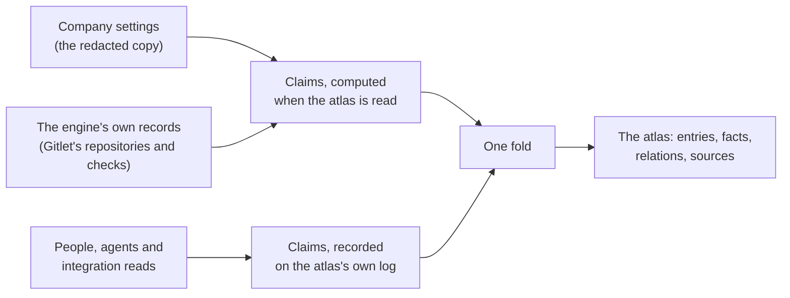

# Atlas

The atlas is the map and catalogue of everything a company runs on: its vendor accounts, domains and host names, servers, databases, repositories, pipelines, monitoring, tool servers and models, and how they depend on each other. The engine fills it from what it already knows, and every fact in it says where it came from, when it was seen, and how far it can be trusted.

This page describes the model: what the atlas holds, where each fact comes from, how one thing seen by several sources becomes one entry, and what the atlas never holds. The decision behind it is [ADR-0126](../../adr/0126-the-atlas-computes-what-the-engine-knows-and-records-what-it-is-told.md).

## What the atlas holds

An **entry** is one thing the company runs on. Its kind is one of a closed set, and each kind sits in one lane of the map, read left to right the way a request travels, with the code, monitoring, tools and models in a band beneath.

| Kind | On screen | Lane | Example |
|---|---|---|---|
| `domain` | Domain | Entry | `acme.example` |
| `hostname` | Hostname | Entry | `api.acme.example` |
| `endpoint` | Endpoint | Entry | `https://api.acme.example/v1` |
| `service` | Service | Services | `checkout-api` |
| `host` | Server | Runtime | `web-1` |
| `datastore` | Database | Data | `orders-db` |
| `queue` | Queue | Data | `orders` |
| `bucket` | Bucket | Data | `acme-assets` |
| `vendor_account` | Account | Platforms | the Cloudflare account, the GitHub organisation |
| `repository` | Repository | Code and delivery | `acme/api` |
| `pipeline` | Pipeline | Code and delivery | a repository's `deploy` check |
| `monitor` | Monitor | Observability | "API 5xx" |
| `tool_server` | Tool server | Tools and models | an MCP server |
| `model_provider` | Model | Tools and models | a model entry and its vendor |

What a vendor does for the company (chat, tracking, code hosting, CI, monitoring, DNS, CDN, compute, a model API) is an account's **capabilities**, not a kind per product, so "which CDN do we use" is answered by the account that carries the `cdn` capability. A vendor the engine does not know yet is an account with the vendor `other` and a name.

**Relations** always point from the thing that relies to the thing relied on, so "what depends on X" is one walk against the arrows: `runs_on`, `depends_on`, `exposes`, `resolves_to`, `in_zone` and `fronted_by` are drawn on the map at rest; `served_by`, `built_from`, `deployed_by`, `monitored_by`, `belongs_to`, `documented_in` (a Doclet page) and `owned_by` (a seat or a unit) appear when an entry is selected.

**Facts** are a closed list per kind, each with a value type: a host name, an IP address, an address without credentials, a port, a version, a region, an account's own id, a branch, a short label, a word from a closed set. Facts of **meaning** (purpose, environment, importance, and the owner) are decided only by people and the settings; an integration or an agent can only suggest them.

## Where each fact comes from

Every fact is a claim from one source, and the atlas is one fold over all of them.

What the engine **already keeps** is computed every time the atlas is read and never stored: it cannot drift from where it lives, and it needs nothing written. What only **somebody can tell** the engine (a person's correction, an agent's observation, an integration's read beyond what the engine keeps) is recorded on the atlas's own log.

Each claim carries a confidence the engine derives from its source and the evidence it checked. Nobody, and no model, chooses it.

| Where the fact came from | Shown as |
|---|---|
| The company settings, or the engine's own records | Confirmed |
| A person | Confirmed |
| An integration's read with the company's credential | Confirmed |
| An agent, backed by a server or vendor tool call in the same turn | Likely |
| An agent, backed by a repository file, a page or a work item | Likely |
| An agent, with nothing the engine can check | Unconfirmed |

An agent's fact that nothing else supports is shown as stale after 30 days and no longer counts after 180.

### What the settings and Gitlet show

The settings are read only through the same redacting copy the configuration surface serves, so a credential cannot reach the atlas even by mistake.

| From | Entries |
|---|---|
| Each connected integration | its account, keyed by the account's own id where the settings carry one (the Cloudflare account id, the AWS account, the GitHub organisation), with its capabilities and whether the integration is on. Jira and Confluence on one site are one account |
| Cloudflare | each declared zone as a domain, served by and belonging to the account |
| GitHub and GitLab | each repository the settings name, belonging to the account |
| SSH | each declared server, with its address (marked internal where no public network routes to it), its port and whether it runs containers |
| `api.external_url` and `api.public.external_url` | the host name the deployment answers at, in its zone where the settings declare that zone |
| `providers.llm` and `providers.embeddings` | each model entry, its vendor, harness, model, sign-in mode and place in the fallback chain |
| `mcp_servers` | each enabled tool server, its transport, its address or the base name of its command (never its arguments) |
| `providers.sandbox` | the E2B account, where the sandbox runs boxes there |
| Gitlet | each repository the reader may read, with its default branch, visibility, status and owner, the hosts it mirrors from and to, and each check its default branch runs, with its latest result |

Gitlet's repositories are read as the person reading the atlas, so a repository only its unit may read appears only to that unit. A value the atlas would refuse (a label shaped like a token, an address with credentials in it, a `${VAR}` reference it does not resolve) is left out, and the read says where it sat and why, never what it was.

## One thing, one entry

An entry's identity is its kind and its natural key, and its id is derived from the two, so every source that meets the same zone names the same entry. Two entries of one kind that share an **exact** key are one entry when the atlas is read:

- a repository and a Gitlet repository that mirrors it, by the forge address;
- two accounts named by the same account id;
- two servers at the same public address, seen by different sources.

A key one source carries on two entries (two servers behind one load balancer, two copies of one mirror) is a shared address, not an identity, and merges nothing. A private address never merges two servers, which may sit on two networks. An agent's report never merges anything. A person's "not the same" always wins, and similar names never merge: they only suggest.

## When sources disagree

For each fact, a source's newest claim stands for it, and across sources the most trusted wins, then the newest. A person's value is shown over every inference. When a newer report from an integration, an agent or the engine contradicts a person, the fact is **contested**; when two sources the engine trusts alike disagree with no person to settle it, it is **disputed**. Either way both values are shown, and the entry waits for a person; nothing is settled in silence.

## What the atlas never holds

Secrets, tokens, passwords, private keys, signed addresses, connection strings, environment values, command lines, command output, file contents and raw vendor answers have no value type to go in, and a value shaped like a credential is refused rather than masked. A person's contact details are never read: ownership names a seat or a unit. Addresses on private networks are kept, because they are the company's own map, and marked as internal.

## Who reads it

Reading the atlas takes the **Atlas** permission (`atlas`), the one app a person is given only on purpose: an invitation and a person's create leave it unticked, and an administrator holds it as every app ([ADR-0127](../../adr/0127-reading-the-atlas-takes-the-atlas-permission.md), [Atlas is given on purpose](identity-and-access.md#atlas-is-given-on-purpose)). A holder reads every entry, private addresses included. The atlas is never a way round another permission: its repositories are read as the reader, so a holder who does not use Gitlet is shown none, and the answer says Gitlet was not read and why.

A person reads it today with `atlas_search` on the operator surface (`/operator/mcp`): every entry, or those a `query` or a `kind` names, each with its facts, where each came from and its relations, beside which sources were read in full and how many values were left out for being shaped like a credential. Those values are counted and never shown. An agent seat holds the app as it holds every app, and in a turn a person woke it is held to whether that person does ([ADR-0109](../../adr/0109-a-turn-somebody-woke-is-held-to-the-apps-they-use.md)).

## Every piece of state, and who has to agree on it

| State | Who has to agree | Where it lives |
|---|---|---|
| What the engine already keeps: the settings and Gitlet's rows | already agreed where it lives | not stored: computed when the atlas is read |
| Entry states, merges on exact keys, contested and disputed facts | nobody: computed on every read | the read itself |
