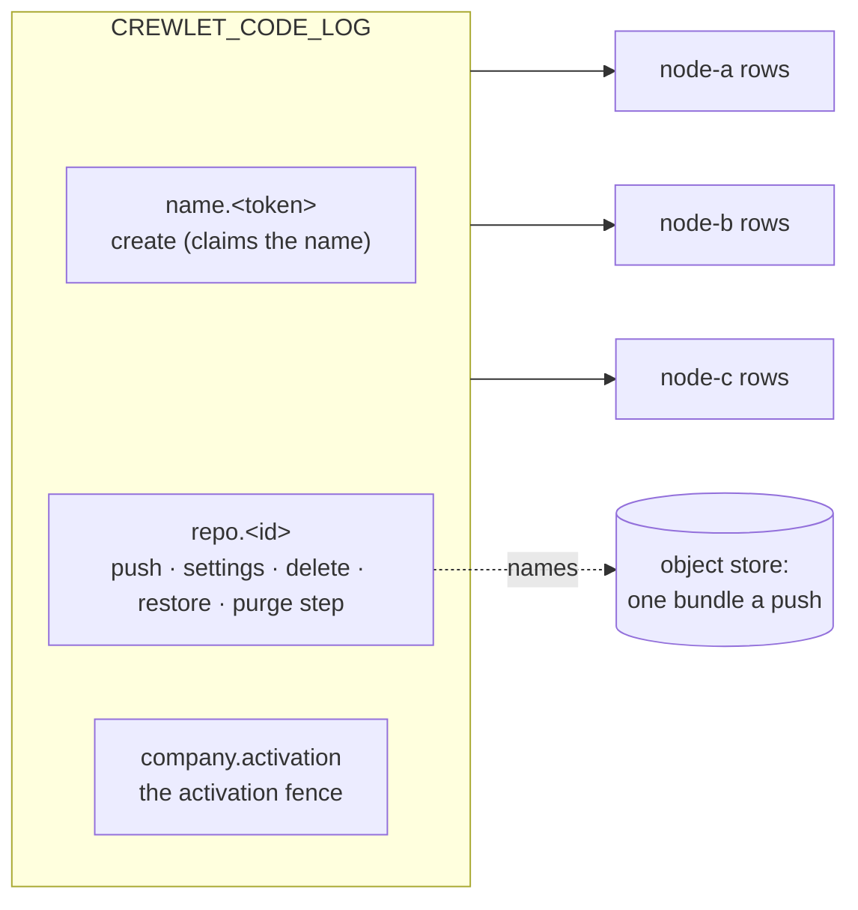
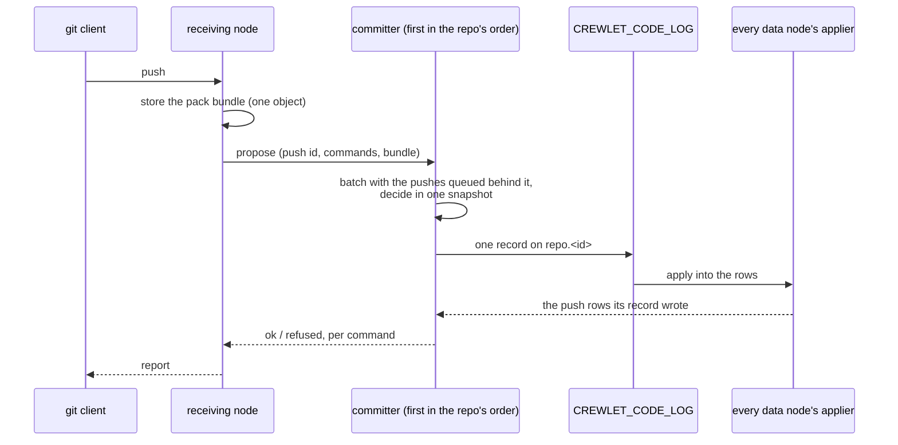
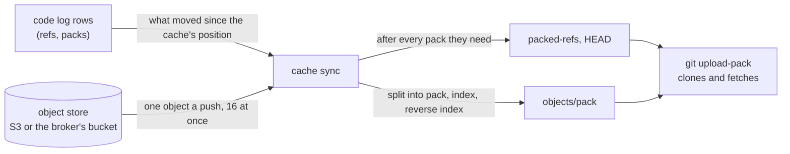

# Code Host

A company that sets [`code.native`](../getting-started/configuration.md#code)
hosts its git repositories in the engine itself, beside its own tracker and
knowledge base, and on the same footing: what a repository *is* — its
settings, its protection rules, its refs and the packs it holds — is
replicated state every data node keeps whole, and the bytes of each push are
one object in the [object store](object-store.md) the whole fleet shares.

It is not exclusive. The [GitHub](../integrations/github.md) and
[GitLab](../integrations/gitlab.md) integrations keep working beside it, and a
company may host some repositories natively and keep others on a vendor.

---

## What it is

A repository is **rows on the code log** (`CREWLET_CODE_LOG`), the state
log's fifth domain (see [Replication](../guides/replication.md)): every change
to a repository is one record on that ordered log, arbitrated at the broker,
and every data node applies it into its own identical copy of the rows. There
is no primary repository anywhere — no node's disk holds "the" repository and
no node's loss loses one.

The **bytes are not rows.** Every push stores **one object**: its pack
together with the index and reverse index the receiving node's git wrote for
it, back to back, named by a `code_packs` row. So a node that has to bring a
repository up to date reads one object a push and indexes nothing — the
index arrived with the pack — and a backup, the collector and the audit treat
a repository's packs exactly as they treat a project's files: a required
reference, kept while a live row names it (see
[One object per upload](object-store.md#one-object-per-upload)).

A git repository on a node's disk is never the record. It is a
[cache](#the-cache-on-a-git-node) derived from the rows, disposable and rebuilt
from them.

### What it does not do yet

This is the product's current shape, not a configuration choice:

- **No node serves git's HTTP transport yet**, so nobody clones or pushes a
  repository through this build. What exists is everything a push takes —
  the repositories, their protection rules, the committer below and the rows
  it writes, the [cache](#the-cache-on-a-git-node) git is served from, and
  the git surface itself ([A push, end to end](#a-push-end-to-end)) — built
  and tested but run by no node yet; the routes that will carry git are
  reserved and always guarded.
- **Agents do not push.** The repositories, their protection rules and the
  decision of every push exist; a seat as a git user does not.
- **There are no changes, reviews or checks** — no merge request, no review
  and no CI gate in front of a protected branch. A protection rule decides
  what a push may do to a ref, and nothing else stands in front of one.
- **Nothing compacts a repository.** Every push adds one pack, and a
  repository's packs are only ever removed with the repository.

---

## Declaring repositories

The repositories are declared in the company document, under `code.repos`,
and every activation makes the fleet match the declaration:

```yaml
code:
  native: true
  deleted_retention_days: 7        # 1..365; unset is 7
  repos:
    - name: nimbus-web             # the address it is cloned by
      owner: { unit: Engineering } # a unit (id or name) or a seat (handle) — exactly one
      default_branch: main         # unset is main
      description: The customer-facing web app.
      protect:
        - branch: main             # refs/heads/main, and nothing below it
        - branch: release/**       # every branch inside release/, never release itself
          allow_delete: true
        - tag: "v*"                # a tag rule: a tag never moves
    - name: infra
      owner: { seat: agent-cto }
      archived: true               # read-only: takes no push
```

- **`name`** — one host-name label: lowercase letters, digits and hyphens,
  starting and ending with a letter or a digit, at most 63. It is the address a
  repository is cloned by, so **renaming one deletes it and creates another**
  rather than moving it; declared twice, it is refused at the later entry.
- **`owner`** — exactly one of `unit` (its id, or its name where it has none)
  or `seat` (a handle), resolved against the same document's chart. An owner
  the chart does not have refuses the revision, naming the units or seats it
  does have.
- **`default_branch`** — what a clone checks out; any branch name git would
  take, and unset is `main`.
- **`description`** — one paragraph, at most 1 024 bytes of UTF-8.
- **`archived`** — read-only. A push to an archived repository is refused as a
  whole, and reading it is not; unarchiving it is setting it back to `false`.
- **`protect`** — at most 64 rules, each naming exactly one of a `branch` or a
  `tag` pattern, each pattern once.

At most 10 000 repositories one document — a typo guard two orders of
magnitude past a large company's, not a limit anybody is expected to meet. It
is an [admission rule](configuration.md#what-a-stored-revision-is-held-to), as
the retention's one-year bound is: a document written past either is refused,
and a revision already stored past one — admitted by a later build that raised
it — still applies, with a warning, because nothing the reconcile or the purge
does depends on either.

### What each change does at its activation

| You change | At its activation |
|---|---|
| Add a repository | **Created**, empty, with its settings. Two nodes creating one name land one repository: a create arbitrates on the name. |
| Change a repository's settings | **Settled**: one record carrying the new settings, stamped with the activation that wrote it. |
| Change nothing | **Nothing** but one fleet-wide record, the activation's fence (below) — never a record a repository. |
| Remove a repository | **Deleted**: it takes no push, and its rows and packs are kept. Declaring it again under its name within `code.deleted_retention_days` **restores** it: its refs and packs as they were, with the settings it is declared with now. |
| Leave it removed past `code.deleted_retention_days` | **Purged** by the `code-retention` duty, in bounded steps, and its name is free again (see [Deletion and purge](#deletion-and-purge)). |
| Turn `code.native` off | **Nothing is deleted.** A node whose native runtime is already running keeps serving the code host until its restart (see [A native backend changes at a restart](control-plane.md#a-native-backend-changes-at-a-restart)), and a revision without the host reconciles no repository at all. |

Only repositories the **configuration** manages are reconciled. A repository
somebody else created is never deleted for being absent from `code.repos`.

### Protection rules

A rule's pattern is a branch or tag name in git's own grammar, in which a
component of `*` matches one component, `*` inside a component matches any run
of characters but `/`, and a component of `**` matches any number of
components — zero or more in the middle of a pattern, one or more as its last.
A pattern with no `*` matches **only itself**: a rule on `main` protects
`refs/heads/main` and not `refs/heads/main/x`, which git's own `for-each-ref`
would also match. So `release/**` protects `release/1.0` and
`release/2/hotfix` but not a branch named `release` — a rule meant for both is
the two rules `release` and `release/**`. A glob has at most eight components
counting `refs/` and its namespace, which is what bounds the cost of asking it
about a ref.

What a rule does to a push of a ref it matches:

| Field | Unset | Set |
|---|---|---|
| `allow_force` | A push that moves the branch to a commit not descending from it is refused | Allowed. Refused on a tag rule: a tag never moves |
| `allow_delete` | Deleting the ref is refused | Allowed |
| `direct_push` | `persons`: a person may push to it | `none`: nothing pushes to it — the ref is frozen |

**Every rule that matches holds**, because two rules written for two reasons
both mean something: a ref matched by a rule allowing deletion and another
that does not cannot be deleted. A ref **no** rule matches may be force-pushed
or deleted by anybody who may push to the repository, so `crewlet validate`
warns about every repository whose default branch no rule protects — at the
repository's `protect`, naming the rule to add — and never fails on it. An
archived repository is not warned about: it takes no push at all, so nothing
can move or delete its branch until it is unarchived, and the revision that
unarchives it brings the warning back.

### The reconcile and the activation fence

Every data node reconciles `code.repos` at **every boot and every
activation** — a node in a [maintenance mode](../guides/retention.md#the-three-modes)
excepted, since it publishes nothing. Only a repository that changed costs a
write: one that is created, settled, deleted or restored. Nodes reconciling one
activation at the same moment race on each of those, and the log lands one
record on each — the others decide it again from that record and write
nothing. A refusal for one repository is logged and the rest are still
applied.

The reconcile runs **beside** the apply, not inside it: the apply reports the
revision applied as soon as it has asked for the reconcile, and the
repositories follow. At the most a document may declare, an activation that
creates, deletes or restores every repository takes 16–19 seconds on one node
before the last has its record — and a node still applying a revision
45 seconds after a peer applied it is [shed](control-plane.md#posture-what-a-lagging-node-does),
so how many repositories a company declares must never decide that. A newer
activation's reconcile ends an older one's still running, since the newer one
decides every repository again; a node that stops mid-reconcile logs
`code_repos_interrupted`, and its next boot reconciles.

Because the revision is already reported applied, a reconcile that leaves
something undone — an outcome the log did not answer, decisions refused while
the node was still catching up on the fence, a listing it could not read — is
**run again by the node**: five seconds later, then waiting twice as long after
each run in a row that leaves something undone, up to every five minutes, until
one applies, a newer activation replaces it or the node stops. Nothing else
would run it again, and no peer covers for a fleet of one. A run again costs a
batch read of the rows where nothing changed, and writes only what is still
missing. A name held by a repository the configuration does not manage, and a
declaration the code log refuses as written, are said at every run but never
run again for: no run changes them, and only a revision that does applies them.

Without an order between activations, a node applying an *older* activation
late would walk a newer one's settings back. So a reconcile first publishes
one **fence** record for its activation, and every node's copy of the rows
raises a single fence to it and never lowers it; every configuration record
an older activation decides afterwards is refused by every node, identically,
because the fence is derived from the log. Every decision a reconcile takes
waits for its own node to have applied its own fence first. So whatever an
older activation decided is either *before* the fence — in the rows the newer
activation decides from, where any difference it made is settled back — or
*after* it, and refused. That is what lets an unchanged repository cost
nothing: an activation that changes nothing writes its one fence record, and
reads every declared repository's row in one batch.

A node that finds a later activation already fenced logs
`code_repos_superseded` and decides nothing: it is applying a configuration
the fleet has moved past, and reconciles again when it applies the later one.

---

## One subject per repository

Everything that moves a repository's refs or packs, or governs them — a push,
a settings change, a deletion, a restore, a purge step — is a record on **one
subject a repository**, `crewlet.code.log.repo.<id>`. That subject is the
**arbitration unit**: two pushes to one repository contend at the broker and
exactly one record lands per round, and the loser decides again against the
winner's rows. One subject a repository rather than one a ref, because every
write on a repository changes its row too — its ref count, its bytes, its
version — so a subject a ref would never narrow a write's contention.

A **name** is claimed on its own subject, `crewlet.code.log.name.<token>` (a
bounded digest of the name), so two creates of one name contend there, where
two freshly minted repository ids never would. The activation fence has the
company's one subject.



---

## The committer

Because every push to a repository contends on its one subject, a
repository's pushes are **committed by one node**: its **committer**, the
first live data node in a rendezvous order of the repository's id, which every
node computes alike. A push received anywhere is asked of that node, which
takes the repository's pushes in order and puts every push waiting behind a
record in flight into the next one — **group commit**, without lingering for
more, up to 64 pushes a record. An idle repository pays one record a push and
a burst one record a batch. A batch is decided in one snapshot of the rows,
each push against what the ones before it did, and a push is answered `ok`
only from the row its record applied, never from the decision.

A push carries an id the receiving node minted, and a push id the repository's
history already holds is answered from its row — so a push asked twice, or of
a second node after the first stopped answering, is still one push. A
committer that stops, or answers nothing, hands each of its repositories to
that repository's runner-up in the same order, under the same push id. A node
in a maintenance mode commits nothing and refuses as a node that ran nothing,
so the next committer decides; while the whole fleet is in one, no push is
committed.

The path a push takes from the node that receives it:



A queue holds at most 1 024 pushes, and a batch has 30 seconds to land; past
either a push is refused `busy` undecided and the client pushes again (the
`crewlet.code.commit.busy` counter, in the
[metrics reference](../reference/metrics.md), says which).

---

## Limits

[`code.limits`](../getting-started/configuration.md#code) — the largest pack
one push may send, the largest file it may carry, and the most one repository
may hold — is read off the **deciding node's current revision** at every
decision, so a change holds from its activation with no restart. A repository
also holds at most 100 000 refs, and a push moves at most 1 000 of them.

---

## Retention and history

Three horizons, each kept by the record that applies it inside its own
repository, never by a sweep:

- **Push history** — a push row is kept **181 days**, the same horizon as the
  company's [usage history](../guides/retention.md), so "what happened over
  the last half year" has one answer across the engine.
- **Ref tombstones** — a deleted ref is kept as a tombstone for **48 hours**,
  so a node bringing a repository up to date learns of the deletion.
- **A purge** — below.

### Deletion and purge

A repository removed from `code.repos` is **deleted**, softly: its rows and
packs stay, and declaring it again under its name restores it. Once it has been
deleted longer than **`code.deleted_retention_days`** (1 to 365 days; unset is
7, the trim's default `min_age`, so a deletion is undone from the same window
the log can replay), the fleet-singleton `code-retention` duty purges it (see
[Singleton duties](seat-ownership.md#singleton-duties)):

- every 15 minutes, it finishes every purge already begun — whatever the
  retention, since a purge has no undo — then purges the repositories deleted
  longest ago first;
- each purge is a sequence of bounded **steps**, each one record removing a
  bounded part of the repository's rows, and the last leaves only a
  **deletion marker**, which drops every later record about the repository on
  every node, for ever ([the deletion gate](../guides/replication.md#applied-is-not-permanent));
- every data node applies every step on its one write lane, so the duty paces
  itself: after each step it waits twice the step's duration, a third of the
  lane, and a pass stops after a minute of steps and the next resumes from
  the rows;
- once the purge has applied on the duty holder's own rows, the name is free,
  and a name the current configuration still declares — re-added while it
  purged, which the reconcile logs as `code_repo_awaits_purge` — is created
  again at once.

A push to a repository that is not there to take it is refused
`repo_deleted`, and what follows the code says which of four states the
committer found, because each has its own remedy:

| State | What the push is told |
|---|---|
| deleted | declaring it again in `code.repos` restores it as it was, until its purge, which may begin from the instant named: the deletion plus `code.deleted_retention_days` on the committer's current revision — the earliest the duty begins it under that revision |
| being purged | the purge cannot be undone; once it completes, declaring the name creates a new, empty repository |
| purged | it holds nothing; declaring its name creates a new, empty repository |
| an id no repository had | it does not exist |

The packs a purged repository named are no longer named by any row, so the
[object collector](object-store.md#collection-and-audit) deletes them a day
later. The code log itself is trimmed like every other log (see
[Retention](../guides/retention.md)), and a node whose copy of it is out of
service declines the duty rather than purge from rows the fleet may not agree
with.

---

## The cache on a git node

A repository lives as rows on the code log and as pack bundles in the object
store. A node that serves git keeps a **cache** of each repository it is asked
for: an ordinary bare repository in a directory of the node's own, from which
git's own `upload-pack` answers clones and fetches. The cache is disposable:
nothing in it is the only copy of anything, and deleting it costs nothing but
the time to download it again. The engine's [backup](../guides/backup.md)
never copies it, and its directory carries a
[`CACHEDIR.TAG`](https://bford.info/cachedir/), so a backup of your own run
with `--exclude-caches` — tar, borg and restic all take it — leaves it out
too; without that option they copy it like any other directory. The
directory is the cache's alone: a node refuses one that already holds
anything without that tag — a volume's own `lost+found` aside — because it
empties its own scratch space there at every boot, and refuses one another
process is using.

A cache is a **function of the rows**: its refs are exactly the repository's
refs at the log position it records, its packs exactly the repository's packs
there. Nothing but the cache itself writes it — its sync, the adoption of a
push's pack once the push's row has applied, and its background index — and a
push never does: a push is received in a throwaway scratch repository that
reads the cache through an alternate, so an object nobody committed can never
appear in a cache, where any reader could fetch it by id.



**Warm and cold.** After a push, every other node brings its cache forward by
a **delta** the next time somebody fetches from it. A delta downloads only
what changed — usually the push's one pack — and rewrites the repository's ref
file, and that rewrite grows with the refs the repository holds: a delta takes
about 7 ms in all at a thousand refs, and about 50 ms at the 100 000 a
repository may hold. The node that received the push does not download it
back: it links the pack its own git wrote into its cache once the push's row
has applied. A **cold** cache — on a node that has never served the
repository, or whose budget evicted it — downloads every pack: sixteen at once
for one repository and at most thirty-two at once on the node, largest first,
so a second repository's cold sync never waits behind the first one's longest
downloads. Each is verified against its SHA-256 and installed as the receiving
node's git indexed it — a push stores its pack together with its index, so no
other node spends a core re-indexing it, and a cold sync is bound by the
object store rather than the CPU. From an S3-shaped store answering in 30 ms,
that is about 450 small packs a second: a repository of 10 000 pushes — one
pack each, since nothing compacts them yet — comes up in about 22 seconds,
before its first request is answered.

The first fetch of a repository after a node restarts reads the whole of its
rows once, reusing every pack the cache already holds, which is what makes a
cache exact again after a crash, a full disk or a stray file. A cache never
goes back because one data node's copy of the rows is behind; it goes back only
when the code log did — recreated, or restored from an older backup — which the
node notices, reading every repository whole at its next sync.

**The budget.** A node holds its caches to a byte budget, counting everything
they hold on disk: every repository's packs, indexes and refs, and the
downloads and pushes in flight. Past it, the repositories used least recently
are evicted, and nothing else evicts one: a repository nobody fetched over a
weekend is still there on Monday, brought forward by the rows that changed
rather than downloaded again. Each repository's last use survives a restart,
so one read all day and rarely pushed to is not the first evicted after one.
A repository a request is reading is never evicted — one larger than the whole
budget is still served, logged as `code_cache_over_budget`, and evicted as soon
as no request holds it. Every git node that serves a repository caches it
**whole**, so size the volume for the repositories it serves, not the company's
total. A dedicated disk is worth it, because a cold sync writes everything it
downloads at the speed the object store delivers it. Size the node's memory
for its largest repository too: the background index below needs about 1 000
bytes of memory for every object of a repository to write its bitmap, and a
repository past what the node can give it is indexed without one.

**Background indexing.** With one pack a push, git would search pack after
pack for every object. So once a repository's packs have stood still for ten
seconds — or the oldest has waited ten minutes, for one pushed to without pause
— a git node writes it a multi-pack index with a bitmap, and a commit-graph, so
a clone counts its objects from the bitmap rather than walking the history; and
writes them again once 64 more packs have gathered beside them, at most every
ten minutes and at most a tenth of a core's time for any one repository. A
run, on one core, takes 16 to 30 seconds a gigabyte of packs, more a gigabyte
the larger the repository. Runs take at most half the node's cores, one each,
in a slot that is free or not at all, so they never make a push or a fetch
wait; and only as many run at once as a quarter of a gibibyte a core holds
beside the largest, so a node that has just joined does not index all its
largest repositories at once.

**Memory.** Every git process a node runs over a whole repository holds memory
in proportion to the repository's objects, measured on git 2.43 over a source
repository's history: about 1 000 bytes an object for the bitmap (702 over
three million objects, more the larger the repository), 80 for the index
without one, 56 for the commit-graph, 192 for `crewlet code verify`'s
connectivity check, and a clone about 240 more than the 224 MiB its git
transfer slot keeps for it — the clone of a repository with no bitmap walks
its whole history. A git node reads its memory — the least of the machine's
and any cgroup limit set on its container — and keeps 224 MiB of it for every
git transfer it admits at once and 896 MiB for each core its git runs on, for
the store, the broker, the engine and its reads. Both count only the cores the
memory backs at 2 GiB a core: a container limited in memory and not in CPU sees
its host's every core, so a node of 64 cores and 16 GiB admits 32 transfers
rather than 256, and runs as the eight-core node its memory makes it. What is
left is the budget of its background work, and every step of it — the
bitmap, the index without one (a cold cache's included), the commit-graph, a
connectivity check — is held to the budget together with everything in flight,
each charged its own figure an object and room beside it for one clone of the
same repository. A step whose charge alone is past the budget never runs on
the node, and the repository is served without it: a bitmap refused leaves
the repository indexed without one — its pushes keep joining an index, so
lookups stay fast, while a clone walks its history — keeping the bitmap the
node wrote while it could until 256 packs have gathered outside it. Each step
refused is logged once as `code_cache_maintenance_refused` with its charge
and the budget and counted by `crewlet.code.cache.maintenance.refusals`, and
a refused bitmap raises the [`code_maintenance_refused`](../reference/alarms.md)
alarm for as long as it stays refused. A connectivity check the budget cannot
hold is refused to whoever asked for it, and one that the work in flight
leaves no room for is busy, as a full lane is. A step that fits the budget
alone but not beside what is running waits for it, and the first such
repository in the queue is given the room it needs: nothing smaller starts
in its place.

So **a git node's ceiling on a repository it keeps a bitmap of is bounded by
memory — about 1 240 bytes an object, with the clone beside it — before it is
bounded by disk**: at about three million objects a gigabyte of a source
repository's packs, nearly 4 GB of memory for each gigabyte of packs, and some
75 GB for the 20 GiB a repository may hold by default, which few nodes have.
A node of 2 GiB a core leaves a quarter of a gibibyte a core (1 GiB on four
cores: bitmaps of repositories of up to about 860 000 objects, indexes of up to
about 3.3 million); 16 GiB on four cores leaves 9 GiB: bitmaps of up to about
7.7 million objects, indexes of up to about 30 million. Give the node the
memory: it reads it again every ten seconds, so a container resized in place
is held to its new limit at once (`code_cache_memory_changed`), while the git
lanes keep the sizes they took at boot until a restart. A node whose memory
cannot be read at all refuses to serve git rather than guess it.

The budget bounds the background work and keeps room for one clone beside
each of its steps; it does not bound the clones themselves, which take the
node's git transfer slots — four a core and no more than one for each
512 MiB of its memory, each kept 224 MiB — whatever the repository. A node
that serves repositories of millions of objects to many cloning clients at
once needs memory for each clone in flight: about 240 bytes an object of the
repository, past the 224 MiB.

A cold cache of a repository
holding 256 packs or more gets an index — without the bitmap — before its
first request is answered, since at that count it saves the request more than
it costs, when the budget holds it beside the work in flight (otherwise it is
logged as `code_cache_round_index_held` and left to the background); the
bitmap follows when the background indexing reaches the repository, which on
a node that has just joined comes after every repository with more packs
waiting. A cache without either is slower, never wrong.

**Damage and repair.** When git finds a cache damaged — a pack or an index it
cannot read, an object a row names that no pack holds — the node rebuilds it:
the repository is read whole again from the rows and the object store into a
new directory beside the damaged one, which replaces it once it is complete.
Requests already reading the old copy finish on it, and any number of requests
failing on one damaged cache cost one rebuild. A rebuild that does not end the
failure is not repeated at once: the damage is then in the object store or in
the rows rather than in the node's copy, and another rebuild would read the
same bytes. So the next attempt waits ten minutes, each one after it twice as
long, up to a day; a cache holding exactly what such a rebuild read is not
rebuilt again for a day unless something writes into it; and every refusal is
counted, and logged as `code_cache_rebuild_refused` at most once every ten
minutes a repository. A pack the object store has lost — once a read at the
log's head confirms a row still names it — or holds damaged fails the sync
naming the pack, and the collector's daily audit raises the
[`objects_missing`](object-store.md#alarms) alarm for the same object.

**What to watch.** `crewlet.code.cache.bytes` against the budget,
`crewlet.code.cache.repos`, `crewlet.code.cache.sync.duration` by `kind` (full
syncs dominating is a cache too small to stay warm),
`crewlet.code.cache.rebuilds` by `reason`,
`crewlet.code.cache.rebuild.refusals` by `rule` — rising at all, damage no
rebuild repairs — and `crewlet.code.cache.maintenance.refused`, above zero a
repository whose bitmap the node's memory cannot hold
([metrics reference](../reference/metrics.md)).

---

## A push, end to end

A person pushes with git's own smart HTTP protocol, presenting their own API
token as the password. The engine checks everything it can before it stores a
byte, receives the push with real git in a repository of its own, stores the
push's one pack, and has the repository's committer decide it — and tells git
a ref moved only once the record that moved it has been applied.

```mermaid
sequenceDiagram
  autonumber
  participant G as git push
  participant H as code host
  participant S as scratch receive-pack
  participant P as proc-receive hook
  participant O as object store
  participant C as committer
  participant L as code log
  G->>H: GET info/refs (receive-pack)
  H->>L: barrier: the repository's refs, now
  H-->>G: the advertisement — or a refusal git prints
  G->>H: POST git-receive-pack (commands, pack)
  H->>H: read the commands; refuse what needs no object
  H->>L: sync the cache through the barrier
  H->>S: receive-pack in a scratch repository
  S->>P: the ref updates git accepted
  P->>H: relayed over the node's hook socket
  H->>H: forced updates, blob sizes, new commits
  H->>O: upload the push's one pack bundle
  H->>C: propose the push
  C->>L: one record, arbitrated on repo.<id>
  L-->>C: applied — or durable, not yet applied
  C-->>H: the push's row, or pending
  H->>L: pending: read the push's row again, up to a minute
  H-->>P: ok or ng per ref
  P-->>S: the report
  S-->>G: what git prints
```

**The advertisement is read at the log's head.** Every answer that names a
ref — the refs a push or a protocol v0 clone is shown, a protocol v2
`ls-refs`, a fetch by `want-ref` — is read through the code log's barrier, so
a node cut off from the fleet answers 503 rather than an old head. An object
fetch names ids that mean the same bytes on every node, so it takes what the
node's cache holds; a fetch of an object the node has not seen yet — the
client learned of it from a node further ahead — makes the node read the
log's head once before it answers.

**receive-pack never runs in a cache.** git moves a push's objects into the
repository it runs in *before* any hook can refuse them, so a push received
in a node's cache would leave a refused push's objects there — fetchable by id
from that one node, and a base a later push could build on that no other node
holds. So a push is received in a throwaway **scratch** repository whose one
alternate is the cache, and its pack enters the cache only once its row has
applied ([ADR-0036](https://github.com/crewlet/crewlet/blob/main/adr/0036-a-repositorys-refs-move-only-by-records-and-a-cache-is-derived.md)).
The scratch is removed when the request ends, and a node that crashed with one
open sweeps it at its next boot.

**Checked before it is stored.** A push naming more than 1 000 refs, a token
bound to nobody, an archived or deleted repository, a deletion or a direct
push a protection refuses — each is refused before receive-pack runs, and
nothing is stored. A forced update of a ref a protection keeps from forcing,
and a blob larger than `code.limits.max_blob_bytes`, are known only once the
objects are, so the hook checks them — and refuses the push before uploading
anything. Only a push that passes every check is uploaded, as **one** object:
its pack with the indexes the receiving git wrote.

**An `ok` means the row applied.** The committer answers with the push's row
once its record has been applied. A record that is durable on the log but not
yet applied on the node that answered is **pending**: the host reads the
push's row at once and again — after a quarter of a second, then at
doubling intervals up to two seconds — for up to a minute (the state log's
own stall grace), and answers git from the row if it appears. It never
reports a pending push as
`ok`, because a durable record can still be dropped — by an eviction, on
every node — and then the push landed nowhere. While a push waits, the hook
prints a line every five seconds naming the step it is on, so a balancer's
idle timeout does not cut a push that is merely waiting.

**What a refusal names.** A push answered `pending`, `unknown` or
`not_applied` is not a push that failed in the ordinary sense — each says what
is known about it:

- `pending` — the record is durable at the position named and was not applied
  here within the grace. Run the same `git push` again: a push that landed
  reports `Everything up-to-date`.
- `unknown` — the answer was lost (the node committing it went silent, or the
  client's connection ended first): it may or may not have landed. Fetch, then
  run the push again.
- `not_applied` — the record was durable and every node dropped it. Nothing
  landed; run the push again.

Every push — applied, refused or failed, at the advertisement or at its body —
is one `operator_acted` record on the node that received it, with transport
`git`, the token's name and the person it is bound to, the repository and what
became of the push. A fetch is not recorded.

**Large fetch requests.** git's own HTTP server holds a fetch request in
memory and refuses one past 10 MiB, and a partial clone breaks that: a
checkout after `git clone --filter=blob:none` asks for every blob it lacks in
one request, fifty bytes a blob, so a tree of more than about 210 000 files
sends more than 10 MiB. The engine holds a request in memory as large as it
is, up to a mebibyte — a clone's negotiation is a few kilobytes, and costs
that — and spools the rest to an unnamed file on the cache's volume, removed
when the request ends however it ends. What every request holds in memory at
once comes out of a node-wide allowance, a mebibyte for each transfer slot, so
a burst of fetches waiting for their slots is bounded by the node; a request
that finds it spent is spooled rather than refused. A request is bounded by
**its repository**: fifty bytes for every object the repository's packs hold
and every live ref, beside the mebibyte — the most a request can legitimately
name — and one past it is refused 413. The spools come out of an allowance of
their own, 64 MiB for each transfer slot and never the cache's budget, and one
credential's spooled requests may hold a quarter of it at once, in bytes and
in requests; a request that finds the allowance or its credential's quarter
spent is answered 503 at once, and one larger than a quarter by itself — about
21 million wants on a sixteen-core node — is answered 413, since this node
will never take it. A request's memory and its spool are given back as soon as
git has read it and started its answer, not when a slow client finishes
downloading. A blobless clone needs protocol v2, git's default since 2.28 —
under v0 a fetch of a blob the client never saw advertised is refused.

---

## What git prints, and what it means

git shows a refusal at the advertisement as `fatal: remote error: …` and a
refusal of one ref as `! [remote rejected] <ref> (<code>: <sentence>)`. An HTTP
error's text — a 503's, a 404's — git prints after `remote:` when it comes
from the advertisement, and as `RPC failed` when it comes from a request in
the middle of a transfer. Every 503 carries `Retry-After`, and says the same in
words, since git does not read the header.

| What happened | What git prints | What to do |
|---|---|---|
| No credential, or a wrong one | git asks for one (a 401 challenge) | Give your API token as the password. |
| The repository is not declared | `repository "<name>" not found` (404) | Check the name in `code.repos`. |
| The repository is deleted | `fatal: remote error: repository <name> is deleted; declaring it again in code.repos restores it …` | Declare it again before its purge to restore it as it was. |
| The repository is archived (a push) | `fatal: remote error: …archived…`, or `(repo_archived: …)` per ref | Fetch only; unarchive it in `code.repos` to push. |
| A token bound to nobody (a push) | `fatal: remote error: this token is not bound to a person: …` | Push with your own token — the one your human seat's `contact.crewlet_operator_id` names. |
| More than 1 000 refs in one push | `(this push names more than 1000 refs; push them in parts …)` | Push the refs in groups. |
| A ref moved since you fetched | `(stale: refs/heads/main is at <id>; fetch first)`, or `(stale: was at <id>, which this repository does not hold; fetch first)` when the commit you pushed from was never pushed here | Fetch, integrate, push again. |
| A protection refused it | `(protected_force: refuses a force-push (protection <pattern>: allow_force))`, and `protected_delete` and `protected_direct` likewise | The rule named says what it allows. |
| A tag moved, a reserved ref | `(tag_moved: …)`, `(reserved_ref: …)` | Create a new tag; push under `refs/heads/` or `refs/tags/`. |
| One ref of an `--atomic` push refused | the refused ref's reason, and `(atomic: …)` on every other | Fix the refused ref; nothing of the push landed. |
| A blob over the limit | `(blob_too_large: blob <id> (<path>) is <size>, past code.limits.max_blob_bytes …)` | Remove it from the history you push. |
| The push is pending | `(pending: durable at <position>, unresolved here; re-run git push …)` | Run the push again. |
| The outcome is unknown | `(unknown: outcome unknown (op …); fetch, then re-run git push)` | Fetch, then push again. |
| Nothing took the push | `(unavailable: no data node took push <id>: …)` | Nothing landed; push again, or once the fleet has a data node serving. |
| The object store failed | `(unavailable: object store unavailable: …)` | Nothing was stored; push again. |
| The engine stopped mid-push | `crewlet: the engine went away during this push; its outcome is unknown …` | Fetch, then push again. |
| Every git slot on the node is busy | `every git slot on this node stayed busy for 10 s: retry in 10 s` (503) | Retry, or against another node. |
| The node ended git before it answered | `git on this node was stopped before it answered, stalled (…): retry in 10 s, or against another node` (503), or `past its deadline` | The node is too loaded to answer in time; retry, or against another node. |
| The node cannot read the code log | `the code log could not be read here: …; retry in 10 s` (503) | The node is cut off from the fleet; retry against another. |
| The node is stopping | `this node's code host is stopping: retry in 30 s …` (503) | Retry against another node. |
| A pack the rows name is gone | `<repo>'s pack <id> is missing from the object store (the daily audit raises objects_missing for it) …` (503) | An operator's problem: see [`objects_missing`](object-store.md#alarms). |
| A fetch request past its repository's bound | `this fetch request is larger than any repository <name> holds could need …` (413) | Fetch in parts. |
| A fetch request past a quarter of the node's room for large requests | `this fetch request is larger than this node takes from one credential at once …` (413) | Fetch through a node with more cores and the memory to back them (its git transfer slots size the room), or fewer objects at once. |
| The node's room for large requests is in use | `this node's room for large fetch requests is in use …` (503) | Retry, or against another node. |
| The request's body could not be read (a gzip stream that fails its checksum; for a fetch, a body cut short too) | `the push's body could not be read: …`, or `the request body could not be read: …` for a fetch (400) | Nothing was stored; send it again, and if it fails the same way the client is sending a broken stream. |

**What to watch.** `crewlet.code.push.duration` by `outcome` (`pending`
growing is a code log slow to apply here; `unknown`, a committer that stopped
answering), `crewlet.code.push.bytes` against the push limit, and
`crewlet.code.fetch.duration` by `command` and `sync` ([metrics
reference](../reference/metrics.md)).

---

## What the node logs

| Line | Level | Means |
|---|---|---|
| `code_repos_applied` | `INFO` | A reconcile wrote something: how many repositories it `created`, `changed`, `restored` and `deleted` (or `written`, where the listing before it could not be read), each with the first 32 of their names in `created_names`, `changed_names` and so on. Nothing is logged when nothing was written. |
| `code_repo_awaits_purge` | `INFO` | A declared name belongs to a repository still being purged; the `code-retention` duty creates it when the purge completes. |
| `code_repos_superseded`, `code_repo_superseded` | `INFO` | A later activation owns the repositories, or this one: this node is applying an older configuration, or has since been asked to reconcile a later one. |
| `code_repos_interrupted` | `INFO` | The node stopped before its reconcile finished; the next boot reconciles. |
| `code_repo_not_applied`, `code_repos_not_applied`, `code_repos_not_listed` | `ERROR`, `ERROR`, `WARN` | A reconcile could not apply one repository, any, or delete what the document no longer declares; the node runs the reconcile again (`code_repos_retrying`). Two of a repository's are not run again for, and say what to change instead: its name is held by a repository the configuration does not manage — rename the declaration — or the code log refuses its declaration as written. |
| `code_repos_retrying` | `INFO` | The reconcile of `activation` left something undone — said in the lines before — and runs again in `retry_in`: five seconds after the first such run, doubling with each run in a row (`attempt`) to five minutes, until one applies or a newer activation replaces it. |
| `code_retention_pass` | `INFO` | A pass that purged, failed a repository, held a purged name or stopped at its budget (`purged`, `steps`, `remain`, `failed`, `unhanded`); `DEBUG` when nothing was due. |
| `code_retention_pass_failed` | `WARN` | A pass ended on an error; the next pass lists what is due again. |
| `code_retention_duty_declined` | `WARN` | This node's copy of the code log is out of service, so it does not take the duty. |
| `code_push` | `INFO` | One push this node received, whatever became of it: the repository, the push's id, the token and the person it is bound to, the `outcome` (`applied`, `pending`, `unknown`, `refused`, `failed`) and any `refusal`, how many commands and how many went through, the bundle's bytes, the position its record landed at and how long it took. |
| `code_fetch_retried` | `INFO` | git found this node's cache damaged during a fetch (`reason`: `corrupt`, `missing`); the cache was rebuilt and the fetch run again over the same request. |
| `code_fetch_failed`, `code_push_failed` | `WARN` | git failed serving a request on this node — `code_push_failed` a push's (its advertisement, its receive-pack, a process its sync ran), `code_fetch_failed` a fetch's — by itself or ended by the node (`reason`: `deadline`, `stall`, or its `input` or `output` failing here, beside the pool's own `code_git_killed`), before its first byte (the client was told why, a push with its `push_id`) or after it (git's own words ended the answer, or, for a process the node ended, the connection was cut). |
| `code_git_unavailable` | `WARN` | A git request could not read the code log here (no quorum, a copy out of service, no data node answering), answered 503. |
| `code_git_ready` | `INFO` | The node's git is 2.40 or newer and its process pool is built: the git's `path` and `version`, its `read_slots`, `maintenance_slots` and `transfer_slots`, the `pack_reuse` it asks git for, and the empty `home` every git process runs with. |
| `code_git_killed` | `WARN` | The node ended a git process (`class`, `command`): past its deadline (`reason`: `deadline`), or having read and written nothing for its stall bound (`stall`) — a minute for a transfer, twelve of git's keepalives. `DEBUG` when its caller ended it (`caller`): a client that hung up, a node stopping. |
| `code_git_straggler_killed`, `code_git_pipe_held` | `WARN` | Something a git process started outlived it: still in its process group, and killed; or outside it and holding git's output open, which the node closed after five seconds. |
| `code_git_signal_withheld`, `code_git_signal_failed` | `WARN` | The node could not read the kernel's record of a git process's group, so sent it no signal rather than risk signalling a stranger; or sending one failed. |
| `code_git_protocol_dropped` | `DEBUG` | A client's `Git-Protocol` header was not one the node passes to git, and git ran without it. |
| `code_git_abandoned` | `DEBUG` | A git request ended because its client hung up (`by`: `client`), answered nothing, or because the node is stopping (`by`: `stop`), answered 503 — never the code log failing. A push abandoned after its proposal is recorded as its session concluded it (`unknown`, `applied`). |
| `code_pack_missing` | `WARN` | A git request failed because a pack the rows name is gone from the object store or damaged there (`damaged`), answered 503 naming the pack. The [cache](#the-cache-on-a-git-node) logs the same line once for the sync that found it (below); the alarm is [`objects_missing`](object-store.md#alarms). |
| `code_pack_checksum_mismatch`, `code_bad_snapshot` | `ERROR` | A git request failed because a downloaded bundle is not the one its row describes — the cache logs that line too, once for the sync (below) — or the rows cannot be read into a cache: an operator's problem, answered 503. |
| `code_pack_rejected`, `code_push_invalid` | `ERROR` | The receiving git wrote a pack the engine's own checks refuse, or the engine built a proposal the committer refused: a bug, and the push fails. Its bundle was already stored; no row names it, and the object collector removes it after its grace. |
| `code_pack_adopt_failed` | `WARN` | The receiving node could not link a push's pack into its cache once its row applied; its next sync downloads it instead. |
| `code_push_blob_path` | `WARN` | The path of a blob over the limit could not be found; the refusal names the blob without it. |
| `code_hook_accept_failed` | `WARN` | The hook socket failed to accept a connection; it goes on accepting. |
| `code_hook_protocol`, `code_hook_refused` | `WARN` | A push's hook spoke out of turn, or a connection to the hook socket named no session the engine started; the push fails and nothing is stored. |
| `code_hook_panic` | `ERROR` | The engine failed while serving one push's hook: that push was refused and its stack logged, and the node goes on serving. |
| `code_host_stop_unfinished` | `WARN` | The node stopped with git requests still running past its stop's wait. |

A git node's [cache](#the-cache-on-a-git-node) logs under the component `code.cache`. Every line at `INFO` and above is here; its `DEBUG` lines (each sync, each background index written, a run stopped from outside) are left out.

| Line | Level | Means |
|---|---|---|
| `code_cache_opened` | `INFO` | The node opened its cache at boot: the `dir`, the `repos` and `bytes` it already held, its byte `budget`, and how many leftovers it moved aside (`trashed`); and the node's `memory` as its git read it, where from (`memory_from`: `/proc/meminfo`, a cgroup's limit file, or `sysctl hw.memsize`), what it keeps for everything but its background work (`memory_reserved`), and what that leaves the work (`maintenance_budget`). |
| `code_cache_memory_changed` | `INFO` | The node's memory read differently from the last reading — a container resized in place — and the background work's `maintenance_budget` moved with it; `was` is the reading before. The git lanes keep their boot sizes until a restart. |
| `code_cache_memory_unreadable` | `WARN` | The node's memory could not be read again; the last reading and its budget stand until a read succeeds. Once until then. |
| `code_cache_trashed` | `WARN` | At boot, something in the cache that is not a repository's current copy was moved aside to be removed — a copy an interrupted rebuild left, a stray, or a copy recorded in another build's format; `why` says which. Nothing is lost: the rows and the object store bring the repository back at its next fetch. |
| `code_cache_state_unreadable` | `WARN` | A repository's copy has no readable record of what it holds. It is kept, and its next fetch reads the repository whole, reusing every pack it already holds. Recurring, it is the disk. |
| `code_cache_evicted` | `INFO` | A repository's copy was evicted to bring the cache back under its byte budget, least recently used first; `idle_for` is how long it had gone unused. Its next fetch is a cold sync. Frequent, the budget is too small for the repositories this node serves. |
| `code_cache_over_budget` | `WARN` | A repository larger than the cache's whole byte budget is being served. It is evicted as soon as no request holds it, so every fetch of it is a cold sync: give the cache more room than the repository holds. |
| `code_pack_missing` | `WARN` | A pack the code log still names, at the log's head, could not be had from the object store: absent, or held `damaged`. The sync that needed it fails naming the pack, and the collector's daily audit raises [`objects_missing`](object-store.md#alarms) for the same object — restore it as that alarm says. |
| `code_pack_checksum_mismatch` | `ERROR` | A pack's bytes arrived whole and matching their checksum, but are not the pack its row describes: a section's size or the pack's own checksum disagrees. No retry can help — the row or the push that stored it is wrong — so the sync fails at once. Keep the line and report it. |
| `code_cache_log_recreated` | `INFO` | The code log was recreated under the cache (provisioned anew, as by a restore of the broker), so every repository on the node is read whole at its next fetch. |
| `code_cache_log_rewound` | `WARN` | A read at the log's head found the code log behind what this node had already read from it: the log was restored from an older copy while the node ran. Every repository on the node is read whole at its next fetch and goes back to what the log holds. A restore is meant to be done with the fleet stopped; restart every node that ran across one. |
| `code_cache_stream_changed` | `INFO` | A sync asked for what changed since its last read and was answered from a different code log than the one it last read — the log was recreated under it — so it reads the repository whole instead. |
| `code_sync_restarted` | `INFO` | A repository's rows moved under a read that spans pages — the log under it re-anchored — and the read began again from its first page (`restart`); it begins again at most three times, and a sync whose history moves a fourth time fails. |
| `code_cache_rebuilt` | `WARN` | git found a repository's copy damaged and the node rebuilt it beside the damaged one from the rows and the object store; `reason` is what git found (`corrupt`, `missing`), or `verify` for a repair asked for. One is a disk's bad moment; a run of them is a disk to replace. |
| `code_cache_rebuild_refused` | `WARN` | A rebuild was asked for and refused: one that did not end the failure ran too recently, or the copy holds exactly what such a rebuild read. The damage is then in the object store or the rows, not in this node's copy. At most once every ten minutes a repository. |
| `code_cache_rebuild_seeded` | `INFO` | A repair (`crewlet code verify` asked to repair) linked the `packs` it had found whole into the new copy, of the `whole` it checked, so it downloads only the rest. |
| `code_cache_rebuild_seed_failed` | `WARN` | A rebuild could not link a pack it had already found whole into the new copy, so it downloads that pack instead. The disk refusing a hard link. |
| `code_cache_adopt_failed` | `WARN` | The node that received a push could not link the push's pack into its cache; its next sync downloads the pack instead. Recurring, the disk is refusing writes. |
| `code_cache_maintenance_failed` | `WARN` | A background indexing run failed at its `step` (`multi-pack-index`, `commit-graph`, or `state` when its record could not be written). The repository is served without the index — slower, never wrong — and the next run waits out the interval. |
| `code_cache_maintenance_refused` | `WARN` | One `step` of a repository's background work needs more memory than the node can give it — its `estimate`, the step's figure an object and room for a clone beside it, against the `budget`, with the `memory` it was taken from and what was `reserved` — so it never runs on this node. `bitmap`: the repository is indexed without one, and a clone walks its history; `index`: it is served from its packs' own indexes, a cold cache's index included; `graph`: its walks parse every commit. Slower, never wrong. Once for each copy of the repository the cache holds and each step, while [`code_maintenance_refused`](../reference/alarms.md) stands for as long as a bitmap stays refused. Give the node more memory. |
| `code_cache_round_index_held` | `INFO` | A cold sync of a repository with many packs answered without writing its index first, because the background work in flight left the node's memory no room for it (`estimate` against the `budget`). Slower, never wrong; the background index follows. |
| `code_cache_round_index_skipped` | `WARN` | A cold sync of a repository with many packs answered without writing its index first: the node's git reads were all busy, or the write failed. Slower, never wrong; the background index follows. |
| `code_cache_trash_failed` | `WARN` | Something the cache had finished with could not be moved aside or removed. It stays on the disk until a later pass or the next boot removes it; recurring, the disk is refusing work. |
| `code_cache_held_unmeasured`, `code_cache_scratch_unmeasured` | `WARN` | At boot, or at a pass of the cache's own housekeeping, a file in the cache could not be measured, so the cache counts less than it holds on the disk. Fix the disk or the file's permissions. |
| `code_cache_use_unrecorded` | `WARN` | A repository's last use could not be written to the disk, so after a restart it may be evicted sooner than its use says. |
| `code_cache_scratch_remove_failed` | `WARN` | The throwaway repository a push was received in could not be moved aside when the push ended. The next boot clears it. |
| `code_cache_stop_unfinished` | `WARN` | The node stopped while its cache still had work running in its directory. The cache keeps its claim on the directory until that work ends, so no other process can open it meanwhile. |

---

## See also

- [Configuration: Code](../getting-started/configuration.md#code) — every field of the `code` block
- [Object Store](object-store.md) — where a push's bytes live, and the collector and audit that keep them
- [Replication](../guides/replication.md) — the state-log framework the code log rides
- [Retention](../guides/retention.md) — the log's trim, and what a purge does and does not reach
- [Backup](../guides/backup.md) — a repository's rows ride the store copy, its packs ride as required references
- [Metrics](../reference/metrics.md) — the cache's bytes and repositories, its sync durations, and its rebuilds and refusals
