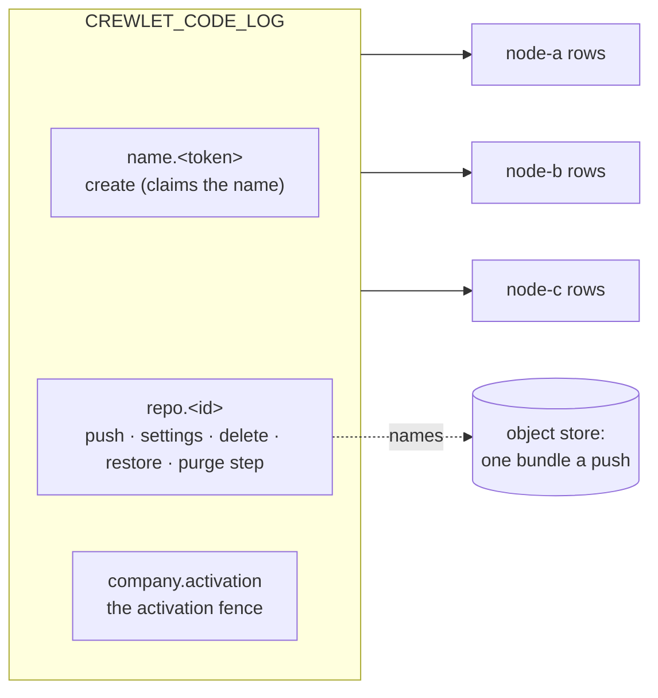
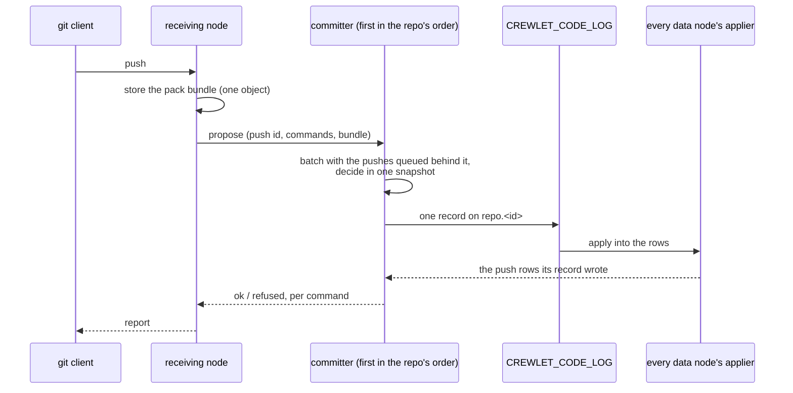
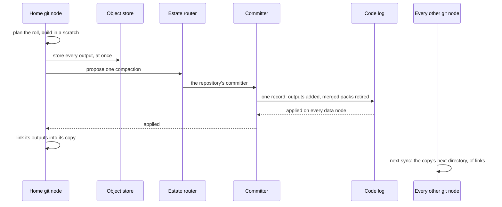
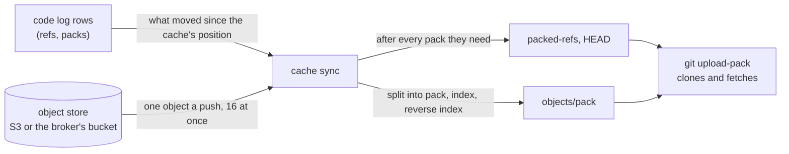

# Code Host

A company that sets [`code.native`](../getting-started/configuration.md#code)
hosts its git repositories in the engine itself, beside its own tracker and
knowledge base, and on the same footing: what a repository *is* — its
settings, its protection rules, its refs and the packs it holds — is
replicated state every data node keeps whole, and the bytes of each push are
one object in the [object store](object-store.md) the whole fleet shares.

It is not exclusive. The [GitHub](../integrations/github.md) and
[GitLab](../integrations/gitlab.md) integrations keep working beside it, and a
company may host some repositories natively and keep others on a vendor.

---

## What it is

A repository is **rows on the code log** (`CREWLET_CODE_LOG`), the state
log's eighth domain (see [Replication](../guides/replication.md)): every change
to a repository is one record on that ordered log, arbitrated at the broker,
and every data node applies it into its own identical copy of the rows. There
is no primary repository anywhere — no node's disk holds "the" repository and
no node's loss loses one.

The **bytes are not rows.** Every push stores **one object**: its pack
together with the index and reverse index the receiving node's git wrote for
it, back to back, named by a `code_packs` row. So a node that has to bring a
repository up to date reads one object a push and indexes nothing — the
index arrived with the pack — and a backup, the collector and the audit treat
a repository's packs exactly as they treat a project's files: a required
reference, kept while a live row names it (see
[One object per upload](object-store.md#one-object-per-upload)).

A git repository on a node's disk is never the record. It is a
[cache](#the-cache-on-a-git-node) derived from the rows, disposable and rebuilt
from them.

How it scales — git nodes adding reads, data nodes committing pushes, and what
sizes each — is [Scaling Out: Git nodes](scaling.md#git-nodes); turning it on,
declaring a repository and pushing to it are the steps of the
[Hosting Code](../guides/code.md) guide.

### What it does not do yet

This is the product's current shape, not a configuration choice:

- **Only people use git.** A person clones, fetches and pushes over HTTPS
  with their own API token ([Persons and their
  tokens](#persons-and-their-tokens)); a seat as a git user does not exist
  yet, so agents do not push. A seat READS the company's repositories, on
  the server, through its code tools ([Server-side reads](#server-side-reads)),
  under the rule a person's push is judged by too ([Who may read and
  push](#who-may-read-and-push)). A git node can build a seat's or a
  person's commit itself and land it as a push ([Engine-built
  commits](#engine-built-commits)), but no tool asks it for one yet.
- **No tool asks for a repository yet.** The code host decides a request to
  create, rename, archive, delete, restore or protect a repository, a seat's
  own scratch repositories among them, and expires an idle scratch repository
  no live turn holds ([Repositories made by tools](#repositories-made-by-tools));
  the tools that ask it arrive with seats' code writes, so today every
  repository is one `code.repos` declares.
- **Nothing asks for a change yet, and there are no reviews or checks.** A
  repository's committer decides a [change](#changes)'s opening, its edits and
  its close, a push to a change's branches writes its revisions, merges it or
  closes it, and a data node answers a listing of changes and one change in
  detail ([Reading changes](#reading-changes)) — but no tool, route or push
  opens or reads one in this release, and no change is reviewed or gated in
  front of a protected branch. A protection rule decides what a push may do to
  a ref, and nothing else stands in front of one. So a repository's [path
  owners](#path-owners) are recorded and read, and no review is asked of them
  yet.
- **Nothing publishes a repository's layers.** A git node installs the chain
  the rows name ([Published layers](#published-layers)), and no row names one
  yet, so each node serves from the index and graph it writes itself.
- **Nothing drops an object a push stored.** A force-push or a deletion
  leaves the history behind it in the repository's packs, fetchable by its
  id, for as long as the repository lives. The object each such push left is
  recorded for two weeks ([ref drops](#retention-and-history)): the grace
  that history keeps once a repository's unreachable objects can be dropped.

---

## Declaring repositories

The repositories are declared in the company document, under `code.repos`,
and every activation makes the fleet match the declaration:

```yaml
code:
  native: true
  deleted_retention_days: 7        # 1..365; unset is 7
  repos:
    - name: nimbus-web             # the address it is cloned by
      owner: { unit: Engineering } # a unit (id or name) or a seat (handle) — exactly one
      visibility: unit             # company (unset) or unit: which seats read it
      default_branch: main         # unset is main
      description: The customer-facing web app.
      protect:
        - branch: main             # refs/heads/main, and nothing below it
        - branch: release/**       # every branch inside release/, never release itself
          allow_delete: true
        - tag: "v*"                # a tag rule: a tag never moves
      path_owners:
        - paths: ["web/**"]        # everything inside web/
          unit: Engineering        # a unit (id or name) or a seat (handle) — exactly one
        - paths: ["**/*.sql"]      # every SQL file, at any depth
          seat: agent-dba
    - name: infra
      owner: { seat: agent-cto }
      archived: true               # read-only: takes no push
```

- **`name`** — one host-name label: lowercase letters, digits and hyphens,
  starting and ending with a letter or a digit, at most 63. It is the address a
  repository is cloned by, so **renaming one deletes it and creates another**
  rather than moving it; declared twice, it is refused at the later entry.
- **`owner`** — exactly one of `unit` (its id, or its name where it has none)
  or `seat` (a handle), resolved against the same document's chart. An owner
  the chart does not have refuses the revision, naming the units or seats it
  does have.
- **`visibility`** — which **seats** may read it: `company` (unset), every
  seat, or `unit`, only the seats the chart relates to its owner (see
  [Visibility](#visibility)). It narrows seats and nobody else: a person reads
  every repository whatever it says. Any other value refuses the revision.
- **`default_branch`** — what a clone checks out; any branch name git would
  take but `seats` and `seats/<one name>`, which hold the seats' own
  namespaces (see [Who may read and push](#who-may-read-and-push)), and unset
  is `main`.
- **`description`** — one paragraph, at most 1 024 bytes of UTF-8.
- **`archived`** — read-only. A push to an archived repository is refused as a
  whole, and reading it is not; unarchiving it is setting it back to `false`.
- **`protect`** — at most 64 rules, each naming exactly one of a `branch` or a
  `tag` pattern, each pattern once.
- **`path_owners`** — at most 64 owners, each exactly one of `unit` or `seat`
  resolved as `owner` is, owning 1 to 32 globs of the repository's paths, each
  glob once and each owner in one entry ([Path owners](#path-owners)).

At most 10 000 repositories one document — a typo guard two orders of
magnitude past a large company's, not a limit anybody is expected to meet. It
is an [admission rule](configuration.md#what-a-stored-revision-is-held-to), as
the retention's one-year bound is: a document written past either is refused,
and a revision already stored past one — admitted by a later build that raised
it — still applies, with a warning, because nothing the reconcile or the purge
does depends on either.

### What each change does at its activation

| You change | At its activation |
|---|---|
| Add a repository | **Created**, empty, with its settings. Two nodes creating one name land one repository: a create arbitrates on the name. |
| Change a repository's settings | **Settled**: one record carrying the new settings, stamped with the activation that wrote it. |
| Change nothing | **Nothing** but one fleet-wide record, the activation's fence (below) — never a record a repository. |
| Remove a repository | **Deleted**: it takes no push, and its rows and packs are kept. Declaring it again under its name within `code.deleted_retention_days` **restores** it: its refs and packs as they were, with the settings it is declared with now. |
| Leave it removed past `code.deleted_retention_days` | **Purged** by the `code-retention` duty, in bounded steps, and its name is free again (see [Deletion and purge](#deletion-and-purge)). |
| Turn `code.native` off | **Nothing is deleted.** A node whose native runtime is already running keeps serving the code host until its restart (see [A native backend changes at a restart](control-plane.md#a-native-backend-changes-at-a-restart)), and a revision without the host reconciles no repository at all. |

Only repositories the **configuration** manages are reconciled. A repository
somebody else created is never deleted for being absent from `code.repos`.

### Protection rules

A rule's pattern is a branch or tag name in git's own grammar, in which a
component of `*` matches one component, `*` inside a component matches any run
of characters but `/`, and a component of `**` matches any number of
components — zero or more in the middle of a pattern, one or more as its last.
A pattern with no `*` matches **only itself**: a rule on `main` protects
`refs/heads/main` and not `refs/heads/main/x`, which git's own `for-each-ref`
would also match. So `release/**` protects `release/1.0` and
`release/2/hotfix` but not a branch named `release` — a rule meant for both is
the two rules `release` and `release/**`. A glob has at most eight components
counting `refs/` and its namespace, which is what bounds the cost of asking it
about a ref.

What a rule does to a push of a ref it matches:

| Field | Unset | Set |
|---|---|---|
| `allow_force` | A push that moves the branch to a commit not descending from it is refused | Allowed. Refused on a tag rule: a tag never moves |
| `allow_delete` | Deleting the ref is refused | Allowed |
| `direct_push` | `persons`: a person may push to it, and nobody else — a seat's push is refused `protected_direct` ([A seat's push](#a-seats-push)) | `none`: nothing pushes to it — the ref is frozen |

**Every rule that matches holds**, because two rules written for two reasons
both mean something: a ref matched by a rule allowing deletion and another
that does not cannot be deleted. A ref **no** rule matches may be force-pushed
or deleted by anybody who may push to the repository, so `crewlet validate`
warns about every repository whose default branch no rule protects — at the
repository's `protect`, naming the rule to add — and never fails on it. An
archived repository is not warned about: it takes no push at all, so nothing
can move or delete its branch until it is unarchived, and the revision that
unarchives it brings the warning back.

### Path owners

A repository's **path owners** say who owns which part of its tree: each a
unit — whose [effective lead](organization-model.md#lead-inheritance) a review
is asked of — or a seat, and the globs of the paths it owns. What a path owner
is for is **review routing**: a change whose revision touches an owner's paths
asks it for a review — once changes are reviewed, which they are not yet
([What it does not do yet](#what-it-does-not-do-yet)). It **grants nothing**. A seat named a path owner reads
and pushes the repository by its [grant](#who-may-read-and-push) exactly as it
did before — owning `deploy/**` lets no seat push there that could not, and a
`visibility: unit` repository still shuts out a seat outside its unit,
whatever paths it owns — because a seat's standing is derived from the chart
and its tier, and no path owner is read there.

A glob is **a [protection rule](#protection-rules)'s pattern grammar, read
over a tree's paths**: it starts at the repository's root, a component of `*` matches one component,
`*` inside a component any run of characters but `/`, and a component of `**`
any number of whole components — zero or more in the middle, one or more as
the last. So `*.go` is the Go files at the root and no deeper, `**/*.go` every
Go file of the tree, `docs/**` everything inside `docs` but never a file named
`docs`, and `web/**/test/*` every file directly inside a `test` directory
anywhere under `web`. A glob with no `*` matches **only** that path, where git's
own pathspec would also match everything below a directory of that name. It
is at most 128 bytes, and one holding a `*` at most eight components, which is
what bounds what asking it about a path can cost. `*` is the one
metacharacter: `?`, `[`, `\` and a leading `!` — read by another glob dialect
as a single character, a class, an escape and a negation — are refused rather
than read as themselves.

A repository names at most **64** owners, each owning at most **32** globs —
sixty-four teams or seats on one repository, and a handful of directories
each — and an owner is named once: everything one owner owns is one entry, a
unit named by its name and by its key being one owner. A scratch repository
takes none; it is its seat's own. Path owners are part of the settings, carried
whole by the records that carry them and settled at an activation like every
other field ([What each change does at its activation](#what-each-change-does-at-its-activation)).
For a repository a tool made, a settings change adds globs to an owner and
removes them, applied to the owners the deciding node's rows hold — never a
whole list the asker read elsewhere — so two requests giving one owner a glob
each both land; an owner left with no glob is no path owner any more, and an
owner a change gives globs to must be one the chart holds, while one it only
removes them from need not be. A repository's detail answers its path owners
(`GET /code/repos/{name}`), in their one order: by kind, then reference, each
one's globs sorted.

### The reconcile and the activation fence

Every data node reconciles `code.repos` at **every boot and every
activation** — a node in a [maintenance mode](../guides/retention.md#the-three-modes)
excepted, since it publishes nothing. Only a repository that changed costs a
write: one that is created, settled, deleted or restored. Nodes reconciling one
activation at the same moment race on each of those, and the log lands one
record on each — the others decide it again from that record and write
nothing. A refusal for one repository is logged and the rest are still
applied.

The reconcile runs **beside** the apply, not inside it: the apply reports the
revision applied as soon as it has asked for the reconcile, and the
repositories follow. At the most a document may declare, an activation that
creates, deletes or restores every repository takes 16–19 seconds on one node
before the last has its record — and a node still applying a revision
45 seconds after a peer applied it is [shed](control-plane.md#posture-what-a-lagging-node-does),
so how many repositories a company declares must never decide that. A newer
activation's reconcile ends an older one's still running, since the newer one
decides every repository again; a node that stops mid-reconcile logs
`code_repos_interrupted`, and its next boot reconciles.

Because the revision is already reported applied, a reconcile that leaves
something undone — an outcome the log did not answer, decisions refused while
the node was still catching up on the fence, a listing it could not read — is
**run again by the node**: five seconds later, then waiting twice as long after
each run in a row that leaves something undone, up to every five minutes, until
one applies, a newer activation replaces it or the node stops. Nothing else
would run it again, and no peer covers for a fleet of one. A run again costs a
batch read of the rows where nothing changed, and writes only what is still
missing. A name held by a repository the configuration does not manage, and a
declaration the code log refuses as written, are said at every run but never
run again for: no run changes them, and only a revision that does applies them.

Without an order between activations, a node applying an *older* activation
late would walk a newer one's settings back. So a reconcile first publishes
one **fence** record for its activation, and every node's copy of the rows
raises a single fence to it and never lowers it; every configuration record
an older activation decides afterwards is refused by every node, identically,
because the fence is derived from the log. Every decision a reconcile takes
waits for its own node to have applied its own fence first. So whatever an
older activation decided is either *before* the fence — in the rows the newer
activation decides from, where any difference it made is settled back — or
*after* it, and refused. That is what lets an unchanged repository cost
nothing: an activation that changes nothing writes its one fence record, and
reads every declared repository's row in one batch.

A node that finds a later activation already fenced logs
`code_repos_superseded` and decides nothing: it is applying a configuration
the fleet has moved past, and reconciles again when it applies the later one.

---

## Repositories made by tools

Beside the projects `code.repos` declares, the code host keeps repositories a
**tool** made, and decides what a person, a unit's lead or a seat asks of
them — create, rename, change the settings of, archive, unarchive, delete,
restore, or protect a branch of — as one **lifecycle request** on any data
node, in one snapshot of the rows. What a request sends for a repository that
exists is a **change** — one field, one protection rule, the archive flag,
globs added to or removed from a [path owner](#path-owners) — which the
deciding node applies to the settings its own rows hold, never a whole set the
asker read elsewhere: two people adding two protection rules at once each keep
theirs. A request names its operation, so asking it again is
one write, answered from the first; and a create's repository id is derived
from its operation, so a retry long after still finds the repository it made.
A repository `code.repos` declares refuses every tool's request
(`config_managed`, naming the declaration to change instead), and a
configuration never adopts one a tool made.

**Two kinds, and the name says which.** A **project** repository's name is
one host-name label, as a declared one's is: a person creates one for any unit
or seat of the chart, and a seat only for the unit whose effective lead it is,
at `full_access`. A **scratch** repository is a seat's own, named
`<handle>.<slug>` after it — two labels and one dot, 63 bytes in all, the slug
never `git` — created only by that seat, at `full_access`, owned by it, taking
no protection, and deleted once it has sat idle (below). A person never
creates one. A rename keeps the kind's form for everybody, a person included:
a scratch repository keeps its seat's handle, and a project stays one label,
since a project renamed to `alice.web` would read as seat `alice`'s own and
squat the name `alice` would create.

**Who may.** A person maintains every repository a tool made. A seat may what
its [grant](#who-may-read-and-push) on the repository maintains: the owning
unit's effective lead at `full_access` a project, and the seat a scratch
repository belongs to its own. A settings change is judged as the repository
stands **and** as the change would leave it, so a seat cannot hand a
repository to an owner, or narrow it to a visibility, under which it would no
longer maintain it — it could not take it back. Everything else is refused
`not_permitted`, with the reason, and nothing is written. Every request reads
the chart, so a node [behind the company's
configuration](#who-may-read-and-push) decides none of them and the next data
node does.

**Two caps.** A tool's create of a project is refused `repo_limit` when the
code host already holds 10 000 project repositories — declared and tool-made
alike, every one short of purged — the bound `code.repos` is held to. A seat's
scratch repositories never count there; each seat holds at most
`code.scratch.max_per_seat` of its own (50 unless set; 0 for none), **every
one it owns counting until it is purged**, a deleted one included, so a
create-and-delete loop cannot hold more (`scratch_limit`). A restore adds no
repository, so neither cap refuses one. A scratch repository costs the code
log one create record, once: under a kibibyte of signed frame at the longest
name, under two with the longest description.

**A rename leaves the old name redirecting** for a month (`RedirectWindow`):
the old name resolves to the repository under its new one, so
[a clone or a fetch by the old URL still works](#what-git-prints-and-what-it-means)
— the advertisement it begins with is answered `302 Found` to the new name,
and the fetch git sends after it is served at either name, since git moves to
the new name only when the redirect answered its very first request: one that
presented its credential up front, which git then says (`redirecting to`),
never one whose credential helper answered a challenge first. A push of the
old name is refused, naming the new one, so nothing is pushed to a name the
repository no longer holds. Nothing else may take the old name while it
redirects. Renaming back takes it back. The `code-retention` duty
releases an old name at its window's end, one record a name, after which it
names nothing and is free; an old name whose repository was purged meanwhile
stays reserved until its window ends, like every other.

**Archive, delete and restore** work as they do for a declared repository: an
archived repository is read-only, a deleted one takes no push and keeps its
refs and packs, restorable as it was until its [purge](#deletion-and-purge),
and a restore through the tools brings it back.

### A scratch repository's idle expiry

A scratch repository with no push, rename, settings change or restore for
`code.scratch.idle_days` (7 unless set) is **deleted** by the `code-retention`
duty — restorable for `code.deleted_retention_days` like any deletion, then
purged. Reading a repository is no activity, and an archived one is kept: its
seat archived it on purpose.

**A scratch repository a live turn has named is never expired.** Every request
a seat's turn makes about a repository — a read, a write, a lifecycle request,
through its own tools, a delegated worker's or an agent-mode run's bridge —
takes the turn's **hold** on it first, and a turn holds what it named until it
ends: while it runs, in the memory of the node running it; once it has a
[coding run](code-sandbox.md)'s row, on the row as well, unioned at every
launch and released with the row when the run ends. So a turn parked for days
on a question keeps its experiment. A hold moves no clock: once the turn ends,
the repository is expired at the duty's next pass if it is still idle.

Each pass fixes its cutoff, and the position its page of due repositories was
read at, **before** it reads the holds — every run row the fleet holds,
whatever its status, and the running turns of every node holding a seat
lease, each asked and each required to answer within two seconds — and
decides each expiry against that page: a repository with any record on it
since, or active since the cutoff, is kept. A turn taking its hold on a
repository idle 22 hours or more also records it on the repository, which the
broker orders against the expiry: recorded first, the expiry is refused;
expired first, the turn's request is refused before it reads anything, and the
repository can be restored. Under 22 hours no pass in flight can have
listed it, since `idle_days` is a day at least and two nodes' clocks may
disagree by two hours. **A hold that cannot be read expires nothing**: a run
store that cannot be listed, or a seat holder that does not answer, ends that
pass's expiry, says so on its `code_retention_pass` line
(`scratch_expiry_unread`) and logs `code_scratch_expiry_skipped` at warn; the
next pass asks again.

A pass's line counts `released` old names, `expired` scratch repositories and
`scratch_held`, the idle ones a live turn kept.

---

## One subject per repository

Everything that moves a repository's refs or packs, or governs them — a push,
a settings change, a deletion, a restore, a purge step — is a record on **one
subject a repository**, `crewlet.code.log.repo.<id>`. That subject is the
**arbitration unit**: two pushes to one repository contend at the broker and
exactly one record lands per round, and the loser decides again against the
winner's rows. One subject a repository rather than one a ref, because every
write on a repository changes its row too — its ref count, its bytes, its
version — so a subject a ref would never narrow a write's contention.

A **name** is claimed on its own subject, `crewlet.code.log.name.<token>` (a
bounded digest of the name), so two creates of one name contend there, where
two freshly minted repository ids never would. The activation fence has the
company's one subject.



---

## The committer

Because every push to a repository contends on its one subject, a
repository's pushes are **committed by one node**: its **committer**, the
first live data node in a rendezvous order of the repository's id, which every
node computes alike. A push received anywhere is asked of that node, which
takes the repository's pushes in order and puts every push waiting behind a
record in flight into the next one — **group commit**, without lingering for
more, up to 64 pushes a record. An idle repository pays one record a push and
a burst one record a batch. A batch is decided in one snapshot of the rows,
each push against what the ones before it did, and a push is answered `ok`
only from the row its record applied, never from the decision. A push whose
[changes](#revisions) would take the record past the rows one record may
write, beside the pushes before it, is decided first in the next record
instead, with the pushes behind it after it.

The live data nodes are the ones each node's view of the fleet's presence
names. The view hears a presence claim or release as it lands and lists the
fleet again then — see
[Coordination](coordination.md#who-is-in-the-fleet-asked-per-request) — so a
data node that joins is in every repository's order within about a second of
its claim, and a fleet started all at once agrees on every committer within
about a second of the last node's claim. A push received inside that second
may be committed by a node that has not yet heard its committer join: correct,
since the pushes still contend on the repository's one subject and the broker
decides between them, and short only of that push's group commit. A node
without `data` that has heard of no data node yet has nobody to ask, and
refuses a push, a fetch or a read as unserved until one claims. A committer
that stops without releasing its presence stays in the order until its lease
lapses, asked after the rest once it has gone silent — see
[Scaling](scaling.md#how-a-request-reaches-the-estate).

A push carries an id the receiving node minted, and a push id the repository's
history already holds is answered from its row — so a push asked twice, or of
a second node after the first stopped answering, is still one push. A
committer that stops, or answers nothing, hands each of its repositories to
that repository's runner-up in the same order, under the same push id. A node
in a maintenance mode commits nothing and refuses as a node that ran nothing,
so the next committer decides; while the whole fleet is in one, no push is
committed.

The path a push takes from the node that receives it:



A queue holds at most 1 024 pushes, and a batch has 30 seconds to land; past
either a push is refused `busy` undecided and the client pushes again (the
`crewlet.code.commit.busy` counter, in the
[metrics reference](../reference/metrics.md), says which).

---

## Limits

[`code.limits`](../getting-started/configuration.md#code) — the largest pack
one push may send, the largest file it may carry, the most one repository
may hold, and how many pushes one seat may land in a day ([A seat's
push](#a-seats-push)) — is read off the **deciding node's current revision**
at every decision, so a change holds from its activation with no restart. A
seat outside a repository's owning unit is held to half of its live refs and
half of `repo_max_bytes` ([A seat's push](#a-seats-push)). A repository
also holds at most 100 000 live refs, and a push moves at most 1 000 of them;
the refs it deleted within 48 hours are kept apart, up to another 100 000, the
oldest forgotten sooner past that — a node last synced before them reads the
repository whole, and so does a node whose last sync is behind more changes
than the repository now holds, since what is left is then fewer rows to read.
A deletion never counts against the live refs, and never refuses a push: a
push that deletes refs and creates others is judged on what it leaves, so at
the limit `git push origin :old new` — or a `--prune` push — goes through.

A repository also holds at most **2 048 live packs**: every push that carries
objects stores one, and they stay until a compaction merges them. The bound is
a cold read's: a git node that has never served the repository downloads one
object for every live pack before it answers, sixteen at a time, and from an
S3 fake answering each request 200 ms late a cold read downloaded 2 048 of
them in 26.4 s, 77 a second — within 27 s, half of 55 s, the minute of quiet a
balancer allows a git request ([Deployment](../guides/deployment.md)) less a
keepalive, with the other half left for indexing what arrived — and ended its
whole read at 26.6 s. A push
carrying a pack into a repository that holds that many is refused
**`compaction_behind`**, whole: nothing of it is decided, no row names
anything it uploaded, and it lands when it is run again once a compaction has
merged the repository's packs. A push that carries no pack — deletions, or
refs moved onto commits the repository already holds — adds none, and is
never refused for it. The node that received the push refuses it before
uploading anything, once it has read the repository's row again; the
repository's [committer](#the-committer) decides it for good, counting the
packs of the pushes it commits in the same batch ahead of it. So a push whose
node read the repository below the bound, where pushes that landed since have
taken it, is refused by its committer only after its pack was uploaded, and
the [object collector](object-store.md#collection-and-audit) deletes that
pack a day later ([a push, end to end](#a-push-end-to-end)).

A push's ref updates must also fit the one record its committer writes for
it: about 1 MiB of them, as the code log spells them. A thousand plain refs of
the longest, 255 bytes, take under half of that. A ref whose characters the
log spells in six bytes each (`&`, `<`, `>`) costs up to six times its
length, so a push of some six hundred such refs of the longest reaches the
bound first. The receiving node measures a push's ref updates as it reads
them, with everything the rest of the push could add at its largest, and
refuses one past the bound before anything of it is run or stored.
[`crewlet code import`](../reference/cli.md#crewlet-code-import) cuts each
batch of refs it pushes by the same rule, so an import never meets it.

What a repository holds is its packs **as the pushes stored them** until its
home merges them ([Compaction](#compaction)) — which matters for a history
that arrived in many pushes rather than grew by them. A history [imported](../guides/code.md#import-from-github-or-gitlab)
in steps stores more than one pack of it: every step keeps whole the files it
touches whose earlier versions an earlier step stored. Measured on this
project's own history, 34 MB as one pack stored 68.5 MB in eleven steps and
78.6 MB in forty-two. Those bytes are what the object store holds, what every
git node serving the repository caches and what a cold sync downloads, so
size `repo_max_bytes`, the object store and the git nodes' caches for the
repository as it was pushed, not for the source it came from. A merge writes
each object of the packs it takes once, and git searches for deltas among the
objects it merges, so a file a step kept whole may be stored as a delta again
once its home merges the steps' packs; how much that saves depends on the
history, which is why the sizing above is for the repository as it was
pushed.

### A ref and a directory of refs

A ref is never created beside a directory of its own name. With a branch
`feature`, a push creating `feature/x` is refused `ref_conflict`, and so is one
creating `feature` while any `feature/…` branch is live; the sentence names the
ref in the way. git keeps a ref as a file under `.git/refs`, and no clone can
hold a file and a directory of one name: a repository that took both was
cloned whole — a clone writes its refs into one packed file — but every
existing clone's `git fetch` then failed (`'refs/remotes/origin/feature'
exists; cannot create 'refs/remotes/origin/feature/x'`) until somebody deleted
one of the two. Branches and tags never meet (`refs/heads/v1` and
`refs/tags/v1/x` are different directories), and siblings never do
(`feature-x`, `feature.x`).

Like the ref limit, the rule is judged on what the push leaves: a deleted ref
blocks nothing, so renaming `feature` to `feature/v2` in one push —
`git push origin :feature HEAD:feature/v2` — goes through. A clone that
already holds `origin/feature` fetches the rename with `git fetch --prune`,
which removes the old remote-tracking ref before it writes the new one. Of two
creates in one push, or in one batch of the [committer](#the-committer), that
would sit beside each other, the first stands and the second is refused.

---

## Compaction

Every push stores one pack, so a busy repository's pack count grows with its
pushes — and a git node that reads it whole pays a GET for every pack, and
every request a lookup in every pack its index does not cover. The
repository's [home git node](#the-home-git-node) — the node its reads are
asked of first — merges them, and its committer decides the merge as it
decides a push
([ADR-0060](https://github.com/crewlet/crewlet/blob/main/adr/0060-a-compaction-merges-packs-without-judging-reachability.md)).

**The roll.** Once a minute every git node lists the repositories holding
sixteen live packs or more, most packs first, judges whose home each is against
one reading of the live git nodes, and for each it is home for it
plans git's own geometric split — the one `git repack --geometric=2` makes —
over the packs that are not FULL: the lightest are merged until every pack
left weighs at least twice the objects of all the lighter ones together, and
only where that takes sixteen packs or more, so a repository pushed a pack at a
time is merged sixteen pushes at a time rather than at every poll. A
pack is full once its pack section, or its whole bundle, is at seven eighths of
the 1 GiB a merge cuts its outputs at, and a full pack is never merged again.
A repository holding more than 50 packs that are not full is merged two packs
at a time even when they already stand in that progression, so it shrinks at
every poll. One merge takes at most 1 024 packs and 8 GiB of pack bytes, the
lightest first. A repository whose plan finds nothing worth merging is not
planned again until its rows move, so an idle repository costs its home's
minute a lookup, and every other git node's the one judgment of whose home it
is.

**The build.** One `git pack-objects --stdin-packs` over the packs merged,
run in a scratch repository — never in the copy — whose one alternate holds
exactly those packs, hard links of the copy's own files, so the walk git makes
from the merged packs' commits to sort their objects for delta compression
ends where they do: over the whole copy it ran the repository's history, and a
merge of a few small pushes into a large repository cost time and memory in
proportion to that history. It runs in the node's maintenance lane: at the
background indexing's own limit, never the slot kept for
`crewlet code verify`, with its memory charged against the node's background
budget beside the indexing's (500 bytes an object merged, 240 more an object
merged for a transfer's room beside them, and six times
`code.limits.max_blob_bytes` for its delta search, as a build was measured to
hold). It follows the merge and never the repository, where every other step
keeps room for a clone of the whole repository: a home that refused a large
repository's every merge would refuse its pushes too, once its packs reached
the bound. It cuts its outputs at 1 GiB. **The outputs hold every object of the
packs merged** — an object a pack outside the merge also holds included —
because a merge judges no
reachability: no push decided against the packs it replaces can land a ref
whose history it dropped, and two merges planned from different moments never
each drop what the other relied on. Each output is one bundle in the stored
format, every one held to the bundle rule before a byte is uploaded and all of
them uploaded at once, since an object's key is minted as its upload begins
and a record may name only keys of the last twelve hours. The maintenance slot
and the memory go back as soon as the build's last git process ends, before
the uploads.

**The decision.** The home proposes ONE compaction to the repository's
[committer](#the-committer) through the estate router, as a push is proposed,
under an id of its own — so the runner-up asked after a committer went silent
decides the same compaction, never a second. The committer decides it ALONE,
in one snapshot: every pack it merges still live and not full, or it is
refused `stale` and the next poll plans again from the rows; and ONE record
adds the outputs' rows and moves the merged packs' rows into a table of
retired packs. Two git nodes that both take themselves for the home for a
moment both build, and the second is refused `stale`; what it stored is named
by no row, and the object collector deletes it.



**Every copy follows.** The home links the outputs it built into its copy, so
it downloads none of them; every other git node downloads them at its next
sync of the repository, and drops the merged packs by moving its copy into a
next directory of hard links, keeping the commit-graph, since a merge drops no
commit ([When packs leave a copy](#the-cache-on-a-git-node)). A request
already reading the old directory finishes on it.

**A day's grace.** A retired pack keeps its object for a day — longer than the
longest read a clone of the largest bundle a row can name may take (21 hours
21 minutes), by more than the two hours the clocks of the broker that stamped
the retirement and the node sweeping it may disagree by while no node raises
[`clock_skew`](../reference/alarms.md) — so a clone that began on it before the
merge finishes
([Live, retired and derived references](object-store.md#live-retired-and-derived-references)).
Then the `code-retention` duty removes its row, and the object collector
deletes the object at its next pass ([Deletion and purge](#deletion-and-purge)).

**When it cannot keep up.** A repository at the 2 048 live packs one may hold
refuses a push carrying objects `compaction_behind` ([Limits](#limits)), and
its home raises the [`code_compaction_behind`](../reference/alarms.md) alarm
for every repository it compacts at that bound, from its own poll, for as long
as one is there — its log says why the merge has not landed:
`code_cache_compaction_refused` for a build the node's memory cannot hold,
`code_compaction_refused` for a refusal (`store_full` among them: an object
store with no room, which holds the repository back until the store has the
room for that merge, never retried as a blip, and lets it go once that merge's
outputs are stored, so a later merge is held back only by a refusal of its
own),
`code_compaction_failed` for a build, an
upload or an answer that failed, each tried again at the next poll. A
repository that takes pushes faster than one node merges them shows as
`crewlet.code.compact.duration` against the pushes' rate
([metrics reference](../reference/metrics.md)).

**What it costs.** The build holds about 500 bytes of memory an object it
merges — 139 MiB for a 100 MB source history's 295 680 objects, measured —
and more where its delta search meets large files (eight revisions of a
50 MiB file held 270 MiB), and takes 28 to 48 seconds for every gibibyte of
packs it merges, in the node's maintenance lane. Every other git node holding
the repository downloads each output once, so over a repository's life a git
node downloads, and writes, at most about 16 times what is pushed to it at
20 KB pushes, fewer the more pushes a merge takes at once
([Scaling Out](scaling.md#git-nodes) has what that bills); a merge's record
takes 43 to 108 bytes a push on the code log, and the record that sweeps its
retired rows a day later up to 44 more; a merged pack's row is kept a
day, about 608 bytes; and a git node drops the merged packs by a move into a
next directory that links three files a pack it keeps, whatever the packs'
bytes (over the in-memory store, whose download waits on no first byte, a
sync that downloaded a merge's output and moved a copy of 50 packs took
7 ms, and one of 2 048 took 119 ms; from a bucket the output's GET comes on
top). What it buys is the cold read: from an S3 fake answering each request
200 ms late — S3's slow first byte — the fifty or so packs a compacted
repository holds came up in under a second, where the 2 048 a repository may
hold took 27 seconds and the 10 000 of a history nothing merged over two
minutes ([The cache on a git node](#the-cache-on-a-git-node)).

**What it does not do.** It removes no object: what no ref reaches stays in
the repository's packs for as long as it lives. And every merge drops the
multi-pack index and its bitmap on every git node holding the repository —
the commit-graph survives — which the background indexing writes again at its
own pace, so a clone between the two counts its objects by walking.

---

## Changes

A **change** — `web!42`, the 42nd change opened on the repository `web` —
proposes that one branch of a repository, its **source**, be merged into
another, its **target**. It is rows on the code log like the refs it names,
and every record that moves it is on the repository's own subject, beside the
pushes that move its branches: the repository's one
[committer](#the-committer) decides them in order and the broker arbitrates
them together, so a change is never both merged and closed.

Four tables hold a change, on every data node:

| Table | A row for | What it holds |
|---|---|---|
| `code_changes` | each change | Its number and title; its state; its source and target branches; the head of its latest revision; who opened it — a seat, or a person by the human seat they hold, with the credential they used; the work item it carries; when it was opened, closed and merged, and how; and how many bytes its description holds |
| `code_change_bodies` | each change with a description | Its description, up to 32 KiB |
| `code_change_authors` | each of its authors | Who wrote the change: whoever opened it, and everyone whose push moved its head, each from the revision they first wrote. An author's approval of their own change counts for nothing |
| `code_revisions` | each time its head moved while it was live | The new head, who pushed it and the push that did. Revision 1 is the source branch's head when the change was opened, and a reopen's revision its head when the change was reopened — each made by whoever opened or reopened it, by no push |

- **A number is the repository's own**, counted from 1 in the order the code
  log applies the records that open changes, so two changes of a repository
  never share one and none is skipped.
- **A state is one of four.** A `draft` or `open` change is **live**: the
  moves of its source branch's head are its revisions, and the branch is the
  source of no other live change. A `closed` change was closed without being
  merged, and may be opened again while its source branch is live. A `merged`
  change reached its target and stays merged; it says how (`push`: a push set
  its target to its head, or moved the target past it) and the commit its
  target was merged at.
- **A revision is a row, never a ref.** Nothing a client fetches advertises
  one, so a clone holds the repository's branches and tags and nothing more.
- **A description is a row of its own.** Every move of a change's head reads
  and rewrites the change's row on every data node, and the store reads a row
  whole: a description of up to 32 KiB on that row more than doubled what each
  revision cost. Kept beside it, a description costs a head move nothing, and
  the row still says how long it is, so a purge weighs it without reading it.
- **A change has no horizon of its own.** It is kept as long as its
  repository, and the repository's [purge](#deletion-and-purge) removes it:
  each change whole, its revisions, authors and description before its row,
  in the same bounded steps as the rest of the repository's rows.

### Opening, editing and closing a change

Every write of a change's lifecycle is a record of its own on the
repository's subject, decided by the repository's
[committer](#the-committer): it waits in the same queue as the repository's
pushes, in the order it arrived, and is decided alone, never batched with
them. Six writes:

| Write | What it does | Who may |
|---|---|---|
| Open | Proposes a source branch into a target branch: the change's row, its owner as its first author, and its first revision, the source branch's head | Whoever may push the source branch: a person, a seat that writes the repository, and a `full_access` seat from its own namespace (`refs/heads/seats/<handle>/`) — see [Who may read and push](#who-may-read-and-push) |
| Edit | Sets its title (one line, at most 256 bytes), its description (at most 32 KiB) or the work item it carries | Its owner, a principal that maintains the repository, and any person |
| Draft | Makes a live change a draft, or a draft ask to be merged | The same |
| Retarget | Moves its target to another live branch | The same |
| Close | Closes it without merging it, with a reason of at most 1 KiB | The same |
| Reopen | Opens a closed change again, at its source branch's head now — a revision of its own, made by whoever reopened it, where the branch moved while the change was closed | The same |

- **A number is the apply's.** The record that opens a change takes the
  repository's next number when it applies and moves it on, so numbers follow
  the order the code log applies the opens, and two opens decided at once
  never share one.
- **An open asked again is the same change.** A change's id is derived from
  the open's operation id, and the code log's ledger collapses the open asked
  again under it — of another data node after its committer stopped
  answering, or by an asker whose answer was lost — onto the record that
  landed, so no retry opens a second change.
- **A branch heads one live change at a time.** An open from a branch that
  already heads a draft or open change is refused, naming that change, and so
  is a reopen while another change is live on the branch: a push to the
  branch revises exactly one change.
- **Every write but an open names the version it was formed against.** A
  change's version counts the records that changed its row, 1 at its open; a
  write naming one the change has moved past — another write, or a push that
  moved its head, landed first — is refused `stale`, and its asker reads the
  change again.
- **A write that asks for what the change already says changes nothing.** An
  edit to its own values, the draft state it is in, the target it has, a
  close of a closed change and a reopen of a live one are answered from the
  change's row, at its version, and append nothing.
- **A seat is judged by the chart of the node that decides.** A node that
  holds no chart yet, or one [behind the company's
  configuration](#a-seats-push), decides none of a seat's writes and hands them
  to the repository's next committer, as it does a seat's push; a person's is
  decided as ever.

A write that is refused appends nothing, and says why in one sentence:

| Refusal | Means |
|---|---|
| `repo_deleted`, `repo_archived` | The repository is deleted, being purged or gone — in the sentence of the state it is in — or archived and read-only |
| `change_not_found` | The repository holds no such change |
| `not_permitted` | The asker may not make the write: an open by one who may not push the source branch, saying what the asker holds and what would admit it; any other write by one who neither owns the change nor maintains the repository, nor is a person |
| `stale` | The change is at another version than the write was formed against |
| `same_ref`, `no_source`, `no_target`, `no_difference` | The source and target are one branch; the source or the target is not a live branch; the source is at its target's commit |
| `change_exists` | The source branch already heads a live change, which the sentence names |
| `change_closed`, `change_merged` | An edit, a draft's state or a retarget of a closed change, which is reopened first; any write but an open of a merged change, which stays merged |
| `busy`, `not_applied`, `unavailable` | The committer did not reach the write in time, or the code log refused it or dropped it on every node: nothing was decided, and the write is sent again |

`crewlet.code.change.proposals` counts every write a node's committer was
asked to decide, by its write and what became of it, and
`crewlet.code.commit.busy` counts one met busy under `kind` `change` (the
[metrics reference](../reference/metrics.md)).

### Revisions

A change's revisions are the moves of its source branch's head while it is
live, and no record of the change's own says one happened: the push that moved
the branch does. Its record writes the revision — on every data node, from the
push's commands and the change's rows, in the same record as the refs it
moves — and each push of a record sees what the ones before it did.

- **A push to the source is the next revision.** A command that moves a live
  change's source branch to a new commit writes revision n + 1: the new head,
  who pushed it and the push that did. The change's head, revision and
  version move with it, so a write of the change formed before the push is
  refused `stale`. A forced update is a revision like any other.
- **Whoever pushes a revision becomes an author**, from the revision they first
  wrote; the change's owner is one from its first. An author's approval of
  their own change counts for nothing.
- **A push that sets the target to exactly the change's head merges it**:
  `merged`, by `push`, at that commit. The head is the one the same push's own
  moves left, so a push of one commit to both the source and the target
  merges the change whatever order the refs were sent in. One record merges at
  most 64 changes, the lowest numbers first; a change past it stays open with
  its head in its target. A push that moves the target past the head rather
  than onto it leaves the change open: nothing in this release yet finds a
  head inside its target.
- **Deleting the source branch closes the change**: `closed`, its reason
  `source_deleted` — after the same push's merges, so a push that sets the
  target to the head and deletes the branch leaves the change merged.
  Reopening it needs the branch pushed again.
- **Every change one record moves counts one version**, however many of its
  pushes moved it.
- **A record holds the rows of the changes it moves.** The committer counts
  what a record will write about the changes its pushes move beside the
  record's own rows. A push whose changes would take the record past the rows
  one record may write, beside the pushes batched before it, waits for the
  next record and is decided first in it, the pushes behind it after it; one
  whose changes would not fit even a record of its own is refused
  `too_many_changes` — see [What git prints](#what-git-prints-and-what-it-means).

### Reading changes

The code host answers two reads of changes, each from a data node's own rows
at the read level its caller asks for, as every read of the rows is: stale
unless asked, `session` beside the position a write answered with, so a list
just changed is read back with the change in it, and linearizable for an
answer that holds every record the code log had committed when it was asked.

- **A listing of changes**, newest first, a page at a time. It names a
  **repository**, a **work item** — by its identity across trackers,
  `<backend>:<id>`, such as `native:<task id>` — or a **state**, and may
  narrow further by an **owner** (a seat by its handle, or a person by the
  human seat they hold) and by whichever of the three it did not name. One
  that names none of the three is refused: no index holds every change the
  company has, and an owner's changes are kept by state, so an owner's are
  listed in a state, or in a repository, or on a work item. A repository's
  changes are listed by number; every other listing in the order the records
  that opened its changes landed on the code log.
- **One change**, by its number on its repository — `web!42` — with its row
  (title, state, branches, head and revision, version, owner, the work item it
  carries, when it was opened, closed or merged and how), its description and
  its authors, beside its revisions, newest first; a later page carries its
  revisions alone, after the revision the page before it ended at. A number
  the repository does not hold is "no such change", naming it (`web!43`).

**A listing reads the one index its filters lead with** — a work item's
changes; an owner's in a state; a repository's in a state; a repository's;
the company's in a state — so a repository's open changes are read without
its closed and merged history, however long that grows. A filter that index
does not hold — a repository beside a work item or an owner, a state beside a
work item, an owner beside a repository with no state — is tested on each
change the page read, never by reading further: a page is the changes it
**read**, not the changes it kept, so it can be short, or empty with a cursor,
and a reader pages until no cursor comes back. A page reads 50 changes unless
asked for fewer or more, 200 at most; a change's revisions come 200 a page,
1 000 at most.

**Every read of changes is held to the reader's grant** on the change's
repository, as the repository's own reads are ([Who may read and
push](#who-may-read-and-push)):

- A listing that names no repository lists the changes of every repository
  the reader may read — and of an active or archived one only: a deleted
  repository's changes are no work anybody can do until it is restored.
- A listing that names a repository, and a read of one change, are refused
  `not_permitted` where the reader may not read the repository, naming the
  visibility and who does read it — a number in it too, which is never
  answered "no such change" — and are otherwise served whatever the
  repository's state, a deleted one's included, since it was named.
- A seat reading for a colleague is held to both grants, as every code read in
  such a turn is ([Reads made for somebody else](#reads-made-for-somebody-else)).

---

## Retention and history

Four horizons, each kept by the record that applies it inside its own
repository, never by a sweep:

- **Push history** — a push row is kept **181 days**, the same horizon as the
  company's [usage history](../guides/retention.md), so "what happened over
  the last half year" has one answer across the engine. A row names who
  pushed — a person's credential and the seat they hold, or a seat by its
  handle — how the push's pack was built (`git`, sent by a client's git, or
  `engine`, built by the engine itself), and for a seat's push the turn that
  made it, the work item that turn was charged to and the model it ran on —
  and for a push the seat's coding box made, the coding run that pushed and
  the coding agent it ran, which is how the engine reads back what a run
  delivered when it collects the run: each stamped by the engine from the
  call or the run that made the push, never read from a commit, whose author,
  committer and trailers whoever made the commit writes. A row names every
  ref its push named, refused ones too. A ref the
  engine refused for being longer than 255 bytes, or for not being UTF-8, is
  kept as much of it as fits in 255 bytes beside its length and a digest of
  the whole
  (`refs/heads/x… [60013 bytes, sha256 <32 hex>]`), so a ref nothing can ever
  name costs every node's history no more than one that could. The history
  is kept, listed and forgotten in the order the pushes LANDED on the code
  log, newest first in its listing and oldest first as it ages out — never
  by the instant on each record, which is the stream leader's clock and can
  step back when the leader changes — so a push stamped earlier than the one
  before it waits for that one, at most the brokers' clock skew past its own
  181 days, and every node forgets the same pushes.
- **Ref tombstones** — a deleted ref is kept as a tombstone for **48 hours**,
  so a node bringing a repository up to date learns of the deletion — or
  sooner, oldest first, once the repository holds **100 000** of them. Each
  push's record always has room to forget as many old ones as it deletes,
  so a repository at that bound keeps every new deletion and forgets the
  oldest. A node last brought up to date before a forgotten deletion reads
  the repository whole: it re-reads the refs and keeps every pack it holds,
  and downloads nothing again.
- **Ref drops** — a push that force-moves a branch, or deletes a branch or a
  tag, records the object the ref held, since no ref names it any more: one
  row an object, naming the ref, the object and when the push landed. It is
  kept **14 days**, git's own `gc.pruneExpire` default, because dropping a
  repository's unreachable objects keeps what such a push left for that
  long: history force-pushed away or deleted stays fetchable by its id for
  two weeks after the push. The repository's later pushes forget the rows
  past that, oldest first, with whatever room each push's record leaves once
  its tombstones are forgotten. That is room for at least as many as the
  push records, except behind the busiest records: two pushes of forced
  updates sharing one record (about 1 900 short), or a thousand deletions or
  more while older deletions' tombstones are being forgotten too (from four
  short, for one push of a thousand, to about 1 250). What a push could not
  forget waits for pushes with room, up to about 4 000 rows a push, so the
  rows past two weeks pile up while a repository's pushes stay that busy and
  go once they do not. A fast-forward or a create leaves nothing behind and
  records nothing. The committer counts these rows in the record it forms,
  so a record holds one push of a thousand forced updates or deletions where
  it holds three of a thousand fast-forwards.
- **A purge** — below.

A pack a compaction retires is kept a day as a retired row, which the
`code-retention` duty then removes ([below](#deletion-and-purge)). Until then
the row is how a node bringing the repository up to date learns of the
retirement; a node last brought up to date before its removal reads the
repository whole at its next sync, as after a forgotten deletion, and
downloads nothing again.

### Deletion and purge

A repository removed from `code.repos` is **deleted**, softly: its rows and
packs stay, and declaring it again under its name restores it. Once it has been
deleted longer than **`code.deleted_retention_days`** (1 to 365 days; unset is
7, the trim's default `min_age`, so a deletion is undone from the same window
the log can replay), the fleet-singleton `code-retention` duty purges it (see
[Singleton duties](seat-ownership.md#singleton-duties)):

- every 15 minutes, it first removes the rows of the packs a compaction
  retired more than a day ago, so the collector can take their objects (see
  [Live, retired and derived references](object-store.md#live-retired-and-derived-references)),
  then finishes every purge already begun — whatever the retention, since a
  purge has no undo — then purges the repositories deleted longest ago first,
  then releases every renamed repository's old name whose redirect has ended,
  and last deletes every scratch repository idle past
  `code.scratch.idle_days` that no live turn holds
  ([A scratch repository's idle expiry](#a-scratch-repositorys-idle-expiry));
- each purge is a sequence of bounded **steps**, each one record removing a
  bounded part of the repository's rows — its push history, its refs, its
  packs and the ones a compaction retired, its
  [ref drops](#retention-and-history), then its [changes](#changes), each
  whole: a change's revisions, authors and description, then its row — and
  the last leaves only a **deletion marker**, which drops every later record
  about the repository on every node, for ever
  ([the deletion gate](../guides/replication.md#applied-is-not-permanent)).
  A step is bounded by how many rows it removes and by what its widest rows
  weigh: the push records and the change descriptions it removes together
  stop at about 32 MiB, so a repository with long descriptions takes more
  steps rather than longer ones;
- every data node applies every step on its one write lane, so the duty paces
  itself: after each step it waits twice the step's duration, a third of the
  lane, and a pass stops after a minute of steps and the next resumes from
  the rows;
- once the purge has applied on the duty holder's own rows, the name is free,
  and a name the current configuration still declares — re-added while it
  purged, which the reconcile logs as `code_repo_awaits_purge` — is created
  again at once;
- a purge **begins only on a node that serves the fleet's current
  configuration** — the revision the [activation pointer](control-plane.md)
  names, applied on that node. The duty purges by the retention its own node
  serves, and a purge has no undo, so a revision that lengthens
  `code.deleted_retention_days` to save a deleted repository is never defeated
  by a holder that failed to apply it: a node behind the fleet's revision, or
  one whose fleet has activated nothing yet, declines the duty and gives it
  back, logging `code_retention_duty_declined` with the reason and both
  epochs, and a node that has applied the revision takes it at its next tick.
  A pass that outlasts a renewal of the duty's lease is asked the same before
  the renewal, and stops there if its node has fallen behind. Being behind is
  a fault only once the lag is
  [confirmed](control-plane.md#where-the-gate-sits) — an apply of the
  revision failed on the node, or it has been behind longer than propagation
  explains: a node merely applying an activation, or starting up before its
  reconciler has ticked, declines quietly and asks again a reconcile interval
  (15 seconds) later, so a restart or a configuration write costs a purge
  seconds. Declining costs a purge at most one tick (15 minutes) on a fleet
  with a current node; on a fleet whose only worker data node is stuck, every
  purge waits for its apply to succeed.

A push to a repository that is not there to take it is refused
`repo_deleted`, and what follows the code says which of four states the
committer found, because each has its own remedy:

| State | What the push is told |
|---|---|
| deleted | declaring it again in `code.repos` restores it as it was — or, for a repository a [tool made](#repositories-made-by-tools), a restore through the code tools — until its purge, which may begin from the instant named: the deletion plus `code.deleted_retention_days` on the committer's current revision — the earliest the duty begins it under that revision |
| being purged | the purge cannot be undone; once it completes, declaring the name — or creating it again, for one a tool made — creates a new, empty repository |
| purged | it holds nothing; declaring its name creates a new, empty repository |
| an id no repository had | it does not exist |

The packs a purged repository named, the ones it had retired with them, are no
longer named by any row, so the
[object collector](object-store.md#collection-and-audit) deletes them a day
later. The code log itself is trimmed like every other log (see
[Retention](../guides/retention.md)), and a node whose copy of it is out of
service declines the duty rather than purge from rows the fleet may not agree
with.

---

## The cache on a git node

A repository lives as rows on the code log and as pack bundles in the object
store. A node that serves git keeps a **cache** of each repository it is asked
for: an ordinary bare repository in a directory of the node's own, from which
git's own `upload-pack` answers clones and fetches. The cache is disposable:
nothing in it is the only copy of anything, and deleting it costs nothing but
the time to download it again. The engine's [backup](../guides/backup.md)
never copies it, and its directory carries a
[`CACHEDIR.TAG`](https://bford.info/cachedir/), so a backup of your own run
with `--exclude-caches` — tar, borg and restic all take it — leaves it out
too; without that option they copy it like any other directory. The
directory is the cache's alone: a node refuses one that already holds
anything without that tag — a volume's own `lost+found` aside — because it
empties its own scratch space there at every boot, and refuses one another
process is using.

A cache is a **function of the rows**: its refs are exactly the repository's
refs at the log position it records, its packs exactly the repository's packs
there. Nothing but the cache itself writes it — its sync, the adoption of a
push's pack once the push's row has applied, and its background index — and a
push never does: a push is received in a throwaway scratch repository that
reads the cache through an alternate, so an object nobody committed can never
appear in a cache, where any reader could fetch it by id.



**Warm and cold.** After a push, every other node brings its cache forward by
a **delta** the next time somebody fetches from it. A delta downloads only
what changed — usually the push's one pack — and rewrites the repository's ref
file, and that rewrite grows with the refs the repository holds: a delta takes
about 7 ms in all at a thousand refs, and about 50 ms at the 100 000 a
repository may hold. The node that received the push does not download it
back: it links the pack its own git wrote into its cache once the push's row
has applied. A **cold** cache — on a node that has never served the
repository, or whose budget evicted it — downloads every pack: sixteen at once
for one repository and at most thirty-two at once on the node, largest first,
so a second repository's cold sync never waits behind the first one's longest
downloads. Each is verified against its SHA-256 and installed as the receiving
node's git indexed it — a push stores its pack together with its index, so no
other node spends a core re-indexing it, and a cold sync is bound by the
object store rather than the CPU. S3 answers each request in about 100 to
200 ms, and from a fake answering that late a cold sync read about 75 to 150
small packs a second: the fifty or so a [compacted](#compaction) repository
holds come up in under a second, the 2 048 a repository may hold at the most
in about 14 to 27 seconds before the first request is answered (about
5 seconds from the same fake answering in 30 ms), and 10 000 — as many
pushes, one pack each, were nothing to merge them — in about 70 to 130
seconds, which is why a repository holds at most 2 048 live packs
([Limits](#limits)).

The first fetch of a repository after a node restarts reads the whole of its
rows once, reusing every pack the cache already holds, which is what makes a
cache exact again after a crash, a full disk or a stray file. A cache never
goes back because one data node's copy of the rows is behind; it goes back only
when the code log did — recreated, or restored from an older backup — which the
node notices, reading every repository whole at its next sync.

**Many repositories at once.** A full read — a repository's first fetch on a
node that just started or joined, a rebuild — reads the repository's rows from
a data node a page at a time, and every page is one read on that data node:
one of the 64 answers its lane gives the whole fleet's reads at once — a seat's
tracker read, a page write, the check every git request is admitted by — and
one of the connections its database scans every one of those reads on, of
which the smallest data node has eight (or, on a git node that holds the data
itself, its own database's, which serves those reads too). So a node reads
**at most eight repositories' rows whole at once**, the rest waiting their
turn, first come, first served: a node coming up with hundreds of repositories
asked of it asks no more of a data node than the smallest scans at once,
rather than every page while the fleet's reads wait behind them. A sync after
a push reads only what moved and never waits for one of the eight. The wait is
part of the request's own: a clone waits for its repository's turn as it waits
for the sync, and a seat's read that has no answer within two seconds is sent
to another git node while the sync goes on.

Against a model of a data node of eight cores, every page as long as a full
page of refs takes to scan — about 60 ms, the dearest a page is — a node
**restarted** over the cache it kept, which downloads nothing, brought 500
repositories up in about four seconds, the data node's own rate, while the
fleet's other reads waited about a tenth of a second for a connection (p99).
Allowed more at once, it came up no sooner and those reads waited longer — a
third of a second at sixteen, a second at sixty-four, 3.6 seconds with no
limit — and allowed four, it took 7.6 seconds. Four nodes **joining** together
read their 2 000 repositories' rows in about 16 seconds whatever the limit,
while the other reads waited about 0.8 seconds at eight, a second at sixteen
and 15 seconds with no limit; in those 16 seconds each node downloads five to
nine packs for each of its repositories from S3, so for repositories of more
history the downloads, not the reads, set how long a join takes. A repository
of a few hundred refs is one page of a few milliseconds, which holds its turn
a twentieth as long. `crewlet.code.cache.full_rounds` shows a node's full reads
running and waiting, and `crewlet.code.cache.read.page.duration` how long the
data nodes take to answer each page.

**The budget.** A node holds its caches to a byte budget —
`git.cache_max_bytes`, or a share of the cache's volume derived at every boot
([`git`](configuration.md#git)) — counting everything they hold on disk: every repository's packs, indexes and refs, the
answers its [memo](#the-memo) keeps, and the downloads and pushes in flight.
Past it, the memo is trimmed to its sixteenth of the budget first, and then
the repositories used least recently are evicted, and nothing else evicts one: a repository nobody fetched over a
weekend is still there on Monday, brought forward by the rows that changed
rather than downloaded again. Each repository's last use survives a restart,
so one read all day and rarely pushed to is not the first evicted after one.
A repository a request is reading is never evicted — one larger than the whole
budget is still served, logged as `code_cache_over_budget`, and evicted as soon
as no request holds it. Every git node that serves a repository caches it
**whole**, so size the volume for the repositories it serves, not the company's
total. A dedicated disk is worth it, because a cold sync writes everything it
downloads at the speed the object store delivers it. Size the node's memory
for its largest repository too: the background index below needs about 1 000
bytes of memory for every object of a repository to write its bitmap, and a
repository past what the node can give it is indexed without one.

**Background indexing.** With one pack a push, git would search pack after
pack for every object. So once a repository's packs have stood still for ten
seconds — or the oldest has waited ten minutes, for one pushed to without pause
— a git node writes it a multi-pack index with a bitmap, and a commit-graph, so
a clone counts its objects from the bitmap rather than walking the history. The
bitmap carries git's lookup table, so a request that opens it reads only the
bitmaps it needs rather than every commit's: over a gigabyte, the pack-objects
run that answers a blobless clone's lazy fetch of one blob takes 5.0 ms with
the table and 6.2 without, and the one that answers a fetch of one new commit
8.2 ms rather than 9.0 — the git process alone, which is part of what such a
request costs beside its exchange, its sync and its checks. The node writes
them again once 64 more packs have gathered beside them, at most every ten
minutes and at most a tenth of a core's time for any one repository. A
run, on one core, takes 16 to 30 seconds a gigabyte of packs, more a gigabyte
the larger the repository. Runs take at most half the node's cores, one each,
in a slot that is free or not at all, so they never make a push or a fetch
wait; and only as many run at once as a quarter of a gibibyte a core holds
beside the largest, so a node that has just joined does not index all its
largest repositories at once.

**The commit-graph first.** A copy the node has just read whole — after a cold
sync or a rebuild, or on a node that has just joined — gets its commit-graph at
once: ahead of every other repository's index, without waiting for its packs
to stand still, and in a slot of its own while the background work holds the
others — the one kept for `crewlet code verify` included, for the graph alone
and never for the index and bitmap the copy may be due for after it. Without
one, git walks a repository's commits by date, so a push of a
commit dated before its parent — a clock that is behind — walks every commit
of the history in each of its checks; with one, the engine's checks go by
generation and only git's own connectivity check still walks by date (see
[A push, end to end](#a-push-end-to-end)). The graph is one walk of the
commits, about 3.4 seconds over a gigabyte of source history, so that window
lasts seconds rather than as long as the node's queue of other repositories'
bitmaps. Reading a copy whole does not write the graph itself: the request
it was read for would wait those seconds to spare the rare skewed push the
same. A copy that serves from a published chain gets its node's **tip**
over the chain the same way ([Published layers](#published-layers)).

**Changed-path filters.** Every commit-graph a git node writes carries git's
changed-path filters, one a commit: a `git log -- <path>` or a blame skips
each commit whose filter says the path did not change rather than diffing it
against its parent — 0.044 seconds with them against 0.399 with no
commit-graph, for one path over a synthetic history of 40 000 commits on git
2.56.0. One write computes at most 1 024 new filters, so what it spends on
them is bounded whatever the history; a commit without one is diffed as
before. A copy's own graph keeps every filter the graph it replaces holds,
so its background indexing's next write computes more; a node's tip over a
published chain ([Published layers](#published-layers)) computes its own
afresh at each write, so the commits of a tail longer than that go without
one until a publication covers them. They are git's version 2:
version 1 hashes a path by whether the platform's `char` is signed, so its
filters disagree between an `amd64` and an `arm64` build for every path
outside ASCII, and every git a node runs reads and writes version 2.

**When packs leave a copy.** A [compaction](#compaction) merges a repository's
packs and retires the ones it merged, and a whole read can find a pack no row
names any more, after the code log went back under the node. git opens a pack only when a request first needs
it, part way through, so a pack never leaves a copy a request may be
reading: the node builds the copy's **next directory** beside it — every pack
the rows still name, the ref file and the files built over them that the
change leaves valid, each hard-linked from the old directory, so it
downloads nothing, runs no git and costs three file links a pack it keeps and
four to six disk syncs (six to nine for a copy that serves from a published
chain, whose two chain files it writes from the rows), whatever the packs'
bytes (a sync that downloaded a merge's output and moved a copy of 50 packs
took 7 ms, and one of 2 048 took 119 ms, measured over the in-memory store,
whose download waits on no first byte) — moves it into place
whole, moves the memo of answers
into it in one rename, and serves every later request from it, while the
requests already reading the old directory keep
every pack they may still open until the last of them ends. A compaction
keeps the commit-graph, since a merge drops no commit; a pack that left with
no compaction retiring it takes the graph with it, and the background
indexing writes it again at once. The multi-pack index and its bitmap name
the packs that left, so the next directory starts without them, and the
background indexing writes them again at its usual pace. A background index
run the move interrupts counts as one of the repository's runs, so a
repository compacted more often than its index takes to write holds a
background slot no more than its usual share of the node's time. The two
directories share every file the new one kept, so whatever a request still
reading the old directory learns about one counts for the new one: damage its
git reports there makes the new directory's scrub due, and a request that
fails on damage there runs once more over the new directory before any repair
is spent, which ends it if the damaged file was one that left and repairs it
in the new directory if the two share it. A move that
fails — the disk refusing a link, a full disk — leaves the copy as it was,
still holding every pack the rows name, and the repository's next sync tries
again; one a crash interrupts leaves the old directory in place, and the
node's first sync of the repository after its restart finishes the job,
keeping the graph. `crewlet.code.cache.swaps` counts every move by whether
the commit-graph came along, was dropped or was never there to keep —
`chain` for a copy that serves from an installed published chain, whose graph
layers move with it, a placement of one included
([Published layers](#published-layers)) — and every one that failed.

**Packs an expunge is dropping.** An expunge of a repository's unreachable
objects — which nothing in this build begins yet ([what it does not do
yet](#what-it-does-not-do-yet)) — first rewrites the packs it takes into
packs of what the refs reach, kept, and packs of what nothing reached when it
read the refs, **dropping**, and only a second record takes the dropping ones
out. Between the two, a git node keeps the repository's dropping packs in a
directory of their own beside its packs, `objects-dropping/pack`, which only a
git process serving the repository reads: a clone, a fetch and a seat's read
still find an object there by its id, so a client that already holds one
loses nothing before the expunge ends. A push never sees them. It is received
in a scratch repository that reads the copy's own packs and nothing beside
them, so a push that relies on an object being dropped is refused by git's
own connectivity check rather than landing a ref on an object the expunge
then takes out of every node; and a push the node checked while the packs the
expunge rewrote were still in the copy is refused `expunging` and runs again
([What git prints](#what-git-prints-and-what-it-means)). No index or bitmap
covers the dropping packs. They count against the cache's budget like any
other pack, and `crewlet.code.cache.dropping.bytes` shows how much of the
node's cache they hold: nothing but while an expunge is open on a repository
the node holds, and held up for long by one that began and does not end.
`crewlet code verify` names a dropping pack found among the live ones, or a
live one among the dropping, as a stray, and its repair puts each back. When
the expunge ends, the dropping packs leave the copy as a compaction's packs
do, by its next directory, and they are the one thing whose leaving takes the
commit-graph with them: the commits in them are gone from the repository, and
git walks a graph that still names one as though it were there. The answers
the copy keeps for seats' reads go too, since one may quote what was purged,
and so does a node's tip over a published chain; the multi-pack index and the
published layers stay, never having covered the dropping packs.

**What the cache writes beside the packs.** Six kinds of file in a
repository's cache are derived on the git nodes rather than named by the
rows: the multi-pack index — a full read's, written before it answers once
the repository holds 256 packs, and the background indexing's, with its
bitmap or without one — the commit-graph, the index of which push introduced
each commit ([Which push landed a commit](#which-push-landed-a-commit)), the
answers of seats' reads by object id ([The memo](#the-memo)), and an
installed published chain's multi-pack-index layers with their bitmaps and
its commit-graph layers, each half with the chain file the node writes over
it ([Published layers](#published-layers)). Each lives
inside the repository's own directory, so it counts against the budget and
leaves with the repository when it is evicted. The multi-pack index and the
commit-graph are written again over a rebuild's packs, and each is dropped
before a pack it may name leaves the directory — the copy's next directory
never holds it ([When packs leave a copy](#the-cache-on-a-git-node)) — so no
git process reads an index that names a pack that is gone; the one exception
is the commit-graph when a compaction retires the pack, since a merge drops no
commit and the graph names only commits the repository still holds. An
expunge is the other way round: the packs it drops lie beside the others,
where no index or layer looks, so those stay, while the commits it takes out
leave the repository, so the commit-graph goes — a graph still naming one has
git walk through it as though it were there — and the answers of seats' reads
go with it, since one may quote what was purged. An
installed chain is cut rather than dropped, below the first layer naming a
pack that leaves — and a pack an installed layer names stays while the layer
does, so it is the chain moving that takes one out. The installed layers are
linked into a rebuild's copy where their files and packs are whole, and
fetched again otherwise. The index
of pushes is built from the push rows rather than the packs, and the memo's
answers are about objects rather than packs, so a pack leaving changes nothing
of either: a rebuild or a move to the next directory links the index of pushes
into it and moves the memo there whole, in one rename however many answers it
holds, and a log restored or recreated under the node drops both. One the node
has not written since it started is held to its
checksum before it serves — git's for the first two and a chain's layers,
the layers installed for its chain files, the run's own for the
index of pushes — and every file of a copy is checked again behind the
serving; a memo's answer is checked by every read of it instead. Anything else in the directory that is neither one of them nor the
repository's own files is moved aside the next time the node reads the
repository whole — and so is a symbolic link, or anything but a regular file,
at one of their names or at the repository's own `HEAD`, `config` or
`packed-refs`, whatever it points at. git reads the file a link at `config`,
`packed-refs` or one of those files leads to, outside the directory. A link at
`HEAD` it refuses outright, the copy then being no repository to it, so every
request on the copy fails until the link is gone — unless the link's own text
begins `refs/`, which git reads as the ref named there, or, where the rest of
that text climbs back out of `refs/`, as the file it leads to.
`crewlet code verify` names any of them. Each is declared once in the engine,
and this table is that list; the steps are what
`code_cache_maintenance_refused` and its counter name when the node's memory
refuses one — never `provenance`, `memo` or `layer`, which the engine's own
code writes, holding no git slot and charged against no memory budget. The
`layers` and `graph-layers` files are git's own, written once by the
repository's maintainer and installed byte for byte from the object store
([Published layers](#published-layers)) — all but the node's **tip**, the
one `graph-layers` file its own background indexing writes (`tip-graph`), over
the commits the installed layers lack. A copy holds them or `midx` and
`commit-graph`, never both, and placing a chain drops the other two first.
The tip stays when a compaction retires a pack and the chain beneath it stays
whole, and goes with every other change to the chain or the packs below,
written again at once.

| Declared file | Its files, in the repository's directory | Written by | When a compaction retires a pack | When an expunge drops a pack | When any other pack leaves |
|---|---|---|---|---|---|
| `midx`, the multi-pack index | `objects/pack/multi-pack-index`, `objects/pack/multi-pack-index-<checksum>.bitmap`, `objects/pack/multi-pack-index-<checksum>.rev` | a sync, before it answers: `index`; the background indexing: `bitmap`, `index` | dropped first | kept | dropped first |
| `commit-graph`, the commit-graph | `objects/info/commit-graph` | the background indexing: `graph` | kept | dropped first | dropped first |
| `provenance`, the index of which push introduced each commit | `crewlet/provenance.<n>` | a sync, before it answers: `provenance`; the backfill: `provenance` | kept | kept | kept |
| `memo`, the answers of seats' reads by object id — a directory, one file an answer | `crewlet/memo` | a seat's read by object id: `memo` | kept | dropped first | kept |
| `layers`, the installed published multi-pack-index chain — each layer's index and bitmap, and the chain file the node writes from the rows | `objects/pack/multi-pack-index.d/multi-pack-index-chain`, `objects/pack/multi-pack-index.d/multi-pack-index-<checksum>.midx`, `objects/pack/multi-pack-index.d/multi-pack-index-<checksum>.bitmap` | the install of the maintainer's published layers: `layer` | cut first, below the layer that names it | kept, no layer naming a pack an expunge drops | cut first, below the layer that names it |
| `graph-layers`, the installed published commit-graph layers, one a layer, the node's tip over them, and their chain file | `objects/info/commit-graphs/commit-graph-chain`, `objects/info/commit-graphs/graph-<checksum>.graph` | the install of the maintainer's published layers: `layer`; the background indexing: `tip-graph` | cut first, below the layer that names it | kept, but for the node's tip, dropped first | cut first, below the layer that names it |

**Memory.** Every git process a node runs over a whole repository holds memory
in proportion to the repository's objects, measured on git 2.43 over a source
repository's history: about 1 000 bytes an object for the bitmap (702 over
three million objects, more the larger the repository), 80 for the index
without one, 56 for the commit-graph, 192 for `crewlet code verify`'s
connectivity check, and a clone about 240 more than the 224 MiB its git
transfer slot keeps for it — the clone of a repository with no bitmap walks
its whole history. The node's tip over a published chain is the one step
that walks less than the whole history, the commits the chain lacks, so it is
charged by the tail rather than the repository: 1 700 bytes an object of the
tail, from 40 MiB over 5 000 new commits on git 2.56.0. A
[compaction](#compaction)'s build walks no history, only the packs it merges,
and is charged by them: 500 bytes an object merged, 240 more an object merged
for a transfer's room beside them, and six times
`code.limits.max_blob_bytes` for its delta search. A git node reads its
memory — the least of the machine's and any cgroup limit set on its
container — and keeps 224 MiB of it for every
git transfer it admits at once and 896 MiB for each core its git runs on, for
the store, the broker, the engine and its reads. Both count only the cores the
memory backs at 2 GiB a core: a container limited in memory and not in CPU sees
its host's every core, so a node of 64 cores and 16 GiB admits 32 transfers
rather than 256, and runs as the eight-core node its memory makes it. What is
left is the budget of its background work, and every step of it — the
bitmap, the index without one (a cold cache's included), the commit-graph, the
tip, a connectivity check, a compaction's build — is held to the budget
together with everything in flight, each charged its own figure an object of
what it walks and room beside it for one clone of the whole repository — but
the build, whose room is a transfer of the packs it merges: any other step
refused costs speed, while a build refused leaves the repository's packs to
gather until its pushes are refused, so a room that grew with the repository
would refuse every merge, and in time every push, of any repository whose
clone the node's budget cannot hold beside the build — on either node worked
through below, repositories under the 20 GiB one may hold. A
step whose charge alone is past the budget never runs on the node, and the
repository is served without it: a bitmap refused leaves the repository
indexed without one — its pushes keep joining an index, so lookups stay fast,
while a clone walks its history — keeping the bitmap the node wrote while it
could until 256 packs have gathered outside it. Each step refused is logged
once as `code_cache_maintenance_refused` — a compaction's build as
`code_cache_compaction_refused` — with its charge and the budget and counted
by `crewlet.code.cache.maintenance.refusals`, and a refused bitmap raises the
[`code_maintenance_refused`](../reference/alarms.md) alarm for as long as it
stays refused. A refused tip raises nothing: the copy is still served through
its chain's bitmap and graph layers, and only the commits pushed since the
last publication go by date — `crewlet.code.cache.maintenance.refused{step=tip-graph}`
counts the copies. A publication that shortens the tail lifts a tip refused for
the tail's length, never one refused for the repository's size: the tip keeps
room beside the tail for a walking clone of the whole repository, so a node
whose budget cannot hold that clone writes no tip of the repository until it
is given more memory. A connectivity check the budget cannot
hold is refused to whoever asked for it, and one that the work in flight
leaves no room for is busy, as a full lane is. A step that fits the budget
alone but not beside what is running waits for it, and the first such
repository in the queue is given the room it needs: nothing smaller starts
in its place.

So **a git node's ceiling on a repository it keeps a bitmap of is bounded by
memory — about 1 240 bytes an object, with the clone beside it — before it is
bounded by disk**: at about three million objects a gigabyte of a source
repository's packs, nearly 4 GB of memory for each gigabyte of packs, and some
75 GB for the 20 GiB a repository may hold by default, which few nodes have.
A node of 2 GiB a core leaves a quarter of a gibibyte a core (1 GiB on four
cores: bitmaps of repositories of up to about 860 000 objects, indexes of up to
about 3.3 million); 16 GiB on four cores leaves 9 GiB: bitmaps of up to about
7.7 million objects, indexes of up to about 30 million. Give the node the
memory: it reads it again every ten seconds, so a container resized in place
is held to its new limit at once (`code_cache_memory_changed`), while the git
lanes keep the sizes they took at boot until a restart. An operator's
`git.max_transfers` is kept as written rather than sized to the memory, so a
figure set by hand can leave the background work nothing: once its
transfers' 224 MiB each reach the memory less the 896 MiB of each core it
backs — as little as 56% of the transfers the memory holds at 224 MiB each,
where the node has a core for every 2 GiB or more. Lowering or unsetting
it, or memory past what the node keeps, gives the budget back; a restart
alone does not. A node whose memory cannot be read at all refuses to serve
git rather than guess it.

The budget bounds the background work and keeps room for one clone beside
each of its steps; it does not bound the clones themselves, which take the
node's git transfer slots — four a core and no more than one for each
512 MiB of its memory, each kept 224 MiB — whatever the repository. A node
that serves repositories of millions of objects to many cloning clients at
once needs memory for each clone in flight: about 240 bytes an object of the
repository, past the 224 MiB.

A cold cache of a repository
holding 256 packs or more gets an index — without the bitmap — before its
first request is answered, since at that count it saves the request more than
it costs, when the budget holds it beside the work in flight (otherwise it is
logged as `code_cache_round_index_held` and left to the background); the
bitmap follows when the background indexing reaches the repository, which on
a node that has just joined comes after every repository with more packs
waiting. A cache without either is slower, never wrong.

**Damage and repair.** A damaged cache is repaired under the request that
found it — a clone, a fetch, a push, or the node's own sync of the repository
— and the request then served from the repaired copy; any number of requests
failing on one damaged copy cost one repair. How depends on the damage:

- **Its indexes, before they serve.** Every file git reads to find an object or
  a parent — the commit-graph, the multi-pack-index with its bitmap and reverse
  index, and each pack's index and reverse index — is held to its own checksum
  (the one git writes at its end) before a copy the node's current process did
  not write answers its first request, and again whenever such a file is
  replaced. git checks none of them when it reads, and a damaged one answers
  wrong without a word: a commit-graph naming the wrong parent lets a push
  force a protected branch as though it were a fast-forward (git 2.55 and
  later answer from the graph), a pack index naming the wrong offset makes a
  clone ship the wrong object, a bitmap missing objects makes every clone
  incomplete. A derived file that fails is dropped and written again at once
  over the same packs; a pack whose index fails is fetched again — one
  download, renamed over its files in the same copy, so a request already
  reading the pack is not cut off. What the node's current process wrote, or
  has checked since, is not read again until it changes. What a check finds
  that its sync cannot put right there and then — the object store refusing
  the download, or the sync failing on a newly pushed pack the store will
  not hand over — waits for the next sync rather than the next check: an
  index damaged where it lies after the node checked it looks to the node
  just as it did, so only that finding says it needs repairing.
- **Every byte, behind the serving.** Each copy a node uses is read whole
  again — every pack against its own checksum, and every index file — once
  after its first request when a previous run of the node left it (its packs,
  and nothing that request's own check had just read), then once a day while
  it is used, and at once when a git process reports a pack or an object of it
  unreadable or dies of a crash — unless that process was a request's whose
  failure the request repairs itself (its packs, below), whose repair is then
  the answer. That is the one way two kinds of damage are
  ever found: a damaged pack is sent to clients byte for byte (git copies a
  stored object as it is stored — damaged bytes from any pack, and a damaged
  entry header from the bitmap's preferred pack, which it sends without
  reading — so no git on the node notices while every clone of it fails at
  the client), and a file damaged in place after it was checked — a bitmap
  missing an object fails every clone of its branch — is reported by
  nothing. What fails its checksum, or what the disk cannot read, is fetched
  again or dropped as above, one download a pack; a pack fetched again for
  its body alone keeps the multi-pack-index, bitmap and commit-graph built
  over it, since it is the same pack byte for byte. A download that fails
  leaves the copy serving as it is and is tried again ten minutes later, then
  twice as long each time up to a day (`code_cache_pack_reinstall_failed`).
  It runs one copy at a time on a node,
  a core and a read slot a 64 MiB piece, and reads nothing of a copy nobody
  uses; scrubs go in the order of their evidence — one a failing request
  asked, then one a report asked, then a copy's first, then the daily ones —
  and a request's or a report's stops a first or daily scrub at its next
  piece rather than waiting behind it. A request on a node whose every other
  read slot is busy waits for one piece at most: 51 to 59 ms from the page
  cache, and the piece read at the volume's own throughput when the copy is
  cold — about half a second at a gp3 volume's 125 MB/s baseline. A report
  within an hour of a scrub that found nothing asks for no other, whatever was
  written to the copy meanwhile; one within an hour of a scrub whose findings
  still wait for their repair — a download the object store refused, say —
  asks for none either, since that repair is its answer; past that hour such
  a report scrubs the copy again, at most once an hour, so damage that landed
  elsewhere in the copy meanwhile is not left to the daily scrub.
- **Its shape.** The node will not run git in a copy that is not the shape the
  engine writes — its config edited, a `commondir`, an objects directory that
  is not its own, or an alternates file planted in it (by a disk, or by
  anything outside the engine; a copy's objects come only from its own packs,
  so an alternates file there is refused whichever request meets it). Nothing
  of what it holds is lost, so the copy is put right **in place**: read whole
  again from the rows in the same directory, which rewrites its config, moves
  aside whatever the engine never writes there, and reuses every pack it holds
  — no download, and never held back, since it costs a read of the rows. Only
  a copy that read leaves still refused — something that keeps writing into
  it, or a filesystem that does not keep what it is given — is rebuilt as
  below.
- **Its packs.** When a request's git finds a pack or an index it cannot read,
  or an object a row names that no pack holds — or the node's own sync's git
  does, peeling the tags it sets — the copy is put right **in place first**,
  under that request or that sync. The node reads it whole again in the same
  directory, holding every index file to its checksum whatever it checked
  before — at most once an hour while nothing has been repaired in the copy
  since, whether or not that read found anything and however its sync ended
  (what it found waits for the next sync, as above), or while the only packs
  it could fetch again are ones the object store has just refused, so a busy
  repository's requests failing on one damaged pack cost one such read, not
  one each — and fetches again, one download each, every pack whose index
  files fail, that the copy has lost or holds at another size, or that git
  named —
  git 2.55 and later name the pack of a corrupt object, which the node hashes
  against what the push stored before it believes it. A damaged
  pack body no index shows is found by scrubbing the copy at once for that
  request — unless a scrub of the copy has already said: one whose findings
  still wait for their repair is the answer, however often a request's own
  read finds the same files failing again, and so is one that found nothing,
  if it began after the request's git or ended within the hour with nothing
  repaired in the copy since. Only when neither finds anything to fetch again
  is the repository read whole from the rows and the object store into a new
  directory beside the damaged one, which replaces it once it is complete —
  linking every pack the scrub found whole rather than downloading it, so a
  copy whose rows are the damage costs no download at all. Requests already
  reading the old copy finish on it.
  A request whose git began before the node last wrote a repair
  into the copy — a pack fetched again or put back, a derived file dropped,
  before the request's own repair or while it runs — is not repaired any
  further: it may have failed on what the repair replaced, so it is run once
  more over the copy as it stands, once any repair still running on it has
  ended, and only damage it meets again is repaired; a sync whose own git met
  it so syncs again. Each request or sync passes each step once, so a repair
  ends whatever the damage. A pack the object store will not hand over is
  asked for once: the download that failed holds the next one off — ten
  minutes, then twice as long each time up to a day
  (`code_cache_pack_reinstall_failed`) — and until it has passed, a request
  or sync that meets the pack's damage takes no rebuild, since that would ask
  the store for that very pack again, and no forced read of the copy but the
  hourly one above, which leaves the pack as it stands. It is answered 503 —
  with the store's own refusal of the pack wherever a rebuild would have come
  next, and that the copy is still damaged otherwise
  — and the first to meet the damage once the hold has passed asks the store
  once more. A pushed pack is no
  repair: it replaces nothing a failing request read, so a repository pushed
  to all day has its damage repaired like any other. What the failing git
  reported belongs to that request, or that sync: it is held for its own repair
  rather than asking the copy's scrub as well, so a repair of one pack never
  pays for a read of the whole copy beside it — 1.13 times its pack bytes,
  some 24 GB for the largest repository the defaults admit — nor races one to
  fetch the same pack again (`crewlet.code.cache.reports{outcome=request}`).
  It stays the request's through a repair of the copy's shape or its derived
  files, which reads no pack and answers none of it, so when the request's
  next try meets a damaged pack beneath a dropped index, that pack's repair
  answers it too. A request that repairs no pack — its git failed after its
  answer began, or in a way the node does not repair, or never failed, or
  was put right by a repair of the shape or the derived files alone — hands
  what it held on as it ends, and the copy's scrub is due for it as for any
  other report.
- **Its derived files.** The multi-pack-index git builds over the packs (with
  its reverse index and its bitmap) and the commit-graph are DERIVED files,
  written on the node from the packs it already holds, so damage git names in
  them alone is put right **in place**: the damaged files are dropped — the
  index, the graph, or both where git's message names a chunk-format file
  without saying which — and the node writes sound ones over the same packs
  at once: no download, no new directory. That happens whenever **any** git
  process on the node names them damaged, whether or not a request failed:
  git reads around most damage to a derived file — it warns, answers from the
  packs and walks by date, slower — and the request that got its answer never
  looks at the warning, so every git run is reported to the cache, the
  node's own background indexing included (writing an index over a damaged
  one fails every time, and its own warning is what has it dropped). A run
  that merely reported damage takes nothing out of service: the copy keeps
  answering while a sync of its own, with no request waiting, drops the files.
  Two things hold it back: a file the node wrote after the reporting process
  began is kept — that process may have read the file it replaced — and a
  check of the copy defers the drop until it ends, so a check reports what it
  found rather than a repair made under it. A derived file named damaged again
  within a day of its last drop for damage — whatever the node wrote of it
  between, its own ordinary rewrites included — is dropped and left to the
  ordinary schedule rather than written again at once, so a disk that keeps
  damaging what is written to it costs one rewrite at once a day and the
  ordinary schedule's after it rather than a loop
  (`code_cache_derived_damaged_again`). A clone over an index whose positions
  are damaged makes git die `invalid MIDX object position, MIDX is likely
  corrupt` (every git at the node floor; one older than 2.47 crashed there
  without a word) as it starts building the pack, after the answer's first
  line — so a fetch's
  answer starts only once its pack does, and a fetch whose git dies before
  then has shown the client nothing and is run again, over the repaired copy.
  Only damage that survives the drop — a pack the index named is itself
  damaged — falls through to a pack rebuild above. Before, such a clone failed
  with `aborting due to possible repository corruption on the remote side` on
  every clone of the copy until an operator repaired it.

Damage is read from git's own report of each failure, by the FORMAT of the
message — the sentence git's source fixes — and never by its words. Git
repeats the text of a request line it refuses in the message it dies with, so a
request quoting `is corrupt` would, if the node read the words, have it read
the repository whole again from the object store; the format carries none of
the request's text, so no request can name damage. Every git process the node
runs reports to it this way, the ones git starts itself included, so a fetch
whose own git meets damage before its answer begins — an object the fetch
names that git cannot read — is repaired and served like any other request.
One damage git 2.56 names only in words — a packed object whose header is
wrong, reported as a bare sentence with no format of its own — is not taken at
its word either: the node hashes the pack the sentence names against what the
push stored, and fetches that pack again only when they differ. Git 2.55
reports the same sentence with a format of its own, and the pack it names is
held to what the push stored the same way, so the repair fetches that one
pack.

A rebuild that does not end the failure is not repeated at once: the damage is
then in the object store or in the rows rather than in the node's copy, and
another rebuild would read the same bytes. So the next attempt waits ten
minutes, each one after it twice as long, up to a day; a cache holding exactly
what such a rebuild read is not rebuilt again for a day unless something writes
into it — and a copy still refused for its shape always has, so only the
doubling wait holds it back; and every refusal is counted, and logged as
`code_cache_rebuild_refused` at most once every ten minutes a repository. A
pack the object store does not have is called lost only once a read at the
log's head, made after the store said so of that pack, still names it: the
sync's own read, even one at the head, came before that answer, and a row can
leave the log in between — a deleted repository's purge removes its pack rows
— in which case the sync carries on to what the log holds, and asks about
every pack it then cannot have the same way. A lost pack, or one the store
holds damaged, fails the sync at once naming the pack, with nothing fetched
again, and the collector's daily audit raises the
[`objects_missing`](object-store.md#alarms) alarm for the same object.

**Checking a copy.** An operator asks a git node to check its copy of a
repository against the rows — every pack hashed as the bundle its push stored,
every multi-pack-index, bitmap and commit-graph held to its own checksum (the
one check that names a damaged bitmap: no git command can), an installed
chain's chain files to the layers installed and each layer to the row it was
installed from ([Published layers](#published-layers)), the refs against
what was written, git's own connectivity check — and, asked
to, to repair what it finds ([`POST
/code/repos/{name}/verify`](../reference/api-endpoints.md#post-codereposnameverify)).
Where everything it found is the copy's own directory out of place — a file
the engine does not write there, a fixed file edited or replaced by a link, a
pack no row names, a shape git is refused in — it reads the copy whole IN
PLACE, as a shape a request meets is: every pack, the multi-pack-index, its
bitmap and the graph kept, nothing downloaded — but a pack no row names,
which leaves as the copy moves into its next directory, taking the
multi-pack-index and the graph built over it along, still with nothing
downloaded (When packs leave a copy, above). Damage — a pack missing, at
another size or not its row's bytes, an index failing its checksum — is
rebuilt into the next copy, and so is whatever the read in place leaves —
something writing into the directory as the node puts it right, a shape among
it — linking in every pack the check found whole so the rebuild downloads only
the rest: a rebuilt copy has no index, bitmap or graph until the node writes
them again, minutes to hours of slower clones of a large repository, which a
directory put right in place never costs.
The sync that first brings the copy up to date repairs nothing for a check: damage
its own git meets there is the check's first finding, repaired only when the
check was asked to repair, so a check never hides what it was asked to name —
and an index file that sync's own checksum check found damaged and put right
(the copy's first sync since the node started) is named first too. The read in
place is the check's in the same way: what its git meets is the second check's
first finding and is rebuilt under the operator's repair, never left to the
repair a request's failure asks for, which would download every pack again and
can be held back by how recently the copy was last rebuilt.
A check reads every byte of the copy, so it runs on the node's own time — the
request that asked for it is answered in place when the check ends within a
quarter of a second, a small copy's, and otherwise the check is read until it
ends — and it is **admitted
before it reads anything**: it holds a slot of the maintenance lane — the one
the background indexing leaves free — and its connectivity check's memory from
its first read to its last, and a node with neither free refuses it at once
rather than after reading the repository. Each check pass is **bounded by what
the copy holds** — about 1.1 seconds a mebibyte, against a measured 9 ms,
nearly all of it git's connectivity check — and ended there, so a check wedged
on a disk holds neither its slot nor the operator who asked; the node says
when it ends the pass running, and a client waits by that. It checks only a
copy the node holds: one it never served has nothing to check, and building one
would be a download of the whole repository that evicts a warm one — so a
check goes to the git nodes that serve the repository.

**What to watch.** `crewlet.code.cache.bytes` against the budget,
`crewlet.code.cache.repos`, `crewlet.code.cache.sync.duration` by `kind` (full
syncs dominating is a cache too small to stay warm; a full sync's time counts
its wait for one of the eight full reads),
`crewlet.code.cache.full_rounds` by `state` — `waiting` climbing is a node
bringing up more repositories at once than it reads whole —
`crewlet.code.cache.read.page.duration` by `kind` — a `full` page past about
60 ms is the data node's connections queueing, which its
`crewlet.store.pool.wait` confirms — `crewlet.code.cache.rebuilds` by `reason`,
`crewlet.code.cache.rebuild.refusals` by `rule` — rising at all, damage no
rebuild repairs — `crewlet.code.cache.swaps` by `graph` — `failed` at all, a
cache volume refusing links or out of room, and `dropped` beside a code log
nobody restored, whole reads that could not tell a compaction's packs from
others, each a commit-graph written again —
`crewlet.code.cache.checks` by `outcome`, `file` and
`trigger` — any `damaged` is a disk losing data, or something outside the
engine writing into the cache, and `damaged` under `file=pack` or
`trigger=scrub` damage only the scrub could have found —
`crewlet.code.cache.reports` by `part` and `outcome` — `queued` rising is a
disk losing data under the cache, `again` one that keeps losing it, `crash` a
git process dying on something in a copy, `request` requests failing on
damage they then had repaired under them — `crewlet.code.cache.maintenance.refused`, above zero a
repository whose bitmap the node's memory cannot hold, or under `step=tip-graph` a chained copy whose
tip it cannot —
`crewlet.code.cache.chained` against `crewlet.code.cache.repos`, the
repositories served from an installed published chain rather than in their
own mode ([Published layers](#published-layers)) —
`crewlet.code.cache.layers` by `outcome` — `missing`, `corrupt` or
`newer_git` at all a layer this node refused and serves without, each logged
as `code_layer_refused` ([When a layer is missing](#when-a-layer-is-missing)),
and `failed` climbing an object store failing the installer — beside
`crewlet.code.cache.layer.install`, how long each layer took to fetch, check
and place — and `crewlet.code.cache.memo.lookups` by `outcome` beside
`crewlet.code.cache.memo.bytes`: misses climbing while the memo sits at its
sixteenth of the budget is a memo too small for the pages seats ask for again,
and `corrupt` at all a disk damaging what the cache holds
([metrics reference](../reference/metrics.md)).

### Published layers

A repository's multi-pack index, its bitmap and its commit-graph are the
dearest files a git node derives — writing the bitmap walks the whole history
and holds about 1 000 bytes of memory an object of it ([Memory](#the-cache-on-a-git-node))
— and every git node that serves the repository wants them. So they can be
written **once**, by one git node, the repository's **maintainer**, and
installed by every other. The maintainer writes git's own incremental
multi-pack-index **layer** over the packs the layers below it do not cover,
with that layer's bitmap and a commit-graph layer over the same packs; stores
the three files in the object store, in parts of at most 1 GiB; and names the
layer on the code log on top of the repository's **chain**: at most 32
layers, root first, each valid only over the exact layers beneath it
([Live, retired and derived references](object-store.md#live-retired-and-derived-references)).
Every git node installs the chain the rows name. Each layer is fetched, held
to its row and placed byte for byte as the maintainer's git wrote it, which
any node holding the layer's packs byte for byte can read — every copy does.
The two chain files that list the layers are the node's own, written from the
rows' order, since a layer's files never name the layer beneath them.

Nothing in this build publishes a layer yet: a publication is a compaction
carrying one, and no [compaction](#compaction) carries one yet ([what it does
not do yet](#what-it-does-not-do-yet)). So every copy serves from the index
and graph its own node writes, and the rest of this section is how a git node
installs whatever chain the rows name.

**Chain mode or own mode, never both.** A copy holding an installed chain
serves in **chain mode**: each layer's `.midx` and `.bitmap` in
`objects/pack/multi-pack-index.d/`, each commit-graph layer in
`objects/info/commit-graphs/`, and the chain file of each. A copy holding
none serves in **own mode**, from the whole multi-pack index, bitmap and
commit-graph its background indexing writes (above). git refuses the two side
by side: it reads a whole index before a chain, and writing either whole
deletes every layer and its chain file. So placing a chain drops the copy's
own index and graph first; the background indexing writes neither while a
chain is installed — only the node's tip over it (below) — and a sync writes
no index of its own beside one; and a chain cut to nothing leaves the copy in
own mode, its index and graph the background indexing's to write again.
`crewlet.code.cache.chained` counts the repositories a node serves in chain
mode.

**No node writes a layer of its own.** On git 2.56 a layer with a bitmap
costs the walk of the whole history however few objects it adds. Over a
synthetic history of 220 000 objects in 64 packs, a layer of an eighth of the
objects took 1.52 seconds and 132 MiB and a layer of a sixty-fourth 1.89
seconds and 128 MiB, against 1.43 seconds and 168 MiB for the whole index —
and a layer without a bitmap switches off the bitmap of every layer beneath
it. So the packs pushed since the last publication, the **tail**, stay
outside the chain, and git reads them beside it through each pack's own
index. A bitmapped walk of every object took 0.004 seconds with no pack
outside the chain, 0.03 with one, 0.09 with four and 0.35 with sixteen, and a
clone's pack ran in the same 2.7 to 3.0 seconds with four packs outside it as
with none (4.6 with no index at all).

**Each node writes its own tip commit-graph.** The tail's commits are outside
the published commit-graph layers, and a walk into them would go by date. A
commit-graph layer, unlike a multi-pack-index layer, costs only the commits it
adds and switches off nothing beneath it, so each node's background indexing
writes one over the chain, the copy's **tip**: git's own split write of just
the commits the installed graph layers lack, over exactly those layers, with
changed-path filters — 0.29 seconds over 5 000 new commits with every filter,
0.04 with 100, on git 2.56.0. A copy holding no tip gets one at once, as a copy
with no graph does ([The commit-graph first](#the-cache-on-a-git-node)); once
the tail's packs change, the tip is written again by the background indexing's
usual pace, **whole** — over the installed layers alone and every commit of the
tail — rather than a new tip stacked on the old, which would grow without bound
while the tail waits for its publication. While the tail holds the packs the
tip was written over, nothing writes it again: the node records which packs
those were beside the tip, so neither a restart nor a full sync of a quiet
repository costs it a write. The old tip's file goes with git's
own write; a request that read the old chain file and opens the old tip after
that is told `unable to find all commit-graph files` and goes on through the
layers beneath it, as git's own split writes leave their readers, and the node
counts that as no damage. The tip is valid only over its exact base and the
commits it names: a placement, a cut, or a pack leaving that no compaction
retired takes it, and the background indexing writes it again at once over
what the tail then holds; a compaction's retirement keeps it, since a merge
drops no commit.

**A full sync installs the chain before it answers.** A full read of a
repository — a cold cache, a node's first sync of it after a restart, a
rebuild — keeps the longest part of the chain, from its root, that the copy
already holds whole: every file there at its row's size and held to its
checksum, as every file a previous process left is before it serves
([Damage and repair](#the-cache-on-a-git-node)). It fetches the rest, every
part of every layer queued in the sync's one download queue behind its packs,
so a cold copy's first answer is served through the bitmap for the layers'
bytes downloaded beside the packs' rather than after them. A layer's index and
bitmap are about 37 bytes an object it covers, about a tenth of a source
repository's packs. A layer is installed only over every pack it names, and
only in the rows' order: one whose packs the copy does not hold, or a git
newer than the node's wrote, is not installed, and nothing above it is either.

**A delta never downloads a layer.** A sync after a push that brings a new
publication hands the new layers to the node's **installer** and answers at
once. A root layer of the largest repository the defaults admit is some
2.6 GB, which inside a delta would hold every fetch waiting on that sync. The
installer runs behind the serving, on at most half the node's downloads —
sixteen parts at once, of the thirty-two the node runs at once — and one core
of the node's read lane for checking what it fetched, as the scrub takes, and
one for reading each placement through its bitmap, so the requests the lane
serves keep the rest of it through a mass install. It fetches each layer in
chain order, and places them once all are held. Meanwhile the copy serves from
its chain as it was, the new packs in its tail. A copy that moves while its
layers download — a compaction's swap, a sync that reads the chain anew —
costs no second download: what was fetched waits in the node's temporary
space for the next placement, which takes it, or drops it once the rows have
moved past it.

**The chain holds its packs.** A publication retires the packs its own repack
merged, which the chain installed before it still names. Every pack an
installed layer names stays in the copy while the layer does, whatever its row
says — no sync, scrub or check takes one out — and leaves with the layer once
its replacement is placed. Dropped at the sync that retired them, they would
cut the chain, and its bitmap with it, until the replacement was fetched. A
layer the rows no longer name whose replacement cannot be placed for half an
hour is cut, and the packs it held leave with it
(`crewlet.code.cache.layers{outcome=cut}`, which counts every layer that
leaves a copy, a replaced one included).

**A placement is a swap, read before it is seen.** A copy a request may be
reading has its chain placed the way packs leave one ([When packs leave a
copy](#the-cache-on-a-git-node)): in its next directory, the layers it keeps
linked from the old one and the fetched ones renamed in, the chain files
written from the rows, and the copy moved into place whole. A copy nobody
holds — a node's first sync of it after a restart, a rebuild's — has its chain
placed in place. Either way the chain is read once through its bitmap before
any request sees it. A layer's files do not name the layer beneath them, so
one placed over the wrong base passes git's own `multi-pack-index verify` and
fails the first read that uses its bitmap (`invalid MIDX object position, MIDX
is likely corrupt`). That read is one bitmapped walk of every object from the
copy's refs, in the node's read lane: 0.004 seconds with no pack outside the
chain, 0.35 with sixteen. A placement whose read fails refuses the layers it
added as `corrupt`, and the copy serves from the layers beneath them. A read
that could not run — every slot of the read lane busy for ten seconds, or the
read past its deadline — says nothing of the layers: they are not placed and
not refused, and the installer tries them again a minute later.

**The maintainer's own layers.** The node that published a layer already
holds its files, so it links them into its copy rather than fetching them back
(`crewlet.code.cache.layers{outcome=adopted}`), as the node that received a
push links the push's pack. Files no install claims within the twelve hours
a write may take are removed: their publication never applied.

**Damage.** Every file of an installed chain is held to its checksum as the
other derived files are — before a copy a previous process left serves, by
every scrub, and by `crewlet code verify`. A layer's `.midx` and `.graph` are
held to the checksum their names carry, its bitmap to its own, and the two
chain files line for line to the layers the copy installed. `crewlet code
verify` also holds each layer to the row it was installed from: its packs,
its counts and the graph layers beneath it, which no checksum says. A layer
file that fails is fetched again by the copy's next full sync, which a scrub's
finding asks at once: before it answers, the sync fetches that layer and every
layer above it, since a layer is valid only over its exact base, and places
them as any layer is placed. A layer the sync cannot fetch is cut, with every
one above it, and the copy serves from the layers below. A chain file that
fails is written again from the rows, in place, without the node's tip. The
tip is held to the checksum its name carries as a layer's `.graph` is, and one
that fails is dropped — the chain file written again without it — and written
again at once by the background indexing, never fetched: no row names it. A
tip a previous process left is kept only over the very layers it was written
over, and is written again only once the tail it covered has changed. A git
process that names a
chain's files damaged drops nothing: it makes the copy's scrub due instead,
which holds every file of the chain to its checksum. A rebuild links into its
new copy every layer whose files pass and whose packs it linked, and fetches
the rest.

### When a layer is missing

A layer is never needed for a right answer: without the chain, git reads each
pack's own index — slower, never wrong. So a layer a node cannot install is
**refused**, never an error. The copy serves from the layers below it — the
longest part of the chain from its root that it holds sound — or in own mode
where none is left, its background indexing writing the copy's own index and
graph. The layer and every one above it wait for the rows to name another
chain. Each refusal is logged once a copy as `code_layer_refused`, with its
`outcome`, and counted by `crewlet.code.cache.layers`:

- **`missing`**: a part of the layer the object store holds nothing for. The
  rows may have moved to a newer publication since the node read them, and
  the store collected the old one's parts, so the node asks the log's head
  first: the layer is refused only while a read made after the store's answer
  still names it. While the head cannot be read, nothing is decided, and the
  layer is tried again after the wait a store that fails to answer gets.
- **`corrupt`**: a part whose bytes are not its row's, files the row does not
  describe — sections, packs or counts not the row's, a graph layer over
  another base — or a placement whose read through the bitmap failed.
- **`newer_git`**: written by a git newer than the node's own, which the node
  does not hand its git to read.

A refusal holds while the rows name that very layer record, and lives in the
node's memory, so a restart tries the layer once more. A failure that may
pass is no refusal. A store that fails to answer, a disk that refuses a
write, a missing part while the log's head cannot be read, or a placement whose
read through the bitmap could not run is tried again a minute later, then
twice as long each time up to half an hour — at most one try of a repository a
node each half hour once it keeps failing — while the copy serves as it is.
Each is logged as `code_layer_install_failed`, or as `code_cache_swap_failed`
where it was the placement's swap that failed.

**After a restore.** A backup carries no layer: a layer is derived, and the
backup neither copies nor asks after it ([Live, retired and derived
references](object-store.md#live-retired-and-derived-references)). So a
restore brings back rows naming layers whose parts the restored object store
may not hold. On `s3` it holds none; on the broker's bucket it holds what the
bucket's snapshot did. A part the store holds is held to its row and placed
like any other. A layer with a part it lacks is refused `missing` on every git
node, and each copy serves from the layers below it, or in own mode, until the
rows name another chain. Nothing alarms: a layer is not data, and the
collector's audit never asks after one.

---

## Persons and their tokens

A person reaches a repository with git's own smart HTTP at
`https://<the API's address>/git/<name>.git`, on the node's `api.port`, and
with a token the engine already knows — their own machine token, minted with
[`crewlet iam token -login`](../reference/cli.md#crewlet-iam) or from the
dashboard's Account page and acting as them — given to git as the
**password** (git asks for
it, or a credential helper answers —
[`crewlet code credential`](../reference/cli.md#crewlet-code-credential) is the
engine's own, reading the token from the environment; the user name is
ignored). There is no second credential for git — no SSH key and
no deploy token — because the token is already how the engine knows who a
person is, and a second identity system would be one more thing to revoke and
audit ([ADR-0055](https://github.com/crewlet/crewlet/blob/main/adr/0055-a-person-reaches-git-with-their-own-bound-token.md)).

- **A credential acting as a human seat pushes as that person** — every
  person holds one ([humans in the org](humans-in-the-org.md)), so a person's
  own machine token pushes as them. That is the same principal the
  dashboard's writes and an assistant's operator tools act as, and git is the
  third way a person acts beside them. A pipeline that pushes does it with a
  Tier A token or a service account the identity directory binds to a human
  seat **nobody holds** — a person's seat is theirs alone, so a bind to it is
  refused — and its pushes are that seat's.
- **A credential bound to no seat fetches only** — a Tier A token or a service
  account the directory binds to none: a push is refused at its first request,
  before anything is sent, saying the token is not bound to a person.
- **Every push is recorded** as one `operator_acted` event with transport
  `git`, naming the caller exactly as every write does — the seat, its kind
  and the credential the push came through — with the repository and what
  became of the push, refused and failed ones included. A fetch is a read and
  is not.
- **`/git/` and `/code/` are guarded like every route**, reads included: a
  repository is the company's source. The token may arrive as git's Basic
  password on `/git/` and on no other route. Neither prefix is ever on the
  [public listener](../reference/api-endpoints.md#which-listener-serves-what) —
  it serves outside parties, who hold no token of the company's.

git is served by every node whose `node.roles` name `git` (an undeclared node
has every role), once the company sets `code.native`: the node builds the code
host at boot, or at the activation that brings its native runtime up, and
refuses to start one on a git older than 2.55 (the node floor), naming the git it
found; a person's git, CI's or a sandbox box's needs 2.40 or newer. A node
without the role answers every `/git/` request `404`. Every node answers the
code host's REST reads
(`GET /code/repos…`, [API Endpoints](../reference/api-endpoints.md#the-code-host-git-and-code)).
The [Code guide](../guides/code.md) walks through turning it on, declaring a
repository, binding a token and the first push.

---

## Who may read and push

What a principal may do to a repository is **derived, never stored**: there is
no list of who may push to which repository, because such a list is a second
org chart, and it drifts from the first the day a seat moves units. It is
computed every time it is asked, from the repository's row and the chart the
deciding node runs, by one rule
([ADR-0058](https://github.com/crewlet/crewlet/blob/main/adr/0058-a-repository-grant-is-derived-from-the-chart.md)).

| Who | What they may do |
|---|---|
| A person — a credential acting as their human seat | **maintain** every repository: create, update, force and delete any branch, create and delete tags |
| A credential bound to no seat — a Tier A token or a service account | **read** every repository: fetch and clone, never push |
| A seat | the **lesser** of its tier and its relation to the repository, below |

A seat's **tier** is its `role.code.access` and caps what it may do anywhere:
`read_only` reads, `review` reads and reviews, `full_access` maintains; a seat
that sets none reads. Its **relation** is what the chart relates it to the
repository by, the first row that holds:

| The repository's owner | The seat | Relation |
|---|---|---|
| a unit | the unit's effective lead (its own, or the nearest above it) | maintain |
| a unit | sits in the unit or in a unit below it | write |
| a unit | leads a unit above it | read |
| a seat | is that seat | maintain |
| a seat | leads that seat's unit or a unit above it | read |
| a `visibility: company` repository | any other seat | read |
| a `visibility: unit` repository | any other seat | **none** |

So a `full_access` seat in the owning unit writes — creates and fast-forwards
branches, creates tags — and only the unit's lead, at `full_access`, also
forces and deletes. A `review` seat reads whatever its relation.

**A seat's own branches.** A `full_access` seat owns
`refs/heads/seats/<its handle>/` on every repository it may read, and may do
anything there — create, update, force, delete — whatever its relation: that is
where a seat that only reads a repository pushes its work, in place of a fork.
The namespace sits under `seats/` and never at the handle alone, because a
handle is a role name's slug (`docs`, `release`, `qa`) and people name their own
branches under exactly those prefixes. `refs/heads/seats` itself and
`refs/heads/seats/<name>` as a branch are nobody's: no ref is ever created
beside a directory of its own name ([A ref and a directory of
refs](#a-ref-and-a-directory-of-refs)),
so a branch named `seats` would block every seat's namespace on its repository,
and one named `seats/<name>` the namespace of the seat with that handle — one
the chart has now or may add later. Any push of either is refused
`reserved_ref`, a person's included, and neither is taken as a repository's
`default_branch`. Another seat's namespace takes maintain.

The [protection rules](#protection-rules) are judged after the grant and are
never skipped for one: a grant decides who may move a ref, a protection what
any push may do to it.

### Visibility

A repository's `visibility` decides one row of that table — the last, for a
seat the chart relates to the repository in no other way — and nothing else:

- **`company`** (unset): every seat reads it. A seat outside the owning unit
  reads its code and pushes to its own branches there.
- **`unit`**: only the seats the rows above relate to it read it — the owning
  unit's members and the leads above them, or the owning seat and the leads
  above its unit. Every other seat reads **nothing**: the repository is
  absent from its listing and its changes from every listing of changes, and
  its detail, its push history, a listing of its changes and any one of them
  are refused `not_permitted`, naming the visibility and who does read it
  ([Reading changes](#reading-changes)). That a
  `visibility: unit` repository exists is no secret — its name is in the
  company document, so asking for one that does not exist is still answered
  "not found" — and what it holds is.

**Visibility narrows seats only.** A person reads every repository whatever it
says, and so does a credential bound to no seat: the people who run the company
are never shut out of its code by a setting that exists to keep one team's
seats out of another's. A seat's own branches are only on the repositories it
may read, so a `full_access` seat outside the unit has none on a `unit`
repository. What does read a `unit` repository's contents — a person, a
credential or a seat — is recorded, for an admin to ask
([Who read it](#who-read-it)).

A `unit` repository owned by a unit with **no lead** — neither its own nor one
above it — is read only by persons and the unit's members, and `crewlet
validate` warns about it at its `visibility`. Changing a repository's
visibility is a settings change like any other: one record at its activation,
and every listing and read after it judged by the new one.

A person's standing reads no chart at all. A seat's is judged from the chart of
the node that answers or decides — the data node serving a listing or a read
holds the asker to its own epoch's chart — so two nodes on different
activations may decide one command differently while one of them has not yet
applied the other's. A node that holds no chart yet, from its start until it
installs its first company configuration, judges no seat: it refuses a seat's
read as a node that cannot answer it, and the read is asked of another data
node — never answered that the seat may read nothing. Nor does a node
[confirmed behind the company's configuration](control-plane.md#where-the-gate-sits)
— shed or stuck, about a minute after an activation it failed to apply, at
worst — judge a seat: it answers a seat's listing, read or ref `behind_config`
even when it is the last data node left to ask, because the revision it failed
to apply may be the one that revoked the seat's grant, so the read is answered
by a current node or by nobody; a person's read it answers as before, asked
last. In this release a seat reads a repository through its code tools
([Server-side reads](#server-side-reads)) and pushes to none
([What it does not do yet](#what-it-does-not-do-yet)).

### A seat's push

A seat's push is decided by its repository's [committer](#the-committer), as
a person's is, and held to four rules a person's is not — each judged from
the chart and the calendar of the data node that decides it. Nothing in this
release pushes as a seat yet ([What it does not do yet](#what-it-does-not-do-yet));
these are the rules the committer holds one to.

- **Its grant, at the decide.** Every command is judged against the seat's
  grant (the table above) before anything about its ref is read, and one the
  grant does not cover is refused **`not_permitted`**, with the grant's own
  sentence. It is a verdict on the command, recorded with the push's other
  commands where any of them lands, as every such verdict is: who tried to
  move what past their grant is a fact the push history keeps.
- **A protection takes a person's push alone.** `direct_push: persons` — what
  every protection rule says unless it says `none` — lets a person push to the
  ref and **nobody else**: a seat's push to it is refused **`protected_direct`**
  whatever the seat's grant, its unit's lead included, and `direct_push: none`
  refuses everybody. A seat's work reaches a protected branch when a person
  pushes it.
- **A seat outside the owning unit fills at most half.** A seat whose
  relation to the repository is below write — one that reads it and pushes
  only into its own branches there — creates a ref only while the repository
  holds fewer than 50 000 live refs, half of the 100 000 one may hold, and
  lands a pack only while the repository's packs stay within half of
  `code.limits.repo_max_bytes`. Its own branches are on every repository it
  reads, so without the bound one seat of another unit could fill a
  repository its owners work in and refuse them every push. The other half is
  the owners': a person, and a seat of the owning unit, are held to the whole
  of each. The seats outside share their half, with no bound on any one of
  them. The refusals are `repo_refs` and `repo_size`, each saying which half
  it met.
- **A daily quota.** A seat lands at most `code.limits.pushes_per_seat_day`
  pushes in one day on the company's calendar
  ([`timezone`](../getting-started/configuration.md#the-companys-clock)),
  every repository together: 1 000 unless set, some thirty-three times the
  reference company's thirty pushes a seat a day — a bound on a seat pushing
  in a loop, not a budget. Past it a push is refused **`push_quota`**, whole and
  **unrecorded**: nothing of it is decided and no record carries it, because a
  refusal recorded for every push of a runaway seat would cost the log the
  record a push the quota exists to bound. Its sentence names the instant the
  count starts again, the company's next midnight. A person's pushes are never
  counted. A push the quota refuses has already stored its pack; nothing names
  it, and the [object collector](object-store.md#collection-and-audit) deletes
  it a day later — the quota bounds what a seat costs the log, not its git
  work.

The quota counts a seat across repositories, and each repository's committer
counts what the code log has applied on its own node, so a seat pushing to
several repositories in one instant may land past the bound by its pushes in
flight at that instant, less one — never more, and never again that day: once
the count is past the bound, every later push is refused. An exact count
would put every push of a seat working in many repositories behind one
another, on one arbitration, to save a few pushes on a bound of a thousand.

A data node that cannot judge a seat decides none of its pushes, and says so
about itself, so the repository's next committer decides the push under the
same push id: one that holds no chart yet, from its start until it installs
its first company configuration, and one [confirmed behind the company's
configuration](control-plane.md#where-the-gate-sits), which decides no seat's
push even as the last committer left to ask — the revision it failed to apply
may be the one that revoked the seat's grant, so the push is decided by a
current node or by nobody. A person's push it decides as before.

### Reads made for somebody else

A turn somebody woke — a person's message, a colleague seat's message or ask,
or a change either of them made on a work item or a page that wakes the seat —
is that somebody's errand, and a seat that read out for them whatever it may
read itself would hand a `visibility: unit` repository to anybody who can
message one of the unit's seats. So inside such a turn every code read the
seat makes is decided again for whoever woke it: the **requester ceiling**
the [artifacts tools](artifacts.md) apply, here on a repository's grant.

| The turn was woken by | What the seat reads |
|---|---|
| nobody — a schedule, a watch, the seat's own work, the outcome of its own act (a workflow or a pipeline its own push failed), or the engine's own notice on a work item, such as one it reports unblocked, or an [alarm's wake](event-system.md#alarm-wakes) | what its own grant allows |
| a person of the company | what its own grant allows: a person maintains every repository, so they bound nothing |
| a colleague seat | what **both** grants allow: a listing leaves out every repository the colleague may not read, and a read of one is refused, naming the colleague and the visibility that shuts it out |
| a person who may not act in the company now — invited and not yet enrolled, suspended, or removed | nothing |
| somebody the company does not know — a chat sender no seat or person maps to — or a credential acting as no seat, such as an automation's change on a work item or a page | nothing |

A change on a work item or a page names who made it by the kind its record
holds, never by how the name is spelled: a seat's change, or a person's made
as the seat they hold, is that seat's, and the engine's own is nobody's. A
credential acting as no seat holds no seat a ceiling could be decided for, so
the turn its change wakes reads nothing, as a stranger's does. The seat's own
voice is never its requester: when the outcome of its own act opens a thread,
whoever speaks in it next is — a colleague or a person as above, and somebody
the company does not know as a stranger.

The same holds for the repositories a seat with the
[health tools](../guides/fleet.md#the-health-tools) reads through
`code_status`: its hot list and the repository it names are read as the code
tools read them, so in a colleague's turn the hot list leaves out what the
colleague may not read as well, and a stranger's turn is answered nothing. Who
woke the turn is asked only what a code read asks of them — the deployment's
view beside the repositories is the seat's own grant.

The colleague's grant is judged where the seat's own is: by the node that
answers each read, from its own chart and the repository's row, and never
from a chart the turn read once, so an activation that takes the colleague out
of the owning unit stops the very next read made for it. A seat that may not
read the repository itself is told so about itself first, whoever it reads
for — that is the refusal whose remedy it can act on. A refusal made for the
colleague is not one a retry clears, and nothing the seat could be given
changes it: it is about what the colleague may read.

A turn whose requester the node cannot establish — the identity directory
out of reach — reads nothing and is told to try again, never read as a turn
nobody woke. A person's own assistant, which reads through the same tools,
calls them in no turn and reads for nobody but its caller. The ceiling bounds
and never grants: what the seat reads is still its own read, judged by its
own grant.

**The ceiling holds the turn somebody woke, and no turn after it.** Each turn
is decided for whoever woke that turn. A colleague the seat asks with
`a2a_ask` answers in a turn the asking seat woke, so it reads for the asking
seat and never for whoever woke the asker; the answer wakes the asking seat in
a turn of its own work, which nothing beyond its own grant bounds; and a work
item the seat files for itself is worked in a turn of its own too. Nor does
the ceiling reach what a seat already holds: its memory, or what it read in a
turn nobody woke. What a seat was refused for somebody can therefore still
reach them through a colleague's answer or the seat's own memory: the ceiling
decides what a turn reads for somebody, not what a seat may go on to tell
them.

---

## Server-side reads

A git node also answers questions about a repository's content without a
clone: a tree's listing, a file's lines, a diff — its per-file stat, or one
file's patch — how two commits compare (their merge base, which contains
which, the commits each has that the other lacks, and what one changed since
the merge base), whether a commit landed in a branch and which push landed
it (`landed_in`, [Which push landed a commit](#which-push-landed-a-commit)),
and what a change's revisions are: a revision's facts against its target,
where lines anchored in one revision are in another, and what the change
changed between two ([A revision's facts](#a-revisions-facts)).
It answers each with real git over its own
[cache](#the-cache-on-a-git-node), in the cache's read lane, from the copy it
holds, and names in every answer the push that introduced each commit the
answer names, with what its index of pushes holds.

**Who asks them** is a seat, through its code tools, and a person through
their own assistant, which the operator catalogue serves the same tools to:
`code_read`, `code_diff`, `code_compare` and `code_landed_in` read by commit
id, beside `code_list_repos`, `code_get_repo` and `code_resolve`, which read
the rows — what a repository is, its branches, what a ref points at now — at
linearizable ([The company's code](../guides/tools-and-mcp.md#the-companys-code)).
A turn reads each repository it names once, and resolves the refs a call
names in one read — a comparison's two branches cost one barrier — so a seat
that resolves a branch once and reads by the commit it answers pays one
barrier for the repository and one for the branch, however many files it
reads. A file's lines and a patch reach the model
[fenced](agent-runtime.md#text-somebody-else-wrote), at trust `external`: a
read by commit id knows the bytes and not whose they are.

**By object id, never by ref.** Every revision a read names is an object id,
whole or abbreviated to 7 or more hex digits. What a branch or a tag points at
is a row, read at whatever level its reader asks; an object id names the same
object on every node at every position, so a read by one needs no level. An
abbreviation is expanded from the repository's objects alone, never as a ref
name — git's own reading of a short name tries it as a ref first, so a branch
or a tag named like an abbreviation would answer for another commit — and one
that two objects begin with is refused, asking for more of its digits.

**A path is data.** A path a read names reaches git only on a batch command's
standard input, where it resolves to the id of the tree or file it names, and
every git process the read runs is handed ids and fixed options alone: no path
is ever an argument, so none can be read as an option. A diff's stat is
filtered by the paths a read names after git has answered, never by a
pathspec, and so is an interdiff by the paths its revisions touch.

**One page at a time, never cut.** Every answer is at most 56 KiB of JSON and
says where the next page starts: a listing's entries, a stat's files, a file's
lines and a patch's lines are each whole on the page that holds them, and a
listing's total, a file's line count and a diff's totals are the whole answer's
on every page. A line of a file longer than a page is served in pieces at
character boundaries that concatenate to the line; a line of a patch longer
than a page is refused, naming the file's lines to read instead. A binary file
is answered by its size, as git calls one binary: a NUL in its first 8 000
bytes.

**Who may read** is judged by the git node that answers, from its own chart,
by the rules of [Who may read and push](#who-may-read-and-push): a person reads
every repository, and a seat what its tier and its relation allow, so a
`visibility: unit` repository is refused to a seat outside the unit,
`not_permitted`, naming the visibility. A read a seat makes for the colleague
whose ask woke its turn is held to the colleague's grant as well, from the same
chart and row, and refused where the colleague could not read it
([Reads made for somebody else](#reads-made-for-somebody-else)). A deleted or
purging repository is answered not found, with what became of it.

**A git node that cannot answer says so about itself**, and another git node
may answer the same read — nothing about the repository's content is concluded
from such an answer:

| Unready | What it means |
|---|---|
| `syncing` | the node is bringing its copy up: it could not be brought to what the read needs within two seconds, or before the read's answer fell due — a copy downloading the repository, whose download goes on after the read stops waiting — or a git process over the copy reported damage, which the cache is repairing, or a sync failed on what every git node's copy is filled from (the code log, the object store, the repository's rows, or a repair the cache will not repeat because reading them whole did not end the damage), which another node's download would only meet again |
| `share` | the node holds its copy and is busy: its seats' git work holds its whole share of the read lane (below) and none came free within two seconds, its read lane stayed busy for ten, or the read's waits for either, or its own git, ran past the instant its answer fell due |
| `no_chart` | a seat's read on a node holding no chart yet — at boot, before its first apply — which cannot judge a seat, as opposed to judging it has no access |
| `behind_config` | a seat's read on a node confirmed behind the company's configuration (shed or stuck), which judges no seat's grant from the chart the fleet replaced |
| `node_failed` | the node failed the read for a reason of its own — its sync of the repository failed with nothing the code log, the object store or the rows said (its disk refusing a write, its cache stopping), or one of the short checks of what the read names ran its whole bound, which no healthy node takes over a few object ids |
| `not_held` | the node holds no copy of the repository and the read did not name it the one node of its walk that may fill one ([The home git node](#the-home-git-node)), so it started nothing |

A person's read reads no chart, so neither `no_chart` nor `behind_config`
applies to one. Which of them a node gives decides more than the sentence: it
tells the read's walk whether a copy is coming on that node, and so whether
the next node may fill one ([The home git node](#the-home-git-node)).

**Fresh enough by construction.** A read is answered from the copy as it
stands, or brought to the reader's floor where it holds one; an object the copy
lacks is looked for once more after a sync at the log's head — the reader may
know of a push this node has not synced yet — and only then answered as no
such object.

**Ten seconds of git a read, and too large only past them.** A read's own git
— a listing's one process, a patch's lookup and its diff, a comparison's two
walks and its stat — shares one budget of ten seconds of git run time, each
process given what the ones before it left. A read whose git runs all of it is
too large to answer, refused naming what to narrow — a directory below, fewer
lines, a narrower range, commits closer together — since any git node would
take as long. A comparison's walks go by generation number on a copy the node
has maintained, which holds a commit-graph — 13 ms for the middle of a
14 080-commit history against its tip — while a copy just filled, before its
maintenance, walks by date and may run the budget out over a long history; the
same comparison answers once the copy is maintained.

**Answered inside its asker's attempt, never late.** Every read is answered
within the router's git read attempt, seventeen seconds — the share's two
seconds, two two-second syncs, the read's ten seconds of git and a second for
the answer's trip back — from the node that asked it in process as from every
other. The node serves the read until a second before the attempt ends, and
every wait it makes ends there: the copy's sync, a unit of the share, a slot of
the read lane for each process, each process. Those slots and the short checks
of what a read names are not in the sum, so under load they come out of the
attempt, and a read they hold up past it is answered `share` while its asker
still listens: the read goes on to the next git node, and the busy one is not
taken for a node that is gone. Never too large: a read cut short had less than
its ten seconds, and a node with the time would answer it.

**Seats' reads hold at most half the read lane.** The read lane — one core a
slot, `git.max_processes` of them — is also where a person's push scans its
objects, where a sync reads the refs it installed, and where a fetch checks
the objects it wants, each waiting in turn for at most ten seconds before it is
refused busy. So the git a seat's read runs takes a unit of the node's **seat
git-work share** — half the lane, at least one — and gives it back the moment
that git ends: a read waiting on its sync holds none, and the other half of the
lane stays the persons' and the node's own. The build of an [engine-built
commit](#engine-built-commits) takes its unit of the same share — one share a
node, so seats' reads and writes between them never hold more than half —
and gives it back before its push lands. What the share holds is the read's
or the build's own git; the short checks of what either names, before it,
wait in the lane's queue like any short read. `crewlet.code.seatwork.held` is
the share held now and `crewlet.code.seatwork.waits` every unit asked for, by
the `work` it was for and whether it came free in time
([Metrics](../reference/metrics.md)).

A read's git process that reports damage to the copy is never answered from,
even where git answered anyway — it reads around a damaged index from the
packs and exits as if it had not — and the cache repairs what it reported
while other nodes answer.

### The memo

Every page a git node cuts for a server-side read is kept beside its copy —
one file an answer, in the copy's `crewlet/memo` — and the next read that asks
for the same page is answered from that file with no git run, its answer
saying so (`memo: true`). A page is a function of the object ids it names, the
read's arguments and its cursor alone, so it is never stale, only absent; what
an answer carries of the moment — the copy's position, the push that
introduced each commit it names and what the index of pushes holds — is added
to a page from the memo as to one just cut. A read naming whole ids asks the
memo as soon as its grant is judged, before any git runs, so a seat outside a
`visibility: unit` repository is refused before the memo is asked; one naming
an abbreviation asks it once the abbreviation is expanded. And the memo is
the copy's: an answer in it was cut from objects this copy holds, so none
crosses repositories.

**One run cuts every page.** git cannot seek inside a file or a listing, so
the fiftieth page of a file is a read of the forty-nine before it, and the
recursive listing of a 100 000-file tree is some 250 pages, each a whole
`ls-tree`. So the git that misses cuts every page from the one asked to the
answer's end — a listing's, a file's or its line range's, a stat's, a
patch's — and the memo keeps each: reading a file page by page streams it once,
and listing that tree page by page runs `ls-tree` once. A comparison is kept
whole; whether a commit landed in a branch never is, since its answer moves
with the branch. A read that misses a page another read on the node is
cutting waits for it and is answered from what that read kept, so the seats a
push's review reaches, all asking for the same diff at once, cost the node one
git process rather than one each.

**Measured.** Over a history of 14 080 commits under a tree of 10 000 files,
on two cores of a laptop, a page from the memo is answered in 21 to 90 µs,
where cutting it with no memo took 4.6 to 262 ms — 133 to 3 460 times faster,
the stat of an edit across all 10 000 files the most. A read the memo misses
costs what one with no memo does, but for a long file's first page: it cuts
all 55 pages of a 3 MB file in 32 ms, against 9.5 ms for that one page, and
every page after it is a hit.

**At most a sixteenth of the budget.** The memo holds at most a sixteenth of
the cache's [budget](#the-cache-on-a-git-node), each answer counted at the
whole disk blocks it takes and the pages a read is still cutting counted with
those it keeps, and is trimmed to that before any repository is evicted — an
answer costs one git process to compute again, a repository a download of
every pack it holds. No repository is ever evicted for what the memo holds past
its sixteenth, and a page that would take the pages being cut past it is not
kept at all.

**Trimmed a sixteenth at a time, the least recently used first.** A copy's
memo is kept in **cohorts**, a directory each under `crewlet/memo`: every
answer is in the cohort that was the node's newest when it was last kept or
read, the node opens a new one each time a sixteenth of the memo's share has
been kept in the newest, and a read that finds an answer in an older cohort
moves it into the newest. So the oldest cohort is the sixteenth of the memo
used least recently, across every copy, and that is what a trim takes, whole —
one rename of its directory in each copy that holds it, however many answers
it holds — until the memo is back within its share: a trim gives back a
sixteenth, so the next is due once as much has been kept again rather than
after every read the memo missed. The node holds nothing of an answer in
memory — only each copy's cohorts and what each holds, 16 bytes a cohort, of
which a copy has some seventeen at the most — so a node's memory does not
grow with its memo, however large its disk; and it keeps no more than 32
cohorts, so a read the memo misses looks in at most that many places before
it runs git. After a restart, what the previous process kept is older than
anything kept or read since, so it goes first unless it is read again; the
node lists each copy's cohorts once, behind the serving, and counts any a
crash left unrecorded. Every read checks the
answer against its own header — the key it answers and the SHA-256 of what it
holds — so one a crash cut short or a disk damaged is computed again rather
than served, and nothing behind the serving hashes the memo. A rebuild keeps
it, and so does a move into the copy's next directory when packs leave it,
since an answer is about objects rather than packs — the whole memo moves into
the new copy in one rename as that copy takes over, so either costs the same
at ten answers or a million — and a request still reading the copy it
replaced simply misses from then on; a log restored or
recreated under the node drops it whole, since it may answer for objects the
history that replaced it does not hold, and nothing a read cut before that
history's packs were swept is kept after. `crewlet.code.cache.memo.bytes` is
what it holds and `crewlet.code.cache.memo.lookups` its lookups by outcome
([Metrics](../reference/metrics.md)).

### The home git node

Every node asks a read of the same git node first: the repository's **home**,
the first of the repository's rendezvous order over every live node with the
`git` role, keyed by the repository's id — an order each node computes alike
from the same set — and then its runner-up
([ADR-0059](https://github.com/crewlet/crewlet/blob/main/adr/0059-a-repositorys-git-work-is-asked-of-its-home-git-node.md)).
So one repository's reads meet on one git node's cache whichever node they are
asked from, and a repository its readers keep warm costs the fleet one copy
for them rather than one on every git node a read went through. A git node
asks its own copy in process at its place in that order, never ahead of it.
The home is a preference, never an owner: nothing is leased, and two nodes
that each take themselves for the home answer the same read alike, since an
object id names the same object on both.

A home that cannot answer in time — its copy still syncing, its share full —
says so, and the read goes on to the runner-up at once; the next read asks the
home first again, since a node warming a copy is the right node a moment
later. A git node whose code host is not built — a company that does not host
code, or one whose first apply has not reached it — answers that it runs none
and is asked last for thirty seconds, and a node that went silent is asked
last of all. The reads travel on a lane of their own on each git node, so a
read waiting on its copy's sync never holds a slot the node answers its other
estate requests through, and each is a signed estate request like any other.

**One node fills a copy.** A git node that holds no copy of the repository
starts a download of one only for the read that names it the one node of its
walk that may fill — the home, the first node of the order once those
demotions are applied — and answers every other `not_held` at once, having
started nothing, because a download once begun runs on after the read that
started it stops waiting. So a read of a repository no git node holds costs
the fleet one download, by its home, never one by every git node the read was
asked of. When a home dies, its runner-up becomes the first node every walk
asks and fills the one copy; a read in the seconds that takes is answered
unavailable, as it would be by a cold home, and the copy serves every read
after.

**The fill moves on past a home that will serve no copy.** A home that says
no copy for the read is coming there hands the fill to the next node of the
same walk, which starts a download of one and serves the repository's reads
from it: a home behind the company's configuration, for a seat's read
(`behind_config`) — however long a stuck node stays stuck — a home whose own
sync failed for a reason of its own (`node_failed`), and a home with no code
host. Kept on the home, a repository it alone held stayed unreadable to every
seat for as long as the home stayed stuck, since the nodes after it hold none
and fill nothing for a read not theirs. The home is not demoted for it: a
person's read, which judges no chart, and the next walk still ask it first. A
home that is bringing its copy up keeps the fill — still downloading or
repairing it, its chart moments away at boot, or failing on the object store,
the code log or damage a whole rebuild did not end, which another node's
download would only meet again — so one walk never starts two downloads where
one is coming.

**A busy home keeps its repository's fill too.** A home at its share holds its
copy and is only busy, and the share is the node's, spent by every repository
it serves: handing the fill on for it would answer a fleet busy everywhere with
a download of every repository read on each busy node, each evicting a warm
copy to make the room, and add no capacity anywhere. So one repository's seat
reads are served by the git nodes that hold a copy of it — its home, and any
node a person's fetch, a push or an earlier fill has warmed — and a repository
read harder than half of those nodes' read lanes is answered unavailable for
the rest: give its git nodes more cores and a wider `git.max_processes`, which
widens the share with the lane, or let a second git node hold a copy, as a
person's fetch through it does.

## Who read it

Every read of a `visibility: unit` repository's **contents** is recorded by
the node that served it, and an admin asks who read one over a range of
company days: `GET /code/repos/{name}/readers`
([the readers route](../reference/api-endpoints.md#get-codereposnamereaders)), or the
operator tool `code_repo_readers` from their own assistant — one answer, in
the same pages. A `visibility: company` repository's readers are every seat of
the company by declaration, so nothing records them, and its answer says so and
how to have them recorded: declare it `visibility: unit`, and reads are
recorded from that activation on.

| A read of the repository | Recorded | As |
|---|---|---|
| A clone or a fetch whose answer carried a pack | yes, `via: git` | one read, and the bytes of the answer the reader was sent |
| A fetch's negotiation round that ended with no pack, an `ls-refs`, the advertisement | no | — |
| A fetch the node ended before its answer did — a deadline, a stop | no | — |
| A server-side read that answered — a tree, a file's lines, a diff, a comparison, `landed_in`, and a change's [revision reads](#a-revisions-facts): its facts, where its anchored lines are, an interdiff — a page from the [memo](#the-memo) included | yes, `via: tool` | one read, and the bytes of the answer |
| Its row — a listing, its detail, its push history, what a ref points at | no | — |

So the count is of reads that sent the repository's contents, which is what
an audit asks: a stateless fetch that negotiates over several rounds is one
read, counted by the round whose answer carried the pack, and that a
repository exists and what its branches point at are no secret
([Visibility](#visibility)).

**A reader** is a credential and the human seat it acted as — a person's
machine token (`pat:<credential id>`), a signed-in session
(`session:<lineage>`), a Tier A token (`token:<id>`, with no seat unless the
identity directory binds it to one) — or a seat, by its handle, each with how
it read (`git` or `tool`). The answer sums each reader's reads, bytes and
newest read over every node and every day of the range:

```json
{
  "repo": "payments",
  "recorded": true,
  "from": "2026-08-25",
  "to": "2026-09-23",
  "readers": [
    {"principal_kind": "agent", "principal": "dev", "seat": "dev", "via": "tool",
     "reads": 41, "bytes": 380112, "last_at": "2026-09-23T14:02:11Z"},
    {"principal_kind": "operator", "principal": "pat:0192f6c1-6a7e-7c1b-9d4e-3f8a2b1c0d9e",
     "seat": "jane-founder", "via": "git", "reads": 3, "bytes": 18874368,
     "last_at": "2026-09-22T18:04:00Z"}
  ],
  "readers_elided": 0
}
```

The range is `from` and `to`, company days on the company's clock, both
inclusive — the thirty days ending today where it names neither — and at most
181 days long, which is what the records keep. A page holds at most 32 KiB of
readers, in the order of their kind, their principal, how they read and the
seat; the `next` it carries, handed back as `cursor`, is the page after it,
and the last page carries none.

**How it is kept.** The serving node files each read as it answers it, and
every fifteen seconds publishes **one `code_fetched` event per reader** of
each repository — one per credential or seat, way and, for a server-side read,
kind — counting its reads and the bytes they were sent, into its own event log,
kept out of the activity feed: a CI token fetching on every build would bury
it there. So a CI token fetching every few seconds is one record a flush, not
one a fetch, and no read waits for the event stream to take its record: a
clone completes, and a code tool answers, at the speed of its own work while
the stream elects a leader or is short of its quorum. A record the stream
refuses is published again by the next flush, and the node keeps up to 4 096
of them through an outage, the oldest dropped past that and logged
(`code_fetched_dropped`, with the reads it held). The node's usage publisher
derives each day of them, every fifteen seconds, into one record per
repository naming every reader that day: the `repo_read` kind of the usage
log, kept [181 days](../guides/retention.md) like the rest of it
([ADR-0020](https://github.com/crewlet/crewlet/blob/main/adr/0020-a-nodes-own-day-is-a-compacted-domain.md)).
A read is in the answer within about thirty seconds — the node's flush, then
the publisher's tick. A node stopped in an orderly way publishes its last
reads before it goes; one that dies loses the reads since its last flush, and
any records the stream was refusing.
A question is answered from those records, every node's at once, by whichever
data node serves the usage log, so the readers of a repository include those
of a node that has since left the fleet. One record names at most **1 024
readers** — the most-read of that node's day — and counts the rest: the first
page's `readers_elided` is how many readers that cap left out over the range,
and zero says the answer is complete.

**Who may ask** is an admin, and a person: the answer names the people, the
credentials and the seats that read a unit's code and how much — an audit of
those people as much as of the code. A unit's lead who is not an admin is not
given it, though they read the repository itself, and no seat ever is: a seat
asking who read a repository would be a model watching the people it works
for ([Identity and access](identity-and-access.md)).

## Which push landed a commit

Beside each copy, a git node keeps an index of which push introduced each
commit and every update each push landed on a ref, built from the code
host's push rows rather than from the packs. It names, on every server-side
read, the push that brought in each commit the answer names — who made it,
how it was built and, for a seat's push, the turn and the work item behind
it, as its row says — and it answers whether a commit is in a branch's
history and which push landed it there (`landed_in`) with ancestry checks
against the tip the asker was shown —
never a walk of the log or of the history. (This is a commit's provenance,
not [ADR-0040](https://github.com/crewlet/crewlet/blob/main/adr/0040-content-a-model-reads-carries-its-provenance.md)'s,
which fences text a model reads that somebody else wrote.)

**Eager, so a push just landed is named at once.** Every sync that applies
pushes folds them into the index before it answers anybody, so a reviewer
asking about a change the moment it lands is answered with its push. A full
read of a copy — a cold one, the first after a restart, a rebuild — reads no
pushes, since its answer can span the whole history; what lies between where
the index ended and where that read is the index's **gap**, which a
background backfill reads, a page at a time, on every node that holds a copy:
the pushes made while the node was down. Until it is read, an answer naming a
commit says which range the index does not hold (`coverage`), rather than
naming no push.

**The history is read where it is wanted.** A copy's index begins at its
first full read. The history before it, back to the start of the push history
the data nodes keep ([Retention and history](#retention-and-history)), is read
only by the node that answers a seat's read of the repository as its
[home](#the-home-git-node), and only once a seat has asked: once per fleet,
and only for repositories somebody reads. An index read back to that start is
`complete`; one that is not names its range on every answer. Once a day the
index also asks the rows for the oldest push they keep, and drops what it
holds below it, so it holds the push history the rows do and never grows past
it.

**Paced by the fleet, read where it is whole.** After each page the backfill
waits twice the page's own duration times the fleet's git nodes for each data
node, rounded up, the counts read again after every page: one git node a data
node holds at most a third of one reader of each data node, and the fleet's
backfills hold under half of one however many git nodes share them. A page is
read at a position the index has already seen, so the data node that answers
holds every push in it — a data node behind the log would hold the range in
part, and a commit pushed in the missing part would be answered with no push.
A page that ends inside one record of several pushes leaves that record to
the next page, whole. And a page of pushes, a sync's or the backfill's, is
held to what the data node reads for it as well as to what it answers — 4 MB
of each, every command a push's client sent counted, a refused one too — so
pushes that each landed one ref beside hundreds refused are read in more
pages, never in one too costly to answer.

**Never a wrong push.** `landed_in` names the first move of the branch after
which every move kept the commit reachable, so a commit a force-push removed
and a later push put back is named with the push that put it back. It never
names a move the commit was reachable before: where the commit already stood
on the branch before the oldest move the index holds of it, or before the
first move past its gap, the answer names no push and says which range the
landing lies in. A search runs at most 1 024 ancestry checks, and they share
the read's ten seconds of git with its check against the tip; whichever ends it
first, it names how far it reached and how many forced moves it did not search
past, rather than refusing the read. The count is the most checks that fit
those ten seconds at what one check measured, so a branch forced about five
hundred times since the commit landed on it is searched whole.

**Kept like the rest of the copy.** The index is a set of immutable runs under
`crewlet/` in the repository's directory, merged in the background eight
neighbours at a time — the cheapest eight none of which holds more than twice
the others together — so a lookup reads at most 32 of them, a push synced on
its own costs the node about a seventh of a merge rather than nearly one, and
pushes in bursts of every size keep an index well short of 32; they count
against the budget, leave with the repository, are linked by a rebuild, and
are dropped when the log under the node is restored or recreated, whose
positions then name other records. A run the node has not written since it
started is held to its own SHA-256 checksum before anything reads it — until
then an answer carries no pushes — and every run is checked again by the
scrub; one that fails drops the index, which the backfill reads again. A read
searches a run through memory the node maps from its file, and the kernel
counts every mapping of the engine's process against one setting of the
whole host, `vm.max_map_count` (65 530 unless the host raised it), past which
the process can map nothing — not even memory for itself, which stops it. So
a node keeps at most a quarter of that count of runs mapped (16 382 at the
default, read at boot and named as `mapped_runs` on `code_cache_opened`): a
run its last reader let go stays mapped for the copy's next reader only while
there is room, the one let go longest ago unmapped first, and a read that finds
every mapping held by reads in flight is answered without its pushes.
`crewlet.code.cache.provenance.backfilled` counts the pushes the backfill
read, and `crewlet.code.cache.provenance.behind` the repositories whose index
is still behind on the node ([Metrics](../reference/metrics.md)).

**What it costs.** Measured on four cores of a Core Ultra 7 265U with git
2.56.0: a sync's fold of one push is 0.84 ms — its run written and synced to
disk — a fifth of the cheapest delta sync there is (one ref, its pack from a
store in the process, 4.2 ms) and 1.8% of one whose pack comes from a store
answering in 30 ms (68 ms). The index holds about 64 bytes for each commit a
push introduced — about 190 bytes for a person's push of three commits, and
for a seat's push the bytes of its turn id, work item and model more, about
80, and for a push its coding box made those of its run and coding agent,
about 50 more — inside the cache's budget. A lookup that misses, every run
searched, is 15.5 µs at 32 runs over four million commits, under 1% of a
warm tree listing
(3.1 ms). The backfill reads the data node's push rows in pages of about 7 500
pushes — the 4 MB a page answers at most — each about 115 ms of the data
node's read and 150 ms in all, so a history of 18 million pushes, a large
company's monorepo over 181 days, is read back in about 18 minutes with one
git node for each data node ([Scaling Out](scaling.md#git-nodes) for a larger
fleet). Choosing the backfill's next step costs microseconds however many
copies a node holds — under 3 µs at 10 000 — since the node keeps which
copies have work due as their work changes, rather than looking at every copy
for it. On two E-cores of the same machine, a `landed_in` over a branch of
2 000 moves through 14 000 commits took 32 ms and 11 checks where the branch
was never forced, 56 ms and 17 checks with three forced moves since the
landing, and 4.8 s for all 1 024 checks with 514, answered with how far it
reached. Each check is a git process walking by generation once the node has
written the copy's commit-graph, 6.7 ms at the 99th percentile, so the 1 025
checks of a search at its bound fit the read's ten seconds of git where 2 049
would not; walking by date, without the graph, one check over the same history
took 26 ms.

---

## A revision's facts

Every head a [change](#changes) has had is one of its **revisions**, and what
a revision *is* against the branch it would merge into is three reads a git
node answers from its cache, as it answers every
[server-side read](#server-side-reads): asked of the repository's
[home](#the-home-git-node) first, held to the asker's grant — and, inside a
turn somebody woke, to theirs too
([Reads made for somebody else](#reads-made-for-somebody-else)) — recorded
where the repository is `visibility: unit` ([Who read it](#who-read-it)), one
page each, and named by the whole commit ids the change's rows record — never
an abbreviation, never a ref.

The **facts** of a revision are those of its head commit against its target's
tip, a function of the two commits alone, so every git node answers them
alike:

| Fact | What it is |
|---|---|
| `merge_base` | Where the head's history meets the target's: the **base** the change is measured from, as a merge of it would be. A history that shares no commit with its target's has none, and its change is measured from the empty tree — every file of its head. |
| `head_in_target` | The target holds the head already: the change is merged, by whatever moved the target there, and has nothing left to measure — no path and no id. |
| `touched` | Every file the change touches: each path the diff from the base to the head changes, in git's order, a moved file as its two paths. Past 1 000 paths, past 48 KiB of the list as JSON, or at a path that is not UTF-8 (which JSON cannot carry exactly), the facts say `touches_all` and give no list — read as every path by everything that reads one, where a list cut at its bound would leave the files past the cut out. |
| `patch_id` | `git patch-id --verbatim` of the change's cumulative diff from its base, three lines of context around every change: the same for two revisions whose changes are the same lines among the same neighbours, wherever the base put them — a rebase onto a target that moved nothing near them keeps it — and another for any changed byte. Empty for a revision that changes nothing. |
| `patch_id_omitted` | No id was taken: the diff is past 256 MiB, or it and its id ran out what was left of the read's ten seconds of git. An omitted id, like an empty one, equals nothing. |

**Whitespace is a change.** The id is `--verbatim`, never `--stable`, which
strips every space and tab before it hashes: Python's and YAML's indentation,
a Makefile's tab and a string literal's spaces mean something, so a change to
them alone is not the change somebody looked at. And the diff names a binary
file by its blobs' whole ids (`--full-index`), since the id hashes them as the
diff's `index` line writes them, which git otherwise abbreviates to however
many digits the repository at hand needs — two copies of one repository
holding different counts of objects would identify one change apart.

**The base and the paths are what the read cannot do without; the id it can.**
The four steps run one after another in the node's read lane — the merge
base, the walk of the touched paths, the diff written into a spool (a file
with no name on the cache's volume, gone when the read ends), and `git
patch-id` reading it back — never two at once, which would hold two of the
lane's slots for one read. A merge base or a walk that runs out the read's
budget of git makes the read too large to answer, as any read's git does. A
diff past 256 MiB, or a diff or an id that ran out what the budget left, is
answered with the id omitted instead: the safe side, since an omitted id
equals nothing, and the base and the paths that everything else reads —
an interdiff among them — are there.

**Measured**, over changes rewriting every fourth line of files of 256 KiB,
three reads each on two cores: a revision's facts took 18 ms for a 1 MiB
patch, 170 ms for 16 MiB, 621 ms for 64 MiB and 2.3 s for 249 MiB — some
114 MB of patch a second, so a diff at the bound is identified in under a
quarter of the read's ten seconds, and a node four times as loaded still
takes its id.

### Where lines are in another revision

A finding or a comment is written against lines of one blob. Placed in
another revision, up to 64 such ranges at a time, each is found by the diff
between the blob it was read in and the file at its path now — on the new
side of the change's diff, the revision's head; on the old side, its base —
read as git's zero-context hunks, never by searching for the lines' text,
which repeats in any file of size:

- **Moved** where hunks changed lines above it, by the lines they added less
  the lines they removed — and where it was, in a file that is still its blob.
- **Outdated** where a hunk changed one of its lines, or inserted lines between
  two of them, or the file is binary on either side, so nothing says where its
  lines went; it is answered with where the range would be had only the lines
  above it moved.
- **Gone** where the revision holds no file at its path — deleted, or a
  directory or a submodule now.

One `git diff-pairs` diffs every distinct pair of blobs the read names, each
handed as a numbered pair rather than by its path, so no path reaches git and
every hunk names the pair it is of.

### What changed between two revisions

The **interdiff** of two revisions is the diff of their heads kept to the
files either revision's change touches, as their facts list them: a rebase
between the two brought in what the target changed meanwhile, and the files
neither revision touches differ between the heads without being anything the
change did. It is read as a diff is — its stat a page at a time, or one file's
patch — and a file is kept by its whole name, so the touched path `a*` keeps
the file `a*` and never `ab`. The paths are judged by the node over git's own
records, never handed to git as a pathspec ([A path is data](#server-side-reads)).
Where either revision touches all, or the two share their base — whose heads
then differ only in files one of them touches — it is the heads' whole diff.

---

## A push, end to end

A person pushes with git's own smart HTTP protocol, presenting their own API
token as the password. The engine checks everything it can before it stores a
byte, receives the push with real git in a repository of its own, stores the
push's one pack, and has the repository's committer decide it — and tells git
a ref moved only once the record that moved it has been applied.

```mermaid
sequenceDiagram
  autonumber
  participant G as git push
  participant H as code host
  participant S as scratch receive-pack
  participant P as proc-receive hook
  participant O as object store
  participant C as committer
  participant L as code log
  G->>H: GET info/refs (receive-pack)
  H->>L: barrier: the repository's refs, now
  H-->>G: the advertisement — or a refusal git prints
  G->>H: POST git-receive-pack (commands, pack)
  H->>H: read the commands; refuse what needs no object
  H->>L: sync the cache through the barrier
  H->>S: receive-pack in a scratch repository
  S->>P: the ref updates git accepted
  P->>H: relayed over the node's hook socket
  H->>H: forced updates, blob sizes, new commits
  H->>O: upload the push's one pack bundle
  H->>C: propose the push
  C->>L: one record, arbitrated on repo.<id>
  L-->>C: applied — or durable, not yet applied
  C-->>H: the push's row, or pending
  H->>L: pending: read the push's row again, up to a minute
  H-->>P: ok or ng per ref
  P-->>S: the report
  S-->>G: what git prints
```

**The advertisement is read at the log's head.** Every answer that names a
ref — the refs a push or a protocol v0 clone is shown, a protocol v2
`ls-refs` — is read through the code log's barrier, so a node cut off from
the fleet answers 503 rather than an old head. An object fetch names ids that
mean the same bytes on every node, so it takes what the node's cache holds; a
fetch of an object the node has not seen yet — the client learned of it from
a node further ahead — makes the node read the log's head once before it
answers. The host does not offer protocol v2's `ref-in-want`: a client
offered it fetches by ref name, and git's own server and client disagree on
the order of a shallow fetch's answer when it does, so every
`git clone --depth=1` failed with
`fatal: expected 'packfile', received 'shallow-info'`. A client lists the
refs and fetches the ids it was shown instead, as it does from any server
that does not offer it.

**receive-pack never runs in a cache.** git moves a push's objects into the
repository it runs in *before* any hook can refuse them, so a push received
in a node's cache would leave a refused push's objects there — fetchable by id
from that one node, and a base a later push could build on that no other node
holds. So a push is received in a throwaway **scratch** repository whose one
alternate is the cache's packs — never the packs an expunge is dropping
([the cache on a git node](#the-cache-on-a-git-node)), so no push relies on
one — and its pack enters the cache only once its row has
applied ([ADR-0054](https://github.com/crewlet/crewlet/blob/main/adr/0054-a-repositorys-refs-move-only-by-records-and-a-cache-is-derived.md)).
The scratch is removed when the request ends, and a node that crashed with one
open sweeps it at its next boot.

**The hook is the engine's own binary.** receive-pack hands its ref updates to
the engine through a `proc-receive` hook, and that hook is `crewlet code hook
proc-receive` — this binary, started once a push, which relays them over the
node's hook socket and exits. Go initialises every package a binary links
before its first statement, so the engine's own initialisation is on every
push's path: measured at about 14.5 ms a start on a 4-vCPU machine
(`BenchmarkTheHookStartsUp`), nearly all of it the packages' initialisation,
beside about 2 ms for receive-pack's own start — a few per cent of a push that
also stores a bundle and waits for its record. What the engine's own packages
do at initialisation is held small by a test of their init trace, so a table a
package could build at first use is not built on every push.

**Checked before it is stored.** A push naming more than 1 000 refs, a credential
bound to no seat, an archived or deleted repository, a deletion or a direct
push a protection refuses — each is refused before receive-pack runs, and
nothing is stored. A forced update of a ref a protection keeps from forcing,
and a blob larger than `code.limits.max_blob_bytes`, are known only once the
objects are, so the hook checks them — and refuses the push before uploading
anything. A ref keeps the first refusal it meets: a force-push of a protected
branch is answered `protected_force` even when its pack also carries a blob
over the limit, and a push every ref of which is refused by then is not
scanned for blobs at all. A blob over the limit refuses every ref still
standing, since the pack is stored whole or not at all, and names the path any
ref of the push reaches it by. A push carrying objects into a repository that
holds the most live packs one may ([Limits](#limits)) is refused
`compaction_behind` before anything is uploaded too, so a retry whose own sync
already finds the repository there uploads nothing — but only once the node
has read the repository's row again, from a data node's copy at least as new
as that sync (its own, where it holds one): a compaction that copy has applied
never refuses the push, while one the repository's committer has applied and
the copy not yet still can, and the push's next run meets it. A read that
cannot be made, or finds the name claimed by another repository or the
repository archived or deleted since, leaves the push to its committer, which
judges it for good, as it does every push whose own sync found the repository
below the bound: one it refuses, because pushes that landed since took the
repository there, has uploaded its pack, which no row names and the
[object collector](object-store.md#collection-and-audit) deletes a day later.
Only a push that passes every check is uploaded, as **one** object: its pack
with the indexes the receiving git wrote.

**A clock that is behind.** git walks a repository's commits newest first by
date wherever it has no generation number to stop on, so a commit dated before
its parent — a laptop's clock that is behind, a `GIT_COMMITTER_DATE` — is a
reason to walk the whole history. The engine's own checks of a push walk by
generation once the node has written the repository's commit-graph, which it
does first for every copy it reads whole, so they cost a few milliseconds
whatever the commit's date; git's own connectivity check in receive-pack
still walks by date, reading the graph. Measured over a gigabyte of source
history (455 680 commits), such a push is 0.37 s of the node's time with the
graph against 0.07 s for any other push, and 6.9 s in the seconds after a
node has read the repository whole and before its graph is written. No walk
is refused for what it takes — each is given 11 µs for every object the
repository holds besides what the push itself is given. The person's own git
pays too: a clone with no commit-graph of its own spends about 4.8 s over the
same gigabyte checking that such a push is a fast-forward, and
`git commit-graph write --reachable` in the clone spares it.

**The commands are read as receive-pack reads them.** Every check before
receive-pack runs is a check of the ref updates the engine read from the
request, and receive-pack moves the ones *it* read — so the engine reads them
by git's own rules: an object id in either case, the capabilities whichever
line asks for them, every ref to the end of its line, and the commands up to
the packet that ends them. A client built by hand that writes its ids in
capitals is held to every check git's own client is. A **push certificate** —
a signed push — is refused before anything runs: the engine never advertises
one, so `git push --signed` stops in git itself, but receive-pack acts on the
ref updates a certificate names whatever it advertised.

**An `ok` means the row applied.** The committer answers with the push's row
once its record has been applied. A record that is durable on the log but not
yet applied on the node that answered is **pending**: the host reads the
push's row at once and again — after a quarter of a second, then at
doubling intervals up to two seconds — for up to a minute (the state log's
own stall grace), and answers git from the row if it appears. It never
reports a pending push as
`ok`, because a durable record can still be dropped — by an eviction, on
every node — and then the push landed nowhere. While a push waits, the hook
prints a line every five seconds naming the step it is on, so a balancer's
idle timeout does not cut a push that is merely waiting.

**What a refusal names.** A push answered `pending`, `unknown` or
`not_applied` is not a push that failed in the ordinary sense — each says what
is known about it:

- `pending` — the record is durable at the position named and was not applied
  here within the grace. Run the same `git push` again: a push that landed
  reports `Everything up-to-date`.
- `unknown` — the answer was lost (the node committing it went silent, or the
  client's connection ended first): it may or may not have landed. Fetch, then
  run the push again.
- `not_applied` — the record was durable and every node dropped it. Nothing
  landed; run the push again.

Every push — applied, refused or failed, at the advertisement or at its body —
is one `operator_acted` record on the node that received it, with transport
`git`, the author and the credential exactly as every record a write leaves
names them — the author the human seat the principal holds (a credential bound
to none, whose push is refused, under its own login), the credential
`pat:<credential id>` for a machine token or `token:<id>` for a Tier A token —
the repository and what became of the push. That holds however the push's
request ends: a push the node answered `503` because its sync could not read
the code log, one stopped by the node's own failure on its way to
receive-pack, and one whose body the node could not decode are each recorded
`failed`, and one whose request declares more than `code.limits.max_push_bytes`
allows is recorded `refused` (`push_too_large`) as whoever sent it. A request
is recorded once the node knows who sent it and to which repository: one
refused before that — a request that is not git's, its credential refused or
unresolved, a repository the node does not have, the node stopping — names
nobody and nothing, and is not recorded. A fetch is not recorded.

**Large fetch requests.** git's own HTTP server holds a fetch request in
memory and refuses one past 10 MiB, and a partial clone breaks that: a
checkout after `git clone --filter=blob:none` asks for every blob it lacks in
one request, fifty bytes a blob, so a tree of more than about 210 000 files
sends more than 10 MiB. The engine holds a request in memory as large as it
is, up to a mebibyte — a clone's negotiation is a few kilobytes, and costs
that — and spools a larger one, whole, to an unnamed file on the cache's
volume, removed when the request ends however it ends. What every request
holds in memory at once comes out of a node-wide allowance, a mebibyte for
each transfer slot, so a burst of fetches waiting for their slots is bounded
by the node; a request that finds it spent is spooled rather than refused. A
request is bounded by **its repository**: fifty bytes for every object the
repository's packs hold and every live ref, beside the mebibyte — the most a
request can legitimately name — and one past it is refused 413. The spools
come out of an allowance of their own, 64 MiB for each transfer slot and never
the cache's budget, and a spool takes its room as its client sends — a
mebibyte at a time, given back to what it holds the moment its body ends — so
it holds what its client sent, never what its repository's bound would allow.
While its body arrives a request also **claims** the most it can grow to: at
most 64 MiB, about 1.3 million objects, or the length its client declared,
which git does not declare for a request this large. The node keeps the
requests arriving able to finish, oldest first: a request is given room only
while every request older than it could still reach its claim once the spools
whose bodies have ended are given back. So two requests can never each hold
part of the room waiting for the other's, and nothing counts requests — as
many may be arriving at once as their bytes leave room for, and a slow client
(the floor every transfer is held to is half a minute a mebibyte) holds what
it has sent, and keeps one claim free of the requests behind it. They wait
for it only once the requests arriving hold all but that much of the room:
960 MiB of a four-core node's gibibyte. One credential may hold a quarter of
the room at once — 256 MiB on a four-core node — and the same rule keeps its
own requests arriving able to finish within its quarter. A request that finds
no room, or its credential's quarter spent, **waits its turn for it, up to
55 s**, and is answered 503 only if its turn has not come by then — because
git does not retry a lazy fetch, and a blobless checkout whose fetch is
refused fails. The turns are first come, first served within a credential;
across credentials the node's room goes in arrival order, and a credential at
its quarter holds back only its own requests, so a CI fleet behind one token
never makes a person wait behind it, and a request that can start at once
starts at once, whatever else waits. A request waiting to start holds the
part of it already in memory in a place of the node's waiting room — four
places a transfer slot, a mebibyte each: 64 MiB on a four-core node and
256 MiB on sixteen cores — never in the memory every other request shares,
and once it starts that part goes into its spool, so a spooled request
waiting for its sync holds no memory at all. A wait is bounded by the idle
timeout a balancer gives a quiet git request: a waiting fetch has been sent
nothing, and the deployment guide's minute less one keepalive interval
answers its 503 before the balancer would cut it. A request that must wait
and finds the waiting room full, or its credential's quarter of it — a lane's
width of one credential's requests waiting — is answered 503 at once. A
waiter whose client goes is seen to go when the node next reads its
connection, at its turn: the engine's listener speaks HTTP/1.1, where a client
that hung up is heard only by reading from it.
`crewlet.code.host.spool.waits` counts every wait by how it ended.

A spooled request holds its room until the answer's first byte — through its
sync, git's read of it, and, for a fetch, its `pack-objects` before the pack
begins (at most a progress line or one keepalive, 5 s, for a client using
side-band) — so what a request behind it waits for is that sync: a moment on a
node that holds the repository, and on a node that does not, a **cold** sync —
about 27 s of downloads alone at the 2 048 live packs a repository may hold
([Limits](#limits)) from S3's slower first bytes, and more over a large
repository's bytes or a restarted node's checks of its indexes, where 10 000
packs took 70 to 130 s — plus each fetch's pack-objects, which together can
outlast the wait. Behind one token, as many checkouts large enough to spool run
at once as their requests fit in the token's quarter of the room, and the rest
wait for them; on a cold node, once that outlasts the wait, the ones past the
quarter fail. N runners asking for
B bytes each fail their checkouts there once N × B passes the quarter:
thirteen lazy fetches of 20 MB fill a four-core node's 256 MiB, and the
fourteenth and every one after it are answered 503. So one token behind many
runners costs more than latency: a token for each CI runner moves the limit to
the node's whole room, fifty-three such fetches on a four-core node, which one
cold sync can fill too, and routing each repository's requests to the nodes
that hold it (the [deployment guide](../guides/deployment.md)) is what keeps
the syncs warm. A request past what the node spools for one request —
at most 64 MiB, about 1.3 million objects, a quarter of the allowance on a
node of fewer than four transfer slots — is answered 413 at once, since this
node will never take it: fetch fewer objects at once, as a sparse checkout
does. A request's memory and its spool are given back at the answer's first byte —
for a fetch, its pack's, after `pack-objects` has run (at most a progress line
or one keepalive for a side-band client) — not when a slow client finishes
downloading. A
blobless clone needs protocol v2, git's default since 2.28 — under v0 a fetch
of a blob the client never saw advertised is refused.

**The partial-clone filters served.** A cache serves the filters git can
answer from a repository's bitmap and no others: `blob:none`, `blob:limit=<n>`,
`tree:0`, `object:type=<type>`, and a `combine:` of them. git refuses the rest
in its own words — `filter 'sparse:oid' not supported`, and
`tree filter allows max depth 0, but got <n>` for `tree:<n>` past 0 — because
git answers those by walking every object the clone reaches, whatever the node
holds. The served ones are read from the bitmap where the node holds one, and
it does not always: until the node's first background index of its copy of a
repository, a rebuilt copy included — which waits for the runs ahead of it and
for room in the node's memory, so a node that has just joined indexes the last
of its repositories only after all the others, on four cores a quarter of an
hour or more for 50 GB of them — and for a repository whose bitmap is past the
node's memory, which it indexes without one (the
[`code_maintenance_refused`](../reference/alarms.md) alarm says which;
[background indexing and memory](#the-cache-on-a-git-node) say what each
costs). There every clone, filtered or not, walks the history it reaches,
bounded only by the node's transfer slots and their deadlines — so plan the
memory of a node serving blobless clones of its largest repositories from the
bitmap's figure.
No way of working is lost by the refusals: a blobless clone with a sparse
checkout fetches the files a `sparse:oid` would have named, as it needs them.
It is housekeeping, not a security boundary — a shallow clone also does without
the bitmap and is served, held like every transfer to the node's transfer slots
and their deadlines.

---

## Engine-built commits

A change a seat or a person makes through a tool — files committed, a commit
reverted or cherry-picked, a branch created or deleted — is built by the code
host itself, on a git node holding the repository ([its home](#the-home-git-node)
first), and lands as a **push**: the same landing a person's `git push` takes
from its pack on, held to the same rules, one record on the code log, and
answered applied only from that record's applied row. Nothing in this release
asks a git node for one yet ([What it does not do yet](#what-it-does-not-do-yet));
this is what a git node does with one.

| Kind | What it does |
|---|---|
| `commit_files` | One commit of up to 1 000 file operations onto a branch's head — or onto a start commit, creating the branch, or onto nothing, a root commit. A `put` makes a path a file of the text it carries, or of a blob the repository holds by its id, with mode `100644`, `100755` or `120000` (a link, whose target is its text, never a blob); an `edit` replaces text that occurs in the file **exactly once**; a `delete` removes a file, a link, a submodule or a whole directory; a `move` moves an entry to another path, sending no bytes; a `mode` flips a file between `100644` and `100755`. What is judged is the tree as the whole call leaves it, so deleting `a` and putting `a/b` is one change. |
| `revert` | The inverse of one commit onto a branch's head, with git's own message — `Revert "<subject>"` and `This reverts commit <id>.` — unless the write gives one. |
| `cherry_pick` | One commit's change onto a branch's head, with the commit's message and `(cherry picked from commit <id>)`, as `git cherry-pick -x` writes it, unless the write gives one. |
| `create_branch` | A branch at a commit the repository holds. |
| `delete_branch` | A branch, at the head its caller read. |

Every write that moves a branch names the head its caller read, so a write
onto a branch that moved since is refused `stale` rather than land on a
history its caller never saw, and one that creates a branch needs it absent.

### How a write is built

1. **Judged before anything is built.** The node's copy of the repository is
   brought to the caller's floor — a seat's own writes, a person's
   linearizable — and the write is judged on it: the repository's status, the
   writer's [grant](#who-may-read-and-push), the [protections](#protection-rules)
   — a seat's write to a ref `direct_push: persons` protects is refused
   `protected_direct`, as its push would be ([A seat's push](#a-seats-push)) —
   where the branch is, by its exact name, and what every object and path the
   write names is. A head that is not the one the caller read is first looked
   up as **this write's own push**, landed by an earlier ask of it, and found,
   it is the answer. Every refusal is judged once more at the code log's head
   before it is answered, so a copy that has not yet read a protection's
   removal refuses nothing a current one would let through. A seat's write on
   a node [confirmed behind the company's
   configuration](control-plane.md#where-the-gate-sits) is answered by that
   node as one it cannot serve, so another git node builds it; a person's
   write is built there.
2. **Built beside the copy, over what it touches.** In a scratch repository
   whose one alternate is the copy — never in the copy, which stays a function
   of the rows — by git's own plumbing over exactly the directories the change
   touches: one read of those directories and the files an edit rewrites, one
   `hash-object` of the new files, one `mktree` a level of directories,
   deepest first, every entry the change does not touch passed through as it
   stands, and one `commit-tree`; a revert or a cherry-pick runs one
   `merge-tree --write-tree`, whose cost follows the trees' differences. Never
   an index of the whole tree or a checkout, so what a commit costs follows
   the entries of the directories it touches, never the files the repository
   holds: a commit beside sibling directories of ten thousand files asks git
   exactly what one beside directories of ten does. The build takes a
   unit of the node's [seat git-work share](#server-side-reads), given back
   before it lands, and one budget of ten seconds of git run time that every
   process of it shares.
3. **Checked as a push is.** The new objects are packed into one
   self-contained pack, indexed by `git index-pack --strict` — the check
   receive-pack runs on every person's push (`receive.fsckObjects`) — so a
   write stores nothing the code host would refuse a `git push` of at the
   door: a `.gitmodules` whose url or path git refuses, a `.gitattributes` past
   git's bounds, a malformed tree.
4. **Landed.** From here it is [a push](#a-push-end-to-end), its row saying
   `via engine`: the bundle stored, the proposal to the repository's
   committer, the applied row, the pack adopted into the copy. A caller whose
   time left cannot hold the bundle's upload and the proposal after it is
   answered `busy` before anything is uploaded, so a slow object store costs a
   refusal, never a stored bundle nobody proposes.

### Who a commit names

- **Its author is whoever acted**: a seat's role `name` and the `email` its
  role states, as the company document writes it, or `<handle>@<domain>` on
  [`code.identity_domain`](../getting-started/configuration.md#code) where the
  role states none a commit can name — a `${VAR}` reference is never resolved
  into history. A person writes as the human seat their credential is bound
  to, by that seat's role and handle, whichever of their credentials they
  used; a credential bound to no seat writes nothing.
- **Its committer is the engine**, `Crewlet <engine@<domain>>`. That marks, in
  a cooperating client's history, the commits the code host built, and
  authenticates nothing: any git client can write the same committer into a
  commit it pushes. Who built a commit is the push row's — `via engine`, its
  principal and, for a seat, the turn that made it.
- **Its author date is the instant the writer acted** — the instant the
  write's operation was minted, to the second — and its committer date is
  that instant, or its parent's committer date where the parent is dated
  later (a person whose clock runs ahead), so no commit is dated before its
  parent: git's walks by date, merge bases and the commit-graph read the
  committer date alone, and a child dated before its parent sends every walk
  by date through the whole history. git's own `rebase` and `cherry-pick`
  keep the author date and set the committer date the same way.

Nothing else is added to the message — no trailer naming the seat, its run or
its work item: the push row carries those, and only what the row says is the
record of who made a commit.

### A retry is the same push

The push a write lands under is derived from the caller's operation, never
minted, and the commit is a pure function of the operation and its parent:
the names and dates above, the tree, the message. So a write asked again —
on the same git node, on another after the first went silent, after a crash
at any step — is the same push, which the repository's committer lands
once, carrying the same commit. A second ask on a node still building the
first waits for it and is answered what it is; asked again after it landed,
and after the branch moved on, a write is answered from its push's row with
nothing built; and a write that cannot learn whether it already landed is
answered `busy` — make the same call again — never `stale`.

### What a write is refused

A write the request itself gets wrong is refused before anything is read:
more than 1 000 operations or more than 1 MiB of them with the message, two
operations on one path, a message with a NUL byte or text git would rewrite,
and a new path git or a checkout would refuse or misread — past 4 096 bytes,
a component past 255, an empty, `.` or `..` component, a control character, a
backslash, a code point HFS+ ignores, `.git` in any spelling git reads as one
(any case, trailing dots and spaces, an NTFS stream such as
`.GIT::$INDEX_ALLOCATION`), and a link named `.gitmodules`, `.gitattributes`,
`.gitignore` or `.mailmap`, which git refuses or ignores. Paths a write does not
touch are never judged.

A refusal of the **push** — `stale`, the grant's `not_permitted`, a
protection's, `blob_too_large`, `repo_deleted`, `busy` — says what a push's
says. One the git node reaches stores and records nothing; one the
repository's committer reaches is recorded as any push's is. A refusal of the
**change** stores and records nothing:

| Refusal | Means |
|---|---|
| `conflict` | A revert or a cherry-pick does not apply cleanly. The answer names each conflicted path, git's word for the conflict (`CONFLICT (contents)`, `CONFLICT (modify/delete)`, …), the ids of its base, ours and theirs — each in the repository, readable whole by its id — and the first 2 KiB of the file with its markers; as many as fit the answer, the rest counted. |
| `nothing_to_change` | The change leaves the tree as it is; no commit is made. |
| `edit_not_found`, `edit_ambiguous` | An edit's text occurs nowhere in its file, or more than once (the sentence names the first two lines). |
| `edit_binary` | An edit of a file git reads as binary: a NUL in its first 8 000 bytes. |
| `edit_line_endings` | An edit spanning a line, in a file holding a carriage return. |
| `path_conflict` | A file where a directory is needed or the reverse, or one path beneath another the same call makes, keeps or moves. |
| `path_not_found` | An edit, a delete, a move or a mode of a path the tree does not hold. |
| `not_a_file` | An edit or a mode of a directory, a link or a submodule. |
| `merge_commit` | A revert or a cherry-pick of a merge, which needs a mainline: make it in a coding box. |
| `too_large` | The write's pack is past 4 MiB, or its build ran its ten seconds of git. |
| `rejected_object` | An object the build made fails `index-pack --strict`; the sentence is git's own first error, naming the object and the check. |

### The bounds

| Bound | Value | Why |
|---|---|---|
| A write's operations and message | 1 MiB | An engine write is a document or a configuration fix, never a codebase: a larger change belongs in a coding box, whose push has no such bound. |
| Operations in one `commit_files` | 1 000 | Past every document or configuration change, and what bounds the directories one build rewrites. |
| A write's pack | 4 MiB | Four payloads' worth: a commit's new files compressed and the directories it touches, each written whole — about 40 bytes an entry, so some 3 MB for a file put into a directory of 100 000. |
| A write's git | 10 s | Every process of a build together, one read's deadline. |
| A path | 4 096 bytes | Linux's `PATH_MAX`: a path no checkout can create is a tree no client can use. |
| A conflict's start | 2 KiB | Enough to see what collided; each stage is readable whole by its id. |

Every write a git node builds or answers is counted
(`crewlet.code.host.writes`, by `kind` and `outcome`) and timed
(`crewlet.code.host.write.duration`, by `kind` and `stage`: `sync`, `build`,
`land` and `total`) ([Metrics](../reference/metrics.md)), and logged
`code_write` ([What the node logs](#what-the-node-logs)).

---

## Fair share

Every clone, fetch and push runs its git in one of the node's **transfer
slots** — four a core, and no more than its memory backs — and a slot is held
for as long as the client takes, so one credential can hold every slot: a CI
system checking out behind one token, a mirror catching up, a blobless
clone's lazy fetches one blob at a time. In arrival order, a person's clone
behind sixty-four of them would wait for sixty-four of them. So when every
slot is held, the node hands the next one released by **share**:

| Who asked | Class | Weight | One principal is |
|---|---|---|---|
| A person, through any credential of theirs — their own machine token, a session — or a Tier A token or service account the identity directory binds to a human seat nobody else holds | `person` | 4 | the human seat, by its handle: a person's laptop, scripts and browser are one |
| A credential bound to no seat — a Tier A token (`token:<id>`) or a service account's machine token (`pat:<id>`) | `machine` | 2 | the credential: each of a service account's tokens is one, so a token per CI runner is a turn per runner |

The released slot goes to the class furthest below its weighted share of what
the lane has spent lately — with both waiting, people take two thirds — and
within that class to the principal that has spent least, the oldest request
first on a tie. A pipeline that pushes acts as the human seat the directory
binds it to — one nobody else holds — so it is a `person`, but one principal
among the people, and the one that spent most goes last: its burst still
waits behind every person who has asked less lately. A run is charged the
greater of the CPU its git spent and the time it held its slot, each second
of a slot counted as the share of a core that slot stands for: the node's
cores divided among its transfer slots — a quarter of a core at four slots a
core, a sixteenth where `git.max_transfers` gives sixteen a core — and never
more than a whole core, which is what a slot stands for wherever memory or
`git.max_transfers` leaves the node fewer slots than cores, since one
transfer's git runs on one core. So a slow clone holding a slot for an hour is
charged for the hour, a storm of short, CPU-heavy fetches for the CPU, and on
a node with fewer slots than cores — 32 cores whose 8 GiB back 16 slots —
where slots rather than cores are what runs out, two credentials holding the
same slots as long are charged alike however fast their clients read. What a
principal has spent fades over **a minute** (a burst still counts while it
lasts, and a twentieth of it is left three minutes on), so a person's clone
this morning does not slow their fetch now.

The share decides only **who goes next**. A slot is never left free while
anybody waits, so a class alone — a CI system on a quiet node — has every
slot, and nobody waits longer than **ten seconds** for one, whatever order it
is granted in: a request still waiting then is answered `503` with
`Retry-After`, as it always was. Inside that bound the order is not arrival
order. With both classes waiting, people get about two thirds of what the
lane spends and credentials acting as nobody about one third, so a person's
clone does wait behind CI's when people have spent more than twice what the
machine credentials have lately. And the credential that has spent most in
its class goes last: while others who have asked less keep arriving, it can
wait out the whole ten seconds and be answered `503` where arrival order
would have served it — the burst the share exists to hold back is its own.
The weights are the same on every node, so which node a balancer picks never
decides who waits.

`crewlet.code.git.share_wait` is how long transfers waited for their slot, by
class: `machine` climbing while `person` stays flat is the share doing its job
— CI waiting behind CI — and both climbing is a lane too narrow for its
traffic (more memory and `git.max_transfers`, or more git nodes).
`crewlet.code.git.share` is what each class has spent lately, as the next
grant reads it ([Metrics](../reference/metrics.md)).

**Lazy fetches.** A blobless clone (`--filter=blob:none`) fetches each blob
it lacks when a command first needs it, and `git blame` needs every version
of a file the lines it explains passed through. Measured on a file of 200
lines rewritten by 1 000 commits, one line a commit
(`internal/code/host`'s `BenchmarkLazyBlame`, by a credential bound to nobody,
git 2.56.0 on both ends, one count of three blames on four E-cores of an
Intel Core Ultra 7 265U): one blame was 201 lazy fetches — a version of the
file each, each an advertisement and an upload-pack, so 402 runs of the
node's git — bringing 412.5 KiB, costing the node 1.1 s of CPU (about 5.5 ms
a fetch) and taking 7.2 s. Every one of those fetches is charged to the
credential that made it, so a CI job blaming its way through history waits
behind every machine credential that has asked less, and goes ahead of
people's clones only for the machines' third of a busy lane — once people
have spent more than twice what the machine credentials have lately; the
node keeps no limiter of lazy fetches beside the share.

**Measured** on four E-cores of an Intel Core Ultra 7 265U with the transfer
lane as wide as the cores (`internal/code/gitproc`'s `BenchmarkTransferShare`,
git 2.56.0, real upload-packs of an 18.2 MiB pack to a reader that never
waits, one count of twenty clones an arm, so the 99th percentile is the
slowest of the twenty): a person's clone alone took 56 ms at the median and
62 ms at the 99th percentile; beside sixty-four clones at once by one CI
token, 87 ms and 125 ms, of which the wait for a slot was 60 ms at the 99th
percentile — one release's turn, the rest the clone sharing the cores with
the clones beside it, which no order of granting changes. Granted in arrival
order instead, the same clone took 1.19 s at the median and 1.54 s at the
99th percentile, 1.46 s of it waiting behind the sixty-four. The CI token
alone ran 56 clones a second with the share and 55 without it. A person whose
own burst of sixty-four clones was a minute old waited 187 ms at the 99th
percentile behind the token's sixty-four, and three minutes old 67 ms, about
as someone who had spent nothing does — on that lane, as wide as its cores,
each second a slot is held is charged a whole core.

---

## What git prints, and what it means

git shows a refusal at the advertisement as `fatal: remote error: …` and a
refusal of one ref as `! [remote rejected] <ref> (<code>: <sentence>)`. An HTTP
error's text — a 503's, a 404's — git prints after `remote:` when it comes
from the advertisement; when it comes from a request in the middle of a
transfer git prints only `error: RPC failed; HTTP <status>`, never the text,
which the node's log line for the request keeps. Every 503 carries `Retry-After`, and says the same in
words, since git does not read the header.

| What happened | What git prints | What to do |
|---|---|---|
| No credential, or a wrong one | git asks for one (a 401 challenge) | Give your token as the password. |
| Your token acts as a seat the org chart no longer holds as a human seat | `seat "<handle>" isn't in the org chart anymore`, or `seat "<handle>" is a "agent" seat now, and only a "human" seat can be held` (403) | Ask an admin to move you to a human seat; signing in again changes nothing. |
| A session that may only enrol a second factor (where `api.auth.totp` is `required`) | `This company requires two-step verification. Set it up (POST /auth/totp) before you do anything else.` (403) | Enrol an authenticator in the dashboard, then push or fetch with your own token. |
| The node cannot tell who your token is — it cannot read its identity estate or the org chart, or is behind on identity changes | `this node cannot tell who this credential is right now: retry in 2 s, or against another node` (503) | Retry, or against another node. |
| The company hosts no code | `this company does not host code (code.native is not set)` (404) | Turn the code host on ([`code.native`](../guides/code.md#turn-it-on)). |
| The node is applying the configuration the fleet activated | `this node is applying the configuration the fleet activated and answers once that apply ends: retry in 5 seconds, or against another node (applying)` (503) | Retry. |
| The node could not apply the configuration the fleet activated | `this node could not apply the configuration the fleet activated, which hosts code (GET /fleet and this node's log say why): ask another node, or activate a corrected configuration (config_apply_failed)` (503) | Ask another node. An operator reads why in `GET /fleet` and the node's log, and activates a corrected configuration. |
| The node could not read the configuration the fleet activated | `this node could not read the configuration the fleet activated, so it cannot say whether this company hosts code (GET /fleet and this node's log say why): ask another node (code_unknown)` (503) | Ask another node. An operator reads why in `GET /fleet` and the node's log. |
| The node's native runtime was running before `code.native` was set | `this node's native runtime was running before code.native was set, and it serves the code host once restarted: ask another node, or restart this one (native_backend_needs_restart)` (503) | Ask another node, or restart this one. |
| The node is draining for a shutdown | `this node is draining for a shutdown and begins no new fetch or push: retry in 30 s, against another node or once it has restarted` (503) | Retry; a balancer sends you to another node. A fetch the node had already begun is served to its end. |
| The repository is not declared | `repository "<name>" not found` (404) | Check the name in `code.repos`. |
| The repository was renamed ([Repositories made by tools](#repositories-made-by-tools)) | a clone or a fetch of the old name runs against the repository — git prints `warning: redirecting to <base>/git/<new>.git/` where it presents its credential up front, and nothing where a credential helper answers its challenge; a push of the old name is told `remote: "<old>" was renamed to "<new>" on <instant>; set your remote to /git/<new>.git at the same address (the old name serves clones and fetches until <instant>)` (404), and pushes nothing | Set your remote to the new name before the old one is released, a month after the rename. |
| The repository is deleted | `fatal: remote error: repository <name> is deleted; declaring it again in code.repos restores it …`, or for a repository a tool made, `…; a restore through the code tools brings it back …` | Declare it again — or, for one a tool made, restore it through the tools — before its purge, to restore it as it was. |
| The repository is being purged | `fatal: remote error: repository <name> is being purged, which cannot be undone; once the purge completes, declaring its name in code.repos creates a new, empty repository`, or `(repo_deleted: repository <name> was purged and holds nothing; …)` on a push the purge overtook | Nothing brings it back. Once its purge completes, declaring the name again creates a new, empty repository. |
| The repository is archived (a push) | `fatal: remote error: …archived…`, or `(repo_archived: …)` per ref | Fetch only; unarchive it in `code.repos` to push. |
| A token bound to nobody (a push) | `fatal: remote error: this token is not bound to a person: …`, or `(not_permitted: this token is not bound to a person: …)` on every ref of a push sent without its advertisement | Push with a token that acts as your human seat — your own machine token (`crewlet iam token -login`). |
| A command the pusher's grant does not cover ([who may read and push](#who-may-read-and-push)) | `(not_permitted: …)`, saying what the pusher holds, what the command needs and what would admit it | Ask for what the sentence names, or push where it says. |
| More than 1 000 refs in one push | `(this push names more than 1000 refs; push them in parts …)` | Push the refs in groups. |
| More ref updates than one push's record holds — some six hundred of the longest refs whose characters the code log spells long (`&`, `<`, `>`) | `(this push's ref updates take up to <size> of its record, past the 1023.5 KiB one push may; push them in parts …)` | Push the refs in groups. Nothing of the push was run or stored. |
| A push carries a push certificate — a signed push, from a client built by hand (`git push --signed` stops in git itself, since the engine advertises none) | `this push carries a push certificate (a signed push), which this engine never advertises and does not take: push without --signed` (400) | Push without `--signed`. Nothing of the push was run or stored. |
| A ref moved since you fetched | `(stale: refs/heads/main is at <id>; fetch first)`, or `(stale: was at <id>, which this repository does not hold; fetch first)` when the commit you pushed from was never pushed here | Fetch, integrate, push again. |
| A protection refused it | `(protected_force: refuses a force-push (protection <pattern>: allow_force))`, `(protected_delete: may not be deleted (protection <pattern>: allow_delete))`, or `(protected_direct: takes no direct push (protection <pattern>: direct_push none))`; for a seat's push to a ref a rule takes a person's push to alone, `(protected_direct: takes a person's push only (protection <pattern>: direct_push persons))` | The rule named says what it allows; a change to it is a change to `code.repos`. A seat's work reaches a ref under `direct_push: persons` — every rule that does not say `none` — when a person pushes it ([A seat's push](#a-seats-push)). |
| A tag moved, a reserved ref — outside `refs/heads/` and `refs/tags/`, under `refs/crewlet/`, or `refs/heads/seats` or `refs/heads/seats/<name>` as a branch | `(tag_moved: …)`, `(reserved_ref: …)` | Create a new tag; push under `refs/heads/` or `refs/tags/`, and not as `seats` or `seats/<name>`, which hold seats' own branches. |
| A ref the engine does not take — longer than 255 bytes, or one git's rules refuse | `(bad_ref: not a ref: git's check-ref-format rules, at most 255 bytes of UTF-8 under refs/<namespace>/)` | Name the ref within 255 bytes. git takes longer refs; the engine does not. |
| One ref of an `--atomic` push refused | the refused ref's reason, and `(atomic: …)` on every other | Fix the refused ref; nothing of the push landed. |
| A blob over the limit | `(blob_too_large: blob <id> (<path>) is <size>, past code.limits.max_blob_bytes …)` | Remove it from the history you push. |
| A push that would store more than one push may — the pack it sends completed against the repository, with its index | `(pack_too_large: the push stores <size>, past the <size> one push may store; push fewer commits at once, or without thin packs (git push --no-thin))` | Push fewer commits at once, or with `git push --no-thin`. Nothing was uploaded. |
| A new ref past the most live refs a repository holds | `(repo_refs: <repo> holds <n> live refs, the most one repository may)`; for a seat outside the owning unit, past the half it may fill ([A seat's push](#a-seats-push)), `(repo_refs: <repo> holds <n> live refs, and a seat outside unit <owner>, which owns it, creates refs there only while <repo> holds fewer than 50000: half of the 100000 one repository may, the other half kept for its owners)` — or `a seat other than <owner>, which owns it,` for a repository a seat owns | Delete the refs nobody needs, in the same push as the new ones or before it: a deletion stops counting at once, even against the push that makes it, and the refs a repository deleted never refuse a push. A seat outside the owning unit deletes its own branches it no longer needs; the other half of the refs is the owners'. |
| A new ref beside a live ref of the directory it would make — `feature/x` beside the branch `feature`, or `feature` beside `feature/x` ([a ref and a directory of refs](#a-ref-and-a-directory-of-refs)) | `(ref_conflict: refs/heads/feature is in the way: a ref is never also a directory of refs, so a clone holding one could not fetch the other; delete it first, or choose another name)` | Delete the ref in the way in the same push (`git push origin :feature HEAD:feature/x`), or choose another name. A clone holding the old ref fetches the change with `git fetch --prune`. |
| A pack that would take the repository past its size | `(repo_size: <repo> would hold <size> of packs, past <limit> (code.limits.repo_max_bytes))`; for a seat outside the owning unit, past the half it may fill ([A seat's push](#a-seats-push)), `(repo_size: <repo> would hold <size> of packs, past <half>: a seat outside unit <owner>, which owns it, fills at most half of code.limits.repo_max_bytes (<limit>), the other half kept for its owners)` | Raise `code.limits.repo_max_bytes`, or push less. What a repository holds is its packs as they were pushed ([Limits](#limits)). Nothing landed. A seat outside the owning unit is held to half of the limit whatever it is raised to: the other half is the owners'. |
| The push's pack was uploaded too long before its commit | `(upload_expired: the pack was uploaded at <instant>, 12h0m0s or more before this decision; run git push again)` | Run the push again; nothing landed. |
| The push is pending | `(pending: durable at <position>, unresolved here; re-run git push …)` | Run the push again. |
| The outcome is unknown | `(unknown: outcome unknown (op …); fetch, then re-run git push)` | Fetch, then push again. |
| The push was recorded and every node dropped it | `(not_applied: the push was durable at <position> and applied nowhere; re-run git push)` | Run the push again; nothing landed ([what a refusal names](#a-push-end-to-end)). |
| The repository is taking pushes faster than its committer commits them | `(busy: <n> pushes are queued for this repository on this node, the most it holds)`, or the same of the bytes queued for it or held across the node's repositories; `(busy: the push's asker stops waiting in <t>, and a batch started now may take 30s and its answer 1s more; run git push again)`, or `(busy: the push waited <t> behind this repository's earlier pushes on this node, …)`; or `(busy: the repository kept changing for every round the write may take; run git push again)` | Run the push again; nothing of it landed. One repository's pushes meet at one node, which commits them a batch at a time ([The committer](#the-committer)). |
| A push carrying objects into a repository holding the most live packs one may until a compaction merges them — 2 048 ([Limits](#limits)) | `(compaction_behind: <repo> holds <n> live packs, and a push adds none past 2048 until compaction catches up: nothing was decided; run git push again in a minute)` | Nothing of the push was decided, and no row names anything it uploaded; it lands once the repository's home git node has merged its packs, which the home tries every minute ([Compaction](#compaction)) — run the push again a minute later. A push carrying none — deletions, refs moved onto commits the repository already holds — still lands. Refused for longer, the home's `code_compaction_behind` alarm stands and its log says what keeps the merge from landing. |
| A seat's push past the pushes one seat may land in a day on the company's calendar, every repository together — `code.limits.pushes_per_seat_day`, 1 000 unless set ([A seat's push](#a-seats-push)) | `(push_quota: seat <handle> has landed <n> pushes since <day> began on the company's calendar, and code.limits.pushes_per_seat_day lets a seat land <limit> pushes a day: nothing was decided; the count starts again at <the company's next midnight>)` | Nothing of the push was decided and no record carries it; run it again once the instant named has passed. A seat that meets it is pushing in a loop: look at what its turns are doing before raising the bound. A pack the push stored is named by no row, and the [object collector](object-store.md#collection-and-audit) deletes it a day later. A person's pushes are never counted. |
| A push moving the branches of more open changes than one record can carry beside its own refs — hundreds of change branches force-pushed at once ([Revisions](#revisions)) | `(too_many_changes: this push moves <n> live changes, and their rows beside its own would take its record to <rows> of the 4000 rows one record may write: nothing was decided; push their branches in fewer pushes)` | Push the branches in groups: each group's revisions are written in its own record. Nothing of the push was decided. A push whose changes fit a record of its own, but not beside the pushes batched before it, is never refused: the committer decides it first in its next record. |
| A push its node checked against the repository just before an expunge of the repository's unreachable objects began — which nothing in this build begins yet ([what it does not do yet](#what-it-does-not-do-yet)) | `(expunging: an expunge of <repo>'s unreachable objects began after this push was checked against it (drop epoch <n>, now <m>): nothing was decided; run git push again)` | Run the push again: nothing of it was decided, and its node checks it again against the repository as the expunge left it. A pack it uploaded is named by no row, and the [object collector](object-store.md#collection-and-audit) deletes it a day later. |
| Nothing took the push | `(unavailable: no data node took push <id>: …)` | Nothing landed; push again, or once the fleet has a data node serving. |
| The object store has no room — the fleet's NATS bucket holds as many bytes as it [reserves](object-store.md#its-byte-reservation), or an S3-compatible bucket's provider [refuses the write for room](object-store.md#an-s3-bucket--s3) | `(store_full: the object store has no room for the <size> this push stores, and nothing was stored; it lands only once <room>)`, the room the store names: on NATS, `an operator makes room — moves the files to a bucket (crewlet objects migrate -to s3), raises the bucket's byte reservation on an external broker, or lets the collector remove what nothing names`; on S3, `an operator makes room in the bucket — frees space on the storage its provider keeps it on, or raises the quota the provider holds it to — or lets the collector remove what nothing names` | Nothing was stored, and pushing again is refused the same until room is made: tell an operator. The node logs `code_push_store_full` at `WARN` with the store's own answer; on NATS, the [`objects_bucket_near_ceiling`](object-store.md#alarms) alarm says how full the bucket is. |
| The object store failed | `(unavailable: object store unavailable: …)` | Nothing was stored; push again. |
| The engine stopped mid-push | `crewlet: the engine went away during this push; its outcome is unknown …` | Fetch, then push again. |
| The engine could not finish checking the push | `crewlet: the engine could not check this push: <why>` | Nothing landed; push again, or against another node. The node logs `code_push_unchecked`. |
| Every git slot on the node is busy | `every git slot on this node stayed busy for 10 s: retry in 10 s` (503) | Retry, or against another node. |
| The node ended git before it answered | `git on this node was stopped before it answered, stalled (…): retry in 10 s, or against another node` (503), or `past its deadline` | The node is too loaded to answer in time; retry, or against another node. |
| The node cannot read the code log — no quorum for a read at the log's head, a copy out of service, no data node answering | `the code log could not be read here: …; retry in 10 s` (503) | The node is cut off from the fleet; retry against another. Only the code log's own failure says this. |
| The object store did not hand over a pack (a fetch) | `<repo>'s packs could not be read from the object store here (…): retry in 10 s, or against another node` (503) | Retry: a timeout or a throttle passes. The node logs `code_object_store_unavailable`; a store that stays unreachable is the operator's ([the object store](object-store.md)). |
| The node itself failed — its disk refusing a write into its copy of the repository, or anything else the engine did not name | `this node could not serve <repo> (…): retry in 10 s, or against another node` (503) | Retry against another node. The sentence says what failed; the node logs `code_push_failed` or `code_fetch_failed` with `reason` `node`. A full disk is the operator's to free. |
| The node is stopping | `this node's code host is stopping: retry in 30 s …` (503) | Retry against another node. |
| A pack the rows name is gone, or damaged in the object store | `<repo>'s pack <id> is missing from the object store (the daily audit raises objects_missing for it); retry in 10 s`, or `<repo>'s pack <id> is damaged in the object store (…)` (503) | An operator's problem: see [`objects_missing`](object-store.md#alarms). |
| A pack's bytes are not the bundle its row describes | `<repo>'s pack <id> in the object store is not the bundle its row describes (code_pack_checksum_mismatch): retrying does not end it — an operator must act on this node's code_pack_checksum_mismatch line, and until then only the node that received the push, which holds its own copy, can serve it` (500, no `Retry-After`) | Do not retry: every retry downloads the whole bundle again and fails the same way. The store handed back exactly the bytes the push stored, and they are not what the push's row says, so the row or what was uploaded is wrong. It is an operator's problem: the node logs `code_pack_checksum_mismatch` at `ERROR`. |
| The rows cannot be read into a cache | `<repo>'s rows cannot be read into a cache on this node (code_bad_snapshot): <why>; retrying does not end it — an operator must act on this node's code_bad_snapshot line, and a node running a newer build may serve it` (500, no `Retry-After`) | Do not retry this node: it reads the same rows again. The rows hold something this build cannot install (a ref, an id or a pack's sizes) or a push cannot be judged against (a protection rule's pattern), and the sentence names the row; a node of a newer build may install it. It is an operator's problem: the node logs `code_bad_snapshot` at `ERROR`. |
| A damaged copy is still damaged after its last repair — a pack or an index git could not read, an object no pack holds, or a copy the node will not run git in because it is not the shape the engine writes | `<repo>'s cache on this node is still damaged after its last repair (<why>): retry in 10 s, or against another node` (503) | Retry against another node. On this node, an operator checks the copy ([`POST /code/repos/{name}/verify`](../reference/api-endpoints.md#post-codereposnameverify)), which says what the repair could not end. A copy damaged once is repaired under the request that finds it and never shows this. It shows when git meets the same damage on the copy just repaired, and while the node holds back another rebuild ([damage and repair](#the-cache-on-a-git-node)): for a damaged pack or a missing object, one that did not end the damage is not repeated for up to a day unless something writes into the copy, and for a shape that reading the copy whole in place did not end, the wait starts at ten minutes and doubles with every rebuild in a row, up to a day. |
| The node refused its own call serving the request — the engine's own call is wrong | `this node refused its own call serving this request (<the refusal>): the engine's call is wrong, and retrying does not end it — an operator must act on this node's code_git_refused line` (500, no `Retry-After`) | Do not retry: the request changes nothing about it. It is a bug in the build the node runs — a git configuration key or variable the engine never allows, a call without a deadline, output captured that the call should have streamed, the cache handed an argument it never takes, a read asked at a level no reader serves — or a node whose git should never have started (git's HOME not empty, a git below the floor). The node logs `code_git_refused` at `ERROR`; report it. |
| git failed on the node, for a reason the engine does not classify | `git <command> failed on this node (<kind>): <git's last line>` (500) | git's last line says why. A hand-built push of a line git's protocol does not have reads `protocol error` there. The node logs `code_push_failed` or `code_fetch_failed`. |
| git's answer could not be read | `git's answer on this node could not be read (…); retrying does not end it` (500, no `Retry-After`) | git exited as if it had answered and its output stopped mid-line, or it wrote a line longer than the engine reads. Report it with the node's `code_push_failed` or `code_fetch_failed` line. |
| A partial clone asks for `--filter=sparse:oid=…` | `fatal: remote error: filter 'sparse:oid' not supported` | Clone with `--filter=blob:none` and a sparse checkout: the files are fetched as the checkout needs them ([the filters served](#a-push-end-to-end)). |
| A partial clone asks for `--filter=tree:<n>` with `<n>` past 0 | `fatal: remote error: tree filter allows max depth 0, but got <n>` | Clone with `--filter=tree:0` or `--filter=blob:none`. |
| A fetch request past its repository's bound | `this fetch request is larger than any repository <name> holds could need …` (413) | Fetch in parts. |
| A fetch request past what the node spools for one request (64 MiB, about 1.3 million objects) | `this fetch request is larger than this node spools for one request …` (413) | Fetch fewer objects at once: a sparse checkout asks only for the files it checks out. |
| A fetch large enough to spool waited 55 s for its turn at the node's room for large requests, or had to wait and found the node's waiting room full, or its credential's quarter of it | `this node's room for large fetch requests is in use: …` (503), saying what held it back — mid-transfer, so git prints `error: RPC failed; HTTP 503` and the node's `code_fetch_spool_unserved` line keeps the sentence | Retry, or against another node. When the sentence says this credential's own requests held it back, the requests are several CI runners behind one token: give each runner a token of its own. |
| The request's body could not be read (a gzip stream that fails its checksum; for a fetch, a body cut short too) | `the push's body could not be read: …`, or `the push's command list could not be read: …` when it failed before the pack or was not pkt-lines at all, or `the request body could not be read: …` for a fetch (400) | Nothing was stored; send it again, and if it fails the same way the client is sending a broken stream. |

**What to watch.** `crewlet.code.push.duration` by `outcome` (`pending`
growing is a code log slow to apply here; `unknown`, a committer that stopped
answering), `crewlet.code.push.bytes` against the push limit,
`crewlet.code.fetch.duration` by `command` and `sync`, and
`crewlet.code.host.spool.waits` by `outcome` — `granted` climbing is a token
behind several CI runners, or a node whose spooling is full, before any
checkout fails; `expired` and `refused` are checkouts that did, and their
`code_fetch_spool_unserved` lines say which held them back ([metrics
reference](../reference/metrics.md)).

---

## What the node logs

| Line | Level | Means |
|---|---|---|
| `code_repos_applied` | `INFO` | A reconcile wrote something: how many repositories it `created`, `changed`, `restored` and `deleted` (or `written`, where the listing before it could not be read), each with the first 32 of their names in `created_names`, `changed_names` and so on. Nothing is logged when nothing was written. |
| `code_repo_awaits_purge` | `INFO` | A declared name belongs to a repository still being purged; the `code-retention` duty creates it when the purge completes. |
| `code_repos_superseded`, `code_repo_superseded` | `INFO` | A later activation owns the repositories, or this one: this node is applying an older configuration, or has since been asked to reconcile a later one. |
| `code_repos_interrupted` | `INFO` | The node stopped before its reconcile finished; the next boot reconciles. |
| `code_repo_not_applied`, `code_repos_not_applied`, `code_repos_not_listed` | `ERROR`, `ERROR`, `WARN` | A reconcile could not apply one repository, any, or delete what the document no longer declares; the node runs the reconcile again (`code_repos_retrying`). Two of a repository's are not run again for, and say what to change instead: its name is held by a repository the configuration does not manage — rename the declaration — or the code log refuses its declaration as written. |
| `code_repos_retrying` | `INFO` | The reconcile of `activation` left something undone — said in the lines before — and runs again in `retry_in`: five seconds after the first such run, doubling with each run in a row (`attempt`) to five minutes, until one applies or a newer activation replaces it. |
| `code_retention_pass` | `INFO` | A pass that swept retired packs, purged, failed a repository, held a purged name, released a renamed repository's old name, expired a scratch repository or kept one a live turn holds, could not read the live turns' holds, or stopped at its budget (`sweeps`, `swept_rows`, `purged`, `steps`, `remain`, `failed`, `unhanded`, `released`, `expired`, `scratch_held`, `scratch_expiry_unread`); `DEBUG` when nothing was due. |
| `code_retention_pass_failed` | `WARN` | A pass ended on an error; the next pass lists what is due again. |
| `code_scratch_expired` | `INFO` | A scratch repository idle past `code.scratch.idle_days` (`idle_since`) and held by no live turn was deleted, restorable for `code.deleted_retention_days`. |
| `code_scratch_expiry_skipped` | `WARN` | The live turns' holds on a page of idle scratch repositories could not be read — the run store, the seat leases, or a seat holder that did not answer within two seconds (`error`, naming which) — so this pass expired none; the next pass asks again ([A scratch repository's idle expiry](#a-scratch-repositorys-idle-expiry)). |
| `code_retention_duty_declined`, `code_retention_duty_resumed` | `WARN` or `DEBUG`, `INFO` or `DEBUG` | This node does not take the duty, and gives it back if it holds it (`code_retention_duty_given_back`). It logs a `_declined` line each time the reason it declines for changes, at that reason's level — so a decline that keeps its reason is one line however many ticks it lasts — and one `_resumed` line when it stops declining, `INFO` if any reason of that decline warned and `DEBUG` otherwise. `WARN` where the reason is a fault: its copy of the code log is out of service (`domain`), or it does not serve the revision the fleet is on (`reason`: `behind`, with this node's `applied_epoch` and the `fleet_epoch`, once the lag is confirmed — its apply of the revision failed, or it has been behind for longer than the 45 seconds of propagation; or `unknown`, with the `error` that kept it from telling, as when the activation pointer could not be read). `DEBUG`, and asked again a reconcile interval (15 seconds) later rather than a tick, while it is no fault: `reason` `propagating` (with the `fleet_epoch`, and the `applied_epoch` once its reconciler has read the pointer) on a node still applying the fleet's revision or still starting — every restart's first turn runs before its reconciler is built — and `not_activated` while the fleet has activated no revision yet, which a fresh deployment meets for the seconds before its first activation. A node that fails one activation and then applies the fleet's next logs four lines: `propagating` at `DEBUG` while it applies the first, `behind` at `WARN` once its failure confirms the lag, `propagating` at `DEBUG` when the next activation arrives, and `_resumed` at `INFO` once it serves that one. |
| `code_push` | `INFO` | One push this node received, whatever became of it: the repository, the push's id, the credential it came through (`operator_id`) and the human seat its principal holds (`seat`, empty for a credential bound to none), the `outcome` (`applied`, `pending`, `unknown`, `refused`, `failed`) and any `refusal`, how many commands and how many went through, the bundle's bytes, the position its record landed at and how long it took. |
| `code_write` | `INFO` | One [engine-built commit](#engine-built-commits) this node was asked for, whatever became of it: the repository, the write's `kind`, who wrote it (`principal_kind`; the `seat` it is the commit's author for — a person's human seat, or the agent's own — with the credential a person came through, `operator_id`, or the turn behind a seat's, `turn_id`), the `push_id` it lands under, the `outcome` (`applied`, `pending`, `unknown` from its push's row; `refused`; `unready`, this node could not answer and another git node is asked; `failed`), any `refusal` of the change or of its push, and how long it spent in `sync_ms`, `build_ms`, `land_ms` and `total_ms`. No `operator_acted` is recorded for it: a person's tool call is one already, and a seat's write is its push row. |
| `code_write_outcome_unread` | `WARN` | An engine write found its branch at another head and could not learn, from the code log, whether that head is its own push landed by an earlier ask; it was answered `busy` — make the same call again — rather than `stale`. |
| `code_commit_failed` | `WARN` | A repository's [committer](#the-committer) could not answer a record it published: the code log failed the write for a reason that is no refusal of it, or the record applied and the rows it wrote could not be read back. By `kind`: `push`, a batch of pushes, each answered with the `error`; or `compaction`, a git node's merge of the repository's packs, which the node that built it plans again. With the `repo` and the record's `op_id`. |
| `code_fetch_spool_unserved` | `WARN` | A fetch large enough to spool — a partial clone's lazy fetch, which git does not retry — was answered 503 without being served: its wait for its turn at the node's room for large requests reached 55 s (`reason`: `expired`), or it had to wait and found the node's waiting room full, or its credential's quarter of it (`reason`: `refused`). The `operator_id` is the token that sent it, and the `error` says what held it back; its credential's own requests holding it back means several CI runners share the token. git itself prints only `error: RPC failed; HTTP 503`, so this line is where the reason is. |
| `code_fetch_retried`, `code_push_retried` | `INFO` | git found this node's cache damaged during a fetch's or a push's request — a fetch's in an advertisement, in the node's check of which of the fetch's wants the copy lacks, or in the fetch's own git, before its pack began — read from the formats of git's own reports, never their words, which repeat the request's (`error` quotes git's words) — or the node would not run git in it for its shape (`reason`: `corrupt`, `derived`, `missing`, `shape` — a push's only ever `shape`, since its git runs beside the cache rather than in it); the cache was repaired — a shape or a damaged derived file (`derived`: a multi-pack-index, a commit-graph) in place, damage to its packs or objects in place first, one download a damaged pack, and by a rebuild only when that found nothing — or, for a request whose git began before the node last wrote a repair into the copy, left as it stands; and git run again over the same request. |
| `code_git_refused` | `ERROR` | The node refused its own call serving a request because the call is wrong — a git configuration key or variable outside what the node allows, a call without a deadline, a malformed command, output captured that the call should have streamed, the cache handed an argument it never takes, a read asked at a level no reader serves — or because its git should never have started; answered 500 with no `Retry-After`. A bug in the build the node runs: report the line. |
| `code_fetch_failed`, `code_push_failed` | `WARN` | git failed serving a request on this node — `code_push_failed` a push's (its advertisement, its receive-pack, a process its sync ran), `code_fetch_failed` a fetch's — by itself or ended by the node (`reason`: `deadline`, `stall`, or its `input` or `output` failing here, beside the pool's own `code_git_killed`), before its first byte (the client was told why, a push with its `push_id`) or after it (git's own words ended the answer, or, for a process the node ended, the connection was cut); or the request failed on the node itself before git answered (`reason`: `node` — its disk refusing a write into the repository's copy, or anything else the engine did not name; the `error` says what), answered 503. |
| `code_git_unavailable` | `WARN` | A git request could not read the code log here (no quorum, a copy out of service, no data node answering), answered 503. Only the code log's own failure is logged so. |
| `code_object_store_unavailable` | `WARN` | A fetch's sync could not read a pack from the object store for a reason that is no answer about the pack — a timeout, a throttle past its retries, the store unreachable — answered 503. A pack the store does not hold, or holds damaged, is `code_pack_missing` instead. |
| `code_cache_sized` | `INFO` | The node built its code host and sized its cache: the cache's `dir`, its budget in `bytes`, whether it was `derived` from the volume or set as `git.cache_max_bytes`, and every figure it was decided from — the `room` the cache can use, which is the volume's `free` space plus what the cache already `held`, less what an embedded `broker` on the same volume may still write under its limit and the request `spools`' allowance (64 MiB for each of the pool's `transfers`), and whether the volume is `dedicated` to it (half the room where it is shared, seven eighths where it is the cache's own). `WARN`, with a `detail` naming what to change, when a derived budget comes out under 1 GiB or an explicit one is more than the room. A room of nothing is never logged here: the node refuses to build its code host, and the error names the same figures and what to change. |
| `code_git_ready` | `INFO` | The node's git is 2.55 or newer (the node floor, `gitproc.NodeMinVersion`) and its process pool is built: the git's `path` and `version`, its `read_slots`, `maintenance_slots` and `transfer_slots`, the empty `home` every git process runs with, the node's `memory` the lanes were sized by and where it was read (`memory_from`: `/proc/meminfo`, a cgroup's limit file, or `sysctl hw.memsize`), and the format of the trace2 event stream its git writes (`trace_evt`), from which a failure's damage is read. |
| `code_git_killed` | `WARN` | The node ended a git process (`class`, `command`): past its deadline (`reason`: `deadline`), or having read and written nothing for its stall bound (`stall`) — a minute for a transfer, twelve of git's keepalives. `DEBUG` when its caller ended it (`caller`): a client that hung up, a node stopping. |
| `code_git_straggler_killed`, `code_git_pipe_held` | `WARN` | Something a git process started outlived it: still in its process group, and killed; or outside it and holding git's output open, which the node closed after five seconds. |
| `code_git_signal_withheld`, `code_git_signal_failed` | `WARN` | The node could not read the kernel's record of a git process's group, so sent it no signal rather than risk signalling a stranger; or sending one failed. |
| `code_git_cpu_unread` | `WARN` | Ending a git process, the node could not read every process record under `/proc` for what its group had spent (a `/proc` mounted `hidepid=1` hides other users' records), so the run's `crewlet.code.git.cpu` is short by whatever a record it could not read held. |
| `code_git_protocol_dropped` | `DEBUG` | A client's `Git-Protocol` header was not one the node passes to git, and git ran without it. |
| `code_git_abandoned` | `DEBUG` | A git request ended because its client hung up (`by`: `client`), answered nothing, or because the node is stopping (`by`: `stop`), answered 503 — never the code log failing. A push abandoned after its proposal is recorded as its session concluded it (`unknown`, `applied`). |
| `code_pack_missing` | `WARN` | A git request failed because a pack the rows name is gone from the object store or damaged there (`damaged`), answered 503 naming the pack. The [cache](#the-cache-on-a-git-node) logs the same line once for the sync that found it (below); the alarm is [`objects_missing`](object-store.md#alarms). |
| `code_pack_checksum_mismatch`, `code_bad_snapshot` | `ERROR` | A git request failed because a downloaded bundle is not the one its row describes — the cache logs that line too, once for the sync (below) — or the rows cannot be read into a cache: an operator's problem, answered 500 with no `Retry-After`, since no retry ends it. |
| `code_pack_rejected`, `code_push_invalid` | `ERROR` | The receiving git wrote a pack the engine's own checks refuse, or the engine built a proposal its own check or its committer refused: a bug, and the push fails. A proposal is checked as soon as the commits it introduces are listed, and its bundle's upload is ended there; a bundle already stored is named by no row, and the object collector removes it after its grace. A push past what one push may carry is never this: it is refused before its work, in git's words. |
| `code_compaction_pass` | `INFO` | A git node's minute's poll of the repositories a compaction may be due in that compacted, refused or failed something: how many it `listed`, how many it is `home` for, how many were `due`, `compacted`, `refused` and `failed`, and how many are `behind` — at the most live packs a repository may hold; `DEBUG` when it did none of those. |
| `code_compaction_pass_failed` | `WARN` | A poll's listing of the repositories a compaction may be due in failed: nothing was compacted, and the alarm reading stays as the last pass left it until the next poll, a minute on. |
| `code_compaction_home_unknown` | `WARN` | Who serves git could not be read, so the poll compacted nothing rather than guess which repositories this node is home for; `listed` is how many repositories its listing named. |
| `code_compaction_applied` | `INFO` | This node's compaction of a `repo` landed: its `compaction` id, how many `inputs` it merged into how many `outputs`, the `objects`, `bytes_in` and `bytes_out`, the record's `position` and how long it `took`, from its plan to its answer. |
| `code_compaction_refused` | `WARN` | A compaction this node built was refused — by the repository's committer (`refusal`: `repo_deleted`, `upload_expired`, `pack_too_large`, `not_applied`) or by an object store with no room for its outputs (`store_full`: the repository is held back until the store has the room, and the line names the room to make). `pack_too_large` and `upload_expired` are a build past its own bounds or longer than twelve hours, and say so in `detail`. |
| `code_compaction_failed` | `WARN` | A compaction this node began did not land: the `step` that failed — `sync`, `admit`, `build`, `upload`, `propose`, `adopt` — and why. `reason` `outputs`: the build wrote more packs than one compaction records; `bundle_too_large`: an output stayed past the bundle rule at a smaller cut too. Either uploaded nothing and halves what the repository's next plan merges. Tried again at the next poll. |
| `code_compaction_rejected` | `ERROR` | An output of a compaction failed its own seal on its way to the object store — the bytes the store took are not the bundle the build laid out: a bug, or a disk returning other bytes than were written. Nothing is proposed, and the object, named by no row, is the collector's. |
| `code_compaction_adopt_failed` | `WARN` | A compaction this node built landed and the node could not link its outputs into its own copy: its next sync downloads them instead. |
| `code_compaction_store_unread` | `WARN` | The object store's room could not be read, so every repository held back for a full store waits for the next poll. |
| `code_compaction_stop_unfinished` | `WARN` | The node stopped while a compaction was still running past the stop's wait: its build was killed and its uploads abandoned, and what it stored, named by no row, is the collector's. |
| `code_compaction_invalid`, `code_publication_invalid`, `code_compaction_unanswerable` | `ERROR` | A repository's committer refused a compaction before its record because its outputs hold more objects than the packs it replaces — or a publication, a compaction carrying a published multi-pack-index layer, because the chain it leaves would hold more than 32 layers or its layer names a pack or the id of a layer below it — a bug in the build of the git node that made it (`node`), never the repository's: nothing was recorded, and what it stored, named by no row, is removed by the object collector after its grace; or a compaction's record applied and this node's rows do not hold the outputs or the layer it added (`missing`) — a bug in the build that wrote the record, answered `unknown`, so the node that built it adopts nothing. Each with the `repo` and the `compaction_id`. Report any of these lines. |
| `code_layer_not_applied` | `WARN` | Under the component `code.apply`: a publication's record applied as nothing on this node, because the layers it replaces are not the top of the repository's published chain or its base is not the layer below them (`chain`, `base`, `replaces`) — a record no correct committer forms, which every node applies alike, so the chain stays as it was. With the `repo`, the `layer` and the record's `position`. Report it. |
| `code_pack_adopt_failed` | `WARN` | The receiving node could not link a push's pack into its cache once its row applied; its next sync downloads it instead. |
| `code_push_blob_path` | `WARN` | The path of a blob over the limit could not be found; the refusal names the blob without it. |
| `code_push_store_full` | `WARN` | A push's bundle was refused by the object store because it has no room: the fleet's NATS bucket holds as many bytes as it [reserves](object-store.md#its-byte-reservation), or an S3-compatible bucket's provider refused the write for room (MinIO's `XMinioStorageFull`, a quota spent). The push's `bytes`, and the store's own answer naming its bucket (`error`). The push is refused `store_full` and recorded `refused`, and nothing was stored or proposed; every push that stores a pack is refused the same until an operator makes room. |
| `code_push_unchecked` | `WARN` | The engine could not finish its own work on a push once receive-pack had written its pack: a git process over the push's objects on this node failed or ran past its deadline (the force check's merge-base, the blob scan, the listing of the commits it introduces), or the push's pack could not be read. The push fails — git prints the `words`, the push is recorded `failed` — and nothing is proposed. Its bundle may already be stored, since the listing runs beside the upload: named by no row, the object collector removes it after its grace. `DEBUG` when the push's request ended under it — its client gone, the node stopping, receive-pack ended — which `code_git_abandoned` or `code_push_failed` records. |
| `code_hook_accept_failed` | `WARN` | The hook socket failed to accept a connection; it goes on accepting. |
| `code_hook_protocol`, `code_hook_refused` | `WARN` | A push's hook spoke out of turn — git's version block or its commands not what git sends — or a connection to the hook socket named no session the engine started; the push fails and nothing is stored. A failure of the push's own work after the hook spoke is `code_push_unchecked`. |
| `code_hook_panic` | `ERROR` | The engine failed while serving one push's hook: that push was refused and its stack logged, and the node goes on serving. |
| `code_host_stop_unfinished` | `WARN` | The node stopped with git requests still running past its stop's wait. |
| `code_fetched_unpublished` | `WARN` | Under the component `code.readaudit`: the event stream refused a flush of this node's records of [who read](#who-read-it) its unit repositories. The records it held back (`records`, and the `reads` they count) are kept, sealed, and published again by the next flush, fifteen seconds later. |
| `code_fetched_dropped` | `WARN` | Under `code.readaudit`: the stream refused this node's records of reads for longer than the node keeps them (4 096 records): the oldest `records`, and the `reads` they counted, are dropped, and who read those repositories answers without them. |
| `code_fetched_lost_at_stop` | `WARN` | Under `code.readaudit`: the node stopped while the stream was refusing its last records of reads; those `records` and their `reads` are in no answer. |
| `code_git_reads_stop_unfinished` | `WARN` | Under the component `code.query`: stopping its code host, the node cut its [server-side reads](#server-side-reads) in flight — each answered unready, so its asker took it to the next git node — and some had still not returned when the stop's wait ended. A read of a `visibility: unit` repository that answers after this line is recorded after the code host's stop, and so after the node's stop has flushed what [who read it](#who-read-it) is kept from. |
| `code_status_answerer_not_withdrawn` | `WARN` | Stopping its code host, the node could not finish withdrawing its answers to the fleet's code-status question (`crewlet.code.status`), which it stops answering first so that no peer is told of a cache that is going: the broker refused to drop its subscription, or answers already in flight outlasted the stop's wait — the `error` says which. Either way the node starts no answer after this line, and the host's stop goes ahead. |
| `code_verify_finished` | `INFO` | A check of this node's copy of a repository ended: the `packs` it checked, how many files the sync before it had found damaged and `repaired_by_sync` in place, the `problems` it found, and how a repair put it right: `repaired_in_place`, its own directory read whole in place, and `rebuilt`, a new copy (both, a rebuild of what the read in place left). Its report is read at `GET /code/repos/{name}/verify/{id}` for an hour after. |
| `code_verify_failed` | `WARN` | A check of this node's copy of a repository could not end — a stop cut it short, a pack the object store lacks stopped its repair — with what the sync before it had `repaired_by_sync` and the `problems` it had found by then. |

A git node's [cache](#the-cache-on-a-git-node) logs under the component `code.cache`. Every line at `INFO` and above is here; its `DEBUG` lines (each sync, each background index written, a run stopped from outside) are left out.

| Line | Level | Means |
|---|---|---|
| `code_cache_opened` | `INFO` | The node opened its cache at boot: the `dir`, the `repos` and `bytes` it already held, its byte `budget`, and how many leftovers it moved aside (`trashed`); and the node's `memory` as its git read it, where from (`memory_from`: `/proc/meminfo`, a cgroup's limit file, or `sysctl hw.memsize`), what it keeps for everything but its background work (`memory_reserved`), and what that leaves the work (`maintenance_budget`); and the most runs of its indexes of pushes it holds mapped at once (`mapped_runs`: a quarter of the kernel's `vm.max_map_count`, [Kept like the rest of the copy](#which-push-landed-a-commit)). |
| `code_cache_map_count_unread` | `WARN` | The node could not read how many mappings the kernel lets its process hold (`/proc/sys/vm/max_map_count`; `error`), so it bounds the runs of its indexes of pushes it maps as if the count were Linux's default (`assumed`, 65 530). A sandboxed kernel that hides `/proc/sys`; nothing to do unless the host lowered the count below its default, which lowers what every process on it may map. |
| `code_cache_memory_changed` | `INFO` | The node's memory read differently from the last reading — a container resized in place — and the background work's `maintenance_budget` moved with it; `was` is the reading before. The git lanes keep their boot sizes until a restart. |
| `code_cache_memory_unreadable` | `WARN` | The node's memory could not be read again; the last reading and its budget stand until a read succeeds. Once until then. |
| `code_cache_trashed` | `WARN` | At boot, something in the cache that is not a repository's current copy was moved aside to be removed — a copy an interrupted rebuild left, a stray, or a copy recorded in another build's format; `why` says which. Nothing is lost: the rows and the object store bring the repository back at its next fetch. |
| `code_cache_state_unreadable` | `WARN` | A repository's copy has no readable record of what it holds. It is kept, and its next fetch reads the repository whole, reusing every pack it already holds. Recurring, it is the disk. |
| `code_cache_evicted` | `INFO` | A repository's copy was evicted to bring the cache back under its byte budget, least recently used first; `idle_for` is how long it had gone unused. Its next fetch is a cold sync. Frequent, the budget is too small for the repositories this node serves. |
| `code_cache_over_budget` | `WARN` | A repository larger than the cache's whole byte budget is being served. It is evicted as soon as no request holds it, so every fetch of it is a cold sync: give the cache more room than the repository holds. |
| `code_pack_missing` | `WARN` | A pack the code log names could not be had from the object store: absent, and still named by a read at the log's head made after the store said so of that pack, or held `damaged`. The sync that needed it fails naming the pack, and the collector's daily audit raises [`objects_missing`](object-store.md#alarms) for the same object — restore it as that alarm says. |
| `code_pack_checksum_mismatch` | `ERROR` | A pack's bytes arrived whole and matching their checksum, but are not the pack its row describes: a section's size or the pack's own checksum disagrees. No retry can help — the row or the push that stored it is wrong — so the sync fails at once. Keep the line and report it. |
| `code_cache_log_recreated` | `INFO` | The code log was recreated under the cache (provisioned anew, as by a restore of the broker), so every repository on the node is read whole at its next fetch. |
| `code_cache_log_rewound` | `WARN` | A read at the log's head found the code log behind what this node had already read from it: the log was restored from an older copy while the node ran. Every repository on the node is read whole at its next fetch and goes back to what the log holds. A restore is meant to be done with the fleet stopped; restart every node that ran across one. |
| `code_cache_stream_changed` | `INFO` | A sync asked for what changed since its last read and was answered from a different code log than the one it last read — the log was recreated under it — so it reads the repository whole instead. |
| `code_sync_restarted` | `INFO` | A repository's rows moved under a read that spans pages — the log under it re-anchored — and the read began again from its first page (`restart`); it begins again at most three times, and a sync whose history moves a fourth time fails. |
| `code_sync_damaged` | `INFO` | The node's own sync of a repository — peeling the tags it sets, in the repository's copy — found the copy damaged, or the node would not run git in it for its shape, or still would not once the sync had read it whole (`reason`: `corrupt`, `derived`, `missing`, `shape`, with git's `error`; `swept` true when the sync had read the copy whole; `packs`, those git named that, hashed, are not what their push stored); the copy is repaired as a request's would be — a shape the sync did not read whole, and a damaged derived file the sync did not just drop, in place; a pack's or an object's damage in place first, one download a damaged pack (the pack git named, once its hash confirms it), then by a scrub, and by a rebuild only when neither finds anything to fetch again; a shape the sync had read whole by a rebuild — and the sync answered by the repair. A check's own sync repairs nothing: what it met is the check's first finding. |
| `code_cache_reshaped` | `WARN` | A repository's copy the node would not run git in because it was not the shape the engine writes was read whole again in place, every pack it holds reused; `moved` is how many files the engine never writes there went to the trash. One is a disk's bad moment or a person's edit; a run of them is something outside the engine writing into the cache's directory. Counted as `crewlet.code.cache.rebuilds{reason=shape}`. |
| `code_cache_check_damaged` | `WARN` | A repository's copy held a `file` — its commit-graph, multi-pack-index, bitmap or reverse index, a file of its installed published chain (a layer's `.midx`, `.bitmap` or `.graph`, or one of the two chain files, held line for line to the layers installed), a run of its index of pushes (`crewlet/provenance.<n>`, held to its SHA-256 trailer before anything reads one this process did not write, and by every scrub), or a pack, its index or its reverse index — that failed its own checksum, or that the disk could not read (`error`), or a run of the index of pushes gone from the disk while the index names it — repaired the same way, since git cannot serve it either: before the copy answered, or in a scrub behind the serving (`trigger`: `first`, the copy's first sync since the node started, or the scrub after it; `unvouched`, a later sync reading a file replaced since; `scrub`, a used copy's daily scrub; `report`, a scrub a git process's report or crash asked for; `forced`, the repair a git failure of a pack or an object asked — a request's, or the node's own sync's — which reads every index file whatever was checked before; `request`, the scrub that repair runs when it found nothing, or when the sync's git met the damage again past it). `action` says what was done: `dropped`, a derived file the node writes again at once over the same packs — for a run of the index of pushes, the whole index, which the full sync that repairs the copy makes again at its own position and the backfill reads back below it as far as it is wanted; `reinstalled`, the pack fetched again (`code_cache_pack_reinstalled`); `refetched`, a published layer's file, the chain cut below that layer and the layer fetched again with every one above it ([Published layers](#published-layers)); `rewritten`, a chain file, written again from the layers installed. One is a disk's bad moment; a run of them is a disk losing data, or something outside the engine writing into the cache. Counted as `crewlet.code.cache.checks{outcome=damaged}`. |
| `code_cache_pack_reinstalled` | `WARN` | A pack of a repository's copy was fetched again and put in over its own files, in the same copy (`pack_id`): `found` says why — `trailer`, the pack, its index or its reverse index failed its checksum; `size`, a file of it was not the size its row says; `hint`, a request's git or the node's own sync's named it and it is not what the push stored; `absent`, a sync found the copy had lost it — named by the rows at a position the copy had read, whichever sync put it back: a request's or a sync's own repair, or any that read the copy whole — put in rather than over anything — and `trigger` what looked, as `code_cache_check_damaged`, or `request` for a pack git named. One download, counted as `crewlet.code.cache.rebuilds{reason=stored}`; a request already reading the pack finishes on the files it opened. |
| `code_cache_scrub_failed` | `WARN` | A scrub of a repository's copy could not list its files (`error`): it decides nothing, and the next scrub, a day later or at a report's word, lists them again. A disk refusing reads under the cache. A file the scrub lists and cannot read is no failure of the scrub's: it is `code_cache_check_damaged`, with its `error`, and repaired. |
| `code_cache_pack_reinstall_failed` | `WARN` | A pack of a repository's copy that failed its checksum or could not be read (`found`, as `code_cache_pack_reinstalled`) could not be fetched again (`error`): the copy keeps serving as it is, its other repairs go on, and the pack is tried again ten minutes later, then twice as long each time up to a day. Until then a request or sync that meets the pack's damage is answered 503 rather than read again or rebuilt, since either would ask the store for the same pack. The `error` says why — most often the object store not answering ([the object store](object-store.md)). |
| `code_cache_derived_repaired` | `WARN` | A repository's copy whose derived files git could not read — its multi-pack-index (`MIDX is likely corrupt`), its commit-graph, or a chunk-format file of either — named by any git process over the copy, had those files dropped in place (`files`), its packs kept, none downloaded; the node writes sound ones over the same packs, and requests are served meanwhile from the packs themselves. `trigger` says what named them: `request`, a request's git that failed on them; `round`, the node's own sync's git; `report`, any git run that named them, failing or not — counted as `crewlet.code.cache.reports`; `check`, their own checksum, before the copy answered; `scrub`, their own checksum, in a scrub behind the serving. A request's or a sync's is counted as `crewlet.code.cache.rebuilds{reason=derived}` — or under the reason the copy was already being read whole for. One is a disk's bad moment; damage that survives it is a pack's, repaired as one — in place first — and the copy rebuilt (`code_cache_rebuilt`, `corrupt`) only when that finds nothing to fetch again. A copy serving from an installed published chain drops nothing on a git process's word: the report makes the copy's scrub due, which cuts the chain at a layer whose files fail (`code_cache_check_damaged`, `refetched`). |
| `code_cache_derived_damaged_again` | `WARN` | A derived file (`part`) was named damaged again within a day of its last drop for damage, whatever the node wrote of it between: it is dropped and left to the ordinary schedule rather than written again at once. Logged once a copy a part; counted as `crewlet.code.cache.reports{outcome=again}`. A disk that keeps losing what is written to it, or a git that rejects its own write — look at the disk. |
| `code_cache_hint_confirmed` | `WARN` | git named a packed object of a repository's copy corrupt and the pack holding it (git's sentence that a packed object is corrupt: a report of its own on 2.55, a bare message on 2.56), and that pack, hashed, is not the one the push stored. Whichever git named it — a request's, or the node's own sync's, peeling the tags it sets — the pack is fetched again in place (`code_cache_pack_reinstalled`, `found` `hint`). Counted as `crewlet.code.cache.hints{outcome=confirmed}`. |
| `code_cache_hint_unknown`, `code_cache_hint_unread` | `INFO` | git named a pack corrupt in words, and it was no pack of the copy's rows (`unknown`), or no verdict was reached (`unread`): its rows could not be read, no read slot was free for the hash, the hash ran past its bound (`bound`: a tenth of a second a mebibyte of the pack, five times the slowest cold disk or CPU the cache allows for), or the pack's files were replaced while it was hashed. Nothing is repaired, and an `unread` pack is hashed again by the next request git fails on it. Counted as `crewlet.code.cache.hints{outcome=unknown}` and `{outcome=unread}`, and each hash as `crewlet.code.cache.hint.hashes`. |
| `code_cache_hint_gone` | `DEBUG` | A request git failed with such a report ended before the pack's hash did — its client gave up or a balancer cut it. The hash goes on, on the node's own time, and the next request about that pack takes its verdict. Counted as `crewlet.code.cache.hints{outcome=gone}`. |
| `code_cache_rebuilt` | `WARN` | git found a repository's copy damaged — a request's git or the node's own sync's — and repairing it in place and a scrub found nothing to fetch again, or the node still would not run git in it for its shape after reading it whole in place, and the node rebuilt it beside the damaged one from the rows and the object store; `reason` is what git found (`corrupt`, `missing`, `shape`), or `verify` for a repair asked for. One is a disk's bad moment or damage in the rows (`crewlet code verify` names which); a run of them is a disk to replace — and a `shape` here, something that keeps writing into the cache's directory. |
| `code_cache_rebuild_refused` | `WARN` | A rebuild was asked for and refused: one that did not end the failure ran too recently, or the copy holds exactly what such a rebuild read. The damage is then in the object store or the rows, not in this node's copy. At most once every ten minutes a repository. |
| `code_cache_rebuild_seeded` | `INFO` | A rebuild linked the `packs` found whole into the new copy, of the `whole` found so — by `crewlet code verify` asked to repair, or by the scrub a request's repair ran before it — so it downloads only the rest. A copy serving from a published chain logs a second line: the `layers` of the `installed` chain it linked in, root first, each over packs it linked and held to the row it was installed from ([Published layers](#published-layers)); it fetches the layers above them. |
| `code_cache_rebuild_seed_failed` | `WARN` | A rebuild could not link a pack it had already found whole into the new copy, so it downloads that pack instead — or could not link a published `layer` of the copy's chain, or found its files not its row's, so it fetches that layer and every one above it. The disk refusing a hard link, or a layer damaged in the copy. |
| `code_cache_swapped` | `INFO` | Packs left a repository's copy — a compaction retired them, or a whole read found pack files no row names — or a published chain was placed in a copy a request may be reading ([Published layers](#published-layers)), and the node moved the copy into its next directory ([When packs leave a copy](#the-cache-on-a-git-node)): `from` and `to` the two directories' numbers, `packs_kept` the packs the rows still name and the chain holds, hard-linked, `packs_dropped` those that left, `layers` the installed chain the next directory holds, `graph` whether the commit-graph came along (`kept`, a compaction's), went with a pack no compaction retired or a chain cut whole (`dropped`, written again at once), was never there to keep (`none`), or moves with the chain (`chain`), and `took`. Requests reading the old directory finish there. |
| `code_cache_swap_failed` | `WARN` | Packs left a repository's copy, or a published chain was being placed in it, and the node could not build its next directory (`step`, `error`; `incarnation` the copy's number): the copy keeps serving, every pack the rows name still in it, and the repository's next sync tries again, or the installer a chain's layers. Recurring, the cache volume is refusing links or is full; at `step` `canary`, the read through the placed chain's bitmap could not run, the node's read lane full for ten seconds or the read past its deadline. |
| `code_layer_installed` | `INFO` | A published layer of a repository's chain was placed in this node's copy ([Published layers](#published-layers)): the `layer` (its multi-pack-index's checksum) and the `seq` of its row, its `bytes`, how long its fetch, check and placement `took`, and whether it was `adopted` — linked from the files the repository's maintainer wrote on this node rather than fetched. |
| `code_layer_refused` | `WARN` | This node will not install a published layer while the rows name it ([When a layer is missing](#when-a-layer-is-missing)): `outcome` `missing`, a part the object store holds nothing for while the log's head still names the layer; `corrupt`, bytes or files its row does not describe, or a placement whose read through its bitmap failed — a layer over the wrong base; or `newer_git`, written by a git newer than this node's — with the `detail`. The copy serves from the layers below it, or in its own mode. Once a copy a layer; a restart tries it again. |
| `code_layers_cut` | `INFO` | A repository's installed chain was cut in place (`incarnation` the copy's number), the `kept` layers beneath the `cut` ones staying: `why` is `layers-moved` — the rows name another chain, or a layer's file failed its checksum, its layers then fetched again — or `pack-removed` or `pack-retired`, a pack a cut layer names leaving. |
| `code_layer_install_failed` | `WARN` | A published layer could not be installed (`error`), with the layer's `seq` and `outcome`. The installer logs it when the object store failed to answer, this node's disk refused a write, or a part was `missing` while the log's head, which decides whether the rows still name the layer, could not be read — with `retry_in`, a minute, doubling to half an hour; a full sync logs it for any layer it could not fetch, or placed in a copy nobody held and could not read through its bitmap — no read slot within ten seconds, or the read past its deadline — and leaves the layer to the installer (one `corrupt` is refused at once). The copy serves as it is meanwhile. |
| `code_cache_adopt_failed` | `WARN` | The node that received a push could not link the push's pack into its cache; its next sync downloads the pack instead. Recurring, the disk is refusing writes. |
| `code_cache_maintenance_failed` | `WARN` | A background indexing run failed at its `step` (`multi-pack-index`, `commit-graph` — the copy's own graph, or its tip over a published chain — or `state` when its record could not be written). The repository is served without what the step writes — slower, never wrong — and the next run waits out the interval. |
| `code_cache_compaction_refused` | `WARN` | A compaction of a `repo` needs more memory than this node can give its background work — its `estimate`, against the `budget`, with the `memory` it was taken from and what was `reserved` — so this node does not build it; logged once for the copy however many polls ask again, and counted `crewlet.code.cache.maintenance.refusals{step=compact}`. The next poll asks again, so a node given more memory builds it; at the pack bound the repository's pushes are refused meanwhile, which `code_compaction_behind` raises. |
| `code_cache_maintenance_refused` | `WARN` | One `step` of a repository's background work needs more memory than the node can give it — its `estimate`, the step's figure an object and room for a clone beside it, against the `budget`, with the `memory` it was taken from and what was `reserved` — so it never runs on this node. `bitmap`: the repository is indexed without one, and a clone walks its history; `index`: it is served from its packs' own indexes, a cold cache's index included; `graph`: its walks go by date, and a push of a commit dated before its parent walks every commit; `tip-graph`: a copy serving from a published chain walks the commits pushed since its last publication by date, and the rest by generation. Slower, never wrong. Once for each copy of the repository the cache holds and each step, while [`code_maintenance_refused`](../reference/alarms.md) stands for as long as a bitmap stays refused — never for a tip. Give the node more memory, or — where `git.max_transfers` is set — fewer transfers, each of which keeps 224 MiB of it. |
| `code_cache_provenance_gap` | `WARN` | A sync applied pushes it could not fold into the repository's index of which push introduced each commit (`from`, `through`, `error`: a delta that served no pushes, or one beginning above where the index ends), so it left that range to the backfill, as a full sync does; until it is read, an answer naming a commit in it says the index does not hold it. One now and then is a page the sync could not read; a run of them, `error` says why. |
| `code_cache_provenance_lost` | `WARN` | A full sync found a run the repository's index names missing from the disk or at another size, so the index was made anew at that sync's position and the backfill reads back below it as far as it is wanted — or a move into the copy's next directory ([When packs leave a copy](#the-cache-on-a-git-node)) found one missing, so the next directory starts with no index until its next full sync makes one. Something outside the engine removing files in the cache, or a disk losing them. |
| `code_cache_provenance_unlisted` | `WARN` | A full sync could not list the repository's `crewlet/` directory (`error`), so it kept the index as its record names it; the next full sync lists it again. A disk refusing reads. |
| `code_cache_provenance_seeded` | `INFO` | A rebuild linked the `runs` of the repository's index into the new copy, so the index outlives it. |
| `code_cache_provenance_dropped` | `INFO` | The backfill found the repository gone from the rows at a position that had held it (`why`) — purged — and dropped its index; the repository's next sync takes its copy out of the cache. |
| `code_cache_provenance_unpersisted` | `WARN` | The backfill changed a repository's index but could not write the copy's record of it (`error`): the index serves the change, and the runs it replaced stay on the disk, named by the record there, until the next write of the record — a sync's, the maintainer's or the backfill's own — catches up and takes them off the disk with it; a restart before it reads the index as that record left it. A disk refusing writes, or full. |
| `code_cache_memo_trimmed` | `INFO` | The memo was past its sixteenth of the cache's budget, and the node dropped its oldest `cohort` — the answers used least recently — from every `copies` that held it, `bytes` in all. |
| `code_cache_memo_untrimmed` | `WARN` | A copy's oldest cohort could not be moved out of its memo (`error`): the trim stops, and the next pass of the janitor takes it up. The disk refusing a rename within the cache's own directory. |
| `code_cache_memo_corrupt` | `WARN` | An answer in a repository's memo (`cohort`, `entry`) did not read back whole — cut short, changed, or another answer's — so it was removed and the read computed it again. More than a rare one is the node's disk damaging what it holds. |
| `code_cache_memo_unremoved` | `WARN` | An answer that did not read back whole could not be removed (`error`): every read of it is answered by git until it is. |
| `code_cache_memo_unwritten` | `WARN` | A read could not keep the pages it cut (`error`), so it answered without keeping them, and the next read of them runs git again. Once a read. |
| `code_cache_memo_unlisted` | `WARN` | The node could not list a copy's memo after its boot (`error`), or count a cohort of it no state recorded: it tries again at the janitor's next pass, and meanwhile counts only what the copy's state recorded. |
| `code_cache_memo_foreign` | `WARN` | A copy's memo held something no cohort is — `found` names the first, as a build that kept the memo in one directory left it — so the node moved the whole memo aside unread; its answers are computed again as they are asked. |
| `code_cache_memo_unstated` | `WARN` | The node could not write a copy's state after its memo moved (`error`): it tries again at its next tick, and a restart before then counts the memo as the last state written does. |
| `code_cache_memo_carried` | `INFO` | A rebuild, or a move into the copy's next directory ([When packs leave a copy](#the-cache-on-a-git-node)), moved the repository's memo of answers into the new copy (`from` and `to` are the copies' numbers), whole and in one rename, with the `bytes` it holds. |
| `code_cache_memo_uncarried` | `WARN` | A rebuild, or a move into the copy's next directory, could not move the memo into the new copy (`error`): the new copy starts with none and computes its answers again; the old copy's goes with it. The disk refusing a rename within the cache's own directory. |
| `code_cache_backfill_failed` | `WARN` | A step of the backfill failed for the `repo` (`error`): a page the data nodes could not serve, a run it could not write, or two runs it could not merge — kept as they are, a lookup reading one more run meanwhile. That repository's steps wait `retry_in`, five seconds doubling to five minutes with each of its failures in a row, while every other repository's steps go on; only failures of more than one repository in a row make the backfill as a whole wait, doubling the same way. One now and then is a data node restarting; one repository's, again and again, is rows of it the data nodes cannot serve this node (a rolling upgrade's record deferred everywhere) or a disk refusing its writes; every repository's, while `crewlet.code.cache.provenance.behind` stays up, is the data nodes unreachable from this node, or its disk full. |
| `code_cache_backfill_unpaced` | `WARN` | The backfill could not count the fleet's live git and data nodes to pace its next page (`error`), so it waits five seconds, doubling to five minutes, and counts again rather than reading on a guess. |
| `code_cache_round_index_held` | `INFO` | A cold sync of a repository with many packs answered without writing its index first, because the background work in flight left the node's memory no room for it (`estimate` against the `budget`). Slower, never wrong; the background index follows. |
| `code_cache_round_index_skipped` | `WARN` | A cold sync of a repository with many packs answered without writing its index first: the node's git reads were all busy, or the write failed. Slower, never wrong; the background index follows. |
| `code_cache_trash_failed` | `WARN` | Something the cache had finished with could not be moved aside or removed. It stays on the disk until a later pass or the next boot removes it; recurring, the disk is refusing work. |
| `code_cache_held_unmeasured`, `code_cache_scratch_unmeasured` | `WARN` | At boot, or at a pass of the cache's own housekeeping, a file in the cache could not be measured, so the cache counts less than it holds on the disk. Fix the disk or the file's permissions. |
| `code_cache_use_unrecorded` | `WARN` | A repository's last use could not be written to the disk, so after a restart it may be evicted sooner than its use says. |
| `code_cache_scratch_remove_failed` | `WARN` | The throwaway repository a push was received in could not be moved aside when the push ended. The next boot clears it. |
| `code_cache_stop_unfinished` | `WARN` | The node stopped while its cache still had work running in its directory. The cache keeps its claim on the directory until that work ends, so no other process can open it meanwhile. |

---

## See also

- [Configuration: Code](../getting-started/configuration.md#code) — every field of the `code` block
- [Hosting Code](../guides/code.md) — the steps: turning it on, a token for each person, clone, fetch and push
- [Scaling Out: Git nodes](scaling.md#git-nodes) — what git nodes and data nodes each scale, and what sizes them
- [Object Store](object-store.md) — where a push's bytes live, and the collector and audit that keep them
- [Replication](../guides/replication.md) — the state-log framework the code log rides
- [Retention](../guides/retention.md) — the log's trim, and what a purge does and does not reach
- [Backup](../guides/backup.md) — a repository's rows ride the store copy, its packs ride as required references
- [Metrics](../reference/metrics.md) — the cache's bytes and repositories, its sync durations, and its rebuilds and refusals
