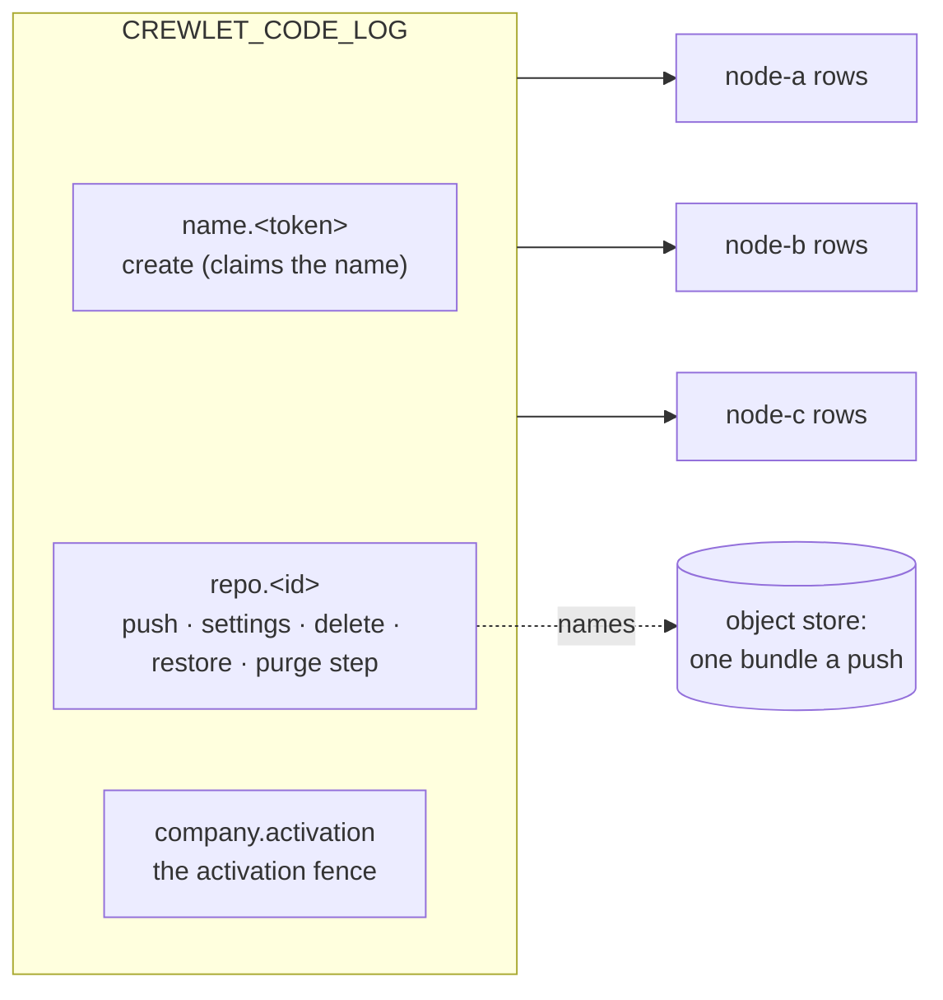
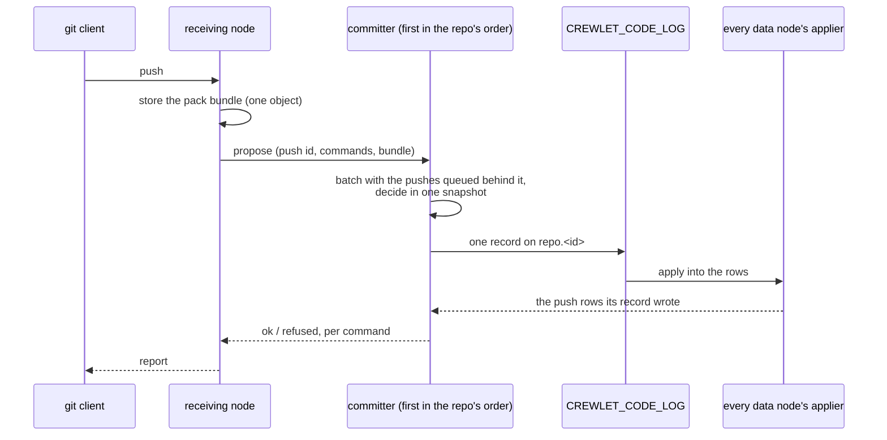
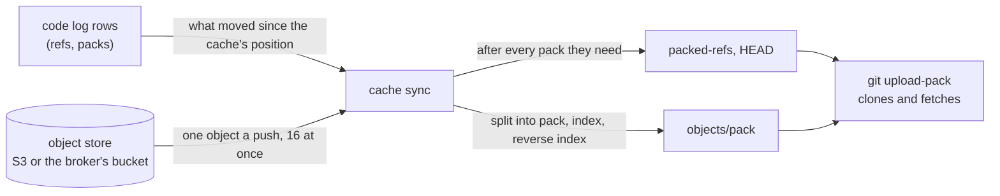

# Code Host

A company that sets [`code.native`](../getting-started/configuration.md#code)
hosts its git repositories in the engine itself, beside its own tracker and
knowledge base, and on the same footing: what a repository *is* — its
settings, its protection rules, its refs and the packs it holds — is
replicated state every data node keeps whole, and the bytes of each push are
one object in the [object store](object-store.md) the whole fleet shares.

It is not exclusive. The [GitHub](../integrations/github.md) and
[GitLab](../integrations/gitlab.md) integrations keep working beside it, and a
company may host some repositories natively and keep others on a vendor.

---

## What it is

A repository is **rows on the code log** (`CREWLET_CODE_LOG`), the state
log's fifth domain (see [Replication](../guides/replication.md)): every change
to a repository is one record on that ordered log, arbitrated at the broker,
and every data node applies it into its own identical copy of the rows. There
is no primary repository anywhere — no node's disk holds "the" repository and
no node's loss loses one.

The **bytes are not rows.** Every push stores **one object**: its pack
together with the index and reverse index the receiving node's git wrote for
it, back to back, named by a `code_packs` row. So a node that has to bring a
repository up to date reads one object a push and indexes nothing — the
index arrived with the pack — and a backup, the collector and the audit treat
a repository's packs exactly as they treat a project's files: a required
reference, kept while a live row names it (see
[One object per upload](object-store.md#one-object-per-upload)).

A git repository on a node's disk is never the record. It is a
[cache](#the-cache-on-a-git-node) derived from the rows, disposable and rebuilt
from them.

How it scales — git nodes adding reads, data nodes committing pushes, and what
sizes each — is [Scaling Out: Git nodes](scaling.md#git-nodes); turning it on,
declaring a repository and pushing to it are the steps of the
[Hosting Code](../guides/code.md) guide.

### What it does not do yet

This is the product's current shape, not a configuration choice:

- **Only people use git.** A person clones, fetches and pushes over HTTPS
  with their own API token ([Persons and their
  tokens](#persons-and-their-tokens)); a seat as a git user does not exist
  yet, so agents do not push.
- **There are no changes, reviews or checks** — no merge request, no review
  and no CI gate in front of a protected branch. A protection rule decides
  what a push may do to a ref, and nothing else stands in front of one.
- **Nothing compacts a repository.** Every push adds one pack, and a
  repository's packs are only ever removed with the repository.

---

## Declaring repositories

The repositories are declared in the company document, under `code.repos`,
and every activation makes the fleet match the declaration:

```yaml
code:
  native: true
  deleted_retention_days: 7        # 1..365; unset is 7
  repos:
    - name: nimbus-web             # the address it is cloned by
      owner: { unit: Engineering } # a unit (id or name) or a seat (handle) — exactly one
      default_branch: main         # unset is main
      description: The customer-facing web app.
      protect:
        - branch: main             # refs/heads/main, and nothing below it
        - branch: release/**       # every branch inside release/, never release itself
          allow_delete: true
        - tag: "v*"                # a tag rule: a tag never moves
    - name: infra
      owner: { seat: agent-cto }
      archived: true               # read-only: takes no push
```

- **`name`** — one host-name label: lowercase letters, digits and hyphens,
  starting and ending with a letter or a digit, at most 63. It is the address a
  repository is cloned by, so **renaming one deletes it and creates another**
  rather than moving it; declared twice, it is refused at the later entry.
- **`owner`** — exactly one of `unit` (its id, or its name where it has none)
  or `seat` (a handle), resolved against the same document's chart. An owner
  the chart does not have refuses the revision, naming the units or seats it
  does have.
- **`default_branch`** — what a clone checks out; any branch name git would
  take, and unset is `main`.
- **`description`** — one paragraph, at most 1 024 bytes of UTF-8.
- **`archived`** — read-only. A push to an archived repository is refused as a
  whole, and reading it is not; unarchiving it is setting it back to `false`.
- **`protect`** — at most 64 rules, each naming exactly one of a `branch` or a
  `tag` pattern, each pattern once.

At most 10 000 repositories one document — a typo guard two orders of
magnitude past a large company's, not a limit anybody is expected to meet. It
is an [admission rule](configuration.md#what-a-stored-revision-is-held-to), as
the retention's one-year bound is: a document written past either is refused,
and a revision already stored past one — admitted by a later build that raised
it — still applies, with a warning, because nothing the reconcile or the purge
does depends on either.

### What each change does at its activation

| You change | At its activation |
|---|---|
| Add a repository | **Created**, empty, with its settings. Two nodes creating one name land one repository: a create arbitrates on the name. |
| Change a repository's settings | **Settled**: one record carrying the new settings, stamped with the activation that wrote it. |
| Change nothing | **Nothing** but one fleet-wide record, the activation's fence (below) — never a record a repository. |
| Remove a repository | **Deleted**: it takes no push, and its rows and packs are kept. Declaring it again under its name within `code.deleted_retention_days` **restores** it: its refs and packs as they were, with the settings it is declared with now. |
| Leave it removed past `code.deleted_retention_days` | **Purged** by the `code-retention` duty, in bounded steps, and its name is free again (see [Deletion and purge](#deletion-and-purge)). |
| Turn `code.native` off | **Nothing is deleted.** A node whose native runtime is already running keeps serving the code host until its restart (see [A native backend changes at a restart](control-plane.md#a-native-backend-changes-at-a-restart)), and a revision without the host reconciles no repository at all. |

Only repositories the **configuration** manages are reconciled. A repository
somebody else created is never deleted for being absent from `code.repos`.

### Protection rules

A rule's pattern is a branch or tag name in git's own grammar, in which a
component of `*` matches one component, `*` inside a component matches any run
of characters but `/`, and a component of `**` matches any number of
components — zero or more in the middle of a pattern, one or more as its last.
A pattern with no `*` matches **only itself**: a rule on `main` protects
`refs/heads/main` and not `refs/heads/main/x`, which git's own `for-each-ref`
would also match. So `release/**` protects `release/1.0` and
`release/2/hotfix` but not a branch named `release` — a rule meant for both is
the two rules `release` and `release/**`. A glob has at most eight components
counting `refs/` and its namespace, which is what bounds the cost of asking it
about a ref.

What a rule does to a push of a ref it matches:

| Field | Unset | Set |
|---|---|---|
| `allow_force` | A push that moves the branch to a commit not descending from it is refused | Allowed. Refused on a tag rule: a tag never moves |
| `allow_delete` | Deleting the ref is refused | Allowed |
| `direct_push` | `persons`: a person may push to it | `none`: nothing pushes to it — the ref is frozen |

**Every rule that matches holds**, because two rules written for two reasons
both mean something: a ref matched by a rule allowing deletion and another
that does not cannot be deleted. A ref **no** rule matches may be force-pushed
or deleted by anybody who may push to the repository, so `crewlet validate`
warns about every repository whose default branch no rule protects — at the
repository's `protect`, naming the rule to add — and never fails on it. An
archived repository is not warned about: it takes no push at all, so nothing
can move or delete its branch until it is unarchived, and the revision that
unarchives it brings the warning back.

### The reconcile and the activation fence

Every data node reconciles `code.repos` at **every boot and every
activation** — a node in a [maintenance mode](../guides/retention.md#the-three-modes)
excepted, since it publishes nothing. Only a repository that changed costs a
write: one that is created, settled, deleted or restored. Nodes reconciling one
activation at the same moment race on each of those, and the log lands one
record on each — the others decide it again from that record and write
nothing. A refusal for one repository is logged and the rest are still
applied.

The reconcile runs **beside** the apply, not inside it: the apply reports the
revision applied as soon as it has asked for the reconcile, and the
repositories follow. At the most a document may declare, an activation that
creates, deletes or restores every repository takes 16–19 seconds on one node
before the last has its record — and a node still applying a revision
45 seconds after a peer applied it is [shed](control-plane.md#posture-what-a-lagging-node-does),
so how many repositories a company declares must never decide that. A newer
activation's reconcile ends an older one's still running, since the newer one
decides every repository again; a node that stops mid-reconcile logs
`code_repos_interrupted`, and its next boot reconciles.

Because the revision is already reported applied, a reconcile that leaves
something undone — an outcome the log did not answer, decisions refused while
the node was still catching up on the fence, a listing it could not read — is
**run again by the node**: five seconds later, then waiting twice as long after
each run in a row that leaves something undone, up to every five minutes, until
one applies, a newer activation replaces it or the node stops. Nothing else
would run it again, and no peer covers for a fleet of one. A run again costs a
batch read of the rows where nothing changed, and writes only what is still
missing. A name held by a repository the configuration does not manage, and a
declaration the code log refuses as written, are said at every run but never
run again for: no run changes them, and only a revision that does applies them.

Without an order between activations, a node applying an *older* activation
late would walk a newer one's settings back. So a reconcile first publishes
one **fence** record for its activation, and every node's copy of the rows
raises a single fence to it and never lowers it; every configuration record
an older activation decides afterwards is refused by every node, identically,
because the fence is derived from the log. Every decision a reconcile takes
waits for its own node to have applied its own fence first. So whatever an
older activation decided is either *before* the fence — in the rows the newer
activation decides from, where any difference it made is settled back — or
*after* it, and refused. That is what lets an unchanged repository cost
nothing: an activation that changes nothing writes its one fence record, and
reads every declared repository's row in one batch.

A node that finds a later activation already fenced logs
`code_repos_superseded` and decides nothing: it is applying a configuration
the fleet has moved past, and reconciles again when it applies the later one.

---

## One subject per repository

Everything that moves a repository's refs or packs, or governs them — a push,
a settings change, a deletion, a restore, a purge step — is a record on **one
subject a repository**, `crewlet.code.log.repo.<id>`. That subject is the
**arbitration unit**: two pushes to one repository contend at the broker and
exactly one record lands per round, and the loser decides again against the
winner's rows. One subject a repository rather than one a ref, because every
write on a repository changes its row too — its ref count, its bytes, its
version — so a subject a ref would never narrow a write's contention.

A **name** is claimed on its own subject, `crewlet.code.log.name.<token>` (a
bounded digest of the name), so two creates of one name contend there, where
two freshly minted repository ids never would. The activation fence has the
company's one subject.



---

## The committer

Because every push to a repository contends on its one subject, a
repository's pushes are **committed by one node**: its **committer**, the
first live data node in a rendezvous order of the repository's id, which every
node computes alike. A push received anywhere is asked of that node, which
takes the repository's pushes in order and puts every push waiting behind a
record in flight into the next one — **group commit**, without lingering for
more, up to 64 pushes a record. An idle repository pays one record a push and
a burst one record a batch. A batch is decided in one snapshot of the rows,
each push against what the ones before it did, and a push is answered `ok`
only from the row its record applied, never from the decision.

The live data nodes are the ones each node's view of the fleet's presence
names. The view hears a presence claim or release as it lands and lists the
fleet again then — see
[Coordination](coordination.md#who-is-in-the-fleet-asked-per-request) — so a
data node that joins is in every repository's order within about a second of
its claim, and a fleet started all at once agrees on every committer within
about a second of the last node's claim. A push received inside that second
may be committed by a node that has not yet heard its committer join: correct,
since the pushes still contend on the repository's one subject and the broker
decides between them, and short only of that push's group commit. A node
without `data` that has heard of no data node yet has nobody to ask, and
refuses a push, a fetch or a read as unserved until one claims. A committer
that stops without releasing its presence stays in the order until its lease
lapses, asked after the rest once it has gone silent — see
[Scaling](scaling.md#how-a-request-reaches-the-estate).

A push carries an id the receiving node minted, and a push id the repository's
history already holds is answered from its row — so a push asked twice, or of
a second node after the first stopped answering, is still one push. A
committer that stops, or answers nothing, hands each of its repositories to
that repository's runner-up in the same order, under the same push id. A node
in a maintenance mode commits nothing and refuses as a node that ran nothing,
so the next committer decides; while the whole fleet is in one, no push is
committed.

The path a push takes from the node that receives it:



A queue holds at most 1 024 pushes, and a batch has 30 seconds to land; past
either a push is refused `busy` undecided and the client pushes again (the
`crewlet.code.commit.busy` counter, in the
[metrics reference](../reference/metrics.md), says which).

---

## Limits

[`code.limits`](../getting-started/configuration.md#code) — the largest pack
one push may send, the largest file it may carry, and the most one repository
may hold — is read off the **deciding node's current revision** at every
decision, so a change holds from its activation with no restart. A repository
also holds at most 100 000 live refs, and a push moves at most 1 000 of them;
the refs it deleted within 48 hours are kept apart, up to another 100 000, the
oldest forgotten sooner past that — a node last synced before them reads the
repository whole, and so does a node whose last sync is behind more changes
than the repository now holds, since what is left is then fewer rows to read.
A deletion never counts against the live refs, and never refuses a push: a
push that deletes refs and creates others is judged on what it leaves, so at
the limit `git push origin :old new` — or a `--prune` push — goes through.

A push's ref updates must also fit the one record its committer writes for
it: about 1 MiB of them, as the code log spells them. A thousand plain refs of
the longest, 255 bytes, take under half of that. A ref whose characters the
log spells in six bytes each (`&`, `<`, `>`) costs up to six times its
length, so a push of some six hundred such refs of the longest reaches the
bound first. The receiving node measures a push's ref updates as it reads
them, with everything the rest of the push could add at its largest, and
refuses one past the bound before anything of it is run or stored.
[`crewlet code import`](../reference/cli.md#crewlet-code-import) cuts each
batch of refs it pushes by the same rule, so an import never meets it.

What a repository holds is its packs **as the pushes stored them**, and
nothing repacks them yet — which matters for a history that arrived in many
pushes rather than grew by them. A history [imported](../guides/code.md#import-from-github-or-gitlab)
in steps stores more than one pack of it: every step keeps whole the files it
touches whose earlier versions an earlier step stored. Measured on this
project's own history, 34 MB as one pack stored 68.5 MB in eleven steps and
78.6 MB in forty-two. Those bytes are what the object store holds, what every
git node serving the repository caches and what a cold sync downloads, so
size `repo_max_bytes`, the object store and the git nodes' caches for the
repository as it was pushed, not for the source it came from.

---

## Retention and history

Three horizons, each kept by the record that applies it inside its own
repository, never by a sweep:

- **Push history** — a push row is kept **181 days**, the same horizon as the
  company's [usage history](../guides/retention.md), so "what happened over
  the last half year" has one answer across the engine. A row names every
  ref its push named, refused ones too. A ref the engine refused for being
  longer than 255 bytes, or for not being UTF-8, is kept as much of it as
  fits in 255 bytes beside its length and a digest of the whole
  (`refs/heads/x… [60013 bytes, sha256 <32 hex>]`), so a ref nothing can ever
  name costs every node's history no more than one that could.
- **Ref tombstones** — a deleted ref is kept as a tombstone for **48 hours**,
  so a node bringing a repository up to date learns of the deletion — or
  sooner, oldest first, once the repository holds **100 000** of them. Each
  push's record always has room to forget as many old ones as it deletes,
  so a repository at that bound keeps every new deletion and forgets the
  oldest. A node last brought up to date before a forgotten deletion reads
  the repository whole: it re-reads the refs and keeps every pack it holds,
  and downloads nothing again.
- **A purge** — below.

### Deletion and purge

A repository removed from `code.repos` is **deleted**, softly: its rows and
packs stay, and declaring it again under its name restores it. Once it has been
deleted longer than **`code.deleted_retention_days`** (1 to 365 days; unset is
7, the trim's default `min_age`, so a deletion is undone from the same window
the log can replay), the fleet-singleton `code-retention` duty purges it (see
[Singleton duties](seat-ownership.md#singleton-duties)):

- every 15 minutes, it finishes every purge already begun — whatever the
  retention, since a purge has no undo — then purges the repositories deleted
  longest ago first;
- each purge is a sequence of bounded **steps**, each one record removing a
  bounded part of the repository's rows, and the last leaves only a
  **deletion marker**, which drops every later record about the repository on
  every node, for ever ([the deletion gate](../guides/replication.md#applied-is-not-permanent));
- every data node applies every step on its one write lane, so the duty paces
  itself: after each step it waits twice the step's duration, a third of the
  lane, and a pass stops after a minute of steps and the next resumes from
  the rows;
- once the purge has applied on the duty holder's own rows, the name is free,
  and a name the current configuration still declares — re-added while it
  purged, which the reconcile logs as `code_repo_awaits_purge` — is created
  again at once;
- a purge **begins only on a node that serves the fleet's current
  configuration** — the revision the [activation pointer](control-plane.md)
  names, applied on that node. The duty purges by the retention its own node
  serves, and a purge has no undo, so a revision that lengthens
  `code.deleted_retention_days` to save a deleted repository is never defeated
  by a holder that failed to apply it: a node behind the fleet's revision, or
  one whose fleet has activated nothing yet, declines the duty and gives it
  back, logging `code_retention_duty_declined` with the reason and both
  epochs, and a node that has applied the revision takes it at its next tick.
  A pass that outlasts a renewal of the duty's lease is asked the same before
  the renewal, and stops there if its node has fallen behind. Being behind is
  a fault only once the lag is
  [confirmed](control-plane.md#where-the-gate-sits) — an apply of the
  revision failed on the node, or it has been behind longer than propagation
  explains: a node merely applying an activation, or starting up before its
  reconciler has ticked, declines quietly and asks again a reconcile interval
  (15 seconds) later, so a restart or a configuration write costs a purge
  seconds. Declining costs a purge at most one tick (15 minutes) on a fleet
  with a current node; on a fleet whose only worker data node is stuck, every
  purge waits for its apply to succeed.

A push to a repository that is not there to take it is refused
`repo_deleted`, and what follows the code says which of four states the
committer found, because each has its own remedy:

| State | What the push is told |
|---|---|
| deleted | declaring it again in `code.repos` restores it as it was, until its purge, which may begin from the instant named: the deletion plus `code.deleted_retention_days` on the committer's current revision — the earliest the duty begins it under that revision |
| being purged | the purge cannot be undone; once it completes, declaring the name creates a new, empty repository |
| purged | it holds nothing; declaring its name creates a new, empty repository |
| an id no repository had | it does not exist |

The packs a purged repository named are no longer named by any row, so the
[object collector](object-store.md#collection-and-audit) deletes them a day
later. The code log itself is trimmed like every other log (see
[Retention](../guides/retention.md)), and a node whose copy of it is out of
service declines the duty rather than purge from rows the fleet may not agree
with.

---

## The cache on a git node

A repository lives as rows on the code log and as pack bundles in the object
store. A node that serves git keeps a **cache** of each repository it is asked
for: an ordinary bare repository in a directory of the node's own, from which
git's own `upload-pack` answers clones and fetches. The cache is disposable:
nothing in it is the only copy of anything, and deleting it costs nothing but
the time to download it again. The engine's [backup](../guides/backup.md)
never copies it, and its directory carries a
[`CACHEDIR.TAG`](https://bford.info/cachedir/), so a backup of your own run
with `--exclude-caches` — tar, borg and restic all take it — leaves it out
too; without that option they copy it like any other directory. The
directory is the cache's alone: a node refuses one that already holds
anything without that tag — a volume's own `lost+found` aside — because it
empties its own scratch space there at every boot, and refuses one another
process is using.

A cache is a **function of the rows**: its refs are exactly the repository's
refs at the log position it records, its packs exactly the repository's packs
there. Nothing but the cache itself writes it — its sync, the adoption of a
push's pack once the push's row has applied, and its background index — and a
push never does: a push is received in a throwaway scratch repository that
reads the cache through an alternate, so an object nobody committed can never
appear in a cache, where any reader could fetch it by id.



**Warm and cold.** After a push, every other node brings its cache forward by
a **delta** the next time somebody fetches from it. A delta downloads only
what changed — usually the push's one pack — and rewrites the repository's ref
file, and that rewrite grows with the refs the repository holds: a delta takes
about 7 ms in all at a thousand refs, and about 50 ms at the 100 000 a
repository may hold. The node that received the push does not download it
back: it links the pack its own git wrote into its cache once the push's row
has applied. A **cold** cache — on a node that has never served the
repository, or whose budget evicted it — downloads every pack: sixteen at once
for one repository and at most thirty-two at once on the node, largest first,
so a second repository's cold sync never waits behind the first one's longest
downloads. Each is verified against its SHA-256 and installed as the receiving
node's git indexed it — a push stores its pack together with its index, so no
other node spends a core re-indexing it, and a cold sync is bound by the
object store rather than the CPU. S3 answers each request in about 100 to
200 ms, and from a fake answering that late a cold sync read about 75 to 150
small packs a second: a repository of 10 000 pushes — one pack each, since
nothing compacts them yet — comes up in about 70 to 130 seconds before its
first request is answered (about 22 seconds from the same fake answering in
30 ms).

The first fetch of a repository after a node restarts reads the whole of its
rows once, reusing every pack the cache already holds, which is what makes a
cache exact again after a crash, a full disk or a stray file. A cache never
goes back because one data node's copy of the rows is behind; it goes back only
when the code log did — recreated, or restored from an older backup — which the
node notices, reading every repository whole at its next sync.

**The budget.** A node holds its caches to a byte budget —
`git.cache_max_bytes`, or a share of the cache's volume derived at every boot
([`git`](configuration.md#git)) — counting everything they hold on disk: every repository's packs, indexes and refs, and the
downloads and pushes in flight. Past it, the repositories used least recently
are evicted, and nothing else evicts one: a repository nobody fetched over a
weekend is still there on Monday, brought forward by the rows that changed
rather than downloaded again. Each repository's last use survives a restart,
so one read all day and rarely pushed to is not the first evicted after one.
A repository a request is reading is never evicted — one larger than the whole
budget is still served, logged as `code_cache_over_budget`, and evicted as soon
as no request holds it. Every git node that serves a repository caches it
**whole**, so size the volume for the repositories it serves, not the company's
total. A dedicated disk is worth it, because a cold sync writes everything it
downloads at the speed the object store delivers it. Size the node's memory
for its largest repository too: the background index below needs about 1 000
bytes of memory for every object of a repository to write its bitmap, and a
repository past what the node can give it is indexed without one.

**Background indexing.** With one pack a push, git would search pack after
pack for every object. So once a repository's packs have stood still for ten
seconds — or the oldest has waited ten minutes, for one pushed to without pause
— a git node writes it a multi-pack index with a bitmap, and a commit-graph, so
a clone counts its objects from the bitmap rather than walking the history. The
bitmap carries git's lookup table, so a request that opens it reads only the
bitmaps it needs rather than every commit's: over a gigabyte, the pack-objects
run that answers a blobless clone's lazy fetch of one blob takes 5.0 ms with
the table and 6.2 without, and the one that answers a fetch of one new commit
8.2 ms rather than 9.0 — the git process alone, which is part of what such a
request costs beside its exchange, its sync and its checks. The node writes
them again once 64 more packs have gathered beside them, at most every ten
minutes and at most a tenth of a core's time for any one repository. A
run, on one core, takes 16 to 30 seconds a gigabyte of packs, more a gigabyte
the larger the repository. Runs take at most half the node's cores, one each,
in a slot that is free or not at all, so they never make a push or a fetch
wait; and only as many run at once as a quarter of a gibibyte a core holds
beside the largest, so a node that has just joined does not index all its
largest repositories at once.

**The commit-graph first.** A copy the node has just read whole — after a cold
sync or a rebuild, or on a node that has just joined — gets its commit-graph at
once: ahead of every other repository's index, without waiting for its packs
to stand still, and in a slot of its own while the background work holds the
others — the one kept for `crewlet code verify` included, for the graph alone
and never for the index and bitmap the copy may be due for after it. Without
one, git walks a repository's commits by date, so a push of a
commit dated before its parent — a clock that is behind — walks every commit
of the history in each of its checks; with one, the engine's checks go by
generation and only git's own connectivity check still walks by date (see
[A push, end to end](#a-push-end-to-end)). The graph is one walk of the
commits, about 3.4 seconds over a gigabyte of source history, so that window
lasts seconds rather than as long as the node's queue of other repositories'
bitmaps. Reading a copy whole does not write the graph itself: the request
it was read for would wait those seconds to spare the rare skewed push the
same.

**What the cache writes beside the packs.** Two kinds of file in a
repository's cache are the node's own work rather than the rows': the
multi-pack index — a full read's, written before it answers once the
repository holds 256 packs, and the background indexing's, with its bitmap or
without one — and the commit-graph. Each lives inside the repository's own
directory, so it counts against the budget, leaves with the repository when it
is evicted and is written again over a rebuild's packs; each is dropped before
a pack it may name leaves the directory, so no git process reads an index that
names a pack that is gone; one the node has not written since it started is
held to its checksum before it serves, and every file of a copy is checked
again behind the serving. Anything else in the directory that is neither one
of them nor the repository's own files is moved aside the next time the node
reads the repository whole — and so is a symbolic link, or anything but a
regular file, at one of their names or at the repository's own `HEAD`,
`config` or `packed-refs`, whatever it points at. git reads the file a link at
`config`, `packed-refs` or one of those files leads to, outside the directory.
A link at `HEAD` it refuses outright, the copy then being no repository to it,
so every request on the copy fails until the link is gone — unless the link's
own text begins `refs/`, which git reads as the ref named there, or, where the
rest of that text climbs back out of `refs/`, as the file it leads to.
`crewlet code verify` names any of them. Each is declared once in the engine,
and this table is that list; the steps are what
`code_cache_maintenance_refused` and its counter name when the node's memory
refuses one.

| Declared file | Its files, in the repository's directory | Written by | When a pack leaves |
|---|---|---|---|
| `midx`, the multi-pack index | `objects/pack/multi-pack-index`, `objects/pack/multi-pack-index-<checksum>.bitmap`, `objects/pack/multi-pack-index-<checksum>.rev` | a full read: `index`; the background indexing: `bitmap`, `index` | dropped first |
| `commit-graph`, the commit-graph | `objects/info/commit-graph` | the background indexing: `graph` | dropped first |

**Memory.** Every git process a node runs over a whole repository holds memory
in proportion to the repository's objects, measured on git 2.43 over a source
repository's history: about 1 000 bytes an object for the bitmap (702 over
three million objects, more the larger the repository), 80 for the index
without one, 56 for the commit-graph, 192 for `crewlet code verify`'s
connectivity check, and a clone about 240 more than the 224 MiB its git
transfer slot keeps for it — the clone of a repository with no bitmap walks
its whole history. A git node reads its memory — the least of the machine's
and any cgroup limit set on its container — and keeps 224 MiB of it for every
git transfer it admits at once and 896 MiB for each core its git runs on, for
the store, the broker, the engine and its reads. Both count only the cores the
memory backs at 2 GiB a core: a container limited in memory and not in CPU sees
its host's every core, so a node of 64 cores and 16 GiB admits 32 transfers
rather than 256, and runs as the eight-core node its memory makes it. What is
left is the budget of its background work, and every step of it — the
bitmap, the index without one (a cold cache's included), the commit-graph, a
connectivity check — is held to the budget together with everything in flight,
each charged its own figure an object and room beside it for one clone of the
same repository. A step whose charge alone is past the budget never runs on
the node, and the repository is served without it: a bitmap refused leaves
the repository indexed without one — its pushes keep joining an index, so
lookups stay fast, while a clone walks its history — keeping the bitmap the
node wrote while it could until 256 packs have gathered outside it. Each step
refused is logged once as `code_cache_maintenance_refused` with its charge
and the budget and counted by `crewlet.code.cache.maintenance.refusals`, and
a refused bitmap raises the [`code_maintenance_refused`](../reference/alarms.md)
alarm for as long as it stays refused. A connectivity check the budget cannot
hold is refused to whoever asked for it, and one that the work in flight
leaves no room for is busy, as a full lane is. A step that fits the budget
alone but not beside what is running waits for it, and the first such
repository in the queue is given the room it needs: nothing smaller starts
in its place.

So **a git node's ceiling on a repository it keeps a bitmap of is bounded by
memory — about 1 240 bytes an object, with the clone beside it — before it is
bounded by disk**: at about three million objects a gigabyte of a source
repository's packs, nearly 4 GB of memory for each gigabyte of packs, and some
75 GB for the 20 GiB a repository may hold by default, which few nodes have.
A node of 2 GiB a core leaves a quarter of a gibibyte a core (1 GiB on four
cores: bitmaps of repositories of up to about 860 000 objects, indexes of up to
about 3.3 million); 16 GiB on four cores leaves 9 GiB: bitmaps of up to about
7.7 million objects, indexes of up to about 30 million. Give the node the
memory: it reads it again every ten seconds, so a container resized in place
is held to its new limit at once (`code_cache_memory_changed`), while the git
lanes keep the sizes they took at boot until a restart. An operator's
`git.max_transfers` is kept as written rather than sized to the memory, so a
figure set by hand can leave the background work nothing: once its
transfers' 224 MiB each reach the memory less the 896 MiB of each core it
backs — as little as 56% of the transfers the memory holds at 224 MiB each,
where the node has a core for every 2 GiB or more. Lowering or unsetting
it, or memory past what the node keeps, gives the budget back; a restart
alone does not. A node whose memory cannot be read at all refuses to serve
git rather than guess it.

The budget bounds the background work and keeps room for one clone beside
each of its steps; it does not bound the clones themselves, which take the
node's git transfer slots — four a core and no more than one for each
512 MiB of its memory, each kept 224 MiB — whatever the repository. A node
that serves repositories of millions of objects to many cloning clients at
once needs memory for each clone in flight: about 240 bytes an object of the
repository, past the 224 MiB.

A cold cache of a repository
holding 256 packs or more gets an index — without the bitmap — before its
first request is answered, since at that count it saves the request more than
it costs, when the budget holds it beside the work in flight (otherwise it is
logged as `code_cache_round_index_held` and left to the background); the
bitmap follows when the background indexing reaches the repository, which on
a node that has just joined comes after every repository with more packs
waiting. A cache without either is slower, never wrong.

**Damage and repair.** A damaged cache is repaired under the request that
found it — a clone, a fetch, a push, or the node's own sync of the repository
— and the request then served from the repaired copy; any number of requests
failing on one damaged copy cost one repair. How depends on the damage:

- **Its indexes, before they serve.** Every file git reads to find an object or
  a parent — the commit-graph, the multi-pack-index with its bitmap and reverse
  index, and each pack's index and reverse index — is held to its own checksum
  (the one git writes at its end) before a copy the node's current process did
  not write answers its first request, and again whenever such a file is
  replaced. git checks none of them when it reads, and a damaged one answers
  wrong without a word: a commit-graph naming the wrong parent lets a push
  force a protected branch as though it were a fast-forward (git 2.55 and
  later answer from the graph), a pack index naming the wrong offset makes a
  clone ship the wrong object, a bitmap missing objects makes every clone
  incomplete. A derived file that fails is dropped and written again at once
  over the same packs; a pack whose index fails is fetched again — one
  download, renamed over its files in the same copy, so a request already
  reading the pack is not cut off. What the node's current process wrote, or
  has checked since, is not read again until it changes.
- **Every byte, behind the serving.** Each copy a node uses is read whole
  again — every pack against its own checksum, and every index file — once
  after its first request when a previous run of the node left it (its packs,
  and nothing that request's own check had just read), then once a day while
  it is used, and at once when a git process reports a pack or an object of it
  unreadable or dies of a crash. That is the one way two kinds of damage are
  ever found: a damaged pack is sent to clients byte for byte (git's pack
  reuse copies what the bitmap names without reading it, so no git on the node
  notices while every clone of it fails at the client), and a file damaged in
  place after it was checked — a bitmap missing an object fails every clone of
  its branch — is reported by nothing. What fails its checksum, or what the
  disk cannot read, is fetched again or dropped as above, one download a pack;
  a pack fetched again for its body alone keeps the multi-pack-index, bitmap
  and commit-graph built over it, since it is the same pack byte for byte. A
  download that fails leaves the copy serving as it is and is tried again ten
  minutes later, then twice as long each time up to a day
  (`code_cache_pack_reinstall_failed`). It runs one copy at a time on a node,
  a core and a read slot a 64 MiB piece, and reads nothing of a copy nobody
  uses; scrubs go in the order of their evidence — one a failing request
  asked, then one a report asked, then a copy's first, then the daily ones —
  and a request's or a report's stops a first or daily scrub at its next
  piece rather than waiting behind it. A request on a node whose every other
  read slot is busy waits for one piece at most: 51 to 59 ms from the page
  cache, and the piece read at the volume's own throughput when the copy is
  cold — about half a second at a gp3 volume's 125 MB/s baseline. A report
  within an hour of a scrub that found nothing asks for no other, whatever was
  written to the copy meanwhile; one within an hour of a scrub whose findings
  still wait for their repair — a download the object store refused, say —
  asks for none either, since that repair is its answer; past that hour such
  a report scrubs the copy again, at most once an hour, so damage that landed
  elsewhere in the copy meanwhile is not left to the daily scrub.
- **Its shape.** The node will not run git in a copy that is not the shape the
  engine writes — its config edited, a `commondir`, an objects directory that
  is not its own, or an alternates file planted in it (by a disk, or by
  anything outside the engine; a copy's objects come only from its own packs,
  so an alternates file there is refused whichever request meets it). Nothing
  of what it holds is lost, so the copy is put right **in place**: read whole
  again from the rows in the same directory, which rewrites its config, moves
  aside whatever the engine never writes there, and reuses every pack it holds
  — no download, and never held back, since it costs a read of the rows. Only
  a copy that read leaves still refused — something that keeps writing into
  it, or a filesystem that does not keep what it is given — is rebuilt as
  below.
- **Its packs.** When a request's git finds a pack or an index it cannot read,
  or an object a row names that no pack holds, the copy is put right **in
  place first**, under that request. The node reads it whole again in the same
  directory, holding every index file to its checksum whatever it checked
  before — at most once an hour while that finds nothing, so a busy
  repository's requests failing on one damaged pack cost one such read, not
  one each — and fetches again, one download each, every pack whose index
  files fail, that the copy has lost or holds at another size, or that git
  named —
  git 2.55 and later name the pack of a corrupt object, which the node hashes
  against what the push stored before it believes it. A damaged
  pack body no index shows is found by scrubbing the copy at once for that
  request. Only when neither finds anything to fetch again is the repository
  read whole from the rows and the object store into a new directory beside
  the damaged one, which replaces it once it is complete — linking every pack
  the scrub found whole rather than downloading it, so a copy whose rows are
  the damage costs no download at all. Requests already reading the old copy
  finish on it. A request whose git began before the node last wrote a repair
  into the copy — a pack fetched again or put back, a derived file dropped,
  before the request's own repair or while it runs — is not repaired any
  further: it may have failed on what the repair replaced, so it is run once
  more over the copy as it stands, once any repair still running on it has
  ended, and only damage it meets again is repaired. A pushed pack is no
  repair: it replaces nothing a failing request read, so a repository pushed
  to all day has its damage repaired like any other.
- **Its derived files.** The multi-pack-index git builds over the packs (with
  its reverse index and its bitmap) and the commit-graph are DERIVED files,
  written on the node from the packs it already holds, so damage git names in
  them alone is put right **in place**: the damaged files are dropped — the
  index, the graph, or both where git's message names a chunk-format file
  without saying which — and the node writes sound ones over the same packs
  at once: no download, no new directory. That happens whenever **any** git
  process on the node names them damaged, whether or not a request failed:
  git reads around most damage to a derived file — it warns, answers from the
  packs and walks by date, slower — and the request that got its answer never
  looks at the warning, so every git run is reported to the cache, the
  node's own background indexing included (writing an index over a damaged
  one fails every time, and its own warning is what has it dropped). A run
  that merely reported damage takes nothing out of service: the copy keeps
  answering while a sync of its own, with no request waiting, drops the files.
  Two things hold it back: a file the node wrote after the reporting process
  began is kept — that process may have read the file it replaced — and a
  check of the copy defers the drop until it ends, so a check reports what it
  found rather than a repair made under it. A derived file named damaged again
  within a day of its last drop for damage — whatever the node wrote of it
  between, its own ordinary rewrites included — is dropped and left to the
  ordinary schedule rather than written again at once, so a disk that keeps
  damaging what is written to it costs one rewrite at once a day and the
  ordinary schedule's after it rather than a loop
  (`code_cache_derived_damaged_again`). A clone over an index whose positions
  are damaged makes git die `invalid MIDX object position, MIDX is likely
  corrupt` (every git at the node floor; one older than 2.47 crashed there
  without a word) as it starts building the pack, after the answer's first
  line — so a fetch's
  answer starts only once its pack does, and a fetch whose git dies before
  then has shown the client nothing and is run again, over the repaired copy.
  Only damage that survives the drop — a pack the index named is itself
  damaged — falls through to a pack rebuild above. Before, such a clone failed
  with `aborting due to possible repository corruption on the remote side` on
  every clone of the copy until an operator repaired it.

Damage is read from git's own report of each failure, by the FORMAT of the
message — the sentence git's source fixes — and never by its words. Git
repeats the text of a request line it refuses in the message it dies with, so a
request quoting `is corrupt` would, if the node read the words, have it read
the repository whole again from the object store; the format carries none of
the request's text, so no request can name damage. Every git process the node
runs reports to it this way, the ones git starts itself included, so a fetch
whose own git meets damage before its answer begins — an object the fetch
names that git cannot read — is repaired and served like any other request.
One damage git 2.56 names only in words — a packed object whose header is
wrong, reported as a bare sentence with no format of its own — is not taken at
its word either: the node hashes the pack the sentence names against what the
push stored, and fetches that pack again only when they differ. Git 2.55
reports the same sentence with a format of its own, and the pack it names is
held to what the push stored the same way, so the repair fetches that one
pack.

A rebuild that does not end the failure is not repeated at once: the damage is
then in the object store or in the rows rather than in the node's copy, and
another rebuild would read the same bytes. So the next attempt waits ten
minutes, each one after it twice as long, up to a day; a cache holding exactly
what such a rebuild read is not rebuilt again for a day unless something writes
into it — and a copy still refused for its shape always has, so only the
doubling wait holds it back; and every refusal is counted, and logged as
`code_cache_rebuild_refused` at most once every ten minutes a repository. A
pack the object store has lost — once a read at the log's head confirms a row
still names it — or holds damaged fails the sync naming the pack, and the
collector's daily audit raises the [`objects_missing`](object-store.md#alarms)
alarm for the same object.

**Checking a copy.** An operator asks a git node to check its copy of a
repository against the rows — every pack hashed as the bundle its push stored,
every multi-pack-index, bitmap and commit-graph held to its own checksum (the
one check that names a damaged bitmap: no git command can), the refs against
what was written, git's own connectivity check — and, asked
to, to repair what it finds ([`POST
/code/repos/{name}/verify`](../reference/api-endpoints.md#post-codereposnameverify)).
Where everything it found is the copy's own directory out of place — a file
the engine does not write there, a fixed file edited or replaced by a link, a
pack no row names, a shape git is refused in — it reads the copy whole IN
PLACE, as a shape a request meets is: every pack, the multi-pack-index, its
bitmap and the graph kept, nothing downloaded. Damage — a pack missing, at
another size or not its row's bytes, an index failing its checksum — is
rebuilt into the next copy, and so is whatever the read in place leaves —
something writing into the directory as the node puts it right, a shape among
it — linking in every pack the check found whole so the rebuild downloads only
the rest: a rebuilt copy has no index, bitmap or graph until the node writes
them again, minutes to hours of slower clones of a large repository, which a
directory put right in place never costs.
The sync that first brings the copy up to date repairs nothing for a check: damage
its own git meets there is the check's first finding, repaired only when the
check was asked to repair, so a check never hides what it was asked to name —
and an index file that sync's own checksum check found damaged and put right
(the copy's first sync since the node started) is named first too. The read in
place is the check's in the same way: what its git meets is the second check's
first finding and is rebuilt under the operator's repair, never left to the
repair a request's failure asks for, which would download every pack again and
can be held back by how recently the copy was last rebuilt.
A check reads every byte of the copy, so it runs on the node's own time — the
request that asked for it is answered in place when the check ends within a
quarter of a second, a small copy's, and otherwise the check is read until it
ends — and it is **admitted
before it reads anything**: it holds a slot of the maintenance lane — the one
the background indexing leaves free — and its connectivity check's memory from
its first read to its last, and a node with neither free refuses it at once
rather than after reading the repository. Each check pass is **bounded by what
the copy holds** — about 1.1 seconds a mebibyte, against a measured 9 ms,
nearly all of it git's connectivity check — and ended there, so a check wedged
on a disk holds neither its slot nor the operator who asked; the node says
when it ends the pass running, and a client waits by that. It checks only a
copy the node holds: one it never served has nothing to check, and building one
would be a download of the whole repository that evicts a warm one — so a
check goes to the git nodes that serve the repository.

**What to watch.** `crewlet.code.cache.bytes` against the budget,
`crewlet.code.cache.repos`, `crewlet.code.cache.sync.duration` by `kind` (full
syncs dominating is a cache too small to stay warm),
`crewlet.code.cache.rebuilds` by `reason`,
`crewlet.code.cache.rebuild.refusals` by `rule` — rising at all, damage no
rebuild repairs — `crewlet.code.cache.checks` by `outcome`, `file` and
`trigger` — any `damaged` is a disk losing data, or something outside the
engine writing into the cache, and `damaged` under `file=pack` or
`trigger=scrub` damage only the scrub could have found —
`crewlet.code.cache.reports` by `part` and `outcome` — `queued` rising is a
disk losing data under the cache, `again` one that keeps losing it, `crash` a
git process dying on something in a copy — and `crewlet.code.cache.maintenance.refused`, above zero a
repository whose bitmap the node's memory cannot hold
([metrics reference](../reference/metrics.md)).

---

## Persons and their tokens

A person reaches a repository with git's own smart HTTP at
`https://<the API's address>/git/<name>.git`, on the node's `api.port`, and
with the credential they already have: their own Tier A API token, given to
git as the **password** (git asks for it, or a credential helper answers —
[`crewlet code credential`](../reference/cli.md#crewlet-code-credential) is the
engine's own, reading the token from the environment; the user name is
ignored). There is no second credential for git — no SSH key and
no deploy token — because the token is already how the engine knows who a
person is, and a second identity system would be one more thing to revoke and
audit ([ADR-0037](https://github.com/crewlet/crewlet/blob/main/adr/0037-a-person-reaches-git-with-their-own-bound-token.md)).

- **A token bound to a human seat pushes as that person** — the seat whose
  `contact.crewlet_operator_id` names the token. That is the same binding the
  dashboard's writes and an assistant's operator tools go by, and git is the
  third way a person acts beside them.
- **A token bound to nobody fetches only**, and so does every caller of a
  disabled `api.auth` guard: a push is refused at its first request, before
  anything is sent, saying the token is not bound to a person.
- **Every push is recorded** as one `operator_acted` event with transport
  `git`: the token as the actor, the person beside it, the repository and
  what became of the push — refused ones included. A fetch is a read and is
  not.
- **`/git/` and `/code/` are always guarded**, reads included, whatever
  `api.auth.allow_anonymous_read` opens: a repository is the company's source.
  The token may arrive as git's Basic password on `/git/` and on no other
  route. Neither prefix is ever on the [public
  listener](../reference/api-endpoints.md#which-listener-serves-what) — it
  serves outside parties, who hold no operator token.

git is served by every node whose `node.roles` name `git` (an undeclared node
has every role), once the company sets `code.native`: the node builds the code
host at boot, or at the activation that brings its native runtime up, and
refuses to start one on a git older than 2.55 (the node floor), naming the git it
found; a person's git, CI's or a sandbox box's needs 2.40 or newer. A node
without the role answers every `/git/` request `404`. Every node answers the
code host's REST reads
(`GET /code/repos…`, [API Endpoints](../reference/api-endpoints.md#the-code-host-git-and-code)).
The [Code guide](../guides/code.md) walks through turning it on, declaring a
repository, binding a token and the first push.

---

## A push, end to end

A person pushes with git's own smart HTTP protocol, presenting their own API
token as the password. The engine checks everything it can before it stores a
byte, receives the push with real git in a repository of its own, stores the
push's one pack, and has the repository's committer decide it — and tells git
a ref moved only once the record that moved it has been applied.

```mermaid
sequenceDiagram
  autonumber
  participant G as git push
  participant H as code host
  participant S as scratch receive-pack
  participant P as proc-receive hook
  participant O as object store
  participant C as committer
  participant L as code log
  G->>H: GET info/refs (receive-pack)
  H->>L: barrier: the repository's refs, now
  H-->>G: the advertisement — or a refusal git prints
  G->>H: POST git-receive-pack (commands, pack)
  H->>H: read the commands; refuse what needs no object
  H->>L: sync the cache through the barrier
  H->>S: receive-pack in a scratch repository
  S->>P: the ref updates git accepted
  P->>H: relayed over the node's hook socket
  H->>H: forced updates, blob sizes, new commits
  H->>O: upload the push's one pack bundle
  H->>C: propose the push
  C->>L: one record, arbitrated on repo.<id>
  L-->>C: applied — or durable, not yet applied
  C-->>H: the push's row, or pending
  H->>L: pending: read the push's row again, up to a minute
  H-->>P: ok or ng per ref
  P-->>S: the report
  S-->>G: what git prints
```

**The advertisement is read at the log's head.** Every answer that names a
ref — the refs a push or a protocol v0 clone is shown, a protocol v2
`ls-refs` — is read through the code log's barrier, so a node cut off from
the fleet answers 503 rather than an old head. An object fetch names ids that
mean the same bytes on every node, so it takes what the node's cache holds; a
fetch of an object the node has not seen yet — the client learned of it from
a node further ahead — makes the node read the log's head once before it
answers. The host does not offer protocol v2's `ref-in-want`: a client
offered it fetches by ref name, and git's own server and client disagree on
the order of a shallow fetch's answer when it does, so every
`git clone --depth=1` failed with
`fatal: expected 'packfile', received 'shallow-info'`. A client lists the
refs and fetches the ids it was shown instead, as it does from any server
that does not offer it.

**receive-pack never runs in a cache.** git moves a push's objects into the
repository it runs in *before* any hook can refuse them, so a push received
in a node's cache would leave a refused push's objects there — fetchable by id
from that one node, and a base a later push could build on that no other node
holds. So a push is received in a throwaway **scratch** repository whose one
alternate is the cache, and its pack enters the cache only once its row has
applied ([ADR-0036](https://github.com/crewlet/crewlet/blob/main/adr/0036-a-repositorys-refs-move-only-by-records-and-a-cache-is-derived.md)).
The scratch is removed when the request ends, and a node that crashed with one
open sweeps it at its next boot.

**The hook is the engine's own binary.** receive-pack hands its ref updates to
the engine through a `proc-receive` hook, and that hook is `crewlet code hook
proc-receive` — this binary, started once a push, which relays them over the
node's hook socket and exits. Go initialises every package a binary links
before its first statement, so the engine's own initialisation is on every
push's path: measured at about 14.5 ms a start on a 4-vCPU machine
(`BenchmarkTheHookStartsUp`), nearly all of it the packages' initialisation,
beside about 2 ms for receive-pack's own start — a few per cent of a push that
also stores a bundle and waits for its record. What the engine's own packages
do at initialisation is held small by a test of their init trace, so a table a
package could build at first use is not built on every push.

**Checked before it is stored.** A push naming more than 1 000 refs, a token
bound to nobody, an archived or deleted repository, a deletion or a direct
push a protection refuses — each is refused before receive-pack runs, and
nothing is stored. A forced update of a ref a protection keeps from forcing,
and a blob larger than `code.limits.max_blob_bytes`, are known only once the
objects are, so the hook checks them — and refuses the push before uploading
anything. A ref keeps the first refusal it meets: a force-push of a protected
branch is answered `protected_force` even when its pack also carries a blob
over the limit, and a push every ref of which is refused by then is not
scanned for blobs at all. A blob over the limit refuses every ref still
standing, since the pack is stored whole or not at all, and names the path any
ref of the push reaches it by. Only a push that passes every check is
uploaded, as **one** object: its pack with the indexes the receiving git
wrote.

**A clock that is behind.** git walks a repository's commits newest first by
date wherever it has no generation number to stop on, so a commit dated before
its parent — a laptop's clock that is behind, a `GIT_COMMITTER_DATE` — is a
reason to walk the whole history. The engine's own checks of a push walk by
generation once the node has written the repository's commit-graph, which it
does first for every copy it reads whole, so they cost a few milliseconds
whatever the commit's date; git's own connectivity check in receive-pack
still walks by date, reading the graph. Measured over a gigabyte of source
history (455 680 commits), such a push is 0.37 s of the node's time with the
graph against 0.07 s for any other push, and 6.9 s in the seconds after a
node has read the repository whole and before its graph is written. No walk
is refused for what it takes — each is given 11 µs for every object the
repository holds besides what the push itself is given. The person's own git
pays too: a clone with no commit-graph of its own spends about 4.8 s over the
same gigabyte checking that such a push is a fast-forward, and
`git commit-graph write --reachable` in the clone spares it.

**The commands are read as receive-pack reads them.** Every check before
receive-pack runs is a check of the ref updates the engine read from the
request, and receive-pack moves the ones *it* read — so the engine reads them
by git's own rules: an object id in either case, the capabilities whichever
line asks for them, every ref to the end of its line, and the commands up to
the packet that ends them. A client built by hand that writes its ids in
capitals is held to every check git's own client is. A **push certificate** —
a signed push — is refused before anything runs: the engine never advertises
one, so `git push --signed` stops in git itself, but receive-pack acts on the
ref updates a certificate names whatever it advertised.

**An `ok` means the row applied.** The committer answers with the push's row
once its record has been applied. A record that is durable on the log but not
yet applied on the node that answered is **pending**: the host reads the
push's row at once and again — after a quarter of a second, then at
doubling intervals up to two seconds — for up to a minute (the state log's
own stall grace), and answers git from the row if it appears. It never
reports a pending push as
`ok`, because a durable record can still be dropped — by an eviction, on
every node — and then the push landed nowhere. While a push waits, the hook
prints a line every five seconds naming the step it is on, so a balancer's
idle timeout does not cut a push that is merely waiting.

**What a refusal names.** A push answered `pending`, `unknown` or
`not_applied` is not a push that failed in the ordinary sense — each says what
is known about it:

- `pending` — the record is durable at the position named and was not applied
  here within the grace. Run the same `git push` again: a push that landed
  reports `Everything up-to-date`.
- `unknown` — the answer was lost (the node committing it went silent, or the
  client's connection ended first): it may or may not have landed. Fetch, then
  run the push again.
- `not_applied` — the record was durable and every node dropped it. Nothing
  landed; run the push again.

Every push — applied, refused or failed, at the advertisement or at its body —
is one `operator_acted` record on the node that received it, with transport
`git`, the token's name and the person it is bound to, the repository and what
became of the push. A fetch is not recorded.

**Large fetch requests.** git's own HTTP server holds a fetch request in
memory and refuses one past 10 MiB, and a partial clone breaks that: a
checkout after `git clone --filter=blob:none` asks for every blob it lacks in
one request, fifty bytes a blob, so a tree of more than about 210 000 files
sends more than 10 MiB. The engine holds a request in memory as large as it
is, up to a mebibyte — a clone's negotiation is a few kilobytes, and costs
that — and spools a larger one, whole, to an unnamed file on the cache's
volume, removed when the request ends however it ends. What every request
holds in memory at once comes out of a node-wide allowance, a mebibyte for
each transfer slot, so a burst of fetches waiting for their slots is bounded
by the node; a request that finds it spent is spooled rather than refused. A
request is bounded by **its repository**: fifty bytes for every object the
repository's packs hold and every live ref, beside the mebibyte — the most a
request can legitimately name — and one past it is refused 413. The spools
come out of an allowance of their own, 64 MiB for each transfer slot and never
the cache's budget, and a spool takes its room as its client sends — a
mebibyte at a time, given back to what it holds the moment its body ends — so
it holds what its client sent, never what its repository's bound would allow.
While its body arrives a request also **claims** the most it can grow to: at
most 64 MiB, about 1.3 million objects, or the length its client declared,
which git does not declare for a request this large. The node keeps the
requests arriving able to finish, oldest first: a request is given room only
while every request older than it could still reach its claim once the spools
whose bodies have ended are given back. So two requests can never each hold
part of the room waiting for the other's, and nothing counts requests — as
many may be arriving at once as their bytes leave room for, and a slow client
(the floor every transfer is held to is half a minute a mebibyte) holds what
it has sent, and keeps one claim free of the requests behind it. They wait
for it only once the requests arriving hold all but that much of the room:
960 MiB of a four-core node's gibibyte. One credential may hold a quarter of
the room at once — 256 MiB on a four-core node — and the same rule keeps its
own requests arriving able to finish within its quarter. A request that finds
no room, or its credential's quarter spent, **waits its turn for it, up to
55 s**, and is answered 503 only if its turn has not come by then — because
git does not retry a lazy fetch, and a blobless checkout whose fetch is
refused fails. The turns are first come, first served within a credential;
across credentials the node's room goes in arrival order, and a credential at
its quarter holds back only its own requests, so a CI fleet behind one token
never makes a person wait behind it, and a request that can start at once
starts at once, whatever else waits. A request waiting to start holds the
part of it already in memory in a place of the node's waiting room — four
places a transfer slot, a mebibyte each: 64 MiB on a four-core node and
256 MiB on sixteen cores — never in the memory every other request shares,
and once it starts that part goes into its spool, so a spooled request
waiting for its sync holds no memory at all. A wait is bounded by the idle
timeout a balancer gives a quiet git request: a waiting fetch has been sent
nothing, and the deployment guide's minute less one keepalive interval
answers its 503 before the balancer would cut it. A request that must wait
and finds the waiting room full, or its credential's quarter of it — a lane's
width of one credential's requests waiting — is answered 503 at once. A
waiter whose client goes is seen to go when the node next reads its
connection, at its turn: the engine's listener speaks HTTP/1.1, where a client
that hung up is heard only by reading from it.
`crewlet.code.host.spool.waits` counts every wait by how it ended.

A spooled request holds its room until the answer's first byte — through its
sync, git's read of it, and, for a fetch, its `pack-objects` before the pack
begins (at most a progress line or one keepalive, 5 s, for a client using
side-band) — so what a request behind it waits for is that sync: a moment on a
node that holds the repository, and on a node that does not, a **cold** sync of
about 70 to 130 s at 10 000 pushes, longer than the wait, plus each fetch's
pack-objects. Behind one token, as many checkouts large enough to spool run at once
as their requests fit in the token's quarter of the room, and the rest wait
for them; on a cold node the ones past the quarter fail. N runners asking for
B bytes each fail their checkouts there once N × B passes the quarter:
thirteen lazy fetches of 20 MB fill a four-core node's 256 MiB, and the
fourteenth and every one after it are answered 503. So one token behind many
runners costs more than latency: a token for each CI runner moves the limit to
the node's whole room, fifty-three such fetches on a four-core node, which one
cold sync can fill too, and routing each repository's requests to the nodes
that hold it (the [deployment guide](../guides/deployment.md)) is what keeps
the syncs warm. A request past what the node spools for one request —
at most 64 MiB, about 1.3 million objects, a quarter of the allowance on a
node of fewer than four transfer slots — is answered 413 at once, since this
node will never take it: fetch fewer objects at once, as a sparse checkout
does. A request's memory and its spool are given back at the answer's first byte —
for a fetch, its pack's, after `pack-objects` has run (at most a progress line
or one keepalive for a side-band client) — not when a slow client finishes
downloading. A
blobless clone needs protocol v2, git's default since 2.28 — under v0 a fetch
of a blob the client never saw advertised is refused.

**The partial-clone filters served.** A cache serves the filters git can
answer from a repository's bitmap and no others: `blob:none`, `blob:limit=<n>`,
`tree:0`, `object:type=<type>`, and a `combine:` of them. git refuses the rest
in its own words — `filter 'sparse:oid' not supported`, and
`tree filter allows max depth 0, but got <n>` for `tree:<n>` past 0 — because
git answers those by walking every object the clone reaches, whatever the node
holds. The served ones are read from the bitmap where the node holds one, and
it does not always: until the node's first background index of its copy of a
repository, a rebuilt copy included — which waits for the runs ahead of it and
for room in the node's memory, so a node that has just joined indexes the last
of its repositories only after all the others, on four cores a quarter of an
hour or more for 50 GB of them — and for a repository whose bitmap is past the
node's memory, which it indexes without one (the
[`code_maintenance_refused`](../reference/alarms.md) alarm says which;
[background indexing and memory](#the-cache-on-a-git-node) say what each
costs). There every clone, filtered or not, walks the history it reaches,
bounded only by the node's transfer slots and their deadlines — so plan the
memory of a node serving blobless clones of its largest repositories from the
bitmap's figure.
No way of working is lost by the refusals: a blobless clone with a sparse
checkout fetches the files a `sparse:oid` would have named, as it needs them.
It is housekeeping, not a security boundary — a shallow clone also does without
the bitmap and is served, held like every transfer to the node's transfer slots
and their deadlines.

---

## What git prints, and what it means

git shows a refusal at the advertisement as `fatal: remote error: …` and a
refusal of one ref as `! [remote rejected] <ref> (<code>: <sentence>)`. An HTTP
error's text — a 503's, a 404's — git prints after `remote:` when it comes
from the advertisement; when it comes from a request in the middle of a
transfer git prints only `error: RPC failed; HTTP <status>`, never the text,
which the node's log line for the request keeps. Every 503 carries `Retry-After`, and says the same in
words, since git does not read the header.

| What happened | What git prints | What to do |
|---|---|---|
| No credential, or a wrong one | git asks for one (a 401 challenge) | Give your API token as the password. |
| The company hosts no code | `this company does not host code (code.native is not set)` (404) | Turn the code host on ([`code.native`](../guides/code.md#turn-it-on)). |
| The node is applying the configuration the fleet activated | `this node is applying the configuration the fleet activated and answers once that apply ends: retry in 5 seconds, or against another node (applying)` (503) | Retry. |
| The node could not apply the configuration the fleet activated | `this node could not apply the configuration the fleet activated, which hosts code (config_apply_failed: GET /fleet and this node's log say why): …`, or `this node could not read the configuration the fleet activated, so it cannot say whether this company hosts code (config_apply_failed: …): ask another node …` (503) | Ask another node. An operator reads why in `GET /fleet` and the node's log, and activates a corrected configuration. |
| The node's native runtime was running before `code.native` was set | `this node's native runtime was running before code.native was set, and it serves the code host once restarted (native_backend_needs_restart): ask another node, or restart this one …` (503) | Ask another node, or restart this one. |
| The node is draining for a shutdown | `this node is draining for a shutdown and begins no new fetch or push: retry in 30 s, against another node or once it has restarted` (503) | Retry; a balancer sends you to another node. A fetch the node had already begun is served to its end. |
| The repository is not declared | `repository "<name>" not found` (404) | Check the name in `code.repos`. |
| The repository is deleted | `fatal: remote error: repository <name> is deleted; declaring it again in code.repos restores it …` | Declare it again before its purge to restore it as it was. |
| The repository is being purged | `fatal: remote error: repository <name> is being purged, which cannot be undone; once the purge completes, declaring its name in code.repos creates a new, empty repository`, or `(repo_deleted: repository <name> was purged and holds nothing; …)` on a push the purge overtook | Nothing brings it back. Once its purge completes, declaring the name again creates a new, empty repository. |
| The repository is archived (a push) | `fatal: remote error: …archived…`, or `(repo_archived: …)` per ref | Fetch only; unarchive it in `code.repos` to push. |
| A token bound to nobody (a push) | `fatal: remote error: this token is not bound to a person: …` | Push with your own token — the one your human seat's `contact.crewlet_operator_id` names. |
| More than 1 000 refs in one push | `(this push names more than 1000 refs; push them in parts …)` | Push the refs in groups. |
| More ref updates than one push's record holds — some six hundred of the longest refs whose characters the code log spells long (`&`, `<`, `>`) | `(this push's ref updates take up to <size> of its record, past the 1023.5 KiB one push may; push them in parts …)` | Push the refs in groups. Nothing of the push was run or stored. |
| A push carries a push certificate — a signed push, from a client built by hand (`git push --signed` stops in git itself, since the engine advertises none) | `this push carries a push certificate (a signed push), which this engine never advertises and does not take: push without --signed` (400) | Push without `--signed`. Nothing of the push was run or stored. |
| A ref moved since you fetched | `(stale: refs/heads/main is at <id>; fetch first)`, or `(stale: was at <id>, which this repository does not hold; fetch first)` when the commit you pushed from was never pushed here | Fetch, integrate, push again. |
| A protection refused it | `(protected_force: refuses a force-push (protection <pattern>: allow_force))`, `(protected_delete: may not be deleted (protection <pattern>: allow_delete))`, or `(protected_direct: takes no direct push (protection <pattern>: direct_push none))` | The rule named says what it allows; a change to it is a change to `code.repos`. |
| A tag moved, a reserved ref | `(tag_moved: …)`, `(reserved_ref: …)` | Create a new tag; push under `refs/heads/` or `refs/tags/`. |
| A ref the engine does not take — longer than 255 bytes, or one git's rules refuse | `(bad_ref: not a ref: git's check-ref-format rules, at most 255 bytes of UTF-8 under refs/<namespace>/)` | Name the ref within 255 bytes. git takes longer refs; the engine does not. |
| One ref of an `--atomic` push refused | the refused ref's reason, and `(atomic: …)` on every other | Fix the refused ref; nothing of the push landed. |
| A blob over the limit | `(blob_too_large: blob <id> (<path>) is <size>, past code.limits.max_blob_bytes …)` | Remove it from the history you push. |
| A push that would store more than one push may — the pack it sends completed against the repository, with its index | `(pack_too_large: the push stores <size>, past the <size> one push may store; push fewer commits at once, or without thin packs (git push --no-thin))` | Push fewer commits at once, or with `git push --no-thin`. Nothing was uploaded. |
| A new ref past the most live refs a repository holds | `(repo_refs: <repo> holds <n> live refs, the most one repository may)` | Delete the refs nobody needs, in the same push as the new ones or before it: a deletion stops counting at once, even against the push that makes it, and the refs a repository deleted never refuse a push. |
| A pack that would take the repository past its size | `(repo_size: <repo> would hold <size> of packs, past <limit> (code.limits.repo_max_bytes))` | Raise `code.limits.repo_max_bytes`, or push less. What a repository holds is its packs as they were pushed ([Limits](#limits)). Nothing landed. |
| The push's pack was uploaded too long before its commit | `(upload_expired: the pack was uploaded at <instant>, 12h0m0s or more before this decision; run git push again)` | Run the push again; nothing landed. |
| The push is pending | `(pending: durable at <position>, unresolved here; re-run git push …)` | Run the push again. |
| The outcome is unknown | `(unknown: outcome unknown (op …); fetch, then re-run git push)` | Fetch, then push again. |
| The push was recorded and every node dropped it | `(not_applied: the push was durable at <position> and applied nowhere; re-run git push)` | Run the push again; nothing landed ([what a refusal names](#a-push-end-to-end)). |
| The repository is taking pushes faster than its committer commits them | `(busy: <n> pushes are queued for this repository on this node, the most it holds)`, or the same of the bytes queued for it or held across the node's repositories; `(busy: the push's asker stops waiting in <t>, and a batch started now may take 30s and its answer 1s more; run git push again)`, or `(busy: the push waited <t> behind this repository's earlier pushes on this node, …)`; or `(busy: the repository kept changing for every round the write may take; run git push again)` | Run the push again; nothing of it landed. One repository's pushes meet at one node, which commits them a batch at a time ([The committer](#the-committer)). |
| Nothing took the push | `(unavailable: no data node took push <id>: …)` | Nothing landed; push again, or once the fleet has a data node serving. |
| The object store failed | `(unavailable: object store unavailable: …)` | Nothing was stored; push again. |
| The engine stopped mid-push | `crewlet: the engine went away during this push; its outcome is unknown …` | Fetch, then push again. |
| The engine could not finish checking the push | `crewlet: the engine could not check this push: <why>` | Nothing landed; push again, or against another node. The node logs `code_push_unchecked`. |
| Every git slot on the node is busy | `every git slot on this node stayed busy for 10 s: retry in 10 s` (503) | Retry, or against another node. |
| The node ended git before it answered | `git on this node was stopped before it answered, stalled (…): retry in 10 s, or against another node` (503), or `past its deadline` | The node is too loaded to answer in time; retry, or against another node. |
| The node cannot read the code log — no quorum for a read at the log's head, a copy out of service, no data node answering | `the code log could not be read here: …; retry in 10 s` (503) | The node is cut off from the fleet; retry against another. Only the code log's own failure says this. |
| The object store did not hand over a pack (a fetch) | `<repo>'s packs could not be read from the object store here (…): retry in 10 s, or against another node` (503) | Retry: a timeout or a throttle passes. The node logs `code_object_store_unavailable`; a store that stays unreachable is the operator's ([the object store](object-store.md)). |
| The node itself failed — its disk refusing a write into its copy of the repository, or anything else the engine did not name | `this node could not serve <repo> (…): retry in 10 s, or against another node` (503) | Retry against another node. The sentence says what failed; the node logs `code_push_failed` or `code_fetch_failed` with `reason` `node`. A full disk is the operator's to free. |
| The node is stopping | `this node's code host is stopping: retry in 30 s …` (503) | Retry against another node. |
| A pack the rows name is gone, or damaged in the object store | `<repo>'s pack <id> is missing from the object store (the daily audit raises objects_missing for it); retry in 10 s`, or `<repo>'s pack <id> is damaged in the object store (…)` (503) | An operator's problem: see [`objects_missing`](object-store.md#alarms). |
| A pack's bytes are not the bundle its row describes | `<repo>'s pack <id> in the object store is not the bundle its row describes (code_pack_checksum_mismatch): retrying does not end it — an operator must act on this node's code_pack_checksum_mismatch line, and until then only the node that received the push, which holds its own copy, can serve it` (500, no `Retry-After`) | Do not retry: every retry downloads the whole bundle again and fails the same way. The store handed back exactly the bytes the push stored, and they are not what the push's row says, so the row or what was uploaded is wrong. It is an operator's problem: the node logs `code_pack_checksum_mismatch` at `ERROR`. |
| The rows cannot be read into a cache | `<repo>'s rows cannot be read into a cache on this node (code_bad_snapshot): <why>; retrying does not end it — an operator must act on this node's code_bad_snapshot line, and a node running a newer build may serve it` (500, no `Retry-After`) | Do not retry this node: it reads the same rows again. The rows hold something this build cannot install (a ref, an id or a pack's sizes) or a push cannot be judged against (a protection rule's pattern), and the sentence names the row; a node of a newer build may install it. It is an operator's problem: the node logs `code_bad_snapshot` at `ERROR`. |
| A damaged copy is still damaged after its last repair — a pack or an index git could not read, an object no pack holds, or a copy the node will not run git in because it is not the shape the engine writes | `<repo>'s cache on this node is still damaged after its last repair (<why>): retry in 10 s, or against another node` (503) | Retry against another node. On this node, an operator checks the copy ([`POST /code/repos/{name}/verify`](../reference/api-endpoints.md#post-codereposnameverify)), which says what the repair could not end. A copy damaged once is repaired under the request that finds it and never shows this. It shows when git meets the same damage on the copy just repaired, and while the node holds back another rebuild ([damage and repair](#the-cache-on-a-git-node)): for a damaged pack or a missing object, one that did not end the damage is not repeated for up to a day unless something writes into the copy, and for a shape that reading the copy whole in place did not end, the wait starts at ten minutes and doubles with every rebuild in a row, up to a day. |
| The node refused its own call serving the request — the engine's own call is wrong | `this node refused its own call serving this request (<the refusal>): the engine's call is wrong, and retrying does not end it — an operator must act on this node's code_git_refused line` (500, no `Retry-After`) | Do not retry: the request changes nothing about it. It is a bug in the build the node runs — a git configuration key or variable the engine never allows, a call without a deadline, output captured that the call should have streamed, the cache handed an argument it never takes, a read asked at a level no reader serves — or a node whose git should never have started (git's HOME not empty, a git below the floor). The node logs `code_git_refused` at `ERROR`; report it. |
| git failed on the node, for a reason the engine does not classify | `git <command> failed on this node (<kind>): <git's last line>` (500) | git's last line says why. A hand-built push of a line git's protocol does not have reads `protocol error` there. The node logs `code_push_failed` or `code_fetch_failed`. |
| git's answer could not be read | `git's answer on this node could not be read (…); retrying does not end it` (500, no `Retry-After`) | git exited as if it had answered and its output stopped mid-line, or it wrote a line longer than the engine reads. Report it with the node's `code_push_failed` or `code_fetch_failed` line. |
| A partial clone asks for `--filter=sparse:oid=…` | `fatal: remote error: filter 'sparse:oid' not supported` | Clone with `--filter=blob:none` and a sparse checkout: the files are fetched as the checkout needs them ([the filters served](#a-push-end-to-end)). |
| A partial clone asks for `--filter=tree:<n>` with `<n>` past 0 | `fatal: remote error: tree filter allows max depth 0, but got <n>` | Clone with `--filter=tree:0` or `--filter=blob:none`. |
| A fetch request past its repository's bound | `this fetch request is larger than any repository <name> holds could need …` (413) | Fetch in parts. |
| A fetch request past what the node spools for one request (64 MiB, about 1.3 million objects) | `this fetch request is larger than this node spools for one request …` (413) | Fetch fewer objects at once: a sparse checkout asks only for the files it checks out. |
| A fetch large enough to spool waited 55 s for its turn at the node's room for large requests, or had to wait and found the node's waiting room full, or its credential's quarter of it | `this node's room for large fetch requests is in use: …` (503), saying what held it back — mid-transfer, so git prints `error: RPC failed; HTTP 503` and the node's `code_fetch_spool_unserved` line keeps the sentence | Retry, or against another node. When the sentence says this credential's own requests held it back, the requests are several CI runners behind one token: give each runner a token of its own. |
| The request's body could not be read (a gzip stream that fails its checksum; for a fetch, a body cut short too) | `the push's body could not be read: …`, or `the push's command list could not be read: …` when it failed before the pack or was not pkt-lines at all, or `the request body could not be read: …` for a fetch (400) | Nothing was stored; send it again, and if it fails the same way the client is sending a broken stream. |

**What to watch.** `crewlet.code.push.duration` by `outcome` (`pending`
growing is a code log slow to apply here; `unknown`, a committer that stopped
answering), `crewlet.code.push.bytes` against the push limit,
`crewlet.code.fetch.duration` by `command` and `sync`, and
`crewlet.code.host.spool.waits` by `outcome` — `granted` climbing is a token
behind several CI runners, or a node whose spooling is full, before any
checkout fails; `expired` and `refused` are checkouts that did, and their
`code_fetch_spool_unserved` lines say which held them back ([metrics
reference](../reference/metrics.md)).

---

## What the node logs

| Line | Level | Means |
|---|---|---|
| `code_repos_applied` | `INFO` | A reconcile wrote something: how many repositories it `created`, `changed`, `restored` and `deleted` (or `written`, where the listing before it could not be read), each with the first 32 of their names in `created_names`, `changed_names` and so on. Nothing is logged when nothing was written. |
| `code_repo_awaits_purge` | `INFO` | A declared name belongs to a repository still being purged; the `code-retention` duty creates it when the purge completes. |
| `code_repos_superseded`, `code_repo_superseded` | `INFO` | A later activation owns the repositories, or this one: this node is applying an older configuration, or has since been asked to reconcile a later one. |
| `code_repos_interrupted` | `INFO` | The node stopped before its reconcile finished; the next boot reconciles. |
| `code_repo_not_applied`, `code_repos_not_applied`, `code_repos_not_listed` | `ERROR`, `ERROR`, `WARN` | A reconcile could not apply one repository, any, or delete what the document no longer declares; the node runs the reconcile again (`code_repos_retrying`). Two of a repository's are not run again for, and say what to change instead: its name is held by a repository the configuration does not manage — rename the declaration — or the code log refuses its declaration as written. |
| `code_repos_retrying` | `INFO` | The reconcile of `activation` left something undone — said in the lines before — and runs again in `retry_in`: five seconds after the first such run, doubling with each run in a row (`attempt`) to five minutes, until one applies or a newer activation replaces it. |
| `code_retention_pass` | `INFO` | A pass that purged, failed a repository, held a purged name or stopped at its budget (`purged`, `steps`, `remain`, `failed`, `unhanded`); `DEBUG` when nothing was due. |
| `code_retention_pass_failed` | `WARN` | A pass ended on an error; the next pass lists what is due again. |
| `code_retention_duty_declined`, `code_retention_duty_resumed` | `WARN` or `DEBUG`, `INFO` or `DEBUG` | This node does not take the duty, and gives it back if it holds it (`code_retention_duty_given_back`). It logs a `_declined` line each time the reason it declines for changes, at that reason's level — so a decline that keeps its reason is one line however many ticks it lasts — and one `_resumed` line when it stops declining, `INFO` if any reason of that decline warned and `DEBUG` otherwise. `WARN` where the reason is a fault: its copy of the code log is out of service (`domain`), or it does not serve the revision the fleet is on (`reason`: `behind`, with this node's `applied_epoch` and the `fleet_epoch`, once the lag is confirmed — its apply of the revision failed, or it has been behind for longer than the 45 seconds of propagation; or `unknown`, with the `error` that kept it from telling, as when the activation pointer could not be read). `DEBUG`, and asked again a reconcile interval (15 seconds) later rather than a tick, while it is no fault: `reason` `propagating` (with the `fleet_epoch`, and the `applied_epoch` once its reconciler has read the pointer) on a node still applying the fleet's revision or still starting — every restart's first turn runs before its reconciler is built — and `not_activated` while the fleet has activated no revision yet, which a fresh deployment meets for the seconds before its first activation. A node that fails one activation and then applies the fleet's next logs four lines: `propagating` at `DEBUG` while it applies the first, `behind` at `WARN` once its failure confirms the lag, `propagating` at `DEBUG` when the next activation arrives, and `_resumed` at `INFO` once it serves that one. |
| `code_push` | `INFO` | One push this node received, whatever became of it: the repository, the push's id, the token and the person it is bound to, the `outcome` (`applied`, `pending`, `unknown`, `refused`, `failed`) and any `refusal`, how many commands and how many went through, the bundle's bytes, the position its record landed at and how long it took. |
| `code_fetch_spool_unserved` | `WARN` | A fetch large enough to spool — a partial clone's lazy fetch, which git does not retry — was answered 503 without being served: its wait for its turn at the node's room for large requests reached 55 s (`reason`: `expired`), or it had to wait and found the node's waiting room full, or its credential's quarter of it (`reason`: `refused`). The `operator_id` is the token that sent it, and the `error` says what held it back; its credential's own requests holding it back means several CI runners share the token. git itself prints only `error: RPC failed; HTTP 503`, so this line is where the reason is. |
| `code_fetch_retried`, `code_push_retried` | `INFO` | git found this node's cache damaged during a fetch's or a push's request — a fetch's in an advertisement, in the node's check of which of the fetch's wants the copy lacks, or in the fetch's own git, before its pack began — read from the formats of git's own reports, never their words, which repeat the request's (`error` quotes git's words) — or the node would not run git in it for its shape (`reason`: `corrupt`, `derived`, `missing`, `shape` — a push's only ever `shape`, since its git runs beside the cache rather than in it); the cache was repaired — a shape or a damaged derived file (`derived`: a multi-pack-index, a commit-graph) in place, damage to its packs or objects in place first, one download a damaged pack, and by a rebuild only when that found nothing — or, for a request whose git began before the node last wrote a repair into the copy, left as it stands; and git run again over the same request. |
| `code_git_refused` | `ERROR` | The node refused its own call serving a request because the call is wrong — a git configuration key or variable outside what the node allows, a call without a deadline, a malformed command, output captured that the call should have streamed, the cache handed an argument it never takes, a read asked at a level no reader serves — or because its git should never have started; answered 500 with no `Retry-After`. A bug in the build the node runs: report the line. |
| `code_fetch_failed`, `code_push_failed` | `WARN` | git failed serving a request on this node — `code_push_failed` a push's (its advertisement, its receive-pack, a process its sync ran), `code_fetch_failed` a fetch's — by itself or ended by the node (`reason`: `deadline`, `stall`, or its `input` or `output` failing here, beside the pool's own `code_git_killed`), before its first byte (the client was told why, a push with its `push_id`) or after it (git's own words ended the answer, or, for a process the node ended, the connection was cut); or the request failed on the node itself before git answered (`reason`: `node` — its disk refusing a write into the repository's copy, or anything else the engine did not name; the `error` says what), answered 503. |
| `code_git_unavailable` | `WARN` | A git request could not read the code log here (no quorum, a copy out of service, no data node answering), answered 503. Only the code log's own failure is logged so. |
| `code_object_store_unavailable` | `WARN` | A fetch's sync could not read a pack from the object store for a reason that is no answer about the pack — a timeout, a throttle past its retries, the store unreachable — answered 503. A pack the store does not hold, or holds damaged, is `code_pack_missing` instead. |
| `code_cache_sized` | `INFO` | The node built its code host and sized its cache: the cache's `dir`, its budget in `bytes`, whether it was `derived` from the volume or set as `git.cache_max_bytes`, and every figure it was decided from — the `room` the cache can use, which is the volume's `free` space plus what the cache already `held`, less what an embedded `broker` on the same volume may still write under its limit and the request `spools`' allowance (64 MiB for each of the pool's `transfers`), and whether the volume is `dedicated` to it (half the room where it is shared, seven eighths where it is the cache's own). `WARN`, with a `detail` naming what to change, when a derived budget comes out under 1 GiB or an explicit one is more than the room. A room of nothing is never logged here: the node refuses to build its code host, and the error names the same figures and what to change. |
| `code_git_ready` | `INFO` | The node's git is 2.55 or newer (the node floor, `gitproc.NodeMinVersion`) and its process pool is built: the git's `path` and `version`, its `read_slots`, `maintenance_slots` and `transfer_slots`, the empty `home` every git process runs with, the node's `memory` the lanes were sized by and where it was read (`memory_from`: `/proc/meminfo`, a cgroup's limit file, or `sysctl hw.memsize`), and the format of the trace2 event stream its git writes (`trace_evt`), from which a failure's damage is read. |
| `code_git_killed` | `WARN` | The node ended a git process (`class`, `command`): past its deadline (`reason`: `deadline`), or having read and written nothing for its stall bound (`stall`) — a minute for a transfer, twelve of git's keepalives. `DEBUG` when its caller ended it (`caller`): a client that hung up, a node stopping. |
| `code_git_straggler_killed`, `code_git_pipe_held` | `WARN` | Something a git process started outlived it: still in its process group, and killed; or outside it and holding git's output open, which the node closed after five seconds. |
| `code_git_signal_withheld`, `code_git_signal_failed` | `WARN` | The node could not read the kernel's record of a git process's group, so sent it no signal rather than risk signalling a stranger; or sending one failed. |
| `code_git_cpu_unread` | `WARN` | Ending a git process, the node could not read every process record under `/proc` for what its group had spent (a `/proc` mounted `hidepid=1` hides other users' records), so the run's `crewlet.code.git.cpu` is short by whatever a record it could not read held. |
| `code_git_protocol_dropped` | `DEBUG` | A client's `Git-Protocol` header was not one the node passes to git, and git ran without it. |
| `code_git_abandoned` | `DEBUG` | A git request ended because its client hung up (`by`: `client`), answered nothing, or because the node is stopping (`by`: `stop`), answered 503 — never the code log failing. A push abandoned after its proposal is recorded as its session concluded it (`unknown`, `applied`). |
| `code_pack_missing` | `WARN` | A git request failed because a pack the rows name is gone from the object store or damaged there (`damaged`), answered 503 naming the pack. The [cache](#the-cache-on-a-git-node) logs the same line once for the sync that found it (below); the alarm is [`objects_missing`](object-store.md#alarms). |
| `code_pack_checksum_mismatch`, `code_bad_snapshot` | `ERROR` | A git request failed because a downloaded bundle is not the one its row describes — the cache logs that line too, once for the sync (below) — or the rows cannot be read into a cache: an operator's problem, answered 500 with no `Retry-After`, since no retry ends it. |
| `code_pack_rejected`, `code_push_invalid` | `ERROR` | The receiving git wrote a pack the engine's own checks refuse, or the engine built a proposal its own check or its committer refused: a bug, and the push fails. A proposal is checked as soon as the commits it introduces are listed, and its bundle's upload is ended there; a bundle already stored is named by no row, and the object collector removes it after its grace. A push past what one push may carry is never this: it is refused before its work, in git's words. |
| `code_pack_adopt_failed` | `WARN` | The receiving node could not link a push's pack into its cache once its row applied; its next sync downloads it instead. |
| `code_push_blob_path` | `WARN` | The path of a blob over the limit could not be found; the refusal names the blob without it. |
| `code_push_unchecked` | `WARN` | The engine could not finish its own work on a push once receive-pack had written its pack: a git process over the push's objects on this node failed or ran past its deadline (the force check's merge-base, the blob scan, the listing of the commits it introduces), or the push's pack could not be read. The push fails — git prints the `words`, the push is recorded `failed` — and nothing is proposed. Its bundle may already be stored, since the listing runs beside the upload: named by no row, the object collector removes it after its grace. `DEBUG` when the push's request ended under it — its client gone, the node stopping, receive-pack ended — which `code_git_abandoned` or `code_push_failed` records. |
| `code_hook_accept_failed` | `WARN` | The hook socket failed to accept a connection; it goes on accepting. |
| `code_hook_protocol`, `code_hook_refused` | `WARN` | A push's hook spoke out of turn — git's version block or its commands not what git sends — or a connection to the hook socket named no session the engine started; the push fails and nothing is stored. A failure of the push's own work after the hook spoke is `code_push_unchecked`. |
| `code_hook_panic` | `ERROR` | The engine failed while serving one push's hook: that push was refused and its stack logged, and the node goes on serving. |
| `code_host_stop_unfinished` | `WARN` | The node stopped with git requests still running past its stop's wait. |
| `code_verify_finished` | `INFO` | A check of this node's copy of a repository ended: the `packs` it checked, how many files the sync before it had found damaged and `repaired_by_sync` in place, the `problems` it found, and how a repair put it right: `repaired_in_place`, its own directory read whole in place, and `rebuilt`, a new copy (both, a rebuild of what the read in place left). Its report is read at `GET /code/repos/{name}/verify/{id}` for an hour after. |
| `code_verify_failed` | `WARN` | A check of this node's copy of a repository could not end — a stop cut it short, a pack the object store lacks stopped its repair — with what the sync before it had `repaired_by_sync` and the `problems` it had found by then. |

A git node's [cache](#the-cache-on-a-git-node) logs under the component `code.cache`. Every line at `INFO` and above is here; its `DEBUG` lines (each sync, each background index written, a run stopped from outside) are left out.

| Line | Level | Means |
|---|---|---|
| `code_cache_opened` | `INFO` | The node opened its cache at boot: the `dir`, the `repos` and `bytes` it already held, its byte `budget`, and how many leftovers it moved aside (`trashed`); and the node's `memory` as its git read it, where from (`memory_from`: `/proc/meminfo`, a cgroup's limit file, or `sysctl hw.memsize`), what it keeps for everything but its background work (`memory_reserved`), and what that leaves the work (`maintenance_budget`). |
| `code_cache_memory_changed` | `INFO` | The node's memory read differently from the last reading — a container resized in place — and the background work's `maintenance_budget` moved with it; `was` is the reading before. The git lanes keep their boot sizes until a restart. |
| `code_cache_memory_unreadable` | `WARN` | The node's memory could not be read again; the last reading and its budget stand until a read succeeds. Once until then. |
| `code_cache_trashed` | `WARN` | At boot, something in the cache that is not a repository's current copy was moved aside to be removed — a copy an interrupted rebuild left, a stray, or a copy recorded in another build's format; `why` says which. Nothing is lost: the rows and the object store bring the repository back at its next fetch. |
| `code_cache_state_unreadable` | `WARN` | A repository's copy has no readable record of what it holds. It is kept, and its next fetch reads the repository whole, reusing every pack it already holds. Recurring, it is the disk. |
| `code_cache_evicted` | `INFO` | A repository's copy was evicted to bring the cache back under its byte budget, least recently used first; `idle_for` is how long it had gone unused. Its next fetch is a cold sync. Frequent, the budget is too small for the repositories this node serves. |
| `code_cache_over_budget` | `WARN` | A repository larger than the cache's whole byte budget is being served. It is evicted as soon as no request holds it, so every fetch of it is a cold sync: give the cache more room than the repository holds. |
| `code_pack_missing` | `WARN` | A pack the code log still names, at the log's head, could not be had from the object store: absent, or held `damaged`. The sync that needed it fails naming the pack, and the collector's daily audit raises [`objects_missing`](object-store.md#alarms) for the same object — restore it as that alarm says. |
| `code_pack_checksum_mismatch` | `ERROR` | A pack's bytes arrived whole and matching their checksum, but are not the pack its row describes: a section's size or the pack's own checksum disagrees. No retry can help — the row or the push that stored it is wrong — so the sync fails at once. Keep the line and report it. |
| `code_cache_log_recreated` | `INFO` | The code log was recreated under the cache (provisioned anew, as by a restore of the broker), so every repository on the node is read whole at its next fetch. |
| `code_cache_log_rewound` | `WARN` | A read at the log's head found the code log behind what this node had already read from it: the log was restored from an older copy while the node ran. Every repository on the node is read whole at its next fetch and goes back to what the log holds. A restore is meant to be done with the fleet stopped; restart every node that ran across one. |
| `code_cache_stream_changed` | `INFO` | A sync asked for what changed since its last read and was answered from a different code log than the one it last read — the log was recreated under it — so it reads the repository whole instead. |
| `code_sync_restarted` | `INFO` | A repository's rows moved under a read that spans pages — the log under it re-anchored — and the read began again from its first page (`restart`); it begins again at most three times, and a sync whose history moves a fourth time fails. |
| `code_sync_damaged` | `INFO` | The node's own sync of a repository — peeling the tags it sets, in the repository's copy — found the copy damaged, or the node would not run git in it for its shape, or still would not once the sync had read it whole (`reason`: `corrupt`, `derived`, `missing`, `shape`, with git's `error`; `swept` true when the sync had read the copy whole); the copy is repaired as a request's would be — a shape the sync did not read whole, and a damaged derived file the sync did not just drop, in place, anything else by a rebuild — and the sync answered by the repair. A check's own sync repairs nothing: what it met is the check's first finding. |
| `code_cache_reshaped` | `WARN` | A repository's copy the node would not run git in because it was not the shape the engine writes was read whole again in place, every pack it holds reused; `moved` is how many files the engine never writes there went to the trash. One is a disk's bad moment or a person's edit; a run of them is something outside the engine writing into the cache's directory. Counted as `crewlet.code.cache.rebuilds{reason=shape}`. |
| `code_cache_check_damaged` | `WARN` | A repository's copy held a `file` — its commit-graph, multi-pack-index, bitmap or reverse index, or a pack, its index or its reverse index — that failed its own checksum, or that the disk could not read (`error`) — repaired the same way, since git cannot serve it either: before the copy answered, or in a scrub behind the serving (`trigger`: `first`, the copy's first sync since the node started, or the scrub after it; `unvouched`, a later sync reading a file replaced since; `scrub`, a used copy's daily scrub; `report`, a scrub a git process's report or crash asked for; `forced`, the repair a request's git failure asked, which reads every index file whatever was checked before; `request`, the scrub that repair runs when it found nothing). `action` says what was done: `dropped`, a derived file the node writes again at once over the same packs; `reinstalled`, the pack fetched again (`code_cache_pack_reinstalled`). One is a disk's bad moment; a run of them is a disk losing data, or something outside the engine writing into the cache. Counted as `crewlet.code.cache.checks{outcome=damaged}`. |
| `code_cache_pack_reinstalled` | `WARN` | A pack of a repository's copy was fetched again and put in over its own files, in the same copy (`pack_id`): `found` says why — `trailer`, the pack, its index or its reverse index failed its checksum; `size`, a file of it was not the size its row says; `hint`, a request's git named it and it is not what the push stored; `absent`, a request's repair found the copy had lost it — named by the rows at a position the copy had read — put in rather than over anything — and `trigger` what looked, as `code_cache_check_damaged`, or `request` for a pack a request's git named. One download, counted as `crewlet.code.cache.rebuilds{reason=stored}`; a request already reading the pack finishes on the files it opened. |
| `code_cache_scrub_failed` | `WARN` | A scrub of a repository's copy could not list its files (`error`): it decides nothing, and the next scrub, a day later or at a report's word, lists them again. A disk refusing reads under the cache. A file the scrub lists and cannot read is no failure of the scrub's: it is `code_cache_check_damaged`, with its `error`, and repaired. |
| `code_cache_pack_reinstall_failed` | `WARN` | A pack of a repository's copy that failed its checksum or could not be read (`found`, as `code_cache_pack_reinstalled`) could not be fetched again (`error`): the copy keeps serving as it is, its other repairs go on, and the pack is tried again ten minutes later, then twice as long each time up to a day. The `error` says why — most often the object store not answering ([the object store](object-store.md)). |
| `code_cache_derived_repaired` | `WARN` | A repository's copy whose derived files git could not read — its multi-pack-index (`MIDX is likely corrupt`), its commit-graph, or a chunk-format file of either — named by any git process over the copy, had those files dropped in place (`files`), its packs kept, none downloaded; the node writes sound ones over the same packs, and requests are served meanwhile from the packs themselves. `trigger` says what named them: `request`, a request's git that failed on them; `round`, the node's own sync's git; `report`, any git run that named them, failing or not — counted as `crewlet.code.cache.reports`; `check`, their own checksum, before the copy answered; `scrub`, their own checksum, in a scrub behind the serving. A request's or a sync's is counted as `crewlet.code.cache.rebuilds{reason=derived}` — or under the reason the copy was already being read whole for. One is a disk's bad moment; damage that survives it is a pack's, and the copy is rebuilt (`code_cache_rebuilt`, `corrupt`). |
| `code_cache_derived_damaged_again` | `WARN` | A derived file (`part`) was named damaged again within a day of its last drop for damage, whatever the node wrote of it between: it is dropped and left to the ordinary schedule rather than written again at once. Logged once a copy a part; counted as `crewlet.code.cache.reports{outcome=again}`. A disk that keeps losing what is written to it, or a git that rejects its own write — look at the disk. |
| `code_cache_hint_confirmed` | `WARN` | git named a packed object of a repository's copy corrupt and the pack holding it (git 2.55's report of a packed object whose header is wrong, or 2.56's, in words alone), and that pack, hashed, is not the one the push stored: the pack is fetched again in place (`code_cache_pack_reinstalled`, `found` `hint`). Counted as `crewlet.code.cache.hints{outcome=confirmed}`. |
| `code_cache_hint_unknown`, `code_cache_hint_unread` | `INFO` | git named a pack corrupt in words, and it was no pack of the copy's rows (`unknown`), or no verdict was reached (`unread`): its rows could not be read, no read slot was free for the hash, the hash ran past its bound (`bound`: a tenth of a second a mebibyte of the pack, five times the slowest cold disk or CPU the cache allows for), or the pack's files were replaced while it was hashed. Nothing is repaired, and an `unread` pack is hashed again by the next request git fails on it. Counted as `crewlet.code.cache.hints{outcome=unknown}` and `{outcome=unread}`, and each hash as `crewlet.code.cache.hint.hashes`. |
| `code_cache_hint_gone` | `DEBUG` | A request git failed with such a report ended before the pack's hash did — its client gave up or a balancer cut it. The hash goes on, on the node's own time, and the next request about that pack takes its verdict. Counted as `crewlet.code.cache.hints{outcome=gone}`. |
| `code_cache_rebuilt` | `WARN` | git found a repository's copy damaged and repairing it in place found nothing to fetch again, or the node still would not run git in it for its shape after reading it whole in place, and the node rebuilt it beside the damaged one from the rows and the object store; `reason` is what git found (`corrupt`, `missing`, `shape`), or `verify` for a repair asked for. One is a disk's bad moment or damage in the rows (`crewlet code verify` names which); a run of them is a disk to replace — and a `shape` here, something that keeps writing into the cache's directory. |
| `code_cache_rebuild_refused` | `WARN` | A rebuild was asked for and refused: one that did not end the failure ran too recently, or the copy holds exactly what such a rebuild read. The damage is then in the object store or the rows, not in this node's copy. At most once every ten minutes a repository. |
| `code_cache_rebuild_seeded` | `INFO` | A rebuild linked the `packs` found whole into the new copy, of the `whole` found so — by `crewlet code verify` asked to repair, or by the scrub a request's repair ran before it — so it downloads only the rest. |
| `code_cache_rebuild_seed_failed` | `WARN` | A rebuild could not link a pack it had already found whole into the new copy, so it downloads that pack instead. The disk refusing a hard link. |
| `code_cache_adopt_failed` | `WARN` | The node that received a push could not link the push's pack into its cache; its next sync downloads the pack instead. Recurring, the disk is refusing writes. |
| `code_cache_maintenance_failed` | `WARN` | A background indexing run failed at its `step` (`multi-pack-index`, `commit-graph`, or `state` when its record could not be written). The repository is served without the index — slower, never wrong — and the next run waits out the interval. |
| `code_cache_maintenance_refused` | `WARN` | One `step` of a repository's background work needs more memory than the node can give it — its `estimate`, the step's figure an object and room for a clone beside it, against the `budget`, with the `memory` it was taken from and what was `reserved` — so it never runs on this node. `bitmap`: the repository is indexed without one, and a clone walks its history; `index`: it is served from its packs' own indexes, a cold cache's index included; `graph`: its walks go by date, and a push of a commit dated before its parent walks every commit. Slower, never wrong. Once for each copy of the repository the cache holds and each step, while [`code_maintenance_refused`](../reference/alarms.md) stands for as long as a bitmap stays refused. Give the node more memory, or — where `git.max_transfers` is set — fewer transfers, each of which keeps 224 MiB of it. |
| `code_cache_round_index_held` | `INFO` | A cold sync of a repository with many packs answered without writing its index first, because the background work in flight left the node's memory no room for it (`estimate` against the `budget`). Slower, never wrong; the background index follows. |
| `code_cache_round_index_skipped` | `WARN` | A cold sync of a repository with many packs answered without writing its index first: the node's git reads were all busy, or the write failed. Slower, never wrong; the background index follows. |
| `code_cache_trash_failed` | `WARN` | Something the cache had finished with could not be moved aside or removed. It stays on the disk until a later pass or the next boot removes it; recurring, the disk is refusing work. |
| `code_cache_held_unmeasured`, `code_cache_scratch_unmeasured` | `WARN` | At boot, or at a pass of the cache's own housekeeping, a file in the cache could not be measured, so the cache counts less than it holds on the disk. Fix the disk or the file's permissions. |
| `code_cache_use_unrecorded` | `WARN` | A repository's last use could not be written to the disk, so after a restart it may be evicted sooner than its use says. |
| `code_cache_scratch_remove_failed` | `WARN` | The throwaway repository a push was received in could not be moved aside when the push ended. The next boot clears it. |
| `code_cache_stop_unfinished` | `WARN` | The node stopped while its cache still had work running in its directory. The cache keeps its claim on the directory until that work ends, so no other process can open it meanwhile. |

---

## See also

- [Configuration: Code](../getting-started/configuration.md#code) — every field of the `code` block
- [Hosting Code](../guides/code.md) — the steps: turning it on, a token for each person, clone, fetch and push
- [Scaling Out: Git nodes](scaling.md#git-nodes) — what git nodes and data nodes each scale, and what sizes them
- [Object Store](object-store.md) — where a push's bytes live, and the collector and audit that keep them
- [Replication](../guides/replication.md) — the state-log framework the code log rides
- [Retention](../guides/retention.md) — the log's trim, and what a purge does and does not reach
- [Backup](../guides/backup.md) — a repository's rows ride the store copy, its packs ride as required references
- [Metrics](../reference/metrics.md) — the cache's bytes and repositories, its sync durations, and its rebuilds and refusals
