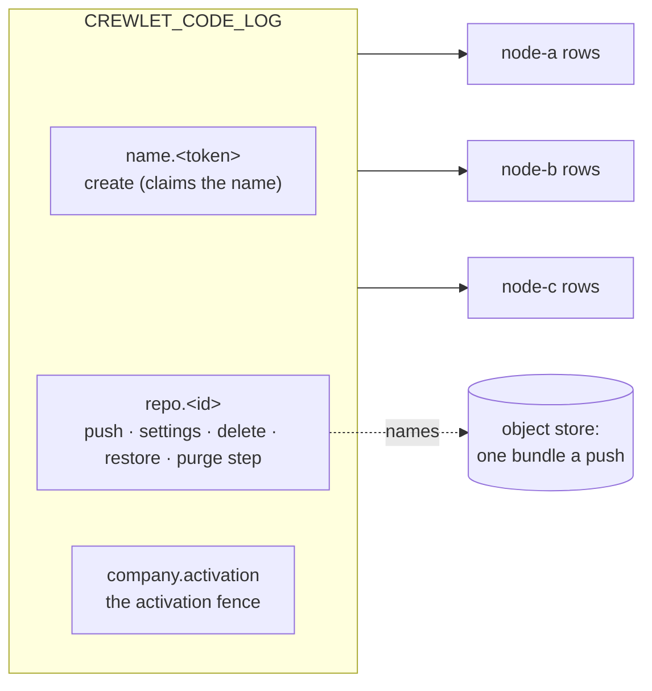
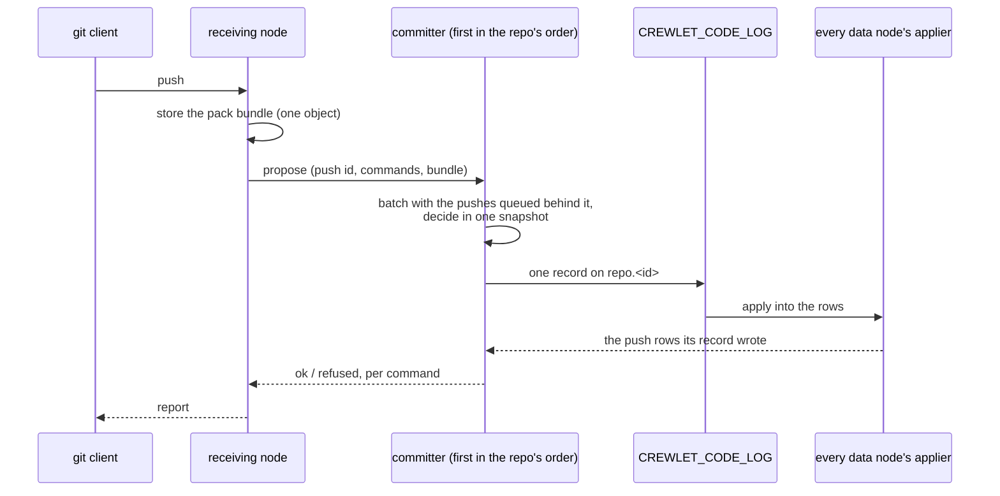

# Code Host

A company that sets [`code.native`](../getting-started/configuration.md#code)
hosts its git repositories in the engine itself, beside its own tracker and
knowledge base, and on the same footing: what a repository *is* — its
settings, its protection rules, its refs and the packs it holds — is
replicated state every data node keeps whole, and the bytes of each push are
one object in the [object store](object-store.md) the whole fleet shares.

It is not exclusive. The [GitHub](../integrations/github.md) and
[GitLab](../integrations/gitlab.md) integrations keep working beside it, and a
company may host some repositories natively and keep others on a vendor.

---

## What it is

A repository is **rows on the code log** (`CREWLET_CODE_LOG`), the state
log's fifth domain (see [Replication](../guides/replication.md)): every change
to a repository is one record on that ordered log, arbitrated at the broker,
and every data node applies it into its own identical copy of the rows. There
is no primary repository anywhere — no node's disk holds "the" repository and
no node's loss loses one.

The **bytes are not rows.** Every push stores **one object**: its pack
together with the index and reverse index the receiving node's git wrote for
it, back to back, named by a `code_packs` row. So a node that has to bring a
repository up to date reads one object a push and indexes nothing — the
index arrived with the pack — and a backup, the collector and the audit treat
a repository's packs exactly as they treat a project's files: a required
reference, kept while a live row names it (see
[One object per upload](object-store.md#one-object-per-upload)).

A git working directory on a node is never the record. It is a cache derived
from the rows, disposable and rebuilt from them.

### What it does not do yet

This is the product's current shape, not a configuration choice:

- **Nothing serves git's HTTP transport yet**, so nobody clones or pushes a
  repository through this build. What exists is everything a push is decided
  by — the repositories, their protection rules, the committer below and the
  rows it writes — and the routes that will carry git are reserved and
  always guarded.
- **Agents do not push.** The repositories, their protection rules and the
  decision of every push exist; a seat as a git user does not.
- **There are no changes, reviews or checks** — no merge request, no review
  and no CI gate in front of a protected branch. A protection rule decides
  what a push may do to a ref, and nothing else stands in front of one.
- **Nothing compacts a repository.** Every push adds one pack, and a
  repository's packs are only ever removed with the repository.

---

## Declaring repositories

The repositories are declared in the company document, under `code.repos`,
and every activation makes the fleet match the declaration:

```yaml
code:
  native: true
  deleted_retention_days: 7        # 1..365; unset is 7
  repos:
    - name: nimbus-web             # the address it is cloned by
      owner: { unit: Engineering } # a unit (id or name) or a seat (handle) — exactly one
      default_branch: main         # unset is main
      description: The customer-facing web app.
      protect:
        - branch: main             # refs/heads/main, and nothing below it
        - branch: release/**       # every branch inside release/, never release itself
          allow_delete: true
        - tag: "v*"                # a tag rule: a tag never moves
    - name: infra
      owner: { seat: agent-cto }
      archived: true               # read-only: takes no push
```

- **`name`** — one host-name label: lowercase letters, digits and hyphens,
  starting and ending with a letter or a digit, at most 63. It is the address a
  repository is cloned by, so **renaming one deletes it and creates another**
  rather than moving it; declared twice, it is refused at the later entry.
- **`owner`** — exactly one of `unit` (its id, or its name where it has none)
  or `seat` (a handle), resolved against the same document's chart. An owner
  the chart does not have refuses the revision, naming the units or seats it
  does have.
- **`default_branch`** — what a clone checks out; any branch name git would
  take, and unset is `main`.
- **`description`** — one paragraph, at most 1 024 bytes of UTF-8.
- **`archived`** — read-only. A push to an archived repository is refused as a
  whole, and reading it is not; unarchiving it is setting it back to `false`.
- **`protect`** — at most 64 rules, each naming exactly one of a `branch` or a
  `tag` pattern, each pattern once.

At most 10 000 repositories one document — a typo guard two orders of
magnitude past a large company's, not a limit anybody is expected to meet. It
is an [admission rule](configuration.md#what-a-stored-revision-is-held-to), as
the retention's one-year bound is: a document written past either is refused,
and a revision already stored past one — admitted by a later build that raised
it — still applies, with a warning, because nothing the reconcile or the purge
does depends on either.

### What each change does at its activation

| You change | At its activation |
|---|---|
| Add a repository | **Created**, empty, with its settings. Two nodes creating one name land one repository: a create arbitrates on the name. |
| Change a repository's settings | **Settled**: one record carrying the new settings, stamped with the activation that wrote it. |
| Change nothing | **Nothing** but one fleet-wide record, the activation's fence (below) — never a record a repository. |
| Remove a repository | **Deleted**: it takes no push, and its rows and packs are kept. Declaring it again under its name within `code.deleted_retention_days` **restores** it: its refs and packs as they were, with the settings it is declared with now. |
| Leave it removed past `code.deleted_retention_days` | **Purged** by the `code-retention` duty, in bounded steps, and its name is free again (see [Deletion and purge](#deletion-and-purge)). |
| Turn `code.native` off | **Nothing is deleted.** A node whose native runtime is already running keeps serving the code host until its restart (see [A native backend changes at a restart](control-plane.md#a-native-backend-changes-at-a-restart)), and a revision without the host reconciles no repository at all. |

Only repositories the **configuration** manages are reconciled. A repository
somebody else created is never deleted for being absent from `code.repos`.

### Protection rules

A rule's pattern is a branch or tag name in git's own grammar, in which a
component of `*` matches one component, `*` inside a component matches any run
of characters but `/`, and a component of `**` matches any number of
components — zero or more in the middle of a pattern, one or more as its last.
A pattern with no `*` matches **only itself**: a rule on `main` protects
`refs/heads/main` and not `refs/heads/main/x`, which git's own `for-each-ref`
would also match. So `release/**` protects `release/1.0` and
`release/2/hotfix` but not a branch named `release` — a rule meant for both is
the two rules `release` and `release/**`. A glob has at most eight components
counting `refs/` and its namespace, which is what bounds the cost of asking it
about a ref.

What a rule does to a push of a ref it matches:

| Field | Unset | Set |
|---|---|---|
| `allow_force` | A push that moves the branch to a commit not descending from it is refused | Allowed. Refused on a tag rule: a tag never moves |
| `allow_delete` | Deleting the ref is refused | Allowed |
| `direct_push` | `persons`: a person may push to it | `none`: nothing pushes to it — the ref is frozen |

**Every rule that matches holds**, because two rules written for two reasons
both mean something: a ref matched by a rule allowing deletion and another
that does not cannot be deleted. A ref **no** rule matches may be force-pushed
or deleted by anybody who may push to the repository, so `crewlet validate`
warns about every repository whose default branch no rule protects — at the
repository's `protect`, naming the rule to add — and never fails on it. An
archived repository is not warned about: it takes no push at all, so nothing
can move or delete its branch until it is unarchived, and the revision that
unarchives it brings the warning back.

### The reconcile and the activation fence

Every data node reconciles `code.repos` at **every boot and every
activation** — a node in a [maintenance mode](../guides/retention.md#the-three-modes)
excepted, since it publishes nothing. Only a repository that changed costs a
write: one that is created, settled, deleted or restored. Nodes reconciling one
activation at the same moment race on each of those, and the log lands one
record on each — the others decide it again from that record and write
nothing. A refusal for one repository is logged and the rest are still
applied.

The reconcile runs **beside** the apply, not inside it: the apply reports the
revision applied as soon as it has asked for the reconcile, and the
repositories follow. At the most a document may declare, an activation that
creates, deletes or restores every repository takes 16–19 seconds on one node
before the last has its record — and a node still applying a revision
45 seconds after a peer applied it is [shed](control-plane.md#posture-what-a-lagging-node-does),
so how many repositories a company declares must never decide that. A newer
activation's reconcile ends an older one's still running, since the newer one
decides every repository again; a node that stops mid-reconcile logs
`code_repos_interrupted`, and its next boot reconciles.

Because the revision is already reported applied, a reconcile that leaves
something undone — an outcome the log did not answer, decisions refused while
the node was still catching up on the fence, a listing it could not read — is
**run again by the node**: five seconds later, then waiting twice as long after
each run in a row that leaves something undone, up to every five minutes, until
one applies, a newer activation replaces it or the node stops. Nothing else
would run it again, and no peer covers for a fleet of one. A run again costs a
batch read of the rows where nothing changed, and writes only what is still
missing. A name held by a repository the configuration does not manage, and a
declaration the code log refuses as written, are said at every run but never
run again for: no run changes them, and only a revision that does applies them.

Without an order between activations, a node applying an *older* activation
late would walk a newer one's settings back. So a reconcile first publishes
one **fence** record for its activation, and every node's copy of the rows
raises a single fence to it and never lowers it; every configuration record
an older activation decides afterwards is refused by every node, identically,
because the fence is derived from the log. Every decision a reconcile takes
waits for its own node to have applied its own fence first. So whatever an
older activation decided is either *before* the fence — in the rows the newer
activation decides from, where any difference it made is settled back — or
*after* it, and refused. That is what lets an unchanged repository cost
nothing: an activation that changes nothing writes its one fence record, and
reads every declared repository's row in one batch.

A node that finds a later activation already fenced logs
`code_repos_superseded` and decides nothing: it is applying a configuration
the fleet has moved past, and reconciles again when it applies the later one.

---

## One subject per repository

Everything that moves a repository's refs or packs, or governs them — a push,
a settings change, a deletion, a restore, a purge step — is a record on **one
subject a repository**, `crewlet.code.log.repo.<id>`. That subject is the
**arbitration unit**: two pushes to one repository contend at the broker and
exactly one record lands per round, and the loser decides again against the
winner's rows. One subject a repository rather than one a ref, because every
write on a repository changes its row too — its ref count, its bytes, its
version — so a subject a ref would never narrow a write's contention.

A **name** is claimed on its own subject, `crewlet.code.log.name.<token>` (a
bounded digest of the name), so two creates of one name contend there, where
two freshly minted repository ids never would. The activation fence has the
company's one subject.



---

## The committer

Because every push to a repository contends on its one subject, a
repository's pushes are **committed by one node**: its **committer**, the
first live data node in a rendezvous order of the repository's id, which every
node computes alike. A push received anywhere is asked of that node, which
takes the repository's pushes in order and puts every push waiting behind a
record in flight into the next one — **group commit**, without lingering for
more, up to 64 pushes a record. An idle repository pays one record a push and
a burst one record a batch. A batch is decided in one snapshot of the rows,
each push against what the ones before it did, and a push is answered `ok`
only from the row its record applied, never from the decision.

A push carries an id the receiving node minted, and a push id the repository's
history already holds is answered from its row — so a push asked twice, or of
a second node after the first stopped answering, is still one push. A
committer that stops, or answers nothing, hands each of its repositories to
that repository's runner-up in the same order, under the same push id. A node
in a maintenance mode commits nothing and refuses as a node that ran nothing,
so the next committer decides; while the whole fleet is in one, no push is
committed.

The path a push takes from the node that receives it:



A queue holds at most 1 024 pushes, and a batch has 30 seconds to land; past
either a push is refused `busy` undecided and the client pushes again (the
`crewlet.code.commit.busy` counter, in the
[metrics reference](../reference/metrics.md), says which).

---

## Limits

[`code.limits`](../getting-started/configuration.md#code) — the largest pack
one push may send, the largest file it may carry, and the most one repository
may hold — is read off the **deciding node's current revision** at every
decision, so a change holds from its activation with no restart. A repository
also holds at most 100 000 refs, and a push moves at most 1 000 of them.

---

## Retention and history

Three horizons, each kept by the record that applies it inside its own
repository, never by a sweep:

- **Push history** — a push row is kept **181 days**, the same horizon as the
  company's [usage history](../guides/retention.md), so "what happened over
  the last half year" has one answer across the engine.
- **Ref tombstones** — a deleted ref is kept as a tombstone for **48 hours**,
  so a node bringing a repository up to date learns of the deletion.
- **A purge** — below.

### Deletion and purge

A repository removed from `code.repos` is **deleted**, softly: its rows and
packs stay, and declaring it again under its name restores it. Once it has been
deleted longer than **`code.deleted_retention_days`** (1 to 365 days; unset is
7, the trim's default `min_age`, so a deletion is undone from the same window
the log can replay), the fleet-singleton `code-retention` duty purges it (see
[Singleton duties](seat-ownership.md#singleton-duties)):

- every 15 minutes, it finishes every purge already begun — whatever the
  retention, since a purge has no undo — then purges the repositories deleted
  longest ago first;
- each purge is a sequence of bounded **steps**, each one record removing a
  bounded part of the repository's rows, and the last leaves only a
  **deletion marker**, which drops every later record about the repository on
  every node, for ever ([the deletion gate](../guides/replication.md#applied-is-not-permanent));
- every data node applies every step on its one write lane, so the duty paces
  itself: after each step it waits twice the step's duration, a third of the
  lane, and a pass stops after a minute of steps and the next resumes from
  the rows;
- once the purge has applied on the duty holder's own rows, the name is free,
  and a name the current configuration still declares — re-added while it
  purged, which the reconcile logs as `code_repo_awaits_purge` — is created
  again at once.

A push to a repository that is not there to take it is refused
`repo_deleted`, and what follows the code says which of four states the
committer found, because each has its own remedy:

| State | What the push is told |
|---|---|
| deleted | declaring it again in `code.repos` restores it as it was, until its purge, which may begin from the instant named: the deletion plus `code.deleted_retention_days` on the committer's current revision — the earliest the duty begins it under that revision |
| being purged | the purge cannot be undone; once it completes, declaring the name creates a new, empty repository |
| purged | it holds nothing; declaring its name creates a new, empty repository |
| an id no repository had | it does not exist |

The packs a purged repository named are no longer named by any row, so the
[object collector](object-store.md#collection-and-audit) deletes them a day
later. The code log itself is trimmed like every other log (see
[Retention](../guides/retention.md)), and a node whose copy of it is out of
service declines the duty rather than purge from rows the fleet may not agree
with.

---

## What the node logs

| Line | Level | Means |
|---|---|---|
| `code_repos_applied` | `INFO` | A reconcile wrote something: how many repositories it `created`, `changed`, `restored` and `deleted` (or `written`, where the listing before it could not be read), each with the first 32 of their names in `created_names`, `changed_names` and so on. Nothing is logged when nothing was written. |
| `code_repo_awaits_purge` | `INFO` | A declared name belongs to a repository still being purged; the `code-retention` duty creates it when the purge completes. |
| `code_repos_superseded`, `code_repo_superseded` | `INFO` | A later activation owns the repositories, or this one: this node is applying an older configuration, or has since been asked to reconcile a later one. |
| `code_repos_interrupted` | `INFO` | The node stopped before its reconcile finished; the next boot reconciles. |
| `code_repo_not_applied`, `code_repos_not_applied`, `code_repos_not_listed` | `ERROR`, `ERROR`, `WARN` | A reconcile could not apply one repository, any, or delete what the document no longer declares; the node runs the reconcile again (`code_repos_retrying`). Two of a repository's are not run again for, and say what to change instead: its name is held by a repository the configuration does not manage — rename the declaration — or the code log refuses its declaration as written. |
| `code_repos_retrying` | `INFO` | The reconcile of `activation` left something undone — said in the lines before — and runs again in `retry_in`: five seconds after the first such run, doubling with each run in a row (`attempt`) to five minutes, until one applies or a newer activation replaces it. |
| `code_retention_pass` | `INFO` | A pass that purged, failed a repository, held a purged name or stopped at its budget (`purged`, `steps`, `remain`, `failed`, `unhanded`); `DEBUG` when nothing was due. |
| `code_retention_pass_failed` | `WARN` | A pass ended on an error; the next pass lists what is due again. |
| `code_retention_duty_declined` | `WARN` | This node's copy of the code log is out of service, so it does not take the duty. |

---

## See also

- [Configuration: Code](../getting-started/configuration.md#code) — every field of the `code` block
- [Object Store](object-store.md) — where a push's bytes live, and the collector and audit that keep them
- [Replication](../guides/replication.md) — the state-log framework the code log rides
- [Retention](../guides/retention.md) — the log's trim, and what a purge does and does not reach
- [Backup](../guides/backup.md) — a repository's rows ride the store copy, its packs ride as required references
