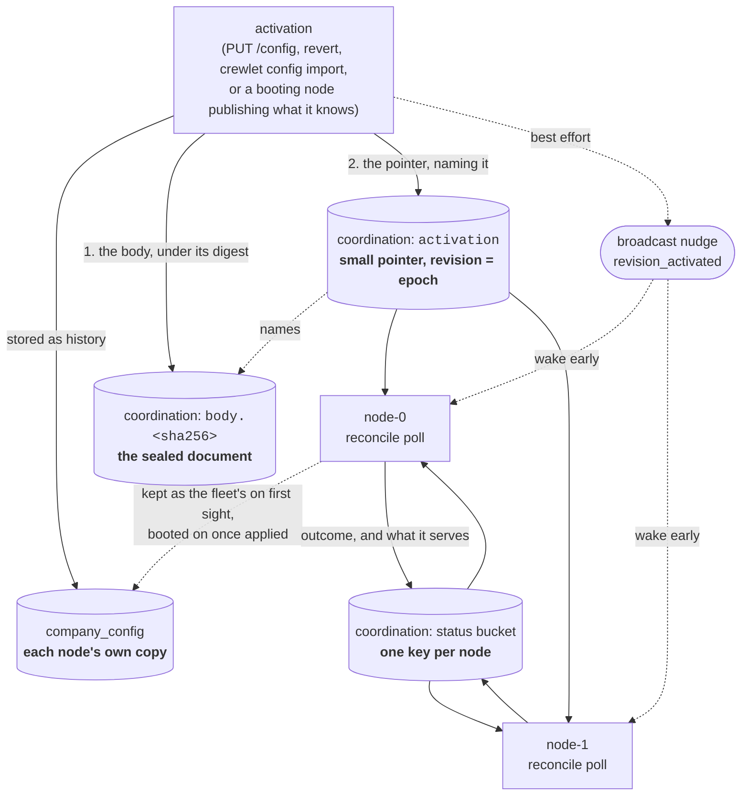
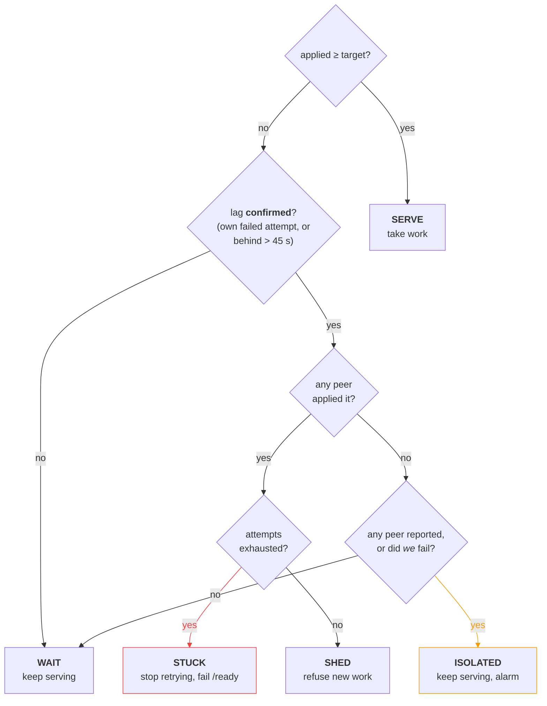

# Control Plane

The **control plane** is how every Crewlet node in a deployment converges on the same company config and, when one cannot, how it decides what to do about its own traffic.

It is two keys in the fleet's [coordination store](coordination.md) and a poll loop. The hard part is the decision a lagging node makes: the obvious answer turns every successful rollout into an outage.

---

## The problem

Delivering activation as a **competing-consumer** event (groups `engine-config`, `api-config`) means one node of N applies a revision and the rest keep the old company: deleted roles keep answering, rotated credentials and webhook secrets stay stale (HMAC failure is a *skip plus an ack*, so stale nodes silently eat their share of messages), and the dashboard reports success (`revision_applied(ok)`) from the one node that applied. A plain broadcast fixes fan-out, not reliability: an ephemeral consumer starts at the latest message, so a node that misses one while reconnecting stays stale forever.

## The design



**The `activation` key is the authoritative pointer**, in the coordination store, not a node's own database: *which revision is current* is something the fleet must agree on.

**The pointer is small and names the body.** Every probe, heartbeat and reconcile tick on every node reads the pointer, so it carries the revision, its instant, summary and origin, and `"body":{"bytes":N,"sha256":"…"}`: at most 8 KiB (`coord.MaxPointerBytes`), the summary at most 4 KiB of it. The sealed document, the envelope `{"__encrypted__":"enc:v1:<key id>:<ciphertext>"}` compacted and otherwise byte for byte what was sealed, is its own key, `body.<sha256>`, up to what [one key holds](coordination.md#what-one-key-holds). `Activate` writes the body first, then flips the pointer to it; content addressing is what makes that safe, since two writers' bodies are two keys unless they are one document. A node reads the body only when it has no copy of the revision, given the time the recorded size takes to cross its link, and refuses one whose length or digest is not what the pointer names. Anything that is not a JSON object is refused before it is written.

A body no pointer names is [swept](coordination.md#superseded-bodies-are-swept) once it is an hour old; a flip lands within half that of its body's write or not at all, so the sweep never removes a body a flip in flight names. A node that fetches a revision **keeps** it in its own `company_config` as soon as its seal opens, before it validates or builds it; history, diffs and revert targets are read from there. What the node boots on moves only once its engine has applied the revision (see [A node's own store keeps three facts apart](#a-nodes-own-store-keeps-three-facts-apart)).

**The revision's author travels too.** Every revision records who wrote it (`created_by`), what that is (`created_by_kind`: `agent`, `human`, `operator` or `system`) and the credential it came through (`operator_id`), as every write names its caller (`iam.ActorFor`):

- A person writes as the human seat they hold, and so does a token the identity directory binds to a seat: kind `human`.
- Anybody else on `/config` or `/setup` writes under their own login, `token:<id>` for a Tier A token or `svc:<name>` for a service account bound to no seat: kind `operator`. So does the login running an offline `crewlet config import` or `rekey`.
- The engine's own write is kind `system` with no credential: a node seeding the store from its `-company` file (recorded under the node's id), or the reconcile loop reloading after it sealed a credential (recorded as `reconcile loop`).

A disconnect the loop carries out is recorded under whoever **asked** for it (see [Integration Reconcile](integration-reconcile.md)). The writer states the kind, because a label cannot (a Tier A token could be given the id `node`). The pointer carries the revision's **origin** (author, kind, credential, source, write instant), so every node records the same author, never `peer` from `fleet`, and history answers the same whichever node serves it.

The origin is **required**: the store refuses an activation whose origin lacks the kind, source or creation instant, and a node refuses to keep an incomplete one. A copy's `activated_at` is the pointer's instant, not the write time (they differ on re-activation). A known author is never overwritten; the first record stays. The *parent* is not carried, since the copying node may not hold it.

**The body is authenticated by its seal.** It is sealed (AES-GCM) under the fleet's Tier A keyring, which every node holds, so opening it proves a node of this fleet wrote it; broker admission vouches for a connection, never a value. A body that does not open is refused before it is kept: the apply is recorded as an error, the epoch is not reached, and the body never enters `company_config`. The recorded error says what fixes it:

- **Stored unsealed:** an admin sends the whole document again with `PUT /config` or `crewlet config import`, the only writes that replace one (neither reads it); the new one is stored sealed.
- **Sealed under a key this node does not hold:** its `secrets.keys` lacks a key the fleet seals under. No write on that node replaces it; add the key and restart the node.
- **Sealed in a form this build does not read:** most likely a newer build sealed it. No write replaces it; upgrade the node to the fleet's build.

The seal does not authenticate the pointer beside it: a party that can write the bucket can point the fleet at a revision it has already seen sealed, so the broker must be reachable only by the fleet (see [Deployment § Every node embeds a member of one cluster](../guides/deployment.md#every-node-embeds-a-member-of-one-cluster)).

**Its revision is the epoch.** The store gives every key write a monotonic revision, so two activations always get different epochs and none is readable before its target is published. It moves on every activation *including re-activation of an unchanged revision*, the gesture for picking up a rotated credential (see [Secret Store § Propagation](secret-store.md#propagation)).

**Every activation names what it was built on.** A config write reads the pointer, builds on the revision it names, and **expects** that revision: it lands only while the pointer still names it.

- Of two writes built on the same revision, one lands and the other is refused `revision_advanced` (`412` where its `If-Match` named that revision, `409` where it named none). Its revision stays as inert history, on the serving node only: the refusal names it as `stored_revision_id` beside that `node`, its diff and revert go to that node, and any other answers `404` ([Concurrent writes](../reference/api-endpoints.md#concurrent-writes)).
- A write that read no pointer activates **create-only** and lands only while there is none, so a node that has not caught up cannot replace the fleet's company (a rename changes every seat id derived from the name and orphans their memory).
- A pointer gone by the time an expecting write arrives (deleted or purged) is a lost race too.
- A booting node's publish follows the same rule ([What a booting node publishes](#what-a-booting-node-publishes)).
- The one activation that expects nothing is `crewlet run -import-company`, which replaces the company outright from a file.

**Every activation carries a later instant than the one it replaces.** Every row a configuration derives (a Worklet project, a Doclet container, a declared repository) is stamped with the pointer's activation instant and refuses an older stamp, so a configuration applied late cannot walk a newer one back (a repository goes through the code log's one [activation fence](gitlet.md#the-reconcile-and-the-activation-fence)). The instant is the activating node's clock, so inside the compare-and-set that replaces the pointer, an activation no later than the pointer's, to the millisecond, is published one millisecond after it; even an unconditional publish is a compare-and-set underneath.

`Activate` returns the published instant, which the writer records as `activated_at` on its own copy (raised, never lowered, on every row including the boot row's). The instant the boot row was *applied* at is its separate `served_at`, which moves only when the reconciler applies an activation (a re-activation this node refused raises `activated_at`, not `served_at`); a node boots its company with it. An [offline offer](#what-a-booting-node-publishes) boots with no instant, because stamped with the offline command's clock it could outrun the fleet's stamps and make the node refuse them; the first apply of the activation that publishes it stamps it.

The pointer's bucket has **no retention**: a pointer that expired would restart the epoch, and a fencing sequence that restarts is not a fence.

**Every node polls it** every ~15 s (±20 % jitter), so it cannot miss anything. The jitter breaks lock-step after a synchronized restart and applies to the *interval*, never to the apply.

**The `revision_activated` event survives as a nudge** that wakes the loop so a change lands in milliseconds. It is an **ephemeral broadcast**, never a consumer group, since every node must hear every activation. It carries only the revision id and summary; the woken loop re-reads the *pointer*, so a lost nudge costs one poll interval, never a revision, and a node that cannot subscribe (logged, not fatal) converges on its interval. After a nudge the next iteration still waits a full jittered interval, so an activation storm cannot become an apply storm.

**The status bucket is what each node managed to do**: one key per node, last-write-wins. Each record names:

- the epoch the node last attempted, the revision that epoch named, and the outcome;
- the epoch it last **applied**, and the revision it **serves** (the one its last successful apply installed, or the one it booted on);
- the revision it would **boot on** if restarted now: its boot row's, read before the node's first record and after every write to the row. This is the served revision except while a write to that row is being retried, and none on a node whose own database is discarded at every start.

The two revisions differ when the node refused a revision other than the one it runs: that is how an operator finds a node still on the previous company (a refused re-activation of the running revision names it twice; only the outcome tells it apart). The two epochs differ whenever the outcome is a failure; only the applied one says which runs. Outcomes:

| Status | Meaning |
|---|---|
| `ok` | Applied cleanly. |
| `error` | Refused; nothing to roll back, because nothing the apply built was published (before it can refuse, an apply changes only the secret snapshot it re-reads first, which the serving epoch reads too). The previous epoch stays current and correct, a degraded-but-correct state work can safely route to. The node keeps serving the revision it ran and comes back on its boot row's (`config_boot_revision_id`, [Reading a stuck node](#reading-a-stuck-node)): the same revision, except while a write to the row is being retried, and none on a node whose database is discarded at every start. |
| `degraded` | Failed **after** a subsystem that cannot be un-applied was mutated, so the declared epoch is not the whole truth (prior config reported, tool surface amputated). Never counted as converged or as somewhere work can go. **Not reachable in this build**; the ordering that keeps it so is a live constraint: everything an apply cannot undo stays behind the epoch swap. See [`Engine.Apply`](configuration.md#the-engine-half). |

Each node **re-stamps its key every tick**, not only when it converges, and the posture decision counts only reports written in the last four intervals (~60 s). Both are needed: a crashed or scaled-in node would otherwise leave a ghost `ok` that a lagging survivor reads as "a healthy peer to shed to"; and a converged node that went quiet would age out, so a lagging peer would read `PeersOK` as 0 off a healthy fleet.

**The bucket's own age is that bound**, four reconcile intervals, set when the store is opened. Nothing sweeps it: a node that stops reporting stops renewing and the broker expires the key. Hence a bucket-wide constant, not a per-write TTL (see [Coordination § Retention is a bucket's age](coordination.md#retention-is-a-buckets-age)).

A node's **coordination record** of a failure is truncated at 2 000 bytes (on a rune boundary): every peer re-reads it on every posture decision and the dashboard shows it on **Settings › Nodes**. The **`config_revision_applied` event** carries up to 64 KiB of it, marked when it cuts, because it is kept for the event store's retention horizon and is what an operator reads days later; a 2 000-byte cut would remove the end of a wrapped chain, where the cause sits. The bound exists only because an event over the queue's payload ceiling is dropped whole.

---

## The company, and what each node keeps of it

The pointer is the company. A node's database keeps facts only it can know (what it starts on, what it last saw the fleet run, an offline change), kept apart so a node can refuse the fleet's revision, restart, and still run.

### Every config answer is the pointer's

Every answer `/config` gives (`GET /config` and its entity-tag, the revision list's `is_active`, a diff against `active`, and the base every write is built on) is the revision the pointer names, on every node alike, whatever that node runs. A node that has not reconciled since the pointer moved answers from the body the pointer carries; no read writes anything, and the next tick keeps the copy. A body this node cannot open is refused with:

- `unreadable_fleet_revision` or `unsealed_fleet_revision`, for one met only on the pointer (a key this node was never given, or a body put there without a seal);
- the two codes for a revision this node keeps;
- `unknown_seal_revision` for either, sealed in a form this build does not read, which no write replaces ([A revision this node cannot open](../reference/api-endpoints.md#a-revision-this-node-cannot-open-is-refused-whichever-route-reads-it)).

An unsealed one, from either place, is replaced by an admin's whole document sent with `PUT /config`, which reads nothing from it ([A whole document replaces an unsealed revision](../reference/api-endpoints.md#a-whole-document-replaces-an-unsealed-revision)). So an `If-Match` taken from one node's entity-tag lands on any other, one that refused the fleet's revision included. Once the fleet runs a company, a create-only write (`If-None-Match: *`) is refused `412 already_configured` on every node, an unreconciled one included.

When the coordination store cannot be read, a `/config` request that needs the fleet's revision (every read above, every write) answers `503 unavailable` with `Retry-After: 2` rather than a guess: "the fleet has no company" would send a create-only write to replace the one it has. A store that stops answering *between* a write's storing its revision and moving the pointer gives `503` with `outcome: unknown`, the `stored_revision_id` and the `node` that stored it, since the activation may have landed. `GET /config` says which once the store answers; sending the write again makes another revision, over this one if it landed. If it did not land, the revision is in that node's history alone, so its diff and revert go to that node; every other answers `404`. With no pointer at all (lost under a running fleet) it answers the company as this node knows it ([below](#a-nodes-own-store-keeps-three-facts-apart)), and a write is create-only.

### A node's own store keeps three facts apart

Each node's `company_config` holds every revision the node has met, as history, and marks three facts:

| Fact | Column | Moved by |
|---|---|---|
| The revision this node **boots** on: the last one its engine applied, with the instant of the activation it applied, or an offline command's choice | `is_active`, `served_at` | Online, only the reconciler, and only to the revision its engine has just applied. Offline, `crewlet config import`, `activate` and `rekey` |
| The **fleet's** revision as this node last saw it, runnable here or not | `is_fleets` | Only the reconciler, for each pointer revision whose seal opens under this node's keyring, before it is validated |
| An **offer**: an offline choice of what to boot on that the fleet has not taken, with the revision it was built on, an offer an earlier start sent and never confirmed where it was built on one, and the instant the boot publish planned for it | `offered`, `offered_over`, `offered_unconfirmed`, `offered_at` | Set by the offline command, replaced by the next one; cleared once the fleet takes the offer, or once the node's engine applies another revision |

Every row also keeps the **latest activation** of its revision this node knows of, `activated_at`: raised by each activation the reconciler sees or the node publishes, never lowered; a restore asks for it and the retention sweep dates the row by it. The boot row's `served_at` is separate: the activation its engine applied, which the org chart is stamped with at the next start. A refused re-activation of the running revision (the [rotation](#rotation) gesture, on a node that lost the credential) is the fleet's newer activation but not what the node runs.

A node that refuses the fleet's revision keeps running the one it served, records the refused one as the fleet's, and at next start boots on its boot row's revision. Its status record names all three. A write through the API stores its revision as history on the node that took it and moves the pointer; each node boots on it once it has applied it. An engine follows the pointer one tick at a time, so what it boots on moves in pointer order and a late apply never walks it back. `crewlet config revisions` shows the three in its STATE column: `boots`, `fleet's` and `offered over <id>` (see [the CLI reference](../reference/cli.md#crewlet-config-revisions)).

**With no pointer, the company is the one this node knows**, chosen in this order:

1. An offer built on the fleet's revision this node last saw (or on an offer an earlier start sent, which the fleet's revision may be), or built while it had seen none.
2. Otherwise that fleet revision, even one this build refused: every node that could run it does, and the older revision this node runs would roll them back.
3. Otherwise the revision it boots on.

It is what `/config` answers while the pointer is gone, what the next boot restores, and what an offline command builds on.

The revision sweep that bounds the table never deletes the boot row, the fleet's row, the chain of ancestors behind each, or a revision activated inside its window: a row is dated by the later of its creation and last activation, so an old revision the fleet re-activated yesterday stays (see [Retention](../guides/retention.md#the-configuration-archive-and-the-one-thing-a-purge-cannot-reach)).

### What a booting node publishes

A `crewlet config` command run while the engine is stopped cannot open the coordination store (on an embedded broker it lives in the running engine), so it cannot move the pointer. What `import`, `activate` and `rekey` write offline is an **offer**: the revision this node boots on at next start, built on the company it knew when the command ran (the command says which). If that company is an offer an earlier start published but crashed before recording, whether the fleet took it is unknown offline, so the new offer is built on it **and** the revision under it, and the boot publishes it over whichever the pointer names. Against a **running** node, `crewlet config import` goes through that node's `PUT /config`, which builds on the fleet's revision and moves the pointer at once.

Every publish also says whether it **restores** a company the fleet lost or **chooses** one. Only a restore is replaced by a peer that knows better; otherwise a chosen pointer (an offline `activate` on a node with a slow clock, or `-import-company`) would be reverted by the first peer to boot with a later clock.

Before its first tick, a node compares what it boots on, and the fleet's revision as it last saw it, with the pointer, and publishes at most one revision, by compare-and-set against what it was built on:

| This node boots on | The pointer | The boot |
|---|---|---|
| An offer built on *B* | names the offer, at the instant this node planned for it, or this node's reconciler saw it name the offer | Publishes nothing: the publish landed before a crash, and is recorded as taken; the boot then decides as for any revision |
| | names *B*, and is not a restore of a revision this node saw the fleet move past | Publishes the offer expecting that very activation of *B*, at an instant later than the pointer's. That is always a new epoch, so an offline `activate` of the fleet's own revision is the [rotation](#rotation) gesture |
| | names anything else | **Withholds it**: the fleet moved on from what the change was built on |
| | is gone, and the fleet revision this node last saw is *B*, or it saw none | Publishes the offer create-only |
| | is gone, or is a stale restore, and this node last saw the fleet run another revision | Withholds the offer, and restores that revision as below |
| Anything else: *R* is the fleet's revision this node last saw, or else what it boots on | is gone | Restores *R* create-only, at its latest activation. A node that knows no company publishes nothing |
| | is a **restore** of another revision this node holds, at an earlier instant than *R*'s | Restores *R* expecting that very restore: another node put back a company the fleet had moved on from |
| | names anything else, a choice however old its instant reads included | Publishes nothing: the pointer is the company, and the reconciler converges on it |

A publish that loses its compare-and-set re-reads the pointer and decides again; that ends, since every landing moves the pointer to a later instant. So a restarted single node comes back on the revision it last saw the fleet on, a pointer lost under a fleet is restored from what its nodes saw (even by a node that refused that revision), and a node rejoining a live fleet converges on it rather than rolling it back.

**What no rule can do** is tell a stale restore from the company once somebody has *chosen* something over it: an edit on a node that knew no better is a choice, and a peer remembering a newer revision leaves it alone. A rebuilt coordination store is restored by the first nodes to boot, so the fleet converges on the newest revision any remembers only while they boot ahead of the first write. After rebuilding one, start the nodes that saw the fleet last before anybody writes.

**A withheld offer is said on every boot**, at warn, as `offline_revision_not_published`, naming the revision, what it was built on and what the fleet runs, for as long as the offer stands. The node runs the offer until it applies the fleet's revision, which then becomes what it boots on (said the same way, the offline change left in its history). Making the offer the company as it stands would undo what the fleet changed since, so the warning's hint names the change instead: `GET /config/revisions/<revision>/diff?against=<built_on>` on that node shows what the offline change did, to repeat on the fleet's document (through the dashboard, or `crewlet config import -api`); `POST /config/revisions/<revision>/revert` on that node puts it up as it stands, for an operator who means that.

`crewlet run -import-company` is the one exception: it replaces whatever the fleet runs with its file, unconditionally, unless the fleet already runs that file. With no pointer and a file that *is* the company this node knows, it publishes that revision again as a choice, at this node's clock, never at the instant the revision last activated.

---

## Posture: what a lagging node does

Reading the pointer and the status bucket together lets a node tell *"I am behind because propagation takes a moment"* from *"I am behind because I cannot apply this"*, which need opposite responses.



The rule an obvious design gets backwards:

> The target is the store's activation pointer, but **lag alone is not a reason to shed.**

Every successful rollout produces lag: the first node to apply advances the pointer and every peer is behind until it polls. A node that sheds on that makes the fastest node the cause of a fleet-wide outage.

So lag must be **confirmed**: either an attempt of this node's at that epoch concluded in failure, or the lag outlasted what propagation explains (three poll intervals, 45 s: longer than a poll plus a normal apply, short enough that a stuck node leaves rotation quickly). Reading the body is part of that apply, so across a link the grace grows by the body's crossing at the slowest pace allowed (up to four minutes for a document at its bound); in process it is 45 s exactly.

**An attempt still running is neither.** A node applying the epoch reports `wait` for the whole apply (its first company on an unconfigured node included) and moves to `serve` when it succeeds. An attempt counts toward the retry bound, and its failure as evidence, only when it **concludes**; otherwise a client polling `/health` across a config write could not tell the transient from a revision that does not apply. A failed attempt stays the node's evidence while a retry runs, so a shedding node does not flap back into rotation.

The 45 s is measured **in time** from when the node first saw *that* epoch, not in ticks, because a hung apply holds the very tick that would count it. Past 45 s a node still applying is confirmed lag: `shed` if a peer has the epoch, `wait` if none has reported either way, because silence is not evidence.

Both the 45 s and the retry budget restart **with each epoch**, so a node is judged only on the epoch the pointer names: activating a corrected revision reads `wait`, not `shed`, on every node applying it, and a node that ran out of retries on the bad one is not `stuck` on the fix before trying it. The one carry-over is an attempt **still running**: a node whose apply of an older epoch hangs cannot begin the newer one, so it is late by as long as that apply has held it, however many activations are made meanwhile.

Only then does peer health pick the action. When *no* peer managed the epoch either, the **revision** is bad rather than this node, so it keeps serving the epoch it had (a refused apply leaves it untouched, and it boots on it again if restarted) and raises divergence loudly; shedding there would take the whole fleet down over one bad revision.

Retry is **bounded** at three attempts, each counted when it fails, so a revision failing on one node only (a missing per-node env var, an MCP binary absent from that image) does not re-apply every tick, restarting that node's MCP children each time. The budget is **per epoch**, not per process: pushing a corrected revision, the runbook's answer to a stuck node, resets it.

Exhaustion sits in the chart **after** peer health. The bound is unconditional (a node stops re-applying at three attempts whatever posture it reports), but `STUCK` claims *this node* is the anomaly, true only when the epoch applies elsewhere. With no healthy peer there is nowhere for work to go, and every node in a fleet that cannot apply a revision exhausts its attempts at about the same moment, so ranking exhaustion first would take the whole company dark about 45 s after a bad activation. A single-node deployment has no peer to report, so its own failure is the only evidence: it stays `isolated`, serving the config it had, rather than failing readiness over a revision nothing else saw.
### Where the gate sits

A shedding node refuses work at **trigger admission**, not inside the turn (`Engine.runTurn`):

- A stale node still *consumes* inbound messages. Signature verification happens consume-side against that node's cached secret, and a failure is a skip plus an ack, so gating later means the node silently eats its share of the fleet's inbound.
- Refusing inside the turn would wedge a seat whose executor's launch just completed: the pending row is already flipped to `resumed`, the box collected, the seat still busy, and nothing reaps a `resumed` row in-process.

Refusal **defers**: the delivery goes straight back to the broker and this node stops consuming, on a seat's inbox and on the ingress topic alike. Never a bare NAK: a node that NAKed and kept fetching would be handed the same event again, refuse it again, and spend one of its twenty-five deliveries per lap, so a shed lasting minutes dead-letters a healthy event. Never a republish either: a shed *releases* this node's seats, and a fenced release republishes nothing (see [Seat Ownership](seat-ownership.md#establishing-a-seat-and-giving-it-back)). A republished event is a **new message**, and the completion ledger's idempotency and the batch layer's aging key on the identity a NAK preserves. It also lands on a subject this node is still attached to, so it could come straight back and be republished at the broker's rate. A deferral cannot spin: the consumer stops after the first one, and the seat's release (or, if the posture recovers first, the next successful lease renew) restarts it.

The ingress consumer has no seat to release it, so the reconcile tick starts it: on every tick whose posture admits work, the node un-quiesces `crewlet.notifications.inbound`. This is a **convergence rather than an edge**, because a recovery edge can fire just before the shed's last in-flight delivery quiesces a consumer nothing would then restart: a node that accepts webhooks, reads none, and reports a healthy config.

Gated differently or not at all:

- **Sandbox-driven turns** bypass the gate: a completion is dispatched directly by the `sandbox.Coordinator`, never through inbox admission. It is the tail of a turn this node already started, and refusing it destroys durable state.
- A shed takes **no topic pause**. Deferring quiesces the one consumer that refused, and the sandbox busy state is a separate count the coordinator keeps from the pending store, so the two cannot release each other.
- The **scheduler** skips a tick on a shedding node whole. A schedule's fire identity is org-derived (name, cron, target seat), so a stale node would fire the previous company's schedules, with no queued copy to fall back on. The skipped window stays open, so the missed-tick catchup evaluates it once the node converges; anything a peer already fired is absorbed by the fleet's at-most-once fire claim.
- The **integration reconcile loop** is gated the same way, and here the stale document reaches *outside* the deployment: every reconciler reads the live company config each pass, so a shedding node would converge a third-party app to a replaced revision (a removed seat's account kept, a webhook re-registered at the previous public base, status `ready`). It declines **before claiming the duty**, so its lease lapses and a peer on the current revision takes the loop over. It logs `integration_reconcile_shed` going in and `integration_reconcile_resumed` coming out.

The **replicated estate** a shed or stuck data node holds goes the other way: the node keeps serving it (Worklet, Doclet, Chatlet, usage, and Gitlet's reads and pushes) and is asked for it **last**. Its copy is sound, but what it adds from its own configuration is the replaced revision: the chart a people field and a wake's lead resolve by, the unit a read renders, a search's scope, the limits a push is decided under. Every other data node is asked first, and the shed node is asked again, told to answer anyway, only when none of them runs the operation, as a data node whose copy [lags its log](scaling.md#how-a-request-reaches-the-estate) is, and after any such node, whose answer is held to the current configuration. It is never refused: a stale value of that kind is one every reader already meets when a revision changes it, while a refusal would cost a fleet whose only data node failed an apply (a stateless node beside one data node is enough, since the stateless one applies what the data node could not) every Worklet, Doclet, Chatlet and usage operation.

A request does not pay a second round trip: the shed node answers `behind_config`, which every asking node remembers for thirty seconds, so an asker spends one refusal on it per thirty seconds and otherwise goes to a current data node (or, where none runs the operation, asks the shed node once, told to answer anyway). A push to a repository the shed node commits for goes to that repository's runner-up. Lag alone never moves a node there; only the confirmed `shed` and `stuck` postures do, 45 s after the node first reads the new pointer (at the activation's nudge or its next poll), or sooner where its own apply fails while a peer has applied: about a minute after the activation at worst. The node's next posture decision after it applies moves it back.

**One kind of operation it refuses even asked last: one that judges a grant from its chart.** A seat's read of Gitlet's rows (the repositories it may list, a repository's detail or history, a ref resolved for it) is decided by what the chart lets that seat read, and the revision the node failed to apply may be the one that revoked it. Such a node answers `behind_config` however it is asked, and the read is answered by a current data node or by nobody. A Gitlet node answers a seat's read of a repository's content unready the same way, and the read moves on to the next Gitlet node, which downloads a copy where it holds none. Each such operation declares it in the estate (`judgesGrant`), and a gate holds every operation whose arguments name an asker to that declaration, so one added later cannot be served from a stale chart by omission. A person's read consults no chart and is served as above. So a fleet whose only data node is stuck answers every seat's code read unavailable until that node's apply succeeds (`/ready` already fails there), while its tracker, knowledge base, usage, and persons' code reads and pushes go on.

The gate is not folded into every worker duty, by decision. Posture and `node.roles` are decided by subsystems that do not consult each other: the shed rule counts any peer with a fresh `ok` row as somewhere the work can go, including an ingress-only node that will never claim a singleton. Applied to all duties, an `ingress` + `seats,workers` fleet whose worker node fails one apply would have nobody running the scheduler, the retention sweep, the launch-node watch or the curator, `/ready` green on the healthy node, and no log line.

One class of duty waits for more than the posture: an **irreversible judgement made against the active revision**. Two exist: the [retirement of a removed seat's mailbox](seat-ownership.md#the-removed-seat), which deletes mail for a seat absent from the revision, and the [purge of a deleted repository](gitlet.md#deletion-and-purge), which removes a repository deleted longer than the revision's `code.deleted_retention_days`. Each acts for the whole fleet with no undo, so each is made only on a node that serves the revision the activation pointer names: the pointer is read first, this node's applied epoch next, its company last, so the revision judged by is the pointer's or newer. A node that is behind (propagating, refused, or stuck) judges nothing, and **nothing activated is not current** here, unlike the posture: a node boots on a company file or its store's company before its first tick activates anything. A declined judgement costs a retirement a sweep later or a purge one duty tick later, against a grace of a day and a retention of days, and the duty is given back so a node serving the revision takes it. It is never silent: the mailbox sweep logs why it judged nothing, and the code-retention duty logs `code_retention_duty_declined` naming this node's epoch and the fleet's.

**Behind is a fault only when the lag is confirmed**, by the posture's rule (above): an attempt of this node's at the epoch concluded in failure, or it has been behind longer than the 45 s of propagation. Every node is behind for a moment at every activation, and at every boot until its reconciler has been built and has ticked once, so a warning for that would teach readers to ignore the real one. A node merely applying or still starting declines **quietly**:

- The code-retention duty logs `code_retention_duty_declined` at debug with `reason` `propagating` and asks again at the reconcile cadence (15 s), so a restart or activation costs a purge seconds, not a quarter of an hour.
- The mailbox sweep logs `seat_mailboxes_not_judged` at debug and judges again at its next tick.

Only a confirmed lag (`reason` `behind`) and a node that cannot tell at all, the pointer unreadable (`reason` `unknown`), are warnings. A node with no reconciler yet reads as one whose reconciler has not ticked, as the posture reads it: `crewlet run` builds its reconciler straight after the engine and exits if it cannot.

---

## Rotation

Re-activating an unchanged revision is the documented gesture for picking up a rotated credential. A revision and the *values* its `${VAR}` references resolve to are different things, and an apply that compared payloads would rebuild nothing on exactly that gesture.

**A rotation is one write.** A write through a running node's `/secrets` of a name the active revision reads makes the re-activation itself, in the same request, and answers the revision and epoch it produced; a batch of values (`PUT /secrets`) makes one ([Secret Store](secret-store.md#a-write-through-a-node-re-activates-what-reads-it), ADR-0070). `POST /config/reload` is for a value written any other way, and for a write whose own re-activation answered an error.

**A patch that changes nothing is not a re-activation.** A `PATCH /config` or a per-entity `PUT /config/{kind}/{id}` that leaves the document as it stands stores no revision, activates nothing, and answers `200` with `changed: false` ([A write that changes nothing](../reference/api-endpoints.md#a-write-that-changes-nothing)). The gestures that publish the document unchanged are `POST /config/reload`, a `/secrets` write, and `PUT /config` of the whole document (which a caller that renders the document sends after writing the values it reads).

**Nothing compares the payload.** The property falls out of the control plane's shape:

- The pointer's **KV sequence is the epoch**, and the store assigns a new one on every write, so re-activating a byte-identical revision mints a new epoch.
- A node's reconciler skips on the **epoch it has already applied**, never on payload content, so a re-activation always reaches `Apply`.
- `Apply` **re-reads the secret store first**, and `${VAR}` references stay verbatim in the stored revision and are resolved where a provider is *constructed*, so the rebuild uses freshly resolved values.

**What that rebuild reaches:**

| Holder | Rotated by a re-activation? |
|---|---|
| LLM providers | **Yes**: constructed from the fresh resolver. |
| Jira / Confluence / GitLab / GitHub | **Yes**: each tracker is reconciled against the new epoch and re-resolves the engine credential. |
| Datadog / Atlassian | **Yes**: nothing holds their credentials between uses. Datadog's webhook token is resolved against the applied company on every delivery, and the [integration pass](integration-reconcile.md) resolves the provisioning keys (Datadog's API and application keys, Atlassian's organization API key) at the start of every pass. |
| Shared MCP children | **Yes, selectively**: see below. |
| Per-role MCP children | **Yes, selectively**, on the node holding each seat, just after the apply. They belong to a seat's *lease*, not the epoch, but the `seat_tools` step of the [convergence](configuration.md#what-follows-a-published-company) reconciles every held seat's children over resolved values, so a rotated `mcp_env` value restarts that seat's one child and leaves the rest running. |
| Slack transport | **Yes.** Rebuilt on every apply (`Engine.reconcileSlack`): an HTTP client and the working-status driver, no socket to drop. |
| Mattermost transport | **Yes, when a value it is built from moved.** It holds a websocket per seat, so `Engine.reconcileMattermost` rebuilds only when a fingerprint over the resolved URL, team, status and every seat's resolved bot token, username and channel changes; a rotated bot token is such a change. |
| Worklet projects | **Nothing to rotate, but they are re-stamped.** The apply stamps each project with the activation's own instant, so a re-activation records one "org chart re-applied" change per project, once, however many nodes apply it. Re-applying the *same* activation (every restart) writes nothing. |

The MCP children and the Mattermost transport are where a comparison does happen, deliberately: a child is a *process*, and restarting every one on every apply would tear down working servers. `Bridge.Reconcile` compares the spec it is handed against the one the child is running and leaves an unchanged server alone. It compares *resolved* values: the spec's `env`, `headers` and `url` are resolved at the edge first, so a moved credential reads as a changed spec and restarts that one child. Comparing the stored entry, where `${VAR}` stays verbatim, would stop rotation reaching MCP children. Tests hold this by re-applying the same document and asserting which children survive, and by rotating one seat's credential and asserting its neighbour's child is untouched. Nothing keeps a digest of live credentials across applies, which could leak into a log line or a row.

A per-role child is reconciled where its seat is held and only there: every node walks the seats *it* holds, so a rotation reaches each agent's child once in the fleet, and a node never starts a child for a seat whose lease it cannot still prove. A seat the revision removes has all its children retired by that reconcile, without waiting for placement to release it. The same reconcile lets a credential [minted by a provisioning pass](integration-reconcile.md) after a seat was claimed reach that seat's child (the pass re-activates the revision once it has sealed), and an apply that lands while the seat is being claimed is folded into the claim, which starts the children from that apply's snapshot before the seat's mailbox opens. The apply does not wait for any of this: it refiles each held seat's tool catalogue and returns, and each seat restarts its own children just after, because a start can take a whole startup timeout. A restart stops the old child before starting the new one, so a turn starting in that moment still lists the old child's tools and a call to one fails as [What a running turn sees](#what-a-running-turn-sees) describes; the next turn gets the new child.

> A **running code sandbox** received its model credential in its environment at launch, and a process's environment cannot change, so no re-activation reaches it while it runs. Every *launch* builds its environment from the current epoch's entry, so a new box, and every later segment of a running turn (a send-back, a continuation after a person's answer), already takes the new credential; a follow-up segment in a kept box carries its own launch's environment. What is left is a segment running when the credential changes:
>
> - **Where the old credential still works**, the segment runs to its end on it, and its next segment launches on the new one.
> - **Where the vendor revoked it**, the segment ends refused. Each launch records the entry's sign-in identity on the run's row (`sign_in_id`, a keyed digest that names no credential), so the node collecting the run sees it was refused on a sign-in the entry no longer uses, and relaunches the same round **once**, in the same box, continuing the run's own session, with the new credential (log line `run_relaunched_signed_in`). A relaunched segment refused again is an ordinary failure.
>
> Stop the seat's running work (pause it with *stop running work*) if a rotation must cut a running segment off at once.

---

## What runs before the first revision

A node started with no company is not idle. On every node that holds the estate (every `data` node) its **core runtime** starts at boot, company or not: every domain's state log, the node gate over every identity-claiming log, the [identity estate](identity-and-access.md) with the triggers that keep this node's view of it, and, on a node that publishes, the log's trim and the identity duties. That lets a Tier A token's session sign in on a node with nothing else yet and create the company through it; the company's first person can be invited or created and sign in once the company declares the human seat they will hold, since a person is only put onto a seat. `ingress` requires `data`, so every node that signs anybody in reads its own identity rows. A node that holds no data runs no core: it applies no log and reaches the estate, identity directory included, through a node that holds it ([A node that holds no data](scaling.md#a-node-that-holds-no-data)).

What waits for the first revision is what only a company can say: whether the engine runs Worklet, Doclet and Chatlet at all, so the writers and readers over those logs, their lexical index and chat's own, their change feeds, the embedding duty and chat's message horizon. The apply's `native` stage brings them up under the API already serving. The surfaces over them (`/worklet`, `/doclet/pages`, `/chatlet`, `/operator/mcp` and the socket's work, page and chat questions) answer `503 no_active_revision` until then and serve afterwards with no restart. On a data node the logs themselves have been applied all along: a join replaces the whole replicated file and a snapshot names every registered domain, so a node applying part of the register could neither adopt nor donate, and the trim, which counts nodes per log, would be pinned.

A node's seats are admitted once its state logs are hydrated: on a data node, once every core log (identity log included) is established and the router answers for Worklet, Doclet and, where the company runs its own, chat; on a node that holds no data, once a data node answers for them. So a data node waiting for its first company is caught up the moment it gets one. At a stop the order is the reverse of the dependencies: the directory's view trigger first (a registry rebuild must not outlive what it serves), then the fleet duties (the embedding writer of the Worklet and Doclet halves and chat's prune duty before the core's trim and identity duties, because each publishes into a log the trim is deciding how far to purge; every duty before the node gives its duty leases back), then Worklet's, Doclet's and Chatlet's halves (their change feeds, the lexical index, chat's keyword index, Gitlet's index of changes' words and the search answerer), and the logs last.

---

## What a running turn sees

**Nothing moves under a running turn, because nothing is mutated in place.** An epoch is published rather than edited, so a turn only has to answer *which* epoch it reads, once. `runTurn` pins the company in a local at the top and builds everything from it: the runner, the round caps, the prefetch, the telemetry. A turn that built its runner from one revision and took its round caps from the next would run a company that never existed.

The prompt is frozen harder: it is **rendered to strings before the runner is built**, so the runner has nowhere to re-fetch from and a `self_iterate` loop cannot move the system prompt between rounds.

**What a pin cannot hold is a capability.** It holds a *catalogue* of the epoch's tool objects, and an MCP tool object holds the server it dispatches to. If the apply replaced that server (its spec moved, or the revision dropped it), the server behind a pinned tool has stopped, and the call comes back as a failed result the model can read, classed `unavailable`, saying the server is no longer running on this node, not as a vanished name or a panic. A server that merely went down and came back is different: the tool object survives and the next call reaches the new process (see [Tools & MCP](../guides/tools-and-mcp.md#a-server-that-dies-or-will-not-start)).

That is the whole exposure, so **the apply does not wait for in-flight turns**: no drain, no seat quiesced before an epoch is published. It stays small because the apply restarts only a server (shared, or one seat's own, which the [convergence](configuration.md#what-follows-a-published-company) reconciles just after the apply) whose resolved spec actually moved.

---

## Operator surface

`GET /health` stays `200` through everything once the node serves (an orchestrator watching liveness must not SIGKILL a node finishing in-flight turns) and reports what the node concluded. Before it serves, a starting node answers a shorter body, `503` only while it recovers what it holds: see [While a node is starting](../reference/api-endpoints.md#while-a-node-is-starting).

```json
{
  "status": "shed",
  "node": "node-2",
  "configured": true,
  "in_flight": 3,
  "shutting_down": false,
  "posture": "shed",
  "applied_epoch": 40
}
```

`GET /ready` is what steers traffic, and it fails on `shed` and `stuck` only:

| Posture | `/ready` | Why |
|---|---|---|
| `serve` | 200 | Converged. |
| `wait` | 200 | Ordinary propagation during a rollout, this node's own apply included. Failing here is the fleet-wide-outage bug. |
| `isolated` | 200 | *No* node applied the revision; taking this one out would take the fleet out over one bad revision. |
| `shed` | 503 | Confirmed: cannot apply an epoch its peers have. |
| `stuck` | 503 | Retries exhausted: the last attempt has failed. Needs an operator. |

That is an ingress node's `/ready`. A node without the `ingress` role takes no traffic, so its `/ready` asks whether it is doing its work: the same postures fail it, beside a broken broker link, a lapsed presence lease and a withheld seat admission; see [Probes on a node without ingress](../reference/api-endpoints.md#probes-on-a-node-without-ingress).

Both probes say *why*. `/health` carries the posture, and `/ready` names in `reason` what took the node out of rotation: `draining`, `unconfigured`, `shed` or `stuck`; `estate_behind` on a node whose own estate copy is out of service and whose view of the fleet has been unreadable over a minute (not a posture; see [the routes table](../reference/api-endpoints.md#routes)); and `starting` before the node serves. A drain outranks a posture in both, being the operator's own action.

### Reading a stuck node

Each node's status carries the `error` it failed with and the revision it runs, so "is this the revision or the node?" is answered by the **Settings › Nodes** screen. It counts as behind on config every node that does not run the activated revision (older epoch, refused or partly applied the active revision, another revision, or nothing reported) and names each one's revision beside its error. It is also one request:

```bash
curl -s -H "Authorization: Bearer $CREWLET_API_TOKEN" \
  http://localhost:8000/query/fleet | jq '{activation, nodes: [.nodes[] |
    {id, config_epoch, config_revision_id, config_applied_epoch,
     config_serving_revision_id, config_boot_revision_id, config_status,
     config_error, config_reported_at}]}'
```

`activation` is the pointer the fleet is converging on: its `epoch`, `revision_id`, `at` and `summary`. A node's `config_epoch` and `config_revision_id` are what it last **attempted**, `config_status` how that went, `config_applied_epoch` the epoch it last **applied** (absent until it has applied one since it started), `config_serving_revision_id` what it **runs** (empty while it runs none), and `config_boot_revision_id` what it would **come back on** (absent while it would come back on nothing). A node runs the company only when it reports the activation's epoch and revision with `ok` and serves that revision. A node that refused it reports the activation's epoch with `error` while serving the revision before, which a comparison of epochs alone reads as current.

A node that stopped reporting **drops out of this list** once its status ages past the freshness bound, the same fact the posture decision reads, so the view and the fleet's conclusion cannot disagree.

One node `error` while peers are `ok` is a per-node problem: a missing env var, an image without some MCP binary. That node goes on running the revision in `config_serving_revision_id` and comes back on the one in `config_boot_revision_id`, so a restart with the missing piece in place brings it up on what it served and then applies the fleet's revision. The two name one revision except while a write to the node's boot row is being retried (local, best effort, retried each tick; the node logs `boot_revision_not_moved` meanwhile). `config_boot_revision_id` is absent on a node whose database is discarded at every start (`store.scratch`), which comes back on nothing and applies the fleet's revision from scratch. Keep whatever such a node needs to start, a revision's credentials among them, against the revision it would boot on, not the one it runs. Every node `error` on the same epoch is the revision: revert it. Any node `degraded` needs a **restart** of that process specifically: the status exists for a failure past anything a later apply can put back. No build reports it today.

### After the fact

The fleet view is **live** and forgetful: a node that stops reporting drops out within a minute, which is exactly the node (crashed, or scaled in mid-rollout) an incident review wants. The durable answer is the event log. Every apply publishes `config_revision_applied`, with the reporting node in the event's `source`:

```bash
curl -s -H "Authorization: Bearer $CREWLET_API_TOKEN" \
  "http://localhost:8000/query/events?type=config_revision_applied&limit=50" |
  jq '.events[] | {id, source, timestamp, failed, summary}'
```

The `summary` reads as a failure for every status other than `ok`, `degraded` included: a node that could not finish an apply has not converged.

A listing never carries payloads (see [API § An event on the wire](../reference/api-endpoints.md#an-event-on-the-wire)), so fetch one by id for the detail:

```bash
curl -s -H "Authorization: Bearer $CREWLET_API_TOKEN" \
  http://localhost:8000/events/$EVENT_ID | jq '.payload'
```

```json
{
  "revision_id": "cfg-…",
  "status": "error",
  "error": "engine: apply: …",
  "applied_subsystems": ["secrets", "company"]
}
```

`applied_subsystems` is the ordered list of what this node had rebuilt when it stopped, out of `secrets`, `company`, `native`, `sandbox_runtime`, `tools`, `learning`, `sandbox`, `integrations`, `epoch`, `maintenance`, `learning_passes`, then the [convergence](configuration.md#what-follows-a-published-company) every published company runs: `parties`, `seat_identities`, `seat_tools`, `tracker_projects`, `knowledge_containers`, `chat_rooms`, `mailboxes`, `scheduler`, `published` (the example refused the revision's `providers.sandbox`, whose catalogue is built straight after the company). It tells "refused before anything changed" from "torn down halfway", which decides whether the node needs a restart. An `error` with **no** `applied_subsystems` (absent, not an empty array) means the apply changed nothing and the node still serves the previous epoch; at most it recorded the revision as the fleet's, which it does before validating. Two causes:

- The node was stopping and refused before the first stage (`engine: apply: this node is stopping and applies no revision`).
- The revision never reached the apply: its body is in no store this node can reach, or could not be fetched, read, opened or parsed, or is not a runnable company. A storage, transport or authoring fault; the `error` text says which: `engine: store: no such config revision: …` (the activation pointer names a revision neither this node's database nor the coordination store holds), `engine: fetch revision …`, `engine: read revision …`, one of the refusals of a body that does not open under this node's keyring (stored without a seal, sealed under a key this keyring lacks, or sealed in a form this build does not read, from this node's own copy or the fleet's pointer), each naming the revision and the remedy, `engine: parse revision …`, `engine: revision … is not a runnable company`.

Every apply that runs a stage reports at least `secrets`, because re-reading the secret store is its first stage (see [The engine half](configuration.md#the-engine-half)). Nothing about the revision is checked against this node's Tier A before it: a node whose stream would not survive a restart is refused when it starts, so it never reaches an apply.

Like every event this lives in the event log of the data node that published it, or, for a node without `data`, in the log of the data node keeping its events in [custody](../guides/deployment.md#custody-the-rows-of-a-node-without-data). A data node whose disk is gone took its rows (a stateless node's included) with it; a node that merely stopped reporting or was replaced still has them.

### What an apply warns about

An applied revision can be valid and still worth a line. Each node logs these **once for every epoch it applies**, only when the apply succeeds (a refused revision is retried and would repeat them for an epoch the node is not serving):

- `org_admission_warning`, once for every [admission rule](configuration.md#what-a-stored-revision-is-held-to) the revision breaks;
- `org_dangling_reference`, once for every reference it resolves to nothing ([Dangling references](organization-model.md#dangling-references));
- `config_tier_warning`, once for every consequence of the revision beside **this node's own** Tier A: a company hosting code on a fleet's default object store, a Gitlet node whose cache budget cannot hold a repository at its size limit, a Gitlet node behind a disabled guard ([Warnings across the two tiers](configuration.md#warnings-across-the-two-tiers)). Each names the `path` of the field that answers it, the `revision` and the `epoch`. The cache budget compared is the one this node resolved (derived from its cache's volume where `gitlet.cache_max_bytes` is unset), which neither document holds. So the same revision can warn on a Gitlet node and say nothing on a node that serves no git.

A node booting on a company says these at its reconciler's first tick, which applies the activation it booted with, not at boot as well.

### A native backend changes at a restart

Each node builds its native runtime once (Worklet, Doclet and Chatlet, and Gitlet with `code.backend: gitlet`) from the company that started it; it follows the fleet's logs, not a revision. A revision that turns one on or off (`tracker.backend` moving to or from `worklet`, `knowledge.backend` to or from `doclet`, `chat.backend` to or from `chatlet`, or `code.backend: gitlet` changing) activates normally and reports `ok`, and the node keeps serving what it was built with until it restarts: Worklet turned off is still served, and Doclet or Gitlet turned on is not served yet. The node warns once per activation with `native_backend_needs_restart`, naming the `field`, what it is `running` and what the revision `activated`:

```json
{
  "time": "2026-03-12T10:30:00.412Z",
  "level": "WARN",
  "msg": "native_backend_needs_restart",
  "component": "engine",
  "field": "tracker.backend",
  "running": "worklet",
  "activated": "jira",
  "detail": "this node's native runtime was built with Worklet (tracker.backend: worklet) and keeps serving it until the process restarts; restart each node (one at a time is fine) to serve tracker.backend: jira"
}
```

A person reading through such a node is told the same: the org answer names each service the node serves only once restarted in [`services.restart`](../reference/api-endpoints.md#get-org), every question about it is refused as `native_backend_needs_restart` rather than as a service the company does not run, and the dashboard drops that service's places and says at its address that the node starts it when it restarts.

Restart each node (a rolling restart is fine) to serve the new choice. Moving between two vendors (`jira` to `none`, say) is not such a switch and takes effect at the apply, because a vendor's half is rebuilt by its own reconciler. A node that runs no native runtime at all (it booted with no company) builds one at the apply of its first company, whatever backends it names, so it has nothing to restart for; from then on a backend a revision turns native, `code.backend: gitlet` among them, waits for a restart, including on a node whose first company kept every half on a vendor (its runtime was built without that half). A re-activation of a revision that still asks for the switch says it again.

A restart serves the switch because a node boots on the revision its own store holds, never on a stale `-company` file, which is ignored once a company exists ([Two equivalent bootstrap entry points](configuration.md#two-equivalent-bootstrap-entry-points)), so the first apply after it says nothing. The exception is a node that did not hold the switch when it restarted: one **down while it was activated**, or a data node **joining** with an empty store. Before its engine is up it cannot read the fleet's pointer, so it boots on the company it had (or its file), applies the switch at its first reconcile, says the line once more, and serves the switch after one more restart, by which point its store holds that revision.

---

## See also

- [Coordination](coordination.md) — the shared store this plane's two keys live in, and what else does
- [Scaling Out](scaling.md) — the model this sits inside, and the other four kinds of coupling a fleet had to resolve
- [Configuration](configuration.md) — the two-tier split, and the apply itself stage by stage
- [Secret Store](secret-store.md) — where rotated credentials live and how re-activation picks them up
- [Deployment](../guides/deployment.md) — running more than one node
- [Event System](event-system.md) — subscription types and why a competing group was the wrong one here
