# Coordination

Crewlet keeps state in two places, and which one a fact belongs in is decided by a single question: **does the company have to agree on it, or does one node?**

- The **[store](#what-stays-node-local)** is the node's own database. One file, one process, exclusively owned. Nothing in it has to be safe against a peer.
- The **coordination store** is the fleet's shared slot. Everything that must be true for the *company* rather than for a process lives here.

Getting a fact into the wrong one is not a crash. It is a subsystem that looks correct on one node and is quietly wrong on four — which is how every entry in the table below arrived.

---

## The three-valued answer

Every question this layer answers has **three** outcomes, not two:

| Answer | Meaning |
|---|---|
| yes | The store said so. |
| no | The store said so. |
| **unknown** | The store could not be reached. |

Collapsing the third into `no` is the single most incident-hardened lesson in the engine. "I do not hold this seat" and "I could not ask whether I hold this seat" are different facts, and treating the second as the first tears a healthy company down over a two-second blip in a database.

So every call returns `(value, error)`, never a bare bool — and **each contract states which direction is safe for it**, because the safe direction is not the same for all of them:

| Contract | On an unreachable store | Why that direction |
|---|---|---|
| Rate valve | **Fails open** — deliver | A refused notification is dropped, not delayed: nothing redelivers it. A valve that shut whenever its store could not be read dropped every seat's notifications for as long as the store was away, and the valve exists to catch a loop, which an outage is not. A *busy* valve is never unknown — it always answers (below). |
| Delivery dedupe | **Fails open** — do not suppress | A claim that cannot be read has not suppressed anything. Suppressing on a read failure drops the delivery entirely, and nothing redelivers it. |
| Completion ledger | **Fails open** — do the work | The pre-ledger answer. Failing closed parks real work during an outage; the redundant turn is bounded and visible. |
| Lease renew | **Holds, briefly** | Ambiguity is not loss. The watchdog is what bounds it — see [Seat Ownership](seat-ownership.md). |
| Budget charge | **Fails closed** — stop the round | Money leaves the building for every token, and a counter that cannot be reached must not un-cap a company. An error is *not* a refusal, though: the caller fails the turn rather than telling an agent it is out of budget. |
| The activation pointer, on `/config` | **Fails closed** — `503 unavailable` with `Retry-After: 2` | Every config answer and every write's base is the pointer. Answered from the node's own record instead, a node behind its fleet hands out an entity-tag the fleet left, every write built on it loses its compare-and-set, and "the fleet has no company" tells a caller to create a company the fleet already runs. A raft election is over in seconds, which is what the retry waits out. |
| Browser control | **Fails closed**: no control is taken, renewed or ended on an unknown | A control the store has not recorded is not one, since every node judges it from the store alone; the caller is told the store could not be reached, and asks again ([A person's control of an agent's browser](#a-persons-control-of-an-agents-browser)). |

**A *yes* is the store's word, read on no node's clock.** A lease a read hands out — one resource's, a class listing's, a node's own — was live by the store's clock as the store read its record, and a reader acts on it as it is: who holds a seat is the owner the store named. Its `expires_at` is the store's reading too, so a node that judged it again on its own clock would read every held lease as lapsed once that clock ran ahead of the store's by more than a lease's remaining time — at most its TTL, 45 seconds for a seat at the default — while machines may stand two hours apart before [`clock_skew`](../reference/alarms.md) is raised ([Every machine's clock](../guides/deployment.md#every-machines-clock)). Such a node would find no holder for any seat, and every box tool call relayed through it would wait out its bound and fail. How long a lease has left is the store's reading as well: its `expires_at` less the store's own clock, read for the lease's class, since a fleet's store keeps seats and presence in [`leases`](#what-the-fleet-shares) and every other lease in `duties`, each on its own clock. Held against the reader's clock instead, the fleet view and `fleet_health` would show every lease running out on a node ahead of the store, and a 45-second lease with an hour left on a node an hour behind. So no reader judges a lease it was handed: `coord.Holder` is the one reading of who holds a resource, `coord.TimeLeft` the one reading of how long a lease has left, and a walk of the engine's source refuses a read of a lease's deadline anywhere but the two store backends, their contract suite and `coord.TimeLeft`.

**A busy record is not an unreachable one.** A compare-and-swap that loses proves the store answered and that another writer's change landed first, so a count of lost races measures how many peers wrote, not whether the store works. So a loop's bound is the **head count** of the writers its key can have, never a guess at how busy the store is. A read-modify-write of a fleet record — the token counter, a channel's counts, a custody or object-store record — is coalesced per key on each node (as [Token budgets are windows](#token-budgets-are-windows) describes for the token counter), so its contenders are the nodes writing it; it and the loops that are no read-modify-write — a delivery claim, a follow, an unfollow — are each carried in up to 256 attempts, twice the 128 nodes a fleet key is bounded for, with a wait between two attempts counted in the round trips this node measures on the bucket. Two records have writers nothing else bounds and are carried in that same bound, each call its own loop, each round a decision the store takes again on the record as it then stands: an [executor](code-sandbox.md#durability-completion-and-observability)'s record, which every tool call its box makes writes — from as many as twenty subagents at once — beside its seat's own turns, a peer recovering it and a person's answer or stop; and a person's chat read state, which every tab and device they read in flushes. An attempt already sent is answered by what the store did with it ([A compare-and-set waits for the leader to decide](#a-compare-and-set-waits-for-the-leader-to-decide)). *Unknown* therefore means a store that did not answer, or a key written faster than the fleet's head count can serve — never one that is merely busy. Where what a write races is a known few, the loop keeps an exact count of its own, and running it out is *unknown*, never a refusal, since losing every round says nothing about who holds the record: a lease's contenders are the nodes contending one seat, a head count the placement model bounds (64 rounds); and a create loses past its third round only to a writer removing the key again inside its own read-to-write window, which nothing does repeatedly (8 rounds). The activation pointer's one unconditional write — `crewlet run -import-company`, replacing the company from a file — runs until its caller gives up, since each round it loses is another activation landing; every other activation is a compare-and-set against the revision it was built on, or create-only where it read no pointer, and losing is its answer ([Control Plane](control-plane.md#the-design)). The notification valve's bound is exact rather than shared: every race one of its callers loses is another caller's increment, so it reads a full window within its own limit of them — its limit and one more attempt — and always answers. The package doc of `internal/coord/kv` lists every loop, and `casline.go` there argues each bound.

**A listing obeys the same rule**, and it is the place it is easiest to lose.
Reading a whole bucket — the fleet's node statuses, the open channels, every
node's log position — either answers every key that was live throughout the
read or answers `unknown`, never a shorter list, on one broker or a cluster of
them alike, and at any size — past the 100,000 keys one answer of the index
holds, the index is read a page at a time, the pages overlapping (below). The
alternative is not hypothetical: a listing that reports what it managed to read, with no error,
hands every caller "there are no more records" when the truth is "the store
stopped answering". For the trim's published floor that reads as a fleet
needing nothing, which deletes records a node is still replaying.

**A listing is one ordered pass, certified against the stream's own key
index.** The pass carries each key together with its value — never a name
list followed by a fetch per name, which is what it was. That shape costs a
round trip per key on top of an ephemeral consumer created and destroyed per
call — paid continuously, since several of a node's fifteen-second duty loops
read a bucket on every tick.

**No state-log read, and no write a seat or a person's tool makes, waits on a
listing of the register.** The
state-log write fence reads the trim's published floor on every write at an
expectation of zero, a subject's first write among them, and it reads it
fresh, after the write's own read of its subject: a floor read before that, or
remembered from an earlier read, can miss the floor that licensed deleting the
subject's last record. So the fence reads its own domain's floor **by its
key** — one `$JS.API.STREAM.MSG.GET` answered by the `positions` stream's
leader, and no consumer at all — beside its read of the log's ends, and
compares this node's checkpoint against the higher of that floor and the log's
first surviving sequence. Every other reader of the floors names the domains
it asks about too, each domain's key on its own, so the floor class is never
listed. It used to be: a listing's consumer is created and deleted through the
metadata group every stream and consumer in the fleet is placed through, and
on a loaded three-member fleet that create ran past the client's five-second
API timeout often enough to refuse a page create `floor_unknown` with the
register perfectly readable. In four runs of the end-to-end fleet at a load
average of 32 to 65 on four cores, 48 of the 1,467 listings every reader of
the register made failed so, every one at the consumer's create. After the
change, ten runs at a lighter load (20 to 40) made 402 key reads for the write
fence and none failed — a different load and a different population, so the
two are not one comparison. What one read of each kind costs is
`BenchmarkAFloorRead`'s (`internal/coord/kv`): measured at a load average of 6
to 7, one key is one API request and no consumer, 0.09–0.16 ms on a member and
0.19–0.23 ms through a leaf; the listing it replaced is four requests, two of
them a consumer's create and delete, 1.04–1.16 ms and 1.41–1.81 ms — on an
idle member a millisecond, and on a clustered broker two proposals the
metadata group must agree to. The register's other classes are still listed —
by the node's own loops on their own clocks, and by the operator's gestures
(the retention report, a readmission, a backup, a capacity window), each once
per gesture rather than once per request.

A pass on its own **cannot tell that it is complete**. The marker that ends it
is the client's guess from a pending count, and every bucket here keeps one
revision per key, so rewriting a key the pass has not reached yet removes the
revision it was about to deliver and appends the replacement *behind* the
marker. A renew is exactly that rewrite, and every live lease takes one on
every heartbeat: measured against the embedded broker, with five presence
leases and three of them renewed in tight loops, 848 of 3,634 membership reads
missed at least one lease that was live the whole time — a live node that
looks gone to placement, or a positions row the trim's minimum never saw. So
every listing also reads the stream's per-subject index, narrowed by the same
filter and answered by the stream leader from the index its store keeps under
its own lock, and reads by itself any key the index names that the pass never
delivered. That read is the **stream leader's** too — `$JS.API.STREAM.MSG.GET`
for the last message on the key's subject, which only the leader answers —
never the bucket's own `Get`: on these buckets that is a direct get, served by
any replica in the direct-get group, and a replica that has fallen behind stays
in that group and answers "not found" for a key the leader's index just named,
which silently undid the certification it was there to perform. An index read
while the stream **has no leader** is refused rather than trusted: during an
election every member answers from its own store, and one that is behind names
fewer keys than the quorum holds, so a listing during a bucket's leader
election is **unavailable** — the third answer — rather than short.

One copy that is behind still answers as the leader, and the bound on it is
stated rather than removed. A member cut off from its peers while it leads a
stream goes on answering that stream's leader reads from its own copy until it
notices it has lost them — about **ten seconds**, the broker's lost-quorum
interval — while the majority elects a leader of its own and moves on. So
through a node on the minority side of a partition, a bucket its member led
reads up to that far behind, and a record the majority wrote reads as absent.
Nothing written through that node lands, since a write needs its quorum, and a
lease is fenced by its epoch, so what the window can mislead is a decision that
writes nothing. Closing it would take a read that proves a quorum — a barrier
append per read, as the state log's linearizable read is — which would turn
every lease heartbeat's read into a write.

A leader read **nobody answers is asked again**, never waited out. Only the
leader answers one — a key's last message, the key index, a lease bucket's
last write and clock — and a member that still believes in a leader its group
has just lost takes the request and returns without a word, so for the seconds
before it notices, every read sent through it is dropped rather than refused.
Sent as one request, such a read waited for its caller's whole budget — the
client's five seconds where the caller set none — for a reply nobody would
send; the object collector's first pass on a loaded fleet of three failed on
its read of the files bucket exactly so. So each read is asked as the engine
asks a metadata read, the state log's own leader reads among them: presumed
lost after a second, and **one more request every two seconds for as long as
none is answered**, every earlier one still outstanding and the first answer
from any of them taken — a leader behind a backlog answers late rather than
never, and the late answer is kept. That is so whether a read was dropped or
is only slow, and the broker processes every request it is sent, so a read
answered later than two seconds costs it a second request. Measured by
stepping down and by killing a three-member fleet's leader under a read loop
on every member: the first read on each other member was never answered at
all, and the one asked again two seconds later was answered by the new leader,
at 2.0 to 2.2 seconds — the common case, rather than the bound. An election
the broker *answers* — a group it already knows has no leader replies
"temporarily unavailable" at once — is an answer, and the caller treats it as
a store that did not answer, as it always has. "No responders" is not one:
a node whose link to the broker is down hears it at once, and its read is
asked again every second, so a link that comes back inside the read's bound
is answered rather than failed.

How long a read is asked is the **bound it had as one request**: its
caller's own deadline, or, where the caller set none, the client's five
seconds, in which a read nobody answers is asked three times — at none, two
and four seconds — since every caller of it, a boot's steps and a duty's tick
among them, was sized against that. And no read is asked for longer than
**thirty seconds**, whatever its caller set — at most fifteen requests nobody
answers: past the longest silence the broker keeps — up to nine seconds of
election, and a leader cut off from its quorum stepping down ten seconds after
it lost it, at a check made every ten — a group in any state answers, so a
read still unanswered is asking a broker the node cannot reach. A read of a
domain log, which a caller with no deadline used to ask for ever, is held to
those thirty seconds. And a read whose answer is a whole stored message is
not asked again while that message could still be crossing a link: an
object's piece, read by a node whose connection to the broker crosses one —
a leaf, or any node of an external cluster — waits for a piece to cross at
the object store's floor first, and a state log's record read back by its
position there waits for the log's largest record, which for a log of
megabyte records outlasts the thirty seconds, so that read is asked once.
The read a writer waits on for a subject's newest record keeps the
two-second cadence, a request dropped across an election being the thing
it must recover from in seconds.

A **tombstone** the pass delivered is not taken as the key's answer either.
The pass is served by whichever replica the broker placed its consumer on, so
on a clustered bucket a key that was deleted and re-created before the listing
began, read by a pass on a replica that has applied the delete but not yet the
re-creation, comes back as a delete marker although it was live throughout. So
a marker the pass delivered, for a key the index names, is read again from the
stream leader exactly as a key the pass lost is, and the leader's answer — the
live value, a marker, or nothing — is what the listing holds. A marker for a
key the index does *not* name needs no read: the leader held nothing on that
key at an instant inside the listing, so the key was not live throughout, and
absent is a correct answer for it.

A pass can also **stop short and never end**, and the certification is what
makes ending it safe. The client sends the marker that ends a pass on a
delivery, so a pass whose pending messages are all removed before it reaches
them — the last counters of a window ageing out, a marker another node's sweep
purged — receives nothing and would wait for ever: measured as one listing of
an idle budget bucket that held its caller for nine minutes. So a pass that
goes quiet is ended there, and every key the index named that it had not
delivered is read from the leader like any other key it lost. The index is read
before the pass begins: across a link its answer would otherwise cross behind
the values the pass is already delivering. Quiet is **five seconds** without a
delivery (the broker's own idle interval for this kind of consumer) in the
store's own process; across a link it adds the time the largest value the pass
may deliver takes to cross at the slowest pace allowed, as stored rather than
base64-encoded: 185 seconds for the sandbox runs, five for a bucket read at the
term. Every delivery restarts it, so only a pass the broker has stopped feeding,
or one whose pending messages were removed, is ever ended this way; across a
link the second holds a listing of the runs up to 185 seconds. The marker
sweep, which nothing certifies and which owes nobody a complete answer, ends a
pass that goes quiet the same way and sweeps the rest on its next tick.

The **watches** the store hands its callers all begin with exactly this
listing. Two follow a family of records, through one implementation: the
[seat pauses](agent-runtime.md#pausing-a-seat) every node follows, and the
`chat reads` every node serving sockets pushes to a seat's own tabs from. The
third follows one
[executor](code-sandbox.md#durability-completion-and-observability)'s record,
its listing over that record's key alone: the node serving the executor's tool
bridge opens it for the turn's notes. A first answer is
the one a node replaces its copy with, so it is certified like any other: a
pause the pass had not delivered when it ended is read from the leader rather
than left out, which would lift that seat's hold, and a pass that goes quiet is
ended after the same quiet rather than leaving the node with no answer
— and deferring every delivery it receives — until somebody next pauses or
resumes a seat. The changes then come from the same consumer, so none can fall
between the answer and the first change, and a revision of a record no newer
than the one the answer holds is not passed on as a change — an older read
state pushed late would put a tab back on a cursor its person had moved past.
It costs what a listing costs, once for each watch a node starts — a family's
at boot, a run's each time the node takes the run up — and again whenever a
watch has to be re-opened.

A watch of a shared-state bucket, and the pass under each of its listings, is
the store's **own consumer**, not the client library's KV watch. That one has
the broker send a heartbeat every five seconds and starts its consumer over
when nothing arrived in ten; no heartbeat passes a value still crossing, so
across a link a value longer than ten seconds to arrive is cut and sent again
for ever. Measured, a run's record taking 20 or 25 seconds to cross never
arrived, and about four copies of it were carried in four times its crossing.
The store's consumer beats at the pass's quiet for what it watches, so the same
records arrived once, at 20.5 and 25.6 seconds. The cost is a lost consumer
noticed after up to twice that quiet: six minutes for a run's watch across a
link, ten seconds in process. The marker sweep's consumer carries headers
alone, which cross in milliseconds, and beats every five seconds. The pass of
the sandbox runs' **standing** carries headers alone too: the seat, the
handle's SHA-256 and the lease epoch a run's writer states as headers in the
same message as its record, which the boot's epoch floor and one seat's
listings read in place of the records. It keeps the runs' quiet and beats at
it, since its headers wait behind any record its link is carrying. A record
that pass missed, or one stating none (an older version's write), is read
whole. Every crossing is counted for one value on the link at
a time, as a write's is.

A key live from before the listing began until after it ended is therefore in
it, however often it was rewritten in between and whichever replica served the
pass. A listing that fails at any step hands its caller nothing rather than the
half it read, and each key is handed over once, at the newest revision the
listing read. What a listing may do is **lag** — a key claimed or deleted while
it ran can be seen late, which is a placement that converges one tick later.

The certification costs one index read — one API request for each hundred
thousand keys of the class, run beside the pass rather than after it so their
round trips overlap — and one leader read for each key the pass lost or
delivered as a marker. The lost keys are zero
without concurrent writes and bounded by the keys written while the listing
ran. The markers are bounded by the [marker sweep](#removal-markers-are-swept):
a bucket with no age would otherwise keep the marker of every record it ever
removed, and every listing whose pass met one would read it again, so without
the sweep a listing's cost grew with every record the company had ever
removed. It is never a read per key, unless the broker stopped delivering a
pass for a whole quiet and the rest of it had to be read key by key.

Past the broker's page size for that index, **100,000 keys under one
filter**, the index is read a page at a time, each page its own leader read,
asked again on its own while nobody answers it. The leader cuts every page out
of a list it sorts for that request alone, so a key removed before a page
boundary between two page reads shifts the next one back across it, into the
page already read; each later page is therefore asked from one key before
where the last ended, and must begin at or before the key the last ended on,
or it is asked again from further back. A key live throughout the read is
named by some page, so none is left uncertified at any size. What a page
costs grows with the class, since every page sorts all of it, which is the
measured figure in `internal/jsapi` (`BenchmarkASubjectListing`).

The batched direct get that would remove even the consumer is deliberately not
used here: it is served by any replica, so a follower behind an acknowledged
write can hide a row, and the trim floor is a *minimum* across rows — a row it
cannot see raises the floor and deletes records a node still needs. Measured
against a single-node broker it also returned empty answers for populated key
classes, because a KV bucket keeps one message per subject and that churn
leaves the per-subject *last-block* index it is resolved through stale. An
empty answer is the one this estate cannot survive, since "no rows" is
legitimate everywhere it is asked. And every key a certification reads again
is read from the stream's leader — see [Every read is the
leader's](#every-read-is-the-leaders), below.

That is why a **resource name is segmented**. A lease is named
`seat:{seat-id}`, `node:{id}`, `worker:{duty}`, `taker:{incarnation}` or
`browser_control:{launch}`, and
the part before the colon is the **class**; the key it becomes carries that class as a subject token of
its own, so `seat` is a wildcard and the seats are addressable without the
nodes. The reads that pay for it run on a ticker: the fleet's membership read
asks for the presence leases — one class instead of every lease in the fleet —
and the sweep's
placement hints come from the `epochs` bucket — the one with no expiry at all,
holding a record for every resource the deployment has ever leased, which used
to be read whole every five seconds to find one node's seats.

**Every read of one key is the leader's too**, not only a certification's. A
claim reads its own write back to learn the store's deadline, a release —
and a renewal whose record moved since this node wrote it — reads the lease
before it writes, and the fleet's records are read by key — and each of those, answered by a replica that had not applied the write
yet, told its caller the write was never made. On a three-member cluster with
a hundred nodes claiming at once, 743 of 10,000 claims on fresh seats answered
"not held" for a lease that was then theirs until its TTL — a singleton duty
dark on every node, since the one that won believed a peer had it — and a
renew through a member that was behind answered "no longer yours", which a
node acts on by shedding the seat. So every single-key read goes to the stream
leader, and one the leader cannot answer — none elected, none reachable — is
**unavailable**, never "absent". It costs the hop to the leader: measured
in-process, 40–220 µs at the median where a replica's read took 25–135 µs, and
about half the read throughput through one node's connection. Ten thousand
seats renewing on the fifteen-second heartbeat used to spend a few percent of
it, a read a renewal; a renewal of a lease the node wrote last now reads
nothing ([below](#a-renewal-of-its-own-write-is-one-round-trip)), so what is
left is each presence's read-back and the reads of a renewal whose record
moved.

There is deliberately **no all-classes listing**. A class is one segment of a
name, so the empty one addresses nothing, and a read of it would answer with
an empty result rather than an error — which reads to a caller exactly like a
class with no members. Asking for a class that cannot address a key is
refused instead. For the same reason a resource may not have an empty segment:
`seat:` builds a key nothing can decode, so the lease would be written and
then returned by no listing at all, which every node reads as a free seat.

---

## Every read is the leader's

On a fleet every bucket is replicated (`stream.replicas`), and a write is
acknowledged once a quorum holds it, so replicas outside that quorum briefly
hold the bucket as it was. **Every coordination read is answered from the
bucket's stream leader**, which has applied every write it acknowledged. The
guarantee is *read-your-writes across the fleet*: a read reflects every write
acknowledged anywhere before the read began.

The client's own reads do not give that. Measured on a three-member cluster
under load:

| Read | What the client does | What it returned |
|---|---|---|
| A key | A *direct get*, which the server hands to a random replica (the bucket is created with `allow_direct` on) | The revision before an acknowledged write, 5–8 times in 100; a member cut off from the cluster answered from its own copy indefinitely |
| A listing | An ordered pass over a consumer the server places on a random member | The bucket without its newest write, up to 3 passes in 100 hosted on a follower; never on the leader |
| A create over a removed key | Reads the removal's marker with the same direct get before stepping over it | "Already exists", from a replica that had not seen the removal, for a key nobody had created |

None was an error. A charge was counted short, an executor's record just
written read back as absent, and the trim floor (a *minimum* over the position
rows) would rise over a row it could not see and delete records a node still
needed. So:

- **A key is read with `STREAM.MSG.GET`**, which only the stream leader
  answers. A member that cannot see a leader answers an error, the third value
  rather than a stale one; one that has not noticed its leader is gone answers
  nothing, and the read is asked again until its bound
  ([above](#the-three-valued-answer)).
- **A listing is certified against the leader's key index.** The stream's
  per-subject index is read from the leader beside the pass, and every key it
  names that the pass did not deliver live (never delivered, or delivered as a
  removal marker) is read again with that leader get, before any row is handed
  to the caller (see [the listing](#the-three-valued-answer) above). An index
  read during an election, which a leaderless member answers from its own
  store, names no leader and is refused: the third value, never a short list.
- **A create's step over a removal reads the marker from the leader.**

No answer a caller gets is a replica's alone, even where a stale one looked
harmless. A listing's pass is still served by whichever member hosts it, but
nothing is handed over until the leader's index has certified it.

**The buckets' own `allow_direct` setting is left as it is.** Turning it off
is an outage on a running fleet: a bucket keeps the configuration it was
created with, every client handle caches the flag when it binds, and once it
is off every read through a handle bound before the switch fails with `no responders`. In a rolling upgrade the first upgraded node to flip it would
take every coordination read from every node on the previous build. So the
guarantee is the reader's, and holds on a bucket an earlier build created. An
operator's own tooling (`nats kv get`, through a member's loopback client
listener on an embedded fleet —
[Reaching an embedded fleet's broker with the nats tool](../guides/deployment.md#reaching-an-embedded-fleets-broker-with-the-nats-tool))
still reads through any replica.

### A renewal of its own write is one round trip

A lease renewal is the one write a node makes of every lease it holds on every
heartbeat. It used to read its record from the leader first (to learn the
record was still there, still named this owner at this epoch, and the revision
to write at), then write: two round trips a seat. The store already knows all
three for a lease it holds, since the broker gave its own write a revision it
never hands out again. So the store keeps, per resource, the record it last
wrote and that revision, and a renewal is **one write at that revision**: it
lands only while the record is exactly that write, with no peer's claim,
release or reap since. A write refused on that comparison says only that the
record moved, so the renewal then reads it and decides as before; one nobody
answered is *unknown*. A node's presence, renewed by a claim, starts from the
same knowledge: its write and the read that returns the store's deadline, two
round trips rather than three.

**Only a record that cannot lapse while it can be read is renewed this way**:
a seat or presence lease taken for the whole age of `leases`, which the bucket
removes at its deadline, so a record still there is live. A record judged by
its own deadline against the store's clock (every lease in `duties`, and a
seat lease asked for less than the bucket's age) can lapse while still there,
and a lapsed lease is never renewed, only re-acquired at a new epoch. A write
at its revision would land on a lapsed lease, so its renewal still reads the
record and the store's clock first.

### What a leader read does not promise

A leader cut off from its quorum does not know it at once. Until nats-server's
lost-quorum check notices (ten seconds without a quorum, checked every ten
seconds) it goes on answering reads from its own copy, while the other members
have elected a successor. Every **write** through it fails for that whole
time, since it has nothing to commit against. This is the isolated former
leader the state logs' `linearizable` level is built around
([Read consistency](../guides/consistency.md#how-linearizable-actually-works)).
The coordination store pays no barrier append per read to rule it out, because
the decisions that cannot be taken back already carry one: each is a write to
the **same bucket** the read came from (a compare-and-set at the revision it
read, a mailbox retired at the version the sweep judged, the trim's floor,
published before the purge it licenses and licensing nothing when it cannot
be), and a former leader cannot commit that write. The reads that decide
nothing on their own (a usage report, a follow check, the completion ledger,
which fails open by design) are wrong for at most that window, on a side of
the partition that can write nothing to that bucket.

On a fleet whose buckets share their members (three nodes at three replicas,
the usual shape) a member without a quorum for one bucket has none for any,
so it cannot claim a duty either, and nothing it reads in that window leads
anywhere. On a larger fleet the buckets are placed independently, and the
integration reconcile acts outside the store before it writes: its vendor call
comes before the status it records. A reconcile that read a former leader's
status may repeat a provisioning step the fleet already took, once, inside
that window.

### What one key holds

**A value is at most 6,290,346 bytes** (`coord.MaxValueBytes`), on every
backend, and at most what its key's class declares: each bucket names its
classes where it is opened. A write past either is refused before anything
is sent, as too large
(`coord.ErrValueTooLarge`): a definite answer no retry changes, never the
store being unavailable. The leader read's reply carries the value
base64-encoded in JSON, a third larger, and a node without `data` reads the
store across its leaf link, whose server closes the whole link to the fleet
(every lease and mailbox the node holds going with it) on any message past the
transport's 8 MiB. So a value is held to the largest whose read crosses that
link, less the most header a write of a key carries: 342 bytes, a run's
standing among them. The in-memory twin
refuses exactly the same values, so a test passing on it passes on the store.

Two kinds of value come near it, and both are held to it where they are made:
a sandbox run's record and its tool log, budgeted field by field
([What a run's record and its log keep](code-sandbox.md#what-a-runs-record-and-its-log-keep)),
and the activation's body, the company document sealed: a config write whose
sealed document is past it is refused `413` before the revision is stored
([PATCH /config](../reference/api-endpoints.md#patch-config--the-narrower-write)).
The activation pointer that names the body is held to 8 KiB
(`coord.MaxPointerBytes`), its summary to 4 KiB as the pointer encodes it,
because every probe on every node reads it: at its bound its read crosses the
slowest link allowed in a third of a second. The body is read only by a node
that lacks the revision, given the time its recorded size takes to cross.
Every bucket declares the classes of its records, each held to the bound its
writer keeps it within and read in the time that bound takes to cross:

| Records | Bound | A read waits |
|---|---|---|
| MCP listings | 896 KiB | its arrival: 36 s at the floor |
| MCP tool definitions | 128.5 KiB | its arrival: 5 s |
| MCP checks | 64 KiB, its sentences cut to fit | its crossing: 2.5 s |
| access reviews | 40 KiB | its crossing: 1.6 s |
| seat access records | 256 KiB, a lane past it taking no step | its crossing: 10 s |
| Home boards | the board's 512 KiB and 256 bytes | its crossing: 20 s |
| Ask Crewlet instructions | the instructions' 8 KiB and 256 bytes | its crossing: 0.3 s |
| atlas wakes, device sign-ins | 16 KiB, a sign-in's detail cut to fit | the read term |
| model checks | 68 KiB, an answer's lines cut to fit | its crossing: 2.7 s |
| OAuth grants | 208 KiB, a scope at most 256 bytes and an address 2,048 | its crossing: 8.2 s |
| OAuth sign-ins | 56 KiB, one whose authorization server outgrows it refused as it starts | its crossing: 2.2 s |
| every other record of the positions register: a node's positions, a trim hold, floor and backup point, a capacity window, its admissions and acknowledgements, a retired node id, a node's capture stamp version, a feed mark, a seat's pause, a box reading, a conversation hold, a grant request, a model retry, an MCP tool's acceptance and restart, an SSH test, an issue report, an insight record, a Google identity | 16 KiB, every field bounded, a capacity window at 16 participants counted, 32 recorded and 16 excluded | the read term |
| the upload reservation ledger | 72 KiB | its crossing: 2.9 s |
| upload records | 2.5 MiB, a publish's warnings cut to fit | its crossing: 100 s |
| seats' save ledgers | 64 KiB | its crossing: 2.5 s |
| chat read records | 144 KiB, every id the UUID Chatlet minted | its crossing: 5.7 s |
| sealed credentials | 96 KiB, a name at most 255 bytes | its crossing: 3.8 s |
| atlas source standings | 64 KiB, a vendor's text cut to fit | its crossing: 2.5 s |
| what an atlas source stopped seeing | 768 KiB, 8,192 entries | its arrival: 31 s |
| atlas refresh asks, code scan standings | 16 KiB | the read term |
| an integration's status | 16 KiB, its fault and sentence cut to fit | the read term |
| an integration's findings | 64 KiB, cut and counted to fit | its arrival: 2.6 s |
| a node's status rows, each its own key | 16 KiB, every text held to its bound as stored | the read term |
| a lease's record, a resource's fencing epoch | 16 KiB, its resource, owner and preferred node each at most 256 bytes beside an 8 KiB Meta | the read term |
| a minted session's claim, beside the runs | 16 KiB, each part at most 128 bytes | the read term |
| every record of the other buckets: a completion and a seen-through mark, an apply status, a token counter and a rate window, a delivery, fire or custody claim, a rebase, a channel, a follow, a mailbox record, the agreed object store, the object collector's and the trash reaper's reports | 16 KiB, every field bounded where it is written, a report's lists and errors cut to fit | the read term |

A read deciding a write somebody waits on is given its reply's crossing; one
deciding none, its arrival too. An upload's record is that large only at its
widest (every path of 1,024 bytes); one of a few dozen files crosses the
floor in under a second. A source's standing lists without what the source
stopped seeing, so the collect duty's tick and every report of the sources
wait a standing's crossing, never that record's, which only the duty's read
of the one source reads by its key. An integration's status names its
findings by size and SHA-256, so the readers that keep a beat's, a turn's or
a boot's window (the duty's tick, the atlas, the credential judgement) read
statuses alone
([Integration reconcile](integration-reconcile.md#what-a-surfaces-records-keep)).
A pass or a watch over a class waits the raw crossing of its bound. Each
record of the positions register is held to its class by its own fields, each
bounded where its record is validated: an engine-written sentence is cut to
what it takes as stored, a value a person or the configuration gives is
refused naming its field, and a capacity window names at most 16 participants
([Retention](../guides/retention.md#who-has-to-acknowledge)).
Every other record is held to its class the same way: an identifier or a
word the engine chose (a completion's detail, a follow's reason, an apply
status's revisions, a lease's names) is refused past its bound before
anything is sent; the object store's endpoint, bucket and prefix are refused
past 2,048, 255 and 1,024 characters, naming the field; and the object
collector's report keeps as many of its unreadable files as fit, every count
whole. Every key the store writes is of a class its bucket declares: a bucket
of several classes writes none outside them, which the contract suites check
of every write as the broker carries it. A
class declared to be read within the read term alone, as the pointer is, is at
most 16 KiB (`coord.SmallValueBytes`): its read crosses the slowest link in two
thirds of a second.

### A compare-and-set waits for the leader to decide

A conditional write (a create, an update at a revision, a removal at a
version) has **three** answers on a replicated bucket. It lands. Or the leader
compares the revision named with the key's and refuses it, naming the latter:
somebody else wrote first. Or the leader answers that **another write to that
key is still in process**, which decides nothing: the leader marks a key in
process when it proposes a conditional write and clears the mark only after
applying *and acknowledging* it, so that write may be this caller's own,
already confirmed. The client reports the last two as the same revision
mismatch.

Read as a lost race, the third answer did damage under load: a removal at the
version its caller had just read back was refused, so a create race had no
winner, and a budget charge spent all sixteen of its compare-and-set rounds on
refusals no other writer caused and reported the store unavailable. So every
conditional write waits it out (a millisecond, doubling to 64 ms) within the
write's own deadline or, where it has none, the budget below, fixed when the
write starts and moved by no attempt, until the leader answers with something
it decided. A write still undecided then is **unknown**, never a race somebody
else won. A single node has no proposal in flight and never gives the third
answer.

A write **across a link waits as long as its bytes take to cross it.** A node
without the `data` role reaches the coordination store across its leaf link,
and every node on an external broker across the network; the engine allows
such a link to be as slow as thirty seconds a mebibyte, the
[object store's floor](object-store.md). Held to the client's five seconds, a
write whose value took longer to cross failed as the store being unavailable
while its bytes were still on the link. An MCP listing of up to 896 KiB, which
every node with seats writes and which takes about 26 seconds at the floor,
failed the same way under the beat's fifteen seconds, on any link below about
60 KiB a second.

- **No caller deadline:** the write waits five seconds on a member's own
  connection. Across a link it waits the time its key, value and headers take
  at the floor for every send the client may make of it (the client sends a
  write nobody heard again, twice at most, inside the one wait). An attempt
  after an in-flight answer waits within that same bound, so a write the
  leader keeps answering in flight ends unknown at it.
- **A caller's own deadline** is kept, but on an external broker the client
  does not check it while a write waits for the connection (which a large
  write holds for its whole length) or while the write is in the socket. A
  write is held behind every large write ahead of it on its connection, each
  for up to the client's write deadline of about eight minutes, and then for
  its own ([Delivery Semantics](event-system.md#delivery-semantics)). A node's
  holds ride a connection of their own ([below](#backends)).
- Each node states how its connection reaches the store when it opens it, from
  its broker's kind, since the store cannot see how the connection was made.
- A node's MCP listings are written on a pass of their own beside its
  fifteen-second beat, each waiting as long as its bytes take, so a slow
  listing holds up no beat. The definitions a moved catalogue names are read
  off the beat's fifteen seconds too, each in its own read's time.
- A caller that bounds a change of a value of megabytes for its own reason (a
  sandbox run's record and the parts beside it) adds the crossing itself: the
  store says how long a change of a value at what one key holds takes to cross
  the node's connection (its read's reply, below, and every send of its write;
  `coord.MaxValueCrossing`, thirteen minutes across a link at the floor, none
  in the store's own process), and the caller's bound is its reason plus that
  ([What a run's record and its log keep](code-sandbox.md#what-a-runs-record-and-its-log-keep)).
  A caller that bounds a read alone adds the reply's crossing alone
  (`coord.MaxValueReadCrossing`, four minutes across a link at the floor): a
  read sends no write.
- Not covered, and the event system's to say: a link slower than the floor,
  and a link busy with traffic ahead of the write
  ([Delivery Semantics](event-system.md#delivery-semantics)).

A read of a **large value waits as long as its reply takes to cross.** The
leader's reply carries the value base64-encoded in JSON, a third larger, heard
only once its last byte is in. A read is otherwise re-asked every two seconds
and never waits longer than thirty seconds, the longest silence the broker
keeps. Each class of key is read by the time its bound takes. A sandbox run's record
and the parts beside it are budgeted to what one key holds, so a reply at the
bound is eight mebibytes: four minutes across a link at the floor. Held to thirty seconds, a record past
about 768 KiB could not be read across a slow link, nor changed by the
read-decide-write every change is; and each two-second re-ask put another
whole reply on the link the first was still crossing. So across a link a read
of a run's key is given the crossing of a reply at its bound at the floor,
beyond the read term and the thirty seconds, and is asked once. An activation
body is given its arrival as well, the time to build and decode it, since no
writer waits on its read. On a member's
own connection, which crosses nothing, it keeps the read term: a caller waits
within a reason of its own (five seconds at the shortest), and a request a
member dropped across an election is asked again two seconds later, where the
new leader answers it. Building and decoding an eight-mebibyte reply takes
tens of milliseconds. A class of small values keeps the read term and the
thirty seconds wherever the node is.

---
## What the fleet shares

```mermaid
flowchart LR
    subgraph COORD["coordination store — shared by the fleet"]
        L[("leases<br/>seats · presence")]
        D[("duties<br/>fleet singletons")]
        E[("epochs<br/>the fencing counter")]
        C[("config<br/>activation pointer")]
        S[("status<br/>one key per node")]
        NS[("node status<br/>each node's own, MCP, model<br/>and growth rows")]
        LG[("ledger<br/>turn completions")]
        CL[("claims<br/>delivery dedupe · spent setup states")]
        R[("rate<br/>notification valve")]
        CW[("counter windows<br/>day-wide counts")]
        B[("budgets<br/>org · per-seat spend per window")]
        CH[("channels<br/>agent-to-agent asks")]
        F[("fires<br/>scheduled dispatch claims")]
        RB[("rebases<br/>where old work's writes are minted")]
        SR[("sandbox runs<br/>each executor's record")]
        SEC[("secrets<br/>the company's sealed credentials")]
        INT[("integrations<br/>reconcile status per surface")]
        AS[("atlas sources<br/>each source's standing")]
        AR[("atlas source refreshes<br/>a person's read-now asks")]
        AC[("atlas code scans<br/>each repository's and forge's standing")]
        MB[("mailboxes<br/>seat mailboxes that may exist")]
        POS[("positions<br/>what the state log may delete · seat pauses")]
        OBJ[("objects<br/>the file store · collector report")]
        FO[("follows<br/>chat threads a seat follows")]
        CR[("chat reads<br/>each seat's cursors · mutes")]
        CU[("custody<br/>which data node keeps a batch")]
        UP[("uploads<br/>bytes an upload has reserved · seat save ledgers")]
    end
    subgraph NODE["node — its own database"]
        DB[("events · episodes · diary<br/>conversations<br/>company payload")]
    end
    N1["node-0"] --> COORD
    N2["node-1"] --> COORD
    N1 --> DB
```

| Slot | Answers | Documented in |
|---|---|---|
| `leases` | Which node runs which seat, and which nodes are alive at all; and short leases a caller holds for one job, such as the renewal of a company OAuth grant (`mcp_oauth_renewal` per MCP server, `integration_grant_renewal` per integration consent grant: one node at a time, so two nodes never spend one refresh token) | [Seat Ownership](seat-ownership.md#the-lease), [Tools and MCP § Signing in with OAuth](../guides/tools-and-mcp.md#signing-in-with-oauth) |
| `duties` | Which node holds which [singleton duty](seat-ownership.md#singleton-duties), and every other lease that is not a seat or a node's presence, [Worklet's](../guides/worklet.md) claims on a running move or merge among them, each engine process's taker lease: that it still keeps the executor sessions it began taking ([Code Sandbox](code-sandbox.md#each-launchs-session-kept)), and a person's control of one executor launch's browser, `browser_control:` ([below](#a-persons-control-of-an-agents-browser)). Its own bucket because those and a seat want opposite TTLs: see [The lease TTL bounds seats and presence only](#the-lease-ttl-bounds-seats-and-presence-only) | [Seat Ownership § Singleton duties](seat-ownership.md#singleton-duties) |
| `epochs` | The monotonic fencing counter each seat's, duty's and node's tokens are minted from, and so the one roll of every node id that ever held presence, which a session take reads before it keeps media apart; and the one counter every taker lease's are: a taker names one process, so a counter of its own would leave a record per process start, and nothing removes a counter. And the one counter every browser control's are, for the taker's reason: a launch is a resource nobody leases again once its job ends. Its own bucket because it is the one thing here that must never expire (see the retention table below) | [Seat Ownership](seat-ownership.md#the-lease) |
| `config` | Which revision **is** the company: every config read, on every node, answers it, and every config write is built on it. The key's own revision is the fencing epoch | [Control Plane](control-plane.md) |
| `status` | What each node last tried to apply and how that went (`error` or `degraded` is a refusal), the epoch it last applied, the revision it serves, the revision it would come back on if it restarted now, and when it last said so. A refused re-activation of the revision a node already runs names one revision in both of the first two, so a refusal is read from the status, never from the two differing; the epoch it applied trails the one it tried exactly while the status is a refusal; what a node boots on is a third revision, which parts from what it serves while a write to its boot row is being retried, and is absent on a node whose own database is discarded at every start | [Control Plane](control-plane.md) |
| `node status` | What each node says of its MCP servers, its models, its runners, what it runs on and the runs of its seats waiting for an operator: rows of its own per node, beside its presence rather than on it, counted only while the node holds its presence at the epoch they name | [Its status record](#its-status-record) |
| `ledger` | Has this trigger already been worked — read before a turn, written after one | [The completion ledger](seat-ownership.md#the-completion-ledger) |
| `claims` | Has this inbound delivery been seen — the dedupe that used to be a per-process map, so a third-party app's retry to a *different* ingress node woke the same seat twice — and has this setup callback's state already been spent. Each claim carries its own deadline, so a setup state's fifteen minutes share the bucket with a delivery's five; see the retention table below | [Event System](event-system.md), [GitHub](../integrations/github.md#one-github-app-per-agent) |
| `rate` | The notification valve. Four nodes ran four of them, so a seat capped at five a second emitted twenty | [Event System](event-system.md) |
| `counter windows` | Counts over a window wider than the valve's, up to a day: the requests a [delegate](../guides/delegated-decisions.md) may allow in an hour, of each kind and, for SSH commands, on each server, and the records an agent may make in the atlas in a UTC day. One node's count of either would let each node grant the whole allowance again | [Atlas § What agents record](atlas.md#what-agents-record) |
| `budgets` | Org and per-seat token spend **per calendar window** — one record per scope with a slot for the day, the ISO week and the month on the company's clock, each carrying the window's label, its spend and when the gate last turned a call away in it (cleared by the next charge the scope admits, and by the window turning over). Caps stay config-derived in memory; only *usage* is shared, because a counter per node makes an org cap of 500 000 into N × 500 000. The refusal is kept beside the counter because it is the gate's own decision and every node reports it: a refusal one node remembered would flicker on a dashboard as different nodes reported. See [Token budgets are windows](#token-budgets-are-windows) | [Deployment § Token budgets](../guides/deployment.md#token-budgets) |
| `channels` | Who is asking whom, and whether the ask is still open. The record authorizing an answer is read by the node that owns the *answering* seat — never the one that opened it | [Event System § Agent-to-agent](event-system.md) |
| `fires` | Has this scheduled dispatch already been claimed, and has anybody claimed this minute at all (the question a restart's catchup pass asks before it records a fire as missed). The scheduler is a singleton *duty*, so it moves, and a successor reading its own database found an empty ledger and gave every company two standups | [Scheduling § At-most-once](scheduling.md#at-most-once) |
| `rebases` | Which instant a unit of work's tracker, knowledge-base and chat writes are minted at, for the work that began longer ago than the [operation ledger](../guides/replication.md#what-a-retry-is-judged-by-the-instant-its-operation-was-minted) remembers — a trigger dispatched a month late, a turn resumed a month after it parked. The attempt that finds its work's start past that horizon mints at its own instant and records it here, and every later attempt at the same work — a crash re-run, a retried resume, the next half of the turn — inherits it. Company-wide because the next attempt runs wherever the seat's delivery is taken next: a successor reading its own database found nothing and wrote every write of the attempt before it a second time | [Turn Engine § A turn's two identities](turn-engine.md#a-turns-two-identities) |
| `sandbox runs` | Every agent seat's executor, one record per turn: its box and the node it runs on (`launch_node`), its turn's parked state, its owner and fencing epoch, its grants on Gitlet and the floor its box reads at, a person's answer sealed under the fleet keyring, a stop's decision, and whether its tokens are already charged — and, beside each record under a key of its own, the run's bridged tool log, which no listing reads, which is written only beside a record, and which the record's delete removes with it; and beside it too the secrets the run's box was handed, sealed — by its launch, and every token the completion poll renewed in the box since, each recorded there before the poll wrote it, or the set marked as holding less than the box where it cannot be — which only a capture of its session (to scrub them out), the next launch's opening (to carry them forward into a box it continues in) and the poll's record of a renewed token (a read of the record, then one compare-and-swap of the set) read, and which the record's delete removes as well; and beside it too the turn's leads, what carried each session of the run on (a person's answer, a review that sent a round back, the turn's task), each sealed under the fleet keyring, which only a resume reads and only the attach that names a job's command writes, ahead of its write of the record, and which the record's delete removes as well. A run outlives its turn, its process and sometimes its node, and is recovered by whichever node owns the seat *next*. After the launch creates it, every change is one read-decide-write the store runs: a write another writer beat is decided again on the record as it then stands, within the bound every fleet key shares ([above](#the-three-valued-answer)), because one run's record takes every tool call its box makes — from as many as twenty subagents at once — beside its seat's own writes. Every flip of the run, every listing of the fleet's runs and every git request of its box reads the record whole, and never the tool log beside it; the boot's epoch floor, the executor sessions' retention and one seat's listings read the standing its writer states in the same message instead, and only that seat's records whole ([Code Sandbox § The run's record](code-sandbox.md#the-runs-record-and-what-it-costs-to-read)). A node can watch the tool log beside a run's record by its own key and hear only the log's writes, never the record's. A node can watch one run's record by its turn id and hear only that run's changes — which the node serving the run's tool bridge does, for the turn's notes: from the run's launch to its turn's end the record carries every note a person sent the turn, each sealed under the fleet keyring and filed by any node with one of those writes ([ADR-0067](https://github.com/crewlet/crewlet/blob/main/adr/0067-a-note-to-an-executor-waits-sealed-on-its-record.md)) | [Code Sandbox](code-sandbox.md) |
| `secrets` | The company's credentials, one sealed envelope per `${VAR}` name, and the engine's own sealed rows under names no `${VAR}` reaches (the identity estate's key under `iam/`, and each MCP server's OAuth grant under `mcp/<server>/refresh`, which no operator surface lists, reveals or deletes). Coordination holds bytes it has no key for; the Tier A keyring opens them at the edge. It was the last kind of company-wide state living in a node's own database, so `crewlet secrets set` reached one node and a rotation half-landed | [Secret Store](secret-store.md) |
| `integrations` | Where each external surface's reconcile pass got to, in two records per surface: its **status** (`status.<kind>`: its phase, the address it was set up against, whether a disconnect has been asked for, and its findings named by size and SHA-256 with what a person owes and what the record left out) and its **findings** (`findings.<kind>`), written first, so the readers that keep a window read the status alone. It is company-wide because the loop is a fleet singleton and moves: a status in a node's own database would be a screen that changed answer depending on which node served the page | [Integration Reconcile](integration-reconcile.md) |
| `atlas sources` | Each [atlas](atlas.md) source's standing: when it was last read whole, what that read cost in calls and withheld values, its last fault, the listings it was refused, and, as a record of its own read only by the duty, which entries it has stopped seeing since when. Company-wide because the collect duty that rewrites it is a fleet singleton and moves | [Atlas § What integrations read](atlas.md#what-integrations-read) |
| `atlas source refreshes` | A person's ask that a source be read now, who asked and when, kept apart from the standing the duty rewrites whole, so the node a person asks on need not hold the duty | [Atlas § What integrations read](atlas.md#what-integrations-read) |
| `atlas code scans` | Each scanned repository's standing (the commit last read whole, the files listed and read, the calls, what was refused) and each forge's standing for its repositories' files, filed under the host each is read from, so a reader lists one host's alone | [Atlas § What a repository's files declare](atlas.md#what-a-repositorys-files-declare) |
| `mailboxes` | Which seat mailboxes may exist, and since when a seat has been missing from the active revision. Every node records the seat's id — the one its inbox, control and reflection subjects are named by — before it creates the seat's durable subscriptions, because a removed seat is gone from the org every node derives names from and the retirement's absence stamp and mark have nowhere else to live. A mailbox that escaped the record is found by listing the broker's subscriptions. Every change is a compare-and-set, since a returning seat's registration and the sweep that retires a mailbox write the same record | [Seat Ownership § Singleton duties](seat-ownership.md#singleton-duties) |
| `follows` | Which chat threads each seat is following, one record per (backend, seat, channel, thread) — the seat named by its handle. It is company-wide because an inbound chat message is claimed and parsed by ONE node — `notify-inbound` is a competing consumer group — and the next reply in the same thread by whichever node wins that time: a follow only one node could see made a non-mention reply reach its seat by chance, less often the more nodes ran. Every follow is written here and nowhere else; no node's own database holds one. A write is conditioned on the record it read and keeps the STRONGER reason — the reason decides whether a reply obliges an answer, so a seat named in a thread is never left following it for a broadcast, whether the broadcast came later or raced the mention on another node | [Slack](../integrations/slack.md#thread-routing) |
| `chat reads` | How far a person has read in each room of the engine's own chat, which rooms they have muted, and whether they are in do-not-disturb: one record per **seat**, kept under the human seat the person acts as, the name every personal record is kept under. **Deliberately not on the chat log**: a cursor is a fact about one reader's attention, nobody replays it and no row is derived from it, while a log record would be applied by every data node, kept for the log's whole replay window and written far more often than messages are, because a person reading a busy room flushes a cursor per screen. A record is forgotten by the [maintenance duty](seat-ownership.md#the-removed-seat) 24 hours after a sweep first finds its seat gone from the company, and kept if the seat is back before then. A flush is a **merge** under a compare-and-set, so two tabs never lose each other's progress and a cursor never moves backwards. A mute is per room, and past 256 rooms the cursor furthest back in the log is the one dropped, while a 257th mute is refused. Every room, message and thread id a flush names is the UUID Chatlet minted for it, and a flush naming any other is refused, so a record is at most 144 KiB. **The seat's next holder inherits it**, as it does the seat's inbox, pins and personal views: the person once reinstated, or whoever is given the seat after they are moved or removed. **Every node serving sockets watches it** and pushes a changed record to that seat's own tabs, so a flush taken by any node reaches every tab without one node telling another. Its own bucket although its retention is the `positions` register's, because it is the busiest record the fleet writes and every chat screen reads it: in the register its flushes would share the one replicated group, and its reads the one leader, that the trim's inputs and the capacity window are written and read through | [Chatlet § People](chatlet.md#people) |
| `custody` | Which data node keeps each batch of a stateless node's events. A node without the `data` role keeps no event log, so it publishes its events in batches and a data node writes each batch it takes — and since the group can deliver one batch to two data nodes, the writer then claims the batch here, create-only, **after** writing it: the winner keeps the batch and any other writer deletes its copy. Company-wide because the two writers are different nodes, and claimed after the write because a claimant that died before writing would hold a batch nobody wrote. A record no claim wrote — one that does not decode or names no node — is answered as *undecidable* rather than as a keeper or an outage, and every data node holding that batch leaves its copy as it is while settling the rest | [Deployment § Custody](../guides/deployment.md#custody-the-rows-of-a-node-without-data) |
| `uploads` | The bytes each upload intent has **reserved** that no record names yet: one ledger of every hold the company has outstanding, written by compare-and-set so two intents racing for the last of a budget cannot both win, and one record per upload naming the keys the engine minted for it and how far each transfer got. Beside them, each seat's ledger of the sessions its runs saved as they worked, counting the saves the object collector has yet to delete against the seat's session budget. Company-wide because the quota is the company's, the intent and its transfers can land on different nodes, and a seat's job can move to another node between two saves | [Artifacts § Uploads and quotas](artifacts.md#uploads-and-quotas) |
| `objects` | Which store the company's files are in (`nats`, or `s3:<endpoint>/<bucket>/<prefix>`), recorded create-only by the first node to boot and compared by every node after it, which refuses to boot on a mismatch rather than split the files between two stores; and what the `object-collector` duty last found, because the duty moves and every node's `/fleet` reports the latest pass whoever ran it; and the `trash-reaper` duty's last pass, which the node that takes the duty next resumes its schedule from | [Object Store § One store per fleet](object-store.md#one-store-per-fleet), [§ Collection and audit](object-store.md#collection-and-audit) |
| `positions` | **What the state log may delete**, in four key classes: where every data node stands per domain, the live pins a backup or a joining node holds, what each node's newest backup and each log's newest operator acknowledgement cover, and the floor the trim itself published with the term that is holding it. Four classes in one bucket because all four answer one question and all four need the same retention, which is none. Four more share it for that retention alone: a log's capacity operation, each node's admission to publish, each node's acknowledgement that it restarted for the operation, and the **seat pauses** (`seat_pause`), which seats a person has paused (keyed by the seat's agent id, derived from its handle, and lifted once a published company no longer has the seat, so a seat later created under the same handle does not start paused), by whom and through which credential, why, and whether they also stopped the running turn, because each must outlive any clock: an expiring operation admits publishers, an expiring admission hides one, an expiring acknowledgement un-seals a barrier that has already run, and an expiring pause is a resume nobody chose. And **the capture stamp version each node asks again whole** (`capture_stamp`, one record per node id, seats-only nodes included, written as the node starts and before it claims presence): what a session take reads for a node offline before it keeps media apart, so it needs no age, is never removed and is bounded by the node ids ever run; a retirement standing against it takes the node out of that count ([Code Sandbox](code-sandbox.md)). And it holds **what each node's MCP servers list** (`mcp_listing`, one record per server and node, carrying the presence epoch it was written under) and **each tool definition whole** (`mcp_definition`: its schemas and its words, which a listing cuts, stored once under the definition's digest, a definition waiting for a review kept first), for that retention too: an age would forget the listing of a server that has not changed in a week. A node writes its listing when it changes and removes it when it shuts down; a reader counts it only while its node holds its presence at that epoch; and the maintenance sweep removes what a dead node left, and a definition no listing has named for two sweeps ([ADR-0074](../../adr/0074-every-node-publishes-what-its-mcp-servers-list-and-the-fleet-reads-the-union.md)). And **a person's request to restart an MCP server** (`mcp_restart`, one record per server and one per seat a person restarted one instance of): a stamp every node restarts what began before, so it needs no age and goes when the configuration stops declaring the server or the seat ([Tools and MCP § Restarting a server now](../guides/tools-and-mcp.md#restarting-a-server-now)). And **each MCP server's latest test** (`mcp_check`, one record per server, the current value only, at most 32 nodes with every sentence bounded): an age would take it off the server's page while it is still the latest, so a later test replaces it and it goes when the configuration stops declaring the server ([Tools and MCP § Testing a server](../guides/tools-and-mcp.md#testing-a-server)). And **the definition each MCP tool's level was decided on** (`mcp_accepted`, one record per server and the server's own name for the tool: the digest accepted, who accepted it and when, and the definition's bounded words), written by compare-and-set by the node that lists a server first and by people deciding its changes: an age would put every tool of a quiet server back in front of a person, so a removal accepted keeps its record and the maintenance sweep removes those of a server nothing declares or lists, and the definition a record names is kept with it, so a change is shown whole ([ADR-0078](../../adr/0078-a-tools-level-holds-only-for-the-definition-it-was-decided-on.md)). And **each MCP server's OAuth grant**, its public half (`mcp_oauth`, one record per server: who signed in, the issuer and client, the scopes, when it runs out and why its last renewal was refused, never a token), good until somebody signs out or removes the server, and **a sign-in in progress** (`mcp_sign_in`, one per server, its PKCE verifier and client sealed in it), lapsed by its own expiry as a device sign-in is ([ADR-0075](../../adr/0075-an-mcp-servers-oauth-grant-is-the-companys-sealed-in-the-estate-and-renewed-by-one-holder.md)). An integration's consent grant keeps the same two in classes of its own (`integration_grant`, which also names the vendor accounts the grant reached, and `integration_sign_in`), so the two families never share a record ([ADR-0178](../../adr/0178-an-integrations-consent-grant-is-a-named-grant-of-the-same-machinery.md)). And a model entry's own three, one record each per entry: **a person's retry** of a model sitting out (`llm_retry`), the later stamp kept, which ages out of meaning by its own stamp and goes with the model; **a device sign-in in progress** (`llm_device_sign_in`), lapsed ten minutes after its code expires and removed by every node's sweep once it has; and **the model's latest test** (`llm_check`), written by the node running it and read by whichever node a poll reaches, lapsed ten minutes after it ended, or after its deadline for a test whose node stopped before it could end it, and gone with the model ([Model backends](llm-backends.md)). And **the conversations the engine holds** (`conversation_hold`, one record per seat and conversation, the conversation hashed into the key): a conversation whose context did not fit twice in a row, lifted when a person writes on it or the seat's models change, never by an age ([ADR-0117](../../adr/0117-a-failure-a-retry-cannot-cure-pauses-its-seat.md)). It holds **what a run found in a seat's box** (`box_reading`, one record per seat and cell, with the fingerprint of what made the box): the memory it is held to and whether it has a browser and a container runtime, replaced by the next fresh box's reading and dropped with a removed seat ([ADR-0104](../../adr/0104-a-seat-is-told-its-access-every-turn-and-what-changed-once.md)). Every listing filters by class. And it holds **the engine defects the company reported** (`issue_report`, one record per fingerprint, with the bytes sent and what the relay answered), so that of the nodes that detect one defect one sends, at most once in seven days ([Engine Issue Reports](../guides/engine-issue-reports.md#how-often)): a record replaced rather than aged, one per class at one engine function. And it holds **each person's Home board** (`home_board`, one record per human seat, the widgets they placed on the dashboard's Home as the dashboard saved them, written by compare-and-set at the revision the person read): an age would hand a person who stayed away a while a Home they never chose, so it goes only when the maintenance sweep forgets the board of a seat absent for 24 hours, as it forgets the seat's chat read state ([The removed seat](seat-ownership.md#the-removed-seat)). And it holds **each person's Ask Crewlet instructions** (`assistant_instructions`, one record per human seat, how they want its answers written, written by compare-and-set at the revision the person read), forgotten with the seat's Home board, at the same grace. | [Retention](../guides/retention.md), [Changing a log's ceiling](../guides/retention.md#changing-a-logs-ceiling), [Agent Runtime § Pausing a seat](agent-runtime.md#pausing-a-seat), [Tools and MCP § What every server lists](../guides/tools-and-mcp.md#what-every-server-lists) |

**The page and work-item embeddings are not here.** They were a slot of their
own once, on the argument that a derived thing wants a lifecycle of its own.
They are now rows in the [replicated estate](architecture.md#5-where-state-lives),
derived once by a fleet-singleton duty and applied on every data node through
the state log like every other replicated fact — which is what makes the company
pay the provider bill once rather than once per node. See
[Knowledge System](knowledge-system.md).

A fleet is not configured — it is **discovered** from these, which is why adding a node is starting a process and removing one is stopping it.

---

## Retention is a bucket's age

Every slot above except `epochs`, `config`, `channels`, `sandbox runs`, `secrets`, `integrations`, `atlas sources`, `atlas source refreshes`, `atlas code scans`, `mailboxes`, `chat reads`, `objects` and `positions` forgets on a horizon, and the horizon is a property of the **bucket**, not of the write. `leases` is in that group and is the load-bearing case: a lease does not expire because something deletes it, it expires because the bucket's age *is* the lease TTL, which is exactly what makes a dead node's seat reclaimable with nobody around to release it. `duties` is in it too, with one difference that matters: its age only reaps a record, and a duty — or a tracker claim — ends at the deadline its own record carries, judged by every reader against the broker's clock (see [The lease TTL bounds seats and presence only](#the-lease-ttl-bounds-seats-and-presence-only)). `claims` has the same difference: a delivery claim lapses at the deadline its record carries, judged against the clock of the node claiming next, so a five-minute webhook claim and a thirty-minute socket claim share one bucket. That deadline is data in the record rather than a per-key TTL, so the create-only rule below does not reach it.

That is a constraint rather than a preference. On the default embedded backend a per-key TTL is *create-only*: an update clears it, leaving the key immortal. A rate window that is incremented four times would therefore never expire — the one key in the system guaranteed to be written more than once. So each retention is fixed when its bucket is created, which is why they are **separate buckets** rather than prefixes in one:

**Fixed when the bucket is created means fixed by whoever created it.** Every node opens every bucket at boot, and a node that finds one already there *adopts* it rather than rewriting its configuration — including the `leases` bucket, whose age is the lease TTL. So on a fleet the retentions in force are the ones the first node to boot asked for, and a peer configured differently logs `coord_kv_lease_ttl_differs` naming the value actually in force and then runs at it — its acquires, its heartbeat, the budget it spends giving seats back on a drain and the lag at which its [event-loop watchdog](seat-ownership.md#the-wedged-node-and-why-it-leaves) ends the process all derive from the live TTL rather than from its own file, because the bucket's age is what expires a lease and a node claiming longer than the bucket allows would have every acquire refused and hold no seats at all. The alternative — every node asserting its own Tier A on every boot — is N writes against a metadata group that is still electing, resolved by boot order, so the node that came up *last* would silently redefine how long every other node's leases lived. Changing a retention is therefore an operator gesture, not a restart: align the config across the fleet and delete the bucket while the fleet is down, so the next boot re-creates it.

**Every adopted bucket is read back, and a difference is named.** A retention that is not the one this node asked for is invisible in every other way — nothing about the write, the read or the caller says which horizon is actually in force — so the boot reads each bucket's live age back as it opens it and logs `bucket_retention_mismatch` naming both numbers and the remedy. That line is the only moment the two are ever in one place. `leases` reports its own instead, as `coord_kv_lease_ttl_differs`, because there the age is also the arithmetic every claim and heartbeat on the node is held to.

**There is exactly one bucket this engine still writes to after it exists, and it is `duties`.** Its age is a *ceiling* on the TTLs it can honour rather than a preference — a bucket made by a build with a shorter one reaps a live duty lease early, and the fleet then runs that duty on two nodes at once — so a booting node raises it to the longest duty's TTL and never lowers it. That is the whole exception: every other bucket, every other field, and the replica count of the duty bucket itself are adopted as they are found. An age *above* the ceiling is the healthy adopted state (a peer on a build with a longer one made it), so that bucket reports no mismatch.

**Replication is the one adopted difference a node refuses to run with.** Everything else a running bucket can disagree with is *reported* — the lease TTL above is warned about and then honoured — because every other difference changes how the store behaves, and behaviour is visible. A replica count changes nothing until a node is lost, and then it changes everything: raise `stream.replicas` from 1 to 3 on a fleet that already ran and a rolling restart finds every bucket still there at one replica, adopts it, and goes on holding every lease, every fencing epoch and the company's secrets on a single disk while each node reports itself correctly configured for three. So a node that is short refuses to start, naming both counts. Equal or higher passes, so a single-replica development node against a replicated fleet's buckets still runs. Resizing is the same operator gesture as any other bucket change — a bucket *is* a stream, so `nats stream update --replicas=3` covers it, made on an embedded fleet through one member's client listener with the operator key, BEFORE `stream.replicas` is raised ([Reaching an embedded fleet's broker with the nats tool](../guides/deployment.md#reaching-an-embedded-fleets-broker-with-the-nats-tool)).

| Bucket | Age | Sized from |
|---|---|---|
| `leases` | the lease TTL (45 s by default) | The expiry **is** the mechanism: a renew rewrites the key and restarts the clock, so a node that stops renewing stops holding, and its seats become claimable without anything having to notice it died |
| `duties` | 3 hours, the longest duty's TTL, and never lowered | Each record carries the TTL its duty or claim asked for and is judged by that deadline against the broker's clock, so the scheduler's 30-second duty moves within 30 seconds and an abandoned move's claim frees a minute after its last heartbeat. The age only has to outlive the longest duty, and it is only ever raised, because a lowered age would have the broker reap a long duty a peer still holds. It is also what removes a record nobody writes any more: a process's taker lease, one per process start, and a run's browser control, one per launch a person took, each go three hours after its last write — a release, an end or the last renewal — so they never accumulate |
| `epochs` | none | The fencing counter, and a fence that restarts is not a fence: a deleted key would hand the next owner a token a zombie is still writing under. It is a separate bucket from `leases` and `duties` for exactly this: they want opposite retentions |
| `rate` | a few multiples of the window | A closed window must age out, and must never outlive its successor |
| `counter windows` | 3 days, the longest window a count may span (a day) times the same factor | A window up to a day wide is counted here rather than in `rate`, whose seconds-long age would reap a day's count between two of its charges and hand the day back its whole allowance. `rate`'s windows stay out of it, because a seat's notifications leave a record a second, which three days of age would keep by the hundred thousand |
| `claims` | 30 minutes, the longest claim's TTL | Like `duties`, each record carries the TTL its claim asked for and lapses at that deadline: a webhook delivery is claimed for **5 minutes** — a third-party app's redelivery and an operator's replay, not its full retry schedule — and a Mattermost post for **30**, because a seat that reconnects replays the last 15 minutes and every node holds every seat's socket (see [Running on a fleet](../integrations/mattermost.md#running-on-a-fleet)). A setup flow's state is claimed for **15 minutes** (`coord.SetupOnceRetention`) the moment it is presented, so a second presentation is refused: the span of a browser round trip to the vendor and two clicks, and under the hour a GitHub manifest's one-time code lives, so a link that has expired says so rather than failing later on a dead code. The age only has to outlive the longest claim; a claim asking for more than the age in force is refused rather than clamped |
| `ledger` | 7 days | Must outlast the queue's redelivery horizon **and** the scheduler's catchup ceiling — expiring a completion a tick could still evaluate lets that fire run twice |
| `status` | 4 reconcile intervals (~60 s) | A node that stops reporting must **vanish** from the fleet view rather than linger as a healthy row nobody is writing |
| `node status` | 4 reconcile intervals (~60 s), the same | Each row of a node's [status record](#its-status-record) is rewritten at least every reconcile interval, four times inside the age, so a live node's never ages out and a dead node's goes with no sweep; readers stopped counting it before then, when its presence lapsed |
| `config` | none | The pointer is the fencing sequence, and a fence that restarts is not a fence |
| `budgets` | 32 days | The longest calendar window a counter has a slot for is a month — 31 days, and at most an hour of clock change — and every charge rewrites the record, so a record older than that counts nothing a current window can be refused against. The age is **not** the reset: a window's allowance comes back when the window turns over, rolled inside the charge that crosses the boundary (see [Token budgets are windows](#token-budgets-are-windows)) |
| `fires` | 7 days | Must outlast the scheduler's catchup ceiling, for a sharper reason than the ledger's: a completion that expired early makes a turn re-run, while a claim that expired early makes the catchup pass dispatch a fire the fleet already ran |
| `rebases` | 30 days | The operation ledger's own retention, a day past the horizon a recorded instant is inherited within: an attempt inherits one only while it lies within that horizon of the attempt's own clock, and the age counts from the write, which is no earlier than the instant recorded — so the bucket forgets a record exactly when no attempt could still inherit it. Forgotten sooner, the next attempt would mint anew and write again what the attempt before it wrote |
| `sandbox runs` | none | The sharpest version of the channel case: an executor parked on a person's answer waits **days**, and its record is the only record of its parked turn, its answer and its stop. Its own pause reaper and its terminal delete are what end it: a run's record is deleted the moment the run settles, done or failed, once its box is reclaimed, and a removed seat's runs are ended when its mailbox is retired. No settled run is left for the completion poll and every seat recovery to read again. |
| `channels` | none | A bucket's age cannot tell an **open** channel from a closed one, so a TTL would reap the authorization record of an ask still waiting for its answer. Closing an idle channel and deleting a closed one are decisions instead, taken by the [maintenance duty](seat-ownership.md#singleton-duties) |
| `secrets` | none | A credential is not short-horizon state, and **an expiring secret is an outage on a timer** — one that arrives at the moment a vendor rejects a token every node believes it still has. A secret leaves when an operator unsets it |
| `integrations` | none | A status is standing state, not a recent event: it says what the last pass found, and it is true until the next one. One that expired would make a converged surface read as never-reconciled and send the loop to re-provision what is already there, and expired findings would leave a status naming a record that is gone. It is bounded by the number of surfaces a company has rather than by a horizon, two records each, and both leave when its block leaves the company document |
| `atlas sources` | none | For the integrations' reason: a source's standing is what its last complete read established, and one that expired would read as a source never read, so the collect duty would retire nothing and read everything at once |
| `atlas source refreshes` | none | The collect duty drops an ask once it is honoured or its source is gone, and an age would drop one the duty had not reached yet without telling whoever made it |
| `atlas code scans` | none | For the atlas sources' reason: a standing that expired would read as a repository never scanned, and its files would be read again for a branch that has not moved |
| `follows` | 90 days | The one aged slot whose horizon is a **last-activity** stamp rather than a window: every re-assert — a mention, a collective address, the seat posting into the thread — rewrites the record, so the bucket's age tracks the conversation, and it is the only thing that ends a follow: nothing offers a way to make a seat stop following a thread. Ninety days is where a chat thread stops being live on every backend that ships one, and the asymmetry makes it safe: a dropped follow costs at most one missed non-mention reply, which the next mention re-establishes, while keeping every follow for ever grows a record read on the hot path of every inbound message |
| `custody` | 32 days | A day past the event log's own retention: a data node that wrote a batch and crashed before learning whether it kept it asks at its next boot, so the record has to outlive every row it can be asked about — and nothing longer, since a batch older than the log's retention has no row left to settle |
| `uploads` | 30 hours | The longest hold an upload's reservation keeps: it holds bytes no record names yet until the [object collector](object-store.md) could have deleted them, a day and two collector passes past the upload's last transfer, so a record the bucket ages out is one whose hold has lapsed, and an abandoned upload's record goes with no sweep and no index of what to sweep. A seat's save ledger counts each save for as long, plus the life of the save's take and twice the clock skew (about 28 h 50 min), so a ledger the bucket ages out holds only lapsed entries and a removed seat's goes on its own |
| `mailboxes` | none | A record's age cannot tell a seat that is still in the company from one that left, so an age would forget a mailbox that still exists and leave it retaining mail for a seat nobody runs. It is bounded by the seats a company has ever had, and a record leaves when the [maintenance duty](seat-ownership.md#singleton-duties) retires its mailbox |
| `chat reads` | none | A read cursor has no expiry that means anything: a person who has not opened a room in months has still read it as far as they did, and an expired cursor would mark a room they had finished as unread. It is bounded by the human seats a company has, and a record leaves when the [maintenance duty](seat-ownership.md#the-removed-seat) forgets one whose seat has been gone from the company for 24 hours |
| `objects` | none | The backend record is standing state for the life of the deployment, and one that expired would let the next node to boot record a different store, the company's files split between two places with nothing failing. The collector's and the trash reaper's reports beside it are replaced by every pass, so they need no age either, and a report that expired would send the next holder of the duty into a pass at once rather than when its last holder said |
| `positions` | none | The sharpest case in the table. A node's position is what the trim reads to decide what every other node may delete, so a key that expired would read as a node that has applied **nothing** — which either pins the trim for ever or, read the other way round, lets it delete records that node still needs. A node stops being counted by an operator's audited eviction, never by a clock — and its row stays even then, for the life of the deployment, because a readmission is judged by the position it holds. What bounds it is the node ids the deployment has ever configured: one row per id, replaced by that node's own heartbeat, so a machine rebuilt under its old id writes over its old row. The MCP listings beside them are removed by a decision too: the node's own when it shuts down, or the maintenance sweep's once the node's presence has gone or moved to a new epoch |

Putting two of those in one bucket gives one of them the other's retention, and **every such mistake is silent** — a delivery claim that expired in a second, a fleet view showing a node that died last week.

This is also why the retention sweep in the [maintenance duty](seat-ownership.md#singleton-duties) has no jobs for the aged buckets: the broker expires those records, so there is nothing left for a sweep to delete, and a job that swept an empty table every tick would only report that it had. Every **ageless** bucket is the exception, for the reason its row gives — nothing expires them, so removal is a decision somebody takes, and each names a different somebody. `channels`, `mailboxes` and `chat reads` are the maintenance duty's own decision — closing an idle ask nothing will answer any more, retiring a removed seat's inbox, and forgetting the read state of a human seat the company no longer has; `integrations` is the reconcile loop's, which forgets a surface whose block has left the company document on the tick that notices; `secrets` wait for an operator's unset; the `objects` backend record is removed only by an operator moving the company to another store — in place, or by leaving it out of a [restore into a new bucket](../guides/backup.md#restoring-into-a-new-bucket) — and the collector's report beside it is replaced by each pass; a node's own `positions` row is never removed at all — an audited eviction stops the trim counting it, and the row is kept because a readmission is judged by it, so those rows are bounded by the node ids ever configured; a log's published trim floor is never removed either, one row per registered domain that each trim tick replaces; and `sandbox runs` end at their own pause reaper or a terminal delete.

### Removal markers are swept

Removing a record does not remove it from the bucket's stream: a delete or a purge appends a **marker** that says the key was removed, and on these buckets — one revision per key — the marker replaces the value. An aged bucket takes its markers with everything else. An ageless one keeps each for the life of the deployment, and every [listing](#the-three-valued-answer) whose pass meets one reads it again from the stream leader, so without a sweep a listing's cost would grow with every record the company had ever removed.

So the [maintenance duty](seat-ownership.md#singleton-duties) sweeps them, as the job `coordination_markers`: on one node for the whole fleet, every 15-minute maintenance tick, from **every shared-state bucket with no age** — `config`, `channels`, `sandbox runs`, `secrets`, `integrations`, `atlas sources`, `atlas source refreshes`, `atlas code scans`, `mailboxes`, `chat reads`, `objects` and `positions`. That set is derived from the retention each bucket is opened with rather than listed, so a new ageless bucket is covered without anybody remembering to add it, and one that never removes a record costs a pass that finds nothing. `epochs` is the one ageless bucket outside it, and needs nothing: a fencing counter is never removed, so it holds no marker. The sweep removes the markers written more than **three hours** (`coord.MarkerRetention`) before the tick, and a bucket it could not sweep is retried on the next tick without stopping the others.

Three hours is not what keeps an answer right. Nothing in the engine takes a marker as an answer: a listing asks the leader about each one its pass delivered, and a create over a removed key asks the leader what the key holds before it writes — a live value is the key existing, a marker is the revision to write over, and nothing at all is a key never written. The contract suite sweeps every marker, however new, and holds each record family to the answers it gave before. The horizon decides how long a removal stays visible in the bucket against what that costs: a listing reads again each marker its pass meets, so it pays for the removals of the last three hours and a quarter — the horizon plus one tick — where without the sweep it paid for every removal the deployment had ever made; and three hours is the longest claim any operation on these records can hold (`coord.MaxDutyTTL`), so nothing that read a record before it was removed can still be acting on that read when its marker goes.

The sweep removes only what it saw. It purges each key **through the marker's own revision**, and the broker applies that bound, so a record created again after the sweep's pass saw the marker has a later revision and is untouched. The client library's own sweep (`PurgeDeletes`) purges a key outright, and would take that new record with the marker.

The same sweep removes a part kept beside an executor's record — its bridged tool log, or the sealed secrets its box was handed — whose run has no record, written before the cutoff: the one value a removal can leave behind, when the node removing a run stops between the record's removal and its parts'. It is found in the same pass of the runs' bucket the marker sweep makes, which already names every record and every part, so a sweep walks the bucket once: a part whose record that pass holds no value for is a candidate, its record is then read from the leader, and the part is removed only as the pass found it, so a run written again under its turn keeps its parts. The removal that ends a run leaves a part alone where a record stands beside it again by then: that is the turn's next run, whose launch opens the log to its own job and writes its own job's handed secrets.

The pass's consumer delivers each key's headers only, never its value, so a sweep moves no run log.

### Superseded bodies are swept

The job `activation_bodies`, on the same duty and tick, removes from `config` an activation's body (`body.<sha256>`) that the pointer no longer names and that was written more than **an hour** (`coord.BodyRetention`) before the tick. It walks `config` itself, each key's metadata and never its value, so it moves no body. The pointer is read after the walk, and a flip lands within half an hour of its body's write beginning or not at all: twice the longest a body at its bound takes to write across a link at the slowest pace, the other half left for clock skew. So a body a flip in flight will name is either younger than the cutoff or written again after the walk, and the purge through the revision the walk saw leaves it. Each activation leaves its predecessor's body for up to an hour and a quarter, so a company at its bound activating N times an hour keeps up to about 1.25 × N × 6.29 MB more in `config`, on each replica.

## The lease TTL bounds seats and presence only

A seat lease and a duty lease want opposite TTLs. A seat is renewed on a heartbeat, so its TTL is a few heartbeats and a dead node's seats move within a minute; a node's presence is renewed on the same heartbeat. A [duty](seat-ownership.md#singleton-duties) is claimed once per **tick** of the work it guards, and a tick runs from ten seconds (the scheduler) to an hour (the learning passes), so a duty's TTL has to outlive several of its own ticks: the scheduler's is 30 seconds, the integration reconcile's four and a half minutes, the retention sweep's 45 minutes and the learning passes' three hours. [Worklet's](../guides/worklet.md) claims are the same kind of lease: a cross-project move or a merge holds a claim for as long as its walk runs, renewed every 15 seconds and lapsing a minute after its last renewal.

A bucket's age is the longest TTL it can keep, so one bucket cannot serve both. While duties shared `leases`, every duty longer than the seat lease TTL was refused, and on a fleet running `coordination.type: embedded-kv` the retention sweep, the mailbox retirement, the integration reconcile, the skill curator and every integration setup pass never ran, with one warning per attempt (`maintenance_duty_claim_failed`, `integration_duty_unknown`) as the only sign. Moving the duties out fixed the duties alone: the tracker's claims stayed in `leases`, so at the shipped 45-second lease TTL every cross-project move and every merge failed before it wrote anything, with an error naming a TTL. A single node running `local` coordination was unaffected by either.

So `leases` holds seats and presence and nothing else, `duties` holds every other lease — every `worker:` lease and every class a caller claims under, the tracker's `move:` and `merge:` included, each engine process's `taker:` lease and each run's `browser_control:` lease — and the rules are these:

- **Any lease other than a seat's or a presence lease may ask for any TTL up to three hours** (`coord.MaxDutyTTL`), on every backend, whatever the seat lease TTL is. One that asks for more is refused with an error naming the ceiling, on the in-memory backend as well, so a duty or a claim too long for a fleet fails in a single-node test rather than only in production.
- **The ceiling is the longest duty's TTL**, and an engine test holds the two equal, so neither can move without the other. Every other lease it bounds is far shorter.
- **Changing `coordination.lease_ttl_seconds` changes seats, presence and each engine process's taker lease, and nothing else.** A duty's TTL comes from its own cadence and a tracker claim's from its own work, so shortening the lease TTL for faster failover refuses neither, and lengthening it permits neither anything longer. A process's taker lease asks for the seat lease TTL in force as its own, renewed four times a TTL, so a stopped process's executor sessions are settled as fast as its seats move ([Code Sandbox](code-sandbox.md#each-launchs-session-kept)) — the engine's choice, which the store holds as any caller's class: to the duty bucket's three hours, which the engine asks for instead of a longer seat lease TTL. Beyond the leases it moves one thing: an executor box's tool call waits up to two of its lifetimes for a node that can answer it, which also counts toward how long the box's harness waits for the call ([Code Sandbox](code-sandbox.md#the-tool-bridge--a-seats-own-tools-from-inside-a-box)).
- **And it cannot be shortened below 15 seconds.** The seat lease TTL is also the threshold at which a node's [watchdog](seat-ownership.md#the-wedged-node-and-why-it-leaves) ends it, so a value of a few seconds let a busy but healthy node end itself — the longest a started engine went without a beat under heavy load was measured at 5.1 s, during a boot step the heartbeat no longer sits out, and 2.0 s between beats. At 15 seconds the heartbeat is 5 seconds, a renew has its full second to land in, a lease rides out a 7-second coordination outage in its worst phase (a coordination bucket's leader election takes 4 to 9), and a dead node's seats move in about 20 seconds. Tier A refuses a value set above 0 and below that, naming the field; 0 still takes the shipped 45.
- **Neither holds a newer build back.** The [mixed-version gate](seat-ownership.md#mixed-version-fleets) counts presence and seat leases only, so it never reads this bucket. A duty is claimed ungated and can outlive a crashed holder by up to three hours. Counted, it would keep a fleet from placing seats for that long after the last older node died mid-upgrade.

---

## Token budgets are windows

A token budget is a set of ceilings per **calendar window** — the day, the ISO week from Monday and the calendar month, cut on the [company's clock](../getting-started/configuration.md#the-companys-clock) — and the `budgets` slot counts spend per window ([ADR-0019](https://github.com/crewlet/crewlet/blob/main/adr/0019-a-token-budget-is-a-periodic-window.md)). Each scope (the company, and each agent seat) has **one record** with a slot per period: the label of the window counted (`2026-09-23`, `2026-W39`, `2026-09`), what has been spent in it, and when the gate last turned a call away in it.

- **A charge is admitted only while every capped window of both scopes has room**, in one compare-and-swap per scope, company first, then seat. Every window is counted, capped or not, so a month ceiling added later finds the month's spend already there.
- **A refused charge is counted too.** A round is charged once its reply arrives (that is when its size is known), so the vendor has already billed it: a refusal stops the round's tool calls and later rounds, not the spend. The round goes on the seat's counter and the company's, whichever refused, and the refusing window reads **past its ceiling**. Dropping it would understate spend (at 98 of 100, a refused 3-token round then an admitted 1-token round). Every later charge is refused until the window turns over or its ceiling is raised.
- **A refusal made without a charge is recorded too.** Once an answer shows a window with no room for a single token, every later charge in it is certain to be refused, so the engine turns work away before its first call: a turn's meter stops the turn's next call (a round, the round-cap judge, a rewrite), the [budget park](agent-runtime.md#the-budget-park) defers a seat's delivery, a person's `answer_knowledge` question is refused, and the reflection stage declines a pass. Each records the refusal itself (`coord.Budgets.Refuse`): one compare-and-swap on the scope a charge would be refused by (company before seat), stamping every capped window with no room left for a single token, judged against the counter as it stands, never the caller's memory, so a turned-over window, or one the caller's ceilings leave room in, is not stamped. It counts and writes nothing where it would stamp nothing. A park, a refused question and a declined pass are one refusal each; a turn's meter records once per window for each part of the turn, and a turn resumed from its executor records again in a window still full.
- **Nothing a charge counted is taken back.** A seat write that *fails* after the company's landed leaves the round on the company, and the charge answers an error naming the seat's missing share (`coord_kv_budget_spend_uncounted` in the node's log), so the round stops as an outage. A caller that merely hangs up between the writes leaves no partial: once the company's write lands, the seat's is finished on a context that outlives the caller's. The partial's cost is the seat's own counter being short that one round until the window turns over, so its ceiling can trip a round late; the company, which every seat is judged against, stays exact. A **post-charge** (spend recorded after the fact with no verdict: a collected launch, an auxiliary call) leaves the same partial the same way, and the one caller that offers such spend again (a collected launch whose resume failed) records the seat's share alone the second time, so the company is not counted twice.
- **The roll is the reset.** A slot labelled with an earlier window is moved onto the current one, spend and refusal cleared, inside the write that counts the charge. Nothing is scheduled; the allowance returns on whichever node charges the scope next, and nodes racing to roll one slot write the same label. There is no reset command or route; room before a window turns over comes from raising its ceiling.
- **A slot never rolls back.** A node whose clock trails a peer's across a boundary finds the slot already on the next window and counts there. A **read** behind such a slot answers the same way (the later window, its spend and refusal), so every read (a turn's headroom, the learning gate, `GET /budgets`, the live meter) sees what the next charge is judged against. That lasts a few seconds behind a peer's clock, and up to a day after the company's `timezone` moves west.
- **The calendar is the caller's.** Every charge and read carries the windows it is about; the store holds labels and never reads a clock. A turn charges each round in the windows current at charge time, on the clock of the epoch the turn is pinned to; an executor's launch is counted in the windows it is collected in.
- **A node's writes to one counter are one write.** The company's record is the busiest key in the fleet, and a compare-and-swap per charge made every in-flight round a contender, exhausting the attempts and failing closed as an outage on a healthy store (32 concurrent charges through a node without `data` lost all sixteen attempts). Each node **coalesces** the charges, refusals and post-charges in flight on one scope: one write is decided at a time, and everything queued behind it is the next, read once and decided **in arrival order**, each against what the ones before left, exactly as if alone in a serial order, so a ceiling admits what it holds and nothing more. A charge whose caller hangs up while waiting is withdrawn, counted nowhere; one whose batch has formed lands with it, and its caller is told what it did. So a counter's contenders are the **nodes** charging it, and every compare-and-swap loop on the fleet's records (counters, cooldowns, channels, claims, custody and object-store records, follows) is bounded by that head count: 256 attempts, twice the 128 nodes a key is bounded for (the rate valve by its own limit and one more where larger). The wait between attempts doubles up to 256 round trips of the bucket as this node measures it, smoothed over every attempt so no single slow one sets it, so a leaf or external cluster spreads its writers by its own latency; a caller that hangs up during the wait is withdrawn. Exhausting the attempts is an outage (`coord.ErrUnavailable`), never a refusal. Measured with every node a leaf and 64 charges in a closed loop on each, no batch took more than ten attempts up to 128 nodes; the slowest charges' p99 was about 2 s at sixteen nodes and 7 to 11 s at 128.

## What a node says about itself

Every node's presence lease is renewed on its heartbeat, and each renewal carries the node's **status** beside its roles and labels: turns in flight, whether it is draining, its config posture (absent for a beat on which it could not read the control plane, rather than the `serve` its readiness probe assumes then), when it started, the build it runs, how far its replicated state has come up, whether it serves admin, and which alarms are firing on it. Each is a few bytes, and the alarm marks are bounded by the alarm table, because the presence is rewritten every beat and is what placement and liveness read. What grows with configuration (MCP servers, models, runners, what the node runs on) is on its [status record](#its-status-record) instead:

- **`admin`** — the node's own [`api.auth.admin`](identity-and-access.md#access-admin-and-one-permission-per-app): `serve` or `refuse`. It is applied per node and per request and nothing is written when it changes, so a fleet mid-rollout legally disagrees; this row says which node does what. `GET /query/fleet` shows it per node. Absent on a node that serves no API (not saying, not refusing).

- **`alarms`**: every [alarm](../reference/alarms.md) the node's own table has firing as of the beat: one mark per kind, however many logs a kind stands on, carrying the kind and when the node raised it (its own clock, to the second; for a kind on several logs, the oldest; for an alarm raised again within 30 minutes of clearing, its first raise), longest-standing first, the order its health envelope takes `worst` from. Only kind and start ride the heartbeat, never the measurement, which is the node's own `alarm_raised` line. An alarm is evaluated by the node it describes, and its gauge, log line and health envelope tell only somebody already looking at that node; this is where every node's current set is read at once, so a clear nobody heard about is read off it. `GET /query/fleet` shows it per node. A node that evaluated its table and found nothing publishes an empty list; a node before its first evaluation publishes no `alarms`, meaning not saying, never nothing firing. A node without `data` evaluates the alarms it measures of itself ([the reference](../reference/alarms.md#how-an-alarm-reaches-you) lists them) and publishes them here like any node.

Freshness is the heartbeat interval, like every other fleet-view column. A node whose status hook does not answer within its share of the beat publishes no status for that beat, and a reader treats it as "did not say", never zero; the hook itself reports whether it answered. A key in the status this build does not know is ignored, so a successor can publish additions and this build still reads the rest.

**Beside the status, never in it**, a node with the `gitlet` role carries `git_background_bytes` on every renewal: the memory its [git cache](gitlet.md#the-cache-on-a-gitlet-node) gives its background work (its maintenance budget: the node's memory less what its serving keeps, which every whole-repository step of the cache is admitted against, re-read each maintenance pass, so a container resized in place says its new figure within a pass and a beat). Gitlet nodes weigh each other by it to choose a repository's **maintainer**, the one Gitlet node that does its background work for the whole fleet: the first node of the repository's git order (the order its [home](gitlet.md#the-home-gitlet-node) heads) whose budget holds the work, else the home. On a fleet of alike nodes the maintainer is the home; with one large Gitlet node, the repositories only it can hold are maintained there. Each such question reads one listing of the presence leases (Gitlet nodes and every figure together), so no node is ordered by one listing and weighed by the next, and a node absent from that listing is no candidate, the asking node included: one that has given its presence back to drain is nobody's maintainer from the first listing that omits it. The figure rides outside the status because a status whose hook overran is dropped for that beat, and a placement input dropped with it would leave the node saying nothing about what it can hold. Read from memory, it cannot overrun, so it is written every beat, zero included (a node with nothing to give: Gitlet not built on it yet, or transfers that keep all its memory). A Gitlet node whose row carries no figure (a build that writes none) is not saying, never nothing to give: where it ranks behind the home it is passed over (a runner-up usually holds no copy, so work placed there would start with a cold sync of the whole history only to be refused at its admission), and it keeps the repositories it is home to. A node without the `gitlet` role writes no figure. Not on `GET /query/fleet`.

### The presence's bound

A renewal waits on the presence crossing the node's link, so the coordination store refuses a claim whose meta is past **8 KiB**, on every backend and before anything is sent. The figure is derived: the presence at its worst under the declared limits (every role, [16 labels](configuration.md#nodelabels) of a 63-byte key and 64-byte value, counts at the largest integer, the build cut to 64 bytes, one mark per [alarm table](../reference/alarms.md) kind) is just under 8,000 bytes, rounded up to the next kibibyte. The record envelope (resource, owner, epoch, TTL, hint) adds about 420 bytes, so a presence record is at most about 8.6 KB, a quarter of a second at the slowest pace the engine allows a link. A test builds that worst case through the node's own assembler, so a new alarm kind or status field moves the bound on purpose.

No legal configuration reaches it; `node.labels` is held to its limits when the file is read. If a node's status would push its presence past the bound, the node publishes its presence **without the status** for that beat, as when its status hook does not answer (it stays counted and keeps its seats), and logs `node_presence_status_dropped` at `ERROR` with the size and the bound. A presence past the bound even without status, which only labels outside the Tier A limits could cause, is refused by the store, and the node logs `node_presence_refused_too_large` at `ERROR` on every renewal until fixed.

### Its status record

What a node says of its MCP servers, models, runners, what it runs on, its seats' runs waiting for an operator and its growth signals is a record of its own in the `node status` bucket, filed as rows, each a key naming the node so a node can describe only itself: its own row, `node_status.<node>` (its epoch, instant, `runners`, `infra` and `resumes_blocked`), one `mcp_status.<node>.<server>` per MCP server, one `model_status.<node>.<entry>` per model entry, and `growth_status.<node>`. Each row is at most 16 KiB, read in the read term ([What one key holds](#what-one-key-holds)), every text held to its bound as stored; a reader lists the own rows and only the classes it needs:

- **`mcp`** — one row per configured [MCP server](../guides/tools-and-mcp.md) (not per child; a per-role template has a child per seat): whether it is shared, how many instances are serving and how many not, how many tools one serves, one failure's reason (clipped to 512 bytes, with the seat it belonged to), and the server's `tool_annotations` keys no instance lists a tool for, each whole, as many as the row holds and counted past it. No rows means the node started none. Counts are the servers' state **as of the record**, not what their starts concluded: a child that died after starting counts as failed, with what took it down, until the engine has [brought it back](../guides/tools-and-mcp.md#a-server-that-dies-or-will-not-start), and a shared server whose start failed counts as started once a retry succeeds. What each server's instances *list* is a separate record (tens of kilobytes), written when it changes ([What every server lists](../guides/tools-and-mcp.md#what-every-server-lists)).
- **`models`** — one row per model entry of the node's active revision: how it signs in and whether that resolves here, the window it [sits out](llm-backends.md) on this node, its last answer and last failure, the seats this node holds parked on it (the eight longest-waiting, and how many), its harness login on this node's disk, and the [fleet](llm-backends.md) work in flight on it and the homes it holds, each list as many as the row holds beside the rest and counted past it. Each node's own: its process meets a vendor's limit and its memory keeps the window, so a peer about to retry reads it here.
- **`runners`** — whether each [executor cell](code-sandbox.md#whether-a-cell-is-ready) can start a box on this node, as its probe last found it.
- **`infra`** — what the node runs on, read once from its file: the host its peers reach it at, an external broker's servers, the embedded cluster's name and where the company's files are kept. Hosts and names only; the [atlas](atlas.md) draws the fleet from it.
- **`growth`** — what the node's growth products met at their vendors that an administrator must act on (a clock a vendor disagrees with, an API version it deprecates), at most 32 of each, read by the Advisor's notices. A row of its own: the two lists at their widest take most of a row.
- **`resumes_blocked`** — the runs of seats this node holds whose executor's job finished and whose last resume here failed on a condition only an operator clears: how many, and the longest waiting, by its seat, the condition's kind and since when (never how long, which moves every pass). Absent where none waits. Only the holding node knows, and it may be a satellite, which evaluates only the alarms it measures of itself, so every data node raises [`executor_resume_blocked`](../reference/alarms.md) from the live records, a live node whose record is not counted keeping its last word while its presence stands at the same epoch.

**Why it is not on the presence.** These rows grow with the company (a row per server and per model, a probe's finding, an infra summary of up to twenty-two texts) and nothing that keeps a node counted or its seats held reads them. So the record is written on a loop of its own, never on the beat: a node with a slow data path writes its record late and renews its presence on time.

**Written when it moves.** As its presence is claimed at a new epoch, and every renew period after, the node builds the record from memory and writes each row that differs from what it last wrote there, leaving out each model's last answer (it moves every call), its own row last; a sit-out, failure or server going down reaches every reader within a renew period. Whatever moved, each row is rewritten at least every reconcile interval (15 s), which carries the last answer at that freshness and keeps every row four writes inside its bucket's age. The row of a server or entry no longer configured, or of growth signals gone, is removed on the next pass, a row whose write's answer was lost included. A row's write never lands over a row a later process under the same node id wrote at a later epoch, so an earlier process's last writes cannot hide a restarted node's rows.

**Joined to the presence by its epoch.** Every row carries the presence epoch the node held when it wrote it. A reader counts a node's other rows only at the epoch of its own row, so a row an earlier incarnation left, or one whose own row is gone, is never read. A listing reads the own rows, the classes it needs, then the own rows again, and counts a node whole or not at all: one whose own row went or moved epoch in between (it stopped, or was claimed anew), or any of whose rows is already at a later epoch than its own, is not counted on that read. A reader counts the record only while that node holds its presence **at that epoch** (as [MCP listings](../guides/tools-and-mcp.md#what-every-server-lists) do). A node that died stops counting when its presence lapses, before its record ages out; a node that restarted, or lapsed and re-claimed, is "not saying" until it writes, which it does as the presence is claimed. A node that stops cleanly removes every row of its record, its own first, once it has given its seats back, on what is left of the stop's [one allowance](agent-runtime.md#graceful-shutdown), and only up to the epoch it wrote at, so a later process under the same node id, started before this one finished stopping, keeps its record. A live node with no record counted is "did not say", never zero: the Models page and the Servers tab draw it as a column of its own, and the alarms judged from the records (a model's sit-out or refusal, an MCP server's outage, a run waiting for the operator) keep the record they last counted while its presence stands at that epoch, so a condition only that node holds neither clears nor re-raises when its record ages out; the node judging them reads its own rows from memory wherever no record of its own counts. A key this build does not know is ignored, as in the status.

## Who is in the fleet, asked per request

A question asked on every request — which data nodes a tool call may go to, which node commits a repository's pushes, which nodes divide a search — is answered from each node's **view** of the presence leases rather than from a listing per call. The view lists the presence leases once a heartbeat (15 s at the default 45 s lease) and trusts a listing for one lease TTL, past which it answers *unknown* rather than an old roster.

Between listings it **watches** them. Every claim, renewal and release reaches it as it lands, and one that disagrees with its last listing — a node it does not name, a node back under a new tenure, a release of a node it names — lists the presence leases again at once, at most once a second. So a node that joins, or leaves cleanly, is in or out of every node's routing within about a second, and a fleet started all at once agrees on its members within about a second of the last node's claim. A renewal agrees with the listing and lists nothing, so the watch costs each node one small message per node per heartbeat.

The listing stays the answer. A node that stops without releasing its presence leaves no write behind, so it leaves every roster at the first listing past its lease's TTL, as it always did. A watch that ends is begun again — after a second, doubling to the heartbeat — and lists as it resumes, for whatever it did not hear; while it is down the roster is the listed one. The node logs `coord_view_watch_failed` when its watch stops hearing and `coord_view_watch_resumed` when it hears again.

## A person's control of an agent's browser

A person's control of the browser an agent's executor runs is a lease in `duties`, one per launch of the executor (`browser_control:<launch>`), so it is everything a lease is: one owner at a time, a fencing epoch, and a compare-and-set at every write. Its owner is the person, the browser session they act through and the take, an id their panel mints for each take, so two tabs of one session are two owners; its holder is how everybody watching sees them, their human seat and display name. Both ride the lease's record beside the launch, its turn and its seat.

It lasts 30 seconds from each take or renewal, judged on the store's clock and on no node's, as every lease is ([The three-valued answer](#the-three-valued-answer)): the node that takes it and the node holding the seat, which follows it, may stand hours apart. An end writes why it ended — released, handed back, idle, the job ended, revoked — while a lapse writes nothing and is read from the store's clock, ended at its deadline. Every later take carries the four newest ends of the launch forward on the record, within the [8 KiB a lease's meta may carry](#the-presences-bound), so how a tenure ended stays readable through four later ones and goes as [Retention is a bucket's age](#retention-is-a-buckets-age) says. Its tokens come from one counter for the class ([What the fleet shares](#what-the-fleet-shares)).

Nothing takes one yet: the class is in place for the dashboard's control of an agent's browser to follow.

---

## What stays node-local

The node's own database holds what only this node reads. The test is "would a peer reading this change any answer?", not "is it durable".

- **The event log.** It records what *this node* saw; a peer's copy would claim this node had seen it too.
- **The diary, episodes, counterparty profiles, synthesized skills — as a CACHE, not the only copy.** Placement moves seats, so a seat's *next owner* needs its memory. Every memory row is also published to a compacted changelog on the stream, and a node hydrates a seat's rows before the seat takes work. A row not yet carried there lives only in this store, which is what a crash or lost file costs ([seat memory](seat-ownership.md#a-seats-memory-follows-it)). The local copy stays because recall computes vector distance *in the database*, which a KV cannot do.
- **The company payload, and what this node knows about it.** Bulk each node holds its own copy of, plus three facts only this node knows: the revision it boots on, the fleet's revision as last seen, and an unpublished offline change. Only *which revision is the company* is shared, and every config read answers that ([Control Plane § The company, and what each node keeps of it](control-plane.md#the-company-and-what-each-node-keeps-of-it)).
- **Not the secret store.** Credentials live only in the shared `secrets` slot, engine running or not: with it stopped, `crewlet secrets set` and every command that resolves a `${VAR}` still read and write that bucket, reaching it themselves where the node can and through a running node named with `-api` where it cannot. What stays on the node is the keyring that opens them: Tier A on disk, never a shared record ([Secret Store § Propagation](secret-store.md#propagation)).
- **`scheduled_runs`**: this node's record of what it *dispatched*, from which its usage day is derived and which the retention sweep purges. The claim is the `fires` slot above.

Two things stay **per-process**:

- **`max_concurrent`.** Tier A's `node.max_concurrent` (default 32) gates every agent turn per node, so an org's ceiling is N × the value. Size it per node. It is the one knob a fleet changes the meaning of.
- **A seat's MCP subprocesses.** They are children of the claiming node and die with the release. Only their *status* is shared, on the node's status record ([above](#its-status-record)).

---

## Backends

| Topology | Coordination store | When |
|---|---|---|
| Embedded (default) | The engine's in-process NATS JetStream KV | One node, or a fleet whose embedded servers cluster |
| External NATS | The same KV, on a cluster this node dials | A fleet whose stream and everything on it should outlive any engine |
| Memory | An in-process twin | Tests |

**The coordination store lives on the stream's own broker.** The engine starts or dials exactly one broker and opens the leases and shared records on it: over the queue's own connection on an external broker, and over a second connection to the same in-process server on the embedded one (shared by the seat-memory replay and the backup's stream copies, so neither sits on the read loop every mailbox consumes through).

**A node's holds ride a connection of their own.** Its claims, renewals, releases, presence and fencing epochs go over a **lease connection** nothing else rides: on a leaf a second leaf link to the members' one leaf port, isolated from other leaves' interest; on an external broker a second dial, named `crewlet-leases`, that gives a dead socket up within a heartbeat of the shortest lease; on a member a third in-process connection. Every read of the fleet's leases (a lease's lookup, the listings, the watches, the placement hints and the protocol gate's view) stays on the coordination connection, so the lease link carries what this node holds and nothing that grows with the fleet, and no write the node sends, however large, queues a renewal where the path to the fleet shares fairly between connections ([ADR-0174](https://github.com/crewlet/crewlet/blob/main/adr/0174-a-nodes-holds-ride-a-connection-nothing-else-rides.md)).

Connections can fail independently, leaving a node renewing leases on one while the one carrying its inbox is gone: alive to peers, deaf to its work, holding every seat. So **every connection the node cannot run without is watched**: the NATS client closing one for good stops the node, which exits for its supervisor to restart ([Seat Ownership](seat-ownership.md#the-node-whose-broker-is-gone-and-why-it-leaves-too)). A split lasts no longer than a reconnect. ([ADR-0001](https://github.com/crewlet/crewlet/blob/main/adr/0001-one-broker-carries-the-stream-and-the-coordination-store.md) records the decision.) And two links can reach the broker apart, so **a node takes or keeps a hold only while its data path answers**: the queue probes the fleet's JetStream over its own connection every five seconds, and a claim or renewal is refused as unknown, before anything is sent, while that probe is unproven (a release never is). The lease link is probed the same way and moved off a member that stops answering ([ADR-0173](https://github.com/crewlet/crewlet/blob/main/adr/0173-a-node-takes-or-keeps-a-hold-only-while-its-data-path-answers.md); the numbers are in [Seat Ownership](seat-ownership.md#the-node-whose-broker-is-gone-and-why-it-leaves-too)).

The twin is held to the **same certified suite** as the real backends (`internal/coord/coordtest`), because a twin that agrees only with itself proves nothing.

### The leases follow `coordination.type`. The shared state does not.

`coordination.type: local` selects only the **leases**: a single node has no peer to fence against and re-claims every seat at boot, so an in-process lease table suffices.

**The fencing counter is not a lease.** Its tokens are written into records that outlive the process (above all an executor record's owner and epoch) and compared later, so the counter must outlive it too. A single node's in-process lease table therefore mints every token from the same `epochs` bucket a fleet's lease store does. A counter restarting at 1 each boot would have a seat's new holder refused as older than its previous self on every run that self had parked: answers handed back on every delivery and never recorded, and resume, completion and reap refused. One bucket also keeps tokens monotone across a move from `local` to `embedded-kv`. At every boot, before claiming a seat, a node raises each seat's counter to the highest epoch any of its executor records carries, so an install upgrading from a build with an in-process counter, or whose `epochs` bucket was deleted and re-created, owns its existing executors with no repair by hand.

Everything else above is a **record** and must outlive the *process*, on one node as on four. The shared slots always live in the KV whatever `coordination.type` says, and their persistence is the event log's choice: `stream.store_dir`. Without it an embedded stream keeps everything in memory: the token counter goes to zero on restart, a turn completion stops suppressing the redelivery it exists to suppress, an executor's launch (a **held box**) is forgotten by the engine that launched it, and so are the state logs (the org chart and identity estate every node keeps on the stream from boot). Configuration therefore refuses such a stream by name.

> **On the embedded backend the coordination store is served by a broker inside the engine's own process.** Its files are on `stream.store_dir`, and an operator's command is given no address to dial: while the engine runs the way in is the engine, and while it is stopped nothing serves those files until something starts a broker on them. That suits a single node (nothing else to install) but has two consequences.
>
> An *offline* `crewlet config import` (run while the engine is stopped) starts no broker and does not move the activation pointer. It makes the revision what this node boots on, as an **offer** built on the company this node last knew, and says so. The next start publishes it by compare-and-set, like every config write, only while the fleet still runs that revision, or, with no pointer, where the fleet's revision this node last saw is that one or none. A change made on a node that was behind is **withheld** rather than published over what the fleet moved on to, and said at warn on every boot (`offline_revision_not_published`) while it stands ([Control Plane § What a booting node publishes](control-plane.md#what-a-booting-node-publishes)). Against a **running** node the command detects the held store and goes through that node's `PUT /config`, which builds on the fleet's revision and moves the pointer immediately.
>
> Commands that read or act on this state talk to a **running node**, not its files: `crewlet budgets show`, `crewlet backup` and `crewlet retention` reach it only through its API, and `crewlet secrets` (like every command resolving a `${VAR}`) does too while this node's engine runs. A second broker on a running engine's files is no way in: nats-server would *accept* one, and two brokers writing one directory corrupt it. So every embedded member, the engine's or a command's, holds `crewlet-broker.lock` inside `stream.store_dir` from before its broker is built until it has stopped, and a broker that meets the lock is refused, naming its holder. The `secrets` slot is the one a command reaches **itself**, only with this node's engine stopped. It first asks the node database's lock whether the engine is running (only asks: it keeps no claim on the database). Then on a solo node it starts the node's own broker on `stream.store_dir` with no listener and stops it when done; on an external broker it dials it. Where no engine has booted yet it creates the coordination buckets through the engine's own constructor, so the first boot adopts them. A member of a cluster is refused (alone it never reaches the bucket's quorum, and beside running peers it would rejoin the cluster as this node), so the command names a running member with `-api` instead. While a command's broker holds the store directory the engine cannot start there: it is refused, naming the command's pid. On an external broker the command holds nothing, and an engine starting beside it is one more client of a store built for many. See [Secret Store § Which store the CLI writes](secret-store.md#which-store-the-cli-writes).

---

## See also

- [Seat Ownership](seat-ownership.md) — leases, the fencing epoch, singleton duties and the watchdog
- [Control Plane](control-plane.md) — the activation pointer and per-node apply status
- [Scaling Out](scaling.md) — the five kinds of coupling a fleet had to resolve, and which one a lock actually fixes
- [Deployment](../guides/deployment.md) — running more than one node
- [Event System](event-system.md) — the queue this sits beside, and what it is not
