# Coordination

Crewlet keeps state in two places, and which one a fact belongs in is decided by a single question: **does the company have to agree on it, or does one node?**

- The **[store](#what-stays-node-local)** is the node's own database. One file, one process, exclusively owned. Nothing in it has to be safe against a peer.
- The **coordination store** is the fleet's shared slot. Everything that must be true for the *company* rather than for a process lives here.

Getting a fact into the wrong one is not a crash. It is a subsystem that looks correct on one node and is quietly wrong on four — which is how every entry in the table below arrived.

---

## The three-valued answer

Every question this layer answers has **three** outcomes, not two:

| Answer | Meaning |
|---|---|
| yes | The store said so. |
| no | The store said so. |
| **unknown** | The store could not be reached. |

Collapsing the third into `no` is the single most incident-hardened lesson in the engine. "I do not hold this seat" and "I could not ask whether I hold this seat" are different facts, and treating the second as the first tears a healthy company down over a two-second blip in a database.

So every call returns `(value, error)`, never a bare bool — and **each contract states which direction is safe for it**, because the safe direction is not the same for all of them:

| Contract | On an unreachable store | Why that direction |
|---|---|---|
| Rate valve | **Fails open** — deliver | A refused notification is dropped, not delayed: nothing redelivers it. A valve that shut whenever its store could not be read dropped every seat's notifications for as long as the store was away, and the valve exists to catch a loop, which an outage is not. A *busy* valve is never unknown — it always answers (below). |
| Delivery dedupe | **Fails open** — do not suppress | A claim that cannot be read has not suppressed anything. Suppressing on a read failure drops the delivery entirely, and nothing redelivers it. |
| Completion ledger | **Fails open** — do the work | The pre-ledger answer. Failing closed parks real work during an outage; the redundant turn is bounded and visible. |
| Lease renew | **Holds, briefly** | Ambiguity is not loss. The watchdog is what bounds it — see [Seat Ownership](seat-ownership.md). |
| Budget charge | **Fails closed** — stop the round | Money leaves the building for every token, and a counter that cannot be reached must not un-cap a company. An error is *not* a refusal, though: the caller fails the turn rather than telling an agent it is out of budget. |

**A busy record is not an unreachable one.** A compare-and-swap that loses proves the store answered and that another writer's change landed first, so a count of lost races measures how many peers wrote, not whether the store works. So a loop's bound is the **head count** of the writers its key can have, never a guess at how busy the store is. A read-modify-write of a fleet record — the token counter, a channel's counts, a custody or object-store record — is coalesced per key on each node (as [Token budgets are windows](#token-budgets-are-windows) describes for the token counter), so its contenders are the nodes writing it; it and the loops that are no read-modify-write — a delivery claim, an unfollow — are each carried in up to 256 attempts, twice the 128 nodes a fleet key is bounded for, with a wait between two attempts counted in the round trips this node measures on the bucket. An attempt already sent is answered by what the store did with it ([A compare-and-set waits for the leader to decide](#a-compare-and-set-waits-for-the-leader-to-decide)). *Unknown* therefore means a store that did not answer, or a key written faster than the fleet's head count can serve — never one that is merely busy. Where what a write races is a known few, the loop keeps an exact count of its own, and running it out is *unknown*, never a refusal, since losing every round says nothing about who holds the record: a lease's contenders are the nodes contending one seat, a head count the placement model bounds (64 rounds); a create loses past its third round only to a writer removing the key again inside its own read-to-write window, which nothing does repeatedly (8 rounds); and a [coding run](code-sandbox.md#durability-completion-and-observability)'s record is written only by its seat's own turns and a peer recovering it, two or three writers at the very worst (16 rounds). The activation pointer's unconditional write runs until its caller gives up, since each round it loses is a booting node's one write landing. The notification valve's bound is exact rather than shared: every race one of its callers loses is another caller's increment, so it reads a full window within its own limit of them — its limit and one more attempt — and always answers. The package doc of `internal/coord/kv` lists every loop, and `casline.go` there argues each bound.

**A listing obeys the same rule**, and it is the place it is easiest to lose.
Reading a whole bucket — the fleet's node statuses, the open channels, every
node's log position — either answers every key that was live throughout the
read or answers `unknown`, never a shorter list, on one broker or a cluster of
them alike, and at any size — past the 100,000 keys one answer of the index
holds, the index is read a page at a time, the pages overlapping (below). The
alternative is not hypothetical: a listing that reports what it managed to read, with no error,
hands every caller "there are no more records" when the truth is "the store
stopped answering". For the trim's published floor that reads as a fleet
needing nothing, which deletes records a node is still replaying.

**A listing is one ordered pass, certified against the stream's own key
index.** The pass carries each key together with its value — never a name
list followed by a fetch per name, which is what it was. That shape costs a
round trip per key on top of an ephemeral consumer created and destroyed per
call — paid continuously, since several of a node's fifteen-second duty loops
read a bucket on every tick.

**No state-log read, and no write a seat or a person's tool makes, waits on a
listing of the register.** The
state-log write fence reads the trim's published floor on every write at an
expectation of zero, a subject's first write among them, and it reads it
fresh, after the write's own read of its subject: a floor read before that, or
remembered from an earlier read, can miss the floor that licensed deleting the
subject's last record. So the fence reads its own domain's floor **by its
key** — one `$JS.API.STREAM.MSG.GET` answered by the `positions` stream's
leader, and no consumer at all — beside its read of the log's ends, and
compares this node's checkpoint against the higher of that floor and the log's
first surviving sequence. Every other reader of the floors names the domains
it asks about too, each domain's key on its own, so the floor class is never
listed. It used to be: a listing's consumer is created and deleted through the
metadata group every stream and consumer in the fleet is placed through, and
on a loaded three-member fleet that create ran past the client's five-second
API timeout often enough to refuse a page create `floor_unknown` with the
register perfectly readable. In four runs of the end-to-end fleet at a load
average of 32 to 65 on four cores, 48 of the 1,467 listings every reader of
the register made failed so, every one at the consumer's create. After the
change, ten runs at a lighter load (20 to 40) made 402 key reads for the write
fence and none failed — a different load and a different population, so the
two are not one comparison. What one read of each kind costs is
`BenchmarkAFloorRead`'s (`internal/coord/kv`): measured at a load average of 6
to 7, one key is one API request and no consumer, 0.09–0.16 ms on a member and
0.19–0.23 ms through a leaf; the listing it replaced is four requests, two of
them a consumer's create and delete, 1.04–1.16 ms and 1.41–1.81 ms — on an
idle member a millisecond, and on a clustered broker two proposals the
metadata group must agree to. The register's other classes are still listed —
by the node's own loops on their own clocks, and by the operator's gestures
(the retention report, a readmission, a backup, a capacity window), each once
per gesture rather than once per request.

A pass on its own **cannot tell that it is complete**. The marker that ends it
is the client's guess from a pending count, and every bucket here keeps one
revision per key, so rewriting a key the pass has not reached yet removes the
revision it was about to deliver and appends the replacement *behind* the
marker. A renew is exactly that rewrite, and every live lease takes one on
every heartbeat: measured against the embedded broker, with five presence
leases and three of them renewed in tight loops, 848 of 3,634 membership reads
missed at least one lease that was live the whole time — a live node that
looks gone to placement, or a positions row the trim's minimum never saw. So
every listing also reads the stream's per-subject index, narrowed by the same
filter and answered by the stream leader from the index its store keeps under
its own lock, and reads by itself any key the index names that the pass never
delivered. That read is the **stream leader's** too — `$JS.API.STREAM.MSG.GET`
for the last message on the key's subject, which only the leader answers —
never the bucket's own `Get`: on these buckets that is a direct get, served by
any replica in the direct-get group, and a replica that has fallen behind stays
in that group and answers "not found" for a key the leader's index just named,
which silently undid the certification it was there to perform. An index read
while the stream **has no leader** is refused rather than trusted: during an
election every member answers from its own store, and one that is behind names
fewer keys than the quorum holds, so a listing during a bucket's leader
election is **unavailable** — the third answer — rather than short.

One copy that is behind still answers as the leader, and the bound on it is
stated rather than removed. A member cut off from its peers while it leads a
stream goes on answering that stream's leader reads from its own copy until it
notices it has lost them — about **ten seconds**, the broker's lost-quorum
interval — while the majority elects a leader of its own and moves on. So
through a node on the minority side of a partition, a bucket its member led
reads up to that far behind, and a record the majority wrote reads as absent.
Nothing written through that node lands, since a write needs its quorum, and a
lease is fenced by its epoch, so what the window can mislead is a decision that
writes nothing. Closing it would take a read that proves a quorum — a barrier
append per read, as the state log's linearizable read is — which would turn
every lease heartbeat's read into a write.

A leader read **nobody answers is asked again**, never waited out. Only the
leader answers one — a key's last message, the key index, a lease bucket's
last write and clock — and a member that still believes in a leader its group
has just lost takes the request and returns without a word, so for the seconds
before it notices, every read sent through it is dropped rather than refused.
Sent as one request, such a read waited for its caller's whole budget — the
client's five seconds where the caller set none — for a reply nobody would
send; the object collector's first pass on a loaded fleet of three failed on
its read of the files bucket exactly so. So each read is asked as the engine
asks a metadata read, the state log's own leader reads among them: presumed
lost after a second, and **one more request every two seconds for as long as
none is answered**, every earlier one still outstanding and the first answer
from any of them taken — a leader behind a backlog answers late rather than
never, and the late answer is kept. That is so whether a read was dropped or
is only slow, and the broker processes every request it is sent, so a read
answered later than two seconds costs it a second request. Measured by
stepping down and by killing a three-member fleet's leader under a read loop
on every member: the first read on each other member was never answered at
all, and the one asked again two seconds later was answered by the new leader,
at 2.0 to 2.2 seconds — the common case, rather than the bound. An election
the broker *answers* — a group it already knows has no leader replies
"temporarily unavailable" at once — is an answer, and the caller treats it as
a store that did not answer, as it always has. "No responders" is not one:
a node whose link to the broker is down hears it at once, and its read is
asked again every second, so a link that comes back inside the read's bound
is answered rather than failed.

How long a read is asked is the **bound it had as one request**: its
caller's own deadline, or, where the caller set none, the client's five
seconds, in which a read nobody answers is asked three times — at none, two
and four seconds — since every caller of it, a boot's steps and a duty's tick
among them, was sized against that. And no read is asked for longer than
**thirty seconds**, whatever its caller set — at most fifteen requests nobody
answers: past the longest silence the broker keeps — up to nine seconds of
election, and a leader cut off from its quorum stepping down ten seconds after
it lost it, at a check made every ten — a group in any state answers, so a
read still unanswered is asking a broker the node cannot reach. A read of a
domain log, which a caller with no deadline used to ask for ever, is held to
those thirty seconds. And a read whose answer is a whole stored message is
not asked again while that message could still be crossing a link: an
object's piece, read by a node whose connection to the broker crosses one —
a leaf, or any node of an external cluster — waits for a piece to cross at
the object store's floor first, and a state log's record read back by its
position there waits for the log's largest record, which for a log of
megabyte records outlasts the thirty seconds, so that read is asked once.
The read a writer waits on for a subject's newest record keeps the
two-second cadence, a request dropped across an election being the thing
it must recover from in seconds.

A **tombstone** the pass delivered is not taken as the key's answer either.
The pass is served by whichever replica the broker placed its consumer on, so
on a clustered bucket a key that was deleted and re-created before the listing
began, read by a pass on a replica that has applied the delete but not yet the
re-creation, comes back as a delete marker although it was live throughout. So
a marker the pass delivered, for a key the index names, is read again from the
stream leader exactly as a key the pass lost is, and the leader's answer — the
live value, a marker, or nothing — is what the listing holds. A marker for a
key the index does *not* name needs no read: the leader held nothing on that
key at an instant inside the listing, so the key was not live throughout, and
absent is a correct answer for it.

A pass can also **stop short and never end**, and the certification is what
makes ending it safe. The client sends the marker that ends a pass on a
delivery, so a pass whose pending messages are all removed before it reaches
them — the last counters of a window ageing out, a marker another node's sweep
purged — receives nothing and would wait for ever: measured as one listing of
an idle budget bucket that held its caller for nine minutes. So once the
index has answered, a pass that goes **five seconds** without a delivery is
ended there (the broker's own idle interval for this kind of consumer), and
every key the index named that it had not delivered is read from the leader
like any other key it lost. Every delivery restarts the five seconds, so only
a pass the broker has stopped feeding is ever ended this way. The marker
sweep, which nothing certifies and which owes nobody a complete answer, ends a
pass that goes quiet the same way and sweeps the rest on its next tick.

The one **watch** the store hands its callers — the
[seat pauses](agent-runtime.md#pausing-a-seat) every node follows — begins with
exactly this listing. Its first answer is the one a node replaces its copy
with, so it is certified like any other: a pause the pass had not delivered
when it ended is read from the leader rather than left out, which would lift
that seat's hold, and a pass that goes quiet is ended after the same five
seconds rather than leaving the node with no answer — and deferring every
delivery it receives — until somebody next pauses or resumes a seat. Its
changes then come from the same consumer, so none can fall between the answer
and the first change, and a revision of a pause no newer than the one the
answer holds is not passed on as a change. It costs what a listing costs, once
for each watch a node starts: at boot, and again whenever the watch has to be
re-opened.

A key live from before the listing began until after it ended is therefore in
it, however often it was rewritten in between and whichever replica served the
pass. A listing that fails at any step hands its caller nothing rather than the
half it read, and each key is handed over once, at the newest revision the
listing read. What a listing may do is **lag** — a key claimed or deleted while
it ran can be seen late, which is a placement that converges one tick later.

The certification costs one index read — one API request for each hundred
thousand keys of the class, run beside the pass rather than after it so their
round trips overlap — and one leader read for each key the pass lost or
delivered as a marker. The lost keys are zero
without concurrent writes and bounded by the keys written while the listing
ran. The markers are bounded by the [marker sweep](#removal-markers-are-swept):
a bucket with no age would otherwise keep the marker of every record it ever
removed, and every listing whose pass met one would read it again, so without
the sweep a listing's cost grew with every record the company had ever
removed. It is never a read per key, unless the broker stopped delivering a
pass for a whole five seconds and the rest of it had to be read key by key.

Past the broker's page size for that index, **100,000 keys under one
filter**, the index is read a page at a time, each page its own leader read,
asked again on its own while nobody answers it. The leader cuts every page out
of a list it sorts for that request alone, so a key removed before a page
boundary between two page reads shifts the next one back across it, into the
page already read; each later page is therefore asked from one key before
where the last ended, and must begin at or before the key the last ended on,
or it is asked again from further back. A key live throughout the read is
named by some page, so none is left uncertified at any size. What a page
costs grows with the class, since every page sorts all of it, which is the
measured figure in `internal/jsapi` (`BenchmarkASubjectListing`).

The batched direct get that would remove even the consumer is deliberately not
used here: it is served by any replica, so a follower behind an acknowledged
write can hide a row, and the trim floor is a *minimum* across rows — a row it
cannot see raises the floor and deletes records a node still needs. Measured
against a single-node broker it also returned empty answers for populated key
classes, because a KV bucket keeps one message per subject and that churn
leaves the per-subject *last-block* index it is resolved through stale. An
empty answer is the one this estate cannot survive, since "no rows" is
legitimate everywhere it is asked. And every key a certification reads again
is read from the stream's leader — see [Every read is the
leader's](#every-read-is-the-leaders), below.

That is why a **resource name is segmented**. A lease is named
`seat:{seat-id}`, `node:{id}` or `worker:{duty}`, and the part before the colon
is the **class**; the key it becomes carries that class as a subject token of
its own, so `seat` is a wildcard and the seats are addressable without the
nodes. The reads that pay for it run on a ticker: the fleet's membership read
asks for the presence leases — one class instead of every lease in the fleet —
and the sweep's
placement hints come from the `epochs` bucket — the one with no expiry at all,
holding a record for every resource the deployment has ever leased, which used
to be read whole every five seconds to find one node's seats.

**Every read of one key is the leader's too**, not only a certification's. A
claim reads its own write back to learn the store's deadline, a renew and a
release read the lease before they write, and the fleet's records are read by
key — and each of those, answered by a replica that had not applied the write
yet, told its caller the write was never made. On a three-member cluster with
a hundred nodes claiming at once, 743 of 10,000 claims on fresh seats answered
"not held" for a lease that was then theirs until its TTL — a singleton duty
dark on every node, since the one that won believed a peer had it — and a
renew through a member that was behind answered "no longer yours", which a
node acts on by shedding the seat. So every single-key read goes to the stream
leader, and one the leader cannot answer — none elected, none reachable — is
**unavailable**, never "absent". It costs the hop to the leader: measured
in-process, 40–220 µs at the median where a replica's read took 25–135 µs, and
about half the read throughput through one node's connection — a few percent
of it spent by ten thousand seats renewing on the fifteen-second heartbeat.

There is deliberately **no all-classes listing**. A class is one segment of a
name, so the empty one addresses nothing, and a read of it would answer with
an empty result rather than an error — which reads to a caller exactly like a
class with no members. Asking for a class that cannot address a key is
refused instead. For the same reason a resource may not have an empty segment:
`seat:` builds a key nothing can decode, so the lease would be written and
then returned by no listing at all, which every node reads as a free seat.

---

## Every read is the leader's

On a fleet every bucket is replicated (`stream.replicas`), and a write is
acknowledged once a quorum holds it — so for a moment after the
acknowledgement, the replicas that were not in that quorum still hold the
bucket as it was before the write. **Every coordination read is answered from
the bucket's stream leader**, which has applied every write it acknowledged.
The guarantee a caller gets is *read-your-writes across the fleet*: a read
reflects every write acknowledged anywhere before the read began.

The client's own reads do not give that, and each way they fall short was
measured on a three-member cluster under load:

| Read | What the client does | What it returned |
|---|---|---|
| A key | A *direct get*, which the server hands to a random replica — the reader's own member or another (the bucket is created with `allow_direct` on) | The revision before an acknowledged write, 5–8 times in 100; a member cut off from the cluster went on answering from its own copy indefinitely |
| A listing | An ordered pass over a consumer the server places on a random member of the stream | The bucket without its newest write, up to 3 passes in 100 hosted on a follower; never on the leader |
| A create over a removed key | Reads the removal's marker with the same direct get before stepping over it | "Already exists", from a replica that had not yet seen the key removed, for a key nobody had created |

None of those was an error. A charge was counted short and a sandbox run just
written read back as absent — and the trim floor, a *minimum* over the position rows, would rise over a row
it could not see and delete records a node still needed. So:

- **A key is read with `STREAM.MSG.GET`**, which only the stream leader answers.
  A member that cannot see a leader answers an error, which is the third value
  rather than a stale one; one that has not yet noticed its leader is gone
  answers nothing, and the read is asked again until its bound
  ([above](#the-three-valued-answer)).
- **A listing is certified against the leader's key index.** The stream's
  per-subject index is read from the leader beside the pass, and every key it
  names that the pass did not deliver live — never delivered, or delivered as
  a removal marker — is read again with that same leader get, before a single
  row is handed to the caller (see [the listing](#the-three-valued-answer)
  above). An index read during an election, which a leaderless member answers
  from its own store, names no leader and is refused: the third value, never a
  short list.
- **A create's step over a removal reads the marker from the leader.**

No answer a caller gets is a replica's alone, including where a stale answer
looked harmless. A listing's ordered pass is still served by whichever member
hosts it, but nothing is handed over until the leader's index has certified
it, and every other read asks the leader directly. The cost is one hop, and "harmless"
would be a claim about every future caller.

**The buckets' own `allow_direct` setting is left as it is.** Turning it off is
the obvious fix and, on a fleet that already runs, an outage: a bucket keeps the
configuration it was created with, every client handle caches that flag when
it binds, and once the flag is switched off every read through a handle bound
before the switch fails with `no responders`. A rolling upgrade is exactly
that — the first upgraded node to flip it would take every coordination read
away from every node still on the previous build. So the guarantee is the
reader's, which also makes it hold on a bucket an earlier build created,
without anybody rewriting it. An operator's own tooling (`nats kv get`, through a
member's loopback client listener on an embedded fleet —
[Reaching an embedded fleet's broker with the nats tool](../guides/deployment.md#reaching-an-embedded-fleets-broker-with-the-nats-tool)) still
reads through any replica.

### What a leader read does not promise

A leader cut off from its quorum does not know it at once. Until nats-server's
lost-quorum check notices — ten seconds without a quorum, checked every ten
seconds — it goes on answering reads from its own copy, while the other members
have already elected a successor and moved on. Every **write** through it fails
for that whole time, because it has nothing to commit against. This is the same
isolated former leader the state logs' `linearizable` level is built around
([Read consistency](../guides/consistency.md#how-linearizable-actually-works)),
and the coordination store does not pay for a barrier append per read to rule
it out, because the decisions that cannot be taken back already carry one:
each is a write to the **same bucket** the read came from — a compare-and-set
at the revision it read, a mailbox retired at the version the sweep judged, the
trim's floor, which is published before the purge it licenses and licenses
nothing when it cannot be — and that write is what a former leader cannot
commit. The reads that decide nothing on their own (a usage report, a follow
check, the completion ledger, which fails open by design) are wrong for at most
that window, on a side of the partition that can write nothing to that bucket.

On a fleet whose buckets share their members — three nodes at three replicas,
the shape most fleets are — a member without a quorum for one bucket has none
for any, so it cannot claim a duty either, and nothing it reads in that window
leads anywhere. On a larger fleet the buckets are placed independently, and one
duty acts outside the store before it writes: the integration reconcile, whose
call to a vendor comes before the status it records. A reconcile that read a
former leader's status there may repeat a provisioning step the fleet has
already taken, once, inside that window.

### A compare-and-set waits for the leader to decide

A conditional write — a create, an update at a revision, a removal at a
version — has **three** answers on a replicated bucket, not two. It lands. Or
the leader compares the revision it named with the one the key is at and
refuses it, naming the latter: somebody else wrote first. Or the leader
answers that **another write to that key is still in process** — and that one
decides nothing. The leader marks a key in process when it proposes a
conditional write to it and clears the mark only after it has applied that
write *and acknowledged it*, so the write still "in process" may be this
caller's own, already confirmed. The client reports the last two as the same
revision mismatch.

Read as a lost race, the third answer did real damage under load: a removal at
the very version its caller had just read back was refused, so a create race
over that record had no winner, and a budget charge spent all sixteen of its
compare-and-set rounds on refusals no other writer had caused and reported the
store unavailable. So every conditional write waits it out — a millisecond,
doubling to 64 ms, within the write's own deadline or the client's five-second
default — until the leader answers with something it decided. A write still
undecided when that runs out is **unknown**, never a race somebody else won.
A single node has no proposal in flight and never gives the third answer.

---

## What the fleet shares

```mermaid
flowchart LR
    subgraph COORD["coordination store — shared by the fleet"]
        L[("leases<br/>seats · presence")]
        D[("duties<br/>fleet singletons")]
        E[("epochs<br/>the fencing counter")]
        C[("config<br/>activation pointer")]
        S[("status<br/>one key per node")]
        LG[("ledger<br/>turn completions")]
        CL[("claims<br/>delivery dedupe · spent setup states")]
        R[("rate<br/>notification valve")]
        B[("budgets<br/>org · per-seat spend per window")]
        CH[("channels<br/>agent-to-agent asks")]
        F[("fires<br/>scheduled dispatch claims")]
        RB[("rebases<br/>where old work's writes are minted")]
        SR[("sandbox runs<br/>detached coding jobs")]
        SEC[("secrets<br/>the company's sealed credentials")]
        INT[("integrations<br/>reconcile status per surface")]
        MB[("mailboxes<br/>seat mailboxes that may exist")]
        POS[("positions<br/>what the state log may delete · seat pauses")]
        OBJ[("objects<br/>the file store · collector report")]
        FO[("follows<br/>chat threads a seat follows")]
        CU[("custody<br/>which data node keeps a batch")]
    end
    subgraph NODE["node — its own database"]
        DB[("events · episodes · diary<br/>conversations<br/>company payload")]
    end
    N1["node-0"] --> COORD
    N2["node-1"] --> COORD
    N1 --> DB
```

| Slot | Answers | Documented in |
|---|---|---|
| `leases` | Which node runs which seat, and which nodes are alive at all | [Seat Ownership](seat-ownership.md#the-lease) |
| `duties` | Which node holds which [singleton duty](seat-ownership.md#singleton-duties), and every other lease that is not a seat or a node's presence — the [work tracker's](../guides/work-tracker.md) claims on a running move, merge or bulk edit among them. Its own bucket because those and a seat want opposite TTLs: see [The lease TTL bounds seats and presence only](#the-lease-ttl-bounds-seats-and-presence-only) | [Seat Ownership § Singleton duties](seat-ownership.md#singleton-duties) |
| `epochs` | The monotonic fencing counter each seat's, duty's and node's tokens are minted from. Its own bucket because it is the one thing here that must never expire (see the retention table below) | [Seat Ownership](seat-ownership.md#the-lease) |
| `config` | Which company revision is current. The key's own revision is the fencing epoch | [Control Plane](control-plane.md) |
| `status` | What each node managed to apply, and when it last said so | [Control Plane](control-plane.md) |
| `ledger` | Has this trigger already been worked — read before a turn, written after one | [The completion ledger](seat-ownership.md#the-completion-ledger) |
| `claims` | Has this inbound delivery been seen — the dedupe that used to be a per-process map, so a third-party app's retry to a *different* ingress node woke the same seat twice — and has this setup callback's state already been spent. Each claim carries its own deadline, so a setup state's fifteen minutes share the bucket with a delivery's five; see the retention table below | [Event System](event-system.md), [GitHub](../integrations/github.md#one-github-app-per-agent) |
| `rate` | The notification valve. Four nodes ran four of them, so a seat capped at five a second emitted twenty | [Event System](event-system.md) |
| `budgets` | Org and per-seat token spend **per calendar window** — one record per scope with a slot for the day, the ISO week and the month on the company's clock, each carrying the window's label, its spend and when the gate last turned a call away in it (cleared by the next charge the scope admits, and by the window turning over). Caps stay config-derived in memory; only *usage* is shared, because a counter per node makes an org cap of 500 000 into N × 500 000. The refusal is kept beside the counter because it is the gate's own decision and every node reports it: a refusal one node remembered would flicker on a dashboard as different nodes reported. See [Token budgets are windows](#token-budgets-are-windows) | [Deployment § Token budgets](../guides/deployment.md#token-budgets) |
| `channels` | Who is asking whom, and whether the ask is still open. The record authorizing an answer is read by the node that owns the *answering* seat — never the one that opened it | [Event System § Agent-to-agent](event-system.md) |
| `fires` | Has this scheduled dispatch already been claimed. The scheduler is a singleton *duty*, so it moves — and a successor reading its own database found an empty ledger and gave every company two standups | [Scheduling § At-most-once](scheduling.md#at-most-once) |
| `rebases` | Which instant a unit of work's tracker and knowledge-base writes are minted at, for the work that began longer ago than the [operation ledger](../guides/replication.md#what-a-retry-is-judged-by-the-instant-its-operation-was-minted) remembers — a trigger dispatched a month late, a turn resumed a month after it parked. The attempt that finds its work's start past that horizon mints at its own instant and records it here, and every later attempt at the same work — a crash re-run, a retried resume, the next half of the turn — inherits it. Company-wide because the next attempt runs wherever the seat's delivery is taken next: a successor reading its own database found nothing and wrote every write of the attempt before it a second time | [Turn Engine § A turn's two identities](turn-engine.md#a-turns-two-identities) |
| `sandbox runs` | Every detached coding run: its box, its suspended conversation, its owner and fencing epoch, and whether its tokens are already charged. A run outlives its turn, its process and sometimes its node, and is recovered by whichever node owns the seat *next* | [Code Sandbox](code-sandbox.md) |
| `secrets` | The company's credentials, one sealed envelope per `${VAR}` name. Coordination holds bytes it has no key for; the Tier A keyring opens them at the edge. It was the last kind of company-wide state living in a node's own database, so `crewlet secrets set` reached one node and a rotation half-landed | [Secret Store](secret-store.md) |
| `integrations` | Where each external surface's reconcile pass got to: its phase, its findings, the address it was set up against, and whether a disconnect has been asked for. It is company-wide because the loop is a fleet singleton and moves — a status in a node's own database would be a screen that changed answer depending on which node served the page | [Integration Reconcile](integration-reconcile.md) |
| `mailboxes` | Which seat mailboxes may exist, and since when a seat has been missing from the active revision. Every node records the seat's id — the one its inbox, control and reflection subjects are named by — before it creates the seat's durable subscriptions, because a removed seat is gone from the org every node derives names from and the retirement's absence stamp and mark have nowhere else to live. A mailbox that escaped the record is found by listing the broker's subscriptions. Every change is a compare-and-set, since a returning seat's registration and the sweep that retires a mailbox write the same record | [Seat Ownership § Singleton duties](seat-ownership.md#singleton-duties) |
| `follows` | Which chat threads each seat is following, one record per (backend, seat, channel, thread) — the seat named by its handle. It is company-wide because an inbound chat message is claimed and parsed by ONE node — `notify-inbound` is a competing consumer group — and the next reply in the same thread by whichever node wins that time: a follow only one node could see made a non-mention reply reach its seat by chance, less often the more nodes ran. Every follow is written here and nowhere else; no node's own database holds one | [Slack](../integrations/slack.md#thread-routing) |
| `custody` | Which data node keeps each batch of a stateless node's events. A node without the `data` role keeps no event log, so it publishes its events in batches and a data node writes each batch it takes — and since the group can deliver one batch to two data nodes, the writer then claims the batch here, create-only, **after** writing it: the winner keeps the batch and any other writer deletes its copy. Company-wide because the two writers are different nodes, and claimed after the write because a claimant that died before writing would hold a batch nobody wrote | [Deployment § Custody](../guides/deployment.md#custody-the-rows-of-a-node-without-data) |
| `objects` | Which store the company's files are in (`nats`, or `s3:<endpoint>/<bucket>/<prefix>`), recorded create-only by the first node to boot and compared by every node after it, which refuses to boot on a mismatch rather than split the files between two stores; and what the `object-collector` duty last found, because the duty moves and every node's `/fleet` reports the latest pass whoever ran it; and the `trash-reaper` duty's last pass, which the node that takes the duty next resumes its schedule from | [Object Store § One store per fleet](object-store.md#one-store-per-fleet), [§ Collection and audit](object-store.md#collection-and-audit) |
| `positions` | **What the state log may delete**, in four key classes: where every node stands per domain, the live pins a backup or a joining node holds, what each owner's newest backup covers, and the floor the trim itself published with the term that is holding it. Four classes in one bucket because all four answer one question and all four need the same retention, which is none. Four more share it for that retention alone — a log's capacity operation, each node's admission to publish, each node's acknowledgement that it restarted for the operation, and the **seat pauses** (`seat_pause`): which seats a person has paused — keyed by the seat's agent id, derived from its handle, and lifted once a published company no longer has the seat, so a seat later created under the same handle does not start paused — by whom and through which credential, why, and whether they also stopped the running turn — because each must outlive any clock: an expiring operation admits publishers, an expiring admission hides one, an expiring acknowledgement un-seals a barrier that has already run, and an expiring pause is a resume nobody chose. Every listing filters by class | [Retention](../guides/retention.md), [Changing a log's ceiling](../guides/retention.md#changing-a-logs-ceiling), [Agent Runtime § Pausing a seat](agent-runtime.md#pausing-a-seat) |

**The page and work-item embeddings are not here.** They were a slot of their
own once, on the argument that a derived thing wants a lifecycle of its own.
They are now rows in the [replicated estate](architecture.md#5-where-state-lives),
derived once by a fleet-singleton duty and applied on every node through the
state log like every other replicated fact — which is what makes the company
pay the provider bill once rather than once per node. See
[Knowledge System](knowledge-system.md).

A fleet is not configured — it is **discovered** from these, which is why adding a node is starting a process and removing one is stopping it.

---

## Retention is a bucket's age

Every slot above except `epochs`, `config`, `channels`, `sandbox runs`, `secrets`, `integrations`, `mailboxes`, `objects` and `positions` forgets on a horizon, and the horizon is a property of the **bucket**, not of the write. `leases` is in that group and is the load-bearing case: a lease does not expire because something deletes it, it expires because the bucket's age *is* the lease TTL, which is exactly what makes a dead node's seat reclaimable with nobody around to release it. `duties` is in it too, with one difference that matters: its age only reaps a record, and a duty — or a tracker claim — ends at the deadline its own record carries, judged by every reader against the broker's clock (see [The lease TTL bounds seats and presence only](#the-lease-ttl-bounds-seats-and-presence-only)). `claims` has the same difference: a delivery claim lapses at the deadline its record carries, judged against the clock of the node claiming next, so a five-minute webhook claim and a thirty-minute socket claim share one bucket. That deadline is data in the record rather than a per-key TTL, so the create-only rule below does not reach it.

That is a constraint rather than a preference. On the default embedded backend a per-key TTL is *create-only*: an update clears it, leaving the key immortal. A rate window that is incremented four times would therefore never expire — the one key in the system guaranteed to be written more than once. So each retention is fixed when its bucket is created, which is why they are **separate buckets** rather than prefixes in one:

**Fixed when the bucket is created means fixed by whoever created it.** Every node opens every bucket at boot, and a node that finds one already there *adopts* it rather than rewriting its configuration — including the `leases` bucket, whose age is the lease TTL. So on a fleet the retentions in force are the ones the first node to boot asked for, and a peer configured differently logs `coord_kv_lease_ttl_differs` naming the value actually in force and then runs at it — its acquires, its heartbeat, the budget it spends giving seats back on a drain and the lag at which its [event-loop watchdog](seat-ownership.md#the-wedged-node-and-why-it-leaves) ends the process all derive from the live TTL rather than from its own file, because the bucket's age is what expires a lease and a node claiming longer than the bucket allows would have every acquire refused and hold no seats at all. The alternative — every node asserting its own Tier A on every boot — is N writes against a metadata group that is still electing, resolved by boot order, so the node that came up *last* would silently redefine how long every other node's leases lived. Changing a retention is therefore an operator gesture, not a restart: align the config across the fleet and delete the bucket while the fleet is down, so the next boot re-creates it.

**Every adopted bucket is read back, and a difference is named.** A retention that is not the one this node asked for is invisible in every other way — nothing about the write, the read or the caller says which horizon is actually in force — so the boot reads each bucket's live age back as it opens it and logs `bucket_retention_mismatch` naming both numbers and the remedy. That line is the only moment the two are ever in one place. `leases` reports its own instead, as `coord_kv_lease_ttl_differs`, because there the age is also the arithmetic every claim and heartbeat on the node is held to.

**There is exactly one bucket this engine still writes to after it exists, and it is `duties`.** Its age is a *ceiling* on the TTLs it can honour rather than a preference — a bucket made by a build with a shorter one reaps a live duty lease early, and the fleet then runs that duty on two nodes at once — so a booting node raises it to the longest duty's TTL and never lowers it. That is the whole exception: every other bucket, every other field, and the replica count of the duty bucket itself are adopted as they are found. An age *above* the ceiling is the healthy adopted state (a peer on a build with a longer one made it), so that bucket reports no mismatch.

**Replication is the one adopted difference a node refuses to run with.** Everything else a running bucket can disagree with is *reported* — the lease TTL above is warned about and then honoured — because every other difference changes how the store behaves, and behaviour is visible. A replica count changes nothing until a node is lost, and then it changes everything: raise `stream.replicas` from 1 to 3 on a fleet that already ran and a rolling restart finds every bucket still there at one replica, adopts it, and goes on holding every lease, every fencing epoch and the company's secrets on a single disk while each node reports itself correctly configured for three. So a node that is short refuses to start, naming both counts. Equal or higher passes, so a single-replica development node against a replicated fleet's buckets still runs. Resizing is the same operator gesture as any other bucket change — a bucket *is* a stream, so `nats stream update --replicas=3` covers it, made on an embedded fleet through one member's client listener with the operator key, BEFORE `stream.replicas` is raised ([Reaching an embedded fleet's broker with the nats tool](../guides/deployment.md#reaching-an-embedded-fleets-broker-with-the-nats-tool)).

| Bucket | Age | Sized from |
|---|---|---|
| `leases` | the lease TTL (45 s by default) | The expiry **is** the mechanism: a renew rewrites the key and restarts the clock, so a node that stops renewing stops holding, and its seats become claimable without anything having to notice it died |
| `duties` | 3 hours, the longest duty's TTL, and never lowered | Each record carries the TTL its duty or claim asked for and is judged by that deadline against the broker's clock, so the scheduler's 30-second duty moves within 30 seconds and an abandoned move's claim frees a minute after its last heartbeat. The age only has to outlive the longest duty, and it is only ever raised, because a lowered age would have the broker reap a long duty a peer still holds |
| `epochs` | none | The fencing counter, and a fence that restarts is not a fence: a deleted key would hand the next owner a token a zombie is still writing under. It is a separate bucket from `leases` and `duties` for exactly this: they want opposite retentions |
| `rate` | a few multiples of the window | A closed window must age out, and must never outlive its successor |
| `claims` | 30 minutes, the longest claim's TTL | Like `duties`, each record carries the TTL its claim asked for and lapses at that deadline: a webhook delivery is claimed for **5 minutes** — a third-party app's redelivery and an operator's replay, not its full retry schedule — and a Mattermost post for **30**, because a seat that reconnects replays the last 15 minutes and every node holds every seat's socket (see [Running on a fleet](../integrations/mattermost.md#running-on-a-fleet)). A setup flow's state is claimed for **15 minutes** (`coord.SetupOnceRetention`) the moment it is presented, so a second presentation is refused: the span of a browser round trip to the vendor and two clicks, and under the hour a GitHub manifest's one-time code lives, so a link that has expired says so rather than failing later on a dead code. The age only has to outlive the longest claim; a claim asking for more than the age in force is refused rather than clamped |
| `ledger` | 7 days | Must outlast the queue's redelivery horizon **and** the scheduler's catchup ceiling — expiring a completion a tick could still evaluate lets that fire run twice |
| `status` | 4 reconcile intervals (~60 s) | A node that stops reporting must **vanish** from the fleet view rather than linger as a healthy row nobody is writing |
| `config` | none | The pointer is the fencing sequence, and a fence that restarts is not a fence |
| `budgets` | 32 days | The longest calendar window a counter has a slot for is a month — 31 days, and at most an hour of clock change — and every charge rewrites the record, so a record older than that counts nothing a current window can be refused against. The age is **not** the reset: a window's allowance comes back when the window turns over, rolled inside the charge that crosses the boundary (see [Token budgets are windows](#token-budgets-are-windows)) |
| `fires` | 7 days | Must outlast the scheduler's catchup ceiling, for a sharper reason than the ledger's: a completion that expired early makes a turn re-run, while a claim that expired early makes the catchup pass dispatch a fire the fleet already ran |
| `rebases` | 30 days | The operation ledger's own retention, a day past the horizon a recorded instant is inherited within: an attempt inherits one only while it lies within that horizon of the attempt's own clock, and the age counts from the write, which is no earlier than the instant recorded — so the bucket forgets a record exactly when no attempt could still inherit it. Forgotten sooner, the next attempt would mint anew and write again what the attempt before it wrote |
| `sandbox runs` | none | The sharpest version of the channel case: a run parked on a person's answer waits **days**, and its record is the only thing that knows a billed box exists. Its own pause reaper and its terminal delete are what end it: a run's record is deleted the moment the run settles, done or failed, once its box is reclaimed, and a removed seat's runs are ended when its mailbox is retired. No settled run is left for the completion poll and every seat recovery to read again |
| `channels` | none | A bucket's age cannot tell an **open** channel from a closed one, so a TTL would reap the authorization record of an ask still waiting for its answer. Closing an idle channel and deleting a closed one are decisions instead, taken by the [maintenance duty](seat-ownership.md#singleton-duties) |
| `secrets` | none | A credential is not short-horizon state, and **an expiring secret is an outage on a timer** — one that arrives at the moment a vendor rejects a token every node believes it still has. A secret leaves when an operator unsets it |
| `integrations` | none | A status is standing state, not a recent event: it says what the last pass found, and it is true until the next one. One that expired would make a converged surface read as never-reconciled and send the loop to re-provision what is already there. It is bounded by the number of surfaces a company has rather than by a horizon, and a row leaves when its block leaves the company document |
| `follows` | 90 days | The one aged slot whose horizon is a **last-activity** stamp rather than a window: every re-assert — a mention, a collective address, the seat posting into the thread — rewrites the record, so the bucket's age tracks the conversation. Ninety days is where a chat thread stops being live on every backend that ships one, and the asymmetry makes it safe: a dropped follow costs at most one missed non-mention reply, which the next mention re-establishes, while keeping every follow for ever grows a record read on the hot path of every inbound message |
| `custody` | 32 days | A day past the event log's own retention: a data node that wrote a batch and crashed before learning whether it kept it asks at its next boot, so the record has to outlive every row it can be asked about — and nothing longer, since a batch older than the log's retention has no row left to settle |
| `mailboxes` | none | A record's age cannot tell a seat that is still in the company from one that left, so an age would forget a mailbox that still exists and leave it retaining mail for a seat nobody runs. It is bounded by the seats a company has ever had, and a record leaves when the [maintenance duty](seat-ownership.md#singleton-duties) retires its mailbox |
| `objects` | none | The backend record is standing state for the life of the deployment, and one that expired would let the next node to boot record a different store, the company's files split between two places with nothing failing. The collector's and the trash reaper's reports beside it are replaced by every pass, so they need no age either, and a report that expired would send the next holder of the duty into a pass at once rather than when its last holder said |
| `positions` | none | The sharpest case in the table. A node's position is what the trim reads to decide what every other node may delete, so a key that expired would read as a node that has applied **nothing** — which either pins the trim for ever or, read the other way round, lets it delete records that node still needs. A node stops being counted by an operator's audited eviction, never by a clock — and its row stays even then, because a readmission is judged by the position it holds |

Putting two of those in one bucket gives one of them the other's retention, and **every such mistake is silent** — a delivery claim that expired in a second, a fleet view showing a node that died last week.

This is also why the retention sweep in the [maintenance duty](seat-ownership.md#singleton-duties) has no jobs for the aged buckets: the broker expires those records, so there is nothing left for a sweep to delete, and a job that swept an empty table every tick would only report that it had. Every **ageless** bucket is the exception, for the reason its row gives — nothing expires them, so removal is a decision somebody takes, and each names a different somebody. `channels` and `mailboxes` are the maintenance duty's own decision, the one closing an idle ask and the other retiring a removed seat's inbox; `integrations` is the reconcile loop's, which forgets a surface whose block has left the company document on the tick that notices; `secrets` wait for an operator's unset; the `objects` backend record is removed only by an operator moving the company to another store — in place, or by leaving it out of a [restore into a new bucket](../guides/backup.md#restoring-into-a-new-bucket) — and the collector's report beside it is replaced by each pass; a node's own `positions` row is never removed at all — an audited eviction stops the trim counting it, and the row is kept because a readmission is judged by it; and `sandbox runs` end at their own pause reaper or a terminal delete.

### Removal markers are swept

Removing a record does not remove it from the bucket's stream: a delete or a purge appends a **marker** that says the key was removed, and on these buckets — one revision per key — the marker replaces the value. An aged bucket takes its markers with everything else. An ageless one keeps each for the life of the deployment, and every [listing](#the-three-valued-answer) whose pass meets one reads it again from the stream leader, so without a sweep a listing's cost would grow with every record the company had ever removed.

So the [maintenance duty](seat-ownership.md#singleton-duties) sweeps them, as the job `coordination_markers`: on one node for the whole fleet, every 15-minute maintenance tick, from **every shared-state bucket with no age** — `config`, `channels`, `sandbox runs`, `secrets`, `integrations`, `mailboxes`, `objects` and `positions`. That set is derived from the retention each bucket is opened with rather than listed, so a new ageless bucket is covered without anybody remembering to add it, and one that never removes a record costs a pass that finds nothing. `epochs` is the one ageless bucket outside it, and needs nothing: a fencing counter is never removed, so it holds no marker. The sweep removes the markers written more than **three hours** (`coord.MarkerRetention`) before the tick, and a bucket it could not sweep is retried on the next tick without stopping the others.

Three hours is not what keeps an answer right. Nothing in the engine takes a marker as an answer: a listing asks the leader about each one its pass delivered, and a create over a removed key asks the leader what the key holds before it writes — a live value is the key existing, a marker is the revision to write over, and nothing at all is a key never written. The contract suite sweeps every marker, however new, and holds each record family to the answers it gave before. The horizon decides how long a removal stays visible in the bucket against what that costs: a listing reads again each marker its pass meets, so it pays for the removals of the last three hours and a quarter — the horizon plus one tick — where without the sweep it paid for every removal the deployment had ever made; and three hours is the longest claim any operation on these records can hold (`coord.MaxDutyTTL`), so nothing that read a record before it was removed can still be acting on that read when its marker goes.

The sweep removes only what it saw. It purges each key **through the marker's own revision**, and the broker applies that bound, so a record created again after the sweep's pass saw the marker has a later revision and is untouched. The client library's own sweep (`PurgeDeletes`) purges a key outright, and would take that new record with the marker.

---

## The lease TTL bounds seats and presence only

A seat lease and a duty lease want opposite TTLs. A seat is renewed on a heartbeat, so its TTL is a few heartbeats and a dead node's seats move within a minute; a node's presence is renewed on the same heartbeat. A [duty](seat-ownership.md#singleton-duties) is claimed once per **tick** of the work it guards, and a tick runs from ten seconds (the scheduler) to an hour (the learning passes), so a duty's TTL has to outlive several of its own ticks: the scheduler's is 30 seconds, the integration reconcile's four and a half minutes, the retention sweep's 45 minutes and the learning passes' three hours. The [work tracker's](../guides/work-tracker.md) claims are the same kind of lease: a cross-project move or a merge holds a claim for as long as its walk runs, renewed every 15 seconds and lapsing a minute after its last renewal, and a bulk edit holds the fleet's one bulk admission for twice the time its rows are projected to take to apply — about two minutes for the largest.

A bucket's age is the longest TTL it can keep, so one bucket cannot serve both. While duties shared `leases`, every duty longer than the seat lease TTL was refused, and on a fleet running `coordination.type: embedded-kv` the retention sweep, the mailbox retirement, the integration reconcile, the skill curator and every integration setup pass never ran, with one warning per attempt (`maintenance_duty_claim_failed`, `integration_duty_unknown`) as the only sign. Moving the duties out fixed the duties alone: the tracker's claims stayed in `leases`, so at the shipped 45-second lease TTL every cross-project move and every merge failed before it wrote anything, with an error naming a TTL, and a large bulk edit was let through with no admission at all. A single node running `local` coordination was unaffected by either.

So `leases` holds seats and presence and nothing else, `duties` holds every other lease — every `worker:` lease and every class a caller claims under, the tracker's `move:`, `merge:` and `bulk:` included — and the rules are these:

- **Any lease other than a seat's or a presence lease may ask for any TTL up to three hours** (`coord.MaxDutyTTL`), on every backend, whatever the seat lease TTL is. One that asks for more is refused with an error naming the ceiling, on the in-memory backend as well, so a duty or a claim too long for a fleet fails in a single-node test rather than only in production.
- **The ceiling is the longest duty's TTL**, and an engine test holds the two equal, so neither can move without the other. Every other lease it bounds is far shorter.
- **Changing `coordination.lease_ttl_seconds` changes seats and presence only.** A duty's TTL comes from its own cadence and a tracker claim's from its own work, so shortening the lease TTL for faster failover refuses neither, and lengthening it permits neither anything longer. Beyond the leases it moves one thing: a node whose uploads cross a link to the [fleet's own files bucket](object-store.md#the-fleets-own-bucket--nats-the-default) holds as many of their messages out as a link at the floor carries in one heartbeat, so a renewal queued behind them still lands in time — fewer on a shorter lease, and under 11.25 seconds even one is too many, which `crewlet validate` warns of.
- **Neither holds a newer build back.** The [mixed-version gate](seat-ownership.md#mixed-version-fleets) counts presence and seat leases only, so it never reads this bucket. A duty is claimed ungated and can outlive a crashed holder by up to three hours. Counted, it would keep a fleet from placing seats for that long after the last older node died mid-upgrade.

---

## Token budgets are windows

A token budget is a set of ceilings per **calendar window** — the day, the ISO week from Monday and the calendar month, cut on the [company's clock](../getting-started/configuration.md#the-companys-clock) — and the `budgets` slot counts spend per window ([ADR-0019](https://github.com/crewlet/crewlet/blob/main/adr/0019-a-token-budget-is-a-periodic-window.md)). Each scope — the company, and each agent seat — has **one record** with a slot per period: the label of the window the slot counts (`2026-09-23`, `2026-W39`, `2026-09`), what has been spent in it, and when the gate last turned a call away in it.

- **A charge is admitted only while every capped window of both scopes has room**, and it is still one compare-and-swap per scope — the company first, then the seat. Every window of a charge is counted, capped or not, so a month ceiling added to a budget that capped only the day finds the month's spend already there.
- **A refused charge is counted too.** A round is charged once its reply has arrived, because that is when its size is known, so by the time it is judged the vendor has billed it: what a refusal stops is the round's tool calls and every round after it, not the spend. The round goes on the seat's counter and the company's, whichever of the two refused, and the refusing window reads **past its ceiling** by the round that crossed it. A counter that dropped the refused round read short of what had been paid for, and its room was a lie: at 98 of 100, a 3-token round refused and then a 1-token round admitted on top of the 3. Counted, every later charge is refused until the window turns over or its ceiling is raised.
- **A refusal made without a charge is recorded too.** Once an answer has shown a window with no room left for a single token, every later charge in it is certain to be refused, so the engine turns work away before its first call rather than pay for a call to be told so: a turn's meter stops the turn's next call (a round, the round-cap judge, a rewrite), the [budget park](agent-runtime.md#the-budget-park) defers a seat's delivery, a person's `answer_knowledge` question is refused, and the reflection stage declines a pass and a conversation entry's rewrites. The call each one stops is the one whose charge would have stamped the window, so each records the refusal itself (`coord.Budgets.Refuse`): one compare-and-swap on the scope a charge would be refused by, the company's before the seat's, stamping every capped window that has no room left for a single token — judged against the counter as it stands, never against what the caller remembers, so a window that turned over or that the caller's ceilings leave room in is not stamped. It counts nothing and writes nothing where it would stamp nothing. A park, a refused question and a declined pass are one refusal each; a turn's meter, asked before every call, records once per window for each part of the turn — a turn resumed from a coding run records again in a window still full, since its first held call is a refusal of its own.
- **Nothing a charge counted is taken back.** A seat write that *fails* after the company's landed leaves the round on the company, whose record of it is true, and the charge answers an error naming the seat's missing share (`coord_kv_budget_spend_uncounted` in the node's log), so the round stops as an outage. A caller that merely hangs up between the two writes leaves no such partial: once the company's write has landed, the seat's is finished on a context that outlives the caller's, because the round is spent whatever the caller does next. Taking the company's half back used to leave a billed round on neither counter — nothing that charges asks again — and the next round was admitted against room it had used. What the partial costs is the seat: its own counter is short of that one round until the window turns over, so its own ceiling can trip a round late. The company, which every seat is judged against, stays exact. A **post-charge** — spend recorded after the fact with no verdict: a collected coding run, an auxiliary call — leaves the same partial the same way, and the one caller that offers such spend again (a collected run whose resume failed) records the seat's share alone the second time, so the company is not counted twice.
- **The roll is the reset.** A slot still labelled with an earlier window is moved onto the current one — spend and refusal cleared — inside the same write that counts the charge. Nothing is scheduled and nothing runs at midnight: the allowance comes back on whichever node charges the scope next, and two nodes racing to roll one slot write the same label. There is no reset command and no reset route; room before a window turns over is made by raising its ceiling.
- **A slot never rolls back.** A node whose clock trails a peer's across a boundary finds the slot already on the next window and counts there, rather than handing the new window its allowance back. A **read** behind such a slot answers the same way: it states the later window, its spend and its refusal, never the earlier window unspent — every read of the counter (a turn's headroom, the learning gate, `GET /budgets`, the live meter) sees exactly what the next charge would be judged against. That lasts a few seconds behind a peer's clock, and up to a day after the company's `timezone` moves west.
- **The calendar is the caller's.** Every charge and every read carries the windows it is about; the store holds labels and never reads a clock. A turn charges each round in the windows current when the round is charged, on the clock of the epoch the turn is pinned to; a detached coding run is counted in the windows it is collected in.
- **A node's writes to one counter are one write.** The company's record is written by every round of every seat, every auxiliary call and every collected coding run, so it is the busiest key the fleet has, and a compare-and-swap per charge made every round in flight on every node a contender for one key — more than any number of attempts covers, and a round that runs out of them fails closed as an outage while the store is healthy: thirty-two concurrent charges through a node without `data` under load lost every one of sixteen attempts. Each node now **coalesces** the charges, refusals and post-charges it has in flight on one scope: one write is decided at a time, and everything that queued behind it is the next, read once and decided **in arrival order**, each against what the ones before it left — admitted or refused exactly as it would have been alone at that point of a serial order, never as a batch, so a ceiling still admits what it holds and nothing more. A charge whose caller hangs up while it waits is withdrawn, counted nowhere; one whose batch has formed lands with it, and its caller is told what it did. So a counter's contenders are the **nodes** charging it, and every compare-and-swap loop on the fleet's records — the counters, the cooldowns, the channels, the claims, the custody and object-store records, the follows — is bounded by that head count: 256 attempts, twice the 128 nodes a key is bounded for (the rate valve by its own limit and one more where that is larger, since every race it loses is another node's increment), with a wait between two attempts counted in round trips — doubling to 256 of them — of the bucket as this node measures it, every attempt it makes there smoothed into one estimate that no single slow attempt can set, so a leaf or an external cluster spreads its writers by its own latency. A charge whose caller hangs up during that wait is withdrawn too, since nothing it asked for has been sent. Exhausting them is still an outage (`coord.ErrUnavailable`), never a refusal. Measured with every node a leaf of its own and sixty-four charges in a closed loop on each, no batch took more than ten attempts at any size up to 128 nodes; what grows with the fleet is the wait under that saturation — the slowest charges' 99th percentile was about 2 seconds at sixteen nodes and 7 to 11 at 128.

## What a node says about itself

Every node's presence lease is renewed on its heartbeat, and each renewal carries the node's **status** beside its roles and labels: turns in flight, whether it is draining, its config posture, when it started, how far its replicated state has come up, whether it serves admin, how its MCP servers started — and which alarms are firing on it:

- **`admin`** — the node's own [`api.auth.admin`](identity-and-access.md#access-admin-and-one-permission-per-app): `serve` or `refuse`. The posture is applied at decision time, per node and per request, and nothing is written when it changes, so a fleet mid-rollout legally disagrees about it — and without a row saying so, whether somebody can administer the company would depend on which node a load balancer sent them to, with nothing anywhere saying why. `GET /query/fleet` shows it per node. Absent on a node that serves no API, which is a node not saying rather than one that refuses.

- **`mcp`** — one row per configured [MCP server](../guides/tools-and-mcp.md): whether it is shared, how many of its instances are serving and how many are not, how many tools one serves, and one failure's reason (clipped to 512 bytes, with the seat it belonged to). One row per *server*, not per child, because a per-role template has a child for every seat the node holds and the status is re-sent on every beat. A status with no rows is a node that started none. The counts are the servers' state **as of the beat**, not what their starts concluded: a child that died after starting counts as failed, with what took it down, until the engine has [brought it back](../guides/tools-and-mcp.md#a-server-that-dies-or-will-not-start), and a shared server whose start failed counts as started once a retry brings it up.

- **`alarms`** — every [alarm](../reference/alarms.md) the node's own table has firing as of the beat: one mark per kind, however many logs a kind stands on, carrying the kind and when the node raised it (by its own clock, to the second; for a kind on several logs, the oldest of them), the longest-standing first, which is the order its health envelope takes `worst` from. Only the kind and its start ride the heartbeat, never the measurement, which moves on every evaluation and is the node's own `alarm_raised` line. An alarm is evaluated by the node it describes, and its gauge, its log line and the health envelope each tell only somebody already looking at that node; this is where every node's set is read at once, and it is the set as it stands now, so a clear nobody heard about is read off it rather than lost. `GET /query/fleet` shows it per node. A node that evaluated its table and found nothing publishes an empty list; a node with no table it has evaluated (one running no state log, which is any node without `data`, or one whose first evaluation has not run) publishes no `alarms`, which is a node not saying, never a node with nothing firing.

Freshness is the heartbeat interval, the same as every other column of the fleet view. A node whose status hook overruns its share of the beat publishes no status for that beat, and a reader treats it as "did not say", never as zero. A key in the status this build does not know is ignored rather than refused, so a successor sharing the fleet can publish what it adds and this build still reads the rest of that node's status.

**Beside the status, never in it**, a node with the `git` role carries `git_background_bytes` on every renewal: the memory its [git cache](code-host.md#the-cache-on-a-git-node) gives its background work — its maintenance budget, the node's memory less what its serving keeps, which every whole-repository step of the cache's is admitted against, read again at every maintenance pass, so a container resized in place says its new figure within a pass and a beat. The git nodes weigh each other by it to choose a repository's **maintainer**, the one git node that does a repository's background work for the whole fleet rather than for its own cache: the first node of the repository's git order — the order its [home](code-host.md#the-home-git-node) heads — whose budget holds the work, and the home where none does. So on a fleet of alike nodes the maintainer is the home, on a fleet with one large git node the repositories only it can hold are maintained there, and no node is asked in turn. Each such question reads one listing of the presence leases — the git nodes and every node's figure together — so no node is ordered by one listing and weighed by the next, and a node that listing does not carry is no candidate, the asking node included: one that has given its presence back to drain is nobody's maintainer from the first listing that leaves it out, its own included. The figure rides outside the status because a status whose hook overran is dropped for that beat, and a placement input dropped with it would leave the node saying nothing of what it can hold until the next beat. Read from memory, the figure has nothing to overrun, so it is written on every beat — zero included, which is a git node saying it has nothing to give: its code host not built yet, or transfers that keep all of its memory. A git node whose row carries no figure at all (a build that writes none) is not saying, never one with nothing to give, and nothing moves past a repository's home on it: where it ranks behind the home it is passed over — a runner-up holds no copy of the repository in the ordinary case, so work placed there on no information would begin with a cold sync of the whole history only to be refused at that node's own admission — and it keeps the repositories it is home to, whose copies it holds. A node without the `git` role writes no figure. Not on `GET /query/fleet`.

## Who is in the fleet, asked per request

A question asked on every request — which data nodes a tool call may go to, which node commits a repository's pushes, which nodes divide a search — is answered from each node's **view** of the presence leases rather than from a listing per call. The view lists the presence leases once a heartbeat (15 s at the default 45 s lease) and trusts a listing for one lease TTL, past which it answers *unknown* rather than an old roster.

Between listings it **watches** them. Every claim, renewal and release reaches it as it lands, and one that disagrees with its last listing — a node it does not name, a node back under a new tenure, a release of a node it names — lists the presence leases again at once, at most once a second. So a node that joins, or leaves cleanly, is in or out of every node's routing within about a second, and a fleet started all at once agrees on its members within about a second of the last node's claim. A renewal agrees with the listing and lists nothing, so the watch costs each node one small message per node per heartbeat.

The listing stays the answer. A node that stops without releasing its presence leaves no write behind, so it leaves every roster at the first listing past its lease's TTL, as it always did. A watch that ends is begun again — after a second, doubling to the heartbeat — and lists as it resumes, for whatever it did not hear; while it is down the roster is the listed one. The node logs `coord_view_watch_failed` when its watch stops hearing and `coord_view_watch_resumed` when it hears again.

---

## What stays node-local

The node's own database holds everything a *single* node is the only reader of. The test is not "is it durable" — all of it is — but "would a peer reading this change any answer?"

- **The event log.** It records what *this node* saw; a peer's copy would claim this node had seen it too.
- **The diary, episodes, counterparty profiles, synthesized skills — as a CACHE, not as the only copy.** A seat's memory is read by the node running that seat, and that node changes: placement moves seats, so the honest test is not "would a peer read this" but "would the seat's *next owner* need it", and the answer is yes. Every memory row is therefore also published to a compacted changelog on the stream, and a node hydrates a seat's rows into its own store before the seat takes work — see [seat memory](seat-ownership.md#a-seats-memory-follows-it). The local copy stays local because recall computes vector distance *in the database*, which is the one thing a KV cannot do.
- **Conversation history.** Read only by the seat's owner — but carried on the same changelog as the rest of its memory, because ownership moves and a seat that forgets what it already said repeats itself in the thread.
- **The company payload.** Bulk that every node holds its own copy of. Only *which revision is current* is shared — see [Control Plane](control-plane.md).
- **Not the secret store.** The company's credentials are a shared slot (`secrets`, above), and that is the only place they live, whether or not the node's engine runs: with it stopped, `crewlet secrets set` and every command that resolves a `${VAR}` still write and read that bucket — reaching it themselves where the node can, and through a running node named with `-api` where it cannot — rather than a table of the node's own, which no peer would read. What stays on the node is the keyring that opens them — Tier A on disk, never a shared record — see [Secret Store § Propagation](secret-store.md#propagation).
- **`scheduled_runs`** — this node's dispatch *history*, for the dashboard and the retention sweep. Not the claim; that is the `fires` slot above.

And two things stay **per-process** deliberately:

- **`max_concurrent`.** Tier A's `node.max_concurrent` (default 32) is the gate every agent turn passes through, and it is per node — so an org's ceiling is N × the configured value. Size it per node, not per company. This is the one knob a fleet genuinely changes the meaning of.
- **A seat's MCP subprocesses.** They are children of the node that claimed the seat, and they die with the release. Only their *status* is shared, on the heartbeat ([above](#what-a-node-says-about-itself)).

---

## Backends

| Topology | Coordination store | When |
|---|---|---|
| Embedded (default) | The engine's own in-process NATS JetStream KV | One node, or a fleet whose embedded servers cluster with each other |
| External NATS | The same KV, on a cluster this node dials | A fleet that wants the stream and everything riding it to outlive any single engine |
| Memory | An in-process twin | Tests |

Coordination is never an estate of its own, and that is a construction rule rather than a convenience: **the coordination store lives on the stream's own broker.** The engine starts or dials exactly one broker, and the leases and the shared records above are opened on it — on an external broker over the very connection the queue is using, and on the embedded one over a second connection to the same in-process server, which the seat-memory replay and the backup's stream copies share so that neither sits on the read loop every mailbox consumes through. Two connections can fail independently, and the danger in that is a node renewing leases over the one that still works while the one carrying its inbox is gone — alive to its peers, deaf to its work, holding every seat it owns while doing none of it. So **both are watched**: the NATS client closing either one for good, rather than reconnecting, stops the node, which exits for its supervisor to restart it ([Seat Ownership](seat-ownership.md#the-node-whose-broker-is-gone-and-why-it-leaves-too)). The split lasts no longer than a reconnect. ([ADR-0001](https://github.com/crewlet/crewlet/blob/main/adr/0001-one-broker-carries-the-stream-and-the-coordination-store.md) records the decision.)

The twin is not a lesser implementation: it is held to the **same certified suite** as the real backends (`internal/coord/coordtest`), because a twin that agrees only with itself proves nothing.

### The leases follow `coordination.type`. The shared state does not.

`coordination.type: local` is about **leases**, and only about leases. A single node has no peer to fence against and re-claims every seat at boot, so an in-process lease table is the honest implementation there — which is exactly what that setting selects.

Everything else above is a **record**, and a record has to outlive the *process*, on one node as much as on four. So the shared slots always live in the KV, whatever the coordination slot says, and what persistence they get is the same choice as the event log's: `stream.store_dir`.

That distinction was not always drawn, and each consequence was silent. The token counter — which then had no retention at all, because a cap was a ceiling for the life of a deployment — went back to zero on every restart of a default single-node engine. A turn completion no longer suppressed the redelivery it exists to suppress. A detached sandbox run, which is a **billed box**, was forgotten by the engine that launched it. An embedded stream with no `stream.store_dir` would keep all of it in memory and have every one of those effects, and now the state logs' too — every node keeps the org chart and the identity estate on the stream from boot — so configuration refuses one by name rather than running a node whose first restart empties every log it holds.

> **On the embedded backend the coordination store is served by a broker inside the engine's own process.** Its files are on `stream.store_dir`, and an operator's command is given no address to dial: while the engine runs, the way in is the engine itself, and while it is stopped nothing serves those files until something starts a broker on them. That is the correct trade for a single node — nothing else to install — but it has two visible consequences.
>
> An *offline* `crewlet config import` — one run while the engine is stopped — does not move the activation pointer: it starts no broker, and needs none. It marks the revision active in this node's own database and says so; a node that starts holding an active revision the fleet has no pointer for publishes it at boot, so a restart converges without any operator action. Against a **running** node the same command takes the other route entirely: it detects the held store and goes through that node's `PUT /config`, which moves the pointer immediately.
>
> And the operator commands that read or act on this state talk to a **running node** rather than to its files: `crewlet budgets show`, `crewlet backup` and `crewlet retention` reach it only through that node's API, and `crewlet secrets` — like every command that resolves a `${VAR}` — goes through the API while this node's engine runs. A second broker on a running engine's files is no way in: nats-server itself would *accept* one, and two brokers writing one directory corrupt it, so every embedded member — the engine's or a command's — holds `crewlet-broker.lock` inside `stream.store_dir` from before its broker is built until it has stopped, and a broker that meets the lock is refused, naming its holder. The `secrets` slot is the one a command reaches **itself**, and only with this node's engine stopped. It first asks the node database's lock whether the engine is running — and only asks: it does not use the database, so it keeps no claim on it — and then, on a solo node, starts the node's own broker on `stream.store_dir` with no listener at all and stops it when done, or on an external broker dials it. Where no engine has booted yet it creates the coordination buckets through the engine's own constructor, so the first boot adopts them. A member of a cluster is refused — started alone it never reaches the quorum the bucket needs, and beside running peers it would rejoin the cluster as this node — so the command names a running member with `-api` instead. For as long as a command's broker holds the store directory the engine cannot start there: it is refused, naming the command's pid. On an external broker the command holds nothing, and an engine starting beside it is one more client of a store built for many. See [Secret Store § Which store the CLI writes](secret-store.md#which-store-the-cli-writes).

---

## See also

- [Seat Ownership](seat-ownership.md) — leases, the fencing epoch, singleton duties and the watchdog
- [Control Plane](control-plane.md) — the activation pointer and per-node apply status
- [Scaling Out](scaling.md) — the five kinds of coupling a fleet had to resolve, and which one a lock actually fixes
- [Deployment](../guides/deployment.md) — running more than one node
- [Event System](event-system.md) — the queue this sits beside, and what it is not

