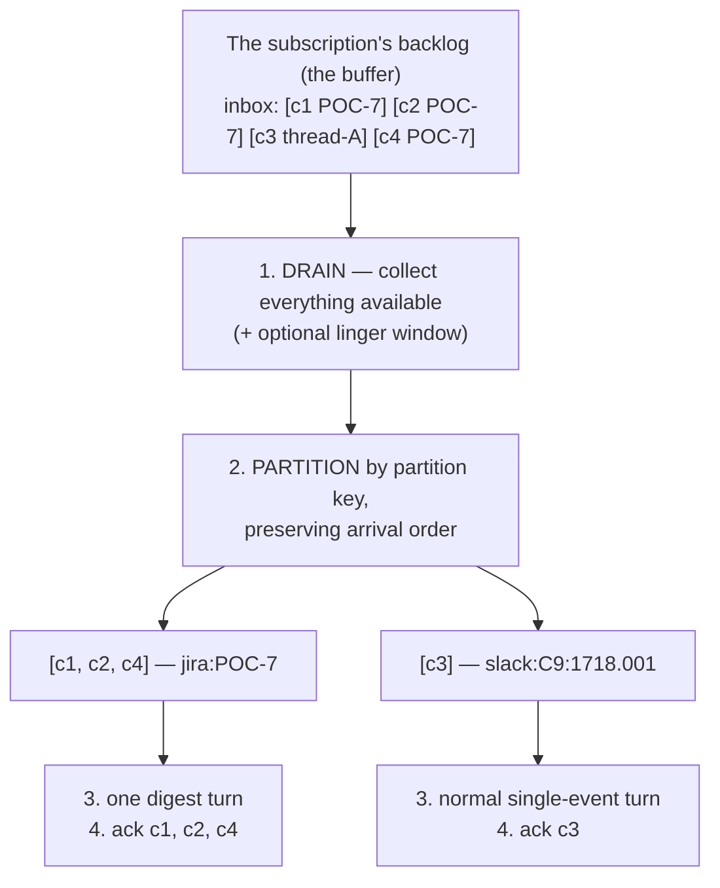
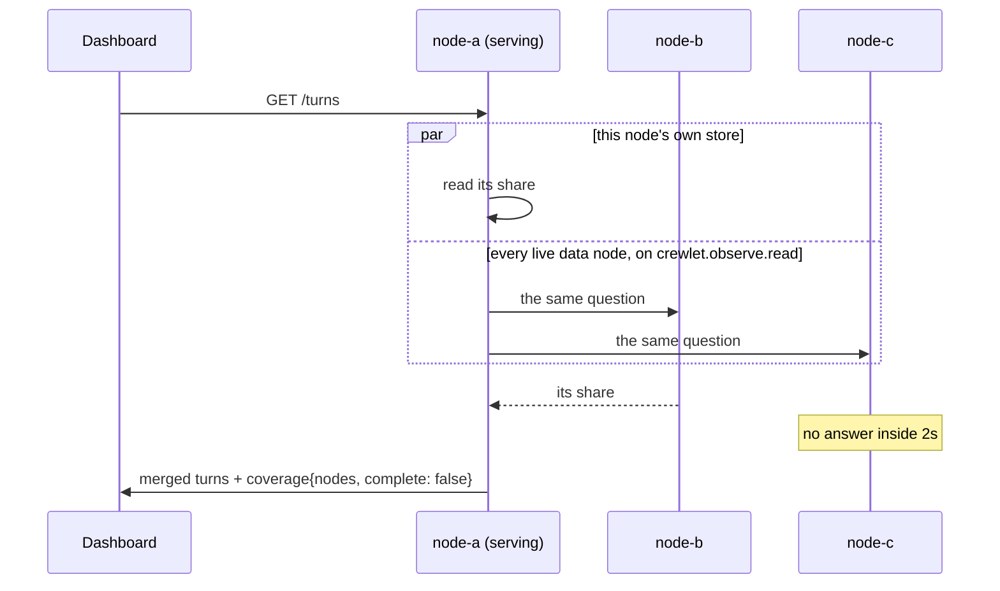
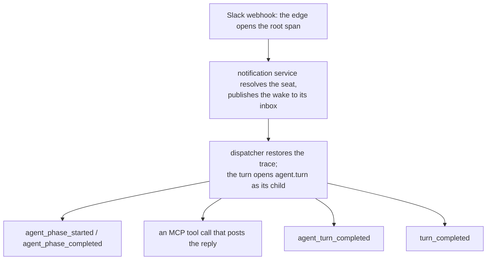
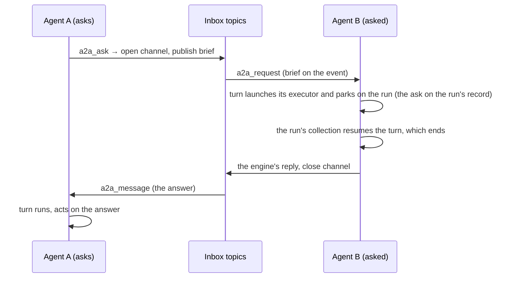

# Event System

All inter-component communication in Crewlet flows through a persistent event queue (`internal/queue`), backed by NATS JetStream: a broker the engine runs **inside its own process** by default, or an external NATS cluster when a fleet needs one.

---

## Interfaces

One interface serves all inter-component communication:

- **`queue.EventQueue`**: persistent pub/sub with consumer groups, for fire-and-forget messages: inbound deliveries, the wakes they route to agent inboxes, and everything a turn publishes about itself.

**Two implementations** sit behind it, the JetStream client and an in-memory twin, and **nothing above `internal/queue` may branch on which one runs**. Where the broker runs is a *connection* choice inside the first implementation, not a second code path:

| Where the broker runs | What that is |
|---|---|
| **In this process**: `stream.type: embedded`, the default | A NATS JetStream server in the engine's own process. No listener, no port, no service to operate; a solo node binds no socket, so the broker is unreachable from outside the process. `stream.store_dir` makes streams file-backed and restart-surviving, and on a broker member (a solo node included) it is **required**: empty, streams would live in memory, and the engine refuses to boot rather than lose them at the first restart. That holds with or without a company yet, because every data node runs the engine's core from boot (the **identity estate** among the state logs whose records live on that stream), and Worklet, Doclet, Chatlet and Gitlet keep their items, pages, messages and repositories there too (see [Configuration](../getting-started/configuration.md#tier-a)). Only a member keeps streams: a leaf (an embedded node without `data`, joining the members over `stream.leaf.urls`) runs no JetStream and sets no `store_dir` (see [Satellite nodes](../guides/satellite-nodes.md)). |
| **Somewhere else**: `stream.type: nats` | The same client code against a NATS server or cluster somebody else runs, dialled through `stream.url`. A laptop runs the whole company with no services and a fleet runs the same binary against a cluster. The operator's server must promise three things the embedded one is built with. (1) Messages of 8 MiB, the largest the engine sends: a server holding the connection to a smaller `max_payload` is refused when the node starts. (2) No duplicate-window limit below 15 minutes, the window `CREWLET_DLQ` declares so a second keep of one dead letter stores nothing: a lower `jetstream { limits { duplicate_window } }` refuses that stream and the node's boot fails naming the setting (see [Deployment](../guides/deployment.md#an-external-nats-server)). (3) `write_timeout: retry` for its clients. A server defaults to `close` for a client connection; a node whose link cannot carry a large delivery inside the server's 10 s `write_deadline` is then cut at its first one, and again each time it returns. With `retry`, a batch still crossing is written on and only a dead link is cut. The engine cannot read that setting, so nothing refuses a server without it. The client's own socket writes get the time the largest takes at the engine's slowest link, about eight minutes, before it gives the connection up. |
| **Nowhere**: the in-memory twin (`internal/queue/memory`) | The test twin: a real broker object plus N clients, so a test can stop a node and still inspect what its subscription retained. |

One conformance suite (`internal/queue/queuetest`) certifies both; a backend it has not certified does not exist to the engine, which is why the twin is certified by the same cases as the real broker.

A fleet's shape is a stream choice: clustered embedded members (`stream.cluster.name` / `.port` / `.peers` on each node, `stream.replicas: 3`) or one external cluster every node dials. See [Running a Fleet](../guides/fleet.md).

---

## Topic Structure

```text
# Per-seat, durable. One consumer group per seat, so membership IS ownership:
# the node that attaches is the node that gets that seat's work.
crewlet.agent.{seat-id}.inbox        # Per-agent inbox — all work arrives here
crewlet.agent.{seat-id}.control      # Sandbox starts and completions. Separate,
                                     #   because while a run holds the seat
                                     #   its inbox is held and fetches nothing,
                                     #   and a completion riding the inbox
                                     #   would wait behind the hold it exists
                                     #   to lift
crewlet.agent.{seat-id}.reflect      # A finished turn, put in front of post-turn
                                     #   reflection on the node HOLDING the
                                     #   seat, whose store is the one its
                                     #   memory is written to and carried from

# Fleet-wide work queues — ONE consumer group each, so whichever node wins a
# delivery is the node that has to route it
crewlet.notifications.inbound        # Inbound webhooks from external systems.
                                     #   There is no outbound counterpart:
                                     #   nothing the engine sends outward is
                                     #   queued — an agent writes through its
                                     #   OWN MCP tools inside its turn, and the
                                     #   chat working-indicator is a transport
                                     #   call on the node already running it
crewlet.events.{type}                # What the engine records about itself:
                                     #   the event store's listener, the live
                                     #   projection read it. Nothing routes
                                     #   work from here (see Routing)

# Control plane. Best-effort nudges: losing one costs a poll interval, never a
# revision, because the authoritative path polls the activation pointer
crewlet.config.revision_activated
crewlet.config.revision_applied

# Who is in which room right now — an artifact's or a chat room's: who is
# looking, who is editing or typing, and which seat is working there (ADR-0038).
# One subject per room, named by its kind and its id, that a node listens on
# only while one of its sockets is in the room, and one fleet-wide subject a
# node asks its peers on as it gains a room's first socket. Ephemeral — no
# stream, no applier — and deliberately outside every log's wildcard, so a
# keystroke is never a record every data node applies. Every frame is SEALED
# under the fleet keyring and one the fleet did not seal shows nobody. A
# person's chat read state has no subject at all — it is a coordination record
# every node serving sockets watches
crewlet.rooms.{artifact|chat}.{id}
crewlet.rooms.ask

# A seat's memory, ONE SUBJECT PER ROW, on a stream that retains one message
# per subject — so it holds the current value of every row rather than a log of
# every write, and a node acquiring a seat reads each row once, a table at a time
crewlet.memory.{seat-id}.{table}.{key-digest}
# and beside its rows one subject of the seat's that is no row's: the barrier
# a node publishes before it replays the seat, which each table's replay reads
# to, so a replay served by a copy behind the stream's leader is never short,
# and each table's end barrier, published there once that barrier has arrived,
# which the replay reads on to, so a row replaced around the barrier is carried
crewlet.memory.{seat-id}.hydration-barrier

# Dead letters, deliberately OUTSIDE the crewlet.* space so the dashboard's
# crewlet.events.> stream cannot resurface poison as live traffic
dlq.{topic}.{group}.{digest}         # the head is for grepping, the digest is
                                     #   the identity: a join alone aliases
                                     #   distinct (topic, group) pairs
dlq.changefeed.{source}.{group}.{digest}  # a wake feed's dead letters, one
                                     #   subject per domain's feed
```

Every one of those strings is built by `internal/queue/topics` and nowhere else: a name mismatch raises nothing, it is a message published to a topic nobody reads.

Subjects are grouped into streams by **purpose**, because retention differs by purpose:

| Stream | Carries | Retention, and why |
|---|---|---|
| `CREWLET_AGENT` | `crewlet.agent.>` | **Interest.** A message is kept while a durable consumer that has not acked it exists; a publish to a subject no consumer covers is dropped. That is the promised mailbox semantic, and why every seat's consumer must exist before anything publishes to it |
| `CREWLET_NOTIFICATIONS` | `crewlet.notifications.>` | Interest: work queues, not a log |
| `CREWLET_EVENTS` | `crewlet.events.>` | **Limits**, age bound 30 days, or `stream.event_retention_hours`. Consumers are ephemeral dashboards and per-node materializers that must be able to fall behind, disconnect and catch up |
| `CREWLET_CONFIG` | `crewlet.config.>` | Limits, one hour, so a restarted node does not replay a week of stale activation announcements |
| `CREWLET_DLQ` | `dlq.>` | Limits, the event stream's age bound. A subscription's dead letters are kept for an operator investigating poison; a wake feed's are replayed by the first node whose feed starts able to read them, discarded by an operator who gives their wakes up, else expire with the bound ([Dead letters](#dead-letters)) |

A subject in a namespace the engine does not define gets a stream provisioned on demand, with the mailbox semantic as default: the **subject space** is the engine's, so a whitelist would make the backend the authority on what the engine may name.

---

## Delivery Semantics

What the engine relies on, enforced in `internal/queue/jetstream`:

**A write returns once the broker has it, however slow a link the engine allows.** A publish, a dead letter's keep and a state log's append each return once the stream has acknowledged the message (its last byte is in). A broker member is reached in-process; a node without `data` crosses its leaf link; every node on an external broker, a data node included, crosses the network. The engine allows such a link to be as slow as thirty seconds a mebibyte, the [object store's floor](object-store.md).
- A write whose caller set no deadline waits five seconds for its acknowledgement on a member's own connection, and across a link five seconds plus its own bytes' time at that floor, for each of its first three sends. A write nobody heard is sent again, as is an append the stream's leader refused while another write to its subject was in flight; each send carries the whole message. A send past the third waits in what is left.
- A caller with its own deadline keeps it. But on an external broker the client does not check it while a request waits for the connection (a large write holds it for its whole socket write) or while its own write is in the socket. So any caller on that connection is held behind every large write ahead of it, each for up to the client's write deadline of about eight minutes (the client's default minute cut the write and the connection), then for its own.

A link that carries the write alone at the floor or faster never fails it, the client's socket write deadline included (sized to the largest write at that floor, about eight minutes; the default minute cut a write over about 2 MiB). A slower link still can, and so can a link carrying something ahead of the write or its acknowledgement: another large write, or the link's one window of the node's own transfers (object store uploads and downloads and memory replays and publishes, both ways together, crossing the floor in at most four seconds so a small request behind them is answered inside its five-second term: [ADR-0161](../../adr/0161-a-link-carries-one-window-both-ways-sized-to-a-requests-term.md)), whose bytes no budget counts. The worst case is long: a write at the 8 MiB ceiling across a link at the floor waits about four minutes a send beyond the five seconds, and a write whose answer decided nothing gets up to three sends, so up to about twelve minutes before it reads as an outage. That bound is fixed when the write starts; a send past the third and a pause between sends never move it. Everything the node sends behind it on that link waits as long; its leases do not where the path shares fairly between connections, since its holds ride a connection of their own ([ADR-0174](../../adr/0174-a-nodes-holds-ride-a-connection-nothing-else-rides.md)).

**Pull, not push.** Consumers fetch (one message for an ordinary subscription, one drain's worth for an inbox) when ready to run one. Nothing is pushed into a client-side queue, so a quiesced, paused or detached consumer holds no mail hostage, and resuming is fetching again.

**A durable consumer, created detached.** `EnsureSubscription` creates a seat's consumer with explicit acks, nothing attached, at `DeliverAll`. It takes about a millisecond, so every node can create the mailbox behind every seat in the company at boot. Never "latest": such a consumer discards everything published before something first attaches.

**Every durable subscription can be listed.** `ListSubscriptions` answers which subscriptions the broker holds under a topic pattern, attached or not and whichever node created them, as the exact topic and group each was created with. It finds a mailbox after everything that knew its name has forgotten it (see [Seat Ownership § The removed seat](seat-ownership.md#the-removed-seat)).
- A JetStream consumer's name is a lossy rewrite of that pair plus a digest, so each consumer records the pair in its metadata at `EnsureSubscription`. The pair is listed only when it derives the consumer's own name, so a caller never deletes the wrong subscription. A consumer whose metadata does not derive its name is logged as `jetstream_subscription_unnamed` and left out; so is one the broker holds offline (made with something this server does not support, answered with no configuration), as `jetstream_subscription_offline`.
- Only the metadata leader answers, and a member that has not noticed its leader is gone drops a page silently, so each page is a read of its own. A page of stream names nobody answers is asked again two seconds after it was sent. A page of a stream's consumers (gathered from every consumer's own leader, waiting up to four seconds) is asked again after that wait, a read term and a re-ask: six seconds after it was sent, past the client's five-second default. A listing whose caller sets no deadline, as the mailbox sweep does, asks each page once; a dropped page fails that sweep's tick and is listed again at the next.
- A consumer whose own leader did not answer in time fails the listing rather than being left out: a mailbox is never judged absent because the broker was slow.
- Only streams the engine provisions (`CREWLET_*`) are searched, so another application's consumers on a shared account are never listed.

**Four outcomes, not two.** A handler acks, naks, **defers** or **passes**:

- **Ack**: done. It is the zero value, so the quiet path is the safe one.
- **Nak**: the handler failed. Redelivered after a one-second spacing that doubles on each further failure, up to 30 seconds: immediate redelivery spins at full speed against whatever is broken, and a flat spacing spends all 25 attempts inside half a minute. The doubling spreads the budget over about ten minutes, so a provider sitting out a spent plan, a rate-limit window or a restarting database is outlasted; a failure outliving that is not transient, and holding a seat's mailbox behind it is worse than the dead-letter copy. **A failure comes back behind the mail that was waiting when it failed**: the broker serves never-delivered messages while the backoff runs, so a newer message of the same conversation is handled first. That is the contract on both backends, held by one conformance case. The in-memory twin models the backoff virtually (the failure goes to the back of the mailbox, no timer).
- **Defer**: *this process has lost the right to do this work*. The message goes back with an immediate Nak (about a millisecond; waiting out the ack timer would park a seat's mail for the whole ack window on every lease movement) **at the head**, because the broker serves a redelivery before new mail, and the consumer **quiesces itself**, since fetching on would hand it more work it has lost the right to do. **It costs one delivery, as a Nak does, on every backend**: no broker here can give a message back uncounted, so a healthy event survives handoffs through a budget sized for them (25 rather than 10). The in-memory twin spends one too. Never a republish: it makes a new message at the stream's tail, and both the [completion ledger](seat-ownership.md#the-completion-ledger)'s idempotency and the batch layer's aging key on the identity a Nak preserves.
- **Pass**: *this node will not handle this message, and a peer may*: a delivery one build cannot read and another can. The notification service passes a wake whose record a newer build wrote when an older node meets it during a roll, and a delivery from a first-party source a newer build added (an older node has no parser for it), rather than acknowledging it as a source nothing parses ([Dead letters](#dead-letters) has what becomes of one nobody takes). A Nak would log a failure for a delivery that failed nothing; a Defer would stop the node taking every other message and return the message unspaced at the head, so a fleet whose nodes all pass it would hand it round as fast as the broker delivers and spend its budget before the peer that reads it has started. So a pass goes back to its group **on the failure path's backoff, by the message's own delivery count** (shared by every node, so it ages at every hand) **behind the mail that was waiting**, and the consumer **goes on taking mail**.
  - Like every return it costs one delivery, so a passed message circles for about ten minutes (1, 2, 4, 8 and 16 seconds, then 30 for each of the nineteen returns after those), then is dead-lettered with its copy. The ack window does not delay it: a pass is a delayed Nak, not a timeout.
  - Nothing steers a pass to a node that can handle it, so its dead letter is kept **with the group's unhandled deliveries**, on a subject beside the group's poison, which is how a capable reader finds it again ([Dead letters](#dead-letters)). Ten minutes is the group's own budget because a dead letter follows, not a drop.
  - **A passed message holds one of the group's ack-pending slots from its first delivery** until a node that reads it acks it, or its 25th delivery is dead-lettered and terminated (the broker keeps a message pending until acked or terminated; a delayed Nak only moves its next delivery). The engine's subscriptions set no pending limit, so the server's default of 1000 applies (an external server's account may set less). **While passes hold all 1000, the group stops delivering new mail until slots free, and loses nothing.**
  - A slot's hold depends on the newer build's share of the group. After a first pass: about 2 seconds with three quarters of the group on the newer build, 3 with two thirds, 7 with half, 42 with a quarter, 3 minutes with a tenth, and the budget's whole 601 seconds when no node reads it. Worst case, early in a roll with one newer node among many: about 1.7 newer-record wakes a second, sustained, fill the 1000 (1000 over 601 seconds). Keeping the server's 1000 is a decision: only the newer build's own records, relayed by its feeds, make such wakes, only that early in a roll, and the cost is the group's other mail waiting, never a delivery lost.
  - A pass is logged at `INFO` as `delivery_passed` (`batch_delivery_passed` for a partition), with its reason and what the node met, never as `handler_failed`. The in-memory twin redelivers it as a failure, behind the waiting mail with no timer.
  - Two conformance cases (single delivery, partition) hold both backends to the return behind the waiting mail, the consumer that goes on taking mail, and the copy kept with the unhandled deliveries once the budget is spent; a third holds a copy at the transport's ceiling, kept whole, a fourth a copy whose last delivery a hand-back spent after passes. The spacing by the message's own delivery count, which no conformance case can tell from a count of failures, is pinned on JetStream, on each path, by `TestAPassIsSpacedByItsDeliveriesAndIsNoFailure` and `TestAPassedPartitionIsSpacedByEachMessagesDeliveries`; it is what puts a pass behind the waiting mail there, since the broker takes a return made at once and the next fetch from two queues of its own, in either order.

**The ack clock is real.** A fetched-unacked message stays invisible to every other consumer of that subscription for `DefaultAckWait`, **30 minutes**, sized for a wait behind a running turn plus one worst-case turn. It is a backstop, not the handoff path: a seat that loses its lease defers explicitly and its successor sees the message in about a millisecond.

**Dead-lettering is decided client-side, with the broker as backstop.** A message is republished to `CREWLET_DLQ` and terminated once delivered 25 times. The decision lives in the consume loop, where the dead-letter subject is known and the body in hand; the broker's own `MaxDeliver` stands five deliveries past it, so a bug there cannot loop forever and a failed keep is made again. Twenty-five is sized for handoffs as well as poison: a deferral counts as a delivery, so a message must be in flight across 25 seat migrations to exhaust it. No budget solves this: a fast crash-loop is indistinguishable from poison.
- **The copy is kept even while the node stops**: the keep is made outside the consume loop's cancellation. A drain waits for it, since a delivery counts as in flight (`WaitForHandlers`, `InFlightCount`) until what its handler returned is settled, a dead letter's keep included, and so does one the consumer hands back itself (a delivery a hold, a pause, a quiesce, a detach or a stop met before its handler ran). The queue's stop closes its connection only once no keep is in flight, for as long as the stop's own allowance lasts.
- **A message is terminated only once its copy is kept.** A keep that fails (refused, cut by a stop whose allowance ran out (`dead_letter_keep_cut`), or by a node killed while it crossed) leaves the message to the broker (`dead_letter_failed`, at `WARN`): it comes back at the failure path's spacing, or at the end of its acknowledgement window if its node is gone, and its next delivery (a handler's first, which may handle it) keeps the copy.
- The broker's `MaxDeliver` allows five deliveries past the budget for that, about two and a half minutes of keeps at the failure path's ceiling. A keep failing at every one loses the copy (`dead_letter_failed`, at `ERROR`): a dead-letter stream refusing that long refuses for a reason no retry answers.
- A keep made again after one whose answer was lost (entry stored, error all its keeper heard) is stored as nothing, because the budget's keep names the message's own identity ([Dead letters](#dead-letters)).

**A handler is told how much of that budget is left**, because a handler that hands a message back spends a budget it cannot otherwise see. The count rides on the *message*, so it survives seat handoffs and restarts. Every delivery carries the number of *further* deliveries it has before the dead-letter, zero on the last one.

**Two numbers, because one cannot answer both questions.** A partition's messages sit at different counts: a conversation whose earlier message was handed back a dozen times keeps collecting fresh replies, each with a whole budget. So a handler is told the **partition's** headroom (the smallest of its messages', which answers "will handing this batch back dead-letter something", since one outcome covers all) *and* **each message's own**, which a handler deciding about one event must read. Reading the first where the second is meant bounds a caller by the worst message in its batch; reading the second where the first is meant hands a batch back believing it costs nothing. Both backends state the per-message counts in the contract's convention (the two brokers count deliveries and redeliveries respectively), the contract folds the partition's from them, and the conformance suite certifies both, including a partition at mixed counts. The one caller today is the [mid-run clarification](code-sandbox.md#mid-run-clarification-ask_and_wait) answer route, which reads *the reply's own* headroom and stops offering it to a parked executor while deliveries are still left, rather than handing it back until the broker dead-letters it.

**The returns keep different places, and that is the choice a handler makes.** A failure (Nak) and a pass return *behind* never-delivered messages; a hand-back (Defer) returns at the head. A handler whose message must keep its place (a later message of its conversation would otherwise be taken for it) does not Nak: it defers, when what failed is the node or its store rather than the message, or it settles the message durably and retries the work itself. The engine does both: a pause or a budget park the queue refused, and a parked executor's answer that could not be recorded, are deferred, and an answer that *was* recorded is retried by the sandbox coordinator rather than redelivered (see [Mid-run clarification](code-sandbox.md#mid-run-clarification-ask_and_wait)). **Within one handler call**, order comes from the events' own timestamps, which is why the batch layer sorts by them; nothing orders two calls.

### Dead letters

Two things give up on a message, and both keep it in `CREWLET_DLQ`, kept by the event stream's age bound (`stream.event_retention_hours`, 30 days unless set) and never by interest, so an entry is there whether or not anybody reads it. A keep is a write like any other, waited for as long as its bytes take to cross a link (see [Delivery Semantics](#delivery-semantics)), so an entry as large as the transport carries is kept across a slow leaf link rather than failed as an outage its keeper retries for ever. An entry is a body and a header kept apart, and the dead-letter verbs read them apart: a subject's entries are listed by header alone, one entry's body is read by its sequence, what a set of subjects holds is counted without listing, and an entry is removed one at a time.

A keep names an identity its keeper derives from what it keeps, which travels as the message's `Nats-Msg-Id` (digested with its subject). `CREWLET_DLQ` collapses a repeated one for fifteen minutes, so a second keep of the same thing is stored as nothing and answered as already kept. Fifteen minutes is the longest a keep waits (three sends of about four minutes each at the transport's ceiling across a link at the floor, plus the request term, with room). That window is why `stream.event_retention_hours` cannot be set below 0.25: the broker refuses a stream whose duplicate window outlasts its age. The delivery budget's own keep names the message the broker stored (stream, sequence, the broker's instant) on either of a subscription's two subjects (below), so a keep that stored its entry and lost its answer, made again, is stored as nothing. A copy within the framing of the transport's ceiling has no room for that identity's header and is kept with none, so a keep of it made again after a lost answer stores it twice: a second copy of one delivery, never none.

- **A subscription's budget**: a message delivered 25 times is republished as its own bytes, with no header, to one of two subjects, **by whether the message failed as itself at any of its deliveries**, never by the return that spent the budget. The subject says which, never a header, because a copy at the transport's ceiling has no room for one.
  - Failed as itself: `dlq.{topic}.{group}.{digest}`, for an operator investigating poison. Nothing replays it, whatever return spent its budget: a hand-back judges nothing of a message, so one whose every delivery failed is poison though a node that shed or stopped handed its last back.
  - **Every other message** (passed, handed back, or failed only for a reason of its node's own): `dlq.{topic}.{group}.unhandled.{digest}`, a healthy delivery no member of the group handled. For a [pass](#delivery-semantics) its dead letter is what delivers it, since nothing steers a pass to a node that can handle it.
  - A handler says a failure is its node's own with `NakNode`: returned as any failure is, spaced and behind the waiting mail with the consumer taking mail on, its line (`handler_failed`) naming `fault=node` where a message's own says `fault=message`, and never counted against the message.
  - A seat's mailbox and its executor's control topic answer by one rule, whether the failure met a requeue, a park, the turn itself or the resumed turn a completion runs. The node's own failures are:
    - every failure the queue tells as the node's (`queue.NodeFault`: a broker that did not answer, a queue no longer live, a delivery whose context the node's stop or drain ended);
    - every failure its record names as a condition of the infrastructure: a coordination store, state log, store, data node, file store or disk that failed; fleet nodes holding different keys or builds; a coding sandbox that failed for no mail's doing (its runtime not answering (`sandbox_provider_unavailable`), a setup download failing on the far side); a configuration the deployment cannot start;
    - every hand-back the coordination store's silence made;
    - on the control topic, a resume another node or build can make (a parked state or reply kind a newer build wrote, a seat or company that is not the node's) and a claim the seat's recovery gate refused while the node's pass over the seat's runs is under way, which comes back once the pass is done;
    - `state_log_unavailable` (the log's own refusals).

    The message's own: a deadline, an abandoned wait, and a write the state log refused for what the write is (`state_log_write_refused`: a record too large, an object deleted for good, an operation id reused or superseded).
  - A data node's custody keeper treats every failure of a batch it could not write or settle as the node's, except the store's refusal of the batch itself (one naming no id or origin, or holding a record that cannot be stored). A claim its coordination store did not answer, and its own store failing once every record validated (a full disk or a busy store among them), are the node's.
  - Each member that fails a message as itself marks it in `CREWLET_FAILED` (one empty message per failed message, kept for the event stream's age, deleted once the message is settled) before it goes back, since deliveries go to every member of the group. The member whose return spends the budget reads the mark, the stream leader's answer. A mark that could not be written or read errs towards the unhandled deliveries (`failure_mark_unkept`, `failure_mark_unread`), never a healthy delivery kept with the poison nobody replays.
  - **Notification inbound replay.** The notification service's inbound group passes a wake whose record a newer build wrote when an older node meets it during a roll. A newer node that cannot publish its wake (broker did not answer, queue no longer live, or its stop ended the handler) fails it as its own (`NakNode`), so a wake whose last delivery that was is kept with the unhandled deliveries, never the poison. Once a node's notification service has subscribed, a goroutine of its own lists the group's unhandled deliveries (`dlq.crewlet.notifications.inbound.notify-inbound.unhandled.{digest}`) and handles each copy exactly as it handles a delivery, beside live mail. It runs at once and for as long as the service runs: every ten seconds it asks the broker whether the subject's count of entries moved (one request however many it holds) and lists again when it did, and at least every minute while it holds a copy kept for a reason that may have cleared.
    - A copy it handles (wakes delivered, or concerning nobody) is dropped.
    - A copy it still cannot read (it passes it too, it reads as no event, or its handling panics) is kept for a node that can; this process never handles it again, since its build changes only with a restart.
    - A copy whose wake it could not deliver, one it handed back while it sheds, one it could not read and one whose drop failed are kept and tried again by a later pass.
    - The group's poison, on its other subject, it never reads.
    - A copy whose handling panics is kept, under `inbound_dead_letter_panicked` naming its sequence, and the replay goes on with the next.
    - Boot and a first company's apply do not wait for the replay; the node's stop ends it, keeping every copy it did not reach.
    - The copies come in one burst, so the notification rate limiter (`notification_rate_limit`) paces them rather than drops them, in a bucket of the replays' own so a replay never spends a slot the live path would drop a wake for. A wake it refuses waits for its window to reopen and is asked once more; one it still refuses (other replays filling that bucket, another node's or a wake feed's) is kept for a later replay (`inbound_dead_letter_rate_limited`), never skipped.
    - A running newer node reads every copy kept after its start too, so a roll paused with one newer node among older ones has each copy delivered within ten seconds of its keep. A copy no running node reads waits for the next node that does to start, kept for the stream's age bound.
    - Two nodes' replays may both deliver one copy, and a copy whose drop failed is delivered again; both are safe. Every wake's id is derived (by a parser that defers a newer record, from the record's change and the recipient; for a wake whose parser derived none, every vendor's, from the delivery's own id and the recipient, which the copy carries), so the seat's inbox and the completion ledger collapse the second copy.
    - Each pass that handles copies logs `inbound_dead_letters_replayed` (how many it listed, replayed, kept and found gone, and whether a stop cut it short), plus a line per copy: `inbound_dead_letter_replayed` (delivered and dropped), `inbound_dead_letter_still_deferred` (this node cannot read it either), `inbound_dead_letter_rate_limited`, `inbound_dead_letter_not_replayed` (its wake not delivered), `inbound_dead_letter_panicked`, `inbound_dead_letter_frame_unread` (its copy could not be read), `inbound_dead_letter_unreadable` (its copy reads as no event), `inbound_dead_letter_drop_failed` (handled, kept since its drop failed) and `inbound_dead_letter_gone` (gone before it was read). A listing that fails is `inbound_dead_letters_unread`, and every copy waits for the next pass.
    - These are a subscription's dead letters, so [`crewlet feeds dead-letters`](../reference/cli.md#crewlet-feeds-dead-letters) neither lists nor discards them, but the same reading that ages a feed's on every beat of every data node ages them: [`inbound_dead_lettered`](../reference/alarms.md) is raised from the first, naming how many wait, how many expire within a day and the soonest by age and time left. One the retention lets go before any replay delivers it is counted once, fleet-wide, as the wake it lost (`crewlet.notify.inbound.dead_letter_expired`, and an `inbound_dead_letter_expired` line). A replay's drop takes the same claim on the entry's going as a feed's replay, so a replayed copy is never counted.
    - An alarm that stays means no running node reads the copy: finish the roll, or start a node of the newer build where the roll has paused ([Running a Fleet](../guides/fleet.md#draining-and-rolling-upgrades)).
- **A wake feed's hour.** A wake feed reads a state log's own durable consumer (`internal/changefeed`, [ADR-0012](../../adr/0012-a-wake-is-derived-not-published.md)), one per domain, which every data node pulls from, so an acknowledgement is the fleet's. A node that cannot read a record (a version or envelope a newer build writes, a frame sealed under a key it does not hold, or a record its translator fails on) hands it back for a node that can, waiting two seconds and doubling to thirty between attempts (`crewlet.tracker.feed.deferred`; `feed_unreadable` for a record no build here translates). The consumer's redeliveries are uncapped, and a thousand handed-back records in its pending set stall every new wake of the domain, so the feed bounds them: a record no node has read within an hour of being stored is kept on `dlq.changefeed.{source}.{group}.{digest}` and only then acknowledged. Its sealed frame is the entry's body, so it needs its log for nothing; what the feed recorded of it (where it was delivered from, why no node read it) is the entry's one header, `Crewlet-Dead-Letter`, a line of ASCII JSON.
  - The keep can outlast the consumer's 30-second acknowledgement window, since it waits as long as the frame takes to cross the node's link, and then the record goes to another data node, which keeps it too. Both keeps name the message the broker stored (source, stream, position, and the broker's own instant, which every node reads off the delivery whether or not it can open the record), so whichever lands first is stored, the other is stored as nothing and answered as already kept, and both nodes acknowledge one entry.
  - The dead-lettering is counted once (`crewlet.tracker.feed.dead_lettered`, and one `changefeed_record_dead_lettered` line) by whichever node takes the record's dead-letter claim in the coordination store, not by which keep was answered stored: a keep can store its entry yet answer an error when its answer is lost, and that node then hands the record back and counts nothing. A node whose claim the store cannot decide counts the record anyway, since a rare double count beats a dead letter nobody counted.
  - `feed_dead_lettered` is raised from the first entry, naming each entry's age and how long it has left.

**Nothing but a replay reads a frame.** A roll that stalls can dead-letter thousands of records, each as large as its log admits, and every data node reads the feeds' entries on every alarm beat. So a beat asks the broker one question (how many entries each feed's subject holds, and the last sequence the dead-letter stream gave any entry, as the stream's leader states them in one request), and while that answer matches its last listing, the node reads nothing more and ages what it listed. When the last sequence moved, something was kept, and every feed's subject that holds or held entries is listed again; when only a count moved, entries went, and that subject is. A listing carries each entry's header, never its frame, read through a consumer the broker makes on one copy of the stream, which can be a moment behind its leader. So a listing whose count is not the leader's is listed again on the next beat, and an operator's listing or discard may not show an entry kept a moment before.

When a node's feed starts it replays its domain's dead letters, reading each entry's frame from the stream's leader as it acts on it, through the same verification and claim a delivery passes. Data nodes reach the leader over their own member's connection or, on an external broker, as that broker's clients, and the answer reaches them whole.

A node that reaches the dead letters across a **leaf's** link (a node without `data`) never asks the leader for an entry whose answer could not cross it: the leader answers a read of one message in JSON, the entry base64-encoded inside it, and the server on a leaf's side closes its whole link to the fleet, every lease and mailbox the node holds with it, on any message larger than the transport's 8 MiB. So across a leaf's link an entry is found from its headers first:

- one whose answer would not cross (more than about 6 MiB) is read raw, from a consumer the broker placed on the leader's own server, its frame crossing once and as it was kept;
- one whose answer does cross is the leader's read, given the time that answer takes at the link's slowest pace, however long;
- a drop there reads only the entry's headers.

Once it has the frame: an entry it can now read has its wake published once and is dropped, one it still cannot read is left for a node that can, and a frame the fleet did not write is dropped. Each replayed wake is marked replayed, and the notification service paces it by the seat's rate limit as it paces its own replay's copies; one the limit still refuses is failed as the node's own, and its group redelivers it, never skipped. The start is the moment that matters, because what makes an entry readable arrives with a restart (a newer build, or a key, since a node reads its keyring only at boot). An entry nothing replays expires with the stream's age bound, and its wake is lost then, counted once across the fleet as `crewlet.tracker.feed.dead_letter_expired`.

An operator can give an entry up sooner, the one decision about a dead letter a person makes. [`crewlet feeds dead-letters`](../reference/cli.md#crewlet-feeds-dead-letters) lists every wake feed's entries by id (where each record was delivered from, why no node read it, how long ago it was kept and how long it has left), and [`crewlet feeds discard <id> -confirm <id>`](../reference/cli.md#crewlet-feeds-discard) drops one, for an entry no build will ever read: a record sealed under a key retired from every node, or one no build translates, which would otherwise keep `feed_dead_lettered` raised for the whole retention. A discard:

- reaches only the wake feeds' own subjects, never a subscription's poison;
- is `admin`'s and asks a recent proof, like every control of the deployment ([The wake feeds' dead letters](../reference/api-endpoints.md#the-wake-feeds-dead-letters));
- loses its wake for good, logged as `changefeed_dead_letter_discarded` naming who pressed it and counted as `crewlet.tracker.feed.dead_letter_discarded`;
- takes the same claim on the entry's going as a replay's drop and the expiry count, so no node counts it as one the retention lost.

A replay, a discard and the expiry are the only things that clear an entry. A discard leaves the entry's identity in the dead-letter stream's 15-minute duplicate window while the broker runs, so a keep of the same record landing within fifteen minutes of its entry (from a node whose keep was still crossing a link) stores nothing. A broker that restarts rebuilds that window from the entries it still holds, so a keep landing after a restart is stored and listed again, and has to be discarded again.

---

## Routing

Work reaches a seat by being **published straight to its inbox subject** by whatever decided the seat should do it. There is no second routing hop through `crewlet.events.*`: that subject space is the record of what happened, not a work queue. Five producers put work on inboxes:

- the **notification service** (`notify.Service`), which consumes `crewlet.notifications.inbound` in one fleet-wide group, resolves each delivery to its recipients, and publishes a wake to each agent seat's inbox;
- the **scheduler**, which resolves a firing schedule's target seat and publishes `task_assigned` to that inbox, stamped with the schedule's conversation ([below](#inbox-batching--coalescing)), and records `scheduled_task_fired` on `crewlet.events.*`;
- the **A2A service**, which publishes the `a2a_request` wake to the target's inbox and the `a2a_message` answer to the asker's;
- the **work pickup**, which the node holding an agent seat runs once a minute: a seat idle with ready work on Worklet is handed its next item as a `work_pickup` naming it, filed under the item's conversation, once per item version ([Scheduling](scheduling.md#the-work-pickup), [ADR-0112](../../adr/0112-an-idle-seat-is-handed-its-next-ready-item-once-per-item-version.md)). It is the one wake derived from state rather than from a change: an assignment wakes its assignee once, and a turn that did not act on it was otherwise the last word on the item.
- a **delegated review**, which the node that parks a held request of a [delegated](../guides/delegated-decisions.md) kind publishes to each delegate as a `delegated_review` naming the request, once per request and delegate. It carries no part of the request: the delegate's node reads it where it waits when the turn starts, and a review whose request no longer waits on the delegate starts no turn.

A producer reads the organization from the epoch current when it handles the event (`Engine.Company`), never from an earlier snapshot, so an applied revision (including a seat-kind flip) re-routes from the next event on.

**Routing is an org function, not a process-local one.** Every producer resolves its recipient from the organization (a handle or an agent id to a seat, never a display name, which two seats may share; and a seat to its id, which names its inbox subject), never from which seats this node runs. The inbound queue has ONE fleet-wide consumer group, so whichever node wins a delivery routes it, usually not the one running the recipient. This works because agent ids are *derived*: `org.Organization.AgentIDFor` is a `uuid5` over the org name and the seat's handle, so every node computes the same id for the same seat, and `AgentSeatByID` / `AgentSeatByHandle` invert it with no database and no live instance. The inbox subject has one definition, `topics.AgentInbox(seat id)`, because a producer and a consumer that disagree about a topic name do not raise, they just stop talking.

**A busy seat's held inbox is read, not drained.** While one of a seat's executor runs holds it, the seat's inbox is held and starts no turn; the node holding the seat reads that mail without consuming it (`EventQueue.Backlog`) and hands the run each wake its own requester wrote about its work (its conversation, its work item, or a record the run created or wrote), which then starts no turn of its own ([Code Sandbox](code-sandbox.md#notes-to-a-running-run), [ADR-0167](../../adr/0167-a-busy-seats-wake-from-its-requester-joins-the-running-run.md)). Another writer's wake in the run's conversation, about its work item or about a record it wrote, or one from a lead of the seat, is triaged by one cheap call and gated by the engine: information joins, a lead's correction becomes their note, noise owing nothing is absorbed, a request waits ([ADR-0168](../../adr/0168-a-busy-seats-other-wakes-are-triaged-and-the-engine-gates-the-choice.md)). At the seat's cap every other wake waits for a run to end; below it the inbox flows, the dispatcher routes each wake the same way, sets aside one that waits on a run until that run leaves, and starts the rest beside them ([ADR-0169](../../adr/0169-a-seat-runs-up-to-its-cap-of-runs-one-per-conversation.md)).

### Who a change concerns, and who it wakes

The engine's own domains ([Worklet](../guides/worklet.md#what-wakes-a-seat), [Doclet](knowledge-system.md#doclet-backend-the-engines-own-pages) and [Gitlet](gitlet.md#who-a-change-wakes)) commit each change as a record on their log, and the notification service's parser for that domain decides who hears about it. Each log has its own wake feed: a fleet-wide consumer group (`crewlet-tracker-feed`, `crewlet-pages-feed`, `crewlet-code-feed`) that reads every committed record on whichever data node takes it and relays the ones that can wake somebody onto `crewlet.notifications.inbound`. A wake is derived from the committed record, not published by the node that wrote it, and that log's trim waits on its acknowledgement. Every domain decides by **one rule** (`internal/routing`), applied alike on every node; only each domain's list of reasons differs.

- **One reason per person: the first that names them.** Each domain offers its reasons in its own order of precedence (Worklet's nineteen, from `mention` down to `lead_fallback`; Doclet's `mention`, `watcher` and `container_lead_fallback`; Gitlet's fifteen, from `mention` down to `lead_fallback`), and a person named by several hears once, under the first: mentioned on a task they also watch, they are told they were mentioned. There is no exception, not even for a notice about *another* item than the one that changed: one change reaches one person once about one item, so news about another item rides that item's own record. Gitlet carries news of several items in one record by construction (up to 64 pushes from unrelated clients land in one push record, each opening or merging changes of its own, and a queue's landing lands several entries), so it applies the rule change by change: such a record tells a person once about each change it names, each a notice and a wake of its own. Closing a task does not itself tell anybody that the tasks it held up are workable. Worklet's unblocked repair does, on its next pass (every fifteen minutes), in a commit on each dependent naming its assignee, a separate change with its own [`work_routing`](../guides/worklet.md#a-persons-own-state) answer.
- **Whom a Worklet change concerns comes from the record alone.** The set is computed from the record's mentions and the routing snapshot its writer copied onto it (no clock, no roster, no author), so the tracker's applier writes the same notice rows on every data node, inside its own transaction, and whichever node wins the delivery computes the same set again for the wake. Those rows, which a person's inbox reads, are the complete account of whom the change concerned. Gitlet's records are routed the same way: every record about a change carries the audience its writer decided, its applier writes a notice row for each, and the wake is computed again from the record. Doclet keeps no notice rows: its mentions and watchers come from the record, and its one fallback, the lead of the container's unit, from the org chart the routing node is running.
- **Who is woken is that set, filtered in four steps, in this order.**
  1. A notice that is a record rather than a wake (Worklet's `unwatched`) is never woken.
  2. The person who made the change is left out, of the wake and of Worklet's notice rows too, except under a reason that is news to them: `unblocked` on Worklet, none on Doclet.
  3. A handle the company no longer employs loses its wake, and keeps its notice row where the domain writes one. The roster is asked only about somebody the first two steps kept, so a person who left after making the change is never counted as a recipient it dropped.
  4. A lead fallback is woken only when nobody else survived the first three steps, and then only the first link of its chain that did, the links asked in order only then, so a change nobody else hears about wakes one lead rather than every lead in the chain. Worklet's chain is the routing unit's lead, then the project's lead, so a lead filing an unassigned item into their own team still reaches the project's lead rather than nobody. Doclet's is the one lead of the container's unit, offered only for a page created, trashed or changing status. Gitlet's is the one lead of the repository's owner, offered only on a change's first facts when nobody who may review it was asked; Gitlet wakes **seats only**, so a person its record tells reads the notice in their inbox, and counts as somebody who heard.

  Every code wake names the work item the change implements, so the turn it starts is charged to that item ([ADR-0097](../../adr/0097-a-change-implements-one-work-item-and-carries-no-spend.md)).
- **Words wake only the seats they address** ([ADR-0113](../../adr/0113-an-agents-words-wake-only-the-seats-they-address.md)). A standing arrangement (being a task's owner or watcher, following a chat room or thread, having spoken in a thread, the other side of a direct conversation) wakes a seat only for words that ask something and name nobody in particular. A person's message or comment that @-mentions somebody, and anybody's that asks or answers somebody, wakes those seats; everyone else reads it where it was said. An agent's words ask something only where the agent says so (`asks`, which the chat posting tools, `comment_on_work_item` and `comment_on_page` require of an agent); in words that do not, an @-mention is a reference that wakes no agent, and they wake only the seat whose question they answer and the seats with a stake in their thread. A page comment that asks stays open until a seat it named answers it with a comment that asks nothing, and while it is open any reply in its thread by somebody else wakes its author. A record with no statement, a person's or an older build's, routes as it always did. A seat with a stake in a thread (an open ask it made there, or one made of it that it still owes) is woken by any reply in it by somebody else, in chat and in a tracker comment thread alike. Each chat record names the seats the rule held back (`held`), which the parser logs as `chat_wakes_held`.
- **Afterwards, an empty answer is one of three facts.** Worklet answers who each change reached, per change ([`work_routing`](../guides/worklet.md#a-persons-own-state)), and when no row remains it says which empty: `nobody` (the routing resolved to no one), `swept` (the change is older than the inbox retention horizon, so its rows may have been cleared), or `unknown` (no horizon was stated to date the absence by); or `quiet`, a change that announced nothing at all.

### Alarm wakes

A node's [alarms](../reference/alarms.md) wake the seats that may read the deployment's health. Every time an alarm changes on a node (fires or clears), the node hands the transition to an outbox, which publishes it on `crewlet.notifications.inbound` as a delivery of source `alarms`, retried until the broker takes it. A restart is not a change: the node keeps the alarms whose raise the broker took in its own file, so its first evaluation after a restart says only what changed while it was down, and a raise the broker never took is raised again. The notification service routes it by the same rule as every first-party source (`internal/routing`) to every agent seat whose role carries [`health_tools`](../guides/fleet.md#the-health-tools): one reason, no actor, and a seat the company no longer employs dropped. Each wake's id is derived from the transition and the seat, so a delivery published twice wakes each seat once.

- **The delivery is the record.** Nothing commits beside it ([ADR-0095](../../adr/0095-a-nodes-alarm-transition-is-the-record-its-wake-derives-from.md)). A transition the node did not live to publish is not recovered, since the outbox is the node's memory: what is firing now is every node's own heartbeat's to say, which `fleet_health` reads and every alarm wake sends its seat to first, and a restarted node's first evaluation says again what is still firing.
- **One alarm is one conversation, and every transition is a wake.** A per-log alarm is a transition per log and a per-entry alarm a transition per model entry or MCP server, each wake naming the log or entry it is about. Every data node evaluates its own table, and a node without `data` the alarms it measures of itself, waking from that node as a data node does; so one fleet-wide condition, such as a stale backup, fires on each data node within one alarm interval (ten seconds; evaluations are not synchronised). Every copy is keyed by the alarm alone (`alarm:<kind>`), so the [coalescer](#inbox-batching--coalescing) merges whichever are pending together when a seat's turn starts, and one look at `fleet_health` with `firing: true` answers them all. That is ALL that merges them. With `notification_coalesce_window_seconds` at its default `0`, the first copy starts a turn at once and the copies that arrive during it run together as one more, so one fleet-wide condition costs each granted seat two turns however many data nodes raise it; a window of at least the alarm interval gathers them into one, at that much more latency on every wake the seat gets. Nothing holds a transition back: the alarm table has no hysteresis, so an alarm that fires and clears more slowly than a turn runs costs every granted seat one turn per fire and one per clear, for as long as it flaps. Nobody is waiting on an answer, so a woken seat may look and end its turn having done nothing.
- **Nobody sent it.** The wake names no sender and no actor, so the turn it starts is the seat's own work, as the engine's own notice on a work item is: no [requester ceiling](gitlet.md#reads-made-for-somebody-else) bounds what the seat reads in it, and `code_status` beside `fleet_health` answers on the seat's own grant.
- **The outbox is bounded.** It holds 2048 transitions while the broker refuses them, retrying from two seconds and doubling to the alarm interval, and past that drops the oldest, counted on `crewlet.alarm.transitions.dropped`; `crewlet.alarm.transitions{change}` counts the ones the broker took.

### Access review wakes

A seat whose access changed, with open work waiting on a person, is asked for one review turn ([An agent whose access changed reviews its open work](agent-runtime.md#an-agent-whose-access-changed-reviews-its-open-work)). The node holding the seat publishes the request on `crewlet.notifications.inbound` as a delivery of source `access_review`, the alarms' route ([ADR-0111](../../adr/0111-an-agent-whose-access-changed-reviews-its-open-work-once.md)):

- **The delivery is the record, and it can be made again.** What it says is derived from the company document, the seat access ledger, the access log and the seat's pending review in the coordination store, so a request the node did not live to publish is published by the seat's next holder, which checks when it takes the seat, and a publish the broker refused is retried from two minutes, doubling to fifteen. A write to the seat access ledger measures the seat it names too.
- **One wake per change.** Its id is derived from the seat, the told record the change is measured from, the digest it is measured to and the instant the pending review first measured it, so a republish, or the same request from another node, collapses into the wake it already made, while the same change made again after a revert is a wake of its own. Every copy carries the told record's instant.
- **One conversation per seat, and nobody sent it.** Reviews waiting together merge into one turn, the wake names no sender and no actor, and a review whose seat was already told the change (by any turn) is acked without one.

### Atlas drift wakes

The agent seat that owns an [atlas](atlas.md) entry is woken when the entry drifts ([The owning agent is woken when its entry drifts](atlas.md#the-owning-agent-is-woken-when-its-entry-drifts)). The node holding the `atlas-wake` duty publishes the wake on `crewlet.notifications.inbound` as a delivery of source `atlas_drift`, the alarms' route ([ADR-0143](../../adr/0143-the-agent-seat-that-owns-an-atlas-entry-is-woken-when-it-drifts-at-most-once-a-day.md)).

- **Claimed, then published.** The seat's record on the entry in the coordination store is written first, at the revision it was read at, and the publish follows. A publish the broker refused is made again by the next pass, five minutes later, from what the record says.
- **One wake an entry a day.** Its id is derived from the seat, the entry and the UTC day, and every copy carries the claim's instant, so a publish made again collapses into the wake it already made.
- **One conversation per entry, and nobody sent it.** Two entries are two turns. The wake names no sender and no actor, and carries no body: the entry's id, its kind and the change classes are all it says.
- **Not held, skipped.** Unlike other mail, a wake for a seat that is paused, unplaced or parked on its budget or its models is not published at all, so it is not waiting, out of date, when the seat resumes.

### A seat's mailbox exists before the seat is running

A durable subscription **is** the mailbox, and it exists whether or not anyone is consuming it. Publishing to a topic that no subscription covers **drops the event silently**, with nothing reporting a loss: on the shipped backend the agent and notification streams use interest retention, which keeps a message exactly while some durable consumer that has not acked it exists.

So every node creates the subscription behind **every agent seat in the company** as it starts, before it claims a single one, and again whenever an applied revision adds a role. Not its own share: a mailbox is a fact about the company, and the node that ends up serving a seat may not be the one that made its mailbox. Creating one is idempotent, so a fleet doing it N times costs N−1 no-ops.

**No wake is published before its mailbox exists.** A boot makes every seat's mailbox (its inbox and its [priority lane](#a-person-waiting-goes-first-the-priority-lane)) and the inbound edge's own mailbox (the router's group on the notifications stream, which is interest-retention too) before it starts anything that publishes: the scheduler, the change feeds, the Mattermost transport and the inbound router. A revision's new seats get their mailboxes **before** its parties are indexed, since from that moment a delivery naming a new seat resolves to it. The node's **wake queue** is the backstop for a create the broker refused. Every producer of a seat's wake (the inbound router, the scheduler, agent-to-agent asks and a park's requeue) publishes through it, and it confirms the seat's mailbox against the node's own set before the wake is sent (a map lookup, no broker call once confirmed; otherwise it runs the mailbox pass on demand). A mailbox it still cannot confirm refuses the wake with a retryable error instead of handing it to a stream that would discard it, and no producer drops a refused wake:

- the inbound router NAKs the delivery and the broker redelivers it;
- a park's NAK returns the partition;
- the scheduler and agent-to-agent asks confirm the seat's mailbox **before** they claim the fire or open the channel, so a refusal leaves nothing behind. A deferred fire is retried on the next tick (see [Scheduling](scheduling.md#fires-that-wait-for-a-seats-mailbox)) and a refused ask is reported to the asker to send again.

So a trigger aimed at a seat nobody is running yet **waits** instead of vanishing:

- during boot and during a rollout, where seats are claimed a few per sweep and the rest are briefly unowned;
- for a seat whose placement no live node matches (a role pinned to a node that is down, or carrying a label nobody has). The sweep reports those as `seats_unplaceable`; their work accumulates and drains the moment a matching node appears.

When the resolved target is a **[human seat](humans-in-the-org.md)**, the event is skipped: a human has no inbox and no turn to wake, and the engine never sends as itself. These internal events route to agents only; the human is notified natively by the PM tool / Slack where the work lives (and agents reach humans through their own colleague-surface tools with an @-mention). Inbound external-surface webhooks addressed to a human are likewise recorded as an info-level skip, not an undeliverable warning.

---

## Inbox Batching & Coalescing

An agent turn takes minutes; webhooks arrive in seconds. Unbatched, ten comments on one Jira issue arriving mid-turn would drain as **ten sequential full turns**: 10× LLM cost, each seeing one comment alone. Inbox delivery is therefore **batched per conversation**.

**The buffer is the broker backlog**, with no in-memory layer (events held in memory after their broker message was acked would be lost on a crash). The inbox consume loop changes how the backlog is *drained*:



**`SubscribeBatch`** (the `EventQueue` contract; both implementations) does steps 1 to 4: after the first message it drains everything available plus anything arriving within the `queue.BatchOptions` linger window, up to the batch cap; partitions by a caller-supplied key; invokes the handler **once per partition**, sequentially (per-agent serialization unchanged); and acks a partition's messages only after its handler returns. A failing partition NAKs exactly its own messages (normal redelivery / DLQ policy) without affecting other conversations in the drain.

A pause taken *during* collection (`PauseDelivery`, or a hold on this seat's inbox) NAKs the whole drain back: no turn may start under a pause. One landing *between* partitions (a deferral, a hold, a drain pause, a detach) stops the drain the same way, and the undispatched partitions go back through the same budget check: **being drained is the delivery**, so each costs one delivery.

**A failed turn does not hold its conversation back.** A failing partition's redelivery waits out a backoff (one second, doubling to thirty); meanwhile a newer event on the conversation is drained without it and runs first, and the failed event follows in a later turn. Event timestamps order events *within* a partition, not two turns. Holding newer events back would stall the conversation for the whole backoff and spread a poison event's failure to healthy ones, since a partition succeeds or fails as a unit.

**And the failed one is not answered twice.** In a chat thread the newer message's turn sees the failed message waiting and answers the thread as it stands. So the turn reports the waiting messages its thread block showed it (its own writer's, after the seat's last reply, before the message that woke it; never one a bound dropped, never another writer's, which is owed its own turn, below), and on completion they are written to the [completion ledger](seat-ownership.md#the-completion-ledger) beside its triggers, keyed on each message's identity on its chat backend. When the failed message comes round it is dropped as worked (`TurnTriggerSkipped`: a later turn answered it in its thread), on whichever node the redelivery reaches. A message no later turn was shown (a top-level message has no thread block) still gets its turn.

**And a wake a completed turn already read past starts no turn** ([ADR-0120](../../adr/0120-a-wake-a-completed-turn-already-read-past-starts-no-turn.md)). A first-party wake carries the log position of its source record (`trigger_position`). When a turn completes, the newest such position among its triggers becomes its seat's seen-through mark for the conversation on that log: keyed on the thread's stamped partition key (never split by writer) and the log, stored in the completion ledger's bucket and aged with it, moved forward only by compare-and-set. A later wake in that conversation at or below the mark that asks the seat for nothing (not addressed to it, owing no chat surface, no question put to the room) is dropped before coalescing with a `TurnTriggerSkipped` whose disposition is `absorbed`. An obligation is never absorbed; a vendor's wake, carrying no position, never is. Reads during a turn do not move the mark.

A Worklet **state notice** (a wake under `assignee`, `blocking`, `unblocked` or `flow` whose change is no comment) is absorbed too even if addressed: it asks only for its item, work [the pickup](scheduling.md#the-work-pickup) owns, so a completed turn on the item discharges it ([ADR-0162](../../adr/0162-an-item-in-progress-says-why-it-is-not-moving.md); `worklet.Reason.Absorbable`; `Reason.Addressed` keeps its meaning for the prompt and working indicator). A pickup is filed under the item's conversation (`work:task:<id>`) with the position of the change its key names, so a pickup's turn moves the same mark. Words are never absorbed by state.

**And a wake whose relation ended starts no turn** ([ADR-0162](../../adr/0162-an-item-in-progress-says-why-it-is-not-moving.md)). A state notice that reaches a seat because it holds the item (`assignee`; `blocking` on the item others now wait on, naming those dependents in its metadata, `dependents`; `unblocked` on the item whose blockers closed) is checked at dispatch, before any model call, against its item and named dependents, each read no older than the wake's change (`trigger_position`). It is moot when its item was finished, removed or assigned to somebody else since; a `blocking` notice also when every named dependent was finished, removed or no longer waits on the item; an `unblocked` notice also when its item is blocked again. A `flow` notice tells a lead nobody is moving an item ([Worklet § Notices](../guides/worklet.md#notices)) and names the state it told of (`flow_state`); it is moot once its item was finished or removed or left that state, read with the item's flow (a read without the live projection keeps a notice of a hold it cannot see). A moot notice is dropped with a `work_wake_stale` log line naming reason and why, however late it arrives; the inbox row still records the change. Never dropped: a comment or a change carrying one, a wake under any other reason, a `blocking` wake naming no dependent, or one whose item or dependents cannot be read.

**And a wake a running run read starts no turn.** A wake its requester sent about a run's work while the run held the seat, read by the run as a wake item ([Code Sandbox](code-sandbox.md#notes-to-a-running-run)), is recorded worked by the run's turn in the completion ledger as it is read; when the inbox is let go its delivery is dropped with a `TurnTriggerSkipped` whose disposition is `joined`, naming that turn, and the turn ledger counts it ([ADR-0167](../../adr/0167-a-busy-seats-wake-from-its-requester-joins-the-running-run.md)). A wake the run never read is drained and runs as usual. A lead's message filed as their note on the running turn is recorded worked at the filing and dropped `joined` the same way, and one the triage absorbed as noise owing nothing is dropped with the disposition `absorbed`, naming the running turn ([ADR-0168](../../adr/0168-a-busy-seats-other-wakes-are-triaged-and-the-engine-gates-the-choice.md)).

**The ack budget.** Every drained message's ack clock starts at receive, but a partition handler is a multi-minute turn, so later messages stay unacked for the *sum* of the preceding turns. `DefaultAckWait` is 30 minutes and collection plus one handler run must fit, so the linger is capped at 60 s. The cap is `queue.MaxLingerSeconds`: the contract clamps to it on every read and config validation refuses an out-of-range value at load, so an operator is told rather than silently cut.

A drain outlasting the window is **redelivered**, not lost: each redelivery spends one of the 25 deliveries, and the [completion ledger](seat-ownership.md#the-completion-ledger) plus same-id dedupe make it a redelivery rather than a second turn (`TurnTriggerSkipped` makes that visible). A republish is never substituted: it would be a *new* message at the stream's tail, and the ledger's idempotency and the batch layer's aging key on the identity a NAK preserves. Partitions dispatch **oldest conversation first** (by oldest constituent event timestamp), after any partition holding a priority wake (below), so steady inflow on one issue cannot starve a waiting DM.

### A person waiting goes first: the priority lane

A drain reads only the head of a seat's inbox, so aging cannot help a message outside the drain. A seat parked on a provider limit would otherwise answer a person's DM only after working through a backlog of tracker notices.

So a seat's inbox is **two mailboxes under one subscription**. The notification service marks a wake (`queue.Prioritize`) when the seat owes an answer by the backend's own address rule (a direct message, a mention, a question put to it, a thread it is in for one of those reasons) **and** a person wrote what it answers. A source may narrow this: on Worklet only a person's comment (a mention, a question, a reply, a remark on the seat's task) rides the lane; a task a person files, assigns or moves is the seat's work, which the [work pickup](scheduling.md#the-work-pickup) hands in order, and rides with the background.

A marked wake goes to the inbox's priority lane (`<inbox>.lane`), every other wake to the inbox. Every drain takes the lane first, without waiting, then fills from the inbox; a partition holding a priority wake dispatches ahead of the rest, and the lane is asked again before each partition, so a priority wake landing mid-turn is the next turn. A colleague's mention, a tracker notice, a room's news and a schedule's fire are background, ordered as before. The work pickup puts an urgent or due item on a busy seat's lane only while nothing waits there, so a person's message waits behind at most one such turn.

The lane is **part of the inbox's subscription**: `EnsureSubscription` creates both durable consumers, `DeleteSubscription` deletes both, and every hold (a person's pause, a provider or budget park, an executor holding the seat), quiesce and detach stops both. The mark rides the event, so a parked or requeued wake returns to its lane. A mailbox listed without its lane (made before lanes existed, or its lane consumer deleted) is reported partial by `ListSubscriptions`; the node's mailbox pass ensures it again, so the first wake the node's wake queue publishes to it completes it before the wake is sent.

**The drain window bounds what one turn is handed.** A drain takes the lane, then fills from the inbox's head up to the cap; an inbox wake of the same partition inside that window joins the person's partition and is answered in the same turn. One deeper is not reached for (that would settle mail the consumer never delivered, outside its ack state, which no crash or NAK could keep exact): it is delivered once, as a partition of its own, when the inbox's head reaches it, and a chat message the person's turn already answered is dropped as worked then (the ledger's chat key). **A park keeps a partition whole**: a parked partition holding a priority wake goes back to the lane as one unit, every event marked.

**Live shows what waits in each seat's inbox.** Every node reads, every five seconds, what waits in the inbox and lane of each seat it holds, excluding mail its own running turn is working on (only the holding node can tell), and publishes a stream-only `seat_inbox_waiting` snapshot when a count moved and every thirty seconds when none did. A failed read keeps the last count. A tick reads at most four seats at once under one four-second deadline: for thirty seats, about twelve consumer-info requests a second. The live projection folds each report per seat, clears a seat its reporter stops listing only if that reporter is where its count came from, and forgets a reporter silent for ninety seconds.

The seat's live row carries `waiting` (`priority`, `background`). The dashboard draws it on Live (the running turn's row and the holding executor's row) and on each seat's card on the Agents page, where a parked, paused or idle seat shows it. Counts are messages: the lane reads "79 messages from people" / "1 message from a person", the rest "9 other notices" (or "4 notices" with no person's message beside them). A short line (a running turn's or an executor's) says one count ("88 queued") with those words in its tooltip.

**A person waiting behind a busy seat sees their message is queued.** Once a priority wake is durable, the routing node announces it on `crewlet.waiting.<seat>` (an ephemeral broadcast carrying the wake's id and the conversation's keys, never a person or the message's words). The node running the seat, when busy (a delivery being dispatched, or its executors holding every slot of its cap), raises the conversation's working indicator in its queued state: "is queued behind its current task", or "behind N tasks" when other people's messages are ahead. The turn that picks the message up joins that indicator and moves it to its phase in place; the dispatch that finishes with the message takes its wait away, a dead-lettering hand-back included.

Every queued line ends: a seat leaving the node takes its lines down, a node stopping clears them (after a crash a chat surface's indicator lapses on its own), and a line stands at most an hour. Ending it never touches the message, which stays on the inbox. An idle seat picks the message up at once with no queued line; a paused or parked seat is stopped, not busy, which its Live state says. Chatlet draws the queued line (the agent's presence member carries `queued`); a backend whose indicator is a composer typing line raises nothing for a message only waiting.

**A person waiting is told why, once.** Behind a seat whose executor run holds it, the seat's [router](code-sandbox.md#notes-to-a-running-run) says **why** a person's message waits, once per message and reason, in place of the count: "is waiting for Ana or Ravi to approve adding this to the work it is doing" while their request is [put to who may let it join](code-sandbox.md#folding-another-writers-request-in), and "is working on other work; this runs after it" for a message left for a turn of its own (a request refused or with nobody to approve it, a message about other work). Read again, at every nudge and backstop, by the same router or the seat's next one, the line is not raised again; a refusal changes it once to the second. The node forgets what it said once the message runs or joins the running work, and when it lets the seat go. It is the same indicator, so it ends as every queued line does.

**One turn works for one writer.** The node partitions a drain by the stamped key and by who wrote each message (`notify.KeyOf`): one person's ten messages in a thread are one digest turn; a colleague's or stranger's message in that thread is a turn of its own. A turn is worked for the one principal who woke it, held to the apps they use ([ADR-0109](../../adr/0109-a-turn-somebody-woke-is-held-to-the-apps-they-use.md)); mixing writers would hand one the other's apps or read a person's words as a stranger's. The writer is read from fields every producer sends (a first-party notice's writer, the parser-stamped actor, else the sender). Chatlet's wakes state their writer like other first-party sources, so a Chatlet message partitions on its seat.

**And for one whom**: an agent's write on Worklet, Doclet, Chatlet or Gitlet carries whoever the writing turn worked for (`NotificationWriter.WorkingFor`), as does the engine's own Gitlet record about an agent's earlier enqueue (the merge queue's removal of a change, and a close it could not make), carrying whom the enqueue was for. The turn it wakes works for them, and the partition keys on the whole (`seat:cto for seat:ada`, `system for seat:ada`), so one agent's writes for two people are two turns, for every wake that asks something of the seat.

The one exception is the seen-through mark above, which keys on the thread, never the writer: absorption only drops a wake, whatever its writer or carrier ([ADR-0109](../../adr/0109-a-turn-somebody-woke-is-held-to-the-apps-they-use.md#amendment-a-requester-rides-on-what-a-seat-writes), [ADR-0120](../../adr/0120-a-wake-a-completed-turn-already-read-past-starts-no-turn.md)). The two reads that match a message to a turn also take whom it was written for: a turn records as worked through only its writer's waiting messages for the same whom, and a parked run's answer must be written for whom the run works for. The writer split is in memory only: the stamped key, which a merged event carries and a parked run's batch is matched against, stays the thread's.

**Partition keys** (`notify.Prompt.PartitionKey`, namespaced by source) are derived by pure logic from webhook metadata via the per-source `notify.Prompt` classes that build prompts:

- Jira: the issue (`jira:POC-7`). Confluence: the page. GitHub: `repo#number`.
- Worklet: the task's **id** (`work:task:<id>`), never its key, which two tasks can share (a counter restored beside newer work) and which changes on a cross-project move.
- Slack: the **whole channel for top-level DM and group-DM messages** (`channel_type` `im`/`mpim`, or a `D`-prefixed channel id when the variant omits the field), so rapid top-level DM messages are one batch; a DM *thread reply* keeps its thread key so the merged trigger never carries the wrong reply target. Elsewhere channel + thread root (`slack:C9:1718.001`): a top-level channel message keys on its own `ts` so replies join it, while unrelated asks in a shared channel never merge.
- A schedule's fire: its **schedule's conversation**, `schedule/<scope>/<scope id>/<name>` with each part escaped as a URL path segment (`notify.ScheduleConversation`), the scheduler's own stamp. Fires that waited in a seat's inbox together reach it together and run once, as the latest (see [Scheduling](scheduling.md#fires-that-wait-in-a-seats-inbox)).
- A work pickup: the item's conversation (`work:task:<id>`), one conversation with the item's other wakes.
- Everything else (a `task_assigned` no schedule names, A2A wakes, notifications without a derivable conversation) keys uniquely on the event id and is **never coalesced**; single-event partitions follow the unbatched dispatch path.

**Conversation identities** (`notify.Prompt.ConversationIdentity`, namespaced the same way) are the SECOND key, the one that outlives the drain. [Conversation sessions](conversation-sessions.md) carry what the seat did into that conversation's **next** turn, which continues the session its last turn left, and the episode row and turn telemetry are stamped with the identity so history can be asked for by thread. The `event:{uuid}` fallback serves both keys, so those consumers store nothing for a trigger without a real conversation (no later message could reproduce the key).

**The scheduler stamps an identity too**: a fire carries its schedule's conversation as both keys, so each fire's turn continues the session the schedule's last fire left on that seat ([Scheduling](scheduling.md#each-fire-continues-the-last-fires-session)). Nobody can reply into it, so `notify.Derived` refuses it like the fallback, and a fire is never offered to a parked run as the answer to the schedule's last question.

For every source but chat the two keys are the same string (an issue key, page id, monitor id, task id). **Chat differs, only for a direct message**: a DM is one conversation however threaded, so its identity is the bare channel (`slack:D1`) while a thread reply partitions on its thread (`slack:D1:1718.001`); in a shared channel a thread IS the conversation. The rule: **a partition key is always the identity or a finer cut of it**, so every event in a partition carries one identity and the turn's executor-log rows are keyed once.

A notification Worklet, Doclet or Chatlet raised also carries `trigger_position`: where on its log the causing change was committed, as a position token (`<stream>@<generation>:<sequence>`). The turn it wakes hands that position to its node's read-your-writes floors before its first read, so whatever the seat then reads from that domain (a Worklet list or item, a page or listing of pages, a room, a thread or a mention list), on whichever node answers, is no older than the change. Ranked searches are the exception: they read an index each node builds behind its own rows, carry no floor, and may miss a change made a moment ago (see [Read-your-trigger](../guides/consistency.md#read-your-trigger-is-a-floor-not-the-mechanism)). A vendor's notification carries none.

On the wire of an inbound notification the partition key rides `partition_key` and the identity `conversation_identity`, each read only from its own field: a notification naming a partition and no identity names no conversation. The partition is spelled `partition_key` because everywhere else `conversation_key` is the **identity**, which tags a turn's events in the event store.

**Busy agents queue; held agents wait on the broker.** A delivery that finds its agent mid-turn does not fail: a seat's attachment dispatches one partition at a time from a single goroutine, so the next is not fetched until the handler returns, and the per-node gate holds anything past `node.max_concurrent` in this process. The handler holds the delivery for a full turn, which the 30-minute ack window is sized for.

A seat whose executor runs hold every slot of its cap (potentially hours; `sandbox.Coordinator.SeatCount`, `sandbox.max_concurrent_runs`, two by default) is not handed its mail at all. The sandbox coordinator holds the seat's inbox (the `sandbox` hold) from the moment the launch that fills the last slot opens its run's row, before the launching turn can return (for a run recovered when a node takes the seat, before the mailbox is attached), and lifts it when a run stops holding it, by settling or parking on a question. Held, the consumer fetches nothing: mail waits on the broker with order and delivery count intact. A delivery that reaches a held seat anyway (it raced the hold, or the hold was refused) asks for the hold again and is **deferred**, keeping its place at the head of the inbox at the cost of one delivery. Below the cap the inbox flows, and a delivery that waits on one of the seat's runs (of a conversation it works, or related to it as the router relates a wake) is **set aside** (`queue.OutcomeAside`) under the conversation or the run's key: unacknowledged and kept from timing out, its delivery count untouched, while the consumer goes on past it. The coordinator readmits each key as the run holding it leaves (`EventQueue.Readmit`), at the head of the next drain; a release or a stop hands aside mail back at one delivery, and a crash redelivers it after the ack window. At most 64 wait aside (`queue.MaxAside`); past that the inbox is held until a readmit frees room.

A held seat receives nothing, a person's answer to another of its runs included: an agent busy with its run takes up nothing else, and a second resumed run would put two of the seat's turns in flight. A chat reply waits with the rest of the mail and is offered when the run settles or parks. An answer by turn is addressed to a run and travels on the seat's control topic, not the inbox: recorded at once, its resume waits for the run, then runs ahead of the held mail.

A run that stopped to ask a person something holds nothing, so the seat can receive the answer; those deliveries run as usual, each offered to the parked run's answer match before becoming a turn. The first reply after the question is **recorded on the run** and acked; the resume is the sandbox coordinator's from there, retried on its own schedule, with the inbox held under the same `sandbox` hold so later mail is worked after the resume. The reply then reaches the seat **once**, whatever becomes of the run:

- Left behind by a node that stopped after claiming it for its resume and before its turn took it, it is given back to the run by the seat's next holder, which finds the claim as it takes the seat.
- Let go of after its attempts, ended before a turn could take it (inline attempt or retry), or left behind that way once its revivals are spent, it is handed back to the inbox as the ordinary message it is, through an outbox on the run's own row (the store will not delete a run still holding a reply no turn took).
- A reply a resumed turn took is that turn's, neither revived nor handed back.

Its original delivery is recorded as worked in the completion ledger the moment it leaves the run (when a turn takes it, on either route, and before a reply is let go of), so the original coming round later from a node that stopped before acking it is dropped, not worked twice. Only a reply that could not be *recorded* (the coordination store failed) goes back to the broker, **deferred** rather than NAK'd so it keeps its place ahead of the person's next message, until within five deliveries of its budget, after which what is left is kept for the ordinary route (see [Mid-run clarification](code-sandbox.md#mid-run-clarification-ask_and_wait)).

While the company configures no model provider (an empty `providers.llm`, a valid company), the handler pauses the seat's inbox first and then requeues; the apply that adds a provider lifts the pause (see [A Company With No Model Provider](configuration.md#a-company-with-no-model-provider)). Neither path consumes-and-drops or pushes a healthy event toward the dead-letter topic.

**A held seat costs nothing while it waits.** Parking a held seat's deliveries (requeue onto the same inbox, then ack) made every waiting message cycle through fetch, screening, an answer-match read, a replicated publish and an ack at the broker's pace. The hold replaced it, taken and lifted at the coordinator's own transitions; the in-memory twin and JetStream both certify a held seat's mail is neither delivered nor republished until the run stops holding it.

**Letting go of a subscription: four verbs, not one.** By destructiveness:

- `Quiesce` stops taking new work while attached; `Unquiesce` undoes it.
- `Detach` closes this process's consumers and leaves the durable subscription (cursor and mail survive, so a seat handoff is cheap and an unowned seat safe).
- `DeleteSubscription` destroys the subscription and its mail. It needs no local attachment, because decommissioning a role must not depend on which node ran the seat.

Creating an inbox subscription is idempotent per seat, keyed by the seat's agent id (derived from its handle): the node's start and every apply walk the company's seats (`node.EnsureMailboxes`), and only the first call per seat creates a consumer.

**A removed seat's subscriptions are retired, not kept.** `DeleteSubscription`'s caller is the maintenance duty: once a seat has been absent from the active revision for 24 hours, its executor is ended and its inbox and sandbox control subscription are deleted with their mail. The walk that creates inboxes records each seat in the coordination store first (a removed handle is gone from the org the names derive from), and each sweep also lists the seat mailboxes the broker holds, so one that escaped that record is still found. See [Seat Ownership § The removed seat](seat-ownership.md#the-removed-seat).

**The digest trigger.** `internal/notify`'s coalescer merges a multi-event partition into ONE notification: a chronological digest of the earlier messages, then the **latest** constituent's full enriched body, so per-source scaffolding (triage guidance, `## Get full context`) renders once and points at the latest state. Two noise filters:

- Per-source supersede rules (`notify.Prompt.DigestBody`): e.g. Jira `issue_updated` bodies and stale full descriptions collapse to their event lead.
- A source-agnostic **same-sender duplicate dedupe**: a constituent whose effective body is byte-identical to a later message from the same sender collapses to a marker. It is the backstop: a supersede rule fires first where one exists (a code host's lifecycle events collapse to their lead). Two different people each saying "+1" both survive.

Comments and messages always keep their text, each inside the [fence](agent-runtime.md#text-somebody-else-wrote) its own delivery put it in, moved onto the digest's one token.

The merged event carries:

- every constituent in `messages` (sender, salient body, metadata, per-message recon flag), at full fidelity for the [learning workers](agent-learning.md), which observe **each distinct sender**;
- a conservative event-level recon merge and delivery-obligation merge (one direct ask in a burst of broadcasts is still somebody waiting);
- the max-depth constituent's delegation bookkeeping (batching cannot launder the depth cap);
- the FIRST constituent's trace context (a span cannot have two parents; the other constituents are recorded as the turn's interactions).

Same-id duplicate deliveries are dropped at the handler before merging. If a partition cannot be merged (a malformed constituent), the engine degrades to per-event dispatch: the tail is requeued as independent inbox messages FIRST, then the first event runs in the current ack scope, so a requeue failure aborts before any turn ran and a completed turn is never replayed; partially-requeued copies collapse via same-id dedupe on redelivery.

A `NotificationsCoalesced` telemetry event records each merge for the dashboard / event store, naming the PARTITION on its own field, `partition_key`, which the event store promotes to a tag of that name. It is the only event carrying a partition and does not spell it `conversation_key` (the identity on every other turn event), so a query for what a seat did on a thread never mixes in batches.

**Two knobs** (Tier B, hot-reloadable — see the [configuration reference](../getting-started/configuration.md)):

| Field | Default | Meaning |
|---|---|---|
| `notification_coalesce_window_seconds` | `0` (range `0`–`60`) | Linger after the first pending event before dispatching. `0` adds **no latency** and still coalesces the busy case (backlog accumulated during a turn drains together). A positive window (5–15 s) also absorbs bursts while the agent is idle (a human typing several messages, a Jira comment+status+assign webhook cluster). |
| `notification_coalesce_max_batch` | `20` (range `1`–`100`) | Events collected into one **drain**, before partitioning; bounds a digest and the drain, which must fit the ack budget alongside a whole turn. A larger backlog arrives as successive capped drains, and a drain spanning several conversations shares the cap: 24 events over 4 conversations at `20` is two drains, so 8 turns rather than 4. Raise it for seats serving several busy threads at once. The `100` ceiling is the digest's: the trigger is re-sent to the model every round of the tool loop. |

With the window at `0`, an idle-agent burst worst-cases at **two** turns (the first message wakes the agent; everything arriving during that turn coalesces into one follow-up per conversation), never N.

**Relation to the rate limiter.** `notification_rate_limit` (the notification service's valve, default off) *drops* notifications above N per seat per second: purely a safety valve against webhook storms and loops. Burst handling is coalescing's job (a coalesced comment is context preserved, a dropped one lost).

The one burst it paces rather than drops is a REPLAY's ([Dead letters](#dead-letters)): the inbound group's unhandled deliveries and a wake feed's dead letters, whose wakes it marks. A wake the valve refuses waits for its one-second window to reopen and is asked once more; one still refused is kept for a later replay, or, relayed by a feed's replay, failed as the node's own for its group to redeliver; never skipped. Replayed wakes count in a bucket of their own at the same limit, so a replay never spends a slot the live path would drop a wake for: during one, a seat can be woken up to twice its limit a second.

DACI discussion happens in the team channel on the company's chat surface (the engine's own, Mattermost or Slack), with the [Chatlet](chatlet.md) tools or each agent's own chat MCP tools. The decision itself, when somebody has to choose, is a **structured ask** on a work item: a tracker comment carrying the options, answered by a `choice`, arriving as an ordinary tracker wake (`asked`, then `answered`). The engine runs no workflow over it. See [Decision Framework](decision-framework.md) for details.

---

## Event Types

Grouped by the **category** each one is filed under (`events.Category`), the
same closed set the `GET /events?category=` filter and the dashboard's category
chips use, and written as the wire type an event carries in `type`. The
authoritative list, checked against the engine's own map by a test, is
[Deployment § What gets stored](../guides/deployment.md#what-gets-stored-and-under-which-category);
this is the shape of it, with the notes that need a sentence.

```text
# lifecycle: the org coming and going, plus the config changes and the
#            runtime writes an operator goes looking for after the fact
org_started, org_stopped
config_revision_activated  # a new revision is the one to serve
config_revision_applied    # one node's outcome, and how far it got
# the runtime audit: source "operator", and the caller exactly as every
# record the call wrote names it — `actor` and `actor_kind` from
# iam.ActorFor (a person is the seat they hold, as is a token or service
# account the directory binds to one, kind human; a credential bound to no
# seat is its login, kind operator) and the credential it came through in
# `operator_id` (pat:<id>, session:<lineage>, or the login). One per call,
# whatever became of it; never the arguments. Written by the node the call
# reached. The event store keeps the actor as the row's own column and
# promotes actor_kind, operator_id, tool, repo and dir to tags (beside every
# row's `node`), so a listing — which carries no payload — can still say who,
# through what, which tool, where
operator_acted             # an operator tool call that is not a proven read,
                           # on any of four transports — the dashboard's act
                           # route (act), a person's assistant over MCP (mcp),
                           # the human write surface's routes under /worklet
                           # and /doclet/pages (work), whose own refusals and
                           # tool-less verbs are recorded too, and a person's
                           # git push (/git/: transport git, tool git_push, and
                           # the repo it named): tool, transport, request_id (the
                           # operation the call's key became, scoped to the
                           # caller, so a retry carries the same one),
                           # outcome, position or refusal
own_record_marked          # the same record as operator_acted, for a call to
                           # a tool that keeps the caller's own bookkeeping
                           # (mark_chat_read, mark_inbox, the code inbox's
                           # marks, set_pins): STORED, NOT FED, so a person
                           # reading their rooms does not fill the activity
                           # feed with their read cursors
backup_requested           # a POST /backup that began copying: dir, whether
                           # it finished, and how many streams. Which node's
                           # disk holds it is the envelope's `node`
assistant_conversation_read # an administrator's compliance read of a
                           # person's Ask Crewlet conversation (D06):
                           # the reader, conversation_id, owner_id and the
                           # reason they gave; the conversation stays sealed
assistant_turn_completed   # one segment of a person's Ask Crewlet
                           # turn ending: conversation_id, assistant_turn_id,
                           # state, error_code, prompt_version, model, and
                           # every step's tool, route pattern, outcome,
                           # status and bytes; never an argument, an answer
                           # or the question
seat_paused                # a person, or the engine for a failure a
                           # retry cannot cure, paused a seat (paused_by,
                           # paused_by_kind and operator_id from
                           # iam.ActorFor, reason, stop_running, paused_at).
                           # Published once per CHANGE by the caller whose
                           # compare-and-set won, so a second pause of a
                           # paused seat is none; re-announced when a pause
                           # is amended to stop the running turn
seat_resumed               # the pause was lifted (resumed_by,
                           # resumed_by_kind, operator_id, and the paused_by,
                           # paused_by_kind and paused_at it ended)
seat_placed                # a node took a seat (on_node, epoch, and since,
                           # the tenure's start on the lease store's clock)
seat_released              # a node gave a seat up or lost it (on_node, epoch,
                           # reason); with seat_placed, how long no node held
                           # the seat
seat_access_drift_restored # an access sync put a seat's level or scope at a
                           # vendor back to what the document asks after
                           # somebody changed it there (integration, lane,
                           # agent_handle, before, after, restored_at)
agent_capability_told      # a turn's first launch carried the seat what
                           # changed in its access since it was last told,
                           # or its first snapshot (agent_handle, digest,
                           # baseline, changes, lines, revision_from,
                           # revision_to, told_at)

# not stored: a seat acquired or released by this node. Live-only, because
# placement moves seats on every rebalance; they drive the live projection
agent_spawned, agent_terminated

# task: work reaching a seat, including an executor's detached run (the
#       execution of one) and a schedule firing (which creates one). There is no task
#       lifecycle here: work's own record is the tracker's history
task_assigned              # published to the seat's inbox by the scheduler
work_pickup                # published to the seat's inbox by the work pickup
delegated_review           # published to a delegate's inbox once a delegated request is parked
executor_launched        # names the providers.llm entry the launch picked
                           # and its model (provider_key, model), and a
                           # browser seat's browser, ready or withheld (browser)
executor_asked
executor_finished
executor_failed         # a run failed, once: published under an id and an
                           # instant its ending recorded on the run's row, so
                           # the node that finishes an ending another decided
                           # repeats the same event (the store keys on it)
executor_stopped        # a run a person ended by pausing its seat with
                           # stop_running (stopped_by, stopped_by_kind,
                           # operator_id): once, under an id its ending
                           # recorded, like a loss — but never a failure
executor_answered       # what an answer to a parked run's question became
                           # (resumed | not_awaiting | gone | declined |
                           # unoffered | too_large, with answer_bytes and
                           # answer_max_bytes: a chat reply too large is the
                           # question's refusal, one record per run, question
                           # and delivery under an id and the reply's own
                           # instant, and the run is to be resumed told so;
                           # a refusal let go of before any turn told the
                           # run is a chat `declined` with the same figures,
                           # the question waiting again), by which route
                           # (chat | operator) and from whom. The operator
                           # route travels as an inbox wake
                           # (executor_answer_given), which is not stored and
                           # is never a turn
scheduled_task_fired
scheduled_fire_superseded  # a fire that waited in its seat's inbox and was
                           # not run, because a later fire of the same
                           # schedule ran in its place; under the skipped
                           # fire's own trace

# a2a: one ask, one answer, then closed. The ask and the answer also travel
#      as inbox wakes (a2a_request, a2a_message), which are not stored
a2a_channel_opened, a2a_message_sent, a2a_channel_closed

# decision: NOTHING in Crewlet publishes these four. DACI discussion is
#           behavioural guidance on the org's own chat surfaces, and a
#           decision somebody must make is a structured ask on a work item —
#           a tracker record, woken as `asked`/`answered`, not an event here.
#           They stay mapped as the seam an extension writes through, and they
#           are why the category exists to filter on at all
decision_requested, decision_resolved
contribution_requested, contribution_received

# notification: what arrived from outside, and what the engine decided
external_notification      # inbound from a third-party app webhook or chat socket
notification_skipped       # dropped notification with reason (traceability)
wake_held                  # an agent seat a change told and did not wake (its
                           # notice row is written and no turn starts, as for
                           # another agent's words that ask nothing): the
                           # seat, and the origin it was told under, which
                           # the turn ledger counts as the wake's `held`
                           # disposition. One per change and seat, under an
                           # id derived from the one its wake would have had
notifications_coalesced    # N same-conversation inbox events merged into one
                           # digest trigger (see Inbox Batching above)
turn_trigger_skipped       # a redelivery the completion ledger had already
                           # worked, emitted precisely so it is not invisible —
                           # or a trigger whose turn was ABANDONED rather than
                           # redelivered (it panicked, or wrote outside the
                           # engine before breaking), with the reason. A wake
                           # a completed turn already read past carries the
                           # disposition `absorbed`, and one a held
                           # conversation settled unrun `breaker_held`, and one
                           # a running turn's run read as a wake `joined`
                           # (naming that turn), each with its wake, which the
                           # turn ledger counts

# learning: the reflection subsystem and the skill lifecycle, grouped so a
#           dashboard can include or exclude all of it with one toggle
turn_completed             # the record that ends a turn; its `turn` tally
                           # states the whole turn however it was spread over
                           # nodes and parks: duration, reviews, tool calls,
                           # `wake` (what woke its first segment: the object's
                           # kind and reason, `schedule:<name>`, or the
                           # waking event's type), `outcome` (`moved`, `words`
                           # or `nothing`, read from the kinds of change its
                           # committed writes recorded: an item moved, a page
                           # saved, or code pushed, merged or reviewed is
                           # moved; comments, answers to asks and chat posts
                           # are words) and `tokens` (its model spend, and its
                           # in-turn auxiliary calls apart)
episode_written, persist_decider_completed
counterparty_profile_updated, reflection_completed
skill_synthesized, skill_refined, skill_promoted
skill_used                 # a seat loaded a skill; a company-published tool
                           # skill names the page it was read from
                           # (`source_page_id`, `source_container`), absent on
                           # a skill the seat synthesized for itself
skill_staled, skill_archived, skill_revived
prefetch_summary
knowledge_read             # a seat read from the knowledge base: ONE row per
                           # act, listing the pages it reached
                           # (`pages[{id, container, title, rank}]`, rank on
                           # a ranked answer only), the `backend` their ids
                           # are addresses in, the `phase` it happened in and
                           # `via` — get_page, search, prefetch (the
                           # turn-start block, no phase), skill_loaded, or
                           # skill_injected (the pages behind a phase's
                           # tool-skill catalogue). A search's `query` is
                           # clipped to 200 bytes. A read that reached no
                           # page, and a read with no seat (the operator
                           # surface), publish nothing
compaction_requested, compaction_completed

# system: the engine talking about itself
agent_turn_started         # a turn, or a resumed segment of one, beginning —
                           # before its context is assembled, so a turn that
                           # died gathering it still left a row. Names the
                           # work item the turn is charged to (`work_item`
                           # {backend, id, key, project}, absent when nothing
                           # named one) and the rule that named it
                           # (`work_item_basis`: trigger, asked_by, resume,
                           # sole_write), what woke it, and `resumed` — a
                           # turn parked on its executor publishes one
                           # per resumed segment under the same turn_id. Its depth is
                           # the envelope's delegation_depth. Every start is
                           # paired with the turn's agent_turn_completed,
                           # unless the turn died in its own frames — then a
                           # turn.guard_breach under its turn_id says so, or
                           # its process died under it
agent_turn_completed       # full LLM reasoning cycle with tokens and tools,
                           # its calls held to a record's one share of its
                           # message and the rest counted: `calls_elided`,
                           # and `elided_calls` by tool ({name, calls,
                           # failed}) — every phase's unlisted calls, and the
                           # ones this list drops in turn (see "What an agent
                           # record keeps");
                           # names the work item the turn was charged to —
                           # including by `sole_write`, which only a
                           # completion can conclude — and carries
                           # `suspended` on a segment that parked on its
                           # executor rather than ended, and `stopped`
                           # (never with `failed`) on a turn a person ended.
                           # A failed one carries `error_function` and
                           # `error_file` where its error was stamped on
                           # the way out (internal/origin): the engine
                           # function it left the code through
agent_turn_stopped         # a pause with stop_running ended this turn — at
                           # its next round, or at once where it was parked
                           # on its executor, which the pause ends
                           # (executor_stopped): stopped_by,
                           # stopped_by_kind and operator_id (the pauser,
                           # from iam.ActorFor), reason. Its trigger is
                           # recorded as worked, not retried
agent_turn_steered         # what became of a person's note to this running
                           # turn: `delivered` with the phase, iteration and
                           # round that first read it, the kind of step
                           # (`boundary`: round, brief, tool_batch, finish or
                           # step) and, for a read by the executor in its
                           # box, its launch (`launch_id`), and `retold` where
                           # a later launch's brief told it again after a step
                           # that took it never handed it over; `expired`, the
                           # turn ended first; `missed`, a step took it for a
                           # reader that never had it, or every serve of it to
                           # a Claude Code hook was lost and a serve's session
                           # proves it absent, and no later launch whose job
                           # started told it, at that step; `unconfirmed`, the
                           # executor was handed it and never confirmed it, at
                           # its job, or its harness gave up every lost serve
                           # of it, at the last of them.
                           # Published by the node whose step read it (the
                           # runner's, for a round or a run's brief; the one
                           # serving the run's tool bridge, for OpenCode's
                           # confirmation; the one that read the job's box,
                           # for a hook's note its session shows taken) or,
                           # for every other end, by the node that
                           # closed the first segment's box (an expiry) or
                           # finished the run's ending, a note told again
                           # included, under an id derived from the ending.
                           # Carries the note, note_id (the request's
                           # id), steered_by, steered_by_kind, operator_id and
                           # sent_at: a note crosses an ephemeral scatter or
                           # waits on a run's record that is deleted with the
                           # run, so this row is its only durable record
agent_turn_joined          # what became of a wake the engine handed this
                           # turn's running executor as a message about its
                           # work: `delivered` where a step of the run read
                           # it (its delivery is then recorded worked and
                           # starts no turn of its own), `unconfirmed` where
                           # its harness was handed it and never confirmed
                           # it, `unread` where nothing handed it over before
                           # its job ended; each but `unread` at its step
                           # (`boundary`, `iteration`) and job (`launch_id`).
                           # One record a wake, under an id from the turn and
                           # the wake: published by the node whose read
                           # confirmed it, or by the node that ended its job
                           # (a relaunch, or the turn's ending). Carries
                           # wake_id, trigger_ids, written_by,
                           # written_by_kind, written_on, owes_answer and
                           # sent_at, never the message's words, which its
                           # conversation keeps
agent_phase_started
agent_phase_completed      # one phase's durable record: prompts, response,
                           # tool calls, and `rounds[]` — each provider call's
                           # timing, tokens and `stop_reason` (end,
                           # tool_use or cap, the harness's own turn cap; absent
                           # where the backend reported none) — and
                           # `invocations[]`, one per harness run the phase
                           # started (its outcome, first and last round,
                           # tokens). A failed phase carries
                           # `error_kind` — a provider kind (rate_limit,
                           # auth, timeout, server, fatal, canceled),
                           # budget_exhausted, stopped for a phase a person
                           # ended, canceled, sandbox_<class>
                           # for an executor whose box could not
                           # be started, the environment condition
                           # that failed it (store_busy, disk_full,
                           # coordination_unavailable, ...), or
                           # error. Each payload is held to its share of
                           # the message (see "What an agent record keeps"):
                           # the calls a record does not list are
                           # `calls_elided`, and `elided_calls` by tool
                           # ({name, calls, failed}) — a long phase's or a
                           # collected run's dropped middle, the latter
                           # counted in its round's tool_calls — the rounds it
                           # does not list `rounds_elided`, and the tool names
                           # `tools_available_elided` and
                           # `tool_catalogue_elided`; a call held for a person's
                           # approval carries `held` and the one they
                           # approved `approved`, their `arguments` `{}`
                           # because both ride the run's record sealed
executor_collected         # one LAUNCH of an executor's run, as its
                           # collection read it off the box — published once
                           # per launch, a person's stop and a lost host's
                           # cut-off included: its tokens and cache share,
                           # `harness_turns` (the model turns its harness reported),
                           # what its harness said it cost, its report
                           # (`response`), delivered refs, activity
                           # transcript, harness, box, model and entry, and how
                           # it ended (`notes`, or `failed` with `error` and
                           # error_kind launch_failed, context_exhausted,
                           # request_refused, out_of_memory, max_turns or
                           # turn_cap_exceeded), and the
                           # kills the kernel made
                           # for memory in its job's domain.
                           # NO PHASE: the
                           # work of the `execute` round that launched it
                           # (`iteration`, `launch_id`), which every spend
                           # reader files it under — the executor's own
                           # phase record carries no tokens
auxiliary_spend            # what the seat's auxiliary model cost for one key —
                           # stage (turn, reflection, background, operator),
                           # purpose, seat or person, turn, model, provider
                           # entry, company day — coalesced over one flush of
                           # the node's ledger: calls, failed_calls, tokens,
                           # first call's start and last call's end. No
                           # prompt, no response, no `failed` key. STORED AND
                           # NOT FED: it never takes a row of the activity
                           # feed, and it moves no seat's state
code_fetched               # one reader's reads of a `visibility: unit`
                           # repository's CONTENTS on the node that served
                           # them, coalesced over one flush of the node's
                           # reads ledger (fifteen seconds): clones and fetches
                           # whose answers carried a pack (`via: git`) or a
                           # code tool's answers (`via: tool`, of one `kind`),
                           # naming the repository by id and its newest name,
                           # the reader (`principal_kind`, `principal` — the
                           # credential or the seat's handle — and the `seat`
                           # it acted as), how many `reads` and the `bytes`
                           # they were sent, stamped with the newest read's
                           # instant. Never for a `visibility: company`
                           # repository. STORED AND NOT FED, as
                           # auxiliary_spend is: the usage publisher derives
                           # who read each repository from these rows
                           # (gitlet.md, "Who read it")
code_check_finished        # one attempt of a check of a commit ENDED, as
                           # its row on the code log keeps the ending:
                           # repository by id and name, commit, check name
                           # and attempt, purpose, target branch, a head
                           # check's change, state and reason, placement,
                           # whether the target requires it, and how long it
                           # ran. Published ONCE, by the data node whose
                           # checks writer wrote the ending, on its apply —
                           # never by an applier. An ending that REPLACED one
                           # the row kept (a slow runner's exit after its
                           # attempt was errored runner_lost) names it in
                           # `replaces`: a correction of that ending, never
                           # the attempt's second. An ending that FAILS a
                           # change's head (failed, or errored past the
                           # home's own requeue) names the change's owner,
                           # and their seat on `agent_id`, the column the
                           # seat's day counts it off, once by its attempt,
                           # as `checks_failed`; every other ending names
                           # no seat, so the day passes it over. STORED
                           # AND NOT FED (gitlet.md, "Who records a
                           # check")
change_merged              # a change a MERGE RECORD merged into its
                           # branch: repository by id and name, the change
                           # and its number, the branch, the method and the
                           # commit it moved to, who merged it (a seat's
                           # handle or a person's human seat) and a person's
                           # reason where they overrode its merge gate.
                           # Published ONCE, by the data node whose
                           # committer landed the record — never by an
                           # applier, never for a retry its operation ledger
                           # collapsed. STORED AND FED (gitlet.md, "A
                           # merge, end to end")
change_opened              # a change was opened — by a change tool, the
                           # API, or a push's options (`by_push`):
                           # repository by id and name, the change, its
                           # number, target branch and title, and its owner
                           # (a seat's handle or a person's human seat) with
                           # the owner seat's `agent_id`. Published ONCE, by
                           # the data node whose committer landed the record,
                           # never for a collapsed retry; the owner's seat
                           # day counts it as `changes_opened`. STORED AND
                           # FED (budgets-and-spend.md, "A seat's changes and
                           # reviews")
review_submitted           # a review of a change was given: the change and
                           # its number, the review, the revision it judged,
                           # its verdict and how many findings it raised, the
                           # reviewer with its `agent_id`, and the change's
                           # owner with `owner_agent_id`. Published ONCE, by
                           # the data node whose change writer landed the
                           # record; the reviewer's seat day counts it as
                           # `reviews_given`, the owner's its findings as
                           # `findings_received`. STORED AND FED
code_queue_ejected         # a merge queue put an entry OUT: repository
                           # by id and name, the entry, its change and
                           # number, the branch, why (check_failed,
                           # checks_undefined, conflict, gate_unmet,
                           # head_moved, not_fast_forward, repo_mirrored),
                           # the failed or undefined checks or the
                           # conflicted paths, who enqueued
                           # it, and the
                           # change's owner with `owner_agent_id`, whose
                           # seat day counts it once by its entry as
                           # `ejections`. Published ONCE an entry, by the data node whose
                           # committer landed the eject record — or the push
                           # whose move of a queued change's head ejected
                           # its entry head_moved in the push's own record —
                           # never by an applier, never for a retry its
                           # operation ledger collapsed. STORED AND FED
                           # (gitlet.md, "The merge queue")
code_target_broken         # a protected branch's tip checks found the
                           # FIRST landing they failed on: repository by id
                           # and name, the branch, the landing's commit and
                           # kind, the change it landed and its number
                           # (none for a person's push), who landed it, and
                           # the checks it broke. Published ONCE a landing,
                           # by the data node whose committer landed the
                           # broken record — never by an applier, never for
                           # a retry its operation ledger collapsed. STORED
                           # AND FED (gitlet.md, "Tip checks and
                           # code_green")
code_mirror_pushed         # a repository's home pushed it to its push
                           # mirror: repository by id and name, the other
                           # host's URL (never a credential), the seat whose
                           # identity there it pushed as, the refs it set
                           # and onto what, those it deleted, and the
                           # protected branches it held back with no green
                           # commit to publish — each list its first 16
                           # refs in ref order beside the count of all of
                           # them (updated_count, deleted_count,
                           # waiting_count), so a first push of a large
                           # repository stays one event the queue takes.
                           # Published once a push that
                           # moved something, by the home Gitlet node that
                           # pushed; a failed push is no event (its home
                           # raises code_mirror_failing). STORED, NOT FED:
                           # the audit of what the company published
                           # (gitlet.md, "Mirrors and imports")
code_imported              # a repository's import ended, whole or short of
                           # its source: repository by id and name, the
                           # source's URL (never a credential), mirrored
                           # for a pull mirror's first fill, the chunks
                           # that landed, what the repository holds once it
                           # ended — refs, live bytes, default branch — the
                           # import's error where it ended short, and the
                           # end's position on the code log. Published ONCE
                           # an import, by the home Gitlet node that proposed
                           # the end and heard it applied; a sync is none.
                           # STORED, NOT FED: where a repository came from;
                           # its row keeps only its latest import
                           # (gitlet.md, "Mirrors and imports")
code_expunged              # an expunge's commit applied: repository by id
                           # and name, the person's purge it served (none
                           # for the weekly schedule), the expunge's id, the
                           # objects and bytes it dropped, the commit's
                           # position on the code log, and store_until — the
                           # latest a healthy fleet's object store keeps
                           # the dropped bytes. Published ONCE a commit, by
                           # the maintainer that proposed it and heard it
                           # applied. STORED, NOT FED: the audit of what left
                           # a repository; the repository's detail keeps
                           # only its latest (gitlet.md, "Expunge")
budget_exhausted           # a charge the token budget refused ended a turn;
                           # names the scope and the refusing window —
                           # period, window label, resets_at — with its
                           # spend and ceiling. Recorded as the seat's
                           # `last_error`; the seat's `stopped`/`budget` is
                           # read from the refusing window itself
turn.guard_breach          # runtime invariant fired (stall, max_iter,
                           # depth_cap, scheduled_timeout), or the model's
                           # provider refused the executor's request on a
                           # fresh session (request_refused). A failed turn:
                           # the seat's `last_error`, never a stop
llm_unavailable            # the fallback chain is exhausted. A failed
                           # turn: the seat's `last_error`, never a stop
provider_fallback          # the chain moved to its next provider. One per
                           # provider CALL, not per phase (a benched member
                           # is a hand-off on every round), addressed to
                           # the turn, phase and iteration it happened in.
                           # `to_provider_key` is empty on the last member,
                           # where the next event is llm_unavailable.
                           # A `rate_limit` hand-off carries `resets_at`
                           # where the vendor named when the limit lifts,
                           # and `from_harness` and `from_subscription`: what
                           # the limit is called on a screen
seat_provider_parked       # every member of the seat's chain refused for a
                           # rate limit, so the seat is parked until the
                           # first is tried again (`retry_at`), and again
                           # each time the engine's probe meets the limit.
                           # Carries the chain's keys, `resets_at` where
                           # every vendor named one, the head's sentence, its
                           # `harness` and whether it signs in on a
                           # `subscription`. The seat reads
                           # `stopped`/`provider` until a call through its
                           # chain answers
seat_provider_released     # a provider park lifted: the probe was answered
                           # (or failed for a reason that is not a limit),
                           # the seat's chain changed, or the node gave the
                           # seat up
llm_fleet_moved            # a seat job's work on an LLM fleet went to a
                           # member other than its home: between turns,
                           # mid-turn after a limit, or to nobody (`to`
                           # null). A fleet's hand-off publishes this
                           # instead of provider_fallback
llm_fleet_full             # no member of a fleet can take work: who waits,
                           # and the first room (`first_room_at`,
                           # `first_room_member`)
llm_fleet_room             # a member of a full fleet answered its probe,
                           # and the seats it releases
subagent_batched, phase.tool_skill_blocked, skill_telemetry_write_failed
prompt.size                # one phase's OPENING prompt, measured in BYTES
                           # plus a token approximation: the system and user
                           # text and the tool-definition array its harness is
                           # handed over MCP, under system_bytes /
                           # user_bytes / tool_bytes and tool_count. A
                           # separate row rather than a
                           # derivation: the prompts themselves are on
                           # agent_phase_completed, and measuring them there
                           # means hauling every phase payload back

# auth: who signed in and how, what ended a session, what changed about
#       what a person may do, and whether a record on a fleet log was
#       written by the fleet at all. The LIVE half of the trail: each row is
#       the publishing node's, and the fleet-wide record is iam_history
iam_session_started        # method, second factor, lineage, client address
iam_session_ended          # logout / logout_all / revoked / person_removed.
                           # A session past its own idle or absolute deadline
                           # is no row: an expiry nobody authored
iam_login_failures         # ONE per node per minute that had a failure, from
                           # the engine's own flush loop: each source's count
                           # of failed attempts — a source is the throttle's
                           # unit, an address or an IPv6 /64 — at most 64
                           # sources and the rest one overflow count. Never
                           # what was presented, and never whom it named
iam_stepup_completed       # a signed-in person confirming who they are
iam_credential_minted, iam_credential_revoked, iam_mfa_reset
iam_invitation_cancelled   # an unredeemed invitation withdrawn: which one and
                           # by whom, never the address. It frees the address
                           # and the human seat the invitation held
iam_password_changed       # a person changing their own, which ended every
                           # other session and token they held
iam_password_reset_issued  # an administrator issuing a one-time reset link:
                           # for whom, by whom, until when — never the link.
                           # With first: true, the FIRST password link an
                           # administrator's create issued the person it
                           # created on their seat — announced once, by the
                           # call that created them, never by its retry
iam_password_reset         # a reset link spent: the password set, every
                           # session and token ended, nobody signed in. With
                           # first: true, a created person setting their first
                           # password, which ended nothing — there was nothing
                           # to end
iam_grants_changed         # one per person write, from the writer that
                           # decided it: added, removed, by, record version
iam_recovery_code_used     # and how many the person has left
iam_second_factor_throttled   # a person's second-factor curve reaching its
                              # ceiling: somebody holding their password is
                              # guessing at their code. Once per climb per
                              # node — a run held there writes no more
iam_session_generation_bumped   # every session in the company ended
statelog_record_unverifiable    # a state-log record signed under a key this
                                # node does not hold; nothing under it applies
                                # until it does. Once per domain and key id
                                # per node process, at most 16 ids — the id is
                                # whatever the frame says
statelog_record_tampered        # a record whose signature fails under a key
                                # this node holds; the applier stopped

# webhook: inbound_delivery — one delivery presented to one seat, counted
#          once across the fleet, from a webhook route or a Mattermost
#          socket. The ONE type whose rows do not carry its name: each is
#          filed under the delivery's own label (webhook:<event>,
#          forge:<event>, socket:posted) with the provider's exact bytes as
#          the payload, because that is what an operator matches against
#          their provider's console. Published rather than written, so a
#          stateless node's socket reaches a data node through custody
```

**Categorised, and published by nothing in this build.** The category map also
files four types no code path publishes, so a filter on them matches no rows:
`decision_requested`, `decision_resolved`, `contribution_requested` and
`contribution_received`. DACI discussion is behavioural guidance on the org's
own chat surfaces, and a decision somebody has to make is a structured ask on a
work item — a tracker record whose wakes are the tracker's own (`asked`,
`answered`), not one of these types. They stay mapped as the seam an extension
writes through, which is why the `decision` category exists to filter on at
all.

**Excluded from the store**, each with a stated CAUSE as well as a reason:
`agent_turn_progress` (an intermediate state whose finished record is
`agent_phase_completed`), `agent_spawned` and `agent_terminated` (placement —
a fact about scheduling rather than about the company, which the live seat
state answers), `budget_meters` (a periodic snapshot of the fleet's shared
token counters, every capped calendar window with its engine-computed state,
published by every node on a fixed tick and at once when a window first turns
work away on it, which the next report supersedes; the live projection reads
it), `seat_inbox_waiting` (a periodic snapshot of what waits in the inboxes of
the seats one node holds, which the next report supersedes; the live projection
reads it), `raw_webhook` (the delivery is already a row, as the `inbound_delivery` its
edge publishes beside it), `custody_batch` (a carrier rather than an event: the
data node that keeps a batch writes each event inside it as the row it is),
`reflection_due` (the wake that puts a finished turn in front of reflection on
the seat's holder: the turn is already `turn_completed`, and what reflecting on
it did is `reflection_completed`), the two A2A inbox wakes `a2a_request` and `a2a_message` (the ask and the answer are
already rows as `a2a_channel_opened` and `a2a_message_sent`),
`executor_answer_given` (the command an answer by turn puts on the seat's control topic:
what the answer became is `executor_answered`, and that a person gave it is
their `operator_acted` row), `executor_wait_over` (the wake the engine puts on
the seat's control topic once a parked run's wait is over: the run carrying on
is its own `executor_launched` row) and `tool_skill_page_changed` (a nudge between
nodes about an edit the webhook receiver already recorded). The cause is a
value rather than a sentence, because the admission rule below is checked by a
walk and no walk can read intent out of prose. See the exclusions table in the
Deployment page above.

### What an agent record keeps

A phase's record (`agent_phase_completed`) and a turn's (`agent_turn_completed`) are each one event, and an event past the queue's ceiling (8 MiB) is refused at its publish: it would not arrive long, it would not arrive at all, taking every fact of its phase with it, and, for a turn's record, the end of the seat's live row. So each payload that grows with what a phase was handed and made has a share of the message, measured as the event encodes it with every escape counted (a page of HTML is six bytes a `<`), and a payload past its share is kept in part with the cut said. A record within every share is published as it was built.

- **Tool calls** (`tool_executions`): past their share, every row is held to the shares an executor's own call log holds a call to (its arguments to 8 KiB, the newest successful submission's to 64 KiB, its answer and a failure's error to 4 KiB as their openings, its name to 256 bytes), and past that the middle beyond 200 calls is dropped, the first hundred and the newest hundred kept. `calls_elided` counts the calls the list does not keep and `elided_calls` names them by tool, at most 64 tools, the calls of any more counted under no name. A turn's record holds every phase's list to the same one share and merges their counts.
- **Rounds**: a phase past 256 rounds keeps its first and newest 128, each with its provider call, its prose, the harness runs over it, the notes read in it and the calls made in it. `rounds_elided` counts the rest, whose calls are counted in `calls_elided`.
- **Prompts** (`system_prompt`, `user_prompt`): a quarter MiB each. Past it every part of the prompt keeps its opening, the longest cut first, and the outline (`system_sections`, `user_sections`) is rewritten to the kept text, so it still tiles it. The prompt the model was sent is not changed: this is the record's copy.
- **Prose** (`round_narration`): a quarter MiB for every round's together; past it each round keeps an opening. A collected run's round carries a copy of its report, which past that share says the record's `response` holds the whole.
- **Response**: 1.5 MiB, what a run's report may weigh at its worst escape, so a collected run's report is never cut; a host phase's model text past it keeps its opening.
- **Notes** keep 32 KiB, and each list of **tool names** (`tools_available`, `tool_catalogue`) 64 KiB, its names in order while they fit and the rest counted in `tools_available_elided` and `tool_catalogue_elided`.

Every word a record keeps is **redacted before any share cuts it**: a phase's prompts, answer, prose, notes and failure, each call's arguments and answer, and a turn's answer, summary, review notes and failure. So a cut never keeps part of a credential, and the size a cut states is the redaction's. A call's arguments are redacted value by value and stay one JSON object. A call's answer that an executor run's own log kept only the opening of is kept as the redaction of that opening's complete lines. The model read every answer as it came: only the record is redacted.

A running phase's live frame (`agent_turn_progress`) is held to live shares rather than a message's, since it is republished whole five times a second to every dashboard open on its seat and the socket hub queues hundreds for a client that falls behind: past them it keeps the **newest** of what grows, what a reader of a running phase is watching arrive. Its calls keep 256 KiB, the newest that fit, each answer already its tail, with the rest counted in `calls_elided` and `elided_calls`; its round window is a record's, counted in `rounds_elided`; its committed prose keeps 64 KiB; the attempts at the round in flight that a provider gave up on keep the newest four, each its end within its part of 16 KiB; and its calls in flight keep 32 KiB, each one's arguments 2 KiB, with the rest counted in `running_calls_elided`. The opening frame's prompts keep a record's share each. A frame at its worst weighs under a MiB. Every word on a frame is **redacted before its end is taken**, as a record's are before they are cut: a call's arguments value by value, and the round in flight and an abandoned attempt only as far as their lines are complete, so a line still being written appears once it ends and an attempt marks with `…` the words it held back. A text longer than a frame reads whole (some 390 KiB) shows its end only from a line that begins inside the 4,000 bytes shown, read with what comes before it, so one whose last 4,000 bytes hold no line break shows only `…`.

Some words are held where they are made instead, since every reader of them would otherwise hold a different cut of one answer: a review's `final_artifact` (256 KiB, what a run's report may weigh), its `notes` and its `completed_work` (32 KiB each), which `submit_review` refuses past their bounds naming the field, so the reviewer shortens them; and a trigger's `summary`, redacted and held to 1 KiB, its one line, where the trigger is described, so every record of its turn (`agent_turn_completed`'s `prompt`, `turn_completed`'s `task_summary`) holds it redacted while the turn's brief hands the model the trigger as it came.

### What may reach the node estate

A category is an **admission** as much as a filing: the map decides whether a type becomes a durable row, and the [event
store](../guides/deployment.md#the-event-store) is a file on a disk an operator
sized, copied whole by every backup, every snapshot a lagging node installs and
every integrity check before either counts.

So each categorised type also records **who authors its rate**: who decides how often it is published, never the same question as who publishes it.

| Author | What sets the pace | Examples |
|---|---|---|
| `engine` | This company's own work: a turn, a tick, a duty, a schedule | `agent_phase_completed`, `executor_launched`, `reflection_completed` |
| `authenticated` | An admitted caller: an operator holding a token, a seat, a delivery whose signature or shared token verified | `external_notification`, `config_revision_activated`, `task_assigned` |
| `anonymous` | Anybody who can reach the listener, with no credential and no identity | — none, and that is the rule |

**No event type whose rate an unauthenticated caller authors reaches the node
estate.** A failed login is the example: anyone who can reach the API
can author millions a day for nothing, so a row per attempt hands the store's size (and every artefact taken from it) to whoever makes the attempts, with no credential to revoke and no identity on the row. The
per-attempt fact is the `crewlet.auth.attempts.failed` counter; what becomes a
row is `iam_login_failures`, one per node per minute that had a failure,
published by the engine's own flush loop and so rated by the engine. It
carries a count per source (an address, or an IPv6 client's `/64`, the unit
the sign-in throttle keys on) and never the presented value: not a mistyped
login, not a password typed into the login box, not a hash of either (it would
reverse against the company's roster in one pass). Past a fixed number
of sources in one minute the rest fold into one overflow count, so
a distributed attack's size is recorded without its address pool deciding the row's size. A type that must stay out for this
reason is excluded with the cause `anonymous_rate`.

Two facts are kept out by having **no type at all**: a per-request
authorization decision (a fact about a poll, not the company; a
Tier A token refused by a route is a WARN log line on the node it reached)
and a session touch (a clock, not an event). The exclusion map is
for types something publishes, and nothing publishes either. Nothing *refuses*
them: both are caused by a caller the guard admitted, so a type for either would declare an
authenticated rate, which the walk below admits. Adding one is a decision a reviewed change has to argue against
those two reasons.

A walk over the taxonomy enforces the rule: a type
given a category while declaring an anonymous rate, and one given a category
while declaring no rate author, both fail the suite in
`internal/events`. An unstated author is not a claim that the rate is bounded.

**Stored, not fed.** Some types are rows like every other but kept out of
the activity feed, a ring of the company's last few hundred events (every
node's fed by a fleet-wide broadcast): `auxiliary_spend` (accounting),
`code_fetched` (an audit), and `code_check_finished` and `wake_held`
(counted, not watched). Their volume (several auxiliary records per turn,
a record per repository reader every fifteen seconds, every check of every
push) would push out the turns and failures a reader watches. Who read a repository, and how a change's checks ended, are
answered where they are asked ([Gitlet § Who read
it](gitlet.md#who-read-it), [§ Who records a
check](gitlet.md#who-records-a-check)). The class is declared beside the category
map in `internal/events` and asked by every read of the feed's rows: the live
projection, its startup seed, and every view that scrolls on from the feed
(event log pages and axis, the Live strip, a seat's latest
events), which ask `events` and `event_series` with `feed_only`, so a bar never
counts and a page never lists a row the feed would not hold. The row is still
in `GET /events` without it, a turn's history and a trace.

Every data node applies `feed_only` to its own rows, page and bars
alike, by its own copy of that class; the rows a related-agent page pulls
in by trace id are held to it too, since a turn's trace holds every one of its
accounting records.

---

## Event Schema

Every event carries a common set of fields: a unique ID (UUID), a type string, a UTC timestamp, an optional source identifier, the node that first published it, and a free-form `payload` map. A registered event type (for example `types.TaskAssigned`) adds its own fields, marshalled flat beside the envelope's.

Events also carry **OpenTelemetry trace context** and self-describing properties:

```go
type Event struct {
    ID        uuid.UUID
    Type      string
    Timestamp time.Time
    Source    string
    Payload   map[string]any   // free-form extras; typed fields live in Data

    // OpenTelemetry trace context — captured at construction from the
    // active span.
    TraceID      string // W3C 32-char hex, groups causally related events
    SpanID       string // W3C 16-char hex, identifies this event in the trace
    ParentSpanID string // links to the event/span that caused this one

    // Turn-engine bookkeeping, so an agent woken by a colleague handoff
    // inherits the correct depth and chain.
    DelegationDepth int
    ParentTurnID    string
    DelegationChain []string

    // The node that first published the event, stamped by the queue.
    Node string

    // Data is the typed body, non-nil when Type is registered in this
    // build. Marshalled flat into the same JSON object as the envelope.
    Data Payload
}
```

**`node` is the event's origin, and the queue writes it, never the
publisher.** Every node's queue client is built with the node's resolved id
(`node.id`, then `CREWLET_NODE_ID`, then the default: the name its
presence, leases and broker identity carry), and `Publish` stamps it on any
event that names no node yet, before a publish listener or a consumer sees it.
An event that already names one keeps it: a node handing another node's event
back to the broker (a parked delivery, a dead letter) relays the origin.
The caller's own event is never written to; the queue stamps a copy.

It is on the envelope because it is **where the work ran**. The event store is
written by a publish listener inline on the publishing node (see
[Publish Listeners](#publish-listeners)), so each data node's store holds what
it published and the events it keeps in custody for a node without `data`
([custody](../guides/deployment.md#custody-the-rows-of-a-node-without-data)).
So the store a row was read from does not say where it happened; every
stored row keeps the `node` its envelope carried, and a reader reads where the work ran off the row or live frame itself. That is
why the backup audit record names no node of its own: the route publishes
from the node that took the copy.

`node` is absent only on an event from a queue client built
without a node (test harnesses). Like every envelope field it
is additive: an older build keeps an unknown key verbatim and writes it back. No
payload may declare a field named `node`: the envelope drops
a colliding one.

`Data` is the typed half: each registered event type is a Go type with its
own fields, its own `Summary()` ("who did what", in a person's words) and
an `Actor()` (role, then source, then agent id, then `system`). A type whose
line names something a person can open (a work item, a change, a commit, a
page, a turn) writes it as a line that says so (`internal/named`): the summary
is the same words, and `References()` is each object it names, by kind, id
and the words that spell it. The event store keeps them beside the summary
(`refs`), the live feed and a turn's trigger carry them, and the dashboard
draws each as a marked link to its page, only where the reader may open it
([What a line names](../reference/api-endpoints.md#what-a-line-names)). An event type
this build does not know decodes into the envelope with `Data` nil and its
fields kept verbatim in `Extra`, and re-publishes losslessly.

Changes are additive-only: new fields get defaults, existing fields are never removed, and an unknown event type round-trips losslessly rather than being dropped (a rolling upgrade puts unknown types on the wire both ways). Every backend retains each subscription's undelivered backlog until consumed, so a restart resumes cleanly; durable, replayable event history is the [event store](../guides/deployment.md#the-event-store), not the queue. The queue keeps no ledger of everything published (the mailbox semantic): on the work-queue streams an acked message is gone at once. The one stream that keeps history is `CREWLET_EVENTS`, by **age** (`stream.event_retention_hours`, 30 days by default) rather than until someone reads it.

---

## Reading the fleet's history

Each data node's event store holds what **that node** published, plus the
events of a node without `data` it keeps in
[custody](../guides/deployment.md#custody-the-rows-of-a-node-without-data)
(see [Publish Listeners](#publish-listeners)), so no one store
is the company's history. A read of turn-level detail (`events`, `event`,
`event_series`, `trace`, `turn`, `turns`, `phases`, a seat's `llm_history`,
the integrations' delivery counts and what became of those deliveries (the
`notification_outcomes` question: each node's dropped and merged
notifications per third-party app, over the window the delivery
counts name)) is answered by **every live data node at query time**
(`internal/eventfan`, ADR-0021). The same scatter seeds the live
projection when a node starts: the feed and each seat's last turn,
so a restarted node's screens show the company, and the 24-hour spend window (the `phase_tokens`
question, cut to the asker's window and floored at the asker's instant, so
every node answers the same one) behind the
[`tokens` push](../reference/api-endpoints.md#pushes), which no screen draws:
Home and Settings › Token spend read the replicated `usage` domain's company
days instead. Every one of these reads crosses the fleet the same way:



- **The question travels, not the data.** The asker reads its own store
  directly and scatters the same question over the broker's ephemeral
  request/reply: no stream, no consumer, no stored record, because a read of
  the event log must not grow it. The roster is the live data nodes, read off the presence
  leases: a node without `data` keeps no event store and serves no API, so it
  neither asks nor is asked; the asker is always a data node. The read
  ends once every data node on it has answered, by name, or at the budget,
  never at a count of replies: a draining node gives its lease back first
  and answers until it stops, and its answer is kept, but it never stands
  in for a node the roster names.
- **Every answer says who answered.** `coverage` is
  `{nodes: [{id, answered, error}], complete}` on every answer.
  `complete` is true only when every live data node answered; one that did
  not is named with the reason: no answer inside the **2-second** fleet read
  budget, a build speaking another protocol version, an unreadable reply, or its own read failing. A short answer that did not say so would
  read like a quiet company.
- **Every node speaks one protocol version, and only that one.** Each
  question carries its asker's version; a node on any other build refuses by version and is
  named in the coverage, whatever it holds. No node answers
  around a field it cannot read (a dropped filter, a count summed as zero, or
  the asker's instant (below) answered by its own clock), so nothing returned needs re-cutting. A fleet half way through an upgrade answers
  from the nodes on the asker's build, and says so. A question narrowed to one seat (a
  listing, the company's `phases`, a window's phase spend) names
  it by seat id, never by a role name two seats in different units can share.
- **Every question is asked at one instant.** The asker reads its clock once
  per question and sends the instant, and every node floors the
  30-day history at it, not at its own clock (events
  page and trace siblings, one event, a trace, a turn, phases, axis, a page of turns and the spend window alike), so a turn's count is never
  floored later than the rows it counts and no late node
  drops what it held at the edge. The instant is read to the
  **microsecond**, the store's own resolution: finer, a row at the floor's own
  microsecond is counted by one read and missing from the
  listing beside it. A question with no instant is refused.
- **A stateless node's row can sit on two data nodes for a moment.** A node
  without `data` hands its events to one data node in
  [custody](../guides/deployment.md#custody-the-rows-of-a-node-without-data) batches, and a batch whose claim failed is
  written by a second keeper before the first has learned it is not its own,
  so until the first settles it (a pass a minute, longer while that node
  cannot reach the coordination store) both stores hold the same rows. A merge
  holds such a row once, by its `(timestamp, id)`: a listing, a
  trace's or a turn's rows, the spend window's records. Every count holds it
  once too (the axis's bars, totals, failed share and category counts, a
  trace's and a turn's total, a page of turns' tokens, phases and duration, and
  the outcome counts): each node counts the rows it **keeps** and names, by
  identity, the rows of a batch it has written and not settled, with whatever
  that count adds them in by; when any node names one, the asker asks every
  node which of those it keeps (`kept`) and adds each named row once,
  unless a node that keeps it, the batch's keeper, counted it already. That
  second question is asked only while a batch is in flight, so a fleet with no
  stateless node never asks it.
- **The merges are exact.** A page is merged on `(timestamp, id)` and stops
  at the newest point any node's page stopped at, so paging with the cursor
  visits every row once. A histogram's window is cut at the asker's instant
  by every node alike (a window the 30-day history clips down to the bucket
  the horizon falls in, its first bar counting only what lies above the
  horizon), so every node cuts the same bars before they are summed; only
  then does the asker drop that partial first bar, so the axis begins
  at the first whole bucket inside the history, every bar exact. Outcome
  counts are summed over a window whose both edges the asker names (never one taken from a page of the newest
  events, whose span is its own), every row counted once (above). A list of
  turns is two scatters, every node's page, then every node's share of
  exactly the turns listed, so a turn resumed on another node after a
  restart is one row folded from both halves. A turn is
  paged where a node's page lists it (the earliest such start, which every
  node says of its own share) rather than where it began, which for a turn
  whose earliest half fails the page's filter is a position no page reaches; within one microsecond, by the turn's id, so
  the order is total. The cursor is that position and that id, opaque to the
  caller, so a walk of the pages lists every turn once, two that start at one
  microsecond either side of a page's cut included.
- **A departed node's detail is gone.** Nothing replicates it: a node that has
  left the fleet cannot be asked, and its turns, phases and events leave with
  it. The **aggregates** do not: spend, turn counts and page reads are the
  replicated `usage` domain so they survive a node's departure. Keep
  a node's detail past its life by exporting to an OTLP sink.
- **A reply too large for the transport is cut, not lost.** A node gives up
  rows from the least important end (a long turn's middle before its ending)
  and says it holds more, which the merge already handles.

The `history_partial` [alarm](../reference/alarms.md) fires on the fraction
of a node's history reads that came back without every data node, at the fleet
read budget it borrows rather than a threshold of its own.

---

## Distributed Tracing

Events carry **OpenTelemetry-compatible trace context** (W3C Trace Context format). Trace IDs propagate automatically through the system, with no manual threading:



**How it works:**

1. The webhook edge opens a span, so a delivery is the root of the trace
   everything it causes hangs under. An inbound W3C `traceparent` is honoured
   if present, so a delivery forwarded through your own
   gateway joins your trace rather than starting a second one.
2. Events carry `trace_id` / `span_id` / `parent_span_id` in the envelope. That
   is the only carrier (the queue backends move an event's bytes and nothing
   else), and it crosses the broker, the store and a node boundary.
3. When an event wakes a seat, the dispatcher restores its trace onto the
   context before the turn runs, so the turn's span is a child of the span that
   caused it, not a new root.

**The trace is passed, never captured.** An event's trace is an argument to its
constructor (`events.New(payload, trace)`), which the caller derives from the context with `tracing.TraceOf(ctx)`. An
event that read an *ambient* span at construction would have a trace
depending on which frame happened to build it.

`TraceOf` never returns empty. Inside a span it reports that span's ids; with
no span open it mints a fresh root. So an event published outside a span never gets an empty
`trace_id`.

**Each event's `span_id` is the span that emitted it**, and `parent_span_id`
the span above. A turn does not republish its trigger's span id as its own: that
would make every event in a turn look like the same span and collapse the
dashboard's tree onto the wake that started it.

**When a delivery addressed to somebody is dropped** (its payload cannot be read, its source was disconnected, nothing parses its source, its parser refuses the payload, no seat matches its recipient, the routing gate refuses it, or the rate valve is shut) a `NotificationSkipped` event is emitted with the reason, visible in the trace. Its `reason` is always one of a fixed set of phrases, so a reader can match it exactly; what the gate said about this delivery (the parser's error, for a refused payload) is in `detail`. A chat parser's own filtering is **not** a skip: an agent's own post, a thread reply the seat does not follow, a system post or a deleted one concerns nobody, so it is logged at debug (`slack_event_skipped`, `mattermost_post_skipped`) rather than recorded, which would bury the drops that matter under a busy channel's ordinary traffic.

The dashboard groups events by `trace_id` into collapsible trace trees. See [Deployment — Tracing](../guides/deployment.md#tracing) for OTLP export configuration.

---

## Publish Listeners

The `EventQueue` supports **publish listeners**: callbacks `AddPublishListener` registers, invoked inline during every `Publish`, with the topic and the event, on the publishing goroutine, after the broker has acknowledged the message. A listener that fails or panics is logged and never propagates: telemetry must not be able to fail a publish.

The **event store writer** uses this to persist events at publish time, inline on the publishing node: no subscription, so no consumer group that could let two nodes write one row or lose one in a rebalance. A listener is handed the event as the queue stamped it, so the row carries the same `node` the wire copy does. See [Deployment — The event store](../guides/deployment.md#the-event-store).

---

## Broadcast Streams (`SubscribeStream`)

Beyond competing-consumer `Subscribe` and inline `AddPublishListener`, the `EventQueue` exposes **`SubscribeStream(pattern, handler)`** for live-stream consumers (dashboards, real-time log views). Every subscriber receives every matching event, with no consumer-group division.

The JetStream backend implements it as a per-caller **ephemeral consumer** on the stream the pattern resolves to, with three settings. It delivers from *now*, not the beginning: replaying a month of history on every browser refresh would be unusable, and the durable half is a REST query against the event store. It acknowledges nothing, so a dashboard can never hold a message and a slow subscriber misses events rather than keeping them from anyone else. It carries a one-minute inactivity threshold, so the server reaps it shortly after a browser tab goes away even if the caller never unsubscribes. A pattern that would span every namespace is refused. The memory twin implements the same primitive with a topic-filtered publish listener.

The dashboard's `/ws/stream` endpoint uses this primitive: each connected tab is one ephemeral consumer, and the in-process `api/stream` both updates the live-state projection and fans every event out to every connected WebSocket. See [API Endpoints — Live Stream](../reference/api-endpoints.md#live-stream).

The pattern accepts subject wildcards: `*` matches one segment, `>` matches one-or-more trailing segments. Crewlet's subject grammar **is** NATS grammar, so the wildcards a caller writes are the ones the broker matches, with no translation layer.

---

## Ephemeral Fan-out (`Broadcast` and `Listen`)

Some facts are worth nothing once superseded: who is looking at an artifact, and where. On `Publish` each would be a durable, replicated message with a consumer and a retention term, read by nobody. So the `EventQueue` has a second pair of ephemeral verbs beside the `Ask` and `Serve` scatter:

- **`Broadcast(subject, payload)`** hands the bytes to every process currently listening on a matching pattern and returns. Nothing is stored: a listener that starts a moment later never hears it. Delivery is **at most once** and unordered across publishers; a listener that falls behind loses messages rather than holding the publisher. The subject is a literal name (a pattern is refused before anything is sent), and an unreachable broker is refused with `ErrUnavailable` rather than buffered into a reconnect, so a message is never delivered after its moment.
- **`Listen(pattern, handler)`** makes the process a listener until it withdraws. Every listener hears every matching message, one at a time, on a goroutine of the backend's own; a handler that panics loses that message and keeps its registration, and a withdrawal waits for a handler already running.

The JetStream backend runs both on **core NATS** publish and subscribe, outside JetStream; the memory twin delivers to each listener from a bounded queue of its own, so a slow listener drops its overflow as a slow core subscriber does. Both are certified by the same `queuetest` cases. Presence (who is in an artifact's room on the [dashboard socket](../reference/api-endpoints.md#ws-wsstream)) is the one caller today, and every frame it sends is sealed under the fleet keyring, because the broker's admission vouches for a connection, never a frame.

---

## Communication

Two communication systems, and the first has two implementations.

### Channels (the engine's own, or Slack / Mattermost)

Org-wide announcements, department coordination and team discussions happen in
channels: one room per unit, plus whatever the company opens. [`chat.backend`](chatlet.md) picks the product that
holds them, and it is exclusive: one live chat
home, or a person replies where the agents are not reading.

- **Org-wide**: announcements (via an `#announcements` channel)
- **Department**: leads-only coordination (via the department's `channel`)
- **Team**: team coordination and DACI discussion (via the unit's `channel`)

On a **vendor** backend the rooms are Slack or Mattermost channels: agents post
with their own MCP tools, and the notification service routes what arrives (a
Slack webhook, a Mattermost socket event) to agent inboxes.

On Chatlet the rooms are the engine's own, and the path is
shorter in one way: a message is a
record on `CREWLET_CHAT_LOG`, and the wake is derived from that committed
record by a durable consumer rather than an inbound webhook. Everything
after that (routing, inbox, coalescing, turn) is the same
machinery. A unit's `channel` is what opens its room.
### Ephemeral A2A channels (`internal/a2a`)

Private 1:1 conversations between agents for tight-loop or mechanical sync that should *not* show on the team's chat or issue tracker. One question, one answer, then the channel closes.

An agent opens one with the `a2a_ask` tool and ends its turn. The brief travels **on the wake event** in the target's inbox, so it reaches whichever node owns that seat. The answering agent's turn **ends with the reply**, which the engine delivers on the same channel, waking the asker. There is no `send_a2a_message` tool and no channel lifecycle for a model to manage: replying is ending the turn.

The turn parks on its executor's run when it launches one; the reply comes from whatever ends the turn: the resumed segment that settles the run's review, a person's stop of the run, or the ending of a run lost under the turn (box gone, tail abandoned by a dead node), which tells the asker the run was lost and why. The last two run on whichever node holds the seat, off the ask written on the run's record, since none sees the wake. A turn that ends without parking (delegation depth cap, or broken or stopped at or before launch) answers from its dispatch, saying it could not answer ([Turn Engine](turn-engine.md#who-is-waiting-and-how-they-get-an-answer)). Where the answering turn's run did not continue its session, the `a2a_message` says so in its own `session_not_continued` (the engine's verdict, its detail left out), which the asker reads after the answer and outside the colleague's fence ([When a run does not continue its session](conversation-sessions.md#when-a-run-does-not-continue-its-session)).



Both hops are ordinary inbox deliveries: durable, ordered per conversation, routed to the seat's owner, and covered by the [completion ledger](seat-ownership.md#the-completion-ledger) so a redelivery does not rerun the turn. Channel state (participants, open or closed, message count) lives in the [coordination store](coordination.md)'s `channels` slot, because the parties are usually on different nodes and the answering seat's node authorizes the *answer*. A single node uses the in-process coordination twin, a real implementation of the same contract.

The answering turn closes the channel right after its reply; so does the ending of a run lost under that turn. A channel whose answer never came (crashed turn, node died, reply refused by the broker) is closed by the [maintenance duty](seat-ownership.md#singleton-duties) after **2 hours** idle, and the record is deleted seven days later. Neither is configurable or a bucket age: a clock cannot tell an *open* channel from a closed one and would reap an ask still waiting. Closed records persist so *closed* answers "why did my reply bounce" instead of looking like a typo'd id.

**Idle is not the whole question.** Before closing, the sweep asks the engine whether the asked seat still holds the ask somewhere it will take it up, and spares the channel if so:

- the ask is on the record of the executor its turn launched (can wait days on a person's question; its end answers it);
- the ask waits in the seat's inbox while it is held: by the seat's executor (no clock bound, [Code Sandbox](code-sandbox.md)), a person's [pause](agent-runtime.md#pausing-a-seat), a spent [budget window](agent-runtime.md#the-budget-park), or any park the holding node keeps (its budget's larger floor for a first launch continuing its conversation's session, or its models' limit). The sweep asks that node, since a park lives only in its holder's process.

Closing under these would refuse the later answer and leave the asker never woken. A spared channel is re-asked every tick; one the engine cannot judge (run records or budget counters unreadable, pauses not yet read, lease unreadable, holder silent past the fleet read budget of two seconds) is spared for that tick.

The timeout covers only an ask in flight where the engine cannot see: the longest such answerable silence is a delivery a dead node held unacknowledged, invisible for the broker's 30-minute [ack wait](#delivery-semantics), redelivered once the lease moves, then up to two turn starts before a launch writes the run's record (one ahead in the seat's mail, and its own), each bounded by a first turn's fifteen-minute onboarding pass. That is about an hour; the timeout is twice it, since closing early drops an answer and strands the asker, while closing late only keeps a record open.

Every close publishes `a2a_channel_closed` naming both participants, the message count and the time open, the sweep path included. The duration is the record's `opened_at` to `closed_at`, never two nodes' clocks (skew).

The two paths differ in exactly two fields. A close by the answering turn names that seat in `closed_by` and that run in `turn_id` / `work_key`, so it shows on the turn's page. A sweep close names **neither**; the dashboard renders it as *system closed A2A channel* and keeps it off every turn page.

| Aspect | External Channels (Slack) | A2A channels |
|---|---|---|
| **Lifetime** | Permanent (Slack workspace) | Ephemeral (one question and its answer) |
| **Backend** | The chat vendor's API + the notification service | Agent inbox topics + the coordination store's `channels` slot |
| **Persistence** | Yes (Slack history) | State yes, content only as events |
| **Visibility** | The team sees it | Private to the two agents |
| **Use case** | Broadcasting, team coordination | Tight-loop / mechanical sync |
