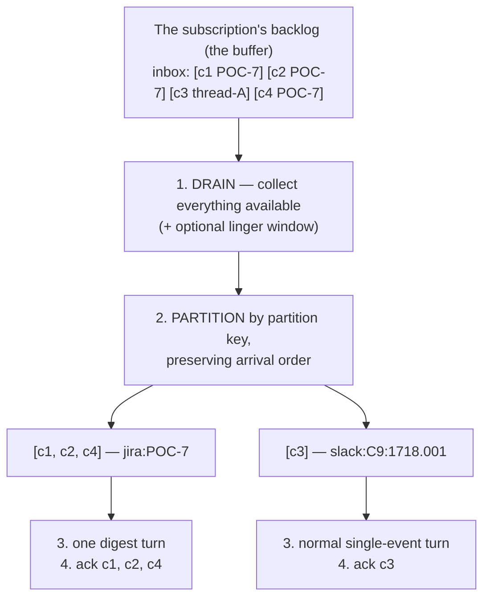
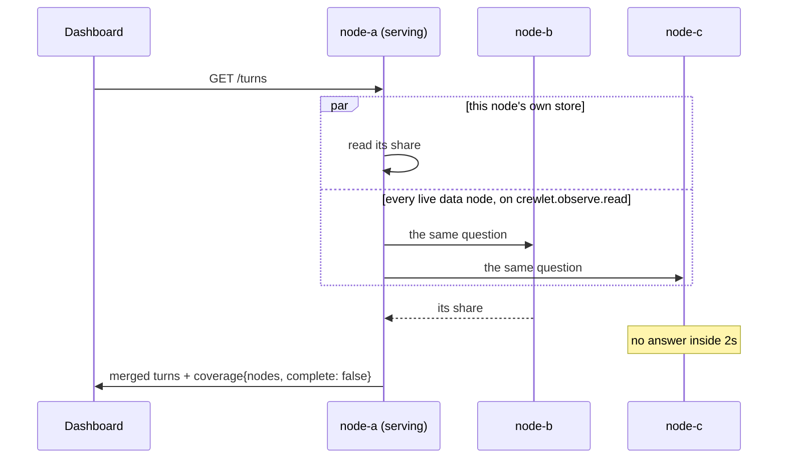
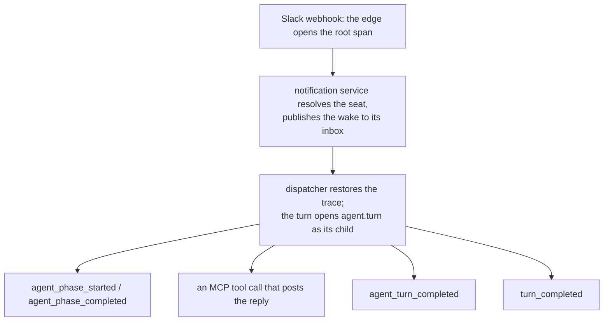
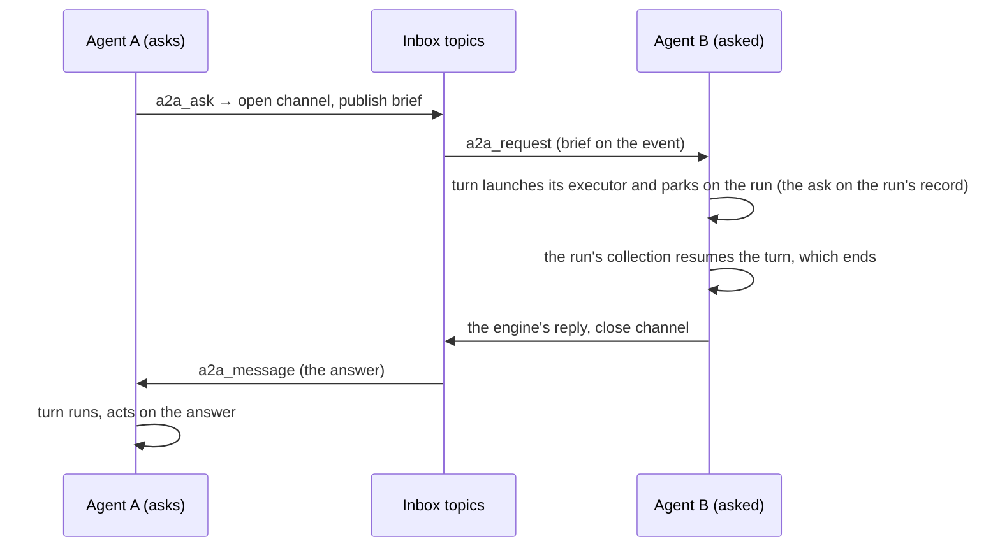

# Event System

All inter-component communication in Crewlet flows through a persistent event queue (`internal/queue`), backed by NATS JetStream — a broker the engine runs **inside its own process** by default, and an external NATS cluster when a fleet needs one.

---

## Interfaces

One interface serves all inter-component communication:

- **`queue.EventQueue`**: persistent pub/sub with consumer groups. For fire-and-forget messages: inbound deliveries, the wakes they route to agent inboxes, and everything a turn publishes about itself.

**Two implementations** sit behind it — the JetStream client and an in-memory twin — and **nothing above `internal/queue` may branch on which one is running**. Where the broker itself runs is a third question, and it is a *connection* choice inside the first implementation rather than a second code path:

| Where the broker runs | What that is |
|---|---|
| **In this process**: `stream.type: embedded`, the default | A NATS JetStream server started in the engine's own process. No listener, no port, no service to operate: in the solo case it binds no socket at all, so the broker cannot be reached from outside the process. `stream.store_dir` makes its streams file-backed and restart-surviving, and on a broker member (a solo node included) it is **required**: left empty they would live in memory, and the engine refuses to boot rather than lose them at the first restart. That holds whether or not the node has a company yet, because every data node runs the engine's core from boot (the **identity estate** among the state logs whose records live on that stream), and Worklet, Doclet, Chatlet and Gitlet put their items, pages, messages and repositories there too (see [Configuration](../getting-started/configuration.md#tier-a)). Only a member keeps streams at all: a leaf (an embedded node without `data`, joining the members over `stream.leaf.urls`) runs no JetStream and keeps none, so it sets no `store_dir` (see [Satellite nodes](../guides/satellite-nodes.md)). |
| **Somewhere else** — `stream.type: nats` | The same client code against a NATS server or cluster somebody else runs, dialled through `stream.url`. That sameness is what lets a laptop run the whole company with no services and a fleet run the same binary against a cluster. One thing the operator's server has to promise that the embedded one is built with: messages of 8 MiB, the largest the engine sends — a server that holds the engine's connection to a smaller `max_payload` is refused when the node starts rather than at its first large write (see [Deployment](../guides/deployment.md#an-external-nats-server)). |
| **Nowhere — the in-memory twin** (`internal/queue/memory`) | The test twin: a real broker object plus N clients rather than one fused thing, so a test can stop a node and still inspect what its subscription retained. |

Both are certified by **one** conformance suite (`internal/queue/queuetest`). A backend that suite has not certified does not exist as far as the engine is concerned — which is exactly why the twin is certified by the same cases as the real broker rather than by cases written for a twin.

A fleet's shape is a stream choice: clustered embedded members (`stream.cluster.name` / `.port` / `.peers` on each node, `stream.replicas: 3`) or one external cluster every node dials. See [Running a Fleet](../guides/fleet.md).

---

## Topic Structure

```text
# Per-seat, durable. One consumer group per seat, so membership IS ownership:
# the node that attaches is the node that gets that seat's work.
crewlet.agent.{seat-id}.inbox        # Per-agent inbox — all work arrives here
crewlet.agent.{seat-id}.control      # Sandbox starts and completions. Separate,
                                     #   because while a run holds the seat
                                     #   its inbox is held and fetches nothing,
                                     #   and a completion riding the inbox
                                     #   would wait behind the hold it exists
                                     #   to lift
crewlet.agent.{seat-id}.reflect      # A finished turn, put in front of post-turn
                                     #   reflection on the node HOLDING the
                                     #   seat, whose store is the one its
                                     #   memory is written to and carried from

# Fleet-wide work queues — ONE consumer group each, so whichever node wins a
# delivery is the node that has to route it
crewlet.notifications.inbound        # Inbound webhooks from external systems.
                                     #   There is no outbound counterpart:
                                     #   nothing the engine sends outward is
                                     #   queued — an agent writes through its
                                     #   OWN MCP tools inside its turn, and the
                                     #   chat working-indicator is a transport
                                     #   call on the node already running it
crewlet.events.{type}                # What the engine records about itself:
                                     #   the event store's listener, the live
                                     #   projection read it. Nothing routes
                                     #   work from here (see Routing)

# Control plane. Best-effort nudges: losing one costs a poll interval, never a
# revision, because the authoritative path polls the activation pointer
crewlet.config.revision_activated
crewlet.config.revision_applied

# Who is in which room right now — an artifact's or a chat room's: who is
# looking, who is editing or typing, and which seat is working there (ADR-0038).
# One subject per room, named by its kind and its id, that a node listens on
# only while one of its sockets is in the room, and one fleet-wide subject a
# node asks its peers on as it gains a room's first socket. Ephemeral — no
# stream, no applier — and deliberately outside every log's wildcard, so a
# keystroke is never a record every data node applies. Every frame is SEALED
# under the fleet keyring and one the fleet did not seal shows nobody. A
# person's chat read state has no subject at all — it is a coordination record
# every node serving sockets watches
crewlet.rooms.{artifact|chat}.{id}
crewlet.rooms.ask

# A seat's memory, ONE SUBJECT PER ROW, on a stream that retains one message
# per subject — so it holds the current value of every row rather than a log of
# every write, and a node acquiring a seat replays it in a single pass
crewlet.memory.{seat-id}.{table}.{key-digest}

# Dead letters, deliberately OUTSIDE the crewlet.* space so the dashboard's
# crewlet.events.> stream cannot resurface poison as live traffic
dlq.{topic}.{group}.{digest}         # the head is for grepping, the digest is
                                     #   the identity: a join alone aliases
                                     #   distinct (topic, group) pairs
dlq.changefeed.{source}.{group}.{digest}  # a wake feed's dead letters, one
                                     #   subject per domain's feed
```

Every one of those strings is built by `internal/queue/topics` and nowhere else. The inbox subject alone had nine call sites when it was formatted by hand — nine chances for a producer and a consumer to disagree about a name that has to match exactly, and a mismatch raises nothing anywhere: it is a message published to a topic nobody reads.

The subjects are grouped into streams by **purpose**, because retention differs by purpose rather than by taste:

| Stream | Carries | Retention, and why |
|---|---|---|
| `CREWLET_AGENT` | `crewlet.agent.>` | **Interest.** A message is kept while a durable consumer that has not acked it exists, and a publish to a subject no consumer covers is dropped. That is precisely the mailbox semantic the contract already promises, so the broker enforcing it is a feature — and it is why every seat's consumer must exist before anything publishes to it |
| `CREWLET_NOTIFICATIONS` | `crewlet.notifications.>` | Interest, for the same reason: these are work queues, not a log |
| `CREWLET_EVENTS` | `crewlet.events.>` | **Limits**, with an age bound — 30 days, or `stream.event_retention_hours`. Its consumers are ephemeral dashboards and per-node materializers that must be able to fall behind, disconnect and catch up |
| `CREWLET_CONFIG` | `crewlet.config.>` | Limits, one hour. A short bound keeps a restarted node from replaying a week of stale activation announcements |
| `CREWLET_DLQ` | `dlq.>` | Limits, the event stream's age bound. A subscription's dead letters are kept for an operator investigating poison; a wake feed's are replayed by the first node whose feed starts able to read them, discarded by an operator who has given their wakes up, and expire with the bound otherwise ([Dead letters](#dead-letters)) |

A subject in a namespace the engine does not itself define gets a stream provisioned on demand, with the mailbox semantic as its default. That is deliberate rather than lax: the stream topology is the backend's business, but the **subject space** is the engine's, and a whitelist here would make the backend the authority on what the engine may name.

---

## Delivery Semantics

What the engine relies on, and where each behaviour is enforced (`internal/queue/jetstream`):

**Pull, not push.** Consumers fetch — one message for an ordinary subscription, one drain's worth for an inbox — when they are ready to run one. Nothing is pushed into a client-side queue, so a consumer that is quiesced, paused or detached holds no mail hostage; it simply stops asking. It is also what makes quiescing reversible at no cost: resuming is fetching again, not reclaiming a prefetch.

**A durable consumer, created detached.** `EnsureSubscription` creates a seat's consumer with explicit acks and nothing attached, positioned at `DeliverAll` — about a millisecond, which is what makes it affordable for every node to create the mailbox behind every seat in the company at boot. Never at "latest": such a consumer exists and still discards everything published before something first attaches to it, which is the whole failure this call prevents.

**Every durable subscription can be listed.** `ListSubscriptions` answers which subscriptions the broker holds under a topic pattern, attached or not and whichever node created them, as the exact topic and group each was created with. It is how a mailbox is found after everything that knew its name has forgotten it (see [Seat Ownership § The removed seat](seat-ownership.md#the-removed-seat)). On JetStream a durable consumer's name is a lossy rewrite of that pair plus a digest, so each consumer also records the pair in its metadata, written when `EnsureSubscription` creates it, and that pair is listed only when it derives the consumer's own name, because a caller acts on the pair and a pair naming another subscription would send it to delete the wrong one; a durable consumer whose metadata does not derive its own name is logged as `jetstream_subscription_unnamed` and left out, and so is one the broker holds offline — made with something this server does not support, and answered with no configuration — as `jetstream_subscription_offline`. Only the metadata leader answers either listing, and a member that has not yet noticed its leader is gone drops a page without a word, so each page is a read of its own: a page of stream names nobody answers is asked again two seconds after it was sent, whoever is listing, and a page of a stream's consumers — which the metadata leader gathers from every consumer's own leader, waiting up to four seconds for them — only once that wait, a read term and a re-ask have passed, six seconds after it was sent and past the client's five-second default: a listing whose caller sets no deadline, as the mailbox sweep does, asks each such page once, as it always did, and a page dropped there fails that sweep's tick and is listed again at the next. A consumer whose own leader did not answer the metadata leader in time fails the listing rather than being left out of it: a mailbox is never judged absent because the broker was slow. Only streams the engine provisions (`CREWLET_*`) are searched, so another application's consumers on a shared account are never listed.

**Three outcomes, not two.** A handler acks, naks, or **defers**:

- **Ack** — done. It is the zero value, so the quiet path is the safe one.
- **Nak** — the handler failed. Redelivered after a one-second spacing that doubles on each further failure, up to 30 seconds, because an immediately-redelivered failure spins the loop at full speed against whatever is broken while a flat spacing spends all 25 attempts inside half a minute. The doubling spreads the delivery budget over about ten minutes, so a provider sitting out a spent plan, a vendor rate-limit window or a restarting database is outlasted rather than dead-lettered; a failure that outlives that window is not transient, and holding a seat's mailbox behind it is worse than the dead-letter copy. **A failure comes back behind the mail that was waiting when it failed**: the broker serves never-delivered messages while the backoff runs, so a newer message of the same conversation is handled first. That is the contract on both backends, and one conformance case holds both to it. The in-memory twin models the backoff virtually — the failure goes to the back of the mailbox, with no timer — so it keeps its inline, deterministic dispatch while certifying the order production gives; it used to replay a failure at the head, and every engine test run on it certified an order the shipped broker never produced.
- **Defer** — *this process has lost the right to do this work*. The message goes back with an immediate Nak — about a millisecond, where letting the ack timer expire would park a seat's mail for the whole ack window on every lease movement — **at the head**, because the broker serves a redelivery before new mail, and the consumer **quiesces itself**, since continuing to fetch would hand it more work it has equally lost the right to do. **It costs one delivery, exactly as a Nak does, on every backend**: no broker here has a "give this back without counting it", so what keeps a healthy event alive across handoffs is a budget sized for them (25 rather than the 10 a free-handoff broker would need), never a handoff that is free. The in-memory twin spends one too — it used to return a deferred batch untouched, which modelled a broker nobody runs and left the one conformance case about handoff cost running against the twin alone. Never a republish: a republished event is a new message at the stream's tail, and both the [completion ledger](seat-ownership.md#the-completion-ledger)'s idempotency and the batch layer's aging key on the identity a Nak preserves.

**The ack clock is real.** A fetched-unacked message stays invisible to every other consumer of that subscription for `DefaultAckWait` — **30 minutes**, sized for a wait behind a running turn plus one worst-case turn. It is a backstop rather than the handoff path: a seat that loses its lease defers explicitly and its successor sees the message in about a millisecond, where waiting the clock out would cost half an hour.

**Dead-lettering is decided client-side, with the broker as backstop.** A message is republished to `CREWLET_DLQ` and terminated once it has been delivered 25 times. The decision lives in the consume loop because that is where the dead-letter subject is known and the body is in hand; the broker's own `MaxDeliver` is configured to the same number so a bug in that path cannot produce an infinite loop. Twenty-five is sized for handoffs as well as poison — a deferral returns via Nak and **counts as a delivery**, so a message would have to be in flight across 25 seat migrations to exhaust the budget. The honest caveat, which no budget solves: a fast crash-loop is indistinguishable from poison.

**A handler is told how much of that budget is left**, because a handler that hands a message back is spending a budget it cannot otherwise see: the count rides on the *message*, so it survives the seat handoffs and restarts that reset anything a process remembers. Every delivery carries the number of *further* deliveries it has before the dead-letter — zero on the last one.

**Two numbers, because one cannot answer both questions.** A partition's messages sit at different counts as a matter of course: a conversation whose earlier message has been handed back a dozen times keeps collecting fresh replies, and each of those arrives with a whole budget. So a handler is told the **partition's** headroom — the smallest of its messages', which is what "will handing this batch back dead-letter something" asks, since one outcome covers them all — *and* **each message's own**, which is what a handler deciding about one particular event has to read. Reading the first where the second is meant bounds a caller by the worst message it happens to be batched with; reading the second where the first is meant hands a batch back believing it costs nothing. Both are part of the contract rather than one backend's courtesy: both backends state the per-message counts, in the contract's convention rather than in their own (the two brokers count deliveries and redeliveries respectively), the contract itself folds the partition's from them so no backend can fold it differently, and the conformance suite certifies both — including a partition deliberately built at mixed counts. The engine's one caller today is the [mid-run clarification](code-sandbox.md#mid-run-clarification-ask_and_wait) answer route, which reads *the reply's own* headroom and stops offering it to a parked executor while deliveries are still left, rather than handing it back until the broker dead-letters it.

**The two returns keep different places, and that is the choice a handler makes.** A failure (Nak) returns *behind* never-delivered messages; a hand-back (Defer) returns at the head. So a handler whose message must keep its place — because a later message of its conversation would otherwise be taken for it — does not Nak: it defers, when what failed is the node or its store rather than the message, or it settles the message durably and retries the work itself. The engine does both: a pause or a budget park the queue refused, and a parked executor's answer that could not be recorded, are deferred, and an answer that *was* recorded is retried by the sandbox coordinator rather than redelivered (see [Mid-run clarification](code-sandbox.md#mid-run-clarification-ask_and_wait)). **Within one handler call**, order comes from the events' own timestamps rather than from how the drain was assembled, which is why the batch layer sorts by them; nothing orders two calls.

### Dead letters

Two things give up on a message, and both keep it in `CREWLET_DLQ`: kept by the event stream's age bound (`stream.event_retention_hours`, 30 days unless set) and never by interest, so an entry is there whether or not anybody reads it. An entry is a body and a header kept apart, and the queue contract's dead-letter verbs read them apart: a subject's entries are listed by their headers alone, one entry's body is read by its sequence, what a set of subjects holds is counted without listing it, and an entry is removed one at a time.

- **A subscription's budget**, as above: a message delivered 25 times is republished to `dlq.{topic}.{group}.{digest}` for an operator investigating poison. Nothing replays it.
- **A wake feed's hour.** A wake feed reads a state log's own durable consumer (`internal/changefeed`, [ADR-0012](../../adr/0012-a-wake-is-derived-not-published.md)), one per domain, which every data node pulls from — so an acknowledgement is the fleet's. A node that cannot read a record — a version or an envelope a newer build writes, a frame sealed under a key it does not hold, or a record its translator fails on — hands it back for a node that can, waiting two seconds and doubling to thirty between attempts, rather than acknowledge it for every node (`crewlet.tracker.feed.deferred`; `feed_unreadable` for a record no build here translates). That consumer's redeliveries are uncapped, so the feed bounds them: the broker holds a record handed back in the consumer's pending set, and a thousand there stall every new wake of the domain. A record no node has read within an hour of being stored is kept on `dlq.changefeed.{source}.{group}.{digest}` — its sealed frame the entry's body, so it needs its log for nothing, and what the feed recorded of it, where it was delivered from and why no node read it, the entry's one header, `Crewlet-Dead-Letter`, a line of ASCII JSON — and only then acknowledged. `feed_dead_lettered` is raised from the first entry, naming each entry's age and how long it has left.

**Nothing but a replay reads a frame.** Every data node reads the feeds' entries on every alarm beat, and a roll that stalls can dead-letter thousands of records, each as large as its log admits. So a beat asks the broker one question — how many entries each feed's subject holds, and the last sequence the dead-letter stream gave any entry, as the stream's leader states them in one request — and while that answer is the one its last listing agreed with, the node reads nothing more and ages what it listed to the beat. When the last sequence moved, something was kept, and every feed's subject that holds or held entries is listed again; when only a count moved, entries went, and that subject is. A listing carries each entry's header and never its frame, read through a consumer the broker makes on one copy of the stream, which can be a moment behind its leader — so a listing whose count is not the leader's is listed again on the next beat, and an operator's listing or discard may not show an entry kept a moment before it.

When a node's feed starts it replays its domain's dead letters, reading each entry's frame from the stream's leader as it acts on it, through the same verification and the same claim a delivery passes: an entry it can now read has its wake published once and is dropped, one it still cannot read is left for a node that can, and a frame the fleet did not write is dropped. The start is the moment that matters, because what makes an entry readable arrives with a restart — a newer build, or a key, since a node reads its keyring only at boot. An entry nothing replays expires with the stream's age bound, and its wake is lost then, counted once across the fleet as `crewlet.tracker.feed.dead_letter_expired`.

An operator can give an entry up sooner, and that is the one decision about a dead letter a person makes. [`crewlet feeds dead-letters`](../reference/cli.md#crewlet-feeds-dead-letters) lists every wake feed's entries by id — where each record was delivered from, why no node read it, how long ago it was kept and how long it has left — and [`crewlet feeds discard <id> -confirm <id>`](../reference/cli.md#crewlet-feeds-discard) drops one, for an entry no build will ever read: a record sealed under a key retired from every node, or one no build translates and none will, which would otherwise keep `feed_dead_lettered` raised for the whole retention. A discard reaches only the wake feeds' own subjects, never a subscription's poison; it is `admin`'s and asks a recent proof, like every control of the deployment ([The wake feeds' dead letters](../reference/api-endpoints.md#the-wake-feeds-dead-letters)); and its wake is lost for good, logged as `changefeed_dead_letter_discarded` naming who pressed it and counted as `crewlet.tracker.feed.dead_letter_discarded`. It takes the same claim on the entry's going that a replay's drop and the expiry count take, so no node counts a discarded entry as one the retention lost. A replay, an operator's discard and the expiry are the only things that clear an entry.

---

## Routing

Work reaches a seat by being **published straight to its inbox subject** by whatever decided the seat should do it. There is no second routing hop through `crewlet.events.*`: that subject space is the record of what happened, not a work queue. Four producers put work on inboxes:

- the **notification service** (`notify.Service`), which consumes `crewlet.notifications.inbound` in one fleet-wide group, resolves each delivery to its recipients, and publishes a wake to each agent seat's inbox;
- the **scheduler**, which resolves a firing schedule's target seat and publishes `task_assigned` to that inbox, stamped with the schedule's conversation ([below](#inbox-batching--coalescing)), and records `scheduled_task_fired` on `crewlet.events.*`;
- the **A2A service**, which publishes the `a2a_request` wake to the target's inbox and the `a2a_message` answer to the asker's;
- the **work pickup**, which the node holding an agent seat runs once a minute: a seat idle with ready work on Worklet is handed its next item as a `work_pickup` naming it, filed under the item's conversation, once per item version ([Scheduling](scheduling.md#the-work-pickup), [ADR-0112](../../adr/0112-an-idle-seat-is-handed-its-next-ready-item-once-per-item-version.md)). It is the one wake derived from state rather than from a change: an assignment wakes its assignee once, and a turn that did not act on it was otherwise the last word on the item.

A producer reads the organization from the epoch current when it handles the event (`Engine.Company`), never from a snapshot captured earlier, so an applied revision (including a seat-kind flip) re-routes from the next event on.

**Routing is an org function, not a process-local one.** Every producer resolves its recipient from the organization (a handle or an agent id to a seat — never a display name, which two seats may share — and a seat to its id, which names its inbox subject) and never from which seats this node runs. The inbound work queue has ONE fleet-wide consumer group, so whichever node wins a delivery is the node that has to route it; that node usually is not the one running the recipient. This works because agent ids are *derived* rather than assigned: `org.Organization.AgentIDFor` is a `uuid5` over the org name and the seat's handle, so every node computes the same id for the same seat, and `AgentSeatByID` / `AgentSeatByHandle` invert it with no database and no live instance. The inbox subject itself has one definition, `topics.AgentInbox(seat id)`, because a producer and a consumer that disagree about a topic name do not raise, they just stop talking to each other.

### Who a change concerns, and who it wakes

The engine's own domains — [Worklet](../guides/worklet.md#what-wakes-a-seat), [Doclet](knowledge-system.md#doclet-backend-the-engines-own-pages) and [Gitlet](gitlet.md#who-a-change-wakes) — commit each change as a record on their log, and the notification service's parser for that domain decides who hears about it. Each log has its own wake feed: a fleet-wide consumer group (`crewlet-tracker-feed`, `crewlet-pages-feed`, `crewlet-code-feed`) that reads every committed record on whichever data node takes it and relays the ones that can wake somebody onto `crewlet.notifications.inbound`, so a wake is derived from the committed record rather than published by the node that wrote it, and that log's trim waits on its acknowledgement. Every domain decides by **one rule** (`internal/routing`), applied alike on every node; what differs is only each domain's own list of reasons.

- **One reason per person: the first that names them.** Each domain offers its reasons in its own order of precedence — Worklet's eighteen, from `mention` down to `lead_fallback`; Doclet's `mention`, `watcher` and `container_lead_fallback`; Gitlet's fifteen, from `mention` down to `lead_fallback` — and a person named by several hears once, under the first. Mentioned on a task they also watch, they are told they were mentioned. There is no exception, not even for a notice about *another* item than the one that changed: one change reaches one person once about one item, so news about another item rides that item's own record. Gitlet is where one record carries news of several items by construction — up to 64 pushes from unrelated clients land in one push record, each opening or merging changes of its own, and a queue's landing lands several entries — so it applies the rule change by change: such a record tells a person once about each change it names, each a notice and a wake of its own. Closing a task does not itself tell anybody that the tasks it held up are workable. Worklet's unblocked repair does, on its next pass (every fifteen minutes), in a commit on each dependent naming its assignee. That commit is a separate change, with its own [`work_routing`](../guides/worklet.md#a-persons-own-state) answer.
- **Whom a Worklet change concerns comes from the record alone.** The set is computed from the record's mentions and the routing snapshot its writer copied onto it — no clock, no roster, no author — so the tracker's applier writes the same notice rows on every data node, inside its own transaction, and whichever node wins the delivery computes the same set again for the wake. Those rows, which are what a person's inbox reads, are the complete account of whom the change concerned. Gitlet's records are routed the same way: every record about a change carries the audience its writer decided, its applier writes a notice row for each, and the wake is computed again from the record. Doclet keeps no notice rows: its mentions and watchers come from the record, and its one fallback, the lead of the container's unit, from the org chart the routing node is running.
- **Who is woken is that set, filtered in four steps, in this order.** A notice that is a record rather than a wake (Worklet's `unwatched`) is never woken. The person who made the change is left out — of the wake, and of Worklet's notice rows too — except under a reason that is news to them: `unblocked` on Worklet, none on Doclet. A handle the company no longer employs loses its wake, and keeps its notice row where the domain writes one; the roster is asked only about somebody the first two steps kept, so a person who left after making the change is never counted as a recipient it dropped. And a lead fallback is woken only when nobody else survived the first three steps, and then only the first link of its chain that did, the links asked about in order only then: Worklet's chain is the routing unit's lead, then the project's lead, so a lead filing an unassigned item into their own team still reaches the project's lead rather than nobody, and a change nobody else hears about wakes one lead rather than every lead in the chain. Doclet's chain is the one lead of the container's unit, offered only for a page created, trashed or changing status. Gitlet's is the one lead of the repository's owner, offered only on a change's first facts when nobody who may review it was asked; and Gitlet wakes **seats only**, so a person its record tells reads the notice in their inbox, and counts as somebody who heard. Every code wake names the work item the change implements, so the turn it starts is charged to that item ([ADR-0097](../../adr/0097-a-change-implements-one-work-item-and-carries-no-spend.md)).
- **Words wake only the seats they address** ([ADR-0113](../../adr/0113-an-agents-words-wake-only-the-seats-they-address.md)). A standing arrangement (being a task's owner or watcher, following a chat room or thread, having spoken in a thread, the other side of a direct conversation) wakes a seat only for words that ask something and name nobody in particular. A person's message or comment that @-mentions somebody, and anybody's that asks or answers somebody, wakes those seats, and everyone else reads it where it was said. An agent's words ask something only where the agent says so (`asks`, which the chat posting tools, `comment_on_work_item` and `comment_on_page` require of an agent); in words that do not, an @-mention is a reference that wakes no agent, and they wake only the seat whose question they answer and the seats with a stake in their thread. A page comment that asks stays open until a seat it named answers it with a comment that asks nothing, and while it is open any reply in its thread by somebody else wakes its author. A record with no statement, a person's or an older build's, routes as it always did. A seat with a stake in a thread, an open ask it made there or one made of it that it still owes, is woken by any reply in it by somebody else, in chat and in a tracker comment thread alike. Each chat record names the seats the rule held back (`held`), which the parser logs as `chat_wakes_held`.
- **Afterwards, an empty answer is one of three facts.** Worklet answers who each change reached, per change ([`work_routing`](../guides/worklet.md#a-persons-own-state)), and when no row remains it says which empty it is: `nobody` (the routing resolved to no one), `swept` (the change is older than the inbox retention horizon, so its rows may have been cleared), or `unknown` (no horizon was stated to date the absence by) — or `quiet`, a change that announced nothing at all.

### Alarm wakes

A node's [alarms](../reference/alarms.md) wake the seats that may read the deployment's health. Every time an alarm changes on a node, it fires or it clears, the node hands the transition to an outbox, which publishes it on `crewlet.notifications.inbound` as a delivery of source `alarms`, retried until the broker takes it. A restart is not a change: the node keeps the alarms whose raise the broker took in its own file, so its first evaluation after a restart says only what changed while it was down, and a raise the broker never took is raised again. The notification service routes it by the same rule as every first-party source (`internal/routing`) to every agent seat whose role carries [`health_tools`](../guides/fleet.md#the-health-tools): one reason, no actor, and a seat the company no longer employs dropped. Each wake's id is derived from the transition and the seat, so a delivery published twice wakes each seat once.

- **The delivery is the record.** Nothing commits beside it: the published delivery is the durable record the wakes derive from ([ADR-0095](../../adr/0095-a-nodes-alarm-transition-is-the-record-its-wake-derives-from.md)), so no write is left for a publish to trail. A transition the node did not live to publish is not recovered, since the outbox is the node's memory: what is firing now is every node's own heartbeat's to say, which `fleet_health` reads and every alarm wake sends its seat to first, and a restarted node's first evaluation says again what is still firing.
- **One alarm is one conversation, and every transition is a wake.** A per-log alarm is a transition per log and a per-entry alarm a transition per model entry or MCP server, as their log lines are, each wake naming the log or entry it is about, and every data node evaluates its own table, so one fleet-wide condition, such as a stale backup, fires on each data node within one alarm interval (ten seconds; the nodes' evaluations are not synchronised). Every copy is keyed by the alarm alone (`alarm:<kind>`), so the [coalescer](#inbox-batching--coalescing) merges whichever of them are pending together when a seat's turn starts, as it merges any conversation's burst, and one look at `fleet_health` with `firing: true` answers them all. That is ALL that merges them. With `notification_coalesce_window_seconds` at its default `0`, the first copy starts a turn at once and the copies that arrive during it run together as one more, so one fleet-wide condition costs each granted seat two turns however many data nodes raise it; a window of at least the alarm interval gathers them into one, at that much more latency on every wake the seat gets. Nothing holds a transition back: the alarm table has no hysteresis and the outbox publishes every transition it is handed, so an alarm that fires and clears more slowly than a turn runs costs every granted seat one turn per fire and one per clear, for as long as it flaps. Nobody is waiting on an answer, so a woken seat may look and end its turn having done nothing.
- **Nobody sent it.** The wake names no sender and no actor, so the turn it starts is the seat's own work, as the engine's own notice on a work item is: no [requester ceiling](gitlet.md#reads-made-for-somebody-else) bounds what the seat reads in it, and `code_status` beside `fleet_health` answers on the seat's own grant.
- **The outbox is bounded.** It holds 2048 transitions while the broker refuses them, retrying from two seconds and doubling to the alarm interval, and past that drops the oldest, counted on `crewlet.alarm.transitions.dropped`; `crewlet.alarm.transitions{change}` counts the ones the broker took.

### Access review wakes

A seat whose access changed, with open work waiting on a person, is asked for one review turn ([An agent whose access changed reviews its open work](agent-runtime.md#an-agent-whose-access-changed-reviews-its-open-work)). The node holding the seat publishes the request on `crewlet.notifications.inbound` as a delivery of source `access_review`, the alarms' route ([ADR-0111](../../adr/0111-an-agent-whose-access-changed-reviews-its-open-work-once.md)):

- **The delivery is the record, and it can be made again.** What it says is derived from the company document, the seat access ledger, the access log and the seat's pending review in the coordination store, so a request the node did not live to publish is published by the seat's next holder, which checks when it takes the seat, and a publish the broker refused is retried from two minutes, doubling to fifteen. A write to the seat access ledger measures the seat it names too.
- **One wake per change.** Its id is derived from the seat, the told record the change is measured from, the digest it is measured to and the instant the pending review first measured it, so a republish, or the same request from another node, collapses into the wake it already made, while the same change made again after a revert is a wake of its own. Every copy carries the told record's instant.
- **One conversation per seat, and nobody sent it.** Reviews waiting together merge into one turn, the wake names no sender and no actor, and a review whose seat was already told the change (by any turn) is acked without one.

### A seat's mailbox exists before the seat is running

A durable subscription **is** the mailbox, and it exists independently of whether anyone is consuming it. That is not a detail — publishing to a topic that no subscription covers **drops the event silently**, with nothing anywhere reporting a loss. On the shipped backend that is the broker's own rule rather than a convention the engine could soften: the agent and notification streams use interest retention, which keeps a message exactly while some durable consumer that has not acked it exists.

So every node creates the subscription behind **every agent seat in the company** as it starts, before it claims a single one, and again whenever an applied revision adds a role. Not its own share: a mailbox is a fact about the company, and the node that ends up serving a seat may not be the one that made its mailbox. Creating one is idempotent, so a fleet doing it N times costs N−1 no-ops.

**No wake is published before its mailbox exists.** A boot makes every seat's mailbox (its inbox and its [priority lane](#a-person-waiting-goes-first-the-priority-lane)) and the inbound edge's own mailbox (the router's group on the notifications stream, which is interest-retention too) before it starts anything that publishes: the scheduler, the change feeds, the Mattermost transport and the inbound router. A revision's new seats get their mailboxes **before** its parties are indexed, since from that moment a delivery naming a new seat resolves to it. The node's **wake queue** is the backstop for a create the broker refused: every producer of a seat's wake (the inbound router, the scheduler, agent-to-agent asks and a park's requeue) publishes through it, and it confirms the seat's mailbox against the node's own set before the wake is sent, which costs a map lookup and no broker call once the seat is confirmed, running the mailbox pass on demand when it is not. A mailbox it still cannot confirm refuses the wake with a retryable error instead of handing it to a stream that would discard it, and no producer drops a refused wake: the inbound router NAKs the delivery and the broker redelivers it; a park's NAK returns the partition; and the scheduler and agent-to-agent asks confirm the seat's mailbox **before** they claim the fire or open the channel, so a refusal leaves nothing behind. A deferred fire is retried on the next tick (see [Scheduling](scheduling.md#fires-that-wait-for-a-seats-mailbox)) and a refused ask is reported to the asker to send again.

What this buys is that a trigger aimed at a seat nobody is running yet **waits** instead of vanishing:

- during boot and during a rollout, where seats are claimed a few per sweep and the rest are briefly unowned;
- for a seat whose placement no live node matches — a role pinned to a node that is down, or carrying a label nobody has. The sweep already reports those as `seats_unplaceable`; their work now accumulates and drains the moment a matching node appears.

When the resolved target is a **[human seat](humans-in-the-org.md)**, the event is skipped: a human has no inbox and no turn to wake, and the engine never sends as itself. These internal events route to agents only; the human is notified natively by the PM tool / Slack where the work lives (and agents reach humans through their own colleague-surface tools with an @-mention). Inbound external-surface webhooks addressed to a human are likewise recorded as an info-level skip, not an undeliverable warning.

---

## Inbox Batching & Coalescing

An agent turn takes minutes; webhooks arrive in seconds. Without batching, ten comments on one Jira issue that arrived while the agent was mid-turn would drain as **ten sequential full turns** — 10× LLM cost, each turn seeing one comment in isolation, potentially ten separate replies. Inbox delivery is therefore **batched per conversation**.

**The buffer is the broker backlog** — no second in-memory buffering layer. Holding events in process memory after their broker message was acknowledged would silently lose them on a crash; instead, the inbox consume loop changes how the backlog is *drained*:



**`SubscribeBatch`** (the `EventQueue` contract; both implementations) does steps 1 to 4: after the first message arrives it drains everything immediately available, plus anything arriving within the `queue.BatchOptions` linger window of the first message, up to its batch cap, partitions by a caller-supplied key, invokes the handler **once per partition** (sequentially, so per-agent serialization is unchanged), and acknowledges a partition's messages only after its handler returns. A failing partition negatively-acknowledges exactly its own messages (normal redelivery / DLQ policy per message) without blocking or replaying other conversations from the same drain. A pause taken *during* collection (`PauseDelivery`, or a hold on this seat's inbox) NAKs the whole drain back rather than flushing it past the pause: the point of pausing a seat's inbox is that no turn starts, and a batch collected a moment earlier would start one. One that lands *between* partitions — a deferral the loop has just applied, a hold, a drain pause, a detach — stops the drain the same way, and the partitions it never dispatched go back through the same budget check: **being drained is the delivery**, so the rest of a stopped drain costs one delivery each exactly as the partition that stopped it does. There is no cheaper way back for a message a consumer changed its mind about.

**A failed turn does not hold its conversation back.** A failing partition's redelivery waits out a backoff — one second, doubling to thirty — and nothing waits with it: a newer event on the same conversation that arrives meanwhile is drained without it and runs first, in a turn of its own, and the failed event follows in a later turn. Event timestamps order the events *within* one partition, whatever order the broker returned them in; they cannot reorder two turns. Holding the newer events back instead would stall the conversation for the whole backoff and hand a poison event's failure to the healthy ones held behind it, since a partition succeeds or fails as a unit.

**And the failed one is not answered twice.** In a chat thread the newer message's turn reads the thread at its start and sees the failed message there, still waiting — and answers the thread as it stands, that message included. So the turn reports the waiting messages its thread block showed it (its own writer's, after the seat's own last reply, before the message that woke it; never one a bound dropped, and never another writer's, which is owed a turn of its own, below), and when it completes they are written to the [completion ledger](seat-ownership.md#the-completion-ledger) beside its own triggers, keyed on each message's identity on its chat backend. When the failed message comes round it is dropped as worked — `TurnTriggerSkipped` says a later turn answered it in its thread — instead of producing a duplicate, out-of-order reply. The ledger is the fleet's, so the drop holds on whichever node the redelivery reaches. A message no later turn was shown — a top-level message has no thread block — is still owed its turn, and gets it.

**And a wake a completed turn already read past starts no turn** ([ADR-0120](../../adr/0120-a-wake-a-completed-turn-already-read-past-starts-no-turn.md)). A first-party wake carries the log position of the record it was derived from (`trigger_position`). When a turn completes, the newest such position among its triggers becomes its seat's seen-through mark for the conversation on that log, keyed on the thread's stamped partition key (never split by writer) and the log, in the completion ledger's bucket and aged with it, and moved forward only, by compare-and-set. A wake that later arrives in that conversation at or below the mark, and that asks the seat for nothing (not addressed to it, owing no chat surface, no question put to the room), is dropped before coalescing with a `TurnTriggerSkipped` whose disposition is `absorbed`. An obligation is never absorbed, and a vendor's wake, which carries no position, never is. Reads made during a turn do not move the mark: it is what the turn was woken for.

**The ack budget.** Every drained message's ack clock starts at receive, but a partition handler is typically a full multi-minute turn, so dispatching a long tail of partitions sequentially holds later messages delivered-but-unacked for the *sum* of the preceding turns. That clock is real: `DefaultAckWait` is 30 minutes, and collection plus one handler run must fit inside it, which is why the linger is capped at 60 s. The number lives once, as `queue.MaxLingerSeconds`: the contract clamps to it on every read so programmatic construction cannot bypass it, and config validation refuses an out-of-range value at load from that same constant, so an operator is told rather than silently cut. A drain whose partitions together outlast the window is not lost, it is **redelivered**: the tail comes back, each redelivery spends one unit of the 25-delivery budget, and the [completion ledger](seat-ownership.md#the-completion-ledger) plus the same-id dedupe are what make that a redelivery rather than a second turn (`TurnTriggerSkipped` is emitted precisely so it is not invisible). What is never substituted is a republish: it would be a *new* message at the stream's tail, and both the ledger's idempotency and the batch layer's aging key on the identity a NAK preserves. Partitions dispatch **oldest conversation first** (by oldest constituent event timestamp), after any partition holding a priority wake (below): a waiting conversation ages and outranks the hot conversation's fresh arrivals on the next drain, so steady inflow on one issue cannot starve a waiting DM.

### A person waiting goes first: the priority lane

A drain reads only the head of a seat's inbox, so aging cannot help a message that is not in the drain at all. A seat that was parked for hours on a provider limit came back to a backlog of tracker notices, and a person's direct message that arrived during the park waited behind every one of them: the seat worked through the backlog one turn at a time, oldest first, and answered the person hours after the limit cleared.

So a seat's inbox is **two mailboxes under one subscription**. The notification service marks a wake (`queue.Prioritize`) when the seat owes an answer by the backend's own address rule (a direct message, a mention, a question put to it, a thread it is in for one of those reasons) **and** a person wrote what it answers. A marked wake published to a seat's inbox is written to the inbox's priority lane (`<inbox>.lane`), and every other wake to the inbox itself. Every drain takes the lane first, without waiting, and fills in behind it from the inbox; a partition holding a priority wake dispatches ahead of every other partition of the drain. A colleague's mention, a tracker notice, a room's news and a schedule's fire are background, and their order among themselves is unchanged.

The lane is **part of the inbox's subscription**, never a subscription of its own: `EnsureSubscription` creates both durable consumers, `DeleteSubscription` deletes both, and every hold (a person's pause, a provider or budget park, an executor holding the seat), quiesce and detach of the inbox stops both, so a held seat holds a person's message with the rest of its mail. The mark rides the event, so a parked or requeued wake returns to the lane it left. A mailbox listed without its lane (one made before lanes existed, or a lane consumer somebody deleted) is reported partial by `ListSubscriptions`, and the node's mailbox pass treats it as missing and ensures it again, so the first wake the node's wake queue publishes to it completes it before the wake is sent.

**The drain window bounds what one turn is handed.** A conversation's mail can sit in both mailboxes at once: the person's message on the lane and, on the inbox, a colleague's remark in the same thread or a tracker notice on the same item. A drain takes the lane and then fills from the inbox's head up to the drain's cap, and an inbox wake of the same partition inside that window joins the person's partition and is answered in the same turn. One deeper than the window is not reached for: it stays where it is and is delivered once the inbox's head reaches it, exactly once, as a partition of its own, and a chat message the person's turn already answered in its thread is dropped as worked when it comes round (the completion ledger's chat key). Reaching past the window would mean settling mail the consumer never delivered, outside its acknowledgement state, which no crash or NAK in between could keep exact. **A park keeps a partition whole**: a parked partition that holds a priority wake goes back to the lane as one unit, every event of it marked, rather than the marked wake alone to the lane and its siblings to the inbox's tail.

**Live shows what waits in each seat's inbox.** Every node reads, every five seconds, what waits in the inbox and the priority lane of each seat it holds, leaving out the mail its own running turn is working on (only the holding node can tell that apart, so it is the one that counts), and publishes a stream-only `seat_inbox_waiting` snapshot when a count moved and every thirty seconds when none did. A read that fails keeps the seat's last count rather than reporting it empty, and a tick reads at most four seats at once under one four-second deadline: for a node holding thirty seats, about twelve consumer-info requests a second. The live projection folds each report per seat, clears a seat its reporter stops listing only if that reporter is where its count came from, and forgets a reporter it has not heard from for ninety seconds, so a node that went away leaves no count behind. The seat's live row carries `waiting` (`priority`, `background`), and the dashboard draws it on Live, on the running turn's row and on the row of the executor that holds the seat, and on each seat's card on the Agents page, where a parked, paused or idle seat shows it: "1 person waiting", "4 waiting".

**A person waiting behind a busy seat sees their message is queued.** Once a priority wake is durable, the routing node announces it on the seat's waiting channel (`crewlet.waiting.<seat>`, an ephemeral broadcast carrying the wake's id and the conversation's keys, never a person or the message's words). The node running the seat, when the seat is busy (a delivery of it being dispatched there, or one of its executors holding it), raises the conversation's working indicator in its queued state: "is queued behind its current task", or "behind N tasks" when other people's messages are ahead. The turn that picks the message up joins that same indicator and moves it on to its phase in place, and the dispatch that finishes with the message takes its wait away, a hand-back that dead-letters the message included. Every queued line ends: a seat that leaves the node takes its lines down, a node that stops clears them (and after a crash a chat surface's indicator lapses on its own without its heartbeat), and as a backstop a line stands for at most an hour after it was queued; ending the line never touches the message, which stays on the seat's inbox. A seat that is idle picks the message up at once and shows no queued line; a paused or parked seat is not busy but stopped, which its state on the Live page says. Chatlet draws the queued line still (the agent's presence member carries `queued`); a backend whose indicator is a composer typing line raises nothing for a message that is only waiting.

**One turn works for one writer.** The node partitions a drain by the stamped key and by who wrote each message (`notify.KeyOf`): one person's ten messages in a thread are one digest turn, and a colleague's or a stranger's message in the same thread is a turn of its own. A turn is worked for the one principal who woke it, held to the apps they use ([ADR-0109](../../adr/0109-a-turn-somebody-woke-is-held-to-the-apps-they-use.md)), and a partition is one turn, so a partition of two writers would hand one of them the other's apps, or read a person's words as a stranger's. The writer is read from fields every producer already sends (a first-party notice's writer, the actor every parser stamps, else the sender), so the split covers an older producer's events too. **And for one whom**: an agent's write on Worklet, Doclet or Chatlet carries whoever the writing turn worked for (`NotificationWriter.WorkingFor`), the turn it wakes works for them, and the partition keys on the whole of it beside the writer (`seat:cto for seat:ada`), so one agent's writes for two people are two turns rather than the second worked inside the first's, for every wake that asks something of the seat. The one exception is the seen-through mark below, which keys on the thread and never on the writer: a completed turn absorbs a later wake at or below its mark that asks the seat for nothing, whatever that wake's writer or carrier, and absorption only drops a wake, running nothing for anybody ([ADR-0109](../../adr/0109-a-turn-somebody-woke-is-held-to-the-apps-they-use.md#amendment-a-requester-rides-on-what-a-seat-writes), [ADR-0120](../../adr/0120-a-wake-a-completed-turn-already-read-past-starts-no-turn.md)). Chatlet's wakes state their writer as the other first-party sources do, so a Chatlet message partitions on its seat. It is in memory only: the stamped key, which a merged event carries and a parked run's batch is matched against, stays the thread's.

**Partition keys** (`notify.Prompt.PartitionKey`, namespaced by source) are derived by pure logic from webhook metadata, via the same per-source `notify.Prompt` classes that own prompt building: Jira keys on the issue (`jira:POC-7`), Confluence on the page, GitHub on `repo#number`, and Worklet on the task's **id** (`work:task:<id>`), never its key, because a key is an address two tasks can share (a counter restored beside newer work mints numbers they already hold) and a cross-project move changes, and keyed on it two tasks' wakes merged into one digest and a moved task's thread started over. Slack keys on the **whole channel for top-level DM and group-DM messages** (`channel_type` `im`/`mpim`, or a `D`-prefixed channel id when the event variant omits the field; a human firing four rapid top-level DM messages is one batch, and a DM *thread reply* keeps its thread key so the merged trigger never carries the wrong reply target) and on channel + thread root elsewhere (`slack:C9:1718.001`: a top-level channel message keys on its own `ts` so its replies join it, while two unrelated asks in a shared channel never merge). A schedule's fire keys on its **schedule's conversation**, `schedule/<scope>/<scope id>/<name>` with each part escaped as a URL path segment (`notify.ScheduleConversation`), the scheduler's own stamp rather than a derivation: every fire of one schedule shares it, so the fires that waited in a seat's inbox together reach it together and run once, as the latest (see [Scheduling](scheduling.md#fires-that-wait-in-a-seats-inbox)). A work pickup keys on the item's own conversation (`work:task:<id>`), so a pickup and the item's other wakes are one conversation. Everything else (a `task_assigned` no schedule names, A2A wakes, notifications without a derivable conversation) keys uniquely on the event id and is **never coalesced**: single-event partitions follow exactly the pre-batching dispatch path.

**Conversation identities** (`notify.Prompt.ConversationIdentity`, namespaced the same way) are the SECOND key, and the one that outlives the drain. Coalescing merges the messages of one partition that arrive *together*; [conversation sessions](conversation-sessions.md) carry what the seat did about them into that conversation's **next** turn, which continues the session its last turn left, and the episode row and the turn's telemetry are stamped with the identity so history can be asked for by thread rather than only by agent and time. The `event:{uuid}` fallback above serves both keys, which is exactly why those consumers store nothing for a trigger without a real conversation: no later message could ever reproduce that key to read the row back. **The scheduler stamps an identity too**: a fire carries its schedule's conversation as both keys, so a schedule is a conversation of each seat that runs it, and each fire's turn continues the session the schedule's last fire left on that seat ([Scheduling](scheduling.md#each-fire-continues-the-last-fires-session)). It is the one identity nobody can reply into — every fire of the schedule reproduces it and nothing a person writes does — so `notify.Derived` refuses it as it refuses the fallback, and a fire is never offered to a parked run as the answer to the question the schedule's last fire asked.

For every source but chat the two are the same string — an issue key, a page id, a monitor id and a task's id are each one object that is both the merge unit and the durable thread. **Chat is where they differ, and only for a direct message**: a DM is one conversation however it is threaded, so its identity is the bare channel (`slack:D1`) while a reply in a thread still partitions on that thread (`slack:D1:1718.001`). In a shared channel a thread IS the conversation and the two coincide again. The rule that decides it is that **a partition key is always the identity or a finer cut of it**, so every event in one partition carries one identity: a turn is a partition and its rows on the executor log are keyed once, and constituents that disagreed about the identity would key them under whichever event sorted first. Before the two were separated, one value answered both questions — so a DM's first turn was filed under the channel, its thread reply looked its conversation up under the thread, and a seat re-read its own 1:1 line as a first turn every time.

A notification Worklet, Doclet or Chatlet raised also carries `trigger_position`: where on its log the change that caused it was committed, as a position token (`<stream>@<generation>:<sequence>`). The turn it wakes hands that position to its node's read-your-writes floors before its first read, so whatever the seat then reads from that domain (a Worklet list or item, a page or a listing of pages, a room, a thread or a mention list), on whichever node answers it, is no older than the change it was woken for. The ranked searches are the exception: they read an index each node builds behind its own rows, so they carry no floor and may not find a change made a moment ago (see [Read-your-trigger](../guides/consistency.md#read-your-trigger-is-a-floor-not-the-mechanism)). A vendor's notification carries none.

On the wire of an inbound notification the partition key rides the payload field `partition_key` and the identity rides `conversation_identity`, each read only from its own field: a notification that names a partition and no identity names no conversation. The partition is spelled as the one event whose subject is a batch spells it (`partition_key`, below), because everywhere else `conversation_key` is the **identity** — that is what a turn's events are tagged with in the event store.

**Busy agents queue; held agents wait on the broker.** A delivery that finds its agent mid-turn does not fail, and nothing has to make it wait: a seat's attachment dispatches one partition at a time from a single goroutine, so the next partition is not fetched until the running one's handler returns, and the per-node concurrency gate holds anything past `node.max_concurrent` in this process rather than handing it back. The handler therefore holds the delivery for a full turn, which is what JetStream's ack window (30 minutes) is sized for: a wait plus a worst-case turn. A seat whose executor run is working, every turn's, potentially hours (`sandbox.Coordinator.SeatHeldBySandbox`), is not handed its mail at all: the sandbox coordinator holds the seat's inbox (the `sandbox` hold) from the moment a launch opens the run's row, before the turn that launched it can return, including a run a node recovers when it takes the seat, whose hold is taken before the mailbox is attached, and lifts it the moment the last run stops holding it, by settling or by parking on a question. Held, the consumer fetches nothing, so the mail waits on the broker with its order and its delivery count intact, nothing is held against the ack window, and nothing runs while it waits. A delivery that reaches a held seat anyway, it raced the hold, or the hold was refused, asks for the hold again and is **deferred**, keeping its place at the head of the inbox at the cost of one of its deliveries. A held seat receives nothing, a person's answer to another of its runs included, that is the rule, not a side effect of the hold: an agent busy with its run takes up nothing else until the run is done, and a second run resumed beside it would put two of the seat's turns in flight at once. A chat reply waits with the rest of the mail and is offered when the run settles or parks. An answer by turn does not ride the inbox at all: it is addressed to a run and travels on the seat's control topic, where it is recorded at once and its resume waits for the run, then runs ahead of the held mail. A run that stopped to ask a person something holds nothing, the seat has to be able to receive that answer, so those deliveries run as usual, each one offered to the parked run's answer match before it becomes a turn. The first reply posted after the question is **recorded on the run** and acked, and the run's resume is the sandbox coordinator's from there, retried on its own schedule, with the seat's inbox held under the same `sandbox` hold so its later mail is worked after the resume rather than beside it. From then on the reply reaches the seat **once**, whatever becomes of the run. Left behind by a node that stopped after claiming it for its resume and before its turn took it, it is given back to the run by the seat's next holder, which finds the claim as it takes the seat, and the run resumed with it. Let go of after its attempts, ended before a turn could take it (on the inline attempt as on a retry), or left behind that way once its revivals are spent, it is handed back to the seat's inbox as the ordinary message it is, through an outbox on the run's own row, because the store will not delete a run still holding a reply no turn took; a reply a resumed turn took is that turn's and is neither revived nor handed back, and the store will do neither. Its original delivery is recorded as worked in the completion ledger the moment it leaves the run, when a turn takes it, on either route, and before a reply is let go of, so the original coming round afterwards, from a node that stopped before acknowledging it (a turn that took a reply inline holds its delivery for the whole turn), is dropped rather than worked as a second message. Only a reply that could not be *recorded* (the coordination store failed) goes back to the broker, and it is **deferred** rather than NAK'd, so it keeps its place ahead of the person's next message, until the message is within five deliveries of its budget, at which point what is left is kept for the ordinary route (see [Mid-run clarification](code-sandbox.md#mid-run-clarification-ask_and_wait)). While the company configures no model provider at all (an empty `providers.llm`, which is a valid company), the handler pauses the seat's inbox first and then requeues, and the apply that adds a provider lifts the pause so the held work runs (see [A Company With No Model Provider](configuration.md#a-company-with-no-model-provider)). Neither path consumes-and-drops, and neither pushes a healthy event toward the dead-letter topic.

**A held seat costs nothing while it waits.** It used to cost a great deal: a held seat's deliveries were *parked* — requeued onto the inbox they had just been fetched from, then acked — and nothing stopped the consumer, so each copy was the next thing it fetched. For the length of a run, every message waiting on the seat went round a fetch, a screening, an answer-match store read, a replicated publish (and the event-store write its publish listener makes) and an ack, at whatever rate the broker would serve. The hold replaced the park: the condition that makes the seat wait (a run holding it) is the coordinator's own count, so the hold is taken and lifted at the transitions that move it, and the in-memory twin and JetStream both certify that a held seat's mail is neither delivered nor republished until the run stops holding it.

**Letting go of a subscription: four verbs, not one.** "Unsubscribe" never said *which* kind of letting go it meant, so the contract spells all four out by destructiveness: `Quiesce` stops taking new work while staying attached, `Unquiesce` undoes it, `Detach` closes this process's consumers and leaves the durable subscription (its cursor and its retained mail survive, which is what makes a seat handoff cheap and an unowned seat safe), and `DeleteSubscription` destroys the subscription and the mail it retains. The last one deliberately does not require a local attachment, because decommissioning a role must not depend on which node happened to be running the seat. Creating an inbox subscription is idempotent per seat — keyed by the seat's agent id, derived from its handle: the node's own start and every apply both walk the company's seats (`node.EnsureMailboxes`), and only the first call per seat creates a consumer.

**A removed seat's subscriptions are retired, not kept.** `DeleteSubscription`'s caller is the maintenance duty: once a seat has been absent from the active revision for 24 hours, its executor is ended and its inbox and its sandbox control subscription are deleted together with the mail they still hold. The walk that creates inboxes records each seat in the coordination store first, because a removed handle is gone from the org the names are derived from and the retirement's stamps have to live somewhere; each sweep also lists the seat mailboxes the broker holds, so one that escaped that record is still found. See [Seat Ownership § The removed seat](seat-ownership.md#the-removed-seat).

**The digest trigger.** A multi-event partition is merged by `internal/notify`'s coalescer into ONE notification: a chronological digest of the earlier messages, then the **latest** constituent's full enriched body — so the per-source scaffolding (triage guidance, `## Get full context`) renders exactly once and points at the most recent state. Two noise filters apply in the digest: per-source supersede rules (`notify.Prompt.DigestBody` — Jira `issue_updated` bodies, stale full descriptions whose current state the Jira prompt never renders anyway, collapse to their event lead) and a source-agnostic **same-sender duplicate dedupe** — a constituent whose effective body is byte-identical to a later message from the same sender collapses to a marker, so a third-party app that re-emits unchanged state does not bury the one actionable line. It is the backstop rather than the first line of defence: where a third-party app has a supersede rule the rule fires first (a code host's lifecycle events collapse to their lead there, never reaching this), and what reaches the dedupe is the case no rule anticipated. Two different people each saying "+1" are two facts and both survive. Comments and messages always keep their text, each inside the [fence](agent-runtime.md#text-somebody-else-wrote) its own delivery put it in, moved onto the digest's one token. The merged event carries every constituent in `messages` (sender, salient body, metadata, per-message recon flag — full fidelity for the [learning workers](agent-learning.md), which observe **each distinct sender**), a conservative event-level recon merge and an equally conservative delivery-obligation merge (one direct ask inside a burst of broadcasts is still somebody waiting), the max-depth constituent's delegation bookkeeping (batching cannot launder the depth cap), and the FIRST constituent's trace context — the same event the merged ask leads with, because a span cannot have two parents and rooting the turn under the message the rest are replies to is what makes the trace readable. The other constituents are already recorded as the turn's interactions. Same-id duplicate deliveries (an at-least-once edge the requeue machinery itself can produce) are dropped at the handler before any merging. If a partition cannot be merged (a malformed constituent), the engine degrades to per-event dispatch — the tail is requeued as independent inbox messages FIRST, then the first event runs in the current ack scope — so a requeue failure aborts before any turn ran and a completed turn is never replayed by a later event's failure; partially-requeued copies collapse via the same-id dedupe on redelivery. A `NotificationsCoalesced` telemetry event records each merge for the dashboard / event store, naming the PARTITION that merged rather than the conversation it belongs to — on its own field, `partition_key`, which the event store promotes to a tag of that name. It is the only event that carries a partition, and it does not spell it `conversation_key`, which is the conversation identity on every other event a turn publishes: one promoted tag meaning the identity there and the batch here would make a query for "what did this seat do on that thread" silently mix in the batches its wakes arrived in.

**Two knobs** (Tier B, hot-reloadable — see the [configuration reference](../getting-started/configuration.md)):

| Field | Default | Meaning |
|---|---|---|
| `notification_coalesce_window_seconds` | `0` (range `0`–`60`) | Linger after the first pending event before dispatching. `0` adds **no latency** and still coalesces the busy case — backlog that accumulated during a turn is drained together regardless. A positive window (5–15 s) additionally absorbs bursts while the agent is idle (a human typing several messages, a Jira comment+status+assign webhook cluster). |
| `notification_coalesce_max_batch` | `20` (range `1`–`100`) | Events collected into one **drain**, before partitioning — so it bounds a digest as a consequence (a digest can never exceed it) and it bounds the drain itself, which is what has to fit the ack budget alongside a whole turn. A larger backlog arrives as successive capped drains rather than one unbounded megaprompt, and a drain that spans several conversations shares the cap between them: 24 events over 4 conversations at `20` is two drains, so 8 turns rather than 4. Raise it for a company whose seats routinely serve several busy threads at once. The `100` ceiling is the digest's: the trigger is re-sent to the model on every round of the tool loop, so a constituent count multiplies the dominant repeated content of a turn. |

With the window at `0`, an idle-agent burst worst-cases at **two** turns (the first message wakes the agent immediately; everything arriving during that turn coalesces into one follow-up turn per conversation) — never N.

**Relation to the rate limiter.** `notification_rate_limit` (the notification service's valve, default off) *drops* notifications above N per seat per second. It remains purely a safety valve against pathological webhook storms and notification loops. Burst handling is coalescing's job: a coalesced comment is context preserved, a dropped one is context lost.

DACI discussion happens in the team channel on the company's chat surface (the engine's own, Mattermost or Slack), with the [Chatlet](chatlet.md) tools or each agent's own chat MCP tools. The decision itself, when somebody has to choose, is a **structured ask** on a work item — a tracker comment carrying the options, answered by a `choice` — so it arrives as an ordinary tracker wake (`asked`, then `answered`) rather than as an event type of its own. The engine runs no workflow over it. See [Decision Framework](decision-framework.md) for details.

---

## Event Types

Grouped by the **category** each one is filed under (`events.Category`), the
same closed set the `GET /events?category=` filter and the dashboard's category
chips use, and written as the wire type an event carries in `type`. The
authoritative list, checked against the engine's own map by a test, is
[Deployment § What gets stored](../guides/deployment.md#what-gets-stored-and-under-which-category);
this is the shape of it, with the notes that need a sentence.

```text
# lifecycle: the org coming and going, plus the config changes and the
#            runtime writes an operator goes looking for after the fact
org_started, org_stopped
config_revision_activated  # a new revision is the one to serve
config_revision_applied    # one node's outcome, and how far it got
# the runtime audit: source "operator", and the caller exactly as every
# record the call wrote names it — `actor` and `actor_kind` from
# iam.ActorFor (a person is the seat they hold, as is a token or service
# account the directory binds to one, kind human; a credential bound to no
# seat is its login, kind operator) and the credential it came through in
# `operator_id` (pat:<id>, session:<lineage>, or the login). One per call,
# whatever became of it; never the arguments. Written by the node the call
# reached. The event store keeps the actor as the row's own column and
# promotes actor_kind, operator_id, tool, repo and dir to tags (beside every
# row's `node`), so a listing — which carries no payload — can still say who,
# through what, which tool, where
operator_acted             # an operator tool call that is not a proven read,
                           # on any of four transports — the dashboard's act
                           # route (act), a person's assistant over MCP (mcp),
                           # the human write surface's routes under /worklet
                           # and /doclet/pages (work), whose own refusals and
                           # tool-less verbs are recorded too, and a person's
                           # git push (/git/: transport git, tool git_push, and
                           # the repo it named): tool, transport, request_id (the
                           # operation the call's key became, scoped to the
                           # caller, so a retry carries the same one),
                           # outcome, position or refusal
backup_requested           # a POST /backup that began copying: dir, whether
                           # it finished, and how many streams. Which node's
                           # disk holds it is the envelope's `node`
assistant_conversation_read # an administrator's compliance read of a
                           # person's Ask Crewlet conversation (D06):
                           # the reader, conversation_id, owner_id and the
                           # reason they gave; the conversation stays sealed
assistant_turn_completed   # one segment of a person's Ask Crewlet
                           # turn ending: conversation_id, assistant_turn_id,
                           # state, error_code, prompt_version, model, and
                           # every step's tool, route pattern, outcome,
                           # status and bytes; never an argument, an answer
                           # or the question
seat_paused                # a person, or the engine for a failure a
                           # retry cannot cure, paused a seat (paused_by,
                           # paused_by_kind and operator_id from
                           # iam.ActorFor, reason, stop_running, paused_at).
                           # Published once per CHANGE by the caller whose
                           # compare-and-set won, so a second pause of a
                           # paused seat is none; re-announced when a pause
                           # is amended to stop the running turn
seat_resumed               # the pause was lifted (resumed_by,
                           # resumed_by_kind, operator_id, and the paused_by,
                           # paused_by_kind and paused_at it ended)
seat_access_drift_restored # an access sync put a seat's level or scope at a
                           # vendor back to what the document asks after
                           # somebody changed it there (integration, lane,
                           # agent_handle, before, after, restored_at)
agent_capability_told      # a turn's first launch carried the seat what
                           # changed in its access since it was last told,
                           # or its first snapshot (agent_handle, digest,
                           # baseline, changes, lines, revision_from,
                           # revision_to, told_at)

# not stored: a seat acquired or released by this node. Live-only, because
# placement moves seats on every rebalance; they drive the live projection
agent_spawned, agent_terminated

# task: work reaching a seat, including an executor's detached run (the
#       execution of one) and a schedule firing (which creates one). There is no task
#       lifecycle here: work's own record is the tracker's history
task_assigned              # published to the seat's inbox by the scheduler
work_pickup                # published to the seat's inbox by the work pickup
executor_launched        # names the providers.llm entry the launch picked
                           # and its model (provider_key, model)
executor_asked
executor_finished
executor_failed         # a run failed, once: published under an id and an
                           # instant its ending recorded on the run's row, so
                           # the node that finishes an ending another decided
                           # repeats the same event (the store keys on it)
executor_stopped        # a run a person ended by pausing its seat with
                           # stop_running (stopped_by, stopped_by_kind,
                           # operator_id): once, under an id its ending
                           # recorded, like a loss — but never a failure
executor_answered       # what an answer to a parked run's question became
                           # (resumed | not_awaiting | gone | declined |
                           # unoffered | too_large, with answer_bytes and
                           # answer_max_bytes: a chat reply too large is the
                           # question's refusal, one record per run, question
                           # and delivery under an id and the reply's own
                           # instant, and the run is to be resumed told so;
                           # a refusal let go of before any turn told the
                           # run is a chat `declined` with the same figures,
                           # the question waiting again), by which route
                           # (chat | operator) and from whom. The operator
                           # route travels as an inbox wake
                           # (executor_answer_given), which is not stored and
                           # is never a turn
scheduled_task_fired
scheduled_fire_superseded  # a fire that waited in its seat's inbox and was
                           # not run, because a later fire of the same
                           # schedule ran in its place; under the skipped
                           # fire's own trace

# a2a: one ask, one answer, then closed. The ask and the answer also travel
#      as inbox wakes (a2a_request, a2a_message), which are not stored
a2a_channel_opened, a2a_message_sent, a2a_channel_closed

# decision: NOTHING in Crewlet publishes these four. DACI discussion is
#           behavioural guidance on the org's own chat surfaces, and a
#           decision somebody must make is a structured ask on a work item —
#           a tracker record, woken as `asked`/`answered`, not an event here.
#           They stay mapped as the seam an extension writes through, and they
#           are why the category exists to filter on at all
decision_requested, decision_resolved
contribution_requested, contribution_received

# notification: what arrived from outside, and what the engine decided
external_notification      # inbound from a third-party app webhook or chat socket
notification_skipped       # dropped notification with reason (traceability)
wake_held                  # an agent seat a change told and did not wake (its
                           # notice row is written and no turn starts, as for
                           # another agent's words that ask nothing): the
                           # seat, and the origin it was told under, which
                           # the turn ledger counts as the wake's `held`
                           # disposition. One per change and seat, under an
                           # id derived from the one its wake would have had
notifications_coalesced    # N same-conversation inbox events merged into one
                           # digest trigger (see Inbox Batching above)
turn_trigger_skipped       # a redelivery the completion ledger had already
                           # worked, emitted precisely so it is not invisible —
                           # or a trigger whose turn was ABANDONED rather than
                           # redelivered (it panicked, or wrote outside the
                           # engine before breaking), with the reason. A wake
                           # a completed turn already read past carries the
                           # disposition `absorbed`, and one a held
                           # conversation settled unrun `breaker_held`, each
                           # with its wake, which the turn ledger counts

# learning: the reflection subsystem and the skill lifecycle, grouped so a
#           dashboard can include or exclude all of it with one toggle
turn_completed             # the record that ends a turn; its `turn` tally
                           # states the whole turn however it was spread over
                           # nodes and parks: duration, reviews, tool calls,
                           # `wake` (what woke its first segment: the object's
                           # kind and reason, `schedule:<name>`, or the
                           # waking event's type), `outcome` (`moved`, `words`
                           # or `nothing`, read from the kinds of change its
                           # committed writes recorded: an item moved, a page
                           # saved, or code pushed, merged or reviewed is
                           # moved; comments, answers to asks and chat posts
                           # are words) and `tokens` (its model spend, and its
                           # in-turn auxiliary calls apart)
episode_written, persist_decider_completed
counterparty_profile_updated, reflection_completed
skill_synthesized, skill_refined, skill_promoted
skill_used                 # a seat loaded a skill; a company-published tool
                           # skill names the page it was read from
                           # (`source_page_id`, `source_container`), absent on
                           # a skill the seat synthesized for itself
skill_staled, skill_archived, skill_revived
prefetch_summary
knowledge_read             # a seat read from the knowledge base: ONE row per
                           # act, listing the pages it reached
                           # (`pages[{id, container, title, rank}]`, rank on
                           # a ranked answer only), the `backend` their ids
                           # are addresses in, the `phase` it happened in and
                           # `via` — get_page, search, prefetch (the
                           # turn-start block, no phase), skill_loaded, or
                           # skill_injected (the pages behind a phase's
                           # tool-skill catalogue). A search's `query` is
                           # clipped to 200 bytes. A read that reached no
                           # page, and a read with no seat (the operator
                           # surface), publish nothing
compaction_requested, compaction_completed

# system: the engine talking about itself
agent_turn_started         # a turn, or a resumed segment of one, beginning —
                           # before its context is assembled, so a turn that
                           # died gathering it still left a row. Names the
                           # work item the turn is charged to (`work_item`
                           # {backend, id, key, project}, absent when nothing
                           # named one) and the rule that named it
                           # (`work_item_basis`: trigger, asked_by, resume,
                           # sole_write), what woke it, and `resumed` — a
                           # turn parked on its executor publishes one
                           # per resumed segment under the same turn_id. Its depth is
                           # the envelope's delegation_depth. Every start is
                           # paired with the turn's agent_turn_completed,
                           # unless the turn died in its own frames — then a
                           # turn.guard_breach under its turn_id says so, or
                           # its process died under it
agent_turn_completed       # full LLM reasoning cycle with tokens and tools;
                           # names the work item the turn was charged to —
                           # including by `sole_write`, which only a
                           # completion can conclude — and carries
                           # `suspended` on a segment that parked on its
                           # executor rather than ended, and `stopped`
                           # (never with `failed`) on a turn a person ended.
                           # A failed one carries `error_function` and
                           # `error_file` where its error was stamped on
                           # the way out (internal/origin): the engine
                           # function it left the code through
agent_turn_stopped         # a pause with stop_running ended this turn — at
                           # its next round, or at once where it was parked
                           # on its executor, which the pause ends
                           # (executor_stopped): stopped_by,
                           # stopped_by_kind and operator_id (the pauser,
                           # from iam.ActorFor), reason. Its trigger is
                           # recorded as worked, not retried
agent_turn_steered         # what became of a person's note to this running
                           # turn: `delivered` with the phase, iteration and
                           # round that first read it, the kind of step
                           # (`boundary`: round, brief, tool_batch, finish or
                           # step) and, for a read by the executor in its
                           # box, its launch (`launch_id`) — or `expired`, the turn ended
                           # first. Published by the node whose step read it
                           # (the runner's, for a round or a run's brief; the
                           # one serving the run's tool bridge, for a read
                           # inside the run) or, for an expiry, by the node
                           # that closed the first segment's box or finished
                           # the run's ending, under an id derived from the
                           # ending. Carries the note, note_id (the request's
                           # id), steered_by, steered_by_kind, operator_id and
                           # sent_at: a note crosses an ephemeral scatter or
                           # waits on a run's record that is deleted with the
                           # run, so this row is its only durable record
agent_phase_started
agent_phase_completed      # one phase's durable record: prompts, response,
                           # tool calls, and `rounds[]` — each provider call's
                           # timing, tokens and `stop_reason` (end,
                           # tool_use or cap, the harness's own turn cap; absent
                           # where the backend reported none) — and
                           # `invocations[]`, one per harness run the phase
                           # started (its outcome, first and last round,
                           # tokens). A failed phase carries
                           # `error_kind` — a provider kind (rate_limit,
                           # auth, timeout, server, fatal, canceled),
                           # budget_exhausted, stopped for a phase a person
                           # ended, canceled, sandbox_<class>
                           # for an executor whose box could not
                           # be started, the environment condition
                           # that failed it (store_busy, disk_full,
                           # coordination_unavailable, ...), or
                           # error. The execute record
                           # that collected a run lists the calls its
                           # run's record kept, and says the rest:
                           # `calls_elided`, and `elided_calls` by tool
                           # ({name, calls, failed}) — a long run's
                           # dropped middle, counted in its round's
                           # tool_calls; a call held for a person's
                           # approval carries `held` and the one they
                           # approved `approved`, their `arguments` `{}`
                           # because both ride the run's record sealed
executor_collected         # one LAUNCH of an executor's run, as its
                           # collection read it off the box — published once
                           # per launch, a person's stop and a lost host's
                           # cut-off included: its tokens and cache share,
                           # `harness_turns` (the model turns its harness reported),
                           # what its harness said it cost, its report
                           # (`response`), delivered refs, activity
                           # transcript, harness, box, model and entry, and how
                           # it ended (`notes`, or `failed` with `error` and
                           # error_kind launch_failed, context_exhausted or
                           # out_of_memory), and the kills the kernel made
                           # for memory in its job's domain.
                           # NO PHASE: the
                           # work of the `execute` round that launched it
                           # (`iteration`, `launch_id`), which every spend
                           # reader files it under — the executor's own
                           # phase record carries no tokens
auxiliary_spend            # what the seat's auxiliary model cost for one key —
                           # stage (turn, reflection, background, operator),
                           # purpose, seat or person, turn, model, provider
                           # entry, company day — coalesced over one flush of
                           # the node's ledger: calls, failed_calls, tokens,
                           # first call's start and last call's end. No
                           # prompt, no response, no `failed` key. STORED AND
                           # NOT FED: it never takes a row of the activity
                           # feed, and it moves no seat's state
code_fetched               # one reader's reads of a `visibility: unit`
                           # repository's CONTENTS on the node that served
                           # them, coalesced over one flush of the node's
                           # reads ledger (fifteen seconds): clones and fetches
                           # whose answers carried a pack (`via: git`) or a
                           # code tool's answers (`via: tool`, of one `kind`),
                           # naming the repository by id and its newest name,
                           # the reader (`principal_kind`, `principal` — the
                           # credential or the seat's handle — and the `seat`
                           # it acted as), how many `reads` and the `bytes`
                           # they were sent, stamped with the newest read's
                           # instant. Never for a `visibility: company`
                           # repository. STORED AND NOT FED, as
                           # auxiliary_spend is: the usage publisher derives
                           # who read each repository from these rows
                           # (gitlet.md, "Who read it")
code_check_finished        # one attempt of a check of a commit ENDED, as
                           # its row on the code log keeps the ending:
                           # repository by id and name, commit, check name
                           # and attempt, purpose, target branch, a head
                           # check's change, state and reason, placement,
                           # whether the target requires it, and how long it
                           # ran. Published ONCE, by the data node whose
                           # checks writer wrote the ending, on its apply —
                           # never by an applier. An ending that REPLACED one
                           # the row kept (a slow runner's exit after its
                           # attempt was errored runner_lost) names it in
                           # `replaces`: a correction of that ending, never
                           # the attempt's second. An ending that FAILS a
                           # change's head (failed, or errored past the
                           # home's own requeue) names the change's owner,
                           # and their seat on `agent_id`, the column the
                           # seat's day counts it off, once by its attempt,
                           # as `checks_failed`; every other ending names
                           # no seat, so the day passes it over. STORED
                           # AND NOT FED (gitlet.md, "Who records a
                           # check")
change_merged              # a change a MERGE RECORD merged into its
                           # branch: repository by id and name, the change
                           # and its number, the branch, the method and the
                           # commit it moved to, who merged it (a seat's
                           # handle or a person's human seat) and a person's
                           # reason where they overrode its merge gate.
                           # Published ONCE, by the data node whose
                           # committer landed the record — never by an
                           # applier, never for a retry its operation ledger
                           # collapsed. STORED AND FED (gitlet.md, "A
                           # merge, end to end")
change_opened              # a change was opened — by a change tool, the
                           # API, or a push's options (`by_push`):
                           # repository by id and name, the change, its
                           # number, target branch and title, and its owner
                           # (a seat's handle or a person's human seat) with
                           # the owner seat's `agent_id`. Published ONCE, by
                           # the data node whose committer landed the record,
                           # never for a collapsed retry; the owner's seat
                           # day counts it as `changes_opened`. STORED AND
                           # FED (budgets-and-spend.md, "A seat's changes and
                           # reviews")
review_submitted           # a review of a change was given: the change and
                           # its number, the review, the revision it judged,
                           # its verdict and how many findings it raised, the
                           # reviewer with its `agent_id`, and the change's
                           # owner with `owner_agent_id`. Published ONCE, by
                           # the data node whose change writer landed the
                           # record; the reviewer's seat day counts it as
                           # `reviews_given`, the owner's its findings as
                           # `findings_received`. STORED AND FED
code_queue_ejected         # a merge queue put an entry OUT: repository
                           # by id and name, the entry, its change and
                           # number, the branch, why (check_failed,
                           # conflict, gate_unmet, head_moved,
                           # not_fast_forward, repo_mirrored), the failed
                           # checks or the conflicted paths, who enqueued
                           # it, and the
                           # change's owner with `owner_agent_id`, whose
                           # seat day counts it once by its entry as
                           # `ejections`. Published ONCE an entry, by the data node whose
                           # committer landed the eject record — or the push
                           # whose move of a queued change's head ejected
                           # its entry head_moved in the push's own record —
                           # never by an applier, never for a retry its
                           # operation ledger collapsed. STORED AND FED
                           # (gitlet.md, "The merge queue")
code_target_broken         # a protected branch's tip checks found the
                           # FIRST landing they failed on: repository by id
                           # and name, the branch, the landing's commit and
                           # kind, the change it landed and its number
                           # (none for a person's push), who landed it, and
                           # the checks it broke. Published ONCE a landing,
                           # by the data node whose committer landed the
                           # broken record — never by an applier, never for
                           # a retry its operation ledger collapsed. STORED
                           # AND FED (gitlet.md, "Tip checks and
                           # code_green")
code_mirror_pushed         # a repository's home pushed it to its push
                           # mirror: repository by id and name, the other
                           # host's URL (never a credential), the seat whose
                           # identity there it pushed as, the refs it set
                           # and onto what, those it deleted, and the
                           # protected branches it held back with no green
                           # commit to publish — each list its first 16
                           # refs in ref order beside the count of all of
                           # them (updated_count, deleted_count,
                           # waiting_count), so a first push of a large
                           # repository stays one event the queue takes.
                           # Published once a push that
                           # moved something, by the home Gitlet node that
                           # pushed; a failed push is no event (its home
                           # raises code_mirror_failing). STORED, NOT FED:
                           # the audit of what the company published
                           # (gitlet.md, "Mirrors and imports")
code_imported              # a repository's import ended, whole or short of
                           # its source: repository by id and name, the
                           # source's URL (never a credential), mirrored
                           # for a pull mirror's first fill, the chunks
                           # that landed, what the repository holds once it
                           # ended — refs, live bytes, default branch — the
                           # import's error where it ended short, and the
                           # end's position on the code log. Published ONCE
                           # an import, by the home Gitlet node that proposed
                           # the end and heard it applied; a sync is none.
                           # STORED, NOT FED: where a repository came from;
                           # its row keeps only its latest import
                           # (gitlet.md, "Mirrors and imports")
code_expunged              # an expunge's commit applied: repository by id
                           # and name, the person's purge it served (none
                           # for the weekly schedule), the expunge's id, the
                           # objects and bytes it dropped, the commit's
                           # position on the code log, and store_until — the
                           # latest a healthy fleet's object store keeps
                           # the dropped bytes. Published ONCE a commit, by
                           # the maintainer that proposed it and heard it
                           # applied. STORED, NOT FED: the audit of what left
                           # a repository; the repository's detail keeps
                           # only its latest (gitlet.md, "Expunge")
budget_exhausted           # a charge the token budget refused ended a turn;
                           # names the scope and the refusing window —
                           # period, window label, resets_at — with its
                           # spend and ceiling. Recorded as the seat's
                           # `last_error`; the seat's `stopped`/`budget` is
                           # read from the refusing window itself
turn.guard_breach          # runtime invariant fired (stall, max_iter,
                           # depth_cap, scheduled_timeout). A failed turn:
                           # the seat's `last_error`, never a stop
llm_unavailable            # the fallback chain is exhausted. A failed
                           # turn: the seat's `last_error`, never a stop
provider_fallback          # the chain moved to its next provider. One per
                           # provider CALL, not per phase (a benched member
                           # is a hand-off on every round), addressed to
                           # the turn, phase and iteration it happened in.
                           # `to_provider_key` is empty on the last member,
                           # where the next event is llm_unavailable.
                           # A `rate_limit` hand-off carries `resets_at`
                           # where the vendor named when the limit lifts,
                           # and `from_harness` and `from_subscription`: what
                           # the limit is called on a screen
seat_provider_parked       # every member of the seat's chain refused for a
                           # rate limit, so the seat is parked until the
                           # first is tried again (`retry_at`), and again
                           # each time the engine's probe meets the limit.
                           # Carries the chain's keys, `resets_at` where
                           # every vendor named one, the head's sentence, its
                           # `harness` and whether it signs in on a
                           # `subscription`. The seat reads
                           # `stopped`/`provider` until a call through its
                           # chain answers
seat_provider_released     # a provider park lifted: the probe was answered
                           # (or failed for a reason that is not a limit),
                           # the seat's chain changed, or the node gave the
                           # seat up
subagent_batched, phase.tool_skill_blocked, skill_telemetry_write_failed
prompt.size                # one phase's OPENING prompt, measured in BYTES
                           # plus a token approximation: the system and user
                           # text and the tool-definition array its harness is
                           # handed over MCP, under system_bytes /
                           # user_bytes / tool_bytes and tool_count. A
                           # separate row rather than a
                           # derivation: the prompts themselves are on
                           # agent_phase_completed, and measuring them there
                           # means hauling every phase payload back

# auth: who signed in and how, what ended a session, what changed about
#       what a person may do, and whether a record on a fleet log was
#       written by the fleet at all. The LIVE half of the trail: each row is
#       the publishing node's, and the fleet-wide record is iam_history
iam_session_started        # method, second factor, lineage, client address
iam_session_ended          # logout / logout_all / revoked / person_removed.
                           # A session past its own idle or absolute deadline
                           # is no row: an expiry nobody authored
iam_login_failures         # ONE per node per minute that had a failure, from
                           # the engine's own flush loop: each source's count
                           # of failed attempts — a source is the throttle's
                           # unit, an address or an IPv6 /64 — at most 64
                           # sources and the rest one overflow count. Never
                           # what was presented, and never whom it named
iam_stepup_completed       # a signed-in person confirming who they are
iam_credential_minted, iam_credential_revoked, iam_mfa_reset
iam_invitation_cancelled   # an unredeemed invitation withdrawn: which one and
                           # by whom, never the address. It frees the address
                           # and the human seat the invitation held
iam_password_changed       # a person changing their own, which ended every
                           # other session and token they held
iam_password_reset_issued  # an administrator issuing a one-time reset link:
                           # for whom, by whom, until when — never the link.
                           # With first: true, the FIRST password link an
                           # administrator's create issued the person it
                           # created on their seat — announced once, by the
                           # call that created them, never by its retry
iam_password_reset         # a reset link spent: the password set, every
                           # session and token ended, nobody signed in. With
                           # first: true, a created person setting their first
                           # password, which ended nothing — there was nothing
                           # to end
iam_grants_changed         # one per person write, from the writer that
                           # decided it: added, removed, by, record version
iam_recovery_code_used     # and how many the person has left
iam_second_factor_throttled   # a person's second-factor curve reaching its
                              # ceiling: somebody holding their password is
                              # guessing at their code. Once per climb per
                              # node — a run held there writes no more
iam_session_generation_bumped   # every session in the company ended
statelog_record_unverifiable    # a state-log record signed under a key this
                                # node does not hold; nothing under it applies
                                # until it does. Once per domain and key id
                                # per node process, at most 16 ids — the id is
                                # whatever the frame says
statelog_record_tampered        # a record whose signature fails under a key
                                # this node holds; the applier stopped

# webhook: inbound_delivery — one delivery presented to one seat, counted
#          once across the fleet, from a webhook route or a Mattermost
#          socket. The ONE type whose rows do not carry its name: each is
#          filed under the delivery's own label (webhook:<event>,
#          forge:<event>, socket:posted) with the provider's exact bytes as
#          the payload, because that is what an operator matches against
#          their provider's console. Published rather than written, so a
#          stateless node's socket reaches a data node through custody
```

**Categorised, and published by nothing in this build.** The category map also
files four types no code path publishes, so a filter on them matches no rows:
`decision_requested`, `decision_resolved`, `contribution_requested` and
`contribution_received`. DACI discussion is behavioural guidance on the org's
own chat surfaces, and a decision somebody has to make is a structured ask on a
work item — a tracker record whose wakes are the tracker's own (`asked`,
`answered`), not one of these types. They stay mapped as the seam an extension
writes through, which is why the `decision` category exists to filter on at
all.

**Excluded from the store**, each with a stated CAUSE as well as a reason:
`agent_turn_progress` (an intermediate state whose finished record is
`agent_phase_completed`), `agent_spawned` and `agent_terminated` (placement —
a fact about scheduling rather than about the company, which the live seat
state answers), `budget_meters` (a periodic snapshot of the fleet's shared
token counters, every capped calendar window with its engine-computed state,
published by every node on a fixed tick and at once when a window first turns
work away on it, which the next report supersedes; the live projection reads
it), `seat_inbox_waiting` (a periodic snapshot of what waits in the inboxes of
the seats one node holds, which the next report supersedes; the live projection
reads it), `raw_webhook` (the delivery is already a row, as the `inbound_delivery` its
edge publishes beside it), `custody_batch` (a carrier rather than an event: the
data node that keeps a batch writes each event inside it as the row it is),
`reflection_due` (the wake that puts a finished turn in front of reflection on
the seat's holder: the turn is already `turn_completed`, and what reflecting on
it did is `reflection_completed`), the two A2A inbox wakes `a2a_request` and `a2a_message` (the ask and the answer are
already rows as `a2a_channel_opened` and `a2a_message_sent`),
`executor_answer_given` (the command an answer by turn puts on the seat's control topic:
what the answer became is `executor_answered`, and that a person gave it is
their `operator_acted` row) and `tool_skill_page_changed` (a nudge between
nodes about an edit the webhook receiver already recorded). The cause is a
value rather than a sentence, because the admission rule below is checked by a
walk and no walk can read intent out of prose. See the exclusions table in the
Deployment page above.

### What may reach the node estate

A category is an **admission** as much as a filing: the map is what decides
whether a type becomes a durable row, and the [event
store](../guides/deployment.md#the-event-store) is a file on a disk an operator
sized, copied whole by every backup, every snapshot a lagging node installs and
every integrity check before either counts.

So each categorised type also records **who authors its rate** — who decides
how often it is published, which is never the same question as who publishes
it:

| Author | What sets the pace | Examples |
|---|---|---|
| `engine` | This company's own work: a turn, a tick, a duty, a schedule | `agent_phase_completed`, `executor_launched`, `reflection_completed` |
| `authenticated` | An admitted caller: an operator holding a token, a seat, a delivery whose signature or shared token verified | `external_notification`, `config_revision_activated`, `task_assigned` |
| `anonymous` | Anybody who can reach the listener, with no credential and no identity | — none, and that is the rule |

**No event type whose rate an unauthenticated caller authors reaches the node
estate.** A failed login is the worked example: anyone who can reach the API
can author millions a day for nothing, so a row per attempt hands the size of
the store — and of every artefact taken from it — to whoever is making the
attempts, with no credential to revoke and no identity on the row. The
per-attempt fact is the `crewlet.auth.attempts.failed` counter; what becomes a
row is `iam_login_failures`, one per node per minute that had a failure,
published by the engine's own flush loop and therefore rated by the engine. It
carries a count per source (an address, or an IPv6 client's `/64`, the unit
the sign-in throttle keys on) and never the presented value — not a mistyped
login, not a password typed into the login box, and not a hash of either, which
would reverse against the company's own roster in one pass. Past a fixed number
of sources in one minute the rest fold into one overflow count, so a
distributed attack's size is recorded without its address pool deciding how
large the row is. A type that must stay out for this
reason is excluded with the cause `anonymous_rate`.

Two facts are kept out by having **no type at all**: a per-request
authorization decision (a fact about a poll rather than about the company; a
Tier A token refused by a route is a WARN log line on the node it reached
instead) and a session touch (a clock, not an event). The exclusion map is
for types something publishes, and nothing publishes either. Nothing *refuses*
them either, and that is stated rather than implied: both are caused by a
caller the guard admitted, so a type for either would declare an
authenticated rate, which the walk below admits. They stay out because no type
exists, and adding one is a decision a reviewed change has to argue against
those two reasons.

The rule is enforced by a walk over the taxonomy rather than remembered: a type
given a category while declaring an anonymous rate, and a type given a category
while declaring no rate author at all, both fail the suite in
`internal/events`. An unstated author is not a claim that the rate is bounded.

**Stored, not fed.** Some types are rows like every other and are kept out of
the activity feed: `auxiliary_spend`, which is accounting rather than activity,
`code_fetched`, which is an audit, and `code_check_finished` and `wake_held`,
which are counted rather than watched. The feed is a ring of the whole
company's last few hundred events — every node's is fed by a fleet-wide
broadcast — and a turn writes several auxiliary records beside its own phases,
a compaction a burst, while a busy company's readers of its unit repositories —
a CI token fetching on every build, seats reading files a line range at a
time — write a record each every fifteen seconds, and every push of every
change ends each check its repository defines, faster than anybody reads a
feed: in the feed any of them would push out the turns and failures a reader
is watching. Who read a repository, and how a change's checks ended, are
answered where they are asked instead ([Gitlet § Who read
it](gitlet.md#who-read-it), [§ Who records a
check](gitlet.md#who-records-a-check)). The class is declared beside the category
map in `internal/events` and asked by every read of the feed's rows: the live
projection, its startup seed, and every view a reader scrolls on from the feed
— the dashboard's event log pages and its axis, the Live strip, a seat's latest
events — which ask `events` and `event_series` with `feed_only`, so a bar never
counts and a page never lists a row the feed would not hold. The row is still
in `GET /events` without it, a turn's history and a trace.

Every data node applies `feed_only` to its own rows — its page and its bars
alike — by its own copy of that class, and the rows a related-agent page pulls
in by trace id are held to it too, since a turn's trace holds every one of its
accounting records.

---

## Event Schema

Every event carries a common set of fields: a unique ID (UUID), a type string, a UTC timestamp, an optional source identifier, the node that first published it, and a free-form `payload` map. A registered event type (for example `types.TaskAssigned`) adds its own fields, marshalled flat beside the envelope's.

Events also carry **OpenTelemetry trace context** and self-describing properties:

```go
type Event struct {
    ID        uuid.UUID
    Type      string
    Timestamp time.Time
    Source    string
    Payload   map[string]any   // free-form extras; typed fields live in Data

    // OpenTelemetry trace context — captured at construction from the
    // active span.
    TraceID      string // W3C 32-char hex, groups causally related events
    SpanID       string // W3C 16-char hex, identifies this event in the trace
    ParentSpanID string // links to the event/span that caused this one

    // Turn-engine bookkeeping, so an agent woken by a colleague handoff
    // inherits the correct depth and chain.
    DelegationDepth int
    ParentTurnID    string
    DelegationChain []string

    // The node that first published the event, stamped by the queue.
    Node string

    // Data is the typed body, non-nil when Type is registered in this
    // build. Marshalled flat into the same JSON object as the envelope.
    Data Payload
}
```

**`node` is the event's origin, and the queue writes it — never the
publisher.** Every node's queue client is built with the node's resolved id
(`node.id`, then `CREWLET_NODE_ID`, then the default — the same name its
presence, leases and broker identity carry), and `Publish` stamps it on any
event that names no node yet, before a publish listener or a consumer sees it.
An event that already names one keeps it: a node handing another node's event
back to the broker — a delivery it parked, a dead letter — relays the origin
rather than claiming the event. The caller's own event is never written to;
the queue stamps a copy.

It is on the envelope because it is **where the work ran**. The event store is
written by a publish listener inline on the publishing node (see
[Publish Listeners](#publish-listeners)), so each data node's store holds what
it published and the events it keeps in custody for a node without `data`,
which keeps no store of its own
([custody](../guides/deployment.md#custody-the-rows-of-a-node-without-data)).
So which store a row was read from does not say where it happened, and every
stored row keeps the `node` its envelope carried: a reader holding one row or
one live frame reads where the work it describes ran off the row itself. That is
also why the backup audit record names no node of its own: the route publishes
from the node that took the copy, so the envelope already says whose disk it is
on.

`node` is absent only on an event published through a queue client built
without a node, which only a test harness builds. Like every envelope field it
is additive: a build that predates a field decodes it as an unknown key, keeps
it verbatim and writes it back out, which is what lets a successor add one. No
payload may declare a field named `node` — the envelope owns the key and drops
a colliding one.

`Data` is the typed half: each registered event type is a Go type with its
own fields and its own `Summary()` ("who did what", in a person's words) and
an `Actor()` (role, then source, then agent id, then `system`). An event type
this build does not know decodes into the envelope with `Data` nil and its
fields kept verbatim in `Extra`, and re-publishes losslessly.

Changes are additive-only — new fields get defaults, existing fields are never removed, and an event type this build does not know round-trips through it losslessly rather than being dropped: a rolling upgrade puts unknown types on the wire in both directions. Every backend retains each subscription's undelivered backlog until it is consumed, so a restart resumes cleanly; durable, replayable event history is the [event store](../guides/deployment.md#the-event-store), not the queue. The queue keeps no ledger of everything ever published, and that is the mailbox semantic rather than a gap: on the work-queue streams an acked message is gone at once, and what a subscription retains is what nobody has acked yet. The one stream that keeps history is `CREWLET_EVENTS`, and it keeps it by **age** (`stream.event_retention_hours`, 30 days by default) rather than until someone reads it.

---

## Reading the fleet's history

Each data node's event store holds what **that node** published, and the
events of a node without `data` it keeps in
[custody](../guides/deployment.md#custody-the-rows-of-a-node-without-data),
and nothing else (see [Publish Listeners](#publish-listeners)), so no one store
is the company's history. A read of turn-level detail — `events`, `event`,
`event_series`, `trace`, `turn`, `turns`, `phases`, a seat's `llm_history`,
the integrations' delivery counts and what became of those deliveries (the
`notification_outcomes` question: each node's dropped and merged
notifications per third-party app, counted over the window the delivery
counts name) — is answered by **every live data node at query time**
(`internal/eventfan`, ADR-0021). The same scatter seeds the live
projection when a node starts. It seeds the feed and each seat's last turn,
so a restarted node's screens show the company rather than the part of it
this node's store holds, and the 24-hour spend window (the `phase_tokens`
question, cut to the asker's window and floored at the asker's instant, so
every node answers the same one) behind the
[`tokens` push](../reference/api-endpoints.md#pushes), which no screen draws:
Home and Settings › Token spend read the replicated `usage` domain's company
days instead. Every one of these reads crosses the fleet the same way:



- **The question travels, not the data.** The asker reads its own store
  directly and scatters the same question over the broker's ephemeral
  request/reply — no stream, no consumer, no stored record, because a read of
  the event log that wrote an event would grow the log every time somebody
  looked at it. The roster is the live data nodes, read off the presence
  leases: a node without `data` keeps no event store and serves no API, so it
  neither asks nor is asked, and the asker is always a data node. The read
  ends once every data node on it has answered, by name, or at the budget —
  never at a count of replies: a draining node gives its lease back first
  and answers until it stops, and its answer is kept, but it never stands
  in for a node the roster names.
- **Every answer says who answered.** `coverage` is
  `{nodes: [{id, answered, error}], complete}` on every one of these answers.
  `complete` is true only when every live data node answered; a node that did
  not is named with the reason — no answer inside the **2-second** fleet read
  budget, a build speaking another protocol version, a reply it could not
  read, or its own read failing. A short answer that did not say so would
  read exactly like a quiet company.
- **Every node speaks one protocol version, and only that one.** Each
  question carries the version its asker speaks, and a node answers only a
  question in its own; one on any other build refuses by version and is
  named in the coverage, whatever it holds. No node is asked to answer
  around a field it cannot read — a filter it would drop, answering a wider
  question than was asked; a count it would never send, summed as zero; or
  the asker's instant (below), which it would ignore and answer as of its own
  clock — so nothing that comes back has to be re-cut or corrected for the
  build that sent it. A fleet half way through an upgrade answers its history
  from the nodes on the asker's build, and says so. A question narrowed to one seat — a
  listing, the company's `phases` and a window's phase spend among them — names
  it by the seat's id, never by a role name two seats in different units can
  share and every node would answer for both.
- **Every question is asked at one instant.** The asker reads its clock once
  per question and sends the instant with it, and every node floors the
  30-day history at that instant rather than at its own clock — the events
  page and its trace siblings, one event, a trace, a turn, the phases, the
  axis, a page of turns and the spend window alike. One node's part of an
  answer is read at that instant throughout, so a turn's count is never
  floored a moment later than the rows it counts. Floored at each node's own
  clock, a fleet's answer would be a union of horizons, and a node answering
  late would drop what it held at the edge. The instant is read to the
  **microsecond**, the store's own resolution: finer, the store's floor and
  the window the asker pins round apart, and a row at the floor's own
  microsecond is counted by one read of an answer and missing from the
  listing beside it. A question that carries no instant is refused rather than
  answered as of the node's own clock.
- **A stateless node's row can sit on two data nodes for a moment.** A node
  without `data` hands its events to one data node in
  [custody](../guides/deployment.md#custody-the-rows-of-a-node-without-data) batches, and a batch whose claim failed is
  written by a second keeper before the first has learned it is not its own —
  so until the first settles it (a pass a minute, and longer while that node
  cannot reach the coordination store) both stores hold the same rows. A merge
  of rows holds such a row once, by its `(timestamp, id)` — a listing, a
  trace's or a turn's rows, the spend window's records. Every count holds it
  once too — the axis's bars, totals, failed share and category counts, a
  trace's and a turn's total, a page of turns' tokens, phases and duration, and
  the outcome counts: each node counts the rows it **keeps** and names, by
  identity, the rows of a batch it has written and not settled, with whatever
  that count adds them in by; when any node names one, the asker asks every
  node which of those it keeps (`kept`) and adds each named row once —
  unless a node that keeps it, the batch's keeper, counted it already. That
  second question is asked only while a batch is in flight, so a fleet with no
  stateless node never asks it.
- **The merges are exact.** A page is merged on `(timestamp, id)` and stops
  at the newest point any node's page stopped at, so paging with the cursor
  visits every row once; a histogram's window is cut at the asker's instant
  by every node alike — a window the 30-day history clips down to the bucket
  the horizon falls in, its first bar counting only what lies above the
  horizon — so every node cuts the same bars before they are summed, and only
  then does the asker drop that partial first bar, so the axis shown begins
  at the first whole bucket inside the history, every bar of it exact; the outcome
  counts are summed over a window whose both edges the asker names — a
  count over a named window, never one taken from a page of the newest
  events, whose span is its own — with every row counted once (above); and a list of
  turns is two scatters — every node's page, then every node's share of
  exactly the turns listed — so a turn resumed on another node after a
  restart is one row folded from both halves, not two half-turns. A turn is
  paged where a node's page lists it — the earliest such start, which every
  node says of its own share — rather than where it began, which for a turn
  whose earliest half fails the page's filter is a position no page reaches — and within one microsecond by the turn's id, so
  the order is total. The cursor is that position and that id, opaque to the
  caller, so a walk of the pages lists every turn once, two that start at one
  microsecond either side of a page's cut included.
- **A departed node's detail is gone.** Nothing replicates it: a node that has
  left the fleet cannot be asked, and its turns, phases and events leave with
  it. The **aggregates** do not — spend, turn counts and page reads are the
  replicated `usage` domain precisely so they survive a node's departure. Keep
  a node's detail past its life by exporting to an OTLP sink.
- **A reply too large for the transport is cut, not lost.** A node gives up
  rows from the least important end — a long turn's middle before its ending —
  and says it holds more, which the merge already handles.

The `history_partial` [alarm](../reference/alarms.md) fires on the fraction
of a node's history reads that came back without every data node, at the fleet
read budget it borrows rather than a threshold of its own.

---

## Distributed Tracing

Events carry **OpenTelemetry-compatible trace context** (W3C Trace Context format). Trace IDs propagate automatically through the system — no manual threading:



**How it works:**

1. The webhook edge opens a span, so a delivery is the root of the trace
   everything it causes hangs under. An inbound W3C `traceparent` is honoured
   if one is present, which is what makes a delivery forwarded through your own
   gateway join your trace rather than start a second one.
2. Events carry `trace_id` / `span_id` / `parent_span_id` in the envelope. That
   is the only carrier — the queue backends move an event's bytes and nothing
   else — and it is what crosses the broker, the store and a node boundary.
3. When an event wakes a seat, the dispatcher restores its trace onto the
   context before the turn runs, so the turn's span is a child of the span that
   caused it rather than a new root.

**The trace is passed, never captured.** An event's trace is an argument to its
constructor (`events.New(payload, trace)`), and the caller derives that
argument from the context with `tracing.TraceOf(ctx)`. This is deliberate: an
event that read an *ambient* span at construction would be one whose trace
depends on which frame happened to build it.

`TraceOf` never returns empty. Inside a span it reports that span's ids; with
no span open it mints a fresh root, which is what every publisher in the engine
used to do by hand. So there is no "events published outside a span lose their
trace" case any more — the older behaviour, where such an event got an empty
`trace_id` and became unreachable from the work it belonged to, is gone.

**Each event's `span_id` is the span that emitted it**, and `parent_span_id`
the span above. A turn does not republish its trigger's span id as its own;
that made every event in a turn look like the same span and collapsed the
dashboard's tree onto the wake that started it.

**When a delivery addressed to somebody is dropped** — its payload cannot be read, its source was disconnected, nothing parses its source, its parser refuses the payload, no seat matches its recipient, the routing gate refuses it, or the rate valve is shut — a `NotificationSkipped` event is emitted with the reason, visible in the trace so you can see why a webhook didn't reach an agent. Its `reason` is always one of a fixed set of phrases, so a reader can match it exactly; what the gate said about this particular delivery — the parser's error, for a payload its parser refused — is in `detail`, beside it. A chat parser's own filtering is **not** a skip: an agent's own post, a thread reply the seat does not follow, a system post or a deleted one concerns nobody, so it is logged at debug (`slack_event_skipped`, `mattermost_post_skipped`) rather than recorded — recording each would bury the drops that matter under the ordinary traffic of a busy channel.

The dashboard groups events by `trace_id` into collapsible trace trees. See [Deployment — Tracing](../guides/deployment.md#tracing) for OTLP export configuration.

---

## Publish Listeners

The `EventQueue` supports **publish listeners** — callbacks `AddPublishListener` registers, invoked inline during every `Publish`. Listeners receive the topic and the event and run on the publishing goroutine, after the broker has acknowledged the message. A listener that fails, or panics, is logged and never propagates: telemetry must not be able to fail a publish.

This is used by the **event store writer** to persist events directly at publish time, inline on the node that published — no subscription, and therefore no consumer group that could let two nodes write one row or lose one in a rebalance. A listener is handed the event as the queue stamped it, so the row carries the same `node` the wire copy does. See [Deployment — The event store](../guides/deployment.md#the-event-store) for details.

---

## Broadcast Streams (`SubscribeStream`)

Beyond competing-consumer `Subscribe` and inline `AddPublishListener`, the `EventQueue` exposes **`SubscribeStream(pattern, handler)`** for live-stream consumers (dashboards, real-time log views). Every subscriber receives every matching event — no consumer-group division.

The JetStream backend implements it as a per-caller **ephemeral consumer** on the stream the pattern resolves to, and three of its settings are the whole design. It delivers from *now* rather than from the beginning, because a live feed that replayed a month of history on every browser refresh would be unusable and the durable half of that question is a REST query against the event store. It acknowledges nothing, because a dashboard must never be able to hold a message — a slow subscriber misses events rather than keeping them from anyone else. And it carries a one-minute inactivity threshold, so the server reaps it shortly after a browser tab goes away even if the caller never unsubscribes. A pattern that would span every namespace is refused rather than resolved to a guess. The memory twin implements the same primitive with a topic-filtered publish listener.

The dashboard's `/ws/stream` endpoint uses this primitive: each connected tab is one ephemeral consumer, and the in-process `api/stream` both updates the live-state projection and fans every event out to every connected WebSocket. See [API Endpoints — Live Stream](../reference/api-endpoints.md#live-stream).

The pattern accepts subject wildcards: `*` matches one segment, `>` matches one-or-more trailing segments. Crewlet's subject grammar **is** NATS grammar, which is a large part of why this backend fits: the wildcards a caller writes are the wildcards the broker matches, with no translation layer to disagree about.

---

## Ephemeral Fan-out (`Broadcast` and `Listen`)

Some facts are worth nothing once superseded: who is looking at an artifact, and where. Carried on `Publish`, each would be a durable, replicated message with a consumer and a retention term, read back by nobody. So the `EventQueue` has a second pair of ephemeral verbs beside the `Ask` and `Serve` scatter:

- **`Broadcast(subject, payload)`** hands the bytes to every process currently listening on a matching pattern and returns. Nothing is stored: a message nobody is listening for never existed, and a listener that starts a moment later never hears it. Delivery is **at most once** and unordered across publishers; a listener that falls behind loses messages rather than holding the publisher. The subject is a literal name (a pattern is refused before anything is sent), and a broker this node cannot reach is refused with `ErrUnavailable` rather than buffered into a reconnect, so a message is never delivered after its moment.
- **`Listen(pattern, handler)`** makes the process a listener until it withdraws. Every listener hears every matching message, one at a time, on a goroutine of the backend's own; a handler that panics loses that message and keeps its registration, and a withdrawal waits for a handler already running.

The JetStream backend runs both on **core NATS** publish and subscribe, outside JetStream entirely; the memory twin delivers to each listener from a bounded queue of its own, so a slow listener drops its overflow exactly as a slow core subscriber does. Both are certified by the same `queuetest` cases. Presence, who is in an artifact's room on the [dashboard socket](../reference/api-endpoints.md#ws-wsstream), is the one caller today, and every frame it sends is sealed under the fleet keyring, because the broker's admission vouches for a connection, never a frame.

---

## Communication

Two communication systems, and the first of them has two implementations.

### Channels (the engine's own, or Slack / Mattermost)

Org-wide announcements, department coordination and team discussions happen in
channels: one room per unit, plus whatever the company opens. Which product
holds them is [`chat.backend`](chatlet.md), and it is exclusive — one live chat
home, or a person replies in the place the agents are not reading.

- **Org-wide** — announcements (via an `#announcements` channel)
- **Department** — leads-only coordination (via the department's `channel`)
- **Team** — team coordination and DACI discussion (via the unit's `channel`)

On a **vendor** backend the rooms are Slack or Mattermost channels: agents post
with their own MCP tools, and the notification service routes what arrives — a
Slack webhook, a Mattermost socket event — to agent inboxes.

On Chatlet the rooms are the engine's own, and the path is
shorter in one specific way rather than different in kind: a message is a
record on `CREWLET_CHAT_LOG`, and the wake is derived from that committed
record by a durable consumer rather than from an inbound webhook. Everything
after that — the routing, the inbox, the coalescing, the turn — is the same
machinery, which is the point. A unit's `channel` is what opens its room.

### Ephemeral A2A channels (`internal/a2a`)

Private 1:1 conversations between agents, for tight-loop / mechanical sync that should *not* show up on the team's chat or issue tracker. One question, one answer, then the channel closes.

An agent opens one with the `a2a_ask` tool and ends its turn. The brief travels **on the wake event** in the target's inbox, so it reaches whichever node owns that seat; the answering agent's turn **ends with the reply**, which the engine delivers back on the same channel, waking the asker. The turn parks on its executor's run when it launches it, and the reply comes from whatever ends the turn: the resumed segment that collects the run and settles its review, the close a person's stop of the run makes, or the ending of a run lost under the turn (its box gone or unreadable, its tail abandoned by a node that died), which tells the asker the run was lost and why — on whichever node holds the seat by then, off the ask the launch wrote onto the run's record, since none of them sees the wake. A turn that ends without parking (stopped at the delegation depth cap, or broken or stopped at or before its launch) answers from its dispatch, saying it could not answer ([Turn Engine](turn-engine.md#who-is-waiting-and-how-they-get-an-answer)). There is no `send_a2a_message` tool and no channel lifecycle for a model to manage — replying is just ending the turn.



Both hops are ordinary inbox deliveries: durable, ordered per conversation, routed to the seat's owner, and covered by the [completion ledger](seat-ownership.md#the-completion-ledger) so a redelivery does not run the turn twice. Channel state — the two participants, open or closed, the message count — lives in the [coordination store](coordination.md)'s `channels` slot, because the two parties are usually on different nodes and the node that authorizes the *answer* is the one that owns the answering seat, never the one that opened the channel. A single node uses the in-process coordination twin, which is a real implementation of the same certified contract rather than a fallback.

A channel is closed by the answering turn, right after its reply, or by the ending of a run lost under that turn, right after it says so. One whose answer never came — a crashed turn, a node that died between the wake and the reply, a reply the broker refused — is closed by the [maintenance duty](seat-ownership.md#singleton-duties) after **2 hours** idle, and the record is deleted seven days after that. Neither is configurable, and neither is a bucket age: the coordination store expires its other slots on a clock, but a clock cannot tell an *open* channel from a closed one, so it would reap the authorization record of an ask still waiting for its answer. Closed records outlive the conversation on purpose: *closed* is the answer to "why did my reply bounce", while a vanished record is indistinguishable from a typo'd channel id.

**Idle is not the whole question.** Before it closes an idle channel the sweep asks the engine whether the seat it asked still holds the ask somewhere it will take it up from, and spares the channel where it does: the ask on the record of the executor its turn launched (which can wait days on a person's question, and whose end answers it), or waiting in the seat's inbox while that inbox is held — by the seat's executor, which has no clock bound ([Code Sandbox](code-sandbox.md)), by a person's [pause](agent-runtime.md#pausing-a-seat), by a spent [budget window](agent-runtime.md#the-budget-park), or by any park the node holding the seat keeps on it — its budget's on the larger floor a first launch that continues its conversation's session needs, or its models' limit — which the sweep asks that node about, since a park lives in its holder's process alone and the sweep runs on whichever node holds the maintenance duty. None of those has an end a timeout could be sized to, and a channel closed under one refuses the answer that arrives later, leaving the asker — whose turn ended when it asked — never woken. A spared channel is asked about again on every tick, and one the engine could not judge (its run records or budget counters unreadable, its pauses not yet read, the seat's lease unreadable or its holder silent past the fleet read budget of two seconds) is spared for that tick rather than closed. What the timeout is left to cover is an ask in flight nowhere the engine can see, and the longest such silence an ask can show and still be answered is a delivery a node that died held unacknowledged: invisible for the broker's 30-minute [ack wait](#delivery-semantics), redelivered once the seat's lease moves, and then up to two turns' starts before a launch writes the run's record (one ahead of it in the seat's mail, and its own), each bounded by a first turn's onboarding pass at fifteen minutes. That is about an hour, and the timeout is twice it, because the two mistakes are not alike: closing too early drops an answer on its way and leaves the asker never woken, while closing late keeps one record open and delays the close an operator reads as "nobody answered".

Either way the close publishes `a2a_channel_closed` naming both participants, the message count and how long the channel was open — including on the sweep path, which is where it matters most, since a channel only reaches the sweep because no turn answered it. The duration is the difference between the record's own `opened_at` and `closed_at`, not between two nodes' clocks: a channel is opened on one node and closed on another as a matter of course, and the difference of two machines' opinions of the time is skew rather than a duration.

The two paths differ in exactly two fields, and the difference is the whole signal. A close by the answering turn names that seat in `closed_by` and that run in `turn_id` / `work_key`, so it is drawn on the turn's own page. A close by the sweep names **neither** — there is no participant and no turn behind it — which is what the dashboard renders as *system closed A2A channel*, and what keeps a swept close off every turn page rather than attaching it to an arbitrary one.

| Aspect | External Channels (Slack) | A2A channels |
|---|---|---|
| **Lifetime** | Permanent (Slack workspace) | Ephemeral (one question and its answer) |
| **Backend** | The chat vendor's API + the notification service | Agent inbox topics + the coordination store's `channels` slot |
| **Persistence** | Yes (Slack history) | State yes, content only as events |
| **Visibility** | The team sees it | Private to the two agents |
| **Use case** | Broadcasting, team coordination | Tight-loop / mechanical sync |
