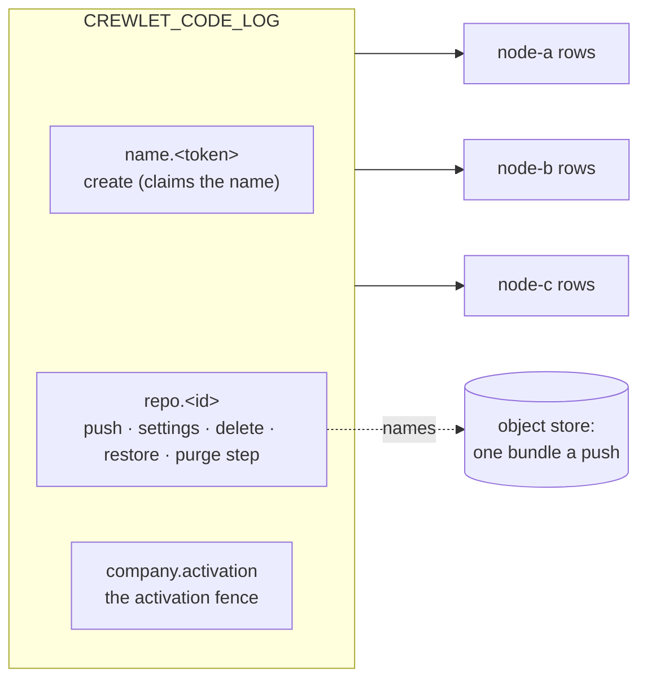
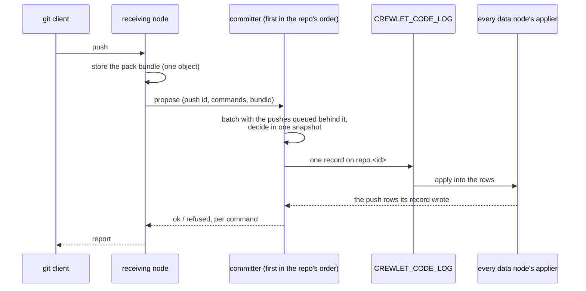
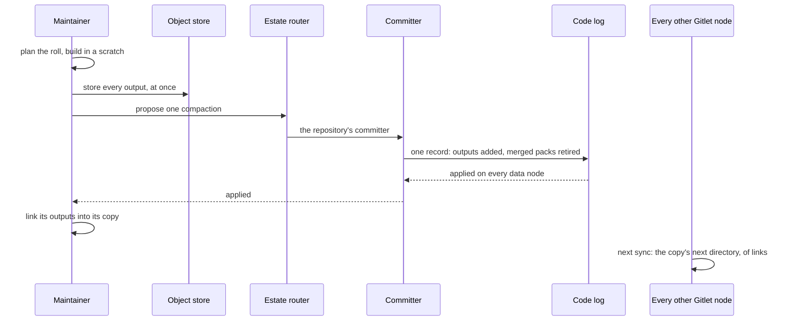
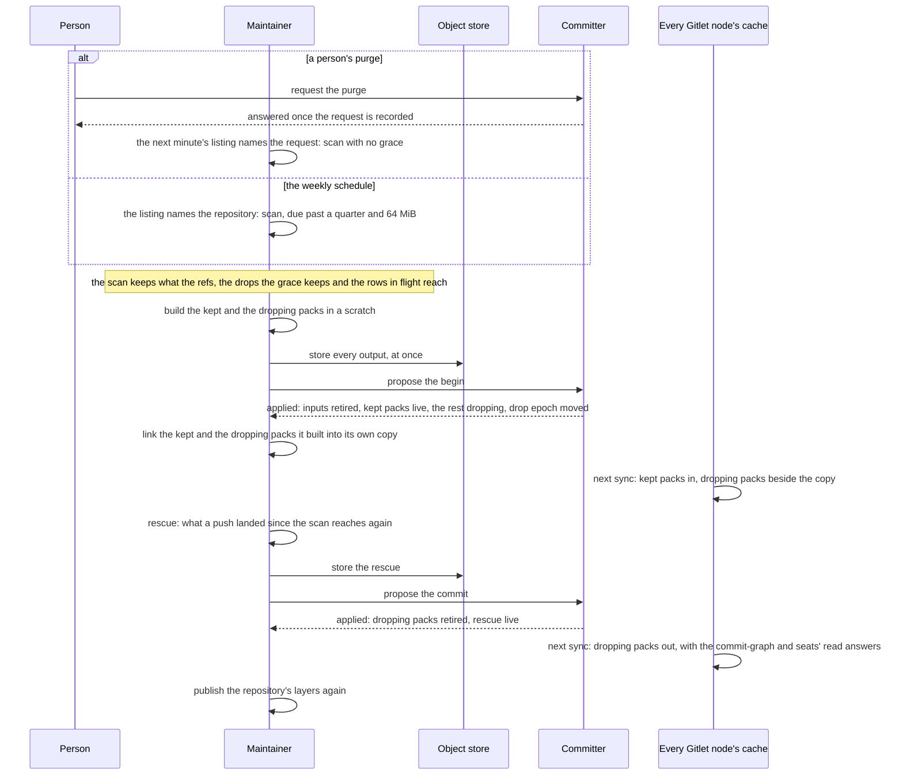
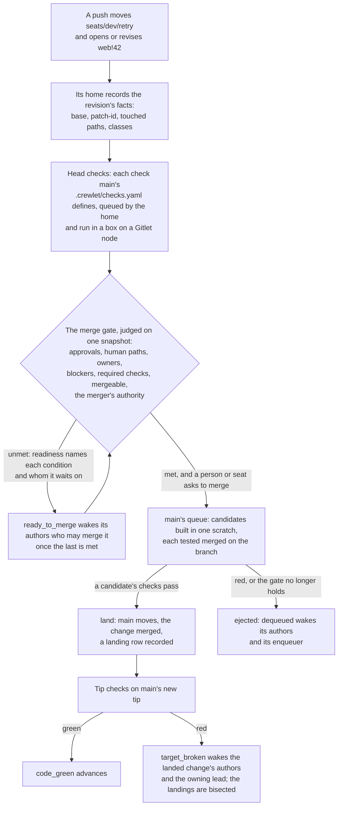
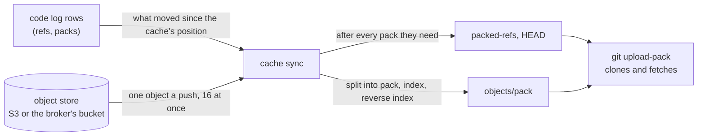
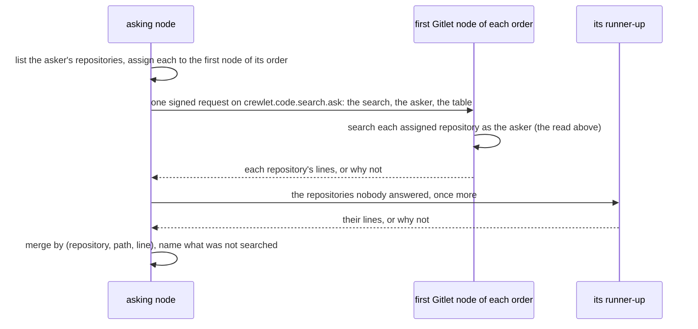
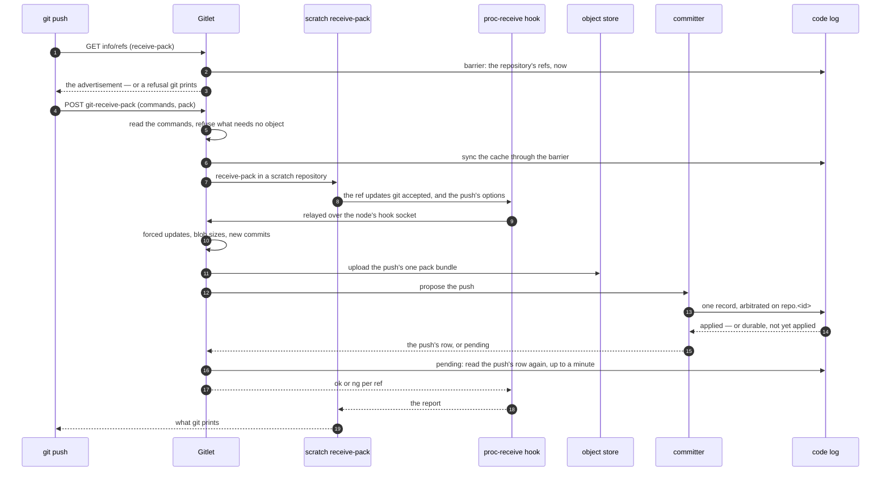
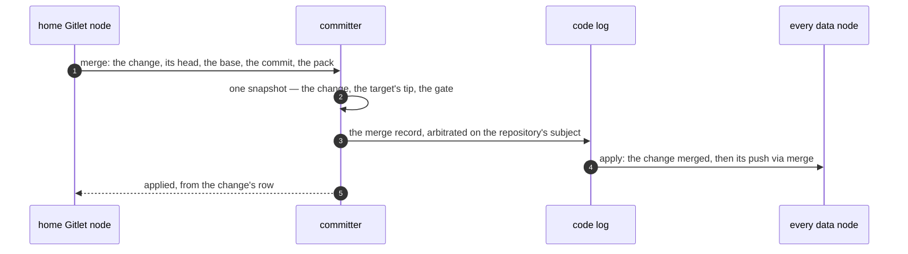

# Gitlet

Gitlet is the engine's own git host. A company that sets
[`code.backend: gitlet`](../getting-started/configuration.md#code) hosts its git
repositories in Gitlet, beside Worklet, Doclet and Chatlet. What a repository *is* (settings, protection rules, refs, packs) is replicated state every data node keeps whole; the bytes of each push are one object in the fleet's shared [object store](object-store.md).

Using it is a permission: a person, token or service account reaches a repository only while it holds `gitlet`, through every door (dashboard, git, code tools; [Who may read and push](#who-may-read-and-push)).

Gitlet is not exclusive: the [GitHub](../integrations/github.md) and
[GitLab](../integrations/gitlab.md) integrations keep working beside it, and a company may host some repositories in Gitlet and others on a vendor.

---

## What it is

A repository is **rows on the code log** (`CREWLET_CODE_LOG`), the state
log's eleventh domain (see [Replication](../guides/replication.md)): every change is one record on that ordered log, arbitrated at the broker, and every data node applies it into its own identical copy. There is no primary repository: no node's disk holds "the" repository and no node's loss loses one.

The **bytes are not rows.** Every push stores **one object**: its pack with the index and reverse index the receiving node's git wrote, back to back, named by a `code_packs` row. A node catching up reads one object a push and indexes nothing; backup, collector and audit treat a repository's packs like a project's files: a required reference, kept while a live row names it (see
[One object per upload](object-store.md#one-object-per-upload)).

A git repository on a node's disk is never the record: it is a
[cache](#the-cache-on-a-gitlet-node) derived from the rows, disposable and rebuilt from them.

A repository's **changes** are rows on the same log. A change (`web!42`, the 42nd of repository `web`) proposes merging one branch into another. A push opens one from its options, or a tool from a branch already pushed. Its lifecycle (opening, edits, close, reopening, and the revision every push to its branch writes) is decided by the repository's one [committer](#the-committer) beside the pushes that move branches, so a change is never both merged and closed ([Changes](#changes)). What is said **about** a change (review requests, reviews, findings, comments, threads) is its conversation, on a subject of its own, decided by the [change writer](#reviews-and-findings) beside the committer and never waiting behind a push. The repository's [home Gitlet node](#the-home-gitlet-node) reads each revision against its target (base, what it touches, whether it merges cleanly), so whether a change is ready to merge is one judgement over rows, never a clone ([A revision's facts](#a-revisions-facts), [Merge readiness](#merge-readiness)).

Every record about a change says **whom it concerns**, and that is who hears of it: a seat is woken from the code log itself, and a person holding the Gitlet permission finds a notice in their inbox ([Who a change wakes](#who-a-change-wakes)). Seats and a person's assistant open, review and answer changes through the [code tools](../guides/tools-and-mcp.md#the-companys-code); a person reviews one on its page in the dashboard's [Gitlet workspace](../reference/dashboard-design.md#the-gitlet-workspace). Steps: [Review a change](../guides/gitlet.md#review-a-change).

Scaling (Gitlet nodes adding reads, data nodes committing pushes) is [Scaling Out: Gitlet nodes](scaling.md#gitlet-nodes); turning it on, declaring a repository and pushing are in [Hosting Code on Gitlet](../guides/gitlet.md).

### What it does not do yet

Current product shape, not a configuration choice:

- **A seat has no git client of its own.** A person clones, fetches and pushes over HTTPS with their own API token ([Persons and their tokens](#persons-and-their-tokens)); a seat's coding box does so with its run's own credential, in the repositories its run checked out ([Coding boxes](#coding-boxes)). A seat reads and changes repositories through its code tools ([The company's code](../guides/tools-and-mcp.md#the-companys-code)): reads are answered on the server ([Server-side reads](#server-side-reads)); each change it asks (files committed, a commit reverted or picked, a branch created or deleted) is built on the repository's home Gitlet node and landed as a push ([Engine-built commits](#engine-built-commits)), under the rule a person's push is judged by ([Who may read and push](#who-may-read-and-push)). A seat and a person's assistant create, rename, archive, delete, restore and protect repositories through the same tools, a seat's scratch repositories included ([Repositories made by tools](#repositories-made-by-tools)).

---

## Declaring repositories

Repositories are declared in the company document under `code.repos`; every activation makes the fleet match.

```yaml
code:
  backend: gitlet
  deleted_retention_days: 7        # 1..365; unset is 7
  repos:
    - name: nimbus-web             # the address it is cloned by
      owner: { unit: Engineering } # a unit (id or name) or a seat (handle) — exactly one
      visibility: unit             # company (unset) or unit: which seats read it
      search: indexed              # indexed (unset) or grep: how code search reads it
      default_branch: main         # unset is main
      description: The customer-facing web app.
      protect:
        - branch: main             # refs/heads/main, and nothing below it
          approvals: one           # a merge into it waits for an approval…
          checks: [unit]           # …and for its unit check (a merge gate)
        - branch: release/**       # every branch inside release/, never release itself
          allow_delete: true
        - tag: "v*"                # a tag rule: a tag never moves
      path_owners:
        - paths: ["web/**"]        # everything inside web/
          unit: Engineering        # a unit (id or name) or a seat (handle) — exactly one
        - paths: ["**/*.sql"]      # every SQL file, at any depth
          seat: agent-dba
    - name: infra
      owner: { seat: agent-cto }
      archived: true               # read-only: takes no push
```

- **`name`**: one host-name label: lowercase letters, digits, hyphens, starting and ending with a letter or digit, at most 63. It is the clone address, so **renaming one deletes it and creates another**; declared twice, it is refused at the later entry.
- **`owner`**: exactly one of `unit` (id, or name where it has none) or `seat` (handle), resolved against the same document's chart. An unknown owner refuses the revision, naming the units or seats the chart has.
- **`visibility`**: which **seats** may read it: `company` (unset), every seat, or `unit`, only seats the chart relates to its owner (see [Visibility](#visibility)). It narrows seats only: a person holding the Gitlet permission reads every repository, one without it none. Any other value refuses the revision.
- **`search`**: `indexed` (unset), from an index of the default branch, read by a search across the company's repositories or one naming it; or `grep`, git grep over a copy, only by a search naming it. The first two Gitlet nodes of the repository's order over the live nodes each keep their own index copy and rebuild it within a minute of a push, reading only the pushed files. A node entering the two because another left builds nothing until that one has been gone ten minutes; a node the order moves past keeps its index ten minutes, so a restart moves no index. An index costs each keeping node disk and a build per new tip; `grep` costs nothing until asked. A node's indexes hold at most a third of its cache's budget: past it, the least recently searched repository's index is dropped and rebuilt only once there is room or it is searched more recently than a kept index, which it displaces; searches use git grep meanwhile, and `crewlet.code.index.builds` counts these as `over_share`. A tool-made repository starts at `grep` ([Repositories made by tools](#repositories-made-by-tools)). Any other value refuses the revision.
- **`default_branch`**: what a clone checks out; any branch name git takes except `seats` and `seats/<one name>`, the seats' own namespaces (see [Who may read and push](#who-may-read-and-push)). Unset is `main`.
- **`description`**: one paragraph, at most 1 024 bytes of UTF-8.
- **`archived`**: read-only. A push to an archived repository is refused as a whole; reading is not. Unarchive by setting `false`.
- **`protect`**: at most 64 rules, each naming exactly one of a `branch` or `tag` pattern, each pattern once; a `branch` rule may carry a [merge gate](#merge-gates).
- **`path_owners`**: at most 64 owners, each exactly one of `unit` or `seat` resolved as `owner` is, owning 1 to 32 globs, each glob once and each owner in one entry, at most 256 KiB in all as the code log records them ([Path owners](#path-owners)).
- **`mirror_from`** `{url, credential}`: makes it a **pull mirror** of a repository at another host. It is imported from there first (at creation, and when an existing repository is given a `mirror_from` or moved to another `url`), then moves only by Gitlet's syncs from it, so it takes no push and no change of its own, each refused `repo_mirrored` ([What git prints](#what-git-prints-and-what-it-means)). Made a mirror later, it reads `importing` until the source has landed: every branch and tag it holds except a seat's own (`refs/heads/seats/`) is made the source's, and one the source lacks is deleted. A new `credential` alone changes no source and imports nothing. Its `protect` list is warned about (no push reaches a rule), and an archived one is refused: an archived repository takes no sync.
- **`mirror_to`** `{url, credential, as, refs}`: makes it a **push mirror**: Gitlet pushes the named refs to a repository at another host as the seat `as` names, that seat's own identity there, never a bot. So `credential` is required and the seat must read this repository (a person's seat reads every one, an agent's what its grant reads; [Who may read and push](#who-may-read-and-push)). `refs` are at most 64 patterns of `refs/heads/<glob>` and `refs/tags/<glob>`, each once; unset is the default branch and `refs/tags/*`. No pattern may reach a seat's own branches under `refs/heads/seats/` (`refs/heads/**` among them): a mirror publishes what the company merged, never what a seat has yet to offer.
- **`import`** `{url, credential}`: fills it at creation from a repository at another host. It is `importing` until done and takes no write meanwhile (no push, change, archive or purge), each refused `repo_importing`. Only the create reads it: one declared for an existing repository fetches nothing, which the reconcile says once a run (`code_import_ignored`); beside `mirror_from` it is refused, since a pull mirror imports from its own source.

Each `url` is `https` with no user, query or fragment, at most 1 024 bytes, in the one form Gitlet dials it by. Each `credential` is **one whole `${VAR}` reference and nothing else**, at most 128 bytes, never the token (every settings record would carry it to every node and backup). The code log records the reference as written; Gitlet resolves it, from the [secret store](secret-store.md) then the environment, only when it dials ([`${VAR}` references](configuration.md#var-references)); unset fetches anonymously.

**The variable must be one an administrator declared for the URL's host** in [`code.remote_credentials`](../getting-started/configuration.md#coderemote_credentials), because the node sends the value to that host; otherwise whoever may create a repository could send any value a node resolves (keyring, Tier A token, object store key) to a host of their choosing. A declaration naming any other is refused at write; a person's create or settings change naming one is refused `not_permitted` by the deciding node, naming the host and its declared variables; every dial resolves no other. A host is matched whole, port included.

Only a person or this document sets a mirror or an import: a seat asking to create a repository with one, or to set or remove either mirror, is refused `not_permitted` whatever its grant, since a pull mirror and an import reach another host for the company and a push mirror sends its code to one. A person sets a tool-made repository's mirrors through `code_update_repo`'s `mirror_from` and `mirror_to`, each set whole or removed by `{}` (from the repository's Settings tab, or their assistant), and imports with `code_import_repo`; a repository this document declares has its mirrors from `code.repos`, settled at every activation. A scratch repository takes none of the three.

**An import and a pull mirror run on the repository's home**: the first live Gitlet node of its rendezvous order, which runs its change work. The home fetches the source's `refs/heads/*` and `refs/tags/*` over smart HTTP, checks every object as a push's, cuts it into packs of at most 1 GiB and lands them as records of the repository. An import lands chunks (packs before the refs needing them, at most 1 000 refs a chunk, fewer where names are long: `&`, `<` and `>` take six bytes each in the code log) then its end. A pull mirror syncs every 15 minutes onto its source as it is, force-push and deleted branch included. Each lands as a push `via import` or `via mirror` on the engine's own account. A sync finding nothing moved still lands a small record, no pack and no push, moving the last sync, so a quiet source is asked again 15 minutes later: one such record per quiet mirror per 15 minutes.

- An import stopped midway resumes from what landed on whichever Gitlet node is home, fetching only what the landed refs do not reach.
- One that cannot finish (a blob past `code.limits.max_blob_bytes`, the repository past one of its limits, a source answering only the dumb HTTP protocol) ends: the repository is active with what landed, and its import's error says why.
- A source that cannot be reached or refuses the credential is asked again a minute after the first failure, the wait doubling to once every 15 minutes.
- A home runs two attempts at once, imports, syncs and pushes together; one due while two run waits and starts as one ends, the mirror attempted longest ago first.
- An attempt whose fetch has arrived while every maintenance process the node allows is running keeps what it fetched and waits for one to end (logged `code_mirror_cut_waiting`) rather than fetching again.

The credential's value is sent as HTTP Basic: a value with a colon is `user:password` as written; any other is a token sent as the password beside the user `x-access-token` (GitHub, GitLab, Gitea, Forgejo). A forge wanting its own user (Bitbucket's `x-token-auth`) gets it in the variable. A push mirror pushes its refs, each protected branch at its green commit, whenever the repository moves and every 15 minutes while it does not ([Mirrors and imports](#mirrors-and-imports)).

**Watching it.** A repository's detail (the `code_repo` question its dashboard page reads) carries `remotes`: its mirrors as its settings name them, each credential the `${VAR}` reference and never a token; its import's source, chunks landed, and once ended, when and why (short); and a pull mirror's last sync. A repository with no mirror that was never imported carries none.

At most 10 000 repositories a document: a typo guard two orders of magnitude past a large company's. It is an [admission rule](configuration.md#what-a-stored-revision-is-held-to), like the retention's one-year bound: a document past either is refused, and a stored revision already past one (admitted by a later build that raised it) still applies, with a warning, since nothing the reconcile or purge does depends on either.

### What each change does at its activation

| You change | At its activation |
|---|---|
| Add a repository | **Created**, empty, with its settings. Two nodes creating one name land one repository: a create arbitrates on the name. |
| Change a repository's settings | **Settled**: one record with the new settings, stamped with the activation that wrote it. |
| Change nothing | **Nothing** but one fleet-wide record, the activation's fence (below), never a record a repository. |
| Remove a repository | **Deleted**: it takes no push; rows and packs are kept. Declaring it again under its name within `code.deleted_retention_days` **restores** it: refs and packs as they were, settings as now declared. |
| Leave it removed past `code.deleted_retention_days` | **Purged** by the `code-retention` duty, in bounded steps; its name is free again (see [Deletion and purge](#deletion-and-purge)). |
| Turn Gitlet off | **Nothing is deleted.** A node whose native runtime is running keeps serving Gitlet until its restart (see [A native backend changes at a restart](control-plane.md#a-native-backend-changes-at-a-restart)); a revision without Gitlet reconciles no repository. |

Only repositories the **configuration** manages are reconciled: one somebody else created is never deleted for being absent from `code.repos`.

### Protection rules

A pattern is a branch or tag name in git's grammar: a component of `*` matches one component, `*` inside a component any run of characters but `/`, and a component of `**` any number of components (zero or more in the middle, one or more as the last). A pattern with no `*` matches **only itself**: a rule on `main` protects `refs/heads/main`, not `refs/heads/main/x` (which git's `for-each-ref` would also match). So `release/**` protects `release/1.0` and `release/2/hotfix` but not a branch named `release`; a rule meant for both is the two rules `release` and `release/**`. A glob has at most eight components counting `refs/` and its namespace, which bounds the cost of asking it about a ref.

What a rule does to a push of a ref it matches:

| Field | Unset | Set |
|---|---|---|
| `allow_force` | A push moving the branch to a commit not descending from it is refused | Allowed. Refused on a tag rule: a tag never moves |
| `allow_delete` | Deleting the ref is refused | Allowed |
| `direct_push` | `persons`: a person may push to it, nobody else; a seat's push is refused `protected_direct` ([A seat's push](#a-seats-push)) | `none`: nothing pushes to it, the ref is frozen |

**Every rule that matches holds**: a ref matched by a rule allowing deletion and another that does not cannot be deleted. A ref **no** rule matches may be force-pushed or deleted by anybody who may push, so `crewlet validate` warns (never fails) about every repository whose default branch no rule protects, at its `protect`, naming the rule to add. An archived repository is not warned about, since nothing can move its branch until it is unarchived; the revision that unarchives it brings the warning back.

**Every rule names who last changed it, and when.** Every record carrying a repository's settings (create, settings change, restore) carries the rules whole, and each rule's row keeps the decider of the record that last CHANGED it (its push controls or gate) and that record's instant: a seat by handle, a person by their human seat, an unbound credential by its login, and nobody for a rule the company document declares (its source is the configuration). A record carrying a rule unchanged (a description edit, another pattern's protection) leaves its source as it was. A detail read that asks for gates answers each rule's source beside them (`rule_sources`: `pattern`, `set_by`, `set_by_kind` and `set_at`), and Settings › Gitlet and the repository's Settings tab draw it under each rule.

A declared repository's rules change only with its declaration. A tool-made repository's rules change one pattern at a time through a lifecycle request: a seat may add a rule or tighten one, only a person removes or loosens one, a rule's [merge gate](#merge-gates) included, field by field ([Who may change a protection](#who-may-change-a-protection)).

### Merge gates

A rule over branches can also say what a **merge** into them needs: its **merge gate**. Any of these fields set on a `branch` rule forms one; unset fields take their default:

```yaml
protect:
  - branch: main
    merge_by: maintainers            # writers (unset), maintainers or persons
    approvals: one                   # none (unset) or one counted approval
    approvals_unless: [comment_only] # path classes whose changes need no approval
    human_paths:                     # paths a change touching waits for a person
      - glob: "migrations/**"
      - glob: "deploy/**"
        unless: [comment_only, whitespace_only]
    checks: [lint, unit]             # the checks a merge waits for, by name
    landing: {depth: 4, batch: 2}    # the queue's candidates at once, changes a candidate
    owners_approve: true             # one approval eligible for every owned glob touched
    delete_source: seats             # seats (unset) or none
```

| Field | Unset | Set |
|---|---|---|
| `merge_by` | `writers`: anybody who may write merges | `maintainers`: only those who maintain it; `persons`: a person, never a seat |
| `approvals` | `none` | `one`: a merge waits for one counted approval |
| `approvals_unless` | none | The [path classes](#change-classes) `whitespace_only`, `comment_only` that exempt a change from those approvals: one whose every touched path is of a listed class waits for none |
| `human_paths` | none | At most 32 globs, in the [path owners'](#path-owners) grammar: a change touching a path one matches waits for a **person's** approval, whatever else approved it, unless every path that glob matched is of a class its `unless` lists |
| `checks` | none | At most 32 checks a merge waits for, each by the name a repository's [checks file](#the-checks-file) gives it: a lowercase letter or digit, then up to 63 of them, `.`, `_` and `-` (one rule for both, so a rule never requires a check no repository can define) |
| `landing` | `depth: 4`, `batch: 2` | How the branch's [merge queue](#the-merge-queue), which tests each change merged on the branch before it lands, keeps pace: `depth`, candidates tested at once, 1 to 8; `batch`, waiting changes one candidate takes, 1 to 8 |
| `owners_approve` | off | A change waits for one counted approval from somebody eligible for every [path owner](#path-owners)'s glob it touches |
| `delete_source` | `seats`: a merge deletes a source branch in a seat's own namespace, in the record that merges it | `none`: it keeps every source branch |
| `agents_edit_checks` | off: on a rule requiring checks, a change to `.crewlet/**` (where a repository's checks are defined) waits for a person | A seat's approval stands for it too |

A merge gate on a `tag` rule is refused at the first gate field it sets: no merge reaches a tag. `no_code_change` is refused in `approvals_unless` and in an `unless`: it is a revision's class, never a path's, and an approval already carries across a revision that changed nothing ([Merge readiness](#merge-readiness)). Each check, human-path glob and class is listed once. A gate is recorded with every field resolved and every list sorted, so one declaration is one record on every node and an unchanged activation writes nothing for it. A gate weighs at most 8 KiB as the code log records it (reached only with both lists near their bounds, or globs JSON spells long: `&`, `<` and `>` are six bytes each), keeping a repository's 64 rules' gates within 512 KiB of its settings.

**`code.merge_by_floor`** (`writers` unset, `maintainers` or `persons`) is the least a merge into **any** protected branch needs: a merge is held to the stricter of the floor and the `merge_by` of every rule matching its branch, a rule with no gate reading as `writers`.

A tool-made repository takes gates through `code_protect_branch`, a field at a time and a list an item at a time; each field a call omits is kept as the branch's gate has it (or defaulted as above where the rule has none), and only a person loosens one ([Who may change a protection](#who-may-change-a-protection)).

A gate is **recorded, answered and judged, and a merge is held to it**. Every change into a gated branch is judged under it, its readiness listing each term ([The merge gate](#the-merge-gate)); `code_merge_change` merges one only as it allows, a change into a branch whose gate requires a check is queued rather than merged ([The merge queue](#the-merge-queue)), and so does an approved `ask_to_merge`, which merges as the agent that asked, for whom its run works ([Delegated Decisions](../guides/delegated-decisions.md#asking-to-merge-and-to-deploy)). A detail read answers every gated rule's gate beside its pattern where it asks (`GET /gitlet/repos/{name}?gates=true`'s `gates`, and `code_get_repo`). A push is held to the rule's `allow_force`, `allow_delete` and `direct_push` alone ([Protection rules](#protection-rules)): a gate judges a merge, never a push. No other read carries a gate: a repository listing answers each rule as a push is held to it, and so does the row every git request, every Gitlet node's sync and every push's decision reads (a repository's gates reach half a mebibyte, which none needs, and a node rewrites its row at every push).

`crewlet validate` warns, never fails, about a gate field that would do nothing: `owners_approve` on a repository naming no path owners, `landing` on a rule requiring no checks (only a branch whose merges wait for checks has a queue), and `approvals_unless` beside `approvals: none`.

### Path owners

A repository's **path owners** say who owns which part of its tree: each a unit (whose [effective lead](organization-model.md#lead-inheritance) a review is asked of) or a seat, with the globs of the paths it owns. They are for **review routing**: a change whose revision touches an owner's paths asks it for a review once the revision's facts are recorded ([Recorded on the change](#recorded-on-the-change)), which the repository's home does for every live change ([The home's change work](#the-homes-change-work)), whether a push opened it ([A change a push opens](#a-change-a-push-opens)) or a tool ([Opening, editing and closing a change](#opening-editing-and-closing-a-change)). The ask names the owner's globs the revision touched. It **grants nothing**: a seat named a path owner reads and pushes by its [grant](#who-may-read-and-push) exactly as before (owning `deploy/**` lets no seat push there that could not, and a `visibility: unit` repository still shuts out a seat outside its unit), because a seat's standing is derived from the chart and its tier, and no path owner is read there.

A glob is **a [protection rule](#protection-rules)'s pattern grammar read over a tree's paths**: it starts at the repository's root, `*` as a component matches one component, `*` inside a component any run of characters but `/`, and a `**` component any number of whole components (zero or more in the middle, one or more as the last). So `*.go` is the Go files at the root only, `**/*.go` every Go file, `docs/**` everything inside `docs` but never a file named `docs`, and `web/**/test/*` every file directly inside a `test` directory anywhere under `web`. A glob with no `*` matches **only** that path (git's pathspec would also match everything below a directory of that name). It is at most 128 bytes, and one holding a `*` at most eight components. `*` is the one metacharacter: `?`, `[`, `\` and a leading `!` are refused rather than read as themselves.

A repository names at most **64** owners, each owning at most **32** globs; an owner is named once (a unit named by name and by key is one owner). The whole weighs at most **256 KiB** as the code log records it, each owner by key or handle: every create, settings change and restore carries them whole, and a record is at most about a mebibyte beside the widest [protection rules](#protection-rules) and gates. Only counts near their bounds with long globs reach it (2 048 globs of a hundred plain characters are about 214 KB), or globs with many `&`, `<`, `>` (six bytes each in JSON). A scratch repository takes none. Path owners are settings, settled at an activation like every other field ([What each change does at its activation](#what-each-change-does-at-its-activation)).

For a tool-made repository, a settings change adds globs to an owner and removes them, applied to the owners the deciding node's rows hold, never a whole list the asker read elsewhere, so two requests giving one owner a glob each both land. An owner left with no glob is no path owner; an owner a change gives globs to must be one the chart holds, while one it only removes globs from need not be. A detail read answers path owners where it asks (`GET /gitlet/repos/{name}?path_owners=true`), ordered by kind, then reference, each one's globs sorted.

Where a rule's [merge gate](#merge-gates) sets `owners_approve`, a merge into its branches waits for an approval eligible for every owned glob it touches, so path owners are no longer a review's alone: taking a glob from one, or an owner whole, lets a merge past an approval it needed, and that is a person's ([Who may change a protection](#who-may-change-a-protection)). Giving an owner globs only asks a merge for more, and a seat that maintains the repository still does it.

### The reconcile and the activation fence

Every data node reconciles `code.repos` at **every boot and every activation**, except a node in a [maintenance mode](../guides/retention.md#the-three-modes), which publishes nothing. Only a changed repository (created, settled, deleted, restored) costs a write. Nodes reconciling one activation at once race on each, the log lands one record, and the others decide again from it and write nothing. A refusal for one repository is logged and the rest still apply.

The reconcile runs **beside** the apply, not inside it: the apply reports the revision applied as soon as it has asked for the reconcile, and the repositories follow. At the most a document may declare, an activation creating, deleting or restoring every repository takes 16-19 seconds on one node before the last has its record, and a node still applying a revision 45 seconds after a peer applied it is [shed](control-plane.md#posture-what-a-lagging-node-does), so repository count must never decide that. A newer activation's reconcile ends an older one's still running; a node that stops mid-reconcile logs `code_repos_interrupted`, and its next boot reconciles.

Because the revision is already reported applied, a reconcile leaving something undone (an outcome the log did not answer, decisions refused while the node caught up on the fence, an unreadable listing) is **run again by the node**: after five seconds, doubling after each such run up to every five minutes, until one applies, a newer activation replaces it or the node stops. A rerun is a batch read where nothing changed and writes only what is missing. A name held by a repository the configuration does not manage, and a declaration the log refuses as written, are said at every run but never rerun for: only a revision changing them applies them.

Without an order between activations, a node applying an *older* activation late would walk a newer one's settings back. So a reconcile first publishes one **fence** record; every node's rows raise a single fence to it, never lower it, and every configuration record an older activation decides afterwards is refused identically by every node. A reconcile's decisions wait for its own node to have applied its own fence, so whatever an older activation decided is either *before* the fence (in the rows the newer one decides from, any difference settled back) or *after* it, refused. That is why an unchanged repository costs nothing: such an activation writes its one fence record and reads every declared row in one batch.

A node that finds a later activation already fenced logs `code_repos_superseded` and decides nothing: the fleet has moved past its configuration, and it reconciles again when it applies the later one.

---

## Repositories made by tools

Beside the projects `code.repos` declares, Gitlet keeps repositories a **tool** made. What a person, a unit's lead or a seat asks of them (create, rename, change settings, archive, unarchive, delete, restore, protect a branch) is one **lifecycle request** on any data node, decided in one snapshot of the rows. For an existing repository a request sends a **change**: one field, one protection rule, the archive flag, or globs added to or removed from a [path owner](#path-owners). The deciding node applies it to the settings its own rows hold, never a set the asker read elsewhere, so two people adding two protection rules at once each keep theirs. A request names its operation, so asking it again is one write, answered from the first; a create's repository id derives from its operation, so a late retry still finds the repository. A repository `code.repos` declares refuses every tool's request (`config_managed`, naming the declaration to change), and a configuration never adopts a tool-made one.

**Two kinds, and the name says which.**
- A **project** name is one host-name label, as a declared one's is. A person creates one for any unit or seat of the chart; a seat only for the unit whose effective lead it is, at `full_access`.
- A **scratch** repository is a seat's own, named `<handle>.<slug>` (two labels, one dot, 63 bytes in all, the slug never `git`). Only that seat creates it, at `full_access`; the seat owns it, it takes no protection, and it is deleted once idle (below). A person never creates one.

A rename keeps the kind's form for everybody, a person included: a scratch repository keeps its seat's handle, and a project stays one label, since a project renamed to `alice.web` would read as seat `alice`'s own and squat the name `alice` would create.

**Who may.** A person holding the Gitlet permission maintains every tool-made repository; one without it reaches none ([Who may read and push](#who-may-read-and-push)). A seat may what its [grant](#who-may-read-and-push) maintains: the owning unit's effective lead at `full_access` a project, the owning seat its scratch repository. A settings change is judged as the repository stands **and** as it would be left, so a seat cannot hand a repository to an owner, or narrow it to a visibility, under which it would no longer maintain it. A seat never leaves a project owned by a seat, its own included, by a create or settings change: a seat's own repositories are scratch ones, which `code.scratch.max_per_seat` caps and idle expiry deletes, while a seat-owned project never expires and counts only against the 10 000 projects the company shares. So only a person makes one. A maintaining seat may add a [protection rule](#protection-rules) or tighten one, never remove or loosen one, its [merge gate](#merge-gates) weighed field by field and its [path owners](#path-owners) too where the gate makes them gating ([Who may change a protection](#who-may-change-a-protection)). Everything else is refused `not_permitted`, with the reason, and nothing is written. Every request reads the chart, so a node [behind the company's configuration](#who-may-read-and-push) decides none and the next data node does.

**Two caps.**
- A project create is refused `repo_limit` at 10 000 project repositories, declared and tool-made alike, every one short of purged (the bound `code.repos` is held to).
- Each seat holds at most `code.scratch.max_per_seat` scratch repositories (50 unless set; 0 for none), **every one it owns counting until purged**, a deleted one included, so a create-and-delete loop cannot hold more (`scratch_limit`). They never count against the 10 000.
- A restore adds no repository, so neither cap refuses one.
- A scratch repository costs the code log one create record: under a kibibyte of signed frame at the longest name, under two with the longest description.

**A rename leaves the old name redirecting** for a month (`RedirectWindow`), so [a clone or a fetch by the old URL still works](#what-git-prints-and-what-it-means). The advertisement is answered `302 Found` to the new name; the fetch after it is served at either name, since git moves to the new name only when the redirect answered its very first request: one that presented its credential up front, which git then says (`redirecting to`), never one whose credential helper answered a challenge first. A push of the old name is refused, naming the new one. Nothing else may take the old name while it redirects; renaming back takes it back. The `code-retention` duty releases an old name at its window's end, one record a name, and it is then free; one whose repository was purged meanwhile stays reserved until its window ends.

**A tool's repository is searched with `grep`** until somebody who maintains it asks for an index: a create makes it `search: grep`, and a settings change sets its [search mode](#declaring-repositories) (a person's on any tool-made repository, a seat's on what it maintains). A **scratch** repository is `grep` for good: an index asked by its seat or a person is refused `not_permitted`, since it would be built and kept on the Gitlet nodes for a repository deleted once idle. A search that names it still reads it.

**Archive, delete and restore** work as for a declared repository: an archived repository is read-only, a deleted one takes no push and keeps its refs and packs, restorable as it was until its [purge](#deletion-and-purge).

### Who may change a protection

A tool-made repository changes its [protection rules](#protection-rules) one pattern at a time, with `code_protect_branch`, and **a call changes only what it names**.
- Each push control named (`direct_push`, `allow_force`, `allow_delete`) replaces that control. One left out stays as the rule has it, or takes its least (`persons`, off, off) on a pattern no rule holds yet: a call that only requires a check leaves a branch frozen at `direct_push: none` frozen.
- The [merge gate](#merge-gates) changes **a field at a time**: `merge_by`, `approvals`, `landing`, `owners_approve`, `delete_source` and `agents_edit_checks` each replace that field.
- Lists change **item by item**: `checks` and `approvals_unless` take `{"add": [...], "remove": [...]}`, `human_paths` takes `{"put": [{"glob", "unless"}], "remove": [glob]}` (a glob put replaces that glob's entry). One more check is `checks: {"add": ["e2e"]}`, never the list resent.
- A field left out stays as the gate has it, or takes its default where the rule has no gate yet. `remove_gate` takes the gate away.

The deciding node puts the change in the rule its own rows hold, so two calls changing two controls, fields or list items (two checks added) both keep theirs. It refuses a gate the change leaves past a list's bound or weighing past the 8 KiB a gate may. The call answers the rule as it now stands, its gate whole.

**A protection binds every seat, its unit's lead included.** A seat whose grant maintains the repository may add a rule or tighten one, never remove or loosen one: that is a person's. A change is weighed against the rule held for its pattern when the request is decided, so two requests cannot loosen a rule between them, and one that tightens one control and opens another is refused `not_permitted` for the one it opens, its sentence naming it. Otherwise a lead steered by what it read could lift `main`'s protection and then force it, or lower its gate and then merge past it.

| Control | A seat may | Only a person may |
|---|---|---|
| The rule | Add one | Remove one |
| `direct_push` | Make it `none` | Make it `persons` where it was `none` |
| `allow_force`, `allow_delete` | Turn either off | Turn either on |
| The merge gate | Add one to a rule with none | Remove one |
| `merge_by` | Raise it: `writers`, `maintainers`, `persons` | Lower it |
| `approvals` | Raise it to `one` | Lower it to `none` |
| `approvals_unless` | Take a class out | Add a class |
| `human_paths` | Add a glob, or take a class from one's `unless` | Drop a glob (a broader one put in its place included) or add a class to one's `unless` |
| `checks` | Require one more | Drop one |
| `owners_approve` | Turn it on | Turn it off |
| `agents_edit_checks` | Turn it off | Turn it on |
| `landing.depth`, `landing.batch`, `delete_source` | Change either way (queue speed and post-merge tidying, never what a merge is held to) | — |

A value the deciding node's build does not know (one a newer build wrote) counts as stricter than every value it knows, so a seat moves `merge_by` or `approvals` neither away from one nor to one, and `direct_push` away from one only to `none`. Since `owners_approve` makes the [path owners](#path-owners) whom a merge waits for, a seat may not take a glob from a path owner, or remove an owner, while any rule's gate sets it: refused `not_permitted`, naming `path_owners`, what it takes and the rule; giving an owner globs lands. A person's request is weighed by none of this, and a repository `code.repos` declares takes no tool's request at all.

### A scratch repository's idle expiry

A scratch repository with no push, rename, settings change or restore for `code.scratch.idle_days` (7 unless set) is **deleted** by the `code-retention` duty, restorable for `code.deleted_retention_days` like any deletion, then purged. Reading is no activity; an archived repository is kept.

**A scratch repository a live turn has named is never expired.** Every request a seat's turn makes about a repository (read, write or lifecycle, through its own tools, a delegated worker's or its executor run's bridge) first takes the turn's **hold** on it. A turn holds what it named until it ends: while it runs, in the memory of the node running it; once it has a [executor](code-sandbox.md)'s row, on the row as well, unioned at every launch and released with the row when the run ends. So a turn parked for days keeps its experiment. A hold moves no clock: once the turn ends, the repository is expired at the next pass if still idle.

Each pass fixes its cutoff, and the position its page of due repositories was read at, **before** it reads the holds: every run row the fleet holds, whatever its status, and the running turns of every node holding a seat lease, each required to answer within two seconds. The rows are read again once the nodes have answered, since a turn's first executor moves its holds from node memory onto the run's new row meanwhile. Each expiry is decided against that page: a repository with any record on it since, or active since the cutoff, is kept.

A turn taking its hold on a repository idle 22 hours or more also records it on the repository, which the broker orders against the expiry: recorded first, the expiry is refused; expired first, the turn's request is refused before it reads anything, and the repository can be restored. Under 22 hours no pass in flight can have listed it, since `idle_days` is a day at least and two nodes' clocks may disagree by two hours. The record is one a **turn**: a seat that keeps reading an experiment it no longer pushes to appends one small record to the code log in every turn that names it, from the repository's 22nd idle hour until a push moves its clock or the expiry takes it. One more is appended in a turn resumed so long after its work began that the engine mints the writes of its resumed half anew (past 29 days, a day inside the 30 the code log's operation ledger remembers); its holds are recorded at that instant, since one recorded when its work began could be confirmed by no node and every call about the repository would be refused.

**A hold that cannot be read expires nothing**: a run store that cannot be listed, or a seat holder that does not answer, ends that pass's expiry, says so on its `code_retention_pass` line (`scratch_expiry_unread`) and logs `code_scratch_expiry_skipped` at warn; the next pass asks again.

A pass's line counts `released` old names, `expired` scratch repositories and `scratch_held`, the idle ones a live turn kept.

---

## Mirrors and imports

A repository can be filled from another forge, kept in step with one, or published to one. All three are run by the repository's [home Gitlet node](#the-home-gitlet-node), from the repository's rows, and dial the other host the same one way.

| | What it moves | Which way | How often |
|---|---|---|---|
| **Import** (`import`, `crewlet gitlet import`, `code_import_repo`) | Every branch and tag of the source, once, into a new repository that reads `importing` until they have landed | In | Until done; a restart fetches only what the landed refs do not reach |
| **Pull mirror** (`mirror_from`) | The source's branches and tags as they are (force-pushes followed, deleted branches deleted), by the mirror's own sync records; every push to it and every change is refused `repo_mirrored` | In | Every 15 minutes (`gitlet.MirrorInterval`), and a minute after a failure, doubling up to that |
| **Push mirror** (`mirror_to`) | The refs it covers (its `refs` patterns, or the default branch and `refs/tags/*`): each protected branch at its **green** commit, every other ref at its tip; a covered ref the repository no longer has is deleted there | Out | At most once a minute while a covered ref moves (records that move none, such as a seat's pushes to its own branches or a check's results, dial nobody), and the other host read again every 15 minutes whatever moved |

**A push mirror publishes what passed, never what was pushed last.** A branch a [protection rule](#protection-rules) protects is pushed at its [green commit](#tip-checks-and-code_green), the newest commit landed on it whose required checks passed; with none yet, it is left as the other host has it, `waiting`. A branch no rule protects has no landing or green row, so it is pushed at its tip, as every tag is (a tag names one commit for good). Each push compares what the other host holds of the covered refs (one `git ls-remote` of its branches and tags alone, so a forge's pull-request refs are never sent) with what the repository says it should, and pushes only the difference, forced (`git push --force --porcelain`), from a scratch over the cache's copy. A ref the other host rejects (a protection or hook refusing the force-push or deletion) fails the attempt, naming it. An attempt whose covered refs, target and patterns are what the last one left the other host level with, within 15 minutes, ends without dialing it; after 15 minutes it reads the other host whatever moved, so a writer there that is not the mirror is undone within the interval.

**It pushes as a seat, never as a bot.** `mirror_to.as` names the seat whose own identity at the other host the push carries: the token the mirror's `credential` variable holds is that seat's own token there. The seat must read the repository. An agent's seat reads what its grant reads. A person's seat reads every repository only while the person holding it uses Gitlet: a seat nobody holds, one held by a person who may not act and one held by a person not given the Gitlet permission read none, since a mirror pushing as them would publish the company's code under an identity the company withheld it from
([ADR-0110](https://github.com/crewlet/crewlet/blob/main/adr/0110-reaching-a-repository-takes-the-gitlet-permission.md)).
- A person's create and a settings change that sets the mirror ask the identity directory first, and are refused for such a seat (`mirror_to.as: nobody holding <seat> uses Gitlet now …`, saying an administrator gives them Gitlet or the mirror names a seat that reads the repository). A directory that cannot answer decides nothing.
- A repository `code.repos` declares is judged on the chart alone when its revision is checked (a configuration reads no identity directory), so whether its person uses Gitlet is judged at push time only.
- The home asks both again before every push, against its chart and the directory as it answers then, so a revision or an administrator that takes the seat's read away stops the mirror: the attempt fails, and a mirror not brought level for half an hour raises `code_mirror_failing`. A directory that cannot answer fails the attempt too; the next asks again.

**Box commit trailers travel as they are.** A commit a coding box made carries the `Crewlet-Seat`, `Crewlet-Run` and `Crewlet-Work-Item` trailers its box's hook wrote, and a mirror moves commits, never rewrites them. The trailers stay a convention, and the push row on the code log stays the provenance ([Which push landed a commit](#which-push-landed-a-commit)).

**One outbound dial.** All three reach the other host over HTTPS alone. The node resolves the host itself and refuses it when any address it resolves to is not on the public internet, unless Tier A's [`gitlet.import_allow_private`](configuration.md#gitlet) lets it reach the node's own network; it hands git exactly the addresses it judged, so git never asks DNS again; redirects are not followed. Through a proxy (the process's own, the one `HTTPS_PROXY` names for the URL less what `NO_PROXY` exempts) the node resolves nothing: the proxy resolves and dials, so the address rule is the proxy's and `gitlet.import_allow_private` changes nothing. The certificate authorities are the process's own too (`SSL_CERT_FILE`, `SSL_CERT_DIR`), as [Deployment](../guides/deployment.md#reaching-other-forges) says. A `credential` is always one whole `${VAR}` reference, kept as the reference on every data node and in every backup and resolved from the secret store, then the node's environment, each time the node dials, and only where the node's current `code.remote_credentials` declares the variable for the URL's host, or the attempt fails at its dial with nothing resolved. It is sent in a header, never on git's command line, and redacted from every logged line.

**A failure is the home's to know.** A push to another host is no code-log record, so only the mirror's home knows, in memory, whether it is level. Each failed attempt is logged as `code_mirror_attempt_failed` (naming the repository, `sync` or `push`, and why), counted in `crewlet.code.mirror.runs` and retried a minute later, longer after each failure in a row. A mirror not brought level for longer than its refresh (15-minute interval plus 15 minutes of grace for an attempt in flight) raises [`code_mirror_failing`](../reference/alarms.md) on its home, naming the repository that has waited longest. A node no longer a repository's home stops counting its mirror; a restarted node counts from the first pass that asks it for the mirror. A mirror waiting behind others for one of the node's two slots, or still running (a first push of a large repository), is not level either. Every push that moved something is recorded in the event log as `code_mirror_pushed`: the repository, the other host, the seat it pushed as, the refs it set and deleted and the protected branches it held back, each the first 16 in ref order beside the count of all, so a first push of tens of thousands of refs is still one event. It is the one durable account of what the company published, and when.

Every import that ends is recorded once, as `code_imported`, by the home that ended it: the repository, the source (never the credential), whether it was a pull mirror's first fill, how many chunks landed, what the repository holds once it ended (refs, bytes of live packs, default branch), the import's error where it ended short of its source (a blob past `code.limits.max_blob_bytes`, say), and the end's position on the code log. The repository's row keeps only its latest import, and the push rows its chunks wrote (`via import`) name no source, so the event is where a repository's origin is kept. It stays out of the activity feed, where a person's import already is, as that person's `operator_acted`. An end its home did not hear applied (answer pending, or the node gone before it published) is no event, and a stream that does not take the event within five seconds is logged `code_imported_unpublished`; the import stands either way. A pull mirror's syncs are no event: each is a push row `via mirror`.

---

## One subject per repository

Everything that moves a repository's refs or packs, or governs them (a push, a settings change, a deletion, a restore, a purge step) is a record on **one subject a repository**, `crewlet.code.log.repo.<id>`: the **arbitration unit**. Two pushes to one repository contend at the broker, exactly one record lands per round, and the loser decides again against the winner's rows. It is not a subject a ref, because every write changes the repository's row too (ref count, bytes, version), so that would never narrow contention.

A **name** is claimed on its own subject, `crewlet.code.log.name.<token>` (a bounded digest of the name), so two creates of one name contend there, where two freshly minted repository ids never would. The activation fence has the company's one subject.



---

## The committer

A repository's pushes are **committed by one node**: its **committer**, the first live data node in a rendezvous order of the repository's id, which every node computes alike. A push received anywhere is asked of that node, which takes the repository's pushes in order and puts every push waiting behind a record in flight into the next one: **group commit**, without lingering, up to 64 pushes a record. An idle repository pays one record a push and a burst one record a batch. A batch is decided in one snapshot of the rows, each push against what the ones before it did, and a push is answered `ok` only from the row its record applied, never from the decision. A push whose [changes](#revisions) would take the record past the rows one record may write, beside the pushes before it, is decided first in the next record, with the pushes behind it after it.

The live data nodes are the ones each node's view of the fleet's presence names. The view hears a presence claim or release as it lands and lists the fleet again then (see [Coordination](coordination.md#who-is-in-the-fleet-asked-per-request)), so a joining data node is in every repository's order within about a second of its claim, and a fleet started at once agrees on every committer within about a second of the last claim. A push received inside that second may be committed by a node that has not yet heard its committer join: still correct, since the broker decides between pushes on the one subject, short only of that push's group commit. A node without `data` that has heard of no data node has nobody to ask, and refuses a push, a fetch or a read as unserved until one claims. A committer that stops without releasing its presence stays in the order until its lease lapses, asked after the rest once silent (see [Scaling](scaling.md#how-a-request-reaches-the-estate)).

A push carries an id the receiving node minted, and a push id the repository's history already holds is answered from its row, so a push asked twice, or of a second node after the first stopped answering, is still one push. A committer that stops, or answers nothing, hands each of its repositories to that repository's runner-up in the same order, under the same push id. So does a committer the code log refuses, before anything is appended, for a reason about itself: it is evicted, behind, below the trim floor or holding a record it cannot decode, or it could not read its own eviction state, the trim floor or the log's usage (which a broker answers `503` while it elects a leader). A node in a maintenance mode commits nothing and refuses as a node that ran nothing, so the next committer decides; while the whole fleet is in one, no push is committed.

The path a push takes from the node that receives it:



A queue holds at most 1 024 pushes, and a push waits in it only while its asker's attempt still holds a batch (which has 30 seconds to land) and its answer; past either bound a push is refused `busy` undecided and the client pushes again. The committer's node holds at most 1 088 proposals (one repository's full queue and the batch ahead of it) and 64 records' worth of their bytes across all its repositories, and refuses `busy` at once past either. Every proposal holds a slot of the node's lane for proposals while it waits, a lane as wide as what the committer and its two sibling writers (of changes' conversations and of repositories' checks) hold together, so each one's burst is refused by its own bound and never keeps another's requests waiting. The `crewlet.code.commit.busy` counter, in the [metrics reference](../reference/metrics.md), counts by `reason`:
- `queue`: the repository's queue full.
- `node`: the committer's node holding as many proposals, or bytes of them, across its repositories as it may.
- `waited`: a push that queued with time to spare and lost it behind the repository's earlier pushes (a committer slower than the arrival rate turns the rest away this way).
- `late`: a push that arrived with too little of its asker's attempt left.
- `contended`: a record that lost every round at the broker.

The first three are a **backlog**: the committer's node raises the [`code_commit_busy`](../reference/alarms.md) alarm for fifteen minutes after one, naming the repository with the most, whichever node received the pushes. Its log says each repository's refusals once a minute, by reason ([`code_commit_busy`](#what-the-node-logs)). `late` and `contended` raise nothing: the first spent its asker's attempt on the nodes it crossed, and the second is a second committer deciding the repository during a handoff.

---

## Limits

[`code.limits`](../getting-started/configuration.md#code) (the largest pack one push may send, the largest file it may carry, the most one repository may hold, and how many pushes one seat may land in a day; [A seat's push](#a-seats-push)) is read off the **deciding node's current revision** at every decision, so a change holds from its activation with no restart. A seat outside a repository's owning unit is held to half of its live refs and half of `repo_max_bytes` ([A seat's push](#a-seats-push)). A repository also holds at most 100 000 live refs, and a push moves at most 1 000 of them. Refs deleted within 48 hours are kept apart, up to another 100 000, the oldest forgotten sooner past that; a node last synced before them reads the repository whole, as does a node whose last sync is behind more changes than the repository now holds. A deletion never counts against the live refs and never refuses a push: a push is judged on what it leaves, so at the limit `git push origin :old new`, or a `--prune` push, goes through.

A repository also holds at most **2 048 live packs**: every push that carries objects stores one, and they stay until a compaction merges them. The bound is a cold read's: a Gitlet node that has never served the repository downloads one object per live pack before it answers, sixteen at a time; 2 048 took 26.4 s against an S3 fake answering 200 ms late, within 27 s (half the 55 s of quiet a balancer allows a git request ([Deployment](../guides/deployment.md)) less a keepalive, the rest left for indexing). A push carrying a pack into a repository that holds that many is refused **`compaction_behind`**, whole: nothing of it is decided, no row names anything it uploaded, and it lands when run again once a compaction has merged the packs. A push that carries no pack (deletions, or refs moved onto commits the repository already holds) is never refused for it. The receiving node refuses it before uploading anything, once it has read the repository's row again; the [committer](#the-committer) decides it for good, counting the packs of the pushes ahead of it in the same batch. So a push whose node read the repository below the bound, where pushes that landed since have taken it, is refused by its committer only after its pack was uploaded, and the [object collector](object-store.md#collection-and-audit) deletes that pack a day later ([a push, end to end](#a-push-end-to-end)).

A push's ref updates must also fit the one record its committer writes: about 1 MiB of them, as the code log spells them. A thousand plain refs of the longest, 255 bytes, take under half of that. A ref whose characters the log spells in six bytes each (`&`, `<`, `>`) costs up to six times its length, so some six hundred such refs reach the bound first. The receiving node measures a push's ref updates as it reads them, with everything the rest of the push could add at its largest, and refuses one past the bound before anything is run or stored. [`crewlet gitlet import -local`](../reference/cli.md#crewlet-gitlet-import--local) cuts each batch of refs by the same rule, so an import never meets it.

A repository holds its packs **as the pushes stored them** until its maintainer merges them ([Compaction](#compaction)), which matters for a history that arrived in many pushes. A history [imported](../guides/gitlet.md#import-from-github-or-gitlab) in steps stores more than one pack of it: every step keeps whole the files it touches whose earlier versions an earlier step stored (this project's own history, 34 MB as one pack, stored 68.5 MB in eleven steps and 78.6 MB in forty-two). Those bytes are what the object store holds, every serving Gitlet node caches and a cold sync downloads, so size `repo_max_bytes`, the object store and the nodes' caches for the repository as it was pushed, not for the source. A merge writes each object once and git searches for deltas among them, so a file a step kept whole may become a delta again; how much that saves depends on the history.

### A ref and a directory of refs

A ref is never created beside a directory of its own name. With a branch `feature`, a push creating `feature/x` is refused `ref_conflict`, and so is one creating `feature` while any `feature/…` branch is live; the sentence names the ref in the way. git keeps a ref as a file under `.git/refs`, and no clone can hold a file and a directory of one name: every existing clone's `git fetch` would fail (`'refs/remotes/origin/feature' exists; cannot create 'refs/remotes/origin/feature/x'`) until somebody deleted one of the two. Branches and tags never meet (`refs/heads/v1` and `refs/tags/v1/x` are different directories), and siblings never do (`feature-x`, `feature.x`).

The rule is judged on what the push leaves: a deleted ref blocks nothing, so `git push origin :feature HEAD:feature/v2` renames `feature` to `feature/v2` in one push. A clone that already holds `origin/feature` fetches the rename with `git fetch --prune`, which removes the old remote-tracking ref before writing the new one. Of two creates in one push, or in one batch of the [committer](#the-committer), that would sit beside each other, the first stands and the second is refused.

### Listing branches

A repository's refs are listed a page at a time, by name, or its branches by when each last moved, newest first (the branches one record moved in reverse name order). Only branches are listed by move, so a repository with thousands of imported tags lists its branches as fast as one with none; a seat's namespace is found by name, or with the find below. The listing by move keeps the branches whose last move falls in a window (`moved_since`, `moved_before`), which is how the Branches screen tells active branches from stale ones.

A find (`contains`) keeps the refs whose name below the listing's prefix holds what was typed, in any case (`FIX` finds `hotfix`, and `k` finds a name written with the Kelvin sign). No index answers a substring, so a page reads at most 10 000 refs and answers a next page however few it kept, even none; reading on reaches every match once.

Read in detail (`detail=true`), each ref also says:

- **When it moved and who moved it**: the push that set its target, read from the push history at the record that moved it. A merge's push names the person or seat that merged it, `via merge`, and a queue landing's `via queue`. Who moved it is unknown once the push history's 181 days have removed that push, and when one record moved the branch away from its target and back; when it moved is always known.
- **Its protection**: every rule whose pattern matches it, a glob rule included, and what they allow together: a force-push or deletion only where every matching rule allows it, and no direct push where any says none.
- **Its change**: the live change the branch heads, else the newest change opened from it.
- **Whether the reader may delete it now**, judged in the order a deletion is judged: the repository's state (archived, being imported, a pull mirror), the reader's access, the protections and the default branch, which is never deleted. Where it may not, the answer carries the refusal and its sentence.

A first page can also count the branches other than the default branch that moved since an instant (`active_since`), the Overview's "Active branches"; it counts up to 1 000 and says when there were more.

### Listing repositories

The repositories are listed a page at a time by name, or by last push (`sort=pushed`): newest first, those pushed at one instant by name, highest first, then those never pushed, by name. Only repositories in use (importing, active and archived) are listed by last push. `kind=project` or `kind=scratch` lists one kind, each read as one range of an index of its own kind, so a company's scratch repositories cost its Projects tab nothing. Neither a kind nor the order by last push combines with a prefix or with the protected repositories.

Asked for its facts (`repo_facts=true`), each row also says:

- **Whether it is a push mirror**: its home pushes it to another host.
- **Who pushed last**: the newest push of its history that was no expiry, with what became of its commands; a command refused beside those that landed counts as refused. It is known while the push history keeps that push (181 days) and while no more than about a hundred expiries followed it, and its instant is always the repository's last push.
- **Where its default branch's checks stand**: each check's latest attempt at the branch's head for that branch, judged as the merge gate judges.

A first page asked for its facts also carries the whole listing's count and live size, all pages together, where it is narrowed by nothing but its kind and statuses. The size is left out where the company holds more than 10 000 repositories of the listing's kinds and statuses, whatever the reader may read, so its walk stays bounded; the count is always exact.

Gitlet also counts the repositories: `code_counts` part `repos` answers every repository the reader may read, by kind and by status (importing, active, archived, deleted, purging, and `live`, the first three together). The counts are kept as repositories are created, change owner, visibility or state, and are purged, tallied by owner and visibility as the change counts are ([Counting changes](#counting-changes)), and recounted at the first boot of a build that changes how.

---

## Compaction

Every push stores one pack, so reads cost a GET per pack and a lookup in every pack the index does not cover. The repository's **maintainer** merges them: the Gitlet node that also publishes its layers ([Who maintains a repository](#who-maintains-a-repository)), on a fleet of alike Gitlet nodes its [home Gitlet node](#the-home-gitlet-node). Its committer decides the merge as it decides a push
([ADR-0090](https://github.com/crewlet/crewlet/blob/main/adr/0090-a-compaction-merges-packs-without-judging-reachability.md)).

**The roll.** Once a minute every Gitlet node lists the repositories holding sixteen live packs or more, most packs first, judges which it maintains against one listing of the live Gitlet nodes, and for each it maintains plans git's own geometric split (the one `git repack --geometric=2` makes) over the packs that are not FULL and that no [published layer](#published-layers) names: a layer is valid only over every pack it names, so a published pack is merged only by the publication that replaces its layer ([When a repository is published](#when-a-repository-is-published)).
- The lightest are merged until every pack left weighs at least twice the objects of all the lighter ones together, and only where that takes sixteen packs or more, so a repository pushed a pack at a time is merged sixteen pushes at a time.
- A pack is full once its pack section, or its whole bundle, is at seven eighths of the 1 GiB a merge cuts its outputs at; a full pack is never merged again.
- A repository holding more than 50 packs that are not full is merged two packs at a time even when they already stand in that progression, so it shrinks at every poll.
- One merge takes at most 1 024 packs and 8 GiB of pack bytes, the lightest first.
- A repository whose plan finds nothing worth merging is not planned again until its rows move: an idle repository costs its maintainer's minute a lookup, and every other Gitlet node the one judgment of who maintains it.

**The build.** One `git pack-objects --stdin-packs` over the packs merged, run in a scratch repository, never in the copy, whose one alternate holds exactly those packs as hard links of the copy's own files. The walk from the merged packs' commits then ends where they do, so a small merge into a large repository costs nothing in proportion to its history.
- It runs in the node's maintenance lane: at the background indexing's own limit, never the slot kept for `crewlet gitlet verify`. Its memory is charged against the node's background budget beside the indexing's
(550 bytes an object merged, 240 more an object merged for a transfer's room beside them,
and six times `code.limits.max_blob_bytes` for its delta search, as a build was measured to hold).
- It follows the merge, never the repository (every other step keeps room for a clone of the whole repository): a maintainer refusing a large repository's merges would refuse its pushes once its packs reached the bound.
- It cuts outputs at 1 GiB. **The outputs hold every object of the packs merged**, an object a pack outside the merge also holds included, because a merge judges no reachability: no push decided against the packs it replaces can land a ref whose history it dropped, and two merges never each drop what the other relied on.
- Each output is one bundle in the stored format, held to the bundle rule before a byte is uploaded, and all are uploaded at once, since an object's key is minted as its upload begins and a record may name only keys of the last twelve hours.
- The maintenance slot and the memory go back as soon as the build's last git process ends, before the uploads.

**The decision.** The maintainer proposes ONE compaction to the repository's [committer](#the-committer) through the estate router, as a push is proposed, under an id of its own, so a runner-up asked after a committer went silent decides the same compaction. The committer decides it ALONE, in one snapshot: every pack it merges still live, not full and named by no published layer, or it is refused `stale` and the next poll plans again from the rows. ONE record adds the outputs' rows and moves the merged packs' rows into a table of retired packs. If two nodes both build, the second is refused `stale`, and the object collector deletes what it stored.



**Every copy follows.** The maintainer links its outputs into its copy, downloading none. Every other Gitlet node downloads them at its next sync of the repository and drops the merged packs by moving its copy into a next directory of hard links, keeping the commit-graph, since a merge drops no commit ([When packs leave a copy](#the-cache-on-a-gitlet-node)). A request already reading the old directory finishes on it.

**A day's grace.** A retired pack keeps its object for a day: longer than the longest read a clone of the largest bundle a row can name may take (21 hours 21 minutes), by more than the two hours the clocks of the broker that stamped the retirement and the node sweeping it may disagree by while no node raises [`clock_skew`](../reference/alarms.md). A clone that began on it before the merge finishes ([Live, retired and derived references](object-store.md#live-retired-and-derived-references)). Then the `code-retention` duty removes its row, and the object collector deletes the object at its next pass ([Deletion and purge](#deletion-and-purge)).

**When it cannot keep up.** A repository at the 2 048 live packs one may hold refuses a push carrying objects `compaction_behind` ([Limits](#limits)). Its maintainer raises the [`code_compaction_behind`](../reference/alarms.md) alarm for every repository it maintains at that bound, from its own poll, for as long as one is there. Its log says why the merge has not landed, each tried again at the next poll:
- `code_cache_compaction_refused`: a build the node's memory cannot hold.
- `code_compaction_refused`: a refusal. `store_full` (an object store with no room) holds the repository back until the store has room for that merge, is never retried as a blip, and lets it go once that merge's outputs are stored, so a later merge is held back only by a refusal of its own.
- `code_compaction_failed`: a build, an upload or an answer that failed.

A repository taking pushes faster than one node merges them shows as `crewlet.code.compact.duration` against the pushes' rate ([metrics reference](../reference/metrics.md)).

**What it costs.**
- **Memory**: about 550 bytes an object merged: 139 MiB for a 100 MB source history's 295 680 objects pushed through a host, 147.5 MiB for the same history's 64 pushes as a publication repacks them (git 2.56.0). More where the delta search meets large files (eight revisions of a 50 MiB file held 270 MiB).
- **Time**: 28 to 48 seconds for every gibibyte of packs merged, in the maintenance lane.
- **Download and write**: every other Gitlet node holding the repository downloads each output once, so over a repository's life a node downloads and writes at most about 16 times what is pushed to it at 20 KB pushes, fewer the more pushes a merge takes at once ([Scaling Out](scaling.md#gitlet-nodes) has what that bills).
- **Code log**: a merge's record takes 43 to 108 bytes a push, and the record that sweeps its retired rows a day later up to 44 more; a merged pack's row is kept a day, about 608 bytes.
- **Drop on a copy**: a move into a next directory linking three files a pack kept, whatever the packs' bytes. Over the in-memory store (whose download waits on no first byte) a sync that downloaded a merge's output and moved a copy of 50 packs took 7 ms, one of 2 048 took 119 ms; from a bucket the output's GET comes on top.
- **What it buys** is the cold read: from an S3 fake answering each request 200 ms late (S3's slow first byte), the fifty or so packs of a compacted repository came up in under a second, the 2 048 a repository may hold took 27 seconds, and the 10 000 of a history nothing merged over two minutes ([The cache on a Gitlet node](#the-cache-on-a-gitlet-node)).

**What it does not do.** It removes no object: what no ref reaches stays in the packs until an [expunge](#expunge) drops it. It never merges a full pack (an expunge is the one rewrite that takes one) and never touches a published chain: a merge takes only the tail's packs, so a copy serving from the chain keeps it, and its tip, through the swap. On a copy serving in own mode a merge drops the copy's own multi-pack index and bitmap (the commit-graph survives), which the background indexing writes again at its own pace, so a clone between the two counts its objects by walking.

### Who maintains a repository

A repository's background work, merging its packs and [publishing its layers](#when-a-repository-is-published), runs on ONE Gitlet node, its **maintainer**: the first Gitlet node of the repository's rendezvous order ([The home Gitlet node](#the-home-gitlet-node)) whose **advertised background budget** holds every step of its maintenance, meaning the largest charge any of them is admitted at: its publication's bitmap over its whole history, 600 bytes an object of the repository with room beside it for a clone, or a merge of every object with its delta window, the larger under some six million objects. Where no node's budget does, its home. The placement weighs the merge as well as the publication, since a merge refused for memory costs the repository its pushes once its packs reach the bound. Every node advertises its budget on its presence heartbeat. On a fleet of alike Gitlet nodes every repository's maintainer is its home; on a fleet with one large Gitlet node, every repository only that node can hold is maintained there, and every other node installs what it publishes ([Sizing Gitlet nodes](../guides/deployment.md#sizing-gitlet-nodes)).

Only nodes in the fleet's presence listing count: a starting node maintains nothing until its first heartbeat is listed (about a second); a draining node has left it, and its repositories are placed among the rest.

Every loop of a maintainer asks by that one charge, so the writers of a repository's packs run on one node:
- **Publication in flight**: a merge never takes a pack it has planned over. Once planned, it reserves every pack its layer will name (the packs it repacks among them), and merges go on beside it with the packs pushed since, which the layer neither names nor needs, so both land in either order. Only while the publication syncs and plans (seconds) does a merge wait. A publication asked while a merge is running waits for it, since it would cover that merge's packs; either way round one of the two would otherwise be refused `stale` after its whole build.
- **An [expunge](#expunge)**, the third writer, holds merges back the same way and no longer: they wait only while it syncs and plans, then go on beside its walk, build and upload with every pack but the ones it is rewriting (through a weekly expunge's walk, every pack old enough to rewrite, since the walk weighs them all), and once it has begun, as though it were not running, so a repository being purged is never the one whose pushes are refused `compaction_behind`. No publication builds while an expunge runs, since the expunge drops the layers over what it rewrites; an expunge waits for a merge or a publication already running.
- **No lease**: nothing leases a repository to its maintainer. Two nodes whose presence views disagree for a moment may both build, and the committer refuses the second `stale`.
- **One judgment a pass**: each pass judges every repository it lists against one reading of the listing, so a repository a node does not maintain costs the one judgment of who does, never a read of the presence view of its own. A node that cannot read who serves git does none of a maintainer's work that pass rather than guess (`code_compaction_maintainer_unknown`, `code_publication_maintainer_unknown`).
- **The maintainer holds what it maintains**: each merge and publication syncs the repository into its cache, so its cache budget must hold the repositories it maintains, or each publication begins with a whole download.

---

## Expunge

Nothing else removes an object a push stored. A force-push or a deletion moves a ref and leaves the history behind it in the repository's packs, fetchable by its id from every Gitlet node and counted against `code.limits.repo_max_bytes`, which a push is refused `repo_size` on. An **expunge** is the one rewrite that drops objects (what no ref reaches, past a grace), run by the repository's [maintainer](#who-maintains-a-repository) beside its compaction and publication, one rewrite of a repository at a time
([ADR-0099](https://github.com/crewlet/crewlet/blob/main/adr/0099-an-expunge-drops-only-what-no-ref-or-in-flight-row-reached-within-its-grace-in-two-records.md)).

**When it runs.** Two ways, and nothing to configure:

- **Weekly, on the maintainer's own schedule.** Every minute a Gitlet node lists the repositories it may owe an expunge: first those with one open or a purge requested, then every active or archived repository
  last expunged or found clean a week ago or never, least recently first, a seat's [scratch repositories](#repositories-made-by-tools) as much as projects. For each it maintains, it **scans**: one walk of the repository's history from what it keeps (below) weighs what nothing reaches in the packs an expunge may rewrite, those that arrived two weeks or more ago (the grace below); a younger pack is kept whole.
  - The expunge
  is **due** once that is more than a quarter of the repository's live pack bytes and at least
  64 MiB. It then rewrites only packs that hold some of it, those freeing the most for their size first. Below a quarter, rewriting the kept packs, which every Gitlet node holding the repository then downloads again, costs more than the bytes it frees.
  - A repository whose live bytes are under 64 MiB is judged from its size alone, never downloaded or walked.
  - One found clean either way is recorded so on the repository, which
  takes it off every Gitlet node's list for
  a week (across a restart, an upgrade or a new node), so a clean repository's history is walked at most once a week.
  - The 64 MiB is provisional: the expunge's benchmark has priced a 100 MB repository's cycle against what it frees, and not yet a gigabyte's.
- **At once, when a person purges** the repository's unreachable objects: `code_purge_unreachable` from your own assistant, **Purge unreachable history** on the repository's Settings tab in the dashboard, or [`crewlet gitlet purge-unreachable`](../reference/cli.md#crewlet-gitlet-purge-unreachable). The purge is
  a request recorded on the repository's subject and answered
  as soon as it is, long before it is served; its maintainer serves it at its next minute's look, with **no grace**: what a force-push or a deletion left goes however recently it was left. A purge asked while another is open widens that one. Its cycles take only packs whose content dates from before the request, and it is served once nothing from before the latest request is left. A purge is a person's alone, on a fresh proof of who they are: no seat may ask for one ([The company's code](../guides/tools-and-mcp.md#the-companys-code)).

**What it keeps.** Whatever began it, an expunge keeps what every ref reaches and what a row still names for work in flight, although no ref does:
- every revision head of a draft or open [change](#changes), which its reviewers compare however often its branch was force-pushed;
- every live [merge queue](#the-merge-queue) entry's head and every candidate's tip, which a landing moves its target onto;
- every protected branch's [green](#tip-checks-and-code_green) commit.

On the schedule it keeps two things more,
for **14 days**, git's own `gc.pruneExpire` default: every object
a force-push or a deletion left within them (the [ref drops](#retention-and-history)) and every pack that arrived within them, whole, so history force-pushed away
stays fetchable by its id for two weeks, and no push in flight
loses an object it relies on. A purge keeps neither: it is asked because something must go now.

**Two records.** Each is decided alone by the repository's [committer](#the-committer) in its one queue, as a compaction is.



1. **The begin keeps every object.** It rewrites some live packs (a [full](#compaction) pack among them, which nothing else rewrites) into packs holding what the scan kept, which stay live, and packs holding the rest, which are **dropping**: still rows naming their objects, still served to a clone, a fetch and a seat's read, and never a pack a push may build on ([Packs an expunge is dropping](#the-cache-on-a-gitlet-node)). To every reader it is a merge. It removes the [published layers](#published-layers) over the packs it rewrote, so each Gitlet node serves from the layers below them, or from its own index, until the maintainer publishes again after the commit. And it moves the repository's **drop epoch**: a push, an engine write, a coding box's push, a pull mirror's sync, a merge, a queue's candidate or its landing that was built from a copy read before the begin is refused `expunging`, nothing of it decided, and built again over the copy the begin left ([What git prints](#what-git-prints-and-what-it-means)), since it may rely on an object the begin made dropping.
2. **Between the two, the repository's compaction and publication wait.** From the scan to the commit (one cycle) its maintainer builds no merge of the repository and publishes none of its layers. A busy repository's pack count grows by its pushes for that long, which its pushes feel only where the growth reaches the pack bound: those carrying objects are then refused `compaction_behind` until the cycle ends and compaction catches up ([Compaction](#compaction)). Only an expunge a stopped cycle left open sits beside compactions, until the next pass finishes it: the committer decides a merge of live packs then as ever, since a merge drops nothing and no dropping pack is its input, and refuses a publication until the commit.
3. **The commit retires the dropping packs** into the table of retired packs, and keeps live, as a **rescue**, whatever of them a push that landed between the scan and the begin reaches again. Its one precondition is its own expunge, still open with exactly those dropping packs, never a ref, so a repository pushed to all day still commits. Each Gitlet node then drops the dropping packs at its next sync, by its copy's next directory, and with them the commit-graph, the answers it keeps for seats' reads, its tip over a published chain and its code index, since each may name or quote what left ([What the cache writes beside the packs](#the-cache-on-a-gitlet-node)).

A cycle stopped at any point (a crash, a restart, the maintainer moving to another Gitlet node) leaves nothing, an expunge open, which the next pass on whichever node then maintains the repository finishes from the rows, or an expunge committed; what it stored that no row names is the [object collector's](object-store.md#collection-and-audit). A begin takes at most 1 024 packs and writes at most 32, so a repository with more to rewrite takes several cycles,
each a week apart on the schedule and back to back for a purge.

**What still holds a purged object.** The commit takes it out of the repository: no row names it live, no Gitlet node serves it once synced, and no clone or fetch receives it again. It is still held:

- by **every Gitlet node's cache that has not synced the repository since** (a node syncs it at the next request it serves for it, or drops it with the repository when its budget evicts it); a request already reading the old copy finishes on it. The purge's answer names the nodes that may hold a copy;
- by **the object store, for a day** after the commit (the retired packs' grace, so a clone already reading one finishes), then until the `code-retention` duty's next quarter-hour removes their rows and the collector's next hourly pass deletes the bytes ([Live, retired and derived references](object-store.md#live-retired-and-derived-references)), and on a **versioned** S3 bucket for as long as the bucket's own rules keep a deleted object's old version ([Choosing a backend](object-store.md#choosing-a-backend));
- by **every backup taken before the commit**, for as long as the backup is kept, and on the `nats` object store every backup taken before the store deletes the bytes ([A purge and the backups before it](../guides/backup.md#a-purge-and-the-backups-before-it));
- by **every clone and fetch that already took it** (a person's clone, a coding box's, a push mirror's target, a CI runner's checkout), which nothing on the server reaches.

So a secret that was ever pushed is a secret to **rotate** first, and the purge takes it off the server afterwards ([A leaked secret is rotated, then purged](../guides/gitlet.md#a-leaked-secret-is-rotated-then-purged)).

**Watching it.** `code_get_repo`'s `expunge` and `crewlet gitlet status -repo
<name>`'s `expunge:` line say whether one is open, which purge is waiting, and when the last commit landed and what it dropped. On the maintainer,
`crewlet.code.expunge.runs` counts its cycles by outcome,
`crewlet.code.expunge.duration` times their stages,
`crewlet.code.expunge.dropped_bytes` sums what they took out; on every Gitlet node
`crewlet.code.cache.dropping.bytes` is what its cache holds of dropping packs ([metrics reference](../reference/metrics.md)). Its log says
`code_expunge_due` when a scan finds one due,
`code_expunge_begun` and
`code_expunge_committed` for its two records, and
`code_expunge_refused` or
`code_expunge_failed` with why when a cycle stops, each tried again at the next pass.

The repository's detail keeps only the **latest** expunge, so every one is also an event: once a commit applies, the maintainer that proposed it publishes one `code_expunged`: the repository by id and name, the purge it served (none for one the weekly schedule began), the expunge's id, the objects and bytes it dropped, its commit's position on the code log, and `store_until`, the latest a healthy fleet's object store keeps the dropped bytes (the day's grace, then the retention duty's quarter-hour and the collector's hour). The event log keeps it out of the activity feed (the asker is there already, as their `operator_acted`) ([What gets stored, and under which category](../guides/deployment.md#what-gets-stored-and-under-which-category)). A commit the maintainer did not hear applied (its answer pending, or the node gone before it published) is no event, and a stream that does not take the event within five seconds is logged `code_expunged_unpublished`; the commit stands either way, and the repository's detail names it.

**What it costs.** On the schedule, the scan that judges an expunge due is one `git rev-list` over the repository's whole history, each object it names looked up in the index of every pack old enough to rewrite, and every build is a walk of it from every tip kept. Each is admitted in the node's maintenance lane at room for that walk, 240 bytes an object of the whole repository as a clone without a bitmap takes.
- The scan adds what its indexes hold: 29 bytes an object of the packs it weighs and 44 more an object of the largest of them.
- A build adds the delta window, six times
`code.limits.max_blob_bytes` (300 MiB by default), and 550 bytes an object of the packs it sorts, as a merge does.
- A node whose budget cannot hold that refuses the expunge and asks again at every pass. Nothing is refused at once, but what no ref reaches keeps counting against `code.limits.repo_max_bytes`, the bytes a push is refused `repo_size` on, until a Gitlet node with the room maintains the repository.
- The begin's record writes at most 2 625 rows and applied in 75 ms at its widest, measured on two cores; the commit's at most 97 rows in 13.5 ms.
- Every other Gitlet node holding the repository downloads the kept, the dropping and the rescue packs once (the maintainer links its own, the dropping ones into its copy's dropping view, downloading none of what it built), which is why
the schedule waits for a quarter of the repository to be unreachable.

---

## Changes

A **change** (`web!42`, the 42nd change opened on the repository `web`) proposes that one branch of a repository, its **source**, be merged into another, its **target**. It is rows on the code log like the refs it names, and every record that moves it is on the repository's own subject, beside the pushes that move its branches: the repository's one [committer](#the-committer) decides them in order and the broker arbitrates them together, so a change is never both merged and closed.

Five tables hold a change, on every data node:

| Table | A row for | What it holds |
|---|---|---|
| `code_changes` | each change | Its number and title; its state; its source and target branches; the head of its latest revision; who opened it (a seat, or a person by the human seat they hold, with the credential they used); the work item it carries; when it was opened, closed and merged, and how; who closed it, while it is closed; and how many bytes its description holds |
| `code_change_bodies` | each change with a description | Its description, up to 32 KiB |
| `code_change_authors` | each of its authors | Who wrote the change: whoever opened it, and everyone whose push moved its head, each from the revision they first wrote. An author's approval of their own change counts for nothing |
| `code_revisions` | each time its head moved while it was live | The new head, who pushed it and the push that did, and how that push moved the branch: its way (`git`, `engine`) and whether it rewrote the branch rather than moving it forward (`forced`: a force-push, or the engine's rebase of the change onto its target, the engine's one write that rewrites a branch). Revision 1 is the source branch's head when the change was opened, made by the push that opened it (for a change a push opened) or otherwise by whoever opened it, by no push; a reopen's revision is its head when reopened, made by whoever reopened it |
| `code_change_moves` | each move of its lifecycle | What the move did (`closed`, `reopened`, `drafted`, `readied`, `retitled`, `described`, `work_item` or `retargeted`), who made it, a close's reason, the branches a retarget moved its target between, the work item an edit set, and when: every edit, draft's state, retarget, close and reopen, and a close a push made by deleting its source, named for its pusher. Its timeline reads them beside its revisions and its conversation |

- **A number is the repository's own**, counted from 1 in the order the code log applies the records that open changes, so two changes of a repository never share one and none is skipped.
- **A state is one of four.** A `draft` or `open` change is **live**: the moves of its source branch's head are its revisions, and the branch is the source of no other live change. A `closed` change was closed without being merged, and may be opened again while its source branch is live. A `merged` change reached its target and stays merged; it says how (`push`: a push set its target to its head, or moved the target past it) and the commit its target was merged at.
- **A revision is a row, never a ref.** Nothing a client fetches advertises one, so a clone holds the repository's branches and tags and nothing more.
- **A description is a row of its own.** Every move of a change's head reads and rewrites the change's row on every data node, and the store reads a row whole: 32 KiB there more than doubled each revision's cost. Kept beside it, a description costs a head move nothing, and the row's byte count lets a purge weigh it unread.
- **A change has no horizon of its own.** It is kept as long as its repository, and the repository's [purge](#deletion-and-purge) removes it: each change whole, its revisions, authors, moves, description and [conversation](#reviews-and-findings) before its row, in the same bounded steps as the rest of the repository's rows.

### Opening, editing and closing a change

Every write of a change's lifecycle is a record of its own on the repository's subject, decided by the repository's [committer](#the-committer): it waits in the same queue as the repository's pushes, in arrival order, and is decided alone, never batched with them. Six writes:

| Write | What it does | Who may |
|---|---|---|
| Open | Proposes a source branch into a target branch: the change's row, its owner as its first author, and its first revision, the source branch's head | Whoever may push the source branch: a person, a seat that writes the repository, and a `full_access` seat from its own namespace (`refs/heads/seats/<handle>/`), see [Who may read and push](#who-may-read-and-push) |
| Edit | Sets its title (one line, at most 256 bytes), its description (at most 32 KiB) or the work item it carries | Its owner, a principal that maintains the repository, and any person |
| Draft | Makes a live change a draft, or a draft ask to be merged | The same |
| Retarget | Moves its target to another live branch | The same |
| Close | Closes it without merging it, with a reason of at most 1 KiB, keeping who closed it (`closed_by`, a seat by its handle or a person by their human seat) until a reopen clears it | The same |
| Reopen | Opens a closed change again, at its source branch's head now (a revision of its own, made by whoever reopened it, where the branch moved while the change was closed) | The same |

- **A number is the apply's.** The record that opens a change takes the repository's next number when it applies and moves it on, so two opens decided at once never share one.
- **An open asked again is the same change.** A change's id is derived from the open's operation id, and the code log's ledger collapses the open asked again under it (of another data node after its committer stopped answering, or by an asker whose answer was lost) onto the record that landed, so no retry opens a second change.
- **A branch heads one live change at a time.** An open from a branch that already heads a draft or open change is refused, naming that change, and so is a reopen while another change is live on the branch: a push to the branch revises exactly one change.
- **Every write but an open names the version it was formed against.** A change's version counts the records that changed its row, 1 at its open; a write naming one the change has moved past (another write, or a push that moved its head, landed first) is refused `stale`, and its asker reads the change again.
- **A write that asks for what the change already says changes nothing.** An edit to its own values, the draft state it is in, the target it has, a close of a closed change and a reopen of a live one are answered from the row, appending nothing.
- **A seat is judged by the chart of the node that decides.** A node with no chart yet, or one [behind the company's configuration](#a-seats-push), hands a seat's writes to the repository's next committer, as for a seat's push; a person's are decided as ever.
- **A seat and a person's assistant write them through tools**, `code_open_change`, `code_update_change` and `code_close_change` ([The company's code](../guides/tools-and-mcp.md#the-companys-code)): each one write, named by one operation, so the same call made again is the same write. An open that names reviewers asks them in a second write once the change is open, a step of the open's own operation decided at or past the open's record ([Asking for review](#asking-for-review)); an open asked again asks them again under the same step, which the ledger collapses.

A write that is refused appends nothing, and says why in one sentence:

| Refusal | Means |
|---|---|
| `repo_deleted`, `repo_archived` | The repository is deleted, being purged or gone (in the sentence of the state it is in), or archived and read-only |
| `repo_importing` | The repository is being imported from another host, and takes no write until its import is done |
| `repo_mirrored` | The repository is a pull mirror, which moves only by its syncs from its source: every write but a close (and the landing its home records once a sync brings a merge in) is refused, so a repository that became a mirror with changes live can shed them |
| `change_not_found` | The repository holds no such change |
| `not_permitted` | The asker may not make the write: an open by one who may not push the source branch, saying what the asker holds and what would admit it; any other write by one who neither owns the change nor maintains the repository, nor is a person |
| `stale` | The change is at another version than the write was formed against |
| `same_ref`, `no_source`, `no_target`, `no_difference` | The source and target are one branch; the source or the target is not a live branch; the source is at its target's commit, or (asked through `code_open_change`, which reads the branches' histories before it writes, since the committer reads rows alone) its target already holds every commit of it |
| `change_exists` | The source branch already heads a live change, which the sentence names |
| `change_closed`, `change_merged` | An edit, a draft's state or a retarget of a closed change, which is reopened first; any write but an open of a merged change, which stays merged |
| `busy`, `not_applied`, `unavailable` | The committer did not reach the write in time, or the code log refused it or dropped it on every node: nothing was decided, and the write is sent again |

`crewlet.code.change.proposals` counts every write a node's committer was asked to decide, by its write and what became of it, and `crewlet.code.commit.busy` counts one met busy under `kind` `change` (the [metrics reference](../reference/metrics.md)).

### A change a push opens

A push opens a change from its options, `git push -o change`, **in the push's own record**: the record that moves the branch opens the change on it, so the commit and the change proposing it land together or not at all, on every data node ([how to open one](../guides/gitlet.md#open-a-change-from-a-push)).

- **From the one branch the push sets.** The change's source is the branch the push creates or moves, its head the commit the push set it to; a push that sets no branch, or several, opens none. Its target is the branch `change.target` names, or the repository's default branch; its title the one `change.title` names, or the subject of the commit the push set the branch to. Else, for a commit with no message or one not in UTF-8, the branch's name made one line (a name git accepts may hold a control character a title may not), and for a name of nothing a title may hold, `commit` and the commit's short id. A push is never refused for a title nobody wrote.
- **By its pusher, as an open is.** The pusher is the change's owner and first author, and the push its first revision. A seat's push names the turn that made it, and a push the seat's coding box made the executor that pushed it too; the change keeps both as the turn and the run that opened it. A coding box's push also names the work item its run was charged to, by its identity in its tracker and its project, and the change carries that item whole, as the seat's own `code_open_change` would ([A run's changes](code-sandbox.md#a-runs-changes)); a person's push names none. Whoever may push the branch may open a change from it, so the push's own update is the check.
- **Numbered like any other.** The record takes the repository's next number when it applies, in the order of the pushes it carries, and a later push in the same record revises or merges the change as it would any live one.
- **A branch heading a live change names it.** A push to a branch that already heads a draft or open change revises that change, as every push to it does, and opens no other, whatever the options ask: they shape only a change a push opens.
- **Its options never fail the push.** Options that are no change's, a push of no branch or of several, and a change the rules of an open refuse (a target that is the source, no live target, a source at its target's commit) leave the push to land as one that asked for nothing. git prints one line of what became of the change, `remote: crewlet: change web!42 opened:` and the link to its page on `api.external_url`, or why none was ([What git prints](#when-a-push-asked-for-a-change)).
### Revisions

A change's revisions are the moves of its source branch's head while it is
live. The push that moved the branch records the revision, on every data node,
in the same record as the refs it moves; each push of a record sees what the
ones before it did.

- **A push to the source is the next revision.** A command moving a live
  change's source branch to a new commit writes revision n + 1: the new head,
  who pushed it and the push. The change's head, revision and version move with
  it, so a write of the change formed before the push is refused `stale`. A
  forced update is a revision like any other.
- **Whoever pushes a revision becomes an author**, from the revision they first
  wrote; the change's owner is one from its first. An author's approval of
  their own change counts for nothing.
- **A push that sets the target to exactly the change's head merges it**:
  `merged`, by `push`, at that commit. The head is the one the same push's own
  moves left, so pushing one commit to both source and target merges the change
  in either ref order. One record merges at most 64 changes, lowest numbers
  first; a change past that stays open with its head in its target. A push that
  moves the target past the head, not onto it, is not seen by the push's own
  apply, so the repository's home finds it when it reads the revision's facts
  and lands the change: `merged`, by `push`, at the target's tip it found
  holding the head, made by whoever pushed the head into the target (not
  whoever moved the target last), who is told nothing of it ([The home's change
  work](#the-homes-change-work)).
- **Deleting the source branch closes the change**: `closed`, reason
  `source_deleted`, by whoever pushed the deletion (nobody for an import's or a
  mirror's), after the same push's merges, so a push setting the target to the
  head and deleting the branch leaves the change merged. Reopening needs the
  branch pushed again.
- **Every change one record moves counts one version**, however many of its
  pushes moved it.
- **A record holds the rows of the changes it moves.** A push that would take
  the record past the rows one record may write waits for the next record and
  is decided first in it; one whose changes would not fit even a record of its
  own is refused `too_many_changes` ([What git
  prints](#what-git-prints-and-what-it-means)).

### Reading changes

Gitlet answers two reads of changes, each from a data node's own rows at the
read level the caller asks for: stale unless asked, `session` beside the
position a write answered with (a list just changed is read back with the
change in it), or linearizable (every record the code log had committed when
asked).

- **A listing of changes**, newest first, a page at a time. It names a
  **repository**, a **work item**, a **state**, a **reviewer**, **what its
  changes wait on**, a **window** they moved in, or **where their merge
  stands** (below), and may narrow by an **owner** (a seat by handle, or a
  person by the human seat they hold) and by the others it did not name. One
  naming none is refused: no index holds every change the company has, and an
  owner's changes are kept by state, so an owner's are listed in a state, a
  repository, or a work item.
  - A work item is its identity across trackers, `<backend>:<id>`, such as
    `native:<task id>`, which a change's row holds. The code tools also take a
    Worklet item's key and resolve it; an identity (a Worklet task's id, bare or
    under `native:`) is listed as named, with no read of the tracker.
  - Order: a repository's by number; a reviewer's by the change's id (minted as
    it is opened); a window's where nothing else leads, and a live state's with
    `sort=updated`, by when each change last moved; every other listing by the
    order the records that opened its changes landed on the code log.
  - Every listed change says how many of its findings stand open (none of its
    authors has answered them) and **when it last moved**. Its **words** also
    name a listing ([Searching changes by their
    words](#searching-changes-by-their-words)).
- **When a change last moved** is the later of two instants: the last record
  that changed its row (open, edit, draft, retarget, close, reopen, landing,
  merge, and every push that moved its head, closed it or merged it), and the
  last one somebody wrote about it (an ask for review, a comment, a thread
  resolved, a review, an answer to a finding). Its home's facts (a revision's facts, a mergeability) date
  nothing: a moving target has its home recheck every live change into it, and
  dating by that would put every change of a busy branch in every day's window.
  - A **window** (`24h`, `7d` or `30d`) lists the changes that moved within the
    last day, week or month. Alone (no repository, work item, reviewer, need or
    live state) it walks the two instants' indexes together, newest first, each
    change once, testing a merged or closed state and an owner on the rows read.
    Beside one of those, it is tested on the rows that one's walk read.
  - A **live state** (`draft`, `open`) leads its own walk, newest opening first,
    because its index holds only live changes, where the window's hold every
    change that moved: a month's open changes walked by the window would cost a
    page for every few kept. With `sort=updated` it walks its own changes by
    lifecycle's last move and the conversations by when somebody last spoke,
    together, newest first, each change once.
- **The changes waiting on a reviewer** are a listing naming a `reviewer` (the
  changes whose ask of that reviewer still **waits**) or `needs=review` (the
  **live** ones alone; the asker's own where it names no reviewer). An ask
  waits only while its review is owed: the reviewer's review answers it,
  whatever its verdict, and a change that closes or merges has its waiting asks
  ended by its [home](#the-homes-change-work) moments later (until then it is
  still named under `reviewer`, and `needs=review` passes over it). A listing
  reads the asks waiting now, so its first page holds the oldest change still
  waiting. A credential bound to no seat is nobody's reviewer, and its
  `needs=review` is refused.
- **The changes waiting on their owner's fix** are `needs=fix`: an **owner**'s
  live changes (the asker's own where it names none) whose reviewer's standing
  verdict asks for changes, or that hold a finding none of their authors has
  answered (see [Reviews](#reviews)). It reads one state, `open` unless it names
  `draft`. A pushed revision answers neither: a
  request for changes stands until its reviewer reviews again, and a finding until an author answers it. A blocker an author
  has answered waits on its raiser, not on the owner, and does not list the
  change.
- **What waits on you** is `needs=me`: the changes whose ask of your review
  stands, then your own changes waiting on your fix, one listing, a change of
  both listed once. A page reaching the end of the first goes on into the
  second, each row saying which listed it (`waits_for`: `review` or `fix`). It
  names no reviewer and no owner.
- **What waits on a person** is `needs=person`: the live changes whose
  [readiness](#merge-readiness) waits on persons alone (an approval only a
  person was asked for, a blocker a person raised and an author answered),
  whoever asks, a seat included. It reads changes whose stored readiness waits
  on a person, newest first, keeping those the read judges still do. A change
  that came to wait on one since its last record (a review, an ask, or a
  configuration that changed who may approve it) is listed once its home
  refreshes it at its next pass: a minute later at most, once the home's node
  and the repository's committing data node have applied that configuration. A
  closed or merged change stores no answer, so is never read here.
- A need lists **live** changes alone, and is refused beside a closed or
  merged state.
- **Where a change's merge stands** is `readiness=`: `ready`, `approval`,
  `checks` or `blockers` ([Changes by where their merge
  stands](#changes-by-where-their-merge-stands)). It lists open changes alone,
  and is refused beside a draft, closed or merged state.
- **One change**, by its number on its repository (`web!42`): its row (title,
  state, branches, head and revision, version, owner, the work item it carries,
  when it was opened, closed or merged and how), description and authors,
  beside its revisions, newest first, each with the facts its home recorded
  ([Recorded on the change](#recorded-on-the-change)); a later page carries
  revisions alone. An unknown number is "no such change", naming it (`web!43`).
- **A live change's readiness rides it**, on its own read and every listed row:
  whether it may merge, judged in the read's snapshot against the read's chart
  ([Merge readiness](#merge-readiness)), whoever asks, a person too. A data node
  holding no chart yet refuses the read as not serving, and the next data node
  answers.
- **A listing's rows carry their cards where asked** (`cards=true`): each
  change's comments (never its reviews), its reviews, how many reviewers'
  standing verdict asks for changes, up to eight reviewers' faces with how many
  more, where its head's checks stand for its target, and, for a live change its
  merge queue put out within the last day, why and when.
  - A reviewer's face: standing verdict and the revision it judged, whether an
    ask of them waits and why, and, for a path owner's ask that waits, was
    answered or ended, the globs it is for and how many more. Order: asks for
    changes, waiting asks, approvals; a reviewer who only commented draws none.
  - Checks: each check's latest attempt counted by state, required ones passed
    of all required, and failing ones named, required or not.
  - A card is read only when asked, so a seat's listing and a change's readiness
    do not grow.

**A listing reads the one index its filters lead with**: the changes whose
stored readiness waits on a person, or is ready; a reviewer's standing asks; a
work item's; an owner's in a state (also what `needs=fix` reads); a
repository's in a state; a repository's; the company's in a state. So a
repository's open changes are read without its closed and merged history. Any
filter that index does not hold is tested on each change the page read, never by
reading further: a repository beside a work item, an owner or a reviewer; a
state beside a work item or a reviewer; an owner beside a repository with no
state; a work item beside a reviewer; whether a change waits on its owner's fix
(its conversation's counters say); whether it waits on a person or where its
merge stands (its readiness says). A page is the changes it **read**, not the
ones it kept, so it can be short, or empty with a cursor, and a reader pages
until no cursor comes back. A page reads 50 changes unless asked for fewer or
more, 200 at most; a change's revisions come 200 a page, 1 000 at most.

**A live state by when its changes last moved** (`sort=updated` beside
`state=draft` or `state=open`, and optionally a repository, an owner, a work
item or a window) reads two indexes in step: its own changes by lifecycle's last
move (live changes alone), and the conversations by when somebody last spoke
(every change ever discussed, which the walk steps over). It reads no
conversation spoken before the oldest live change a full page read, or before
the window's start where named and the page read fewer; none once a page has
read every live change left (unless a window is named); and at most 1 000 a
page. So where many ended changes were discussed after the live ones last
moved, a page can be short, or empty with a cursor. An owner and a work item
are tested on the changes the page read. `sort=opened` is the order every
listing but a window's reads in; a window nothing else leads, already by last
move, refuses it. `sort=updated` is refused beside a reviewer or what the
changes wait on, whose walks keep their own order, and where neither a live
state nor such a window is named. The instant is the one a row says it last moved.

**Every read of changes is held to the reader's grant** on the change's
repository ([Who may read and push](#who-may-read-and-push)):

- A listing naming no repository lists the changes of every repository the
  reader may read and that is in use (importing, active or archived): a deleted
  repository's changes are no work anybody can do until it is restored.
- A listing naming a repository, and a read of one change, are refused
  `not_permitted` where the reader may not read the repository, naming the
  visibility and who does read it (a number in it too, never answered "no such
  change"); otherwise they are served whatever the repository's state, a
  deleted one's included, since it was named.
- A seat reading for a colleague is held to both grants ([Reads made for
  somebody else](#reads-made-for-somebody-else)).

**Every row a read of changes serves names the cursor that resumes after it**
(a listed change by its listing's walk; a revision, reviewer, comment, review
and finding by its own), and a page's cursor is its last row's. So a reader
whose answer is smaller than a page (a code tool's answer, where a page may be
four mebibytes) keeps a page's first rows and resumes after the last kept, reading every row after it once.

**A seat reads changes with its code tools**, and a person's assistant with the
same ones ([The company's
code](../guides/tools-and-mcp.md#the-companys-code)):

- `code_list_changes` is the listing. Its `work` is named as `code_open_change`
  names the item a change carries, so a seat woken on `ENG-42` lists that item's
  changes by the key it holds, resolved through Worklet's read. Only a key is
  resolved: an item named by its identity, as a change prints it
  (`native:<task id>`, or the id alone), is listed as named, costing no second
  read and still listing changes that carry an item whose task was purged.
- `code_get_change` reads one change a part at a time: its summary, its [merge
  readiness](#merge-readiness), a revision's files and a file's patch from the
  base its facts record or, since an earlier revision, what changed between the
  two ([What changed between two
  revisions](#what-changed-between-two-revisions)), its findings each placed in
  the revision asked about ([Where lines are in another
  revision](#where-lines-are-in-another-revision)), its reviews and its
  comments. Each page is cut whole-row at one tool answer and resumed after the
  last row kept.

### Changes by where their merge stands

A listing narrowed by `readiness=` keeps the open changes whose merge stands in
one bucket:

| `readiness=` | Lists the open changes |
|---|---|
| `ready` | whose every precondition is met, whoever merges them |
| `approval` | standing at an approval: a counted one, a person's, or the path owners' |
| `checks` | standing at the checks their target requires: one failed, queued or running |
| `blockers` | standing at a blocker that stands |

**A change stands in one bucket**: the one its first unmet precondition names,
in the order a change moves through, else its first `computing` one's ([Merge
readiness](#merge-readiness)). The merge authority is set aside, being the one
precondition that depends on who asks, so a bucket lists the same changes
whoever asks, each held to the reader's grant. For a reader who may merge the
change, its readiness sentence matches its bucket. For one who may not, an unmet
merge authority comes before a check still queued or running, so the readiness
can lead with who merges the change while it is listed under `checks`, and a
ready change it may not merge is listed as ready, naming who merges it.

**Some open changes stand in none**: a draft, a change whose facts its home has
not recorded yet, one that does not merge cleanly, and one its target's merge
queue holds (merging, not waiting). A queued change whose head's checks still
run stands at `checks`. Waiting on a person is `needs=person` ([Reading
changes](#reading-changes)), which `readiness=` combines with, as with every
other filter.

**`ready` reads the stored answer**: changes whose stored readiness is ready,
newest first, each kept only where the readiness the read judges is still
ready. A change that became ready since its last record (an approval, a passed
check, a configuration that changed who may approve it) is listed once its home
refreshes it at its next pass: a minute later at most. One no longer ready (a
blocker raised, a failed check) is left out at once. A closed or merged change
stores no answer, so is never read here. Beside a reviewer or a need, and under
`sort=updated`, `ready` reads as the other three do.

**`approval`, `checks` and `blockers` read the open changes** the other filters
choose (a repository's, an owner's, a work item's, a reviewer's, a need's, or
the company's), in that walk's order and with any sort and window, keeping those
whose judged readiness stands in the bucket. They store nothing, so are never
stale; a page is the changes it read, so it can be short, or empty with a
cursor, and a reader pages until no cursor comes back.

**A bucket lists open changes alone**: a listing naming it and no state reads
`state=open`, and one beside `draft`, `closed` or `merged` is refused. **Every
page a bucket narrows says so** (`narrowed_to`, the bucket), an empty page
included. A data node of an older build that does not read `readiness` is never
asked to: the read moves on to one that does. A page without `narrowed_to` was
not narrowed, and a client says the filter is not available yet rather than
drawing the unnarrowed listing under the bucket's name.

### Counting changes

Gitlet answers how many changes a scope holds in each state: draft, open,
closed and merged, and `live`, the draft and the open together. The scope is the
company's (every repository in use the reader may read) or one repository named,
whatever its state. A count is never narrowed by a listing's other filters: it
is the section's total, not a page's.

The counts are kept, never walked. Each repository's row counts its changes by
state, moved by every record that opens a change, moves its state or purges it.
The company's are tallied by owner and visibility, which decide who may read a
repository, so a count sums the tallies the reader's grant reads and costs the
same however many changes there are. A build that changes how they are counted
recounts them from the changes at its first boot, on every data node.

The `queue` part counts the live entries, waiting or testing, of the scope's
merge queues, when read, at most 10 000, and says when it stopped there.

A deleted repository's changes leave the company's count, and a restore brings
them back under the owner it returns with. A count is exact at the position it
is read at, so a `session` read after a write includes it. A listing of
repositories and one repository's detail answer each one's counts and their card
([Listing repositories](#listing-repositories)) where `repo_facts=true` asks
([`GET /gitlet/counts`](../reference/api-endpoints.md#the-code-reads)).

### Searching changes by their words

A listing of changes takes **words** (`text=`): it keeps the changes in whose
title or description every word appears, one word in the title and another in
the description included. A word is a run of two or more letters or digits, case
folded and cut at 64 bytes, with no stemming and no prefix: `deploy` does not
find `deploys`. A search takes 1 to 8 words and at most 400 bytes. Results keep
the listing's own order and are never ranked; words alone name a listing, newest
opened first.

With no reviewer, need, work item or readiness bucket, **each data node's own
index of changes' words leads**. It reads the newest 5 000 changes of the
narrowest of the listing's repository, owner, state and rarest word, keeps the
newest 1 000 holding every word, and judges each in the read, beside every
change moved since the index last caught up, so a change opened or retitled a
moment ago is found at once and pages are full. Newest is when a change's open
was asked, the instant its id carries, the same on every node. Beside a
reviewer, a need, a work item or a readiness bucket, that walk leads and the
words are judged on each change it reads.

Every page a listing's words narrowed carries `changes_text`, empty where the
search was whole:

- `truncated`: more changes may hold the words than one search reads (add a
  word, or name a repository, an owner or a state).
- `indexed_back_to`: this node's index is still being built and has reached back
  to the changes opened at that instant, so one opened at or before it may be
  missing.
- `building`: this node's index is behind the rows it holds, is being rebuilt,
  or is holding back behind a record this node keeps for a newer build, so a
  change holding the words may be missing.

Never read either of the last two as "no change holds them". A page without
`changes_text` was answered by a node that does not read `text=`, and is the
listing unnarrowed.

Each data node builds its index from the rows it holds, after an upgrade, when
it joins and when its copy of the estate is replaced: **newest first**, beside
every change that moves meanwhile, so lately opened changes are searchable
within minutes and older ones fill in behind until `indexed_back_to` is gone. At
40 000 changes a day of 150 distinct words, the last day is searchable after
about 14 minutes, the last week after about 2 hours, the last month after about
8 hours and a year after about 4 days, each a lower bound that grows where the
index outgrows the node's memory. A replaced copy keeps its documents: the build
rewrites only those whose change moved, at about 0.2 ms a change otherwise, and
removes those the copy does not hold. The index costs every data node about 10.4
KB a change of 150 distinct words, kept as long as the change's repository:
about 152 GB a year at 40 000 such changes a day. Each batch is held to about
two seconds of writing, and the smaller batches a large index takes cost more,
about 11 KB a change at 32 KiB batches. In a search across repositories, a
deleted repository's changes count toward the 5 000 and the 1 000 until its
purge, though none is listed. A listing by words is held to the reader's grant
as every listing is
([ADR-0156](../../adr/0156-a-changes-words-are-indexed-on-each-data-node-and-every-match-is-judged-in-the-read.md)).

---

## Reviews and findings

What is said ABOUT a change (who is asked to review it, its comments and
threads, its reviews and the findings they raise) is its **conversation**: rows
on the code log, written by records on a subject of the change's own
(`crewlet.code.log.change.<id>`), never its repository's. A change's lifecycle
stays where its pushes are, in the repository's [committer](#the-committer); a
comment or review shares nothing with those pushes, and decided in the
committer's queue it would wait behind their batches and contend with every
push to the repository.

- **One node writes a change's conversation.** A write is asked of the
  repository's committing data node (the one its pushes are asked of) and
  decided there by the **change writer** beside the committer, in one snapshot,
  as a record of its own; a Gitlet node never publishes one. The writer takes
  ONE CHANGE'S WRITES ONE AT A TIME (two at once would read one expectation, and
  one would lose a round) and different changes' side by side. A write waits for
  its change's turn while its asker's attempt has room, and is refused `busy`,
  undecided, the moment it does not, and at once where its change already has 64
  writes publishing or waiting on the node, where the node holds 1 024 across
  all its changes, or where it would take the node past about 60 MiB of them (64
  of the widest reviews). So a change written faster than its writes land, or
  held behind a publish an election stalls, is refused rather than holding the
  slots the node answers pushes through. A node that stops answering is replaced
  by the repository's next data node under the same operation id, so a write
  asked again is the write that landed, never a second one.
- **A write is decided at or past what its asker read.** The asker names the
  code-log position it read the change at, and the writer decides only once its
  own copy holds it, or refuses as a node that is behind, which the next node
  answers: a reply to a comment the asker was shown is never refused because the
  writer has not seen it yet.
- **A seat and a person's assistant write it through tools**:
  `code_request_review`, `code_review_change`, `code_comment_on_change`,
  `code_delete_comment` and `code_resolve_finding` ([The company's
  code](../guides/tools-and-mcp.md#the-companys-code)), each one write, named by
  one operation and decided at or past the tool's own read of the change. A
  review is ONE record (its verdict, summary, every finding it raises and every
  finding of the reviewer's own it carries), and the tool anchors each finding
  where its lines were read: in the revision's head on the new side, its
  recorded base on the old, the blob from one read of the revision's diff, on a
  file the revision changes. A reply that also marks its thread resolved is the
  reply, then the thread's state as a second write of the same operation.
- **A seat writes only on a repository it reads.** Every write of a conversation
  by a seat is held first to its grant on the repository, as the deciding node's
  chart gives it ([Who may read and push](#who-may-read-and-push)): a seat that
  left the chart, or whose unit a `visibility: unit` repository no longer
  reaches, is refused `not_permitted` in the read refusal's own words. That
  covers its answer to a finding as an author, its dismissal of a finding it
  raised, its resolution of a thread it started and its ask for review as an
  author, which those rules otherwise admit by what it did on the change. A
  person holding the Gitlet permission maintains every repository and is never
  refused so; one without it is refused before any of this is asked.
- **A table is written by one subject's records.** The repository's records keep
  the change's row, body, authors and revisions; the change's keep its
  conversation's tables:

| Table | A row for | What it holds |
|---|---|---|
| `code_conversations` | each change that has been discussed | Its counters (comments, reviews, open findings, standing blockers, how many reviewers' standing verdict asks for changes), what its comments, reviews and findings weigh, the version and position of its last record, and the version of what its [readiness](#merge-readiness) reads: one more for each ask for review, review, answer to findings, revision's facts and settling of its asks; and how many of its asks wait and how many its end left, which its [home](#the-homes-change-work) finds a change to settle by |
| `code_reviewers` | each reviewer it has asked | A seat, or a person by the human seat they hold; why (asked by name, or as a [path owner](#recorded-on-the-change) a revision's facts asked); whether the ask waits (`requested`), was answered by the reviewer's review (`reviewed`), was ended by the change's close or merge (`ended`) or was withdrawn (`withdrawn`), each kept; who asked (nobody for a path owner); and the note they asked with, at most 1 KiB, or for a path owner the globs the ask is for, at most 32 and 1 KiB of them, with how many more |
| `code_participants` | everybody who takes part in it | Each reviewer asked or reviewing and each author of a comment, by handle and kind, and a reviewer's **standing verdict**: the latest of their reviews that approves or asks for changes, and the revision it judged |
| `code_comments` | each comment | Its thread, its parent or the finding it replies to, who said it (a seat, or a person with the credential used), the line it points at, whether its thread is resolved and by whom, the turn that said it, its body (at most 32 KiB), when its author last edited it, and when and by whom it was deleted |
| `code_reviews` | each review | The revision it judged, who reviewed (a seat, or a person with the credential used), its verdict, how many findings it raised, the turn and model that reviewed, and its summary (at most 4 KiB) |
| `code_findings` | each finding | The review and revision that raised it, its raiser, where it points (a file, a side of the revision's diff, its lines, the commit and blob they were read in), its severity and category, its state, and its last answer: the note, who gave it, the commit it names |
| `code_finding_texts` | each finding | Its title (one line, at most 200 bytes), body (at most 4 KiB) and the lines it suggests in place of the ones it points at (at most 16 KiB), a row of its own so the finding's state is rewritten without its text |
| `code_revision_facts` | each revision its home read | What the revision is against its target, and the path owners it asked ([Recorded on the change](#recorded-on-the-change)) |
| `code_mergeability` | each change its home merged | Whether its head merges into its target, and the readiness its home's last record judged beside it ([Mergeability](#mergeability)) |

### Reading a conversation

A change's conversation is read with the change: one change's read names the
**part** it pages beside it: its revisions (a read naming no part pages them,
and the first page carries the change's detail), its **reviewers**, its
**comments**, its **reviews**, its **findings** or the reader's own
**standing** findings. Every page is held to the reader's grant on the
repository ([Reading changes](#reading-changes)).

- **The detail counts the conversation**: its comments, reviews, open findings,
  standing blockers and requests for changes, and the version and position of
  its last record, the floor a read of its parts is asked at, so a comment just
  written is read back with the change.
- **The detail names its participants**: everyone in its conversation (each
  reviewer asked, each author of a comment, each reviewer who reviewed and
  everyone a record mentioned), by handle, with each one's standing verdict and
  the revision it judged; 32 at most, with how many more. The change's opener
  and pushers are its authors.
- **Comments come a thread at a time**: a thread's first comment and then its
  replies in the order said, threads in the order they started; 50 a page unless
  asked for fewer or more, 200 at most, ending at the reply's byte budget first
  where comments are long. A comment names its thread (the root or the finding
  it replies to), who said it (a seat, or a person and the credential used), the
  line a thread's first comment points at, and whether its thread is resolved
  and by whom.
- **Reviewers come by handle**, a withdrawn ask among them, 200 a page and 1 000
  at most: who was asked, by whom, with what note, whether the ask stands, and,
  for a path owner's ask, the globs it is for, with how many more. Each row says
  when the record that last moved it landed, read from that record's notices on
  the change: known while one is kept (a person's inbox horizon, a seat's thirty
  days) and unknown after, which the page words "asked earlier". Two data nodes
  may answer differently close to that horizon, since each sweeps its own
  notices.
- **Reviews come in the order given**, 50 a page and 200 at most: the revision
  each judged, who reviewed, its verdict, its summary and how many findings it
  raised.
- **Findings come by id** (the order the reviews that raised them were given),
  each with its text and suggestion, state, last answer and when the review that
  raised it landed, 50 a page and 200 at most, ending at the reply's byte budget
  first where suggestions are long.
- **Standing findings are the reader's own**, by id, paged as findings are:
  every finding they raised that still stands (open, resolved, won't fix or
  disputed), which is exactly what a review of theirs carries or, of a later
  revision, supersedes, at most 1 024 a reviewer; none for a credential bound to
  no seat. A review dialog reads it to its last page before sending, since the
  findings part, oldest first, could leave a reviewer's newest standing findings
  past its first page.
- **A change's findings by path** (`finding_paths`): how many of its findings
  stand in each state on each path, by the revision they were raised on, in path
  order, 500 a page and 1 000 at most: what a changed file's badge counts. It is
  asked by a key of its own, never as a part, so a data node that predates it
  refuses it and another answers.
- **The reader's viewed files** (`viewed`): the files they marked viewed on the
  change, each as two digests under its repository's viewed key (`path_digest`
  of the path, `file_digest` of the path with the object id and mode it was
  marked at) and when, with the key beside a page that holds one, 500 a page and
  1 000 at most; none for a seat, a credential bound to no seat, or a change
  that ended ([Viewed files](#viewed-files)). It is asked by a key of its own,
  so a data node that predates it refuses it and another answers.

### Asking for review

An **ask for review** names reviewers to ask, reviewers whose ask is withdrawn,
or both. A seat is named by its handle and a person by the human seat they hold;
the chart says which is which.

- **Who may ask:** an author of the change, a principal that reviews the
  repository (`review`, `write` or `maintain`; see [Who may read and
  push](#who-may-read-and-push)), and any person holding the Gitlet permission.
- **Who may be asked:** a person only where they hold the Gitlet permission,
  since reading a change is reading its repository's code; a seat only where the
  chart lets it review the repository, and never an author of the change, whose
  review of their own change would count for nothing. A seat that may not is
  refused `not_permitted`, the sentence naming what it holds and what would
  admit it. A person who may not is refused `not_permitted` too (a human seat
  nobody holds, a person who may not act, or one not given the app):
  `"<seat>" has no Gitlet permission, so they cannot read <change> and are asked to review none of it: an administrator gives them Gitlet first`.
  Whether each person named uses Gitlet is read from the identity directory
  before the ask is decided; a directory that cannot say answers the ask `busy`,
  to be sent again, never as a refusal
  ([ADR-0110](https://github.com/crewlet/crewlet/blob/main/adr/0110-reaching-a-repository-takes-the-gitlet-permission.md)).
- **A change asks at most 32 reviewers at once.** Only an ask still waiting
  counts (not a withdrawn one, one the reviewer's review answered, or one the
  change's end ended); an ask past the bound is refused `too_many_reviewers`.
- **A review answers its reviewer's ask**, whatever its verdict, and asking them
  again opens it again. So does a later revision for a reviewer whose standing
  verdict asks for changes: the facts that ask them to look again ([Recorded on
  the change](#recorded-on-the-change)) ask for their review once more.
- **Only a live change is reviewed.** An ask for review of a closed change is
  refused `change_closed`, and of a merged one `change_merged`.
- **An ask that moves nothing changes nothing.** Asking reviewers already asked,
  and withdrawing nobody who is, is answered from the rows and appends nothing.
- **The chart judges every reviewer, whoever asks.** A node that holds no chart
  yet, or one [behind the company's configuration](#a-seats-push), decides no ask
  for review (and no seat's write of a conversation at all) and hands it to the
  repository's next data node.
### Comments and threads

A **comment** speaks on a change in any state, merged included. Anybody who reads the repository may comment; a credential bound to no seat cannot, since every comment names who said it.

- **A thread is one level deep.** A comment starts a thread, or replies to the first comment of a thread on the same change, or to a finding on it (whose thread the finding names). A reply to a reply, to another change's comment or finding, or to nothing is refused `thread_gone`. A comment's id derives from its operation id, so asking again yields the comment that landed.
- **A thread's first comment may point at a line**: a file, a revision of the change, a side of its diff and the line, with the blob read there. A revision the change has not reached is refused `unknown_revision`.
- **A thread is resolved or reopened** by whoever started it, an author of the change, a principal that maintains the repository or a person; anybody else is refused `not_permitted`. Its first comment names who resolved it. A finding's thread is answered by the finding's own answer ([Findings](#findings)), never resolved as a comment's is.
- **Only a comment's author edits it** (a reply to a finding included): its words are replaced and readers see it as edited. Anybody else is refused `not_permitted`.
- **A comment's author, a principal that maintains the repository or a person deletes it**; anybody else is refused `not_permitted`. A deleted comment is a tombstone: its row keeps its place, thread and author, its words cleared, with who deleted it and when. A thread whose first comment is deleted keeps every reply and still takes replies. A deleted comment takes no edit (`comment_gone`, as does a comment the change does not hold); deleting it again changes nothing. The delete also clears the excerpt every inbox notice of the comment quotes.
- **An edit or a delete tells nobody**: no notice, no wake. The code log keeps the original record until its own retention trims it ([Retention](../guides/retention.md)); a delete removes the words from every read of the change, not from the log.

### Reviews

A **review** judges one revision of a live change: a **verdict** (`approve`, `request_changes` or `comment`), a summary of at most 4 KiB, and the **findings** it raises, at most 64, each about lines of the change. The review and its findings are ONE record; their ids derive from its operation id, so asking again yields the review that landed.

- **Who reviews:** a principal that reviews the repository (`review`, `write` or `maintain`) and a person, never an author of the change (the seat or person who opened it, and everyone whose push moved its head). An author's review, or a seat's below `review`, is refused `not_permitted`, the sentence naming what it holds and what would admit it.
- **It judges a revision the change has reached**: one past the change's head as the writer reads it is refused `unknown_revision`. A closed or merged change is reviewed no further (`change_closed`, `change_merged`).
- **A reviewer's standing verdict** is the latest of their reviews that approves or asks for changes. A review that only comments judges nothing, so a comment after a request for changes withdraws nothing. The change counts the reviewers whose standing verdict asks for changes; a pushed revision answers none of them, so a request for changes stands until its reviewer reviews again.
- **A review past what one record carries is refused**, before anything is read: its findings with their suggestions encode to more than a record keeps beside the room reserved for whom the change concerns. Split it into two reviews of the same revision, which supersede nothing of each other.

**What a seat's day counts of them.** The node whose committer opened a change announces a `change_opened` event once, and the node whose change writer landed a review a `review_submitted` event, after the write is answered and never for a retry its operation ledger collapsed. Each names the seats it counts on by agent id; a seat's day of usage counts the changes it opened, the reviews it gave, and the findings reviews raised on the changes it owns ([Budgets and spend § A seat's changes and reviews](../guides/budgets-and-spend.md#a-seats-changes-and-reviews)).

No write of a repository waits on these announcements. A committer hands what its records announce (changes opened, a merge, a merge queue's ejections and broken landings) to one announcer of its own, which publishes them in landing order, each stamped when its record landed and given five seconds. An announcement the stream does not take in time, or one that would put more than 1 088 waiting behind the announcer, is logged (`change_opened_unpublished`, `change_merged_unpublished`, `code_queue_ejected_unpublished`, `code_target_broken_unpublished`): the day it counts on is one short and the feed misses one line, while the code log's rows keep all of it. A stopping node publishes what it landed before exiting, as long as its drain allows.

### Findings

A **finding** points at lines of one revision (a file, a side of the revision's diff, its first and last line, the commit and the blob they were read in) and says how much it weighs (`blocker`, `major`, `minor`, `nit`), what it is about (`correctness`, `security`, `performance`, `tests`, `design`, `style`, `docs`), a one-line title, a body, and, where it suggests one, the replacement lines.

A finding **stands** while it is open, or an author answered it. Who may answer, and what each answer does:

| Answer | Given by | The finding |
|---|---|---|
| `resolved`, `wont_fix`, `disputed` | an author of the change | Still stands: the raiser judges it |
| `dismissed` | its raiser, a principal that maintains the repository, or a person | No longer stands; nothing answers it again |
| `superseded` | the raiser's review of a later revision that does not carry it | No longer stands; nothing answers it again |

- **Only a dismissal or the raiser's later review clears a blocker.** A standing blocker holds its change back whatever its authors answered: one resolved, marked won't fix or disputed still counts.
- **A review carries what still stands.** Its **carries** are the findings of its reviewer's own that still stand as it judges its revision. A review of a LATER revision supersedes every other standing finding its reviewer raised on an earlier one, open or answered. A review of the same revision supersedes nothing: a second pass adds to the first. A review carries its reviewer's own findings alone (`not_raiser`), and only ones still standing (`finding_gone`).
- **A reviewer keeps at most 1 024 findings standing on a change**; a review that would leave more is refused `too_many_findings`, since what a review supersedes is part of its one record.
- **An answer names findings standing on the change** (`finding_gone` otherwise), at most 64 at once, each with a note of at most 1 KiB and, where an author says a commit answers it, that commit. Resolving, marking won't fix or disputing is refused `not_author` to anybody else, and dismissing `not_raiser`. An answer that asks for what every finding already says changes nothing and appends nothing.

**A finding's excerpt** is the lines of the blob around its range, three either side unless the reader asks for up to ten, marked as the change's Files changed tab marks that file: added, deleted or kept, the old side's deleted lines shown between the new side's, a renamed file diffed against where it was. It holds at most 40 lines (a longer range shows its first) and each line up to 1 KiB (a longer line is described by its size). A finding on a revision whose facts its home has not recorded has no excerpt yet. The excerpt is read on the repository's Gitlet node by object ids and kept there, so rereading costs no git.

A refused write of a conversation appends nothing and says why in one sentence:

| Refusal | Means |
|---|---|
| `repo_deleted`, `repo_archived` | The repository is deleted, being purged or gone, or archived and read-only |
| `change_not_found` | The repository holds no such change |
| `not_permitted` | The asker may not make the write (a seat that reads nothing of the repository makes none), a reviewer asked may not review the change, or an author asked to review their own: the sentence says which, and what would admit it |
| `own_change` | A review by an author of the change, whatever their access |
| `no_reviewer` | A reviewer asked is no seat of the chart |
| `too_many_reviewers` | The change would ask more than 32 reviewers at once |
| `unknown_revision` | A comment points at, or a review judges, a revision the change has not reached |
| `change_closed`, `change_merged` | An ask for review, or a review, of a change that is not live |
| `thread_gone` | A reply or a resolution names no thread of the change, or a reply no finding of it |
| `not_author` | A finding resolved, marked won't fix or disputed by one who did not write the change |
| `not_raiser` | A finding dismissed by one who neither raised it nor maintains the repository, nor is a person; or carried by a review of one who did not raise it |
| `finding_gone` | A finding named that does not stand on the change: none by that id, or one dismissed or superseded |
| `too_many_findings` | The review would leave its reviewer more than 1 024 findings standing on the change |
| `busy`, `not_applied`, `unavailable` | The writer did not reach the write in time, or the code log refused or dropped it on every node: nothing was decided; send it again |

- **A conversation goes with its repository.** A repository's [purge](#deletion-and-purge) removes each change's conversation before the change's own row, within the purge's bounded steps. A conversation is weighed by what its comments, its reviews' summaries and its findings' texts hold, read off its counters row; one heavier than a step is cut by steps: comments (oldest thread first), then findings' texts and reviews. A record about a purged repository's change applies nowhere.

`crewlet.code.conversation.writes` counts every write of a conversation a node's change writer was asked to decide, by write and outcome ([metrics reference](../reference/metrics.md)).

### Viewed files

A person marks the files of a change **viewed**: the Viewed toggle on a change's files, or `code_mark_viewed` from their own assistant. The marks are the person's own record, kept on the code log beside their inbox's marks. A seat, a credential bound to no seat and anybody marking another person's files are refused. A seat reviews a change whole and keeps none.

- **A mark is a file at a state.** A file is marked at the object id and mode the read revision gives it, or with neither for a file the change deletes. A mark is current while the revision shown gives the file that object id and mode: it survives a revision that leaves the file alone, the file reads unviewed once a revision changes either, and marking it again marks the new ones. A revision that only moves the base under a file leaves its mark.
- **A mark keeps no path, object id or mode.** It keeps two HMAC-SHA256 digests under a key of its repository's own (32 random bytes recorded the first time any of its files is marked): one of the path, one of the path with the object id and mode. A screen digests the files it shows under the same key and compares. The read answers the key to the person beside their marks, never to Ask Crewlet. A repository's purge deletes its key; its changes' marks, which are each person's and no purge removes, then name no file to anybody once the code log is trimmed past the key's record, which it keeps as it keeps the repository's other records ([Deletion and purge](#deletion-and-purge)).
- **Only a draft or open change takes marks.** A closed or merged change reads none and refuses new ones, and the person's next mark forgets them; a change reopened before then shows its old marks again, each current only where its file is unchanged. A purged change's marks are left to the cap.
- **A gesture names at most 32 files, and a person holds at most 2 000 marks**, the oldest dropped past them. Marking a file again at a new object id or mode makes its mark the newest; marking it again as it stands changes nothing, unless the same gesture changes another mark, which makes both the newest.
- **A mark is decided by a data node holding nothing of the change's repository back**, so a change opened or reopened a moment ago is never refused as ended; the mark waits for the position its change was read at.
- **During an upgrade** a data node of an older build holds viewed records back, and the key record of a repository first marked during it with its later records behind it, until upgraded; the router asks a current node meanwhile.

---

## From a push to a green branch

The whole path into a protected branch whose rule requires checks (say `main`, gated on `unit` and `lint` and an approval); the sections below take each step:



1. **A push** moves a branch; its record opens a change or adds a revision to the one open on it ([A change a push opens](#a-change-a-push-opens), [Revisions](#revisions)).
2. **The repository's home Gitlet node** measures the revision: base, patch-id, touched paths and their [change classes](#change-classes), and whether it merges cleanly ([A revision's facts](#a-revisions-facts), [Mergeability](#mergeability)).
3. **The head's checks** are the ones `.crewlet/checks.yaml` defines **as the target holds it**, never as the change edits it. The home queues them, a Gitlet node claims each and runs it in a box, and each attempt's result is a row ([How a head's checks are dispatched](#how-a-heads-checks-are-dispatched), [Who runs a check](#who-runs-a-check)). A failed head check wakes its authors (`checks_failed`).
4. **The gate** is judged on one snapshot, by the same function for readiness and for the merging record ([Merge readiness](#merge-readiness), [The merge gate](#the-merge-gate)). Unmet, readiness names every condition and whom it waits on; when the last is met its authors who may merge it hear `ready_to_merge`, and where none may, the effective lead of the repository's owner.
5. **A merge** of a branch whose gate requires no check is one record that moves the target and marks the change merged ([How a merge is built](#how-a-merge-is-built)). Where the gate requires one, the merge **joins the target's queue**: the home builds candidates (each change merged onto what lands before it), tests them, lands a green prefix in one record, and ejects a change whose candidate went red or whose gate no longer holds ([The merge queue](#the-merge-queue), [How a candidate is built](#how-a-candidate-is-built)). A person's override merges directly either way, its reason kept with the merge.
6. **The new tip** is checked again, by the checks file at the last green landing. **`code_green`**, the newest landing every required check passed on, advances only on green; a red tip wakes the authors of the change that broke it and the effective lead of the repository's owner (`target_broken`) and is bisected over its landings ([Tip checks and code_green](#tip-checks-and-code_green)).

Every step is a row the [state log](#one-subject-per-repository) applies on every data node, and every wake derives from those rows ([Who a change wakes](#who-a-change-wakes)). A person drives the same steps from a change's dashboard page (Merge or Add to queue, Override, Re-run checks) or with the tools ([Merging a change](../guides/gitlet.md#merging-a-change)).

## Checks

A repository defines its **checks** (builds, tests, linters) in one file at the root of its tree, `.crewlet/checks.yaml`, so a check moves with the code it measures. A change is never judged by a definition it brought: the file that governs its checks is the one its **target** branch holds, so a change editing `checks.yaml` is checked by the file it edits, not its own edit.

Which checks a protected branch **requires** is its protection rule's to say, never the file's, so a file cannot mark its own checks optional. Where a check may run, how long a company lets one run and which secrets can be handed to one are the company's configuration's: the file names, the company decides.

### The checks file

```yaml
checks:
  - name: unit                 # required
    run: make test             # required
    timeout_seconds: 600       # required
    paths: ["**/*.go", go.mod] # run only for a change touching one of these
    report:
      junit: out/junit.xml
      sarif: out/lint.sarif
    checkout: [cmd, internal]  # a cone, or none
    env: [NPM_TOKEN]
  - name: api-shape
    run: ./scripts/api-shape.sh
    timeout_seconds: 120
    checkout: none
```

The file is a mapping holding `checks:` and nothing else (`checks: []` defines none); each check is a mapping of these keys and no other:

| Key | Required | What it says |
|---|---|---|
| `name` | yes | Unique in the file: a lower-case letter or digit, then up to 63 lower-case letters, digits, dots, underscores and hyphens. It keys every row and the token its box fetches with, so `unit` and `Unit` are never two checks |
| `run` | yes | Handed to `sh -c` whole: a line, or a block-scalar script (`run: \|`). At most 4 KiB; a longer script belongs in the repository, reviewed as code |
| `timeout_seconds` | yes | A whole number, 1 to 21 600 (GitHub Actions' per-job ceiling of six hours). A company may hold checks to a lower ceiling (`code.checks.max_timeout_seconds`) |
| `paths` | no | At most 32 path globs, in the grammar [path owners](#path-owners) use (`*` within a component, `**` for whole components, relative to the repository's root); a change must touch one for the check to run. None runs it on every change |
| `report` | no | `junit` and `sarif`: files the check writes results to, each a path inside its checkout, read once the command ends. With neither, the exit code alone judges |
| `checkout` | no | All of the tree (unset), a **cone** (at most 64 directories, git's sparse checkout, each a clean directory inside the repository), or `none`, for a check that reads what it needs by object id through the API |
| `env` | no | At most 32 variable names, each a key of the company's check secrets (`code.checks.env`). A check gets none it does not name |

**It is read strictly**, as a config document is, since a silently ignored typo (`timout_seconds:`, `paths:`) would run a check without the timeout or path filter its author believes it has. The file is refused for:

- a key it does not know, or one written twice;
- a value of the wrong shape: a number or boolean where text belongs (`name: 1.10` is the number 1.1; quote it), a fraction where whole seconds belong, a word where a list belongs;
- an alias or a merge key (`<<`);
- more than one YAML document, more than 64 checks, or more than 64 KiB;
- any value outside its bound above; a list over its bound is refused by length alone, none of its items read.

Every fault is reported, each at its field and line in a config document's shape: the first 128, with one more line counting the rest. `crewlet validate .crewlet/checks.yaml` reads the file as Gitlet does. It tells the file from either config tier by a `checks:` beside no key of either tier, so a typo'd key beside `checks:` is refused at its own line; or reads it as one under `-tier checks` ([`crewlet validate`](../reference/cli.md#crewlet-validate)):

```
.crewlet/checks.yaml: 2 checks (unit, api-shape)
```

### What the log records of a check

Each **attempt** of each check of each commit, for each branch it is checked for, is a row on the code log, `code_checks`, keyed by repository, commit, **target** branch, check name and attempt. Records on a subject of the repository's **checks** (`crewlet.code.log.checks.<repo>`) write it, never on the repository's own: checks share nothing with pushes, and in its [committer](#the-committer)'s queue they would wait behind its batches.

The target is part of an attempt: a commit is checked by its target's checks file and required by its target's protection. One commit checked for two branches is two sets of attempts, each under its own branch's definitions; two changes into one branch with one head share theirs.

| Record | What it says |
|---|---|
| `check_queued` | An attempt is queued on a commit: what it is for (a change's head, a merge queue's candidate, a protected branch's tip, a bisection), the branch, the checks file it was read from and its definition whole (it runs under that definition, whatever the file says when a box starts), whether that branch requires it, and why: dispatched, run again by a seat or a person, or queued again after its runner was lost. A person's own CI queues nothing: its report is the claim and the ending. Or the attempt is recorded `skipped`: its change touched none of its `paths` |
| `check_started` | A runner claims the attempt and, once it has made one, names its box; or a person's CI reports its run started, placed `external` |
| `check_finished` | The attempt ended: state and why, exit status, duration, summary (at most 4 KiB), the last 16 KiB of output, how many tests its JUnit report says ran, failed and were skipped, how many lines the whole output has and whether that last 16 KiB begins inside one, the failures its reports named (at most 200, weighing at most 64 KiB, the rest counted), the link a person's CI reported, and the log a failed run kept |
| `checks_sweep` | Rows that ended before an instant are removed: the `code-retention` duty's, for a repository whose checks stopped ending, swept back to the 30 days once a row of it outlived them by a day ([How long a check is kept](#how-long-a-check-is-kept)) |
| `check_dispatched` | The home read a target's checks file at its tip (or found none) and **dispatched** the heads it names: the checks it queues for that target ride the record, each queued, skipped or errored as a `check_queued` record would set it. With no heads, a moved target's reading is refreshed ([How a head's checks are dispatched](#how-a-heads-checks-are-dispatched)) |

An attempt's **state** is one of seven: `queued`; `running`; and five endings. `passed` and `failed` measured the commit (a run past its timeout fails). `errored` (its runner was lost, its box or setup failed, or its definition could not be read; one its home records errored as it queues it is `defs_invalid`, saying why), `cancelled` and `skipped` did not.

**A check's records commute.** They carry no expectation, since arbitrating the many runners claiming and ending one repository's checks would put each behind every other. So every data node must hold one row whatever order two records about one attempt reach it in, and every record's apply is a **join**:

- **the state only rises**: once ended, an attempt is never running again, and once running never queued;
- **two claims of one attempt keep the earlier**, by its runner's instant, then the runner's name; the box is the kept claim's, named once by its holder;
- **two endings keep a measurement over infrastructure's** (a failed run says more of the commit than one whose runner was lost), then the earlier; the log is the kept ending's;
- **a field arrives with the record that carries it**, so a record about an attempt no other record has reached makes its row with what it carries.

A failed run's **log** is one object in the [object store](object-store.md), named by a `code_check_logs` row: a live reference, audited and carried by every backup, since nothing builds it again.

**What leaves the box is redacted.** A runner redacts every text its ending carries out of the box before it is cut or kept: its summary, each failure's message and test id, its tail and its log. The tail and the log open on a whole line, and the log is at most 64 MiB of the output's end once redacted; a log that cannot be redacted so is not kept, its summary saying why. Both are read as one version of the output: an output cut, grown or written over while it is read keeps no log, its summary saying so, and leaves no tail. A failure's path is kept as written.

**An ending's counts.** A run's tests are its JUnit report's, on a run that passed or failed. A failed run's output lines are counted in its box, over the bytes its tail ends at, less the line breaks the redaction took out of what the tail was read from (a key's block is one marker): the tail's first line is that count less the tail's own lines, plus one, and the ending says whether that first line began before the 16 KiB, which only a last line longer than the tail does. A person's CI reports its own. Only data nodes of this build keep the counts: one of an earlier build holds back each ending that carries them, and every later record of its repository's checks, until upgraded ([Which records an upgrade holds back](../guides/replication.md#which-records-an-upgrade-holds-back)).

### Who records a check

A check's records are written by the repository's **committing data node**, the node its pushes are [decided by](#the-committer) (the first of the repository's rendezvous order over the live data nodes), whichever node asks: the home queuing a head's checks, or the Gitlet node claiming and ending one. **No Gitlet node publishes a check's record itself**: it asks the committing data node through the estate's `code.checks`. That node's **checks writer**, beside its committer and sharing none of its queue, takes one repository's check writes **one at a time**, each decided against the rows every earlier one left and published once the one before it applied there. It refuses `busy` at once, as the change writer does, a write past 256 of its repository's publishing or waiting on the node, past 1 024 across all its repositories, or past about 60 MiB of them. So:

- **a second claim of an attempt is refused before it appends**: a runner asking for an attempt another runner holds, or one that has ended, is told `claimed` with the holder's name, appends nothing, and starts no box. The holder's own claim asked again changes nothing, and its record naming the box it made sets the box once;
- **an attempt follows the one before it, ended**: the home's dispatch queues a commit's first attempt, and one already queued (a second dispatch of the same head) is answered from its row, queuing nothing. The next attempt is queued only once the one before it ended (`not_finished` before), and none passes the tenth (`attempts_exhausted`). The home's dispatch queues a next attempt only after one a dispatch errored for a checks file that did not run, and is refused `rerun_genuine` after any other ending;
- **the home queues again only what its infrastructure ended** (runner lost, or box or setup failed), and only while that attempt is below the third: a dead runner's check runs at most three attempts (`attempts_exhausted` past it). An attempt that passed, failed, or ended any other way is never queued again by the home (`rerun_genuine`);
- **an ending the row would not keep appends nothing**: an infrastructure ending after a measurement (a lost runner reported once its run had already failed) is answered from the row;
- **a rerun is a person's, or a seat's of what its infrastructure ended**: `code_rerun_checks` names the attempt its caller read as the latest and asks for the one after it, which takes the definition that attempt ran under and names who asked, so two callers who read the same latest queue one attempt and the second is answered from it. A person reruns any ended attempt. A seat is refused `rerun_genuine` for an attempt that measured the commit (passed, or failed, a timed-out run included), so it cannot re-roll a flaky test until it passes; and `not_permitted` unless the writer's own chart grants it write on the repository, or it is an author of the change the attempt checks. In a turn a colleague seat woke it is held to that colleague too, the seat's own work excepted; in one a stranger, a person who may not act or a person without the Gitlet permission woke, it is refused before it is asked ([Writes made for somebody else](#writes-made-for-somebody-else)). A check a CI reports is refused `native_check`: its CI runs it again;
- **a report is a person's CI's, onto the same rows**: `code_report_check` records `running` as the attempt's claim and how it ended as its ending, the row placed `external` and naming the person whose CI sent it. A report records no queue, which is how the writer tells a CI's check from the engine's: a name the engine queued at that commit is refused `native_check`, one check being one runner's or one CI's, never both. So the report says itself whether the branch's gate requires the check, as the writer read the gate (a queued attempt's queue says it with `required`, from record version 8). An ending sent again is answered from the row. A seat's report, a token bound to nobody's, and one through a credential without the Gitlet permission are refused before it is asked ([External CI](../guides/gitlet.md#external-ci)).

Where two nodes both believe they decide for a repository (the committing node gone quiet, its runner-up asked), each may append and the [join](#what-the-log-records-of-a-check) converges them: the runner whose claim the row does not keep, reading the row back, makes no box. A request carries the floor its asker read at, so a node deciding it has applied what the asker saw first or says it is behind, and the asker asks the next node.

Each write is asked under an **operation id** its asker mints once, so a write asked again (of the runner-up, or after a lost answer) collapses onto the record that landed.

A check's record **names what its decision read**, not only what it writes: the repository's own row on every write (archived or deleted, and the owner and visibility a seat's rerun is judged by), each change a head dispatch queues at, and the change a seat's rerun reads its authors from or a failed head's ending routes to. Its scope names the repository, its checks and each of those changes by name, never the whole code domain. A node holding a record it cannot decode (a newer build's, mid-upgrade) that covers any of them answers the write unavailable (`deferred`) and publishes nothing; the asker asks the next node, whose rows are current, so a rerun is never admitted on a grant a newer record revoked, nor a head dispatched that a newer record retargeted or closed. A change the decision only finds in its rows it asks about itself before reading it.

An ending that applied and that its attempt's row keeps is announced **once**, by the node that wrote it, as a `code_check_finished` event in that node's [event log](event-system.md), never by the applier every data node runs. It names the attempt, what it was for, how it ended and where it ran, and is kept out of the activity feed, being faster than a person reads. An ending that **replaces** one the row already kept (a slow runner ending its attempt after the home declared it lost) is announced naming the ending it replaced (`replaces`) and counted under it, so each attempt is counted once.

A queued attempt that waits for a runner longer than its **own** `timeout_seconds` raises `code_checks_backlog` ([alarms](../reference/alarms.md)), each attempt judged at its own limit, never one threshold for every check, so a long check's ordinary queue raises nothing and a one-minute lint stuck for an hour does. Every data node measures it from the rows, so it stands even where no Gitlet node runs checks, reading queued attempts in the order they fell **overdue** (queued instant plus its own timeout, which its row carries). It counts up to 1 024 and says there are more past that. A **deleted** repository's queued attempts are not counted: every write of its checks is refused (claim and cancel alike), so they wait for its purge.

The writer counts what it decided on three instruments: the attempts it queued (`crewlet.code.checks.queued`, by purpose), the endings the rows kept (`crewlet.code.checks.finished`, by state, placement and the ending each replaced, `none` for an attempt's first) and every claim's outcome (`crewlet.code.checks.claims`). `claimed` is Gitlet nodes racing for one attempt, each losing a box it never made; `lost` above zero is two nodes writing one repository's checks at once ([metrics](../reference/metrics.md)).
### How a head's checks are dispatched

A change's head is checked by its **target's** checks file, read at the
target's tip, never the head's own, so no change narrows the checks that judge
it. The repository's [home Gitlet node](#the-home-gitlet-node) queues them in
the loop that reads the change's facts and merges it
([The home's change work](#the-homes-change-work)), as a second worker,
`checks`. It reads `.crewlet/checks.yaml` at the tip through the git reads
(`checks_file`, a whole read of the file at one commit) and records the
dispatch in ONE `check_dispatched` record: the target, the tip read, the file
found (or none), the heads dispatched under it, and every check queued at those
heads for that target, each joined into its own row as a `check_queued`
record's would be. Two tables keep each target's checks file as the home last
read it, and the file each head was dispatched under.

A dispatch queues:

- **every check the file defines that the head holds no attempt of** for its
  target. A check with `paths` is queued where the change touches a path one of
  its globs matches (judged against the paths the head revision's recorded
  facts say it touches, never a second git read), and recorded **skipped**
  where it touches none. One with no `paths`, or a change touching more paths
  than a list holds, runs. A check the target's protection rule requires is
  queued marked required;
- where the file is **none that runs** (unparsable, or something at its path
  that is no file): every name the rule requires is recorded **errored**,
  `defs_invalid`, the file's refusal its summary, and nothing else is queued.
  Once the file runs again, the next dispatch queues each of those as its next
  attempt;
- before it queues a head's checks, the home ends every attempt of the change
  still queued or running at a head it moved on from, or for a target it was
  retargeted from: `cancelled`, `superseded`, unless a live change into that
  attempt's target heads its commit and shares it.

Nothing is queued at a head until the change work has recorded its revision's
**facts** (what it touches against its target). They also tell the home whether
the head is already in its target; such a head records none and is
[landed](#the-homes-change-work) instead, so no check runs at a head nobody
will merge. The change work schedules the check work as it records the facts,
so a new change is dispatched at once.

A head's checks and its dispatch land **together**, in one append, never split
between records. Heads one turn dispatches under one target's tip share
records: up to 500 heads and checks a record, about half a megabyte. Each
check is decided as it is written, from the rows: one already queued, or one
the rows refuse (attempts run out, or ended in a way a dispatch does not
follow) is left out, and the rest land.

The home's work list is read from those rows alone. A live change's head is due
a dispatch while no dispatch of it for its target names the file the target's
reading holds: a head never dispatched, a change retargeted, a target whose
file changed since. A head whose target defines no checks leaves the list after
one record. A target is due a reading again once its branch has moved past the
tip it was read at and that reading is older than the home's refresh, ten
minutes; only a changed file makes its waiting heads due, which is how a check
added to a target's file reaches the changes waiting on it. A new change needs
no refresh: it is dispatched at its target's tip as it is listed. A name the
target's rule requires that its file does not define leaves the merge gate
waiting until the file defines it. Two homes recording one target's reading at
once, across a failover, leave one row: the reading of the later tip.

A head is due a **requeue** where the latest attempt of a check at it for its
target ended `errored` for its infrastructure (runner lost, box or setup
failed) below the third attempt (`gitlet.AutoRequeueAttempts`): the same check
is queued again as the next attempt, under the definition it ran under. Past
the third, only a rerun runs it. A record on a repository's **checks** subject
nudges its home, so a requeue follows an ending at once.

**A finished check refreshes the change's readiness.** A head's checks are an
input of its [merge readiness](#merge-readiness), and a record on the checks
subject moves neither version a stored readiness is judged at. So the stored
readiness also remembers the position of the latest record that queued or ended
an attempt at the head for its target, and an attempt queued, requeued or ended
past it makes the change due a **refresh** from its home, recorded above the
stored row, never refused `superseded`. The `mergeability` record that stores
it names the repository's checks in its scope, so a node holding a check record
it could not decode decides none.

### Reading a repository's checks

Read through `code.read`, held to the reader's grant on the repository:

- **`checks`**: one repository's attempts, newest ended first and every
  attempt not yet ended after them; one change's (its head's, or a commit it
  names, checked for its own target, by name and attempt); one commit's, for
  every branch it was checked for; or, naming no repository, every readable
  repository's attempts that ended since a moment, newest ended first; or,
  asked, where each check stands ([Where a check
  stands](#where-a-check-stands)). A page is at most 200 attempts (50 unless
  asked) and resumes exactly where the page before ended;
- **`check`**: one attempt whole, named by its commit, target branch, check and
  number: its row, the definition it ran under, the last of its output, the
  failures its ending named and its kept log;
- **`commit_marks`**: what a history page draws beside up to 100 commits of one
  repository, in one snapshot: per branch a commit was checked for, where its
  checks stand (the rollup a merge gate reads), and the changes whose merge
  commit it is and the revisions it heads, each with how it landed ([What a
  history page carries](#what-a-history-page-carries));
- **`checks_due`**, engine only (no person or seat may make it): the work the
  home polls for. The live changes whose head has no **dispatch** for its target
  naming the checks file the target's reading holds, or owes a **requeue**, each
  with what it owes; and the targets whose branch moved past the tip their file
  was read at, once that reading is older than the home's refresh ([How a head's
  checks are dispatched](#how-a-heads-checks-are-dispatched));
- **`check_box`**, engine only: the one attempt a check's box's token names, by
  its key, as its row stands, read by the box's admission on every request
  ([Check boxes](#check-boxes)). A person's or a seat's read naming an attempt's
  key is refused, so no read that forgot whom it asks for is answered held to no
  grant;
- **`checks_queued`**, engine only, a Gitlet node's [claim
  walk](#who-runs-a-check): every repository's queued attempts, oldest queued
  first, each with the definition it was queued under and its repository's
  name, a page at a time;
- **`checks_running`**, engine only, a home's sweep of a runner that is gone:
  the repositories holding a running attempt, or one repository's running
  attempts.

A seat and a person's assistant read the first two with their tools:
`code_get_check_failures` reads one attempt (its failures a page at a time, its
kept log 32 KiB a page from the object store) and `code_get_change`'s `checks`
part a change's head's attempts in a line each. Every word a check printed is
fenced as `check_log`, text nobody in the company wrote ([The company's
code](../guides/tools-and-mcp.md#the-companys-code)).

### What a history page carries

A list of commits draws beside each one where its checks stand and the change
it landed with, read for a whole page at once from the rows (`commit_marks`,
the `code_commit_marks` question). The commits are the page's own, named by
their whole ids; the read never asks git whether one exists, and a commit the
rows name nothing of carries nothing.

**Where its checks stand** is a **rollup** of each check's latest attempt of
the commit, per branch it was checked for (at most four). Every screen that
draws checks reads it, judged as the merge gate judges a check, so a row never
says "passing" where the gate waits:

- one word, the first that holds: **failing** (a check failed, or errored where
  the home does not queue it again), **running**, **pending** (queued, errored
  and queued again by the home, or in a state a later build records),
  **cancelled** (a head its next push moved on from, not drawn red), then
  **passed**;
- how many of the required checks passed or were skipped, of how many ("Passed
  2 of 2"), the gate's own reading: a cancelled required check has not passed;
- the counts by state, the newest ending, the oldest start of one still
  running, and the failing checks by name, required first.

**The change it landed with** is each change whose merge commit it is and each
revision it heads, with how it landed once merged: the merge commit, when,
which way (`push`, `direct` or `queue`) and by whom. A row names four of each;
a commit's page names them all.

**A commit's page** (`code_commit`) names, beside each change merged through
its gate, that **gate** as the rows keep it (the merge record keeps no
snapshot):

- the approvals of the revision it merged at. An earlier revision's approval is
  not named, though the gate counts one whose code the merged revision kept
  unchanged;
- the checks that gated it: a direct merge's on the change's head for its
  target; a queue landing's on the tip its land record left the branch at, since
  a queue lands a train's tested prefix on that tip's checks. An entry inside a
  train names the train's checks, and its own commit carries none. The tip is
  read from the landing rows, which the queue keeps as long as the checks are
  kept;
- a person's reason for merging past the gate, where one did.

A push's merge has no gate: who pushed it is the push's.

### Where a check stands

A `checks` read asked where each check stands (`standing`) lists each check's
latest attempt for a branch, of a live subject: the head of an open or draft
change, the newest queue entry of such a change (tested by the candidate the
queue last tested it in), or a protected branch's tip. Never standing: an
attempt a later one reran, a head the change moved on from, a branch it no
longer merges into, a tip the branch moved past, a bisection. A head's attempt
judges the live change at that head, whichever change's dispatch queued it.

Orders: `recent`, what runs now and what waits first, then every ending newest
first; or `failing`: the failures, the errors, what runs, what waits, the
cancellations, the passes and the skips, each newest ended first. Running and
queued attempts are listed beside the ended ones, across every repository too.
A check's name narrows the listing, and so does a state, any of the seven,
queued and running in the window too. A page is the attempts it read, so one
may be short, or empty with a cursor, where the grant or a dead subject kept
none.

It reads one repository or every readable one, within a window that starts at a
moment and ends now; an attempt not yet ended is in every window. Its first
page counts the standing attempts by state (by a check's name where one narrows
it, never by a state), each state counted among its newest 128 places and
saying when it stopped there. Each row names the change it judges, its branch
and the head it was checked at: the entry's head for a candidate, which was
checked merged onto its branch. A data node of an older build refuses
`standing`, and another answers.

### Check boxes

A check runs in a **box** of its own, a container on a Gitlet node, with no
harness in it ([Code Sandbox → Check boxes](code-sandbox.md#check-boxes)). It reaches Gitlet as a [coding
box](#coding-boxes) does, at `/box/git/<name>.git` on a node whose roles name
`gitlet` (on the public listener where one is set), with a credential of its
own: git's Basic user name `check` and, as the password, a token naming **one
attempt** of one check of one commit and the name of the repository its box was
given, signed under the fleet's keyring in the coding boxes' key domain
(`crewlet.git.v1`). Each of a run's token and a check's is valid under its own
user name alone: a check's token presented as `run`, or a run's as `check`, is
refused as no token.

**The attempt's row is the authority, the token its backstop.** A token is
valid for its check's timeout and ten minutes more, the box's setup
(`gitlet.CheckBoxGrace`). What admits the box is its attempt's row, read on
every request, so an attempt that has ended admits its box to nothing more from
the moment its row says so, whatever its token's expiry.

**A check's box fetches one commit, and does nothing else.** It fetches over
git's protocol v2, which every git a box runs speaks by default, and is shown
**no ref**: an `ls-refs` — a `git ls-remote` — is answered empty. It fetches its
commit by id, which protocol v2 serves of any object the repository holds:

```sh
git init --quiet check
git -C check remote add origin https://hooks.example.com/box/git/web.git
git -C check fetch --quiet --depth=1 --filter=blob:none origin <commit>
git -C check checkout --quiet --detach <commit>
```

— Gitlet its remote and so its promisor, which the checkout fetches the files
it needs from, every request admitted again by the attempt's row.

A push is refused, and so is a request in protocol v0, which fetches only what
a ref names.

**The admission**, in this order, each refusal in the one line git prints:

| Step | Refused | Answer |
|---|---|---|
| The credential | none presented (git's first request never carries one), a user name other than `run` and `check`, a token this fleet did not sign for the user name presenting it | `401`, a challenge whose sentence names the box's token, never an API token |
| A fetch | a push | `403 read_only` |
| | a request in protocol v0 | `403 protocol_v0` |
| Its requests in flight | sixteen of the attempt's git requests already in flight on this node | `503 run_busy` with `Retry-After` |
| The name given | a repository other than the one the token names | `403 not_granted`, before anything of the code log is read, so a box guessing names costs the log nothing |
| The attempt | its row cannot be read | `503` with `Retry-After` |
| | the rows hold no such attempt (read again through the code log's barrier first, since a copy behind the log may not hold its queue yet) | `403 check_unknown` |
| | the attempt has ended | `403 check_ended`, decided on whatever copy shows it: a check's state only rises, so an ending is for good |
| The repository | not found, deleted or purging, decided through the barrier as a coding box's is; a name a rename left redirecting is served for the repository it redirects to | as a person's |
| | a name now held by another repository than the attempt's | `403 not_granted` |

**Every read is at the check's session**: the position its attempt was queued
at, which its commit's push precedes, so the copy serving the box holds its
commit and no read pays a barrier. **Its transfers are a run's**, in the class
that holds at most half the [transfer lane](#fair-share), keyed by its
**repository** (`check:<id>`), so the checks one push fans out take one turn of
the class between them; its spool is every box's one credential, `runs`. And
**it acts as nobody**: a check's box runs its repository's own checks file, so
its fetch of a `visibility: unit` repository is no principal's read; its
attempt's row, naming its commit and who queued it, is its record ([Who read
it](#who-read-it)). A refusal is logged as a coding box's is
(`code_box_challenged`, `code_box_refused`, `code_box_unavailable`), naming the
attempt and the repository, never the token.

**Its re-syncs and requests in flight are bounded as an executor's**
([a box's re-syncs](#a-boxs-re-syncs-and-requests-in-flight)), since a check's
file runs code nobody vouches for. Every read of its request through the code
log's barrier (a want its session lacks, a request past its bound, the
repository resolved again, the second read of an attempt the stale copy does
not hold) is paid from its **attempt's** bucket on its **repository's checks**,
16 at once and one every 11.5 minutes after. Past it, the request is answered
at its session: `fatal: remote error: <oid> is not in <repo> at the
position this check was queued at; a check's box fetches the one commit it
checks (not re-judged at linearizable: this check's re-syncs are spent until
<instant>)` — `its repository's checks'` where that bucket refused it, or
`403 check_unknown` with the same clause for an attempt the stale copy does not
hold. At most **16** of an attempt's git requests are in flight on a node
(`503 run_busy`), and its reads at `/box/gitlet/` pay the same attempt's bucket
at the Gitlet node that answers them (one set of buckets for git and reads
alike, one burst on a node), counted in `crewlet.code.box.resyncs` with its
git's.

**Reading a commit without a clone.** A check whose file says `checkout: none`
reads what it needs of its commit by object id at `/box/gitlet/<name>/…`, with
the credential its git presents, admitted as its git is:

| Route | Reads |
|---|---|
| `GET /box/gitlet/<name>/tree` | A directory's listing: `path` (or `path_b64`, a path's bytes in base64 where they are no UTF-8), `recursive`, `cursor` |
| `GET /box/gitlet/<name>/blob` | A file's lines: `path` (or `path_b64`), `start_line`, `end_line`, `cursor` |
| `GET /box/gitlet/<name>/diff` | The diff from the base its attempt was queued with to its commit: its stat, narrowed by `paths` (repeated), or one file's patch, `file` (or `file_b64`); `renames`; `cursor` |

```sh
curl -fsS -u "check:<its token>" "https://hooks.example.com/box/gitlet/web/blob?path=go.mod"
```

**Only that commit.** No read takes a revision (a tree and a file are read at
the attempt's commit, a diff from the attempt's base to it), and a parameter no
read takes is refused `400 bad_params`, never ignored: a box that asked for
`rev=` and was answered its own commit would read the wrong code unawares. The
read is asked of the repository's home Gitlet node as a [server-side
read](#server-side-reads) the engine makes for the check, held to no grant,
recorded as nobody's read, and held by the Gitlet node to that commit again.
Its answer is the read's page with the repository's name, the commit, the base
a diff was read from and the next page's cursor, and none of the push
provenance a seat's read carries. A refusal of the read itself is the API's
envelope (`404 not_found` for a path the commit does not hold, `400
bad_params` naming the parameter, `503 unavailable`); the admission's are the
one line its git is answered in. Where a node serves none of Gitlet now, a
check's box is told why only once its token verifies, on both prefixes, as a
[coding box](#coding-boxes) is.

### Who runs a check

**Every Gitlet node runs checks.** Each walks the queued attempts, oldest
queued first, and ranks each by its repository's **git order**: every live
Gitlet node in the repository's rendezvous order, its [home](#the-home-gitlet-node)
first. The node at rank *r* claims an attempt only once it has waited *r* × 2
seconds since it was queued. So the home claims first, where the repository's
warm copy is, and the runner-up two seconds later only if the home did not (its
container cells full, or none), and so on down the order. Every node computes
the same order from the same set of Gitlet nodes; there is no lease and no
coordinator. A node walks the queue when a check record lands on the code log,
at most once a second, and every fifteen seconds regardless.

**A node reads only what it can claim.** A node reads the queue only with a
container slot free: a node with full slots reads none of the backlog. The
attempts are taken oldest queued first.

**The claim comes before the box.** A runner claims an attempt (a
`check_started` record naming itself, decided by the repository's checks writer,
[Who records a check](#who-records-a-check)) and makes a box only where its
claim holds: a second claim of an attempt another runner holds is refused
before it appends, and a runner whose claim the row does not keep makes
nothing. A lost race costs a record, never a box. With its box made, the holder
names the box on the attempt.

**Container cells are bounded by the node's cores.** A `container` check is a
container on the Gitlet node's own machine, so a node runs at most
`gitlet.max_checks` of them at once: unset, a quarter of its cores and at least
one; `0`, none ([Deployment](../guides/deployment.md#running-checks-on-gitlet-nodes)).
A node with no free container cell claims no container check, and the next node
of the attempt's order claims it two seconds later.

**The run.** The box is a [check box](code-sandbox.md#check-boxes): no harness,
no model's sign-in, none of `providers.sandbox.setup`; only the company's check
secrets its file names, what the check is, and Gitlet's base and its check's
token, with no commit identity. It is made (its git's floor checked and its one
commit checked out) within ten minutes of the claim (`gitlet.CheckBoxGrace`);
then its command runs in its checkout, detached, and every fifteen seconds the
runner asks whether it still runs and reads the attempt's row:

| What happens | How the attempt ends |
|---|---|
| The command exits 0 | `passed`, its summary and its report's test counts |
| The command exits non-zero | `failed`, with the failures its reports name, the last 16 KiB of its output, how many lines that output has, its kept log and its report's test counts |
| The command runs past its timeout (the file's `timeout_seconds`, held to `code.checks.max_timeout_seconds`, from the command's start) | `failed` `timed_out`, with its tail, how many lines its output had then, and its log, its box closed: the timeout is the check's own, so running past it measured the commit |
| The box could not be made, or stopped answering for four polls in a row | `errored` `box_failed` |
| A setup step failed (the git floor, the checkout) or a named secret resolved to nothing | `errored` `setup_failed` |
| The file names a secret the company does not declare, or the company runs no check (it sets no `providers.sandbox.local.image`, which every check's container is made from) | `errored` `defs_invalid`, with no box |
| The row ended meanwhile: its head moved on, a person stopped it, the home swept it | nothing more: its box is closed |

The box is closed on every path. **A check spends no tokens**: no model runs in
its box, and what it costs is its box's time, recorded as its duration. The
runner counts what it holds on `crewlet.code.checks.running` and how long each
took on `crewlet.code.checks.duration` ([metrics](../reference/metrics.md)).

**A runner that is gone.** A runner that dies holding attempts leaves their
rows running. The repository's **home** sweeps them at every pass of its loop:
a running attempt whose runner has **left the repository's git order** (a node
that left the fleet), or whose claim is older than its check's timeout plus the
ten minutes of setup and two minutes more (the minute to read a run's reports
and keep its log, the half minute to record the ending; this covers a node that
restarted mid-run and is in the order again holding nothing), is ended
`errored` `runner_lost`. The sweep kills nothing: the box is on the runner's own
node, which no other node reaches, and that node reclaims it (below). The home
queues such an attempt again, so **a dead runner's check runs at most three
attempts**. A runner that was only slow and ends its attempt after
the sweep replaces `runner_lost` with its measurement. A runner that **stops**
(its node draining) ends each attempt it holds `runner_lost` itself, so it is
queued again at once.

**A box its attempt left is reclaimed by its node.** A check's box records its
attempt. A box its runner never closed (the engine crashed or was killed), whose
container the runtime would not remove when its run ended, or that a failed
create left without handing it over (the attempt ended `errored` `box_failed`)
is a container still on its node, holding its disk and memory, and no timer on
it ends it. So each node's runner, at its start and at every walk, kills each
check box on its node whose attempt it is not running itself and whose row has
ended, runs in another box or is gone, and logs it once as
`code_check_box_reclaimed`. A kill the runtime refuses keeps the box and its
record, is logged as `code_check_box_reclaim_failed` and is tried again. A box
is kept while its attempt runs in it, or runs naming no box yet: a box a crashed
engine left goes at its node's first walk after the home has swept its attempt
(above). A walk judges at most four boxes, each at most once every fifteen
seconds.

**A node without `CREWLET_BOX_GIT_URL` runs no check**: a check's box clones
its commit from Gitlet at that address, and reads it without a clone at its
`/box/gitlet` sibling, so the address is the public listener with `/box/git`
on the end; a loopback one reaches the container under its runtime's name for
the engine host ([Local sandboxes](code-sandbox.md#local-sandboxes)). Such a
node says so once, as `code_checks_not_run`, and leaves the fleet's checks to
its other Gitlet nodes; a fleet where none runs them raises
`code_checks_backlog`.

### What a check costs

A check spends no tokens, so what it costs is **its box's time**: a container on
a Gitlet node's own machine, holding one of that node's `gitlet.max_checks`
slots until it ends or its timeout (the file's `timeout_seconds`, held to
`code.checks.max_timeout_seconds`) ends it. How many run at once across the
fleet is the sum of its Gitlet nodes' slots
([configuration](../getting-started/configuration.md#code)).

### How long a check is kept

A check's rows are kept **30 days** after it ended.

- **Every ending removes its own repository's history**: rows that ended before
  its instant less the 30 days, oldest first, at most 500 of them and about a
  mebibyte. No other repository's rows are touched.
- **A repository whose checks stopped ending is swept** by the
  `code-retention` duty: each pass lists the repositories holding a row that
  ended more than **31 days** ago (the 30 days and a day's grace) and appends a
  `checks_sweep` on each one's checks subject removing every row of it past the
  30 days, which every data node applies as an ending's removal
  ([Deletion and purge](#deletion-and-purge)). A repository whose checks end
  more often than once a day removes such rows itself first; an idle one keeps
  its checks 30 to 31 days, and is swept at most once a day.
- **A check queued and never ended is kept** until it ends, or its repository
  is purged.
- **A history page reads what is kept.** A commit whose attempts all ended more
  than 30 days ago carries no checks on a history page, which says nothing about
  whether it was checked; and a merge whose merged revision was pushed more than
  30 days ago, and whose gate's checks no row keeps, names them as no longer
  kept (`gone`). The rows that named them (the attempts and the queue's
  landings) keep the same 30 days, and the attempts ended after that push.
- **A repository's purge takes its checks and their logs** with the rest of it,
  and a check record about a purged repository (a runner ending a check its
  purge outran) writes nothing on any node.

---

## Retention and history

Six horizons, each kept by records that apply it inside their own repository,
never by a node's own sweep:

- **Push history**: a push row is kept **181 days**, the same horizon as the
  company's [usage history](../guides/retention.md). A row names who pushed (a
  person's credential and the seat they hold, a seat by its handle, or the
  engine on its own account, `system`, for [the ref
  lifecycle](#the-ref-lifecycle)'s deletions); how the push's pack was built
  (`git`, sent by a client's git; `engine`, built by the engine itself; `merge`,
  landed by a merge; `expiry`, the ref lifecycle's deletion of idle seat
  branches; `queue`, a merge queue's landing; `import` and `mirror`, Gitlet's
  own); for a seat's push, the turn that made it, the work item that turn was
  charged to and the model it ran on; and for a push the seat's coding box made,
  the executor that pushed and the harness it ran, which is how the engine reads
  back what a run delivered when it collects the run. Each is stamped by the
  engine from the call or the run that made the push, never read from a commit,
  whose author, committer and trailers whoever made the commit writes. A row
  names every ref its push named, refused ones too. A ref the engine refused for
  being longer than 255 bytes, or for not being UTF-8, is kept as much of it as
  fits in 255 bytes beside its length and a digest of the whole
  (`refs/heads/x… [60013 bytes, sha256 <32 hex>]`). The history is kept, listed
  and forgotten in the order the pushes LANDED on the code log, newest first in
  its listing and oldest first as it ages out, never by the instant on each
  record (the stream leader's clock, which can step back when the leader
  changes). So a push stamped earlier than the one before it waits for that one,
  at most the brokers' clock skew past its own 181 days, and every node forgets
  the same pushes.
- **Ref tombstones**: a deleted ref is kept as a tombstone for **48 hours**, so
  a node bringing a repository up to date learns of the deletion, or sooner,
  oldest first, once the repository holds **100 000** of them. Each push's record
  has room to forget as many old ones as it deletes, so a repository at that
  bound keeps every new deletion and forgets the oldest. A node last brought up
  to date before a forgotten deletion reads the repository whole: it re-reads
  the refs and keeps every pack it holds, and downloads nothing again.
- **Ref drops**: a push that force-moves a branch, or deletes a branch or a tag,
  records the object the ref held, since no ref names it any more: one row an
  object, naming the ref, the object and when the push landed. A merge or a
  queue's landing that deletes its change's source branch records the head it
  held the same way. It is
  kept **14 days**, git's own `gc.pruneExpire` default, because the weekly
  [expunge](#expunge) of a repository's unreachable objects keeps what such a
  push left for that long: history force-pushed away or deleted stays
  fetchable by its id for two weeks after the push, and after them only until
  the next expunge, unless a person's purge of the repository's unreachable
  objects, which keeps no grace, takes it sooner. The repository's later pushes
  forget the rows past that, oldest first, with whatever room each push's record
  leaves once its tombstones are forgotten. That is room for at least as many as
  the push records, except behind the busiest records: two pushes of forced
  updates sharing one record (about 1 900 short), or a thousand deletions or
  more while older deletions' tombstones are being forgotten too (from four
  short, for one push of a thousand, to about 1 250). What a push could not
  forget waits for pushes with room, up to about 4 000 rows a push, so rows past
  two weeks pile up while a repository's pushes stay that busy and go once they
  do not. A fast-forward or a create records nothing. A record holds one push of
  a thousand forced updates or deletions where it holds three of a thousand
  fast-forwards.
- **Check history**: a check's rows are kept 30 days after it ended, removed by
  each later ending of its repository and, where its checks stopped ending, by
  the `code-retention` duty's sweep record once a row has outlived the 30 days
  by a day ([How long a check is kept](#how-long-a-check-is-kept)).
- **Queue history**: a merge queue's ended entries and a protected branch's
  landings below its green row are kept 30 days, removed by each later train,
  ejection and landing of the repository's queues and, where they stopped, by
  the `code-retention` duty's `queue_sweep` record once a row has outlived the
  30 days by a day ([The merge queue](#the-merge-queue)).
- **A purge**: below.

A pack a compaction retires is kept a day as a retired row, which the
`code-retention` duty then removes ([below](#deletion-and-purge)). Until then
the row is how a node bringing the repository up to date learns of the
retirement; a node last brought up to date before its removal reads the
repository whole at its next sync, as after a forgotten deletion, and downloads
nothing again.

### Counting pushes

A repository's pushes are counted by day and by pusher, so a screen draws recent activity without walking the push history:

- every push row is counted on its UTC day, by the quarter-hour its record landed in: ref-lifecycle expiries too, and a push a rule refused whole (an attempt), as the push history lists them;
- who pushed is counted per UTC day: a seat by its handle, a person by the human seat they hold whichever credential they pushed with, and Gitlet for a merge, a merge queue's landing, an import and a pull mirror's sync, never the person or seat who merged or queued. An expiry is counted in the day series and as nobody's push;
- a reader's days are the boundaries its client sends, its own midnights; every UTC offset in use is a whole quarter-hour, so each day is exact in any zone, across a clock change too;
- who pushed is counted on the whole UTC days that begin within those days, so its window can sit up to a day off the reader's own;
- both are kept as the history is (181 days); a first boundary older than the history keeps whole, 181 days less two hours for the clocks it is kept by, is refused rather than counted short;
- they are kept, never walked: each push, each expiry of the history and each purge step moves them, and a build that changes the counting recounts them from the push history at its first boot, on every data node;
- a deleted repository keeps them until its purge takes its pushes.

They are asked with `day_bounds` beside `repo_facts=true` on a listing of repositories or one repository's detail, or on a push history (`GET /gitlet/repos/{name}/pushes`); see [the code
reads](../reference/api-endpoints.md#the-code-reads).

### Narrowing a push history

A push history can be narrowed to one pusher, a window of time, or both:

- a pusher is named as its pushes are counted ([Counting
  pushes](#counting-pushes)): a seat by its handle, a person by the human seat they hold, or Gitlet (merges, merge queue landings, imports, pull mirror syncs). A seat's merges are Gitlet's; expiries are nobody's;
- a window runs from `since` (inclusive) to `until` (exclusive), judged on each push's own instant;
- the narrowed history stays in the order its pushes landed.

No index of who pushed is kept: it would cost every push about a hundred bytes on every data node for 181 days (some 4.5 GB at 250 000 pushes a day). So a narrowed read scans newest first, at most 5 000 pushes and 4 MiB of their rows a page, and answers the pushes it keeps up to its limit. A page can hold fewer, or none, beside a cursor; `push_scan` says how far back it has looked.

Narrowed to a pusher, the read uses the repository's per-day counts: it skips days the pusher did not push on, leaves a day once it has met that day's pushes, and ends once it has met them all. Narrowed to a window, it skips what was pushed after the window and stops past its start.

This rests on the clocks. When the stream's leader changes, a record's instant can stand before that of a record that landed earlier; the engine assumes at most two hours (two broker members, each assumed within an hour of the fleet's clock; the `clock_skew` alarm watches only the member leading the position register, and an external NATS cluster's servers are the operator's to keep, see [Deployment § Every machine's
clock](../guides/deployment.md#every-machines-clock)). So a narrowed read reads two hours past each end of a day or window it skips to or stops at, and a push stamped further out of order can be left out of a narrowed page, while the unnarrowed history lists it.

`day_bounds` beside a pusher is refused, since the days count every pusher's pushes; beside a window, every bound lies inside it.

Each push also names the change its own record merged on a branch it set ("Gitlet merged web!41 into main"): a merge's, a merge queue landing's, or one a push merged by setting the change's target to its head, with how many more it merged. A change the home Gitlet node found merged after a push moved its target past the change's head is named on no push, since no row keeps which push did it. See [the code
reads](../reference/api-endpoints.md#the-code-reads).

### Deletion and purge

A repository removed from `code.repos` is **deleted**, softly: its rows and packs stay, and declaring it again under its name restores it. Once deleted longer than **`code.deleted_retention_days`** (1 to 365; unset is 7, the trim's default `min_age`, so a deletion is undone from the window the log can replay), the fleet-singleton `code-retention` duty purges it (see [Singleton duties](seat-ownership.md#singleton-duties)). This purges everything a deleted repository holds; it is not the purge a person asks of a live repository's unreachable objects ([Expunge](#expunge)).

- Every 15 minutes the duty, in order:
  1. removes the rows of packs a compaction retired more than a day ago, so the collector can take their objects (see [Live, retired and derived references](object-store.md#live-retired-and-derived-references));
  2. removes check rows that ended more than 30 days ago in a repository whose checks stopped ending, one holding a row that ended more than 31 days ago ([How long a check is kept](#how-long-a-check-is-kept));
  3. finishes every purge already begun, whatever the retention (a purge has no undo);
  4. purges the repositories deleted longest ago first;
  5. releases every renamed repository's old name whose redirect has ended;
  6. deletes every scratch repository idle past `code.scratch.idle_days` that no live turn holds ([A scratch repository's idle expiry](#a-scratch-repositorys-idle-expiry)).
- A purge is a sequence of bounded **steps**, each one record removing part of the repository's rows: push history, refs, packs and retired packs, what its pushes are counted by, its [ref drops](#retention-and-history), its [changes](#changes) (each whole: revisions, authors, [conversation](#reviews-and-findings), description, row), then its [checks](#checks), each with its log. The last leaves only a **deletion marker**, which drops every later record about the repository, its changes and its checks on every node, for ever ([the deletion gate](../guides/replication.md#applied-is-not-permanent)). A step is bounded by row count and by what its widest rows weigh: the push records, descriptions, comments and checks' definitions and output it removes together stop at about 32 MiB, so a repository with long descriptions, long discussions or many failed checks takes more steps rather than longer ones. Each data node's index of changes' words ([Searching changes by their words](#searching-changes-by-their-words)) drops a purged repository's documents within one rotation of its follower after the last step.
- Every data node applies every step on its one write lane, so the duty paces itself: after each step it waits twice the step's duration (a third of the lane), and a pass stops after a minute of steps; the next resumes from the rows.
- Once the purge has applied on the duty holder's own rows, the name is free, and a name the configuration still declares (re-added while it purged; the reconcile logs `code_repo_awaits_purge`) is created again at once.
- A purge **begins only on a node that serves the fleet's current configuration**: the revision the [activation pointer](control-plane.md) names, applied on that node. The duty purges by the retention its own node serves, so a revision that lengthens `code.deleted_retention_days` is never defeated by a holder that failed to apply it. A node behind the revision, or in a fleet that has activated nothing yet, declines the duty and gives it back, logging `code_retention_duty_declined` with the reason and both epochs; a node that has applied it takes the duty at its next tick. A pass that outlasts a lease renewal is asked the same before the renewal, and stops if its node has fallen behind. Being behind is a fault only once [confirmed](control-plane.md#where-the-gate-sits): an apply failed on the node, or it has been behind longer than propagation explains. A node merely applying an activation, or starting before its reconciler has ticked, declines quietly and asks again a reconcile interval (15 seconds) later. Declining costs a purge at most one tick (15 minutes) on a fleet with a current node; where the only worker data node is stuck, every purge waits for its apply to succeed.

The last step also deletes the repository's [viewed key](#viewed-files).

A push to a repository that is not there to take it is refused `repo_deleted`, and the text after the code says which of four states the committer found:

| State | What the push is told |
|---|---|
| deleted | declaring it again in `code.repos` restores it as it was (for a repository a [tool made](#repositories-made-by-tools), a restore through the code tools) until its purge, which may begin from the instant named: the deletion plus `code.deleted_retention_days` on the committer's current revision, the earliest the duty begins it under that revision |
| being purged | the purge cannot be undone; once it completes, declaring the name (or creating it again, for one a tool made) creates a new, empty repository |
| purged | it holds nothing; declaring its name creates a new, empty repository |
| an id no repository had | it does not exist |

The packs a purged repository named, and its retired ones, are named by no row, so the [object collector](object-store.md#collection-and-audit) deletes them a day later. The code log is trimmed like every other log (see [Retention](../guides/retention.md)); a node whose copy of it is out of service declines the duty rather than purge from rows the fleet may not agree with.

A person's viewed marks on a purged repository's changes are the person's: no purge removes them. They hold each file's path, object id and mode only as digests under the key the purge deleted, so they name no file once the code log is trimmed past the key's record; they are never answered once the change is gone, and leave with the person's oldest marks past their cap ([Viewed files](#viewed-files)). Nothing sweeps the marks of a person who marks nothing more.

### The ref lifecycle

A seat's executor leaves a branch in its own namespace, `refs/heads/seats/<handle>/`, for every piece of work, and nobody else deletes them. So a branch **a seat set in its own namespace and nobody has set for 14 days** is **deleted** by the `code-retention` duty, its last step. Fourteen days is past a working fortnight and a person's holiday, and short enough that a seat running dozens of executors a week does not fill its repositories with dead branches against the [limit](#limits) on refs.

Only such a branch is ever deleted. Never touched: a branch a person pushed last (even in a seat's namespace, even to the same commit), a tag, `main`, a release branch, a seat's push outside its own namespace, and any branch of an archived repository (read-only); a deleted repository's are its purge's.

A branch is **kept** while anything depends on it:

- **a live turn holds it**: one that read or wrote it through a code tool, one an executor's launch resolved, or one the run's box pushed. It is held as a [scratch repository](#a-scratch-repositorys-idle-expiry) is, in the running turn's memory and on a parked run's row, by the same reader and order: the pass fixes its cutoff and reads its page first, then the holds. A turn that holds a branch idle 334 hours or more (14 days less two hours, two nodes' clocks disagreeing by an hour each) also records the hold on the repository, so a deletion listed before the turn's read is ordered against it: recorded first, the deletion keeps the branch; deleted first, the turn is told the branch was deleted, by a push or by this lifecycle, and at which commit to restore it. **A hold that cannot be read expires nothing**: the pass says so (`expiry_unread`) and logs `code_ref_expiry_skipped` at warn;
- it is the repository's **default branch**: deleted, HEAD would name nothing and every clone would check nothing out;
- it is the **source branch of a live change**, a draft's or an open one's: deleting it would close the change, and a review may take longer than a fortnight. Once the change is closed or merged, the branch is a seat's branch like any other, idle from the last time it was set;
- it is the **target of a live change**: deleting it would leave nothing to merge into;
- a [protection rule](#protection-rules) matches it: every rule takes a person's direct push alone (`persons`, unset reads it) or nobody's (`none`), and the lifecycle is no person.

A live change's branches are not even listed, so nothing is proposed for a branch under review and `refs_kept` does not count it on every pass. The committer still asks, for a change opened while a pass runs, and keeps the source branch saying which change holds it (`stale`, `the source branch of live change web!12`).

The deletion is a **push**, on the engine's own account (no credential, seat or run), decided by the repository's [committer](#the-committer) like any other, so a push or a hold that lands first wins and the branch is kept (`stale`, with the reason). It moves no activity clock: a scratch repository's idle time and a repository's last push stay where its last real push left them. Its push-history row (`via` `expiry`, `actor_kind` `system`) keeps every branch it deleted beside its commit, so a branch is **restored** with `code_create_branch` at that commit while the push history keeps the row (181 days) and the repository still holds the commit, which is bounded by the deletion's [prune grace](#retention-and-history): the weekly [expunge](#expunge) keeps it for 14 days after the deletion and may drop it at any run after them, and a person's purge keeps no grace at all. Restore a branch you need within two weeks of its deletion.

Each push deletes up to 1 000 branches, fewer where long names fill a push's record; more idle branches take several pushes. A committer that answers `busy` (persons' and seats' pushes queued) ends the step: the lifecycle yields, and the next pass resumes.

A pass's `code_retention_pass` line counts `refs_expired`, `refs_kept` (proposed and found no longer idle by the committer) and `refs_held` (kept for a live turn's hold), and names `expiry_failed` and `expiry_unread`; each push that deleted something logs `code_refs_expired`.

**Before the bound refuses a create, an alarm says so.** The lifecycle makes room only from branches nobody set for 14 days, so a repository setting refs faster than they go idle, or holding persons' branches and tags (which never expire), can reach the [limit](#limits) of 100 000 live refs, after which every push creating a ref there is refused `repo_refs`. A repository whose live refs plus the refs it set in the last 14 days reach 100 000 reaches the bound within 14 days at that rate (or holds it already), and none of those recent refs is the lifecycle's to delete. So every data node raises [`code_refs_near_limit`](../reference/alarms.md) while one is: it names how many repositories have reached that point and the one with the most, with its live refs and how many it set in the window. Archived repositories (which take no push) and deleted refs are never counted. It is measured from the node's own rows on the trim's quarter-hour tick: a walk of the active repositories in name order, counting the refs set in the window only for those holding at least 50 000 live refs. A node that cannot read them logs `code_refs_near_limit_unread` and raises nothing until the next tick reads them. Delete the branches and tags the repository no longer needs; one that needs more than 100 000 live refs is past what Gitlet serves, and is split.

---

## The cache on a Gitlet node

A repository lives as rows on the code log and as pack bundles in the object store. A node that serves git keeps a **cache** of each repository it is asked for: an ordinary bare repository in a directory of the node's own, from which git's `upload-pack` answers clones and fetches. The cache is disposable: nothing in it is the only copy of anything, and deleting it costs only the time to download it again. The engine's [backup](../guides/backup.md) never copies it, and its directory carries a [`CACHEDIR.TAG`](https://bford.info/cachedir/), so a backup of your own run with `--exclude-caches` (tar, borg and restic take it) leaves it out too; without that option they copy it. The directory is the cache's alone: a node refuses one that holds anything without that tag (a volume's `lost+found` aside), because it empties its own scratch space there at every boot, and refuses one another process is using.

A cache is a **function of the rows**: its refs are exactly the repository's refs at the log position it records, its packs exactly the repository's packs there. Only the cache itself writes it (its sync, the adoption of a push's pack once the push's row has applied, and its background index); a push never does. A push is received in a throwaway scratch repository that reads the cache through an alternate, so an object nobody committed can never appear in a cache, where any reader could fetch it by id.



**Warm and cold.** After a push, every other node brings its cache forward by a **delta** the next time somebody fetches from it: it downloads only what changed (usually the push's one pack) and rewrites the ref file, which grows with the refs held: about 7 ms in all at a thousand refs, about 50 ms at the 100 000 a repository may hold. The receiving node does not download the push back: it links the pack its own git wrote into its cache once the push's row has applied. A **cold** cache (a node that never served the repository, or whose budget evicted it) downloads every pack: sixteen at once for one repository and at most thirty-two at once on the node, largest first, so a second repository's cold sync never waits behind the first one's longest downloads. Each is verified against its SHA-256 and installed as the receiving node's git indexed it (a push stores its pack with its index, so no other node spends a core re-indexing it), so a cold sync is bound by the object store, not the CPU. S3 answers each request in about 100 to 200 ms; from a fake answering that late a cold sync read about 75 to 150 small packs a second: the fifty or so a [compacted](#compaction) repository holds come up in under a second, the 2 048 a repository may hold at the most in about 14 to 27 seconds before the first request is answered (about
5 seconds from the same fake answering in 30 ms), and 10 000 (one pack per push, nothing to merge them) in about 70 to 130 seconds. That is why a repository holds at most 2 048 live packs ([Limits](#limits)).

The first fetch of a repository after a node restarts reads the whole of its rows once, reusing every pack the cache holds, which makes a cache exact again after a crash, a full disk or a stray file. A cache never goes back because one data node's rows are behind; it goes back only when the code log did (recreated, or restored from an older backup), which the node notices, reading every repository whole at its next sync.

**Many repositories at once.** A full read (a first fetch on a node that just started or joined, a rebuild) reads the repository's rows from a data node a page at a time, each page one read on that node: one of the 64 answers its lane gives the whole fleet's reads at once (a seat's tracker read, a page write, the check every git request is admitted by), and one of the connections its database scans them on, of which the smallest data node has eight (or, on a Gitlet node that holds the data itself, its own database's). So a node reads **at most eight repositories' rows whole at once**, the rest waiting first come, first served, so a node coming up with hundreds of repositories asks no more of a data node than the smallest scans at once. A sync after a push reads only what moved and never waits for one of the eight. The wait is part of the request's own: a clone waits for its repository's turn as it waits for the sync, and a seat's read with no answer within two seconds is sent to another Gitlet node while the sync goes on.

Modelled on an eight-core data node (a full page of refs takes about 60 ms to scan), a node **restarted** over its kept cache brought 500 repositories up in about four seconds while other reads waited about 0.1 seconds for a connection (p99); allowed more at once it came up no sooner and those reads waited longer (0.3 seconds at sixteen, a second at sixty-four, 3.6 with no limit), and allowed four it took 7.6 seconds. Four nodes **joining** read their 2 000 repositories' rows in about 16 seconds whatever the limit, while other reads waited about 0.8 seconds at eight, a second at sixteen and 15 with no limit; each node also downloads five to nine packs per repository from S3 in that time, so for repositories of more history the downloads, not the reads, set how long a join takes. A repository of a few hundred refs is one page of a few milliseconds, holding its turn a twentieth as long. `crewlet.code.cache.full_rounds` shows a node's full reads running and waiting, and `crewlet.code.cache.read.page.duration` how long the data nodes take to answer each page.

**The budget.** A node holds its caches to a byte budget, `gitlet.cache_max_bytes`, or a share of the cache's volume derived at every boot ([`gitlet`](configuration.md#gitlet)), counting everything they hold on disk: packs, indexes and refs, the answers its [memo](#the-memo) keeps, and downloads and pushes in flight. Past it, the memo is trimmed to its sixteenth of the budget first, then the repositories used least recently are evicted; nothing else evicts one, so a repository nobody fetched over a weekend is still there on Monday, brought forward by the rows that changed. Each repository's last use survives a restart. A repository a request is reading is never evicted: one larger than the whole budget is still served, logged as `code_cache_over_budget`, and evicted as soon as no request holds it. Every Gitlet node that serves a repository caches it **whole**, so size the volume for the repositories it serves, not the company's total; a dedicated disk is worth it, since a cold sync writes everything it downloads at the speed the object store delivers it. Size memory for the largest repository too: the background index below needs about 600 bytes of memory for every object of a repository to write its bitmap, and a repository past what the node can give it is indexed without one.

**Background indexing.** With one pack a push, git would search pack after pack for every object. So once a repository's packs have stood still for ten seconds — or the oldest has waited ten minutes, for one pushed to without pause — a Gitlet node writes it a multi-pack index with a bitmap, and a commit-graph, so a clone counts its objects from the bitmap rather than walking the history. The bitmap carries git's lookup table, so a request reads only the bitmaps it needs: over a gigabyte, the pack-objects run for a blobless clone's lazy fetch of one blob takes 5.0 ms with the table and 6.2 without, and a fetch of one new commit 8.2 ms rather than 9.0 (the git process alone). The node writes them again once 64 more packs have gathered beside them, at most every ten minutes and at most a tenth of a core's time for any one repository. A run, on one core, takes about 12 seconds a gigabyte of packs at 100 MB and 14 at a gigabyte on git 2.56.0, more a gigabyte the larger the repository. Runs take at most half the node's cores, one each, in a slot that is free or not at all, so they never make a push or a fetch wait; and only as many run at once as a quarter of a gibibyte a core holds beside the largest, so a node that has just joined does not index all its largest repositories at once. A repository read so steadily that one read's sync starts as the last ends is indexed all the same, in its turn: the run starts between the two, and neither waits for the other.

**The commit-graph first.** A copy the node has just read whole (after a cold sync or a rebuild, or on a node that has just joined) gets its commit-graph at once: ahead of every other repository's index, without waiting for its packs to stand still, and in a slot of its own while the background work holds the others (the one kept for `crewlet gitlet verify` included), for the graph alone, never for the index and bitmap it may be due after. Without one, git walks commits by date, so a push of a commit dated before its parent (a clock that is behind) walks every commit of the history in each of its checks; with one, the engine's checks go by generation and only git's own connectivity check still walks by date (see [A push, end to end](#a-push-end-to-end)). The graph is one walk of the commits, about 3.4 seconds over a gigabyte of source history, so that window lasts seconds. Reading a copy whole does not write the graph itself: the request it was read for would wait those seconds to spare the rare skewed push the same. A copy that serves from a published chain gets its node's **tip** over the chain the same way ([Published layers](#published-layers)).

**Changed-path filters.** Every commit-graph a Gitlet node writes carries git's changed-path filters, one a commit: a `git log -- <path>` or a blame skips each commit whose filter says the path did not change rather than diffing it (0.044 seconds against 0.399 with no commit-graph, over 40 000 synthetic commits on git 2.56.0). Every write computes every filter its commits lack: a copy's own graph computes them all at its first write and reads them back from the graph it replaces after, and a node's tip over a published chain ([Published layers](#published-layers)) computes its tail's afresh at each write. No write bounds how many it computes: a bound saves the write little and costs every read, since a write's filters cost only the trees their diffs read, which git keeps up to its delta base cache's 96 MiB however few filters it computes, and a commit without a filter is diffed by every read that passes it (over 455 680 commits, a file's blame took 0.073 seconds with every filter against 0.98 after a first write of 100, which takes over four thousand writes to reach every commit; computing all took that first write 33.5 seconds against 3.0, once). They are git's version 2: version 1 hashes a path by whether the platform's `char` is signed, so its filters disagree between an `amd64` and an `arm64` build for every path outside ASCII, and every git a node runs reads and writes version 2.

**When packs leave a copy.** A [compaction](#compaction) merges a repository's packs and retires the ones it merged, and a whole read can find a pack no row names any more, after the code log went back under the node. git opens a pack only when a request first needs it, part way through, so a pack never leaves a copy a request may be reading. The node builds the copy's **next directory** beside it: every pack the rows still name, the ref file and the files built over them that the change leaves valid, each hard-linked from the old directory. It downloads nothing, runs no git and costs three file links a pack it keeps and four to six disk syncs (six to nine for a copy that serves from a published chain, whose two chain files it writes from the rows), whatever the packs' bytes (moving a copy of 50 packs took 7 ms, 2 048 took 119 ms, over the in-memory store). It then moves the next directory into place whole, moves the memo of answers into it in one rename, and serves every later request from it; requests already reading the old directory keep every pack they may open until the last of them ends.

- A compaction keeps the commit-graph, since a merge drops no commit; a pack that left with no compaction retiring it takes the graph with it, and the background indexing writes it again at once.
- The multi-pack index and its bitmap name the packs that left, so the next directory starts without them, and the background indexing writes them again at its usual pace.
- A background index run the move interrupts counts as one of the repository's runs, so a repository compacted more often than its index takes to write holds a background slot no more than its usual share of the node's time.
- The directories share every file the new one kept, so damage git reports to a request on the old directory makes the new directory's scrub due, and a request that fails on damage there runs once more over the new directory before any repair is spent: that ends it if the damaged file was one that left, and repairs it in the new directory if the two share it.
- A move that fails (the disk refusing a link, a full disk) leaves the copy as it was, still holding every pack the rows name, and the next sync tries again; one a crash interrupts leaves the old directory in place, and the node's first sync of the repository after restart finishes the job, keeping the graph.

`crewlet.code.cache.swaps` counts every move by whether the commit-graph came along, was dropped or was never there to keep (`chain` for a copy that serves from an installed published chain, whose graph layers move with it, a placement of one included ([Published layers](#published-layers))), and every one that failed.

**Packs an expunge is dropping.** An [expunge](#expunge) of a repository's unreachable objects first rewrites the packs it takes into packs of what the refs reach, kept, and packs of what nothing reached when it read the refs, **dropping**; only a second record takes the dropping ones out. Between the two, a Gitlet node keeps the dropping packs in a directory of their own beside its packs, `objects-dropping/pack`, which only a git process serving the repository reads: a clone, a fetch and a seat's read still find an object there by its id, so a client that already holds one loses nothing before the expunge ends. A push never sees them. It is received in a scratch repository that reads the copy's own packs and nothing beside them, so a push relying on an object being dropped is refused by git's connectivity check rather than landing a ref on an object the expunge then takes out of every node; and a push the node checked while the packs the expunge rewrote were still in the copy is refused `expunging` and runs again ([What git prints](#what-git-prints-and-what-it-means)). No index or bitmap covers the dropping packs. They count against the cache's budget like any other pack, and `crewlet.code.cache.dropping.bytes` shows how much of the node's cache they hold: nothing but while an expunge is open on a repository the node holds, and held up for long by one that began and does not end. `crewlet gitlet verify` names a dropping pack found among the live ones, or a live one among the dropping, as a stray, and its repair puts each back. When the expunge ends, the dropping packs leave the copy as a compaction's packs do, by its next directory, and they alone take the commit-graph with them: their commits are gone from the repository, and git walks a graph that still names one as though it were there. The answers the copy keeps for seats' reads go too, since one may quote what was purged, and so does a node's tip over a published chain; the multi-pack index and the published layers stay, never having covered the dropping packs.

**What the cache writes beside the packs.** Eight kinds of file in a repository's cache are derived on the Gitlet nodes rather than named by the rows: the multi-pack index (a full read's, written before it answers once the repository holds 256 packs, and the background indexing's, with its bitmap or without), the commit-graph, the index of which push introduced each commit ([Which push landed a commit](#which-push-landed-a-commit)), the answers of seats' reads by object id ([The memo](#the-memo)), an installed published chain's multi-pack-index layers with their bitmaps and its commit-graph layers, each half with the chain file the node writes over it ([Published layers](#published-layers)), the trigram index of a repository searched by index, and the index of its tags ([Tags by their date](#tags-by-their-date)). Each lives inside the repository's directory, so it counts against the budget and leaves with the repository when evicted.

- The multi-pack index and the commit-graph are written again over a rebuild's packs, and each is dropped before a pack it may name leaves the directory (the next directory never holds it, see [When packs leave a copy](#the-cache-on-a-gitlet-node)), so no git process reads an index naming a pack that is gone. The one exception is the commit-graph when a compaction retires the pack: a merge drops no commit, and the graph names only commits the repository still holds.
- An expunge is the other way round: the packs it drops lie beside the others, where no index or layer looks, so those stay; the commits it takes out leave the repository, so the commit-graph goes and the answers of seats' reads with it, since one may quote what was purged.
- An installed chain is cut rather than dropped, below the first layer naming a pack that leaves; a pack an installed layer names stays while the layer does, so it is the chain moving that takes one out. The installed layers are linked into a rebuild's copy where their files and packs are whole, and fetched again otherwise.
- The index of pushes is built from the push rows, and the memo's answers are about objects, so a pack leaving changes neither: a rebuild or a move to the next directory links the index of pushes into it and moves the memo there whole, in one rename however many answers it holds, and a log restored or recreated under the node drops both.
- The tag index is a function of the refs and of objects that never change, so a pack leaving changes nothing of it either: a move to the next directory links it, and a rebuild's whole read writes it again.
- A file the node has not written since it started is held to its checksum before it serves: git's for the first two and a chain's layers, the layers installed for its chain files, the run's own for the index of pushes, and the tag index by the sync that reads it whole. Every file of a copy is checked again behind the serving; a memo's answer is checked by every read of it instead.
- Anything else in the directory that is neither one of them nor the repository's own files is moved aside the next time the node reads the repository whole, and so is a symbolic link, or anything but a regular file, at one of their names or at the repository's `HEAD`, `config` or `packed-refs`, whatever it points at. git reads the file a link at `config`, `packed-refs` or one of those files leads to, outside the directory. A link at `HEAD` it refuses outright, the copy then being no repository to it, so every request on the copy fails until the link is gone, unless the link's own text begins `refs/` (git reads it as the ref named there) or, where the rest of that text climbs back out of `refs/`, as the file it leads to. `crewlet gitlet verify` names any of them.

Each is declared once in the engine, and this table is that list; the steps are what `code_cache_maintenance_refused` and its counter name when the node's memory refuses one, never `provenance`, `memo`, `layer`, `codeindex` or `tags`, which the engine's own code writes, holding no git slot and charged against no memory budget. The `layers` and `graph-layers` files are git's own, written once by the repository's maintainer and installed byte for byte from the object store ([Published layers](#published-layers)), all but the node's **tip**, the one `graph-layers` file its own background indexing writes (`tip-graph`), over the commits the installed layers lack. A copy holds them or `midx` and `commit-graph`, never both, and placing a chain drops the other two first. The tip stays when a compaction retires a pack and the chain beneath stays whole, and goes with every other change to the chain or the packs below, written again at once.
| Declared file | Its files, in the repository's directory | Written by | When a compaction retires a pack | When an expunge drops a pack | When any other pack leaves |
|---|---|---|---|---|---|
| `midx`, the multi-pack index | `objects/pack/multi-pack-index`, `objects/pack/multi-pack-index-<checksum>.bitmap`, `objects/pack/multi-pack-index-<checksum>.rev` | a sync, before it answers: `index`; the background indexing: `bitmap`, `index` | dropped first | kept | dropped first |
| `commit-graph`, the commit-graph | `objects/info/commit-graph` | the background indexing: `graph` | kept | dropped first | dropped first |
| `provenance`, the index of which push introduced each commit | `crewlet/provenance.<n>` | a sync, before it answers: `provenance`; the backfill: `provenance` | kept | kept | kept |
| `memo`, the answers of seats' reads by object id — a directory, one file an answer | `crewlet/memo` | a seat's read by object id: `memo` | kept | dropped first | kept |
| `codeindex`, the trigram index of the default branch's tip of a repository searched by index, on the first two Gitlet nodes of its git order — its segments, keyed by blob, and its tip map | `crewlet/codeindex/seg.<n>`, `crewlet/codeindex/tip.<n>` | the indexer of code indexes: `codeindex` | kept | dropped first | kept |
| `tags`, the index of the copy's tags by their date and by the commit each names | `crewlet/tags` | a sync, before it answers: `tags` | kept | kept | kept |
| `layers`, the installed published multi-pack-index chain — each layer's index and bitmap, and the chain file the node writes from the rows | `objects/pack/multi-pack-index.d/multi-pack-index-chain`, `objects/pack/multi-pack-index.d/multi-pack-index-<checksum>.midx`, `objects/pack/multi-pack-index.d/multi-pack-index-<checksum>.bitmap` | the install of the maintainer's published layers: `layer` | cut first, below the layer that names it | kept, no layer naming a pack an expunge drops | cut first, below the layer that names it |
| `graph-layers`, the installed published commit-graph layers, one a layer, the node's tip over them, and their chain file | `objects/info/commit-graphs/commit-graph-chain`, `objects/info/commit-graphs/graph-<checksum>.graph` | the install of the maintainer's published layers: `layer`; the background indexing: `tip-graph` | cut first, below the layer that names it | kept, but for the node's tip, dropped first | cut first, below the layer that names it |

**Memory.** Every git process a node runs over a whole repository holds memory
in proportion to its objects (measured on a source repository's history: the
background index's writes on the node pin, git 2.56.0; the check and a clone on
git 2.43):

- about 600 bytes an object for the bitmap (388 over 32 300 objects, 560 over
  296 000, 287 over three million: the share rises to 100 MB and falls past it);
- 80 for the index without one and 1 MiB beside it whatever the repository's size, 67 for the commit-graph and 100 MiB beside it whatever the repository's size,
  192 for `crewlet gitlet verify`'s connectivity check, and a clone about 240 more than the 224 MiB its git transfer slot keeps for it
  (a clone with no bitmap walks the whole history).

While an [expunge](#expunge) is open the connectivity check also walks the packs
the copy's dropping view keeps, each object marked as a live one, so it is
charged its figure for each of them too (a purge may leave far more there than
the live objects), plus room for a clone of the live objects alone.

The commit-graph's 100 MiB are its changed-path filters': each diffs a commit
against its parent, whose trees git keeps in its delta base cache up to its
96 MiB cap (112.8 MiB over a 100 MB history whose every commit rewrites a
directory of a thousand entries, 250.1 MiB over a gigabyte of it, 95 MiB where
no objects are met).

The node's tip over a published chain walks only the commits the chain lacks, so it is
charged by the tail rather than the repository: 50 bytes an object of the tail and 100 MiB whatever its length,
for its changed-path filters (2.4 to 16.7 MiB with 100 new filters a write over
tails of 23 000 to 364 000 objects; 102.3 MiB computing every filter of a tail
of 90 909 objects).

A [compaction](#compaction)'s build walks no history, only the packs it merges, and is charged by them: 550 bytes an object merged, 240 more an object merged for a transfer's room beside them, and six times `code.limits.max_blob_bytes` for its delta search.

A [publication](#when-a-repository-is-published)'s steps run one after another, so it is charged the largest of theirs: 600 bytes an object of the whole repository for its bitmap, when the layer is the chain's root, and 350 when it is written over a base (every publication after the first; the writer walks every commit however few objects the layer adds; a later layer's bitmap held 176, 312 and 90 bytes an object at 10 MB, 100 MB and a gigabyte, a root's 384, 560 and 287). The steps:

- the bitmap above;
- 350 an object of the layer for its commit-graph layer, and 100 MiB beside it for its changed-path filters' diffs;
- a compaction's for its repack.

A repository is placed on the node that maintains it by its root's charge,
which its maintainer must be able to hold.

**The budget.** A Gitlet node reads its memory (the least of the machine's and
any cgroup limit) and keeps 224 MiB of it for every git transfer it admits at once and 896 MiB for each core its git runs on,
for the broker, the engine's own heap and the rest of the store. Both count only the cores the memory backs at 2 GiB a core: a container limited in memory and not in CPU sees its host's every core, so a node of 64 cores and 16 GiB admits 32 transfers rather than 256, and runs as the eight-core node its memory makes it.
Before both it keeps the Go runtime's share for the executor's own pools it
runs: each pool at its worst, half again for the heap's room under the
engine's [memory limit](../guides/deployment.md#the-engines-memory-limit), over
that limit's nine tenths: 107 MiB for the
[transcript reads](code-sandbox.md#reading-a-seats-sessions) its API answers,
and on a node running seats too 1 884 MiB at the default `node.max_concurrent`
(its collections of runs and reads of its boxes for its peers, 8.5 MiB a
turn, the sessions it takes from boxes, and its seats' reads). A Gitlet node
always serves ingress (git is served on the API listener, which only an
ingress node mounts), so every Gitlet node keeps the transcript reads' pool,
with seats or without; on a node of 2 GiB of memory a core in all, that costs
it no transfer without seats and no transfer with them. Beside the pools it keeps the node's [answer budget](../guides/deployment.md#the-engines-memory-limit) over the limit's nine tenths, 284 MiB, its store's
[page cache](../guides/deployment.md#the-page-cache), a sixteenth of its memory
shared by the connections of its two files (one pinned writer for each of its
14 state logs among them), and its read lane, 128 MiB for each read slot (a
core). The engine's memory limit is nine tenths of what git's transfers, the
background budget, the page cache and the read lane leave, so it holds the
same lines. The lanes' and the budget's figures in this section, but the table
below, are of the memory the pools, the answers, the page cache and the read lane leave. The pools are the executor's in-process pools alone: a node running
seats also holds its harness calls and boxes
([Replica count](../guides/deployment.md#replica-count)).
The rest is the budget of its background work. Every step (the bitmap, the
index without one, a cold cache's included, the commit-graph, the tip, a
connectivity check, a compaction's build, a publication's) is held to the budget
together with everything in flight, each charged its own figure an object of what
it walks and room beside it for one clone of the whole repository. A
compaction's build's room is instead a transfer of the packs it merges: a
repository-sized room would refuse every merge, and in time every push, of any
repository whose clone the budget cannot hold beside the build (on either node worked through below, repositories under the 20 GiB one may hold). Any other step
refused costs speed (a publication's repack included); a build refused leaves
the packs to gather until pushes are refused.

A step whose charge alone is past the budget never runs on the node, and the
repository is served without it:

- **Bitmap refused:** indexed without one (pushes keep joining an index, so
  lookups stay fast; a clone walks the history), keeping the bitmap the node
  wrote while it could until 256 packs have gathered outside it.
- **Tip refused:** raises nothing. The copy is served through its chain's
  bitmap and graph layers, and only commits pushed since the last publication go
  by date; `crewlet.code.cache.maintenance.refused{step=tip-graph}` counts the
  copies. A publication that shortens the tail lifts a tip refused for the
  tail's length, never one refused for the repository's size: the tip keeps room
  beside the tail for a walking clone of the whole repository, so a node whose
  budget cannot hold that clone writes no tip until given more memory.
- **Connectivity check:** one the budget cannot hold is refused to whoever
  asked; one the work in flight leaves no room for is busy, as a full lane is.

Each refusal is logged once as `code_cache_maintenance_refused` (a compaction's
build as `code_cache_compaction_refused`) with its charge and the budget, and
counted by `crewlet.code.cache.maintenance.refusals`. A refused bitmap raises
the [`code_maintenance_refused`](../reference/alarms.md) alarm while it stays
refused. A step that fits the budget alone but not beside what is running waits,
and the first such repository in the queue is given the room it needs: nothing
smaller starts in its place.

So **a Gitlet node's ceiling on a repository it keeps a bitmap of is bounded by
memory — about 840 bytes an object, with the clone beside it — before it is
bounded by disk**: at about three million objects a gigabyte of a source
repository's packs, about 2.5 GB of memory for each gigabyte of packs, and some
50 GB for the 20 GiB a repository may hold by default, which few nodes have.
A node of 2 GiB a core leaves a quarter of a gibibyte a core (1 GiB on four cores: bitmaps of repositories of up to about 1.2 million objects, indexes of up to about 3.3 million); 16 GiB on four cores leaves 9 GiB: bitmaps of up to about 11 million objects, indexes of up to about 30 million.
Give the node the memory: it reads it again every
ten seconds, so a container resized in place is held to its new limit at once
(`code_cache_memory_changed`); the git lanes keep their boot-time sizes until a
restart.

An operator's `gitlet.max_transfers` is kept as written, not sized to the
memory, so a hand-set figure can leave the background work nothing: once its transfers' 224 MiB each reach the memory less the 896 MiB of each core it backs — as little as 56% of the transfers the memory holds at 224 MiB each, where the node has a core for every 2 GiB or more. Lowering or unsetting it, or memory past what the node keeps, gives the budget back; a restart
alone does not. A node whose memory cannot be read refuses to serve git rather
than guess it.

At the default lanes, with and without seats beside Gitlet (MiB, rounded):

| Node | Seats | Executor's pools | Answers in flight | Store's page cache | Read lane | Transfers | Kept for the broker, the engine's own heap and the rest of the store | Background budget |
|---|---|---|---|---|---|---|---|---|
| 2 GiB, one core | no | 107 | 284 | 128 | 128 | 2 | 613 | 340 |
| 2 GiB, one core | yes | 1 884 | 284 | 128 | 128 | 1 | 0 | 0 |
| 4 GiB, two cores | no | 107 | 284 | 256 | 256 | 6 | 1 397 | 452 |
| 4 GiB, two cores | yes | 1 884 | 284 | 256 | 256 | 2 | 619 | 348 |
| 8 GiB, four cores | no | 107 | 284 | 512 | 512 | 13 | 2 965 | 900 |
| 8 GiB, four cores | yes | 1 884 | 284 | 512 | 512 | 9 | 2 187 | 796 |
| 16 GiB, eight cores | no | 107 | 284 | 1 024 | 1 024 | 27 | 6 101 | 1 796 |
| 16 GiB, eight cores | yes | 1 884 | 284 | 1 024 | 1 024 | 23 | 5 323 | 1 692 |

Its pools, page cache and read lane alone outgrow 2 GiB, and a node keeps at
least one transfer, so 2 GiB running seats beside Gitlet keeps 601 MiB more
than its memory, and its Go memory limit, 1 411 MiB, sits below the 1 952 MiB
its pools and answers in flight keep: under concurrent load at the bounds its
pools exceed the node, so expect GC pressure, then the out-of-memory killer.
Small and development installs run there, so it still boots and serves, and
logs `code_cache_memory_short` once at boot with the figures; at the default
`node.max_concurrent`, give a node running seats beside Gitlet 4 GiB of memory
or more in all, or run Gitlet on a node of its own.

The budget does not bound the clones themselves, which take the node's git
transfer slots, four a core and no more than one for each 512 MiB of the memory the
executor's pools leave, each kept 224 MiB, whatever the repository. Serving repositories of millions of objects to
many cloning clients at once needs memory for each clone in flight:
about 240 bytes an object of the repository, past the 224 MiB.

A cold cache of a repository
holding 256 packs or more gets an index — without the bitmap — before its first request is answered, since at that count it saves the request more than it costs, when the budget holds it beside the work in flight (otherwise it is logged as `code_cache_round_index_held` and left to the background); the bitmap follows when the background indexing reaches the repository, which on a node that has just joined comes after every repository with more packs waiting. A cache without either is slower, never wrong.

**Damage and repair.** A damaged cache is repaired under the request that found
it (a clone, a fetch, a push, or the node's own sync); the request is then
served from the repaired copy, and any number of requests failing on one damaged
copy cost one repair. How depends on the damage:

- **Its indexes, before they serve.** Every file git reads to find an object or
  a parent (the commit-graph, the multi-pack-index with its bitmap and reverse
  index, each pack's index and reverse index) is held to its own checksum before
  a copy the node's current process did not write answers its first request, and
  again whenever such a file is replaced. git checks none of them when it reads,
  and a damaged one answers wrong silently: a commit-graph naming the wrong
  parent lets a push force a protected branch as a fast-forward (git 2.55 and
  later answer from the graph), a wrong pack-index offset makes a clone ship the
  wrong object, a bitmap missing objects makes every clone incomplete. A derived
  file that fails is dropped and written again at once over the same packs; a
  pack whose index fails is fetched again (one download, renamed over its files
  in the same copy, so a request already reading it is not cut off). What the
  current process wrote, or has checked since, is not read again until it
  changes. What a check finds that its sync cannot fix there and then (the object
  store refusing the download, or a newly pushed pack it will not hand over)
  waits for the next sync, since an index damaged where it lies after the node
  checked it looks the same to the node.
- **Every byte, behind the serving.** Each copy a node uses is read whole again
  (every pack against its own checksum, and every index file) once after its
  first request when a previous run of the node left it, then once a day while
  used, and at once when a git process reports a pack or an object unreadable or
  dies of a crash, unless that was a request whose failure the request repairs
  itself (its packs, below). This is the one way two kinds of damage are found: a
  damaged pack is sent to clients byte for byte (git copies stored objects as
  stored, and sends the bitmap's preferred pack's entry header without reading
  it), so no git on the node notices while every clone fails at the client; and
  a file damaged in place after it was checked is reported by nothing. What
  fails its checksum, or what the disk cannot read, is fetched again or dropped
  as above, one download a pack; a pack fetched again for its body alone keeps
  the multi-pack-index, bitmap and commit-graph built over it. A failed download
  leaves the copy serving as it is and is retried ten minutes later, then twice
  as long each time up to a day (`code_cache_pack_reinstall_failed`).
  The scrub runs one copy at a time on a node, a core and a read slot a 64 MiB
  piece, and reads nothing of a copy nobody uses. Scrubs go in the order of
  their evidence: one a failing request asked, one a report asked, a copy's
  first, then the daily ones; a request's or report's stops a first or daily
  scrub at its next piece. A request on a node whose every other read slot is
  busy waits for one piece at most: 51 to 59 ms from the page cache, about half a
  second at a gp3 volume's 125 MB/s baseline when the copy is cold. A report
  within an hour of a scrub that found nothing asks for no other, whatever was
  written meanwhile; nor does one within an hour of a scrub whose findings still
  wait for their repair (a download the object store refused, say), since that
  repair is its answer. Past that hour such a report scrubs again, at most once
  an hour.
- **Its shape.** The node will not run git in a copy that is not the shape the
  engine writes: its config edited, a `commondir`, an objects directory that is
  not its own, or an alternates file planted in it (a copy's objects come only
  from its own packs). Nothing is lost, so the copy is put right **in place**:
  read whole again from the rows in the same directory, which rewrites its
  config, moves aside whatever the engine never writes there, and reuses every
  pack. No download, and never held back. Only a copy that read leaves still
  refused (something keeps writing into it, or the filesystem does not keep what
  it is given) is rebuilt as below.
- **Its packs.** When a request's git (or the node's own sync's git, peeling the
  tags it sets) finds a pack or an index it cannot read, or an object a row names
  that no pack holds, the copy is put right **in place first**. The node reads
  it whole again in the same directory, holding every index file to its checksum
  whatever it checked before, and fetches again, one download each, every pack
  whose index files fail, that the copy has lost or holds at another size, or
  that git named (git 2.55 and later name the pack of a corrupt object, which
  the node hashes against what the push stored before it believes it). That read
  happens at most once an hour while nothing has been repaired in the copy since
  (whether or not it found anything, however its sync ended; what it found waits
  for the next sync), or while the only packs it could fetch again are ones the
  object store has just refused, so a busy repository's requests failing on one
  damaged pack cost one such read, not one each.
  - A damaged pack body no index shows is found by scrubbing the copy at once for
    that request, unless a scrub has already said: one whose findings still wait
    for their repair is the answer, however often a request's own read finds the
    same files failing, and so is one that found nothing, if it began after the
    request's git or ended within the hour with nothing repaired in the copy
    since.
  - Only when neither finds anything to fetch again is the repository read whole
    from the rows and the object store into a new directory beside the damaged
    one, which replaces it once complete, linking every pack the scrub found
    whole rather than downloading it (a copy whose rows are the damage costs no
    download). Requests already reading the old copy finish on it.
  - A request whose git began before the node last wrote a repair into the copy
    (a pack fetched again or put back, a derived file dropped) is not repaired
    further: it may have failed on what the repair replaced, so it is run once
    more over the copy as it stands, once any repair still running on it has
    ended, and only damage it meets again is repaired; a sync whose own git met
    it syncs again. Each request or sync passes each step once, so a repair ends
    whatever the damage.
  - A pack the object store will not hand over is asked for once: the failed
    download holds the next off, ten minutes, then twice as long each time up to
    a day (`code_cache_pack_reinstall_failed`). Meanwhile a request or sync that
    meets its damage takes no rebuild (it would ask the store for that very pack
    again) and no forced read but the hourly one above. It is answered 503, with
    the store's own refusal of the pack wherever a rebuild would have come next,
    and that the copy is still damaged otherwise; the first to meet the damage
    after the hold asks the store once more.
  - A pushed pack is no repair: it replaces nothing a failing request read, so a repository pushed to all day has its damage repaired like any other.
  - What the failing git reported belongs to that request or sync: it is held for
    its own repair rather than asking the copy's scrub too, so a repair of one
    pack never pays for a read of the whole copy (1.13 times its pack bytes, some
    24 GB for the largest repository the defaults admit) nor races one to fetch
    the same pack (`crewlet.code.cache.reports{outcome=request}`). It stays the
    request's through a repair of the copy's shape or derived files, which reads
    no pack, so when the next try meets a damaged pack beneath a dropped index,
    that pack's repair answers it too. A request that repairs no pack (its git
    failed after its answer began, or in a way the node does not repair, or never
    failed, or was put right by a shape or derived-file repair alone) hands what
    it held on as it ends, and the copy's scrub is due for it as for any other
    report.
- **Its derived files.** The multi-pack-index (with its reverse index and
  bitmap) and the commit-graph are DERIVED, written from the packs the node
  holds, so damage git names in them alone is put right **in place**: the damaged
  files are dropped (the index, the graph, or both where git's message names a
  chunk-format file without saying which) and sound ones are written over the
  same packs at once. No download, no new directory. That happens whenever
  **any** git process on the node names them damaged, whether or not a request
  failed: git reads around most damage (it warns, answers from the packs and
  walks by date, slower) and the request never looks at the warning, so every
  git run is reported to the cache, the node's own background indexing included
  (writing an index over a damaged one fails every time, and its own warning has
  it dropped). A run that merely reported damage takes nothing out of service:
  the copy keeps answering while a sync of its own, with no request waiting,
  drops the files. Two things hold it back: a file the node wrote after the
  reporting process began is kept (that process may have read the replaced one),
  and a check of the copy defers the drop until it ends, so a check reports what
  it found rather than a repair made under it. A derived file named damaged
  again within a day of its last drop for damage, whatever the node wrote of it
  between, is dropped and left to the ordinary schedule rather than written
  again at once, so a disk that keeps damaging writes costs one rewrite a day
  rather than a loop (`code_cache_derived_damaged_again`). A clone over an index
  whose positions are damaged makes git die `invalid MIDX object position, MIDX is likely
  corrupt` (every git at the node floor; one older than 2.47 crashed without a
  word) as it starts building the pack, after the answer's first line, so a
  fetch's answer starts only once its pack does, and a fetch whose git dies
  before then has shown the client nothing and is run again over the repaired
  copy. Only damage that survives the drop (a pack the index named is itself
  damaged) falls through to a pack rebuild above. Without this a clone failed
  with `aborting due to possible repository corruption on the remote side` on
  every clone of the copy until an operator repaired it.

Damage is read from git's own report of each failure by the FORMAT of the message
(the sentence git's source fixes), never by its words: git repeats the text of a
request line it refuses in the message it dies with, so a request quoting
`is corrupt` would, if words were read, have the node read the repository whole
again from the object store; the format carries none of the request's text, so
no request can name damage. Every git process the node runs reports this way,
the ones git starts itself included, so a fetch whose own git meets damage
before its answer begins is repaired and served like any other request. One
damage git 2.56 names only in words (a packed object whose header is wrong, a
bare sentence) is not taken at its word either: the node hashes the pack the
sentence names against what the push stored, and fetches it again only when they
differ. Git 2.55 reports the same sentence with a format of its own, and the
pack it names is held to what the push stored the same way, so the repair
fetches that one pack.

A rebuild that does not end the failure is not repeated at once: the damage is
then in the object store or the rows, and another rebuild would read the same
bytes. The next attempt waits ten minutes, each one after it twice as long, up
to a day; a cache holding exactly what such a rebuild read is not rebuilt again
for a day unless something writes into it (a copy still refused for its shape
always has, so only the doubling wait holds it back). Every refusal is counted,
and logged as `code_cache_rebuild_refused` at most once every ten minutes a
repository. A pack the object store does not have is called lost only once a
read at the log's head, made after the store said so of that pack, still names
it: the sync's own read came before that answer, and a row can leave the log in
between (a deleted repository's purge removes its pack rows), in which case the
sync carries on to what the log holds and asks about every pack it then cannot
have the same way. A lost pack, or one the store holds damaged, fails the sync
at once naming the pack, with nothing fetched again, and the collector's daily
audit raises the [`objects_missing`](object-store.md#alarms) alarm for the same
object.

**Checking a copy.** An operator asks a Gitlet node to check its copy of a
repository against the rows and, asked to, to repair what it finds ([`POST
/gitlet/repos/{name}/verify`](../reference/api-endpoints.md#post-gitletreposnameverify)).
It checks:

- every pack, hashed as the bundle its push stored;
- every multi-pack-index, bitmap and commit-graph against its own checksum (the
  one check that names a damaged bitmap: no git command can);
- an installed chain's chain files against the layers installed, and each layer
  against the row it was installed from ([Published layers](#published-layers));
- the refs against what was written;
- git's own connectivity check.

Where everything found is the copy's own directory out of place (a file the
engine does not write there, a fixed file edited or replaced by a link, a pack no
row names, a shape git is refused in) it reads the copy whole IN PLACE, as for a
shape a request meets: every pack, the multi-pack-index, its bitmap and the graph
kept, nothing downloaded; a pack no row names leaves as the copy moves into its
next directory, taking the multi-pack-index and the graph built over it along
(When packs leave a copy, above). Damage (a pack missing, at another size or not
its row's bytes, an index failing its checksum), and whatever the read in place
leaves (something writing into the directory, a shape among it), is rebuilt into
the next copy, linking in every pack found whole so only the rest is downloaded.
A rebuilt copy has no index, bitmap or graph until the node writes them again:
minutes to hours of slower clones of a large repository, which a directory put
right in place never costs.

The sync that first brings the copy up to date repairs nothing for a check:
damage its own git meets there is the check's first finding, repaired only when
asked to repair, so a check never hides what it was asked to name; an index file
that sync's own checksum check found damaged and put right (the copy's first
sync since the node started) is named first too. The read in place works the
same way: what its git meets is the second check's first finding and is rebuilt
under the operator's repair, never left to a request's repair, which would
download every pack again and can be held back by how recently the copy was last
rebuilt.

A check reads every byte of the copy, so it runs on the node's own time: the
request that asked for it is answered in place when the check ends within a quarter of a second, a small copy's, and otherwise the check is read until it ends. It is **admitted
before it reads anything**: it holds a slot of the maintenance lane (the one
the background indexing leaves free) and its connectivity check's memory from
first read to last, and a node with neither free refuses it at once. Each check
pass is **bounded by what the copy holds** (about 1.1 seconds a mebibyte,
against a measured 9 ms, nearly all of it git's connectivity check) and ended
there, so a wedged check holds neither its slot nor the operator; the node says
when it ends the pass running, and a client waits by that. It checks only a copy
the node holds (building one would download the whole repository and evict a
warm one), so a check goes to the Gitlet nodes that serve the repository.

**What to watch.**

- `crewlet.code.cache.bytes` against the budget, `crewlet.code.cache.repos`.
- `crewlet.code.cache.sync.duration` by `kind`: full syncs dominating is a
  cache too small to stay warm; a full sync's time counts its wait for one of
  the eight full reads.
- `crewlet.code.cache.full_rounds` by `state`: `waiting` climbing is a node
  bringing up more repositories at once than it reads whole.
- `crewlet.code.cache.read.page.duration` by `kind`: a `full` page past about
  60 ms is the data node's connections queueing, which its
  `crewlet.store.pool.wait` confirms.
- `crewlet.code.cache.rebuilds` by `reason`.
- `crewlet.code.cache.rebuild.refusals` by `rule`: rising at all, damage no
  rebuild repairs.
- `crewlet.code.cache.swaps` by `graph`: `failed` at all, a cache volume
  refusing links or out of room; `dropped` beside a code log nobody restored,
  whole reads that could not tell a compaction's packs from others, each a
  commit-graph written again.
- `crewlet.code.cache.checks` by `outcome`, `file` and `trigger`: any `damaged`
  is a disk losing data, or something outside the engine writing into the
  cache; `damaged` under `file=pack` or `trigger=scrub` is damage only the scrub
  could have found.
- `crewlet.code.cache.reports` by `part` and `outcome`: `queued` rising is a
  disk losing data under the cache, `again` one that keeps losing it, `crash` a
  git process dying on something in a copy, `request` requests failing on damage
  they then had repaired under them.
- `crewlet.code.cache.maintenance.refused`: above zero, a repository whose
  bitmap the node's memory cannot hold, or under `step=tip-graph` a chained copy
  whose tip it cannot.
- `crewlet.code.cache.chained` against `crewlet.code.cache.repos`: the
  repositories served from an installed published chain rather than in their
  own mode ([Published layers](#published-layers)).
- `crewlet.code.cache.layers` by `outcome`: `missing`, `corrupt` or `newer_git`
  at all is a layer this node refused and serves without, each logged as
  `code_layer_refused` ([When a layer is missing](#when-a-layer-is-missing));
  `failed` climbing is an object store failing the installer. Beside it
  `crewlet.code.cache.layer.install`: how long each layer took to fetch, check
  and place.
- `crewlet.code.publish.refusals` by `reason` on a maintainer: `memory` at all
  is a repository no Gitlet node holds the publication of, which
  `code_maintenance_refused` raises and `code_cache_maintenance_refused` (step
  `publish`) names; any other reason is logged as `code_publication_refused`.
- `crewlet.code.cache.memo.lookups` by `outcome` beside
  `crewlet.code.cache.memo.bytes`: misses climbing while the memo sits at its
  sixteenth of the budget is a memo too small for the pages seats ask for again
  (`probe_hit` and `probe_miss` count the windows of a directory's last commits
  a walk probes for, which say how often a new commit's read is derived);
  `corrupt` at all is a disk damaging what the cache holds
  ([metrics reference](../reference/metrics.md)).

### Published layers

A repository's multi-pack index, bitmap and commit-graph are the dearest files a Gitlet node derives: writing the bitmap walks the whole history and holds about 600 bytes of memory an object of it ([Memory](#the-cache-on-a-gitlet-node)). So one Gitlet node, the repository's [maintainer](#who-maintains-a-repository), writes them **once** and every other installs them ([ADR-0091](https://github.com/crewlet/crewlet/blob/main/adr/0091-a-derived-object-is-published-kept-and-never-audited.md)).
The maintainer writes git's incremental multi-pack-index **layer** over the packs the layers below do not cover, with its bitmap and a commit-graph layer over the same packs; stores the three files in the object store in parts of at most 1 GiB; and names the layer on the code log on top of the repository's **chain**: at most 32 layers, root first, each valid only over the exact layers beneath it ([Live, retired and derived references](object-store.md#live-retired-and-derived-references)).
Every node fetches each layer, holds it to its row and places it byte for byte as the maintainer's git wrote it. The two chain files listing the layers are the node's own, written from the rows' order, since a layer's files never name the layer beneath. Who publishes and when: [When a repository is
published](#when-a-repository-is-published).

**Chain mode or own mode, never both.** A copy holding an installed chain serves in **chain mode**: each layer's `.midx` and `.bitmap` in `objects/pack/multi-pack-index.d/`, each commit-graph layer in `objects/info/commit-graphs/`, and the chain file of each. A copy holding none serves in **own mode**, from the whole index and graph its background indexing writes. git refuses both side by side (it reads a whole index before a chain, and writing either whole deletes every layer and chain file). So placing a chain drops the copy's own index and graph first; while a chain is installed the background indexing writes only the node's tip (below) and a sync writes no index; a chain cut to nothing leaves the copy in own mode. `crewlet.code.cache.chained` counts the repositories a node serves in chain mode.

**No node writes a layer of its own.** On git 2.56 a layer with a bitmap costs the walk of the whole history however few objects it adds (a layer of 64 small pushes took 0.65 s and 88 MiB at 100 MB, 15.1 s and 254 MiB at a gigabyte, against 0.94 s and 158 MiB and 11.5 s and 812 MiB for the whole index), and a layer without a bitmap switches off the bitmap of every layer beneath it. So the packs pushed since the last publication, the **tail**, stay outside the chain and git reads them beside it through each pack's own index. A bitmapped walk of every object took 0.004 s with no pack outside the chain, 0.03 with one, 0.09 with four, 0.35 with sixteen; a clone ran as fast with four outside as with none.

**Each node writes its own tip commit-graph.** The tail's commits are outside the published graph layers and a walk into them would go by date. A graph layer costs only the commits it adds and switches off nothing, so each node's background indexing writes one over the chain, the copy's **tip**: git's split write of just the commits the installed graph layers lack, with changed-path filters (0.01 to 0.03 s over a tail of 64 pushes). A copy with no tip gets one at once ([The commit-graph first](#the-cache-on-a-gitlet-node)). Once the tail's packs change, the tip is written again at the background indexing's usual pace, **whole** (over the installed layers alone and every tail commit), not stacked on the old, which would grow without bound while the tail waits for publication. While the tail holds the packs the tip was written over nothing rewrites it: the node records those packs beside the tip, so a restart or a full sync of a quiet repository costs no write. A request that read the old chain file and opens the replaced tip is told `unable to find all commit-graph files` and goes on through the layers beneath; the node counts that as no damage. The tip is valid only over its exact base and the commits it names: a placement, a cut, or a pack leaving that no compaction retired takes it and the background indexing writes it again at once; a compaction's retirement keeps it, since a merge drops no commit.

**A full sync installs the chain before it answers.** A full read of a repository (cold cache, first sync after a restart, a rebuild) keeps the longest part of the chain from its root that the copy holds whole, every file at its row's size and held to its checksum ([Damage and repair](#the-cache-on-a-gitlet-node)), and fetches the rest, every part queued in the sync's one download queue behind its packs, so a cold copy's first answer is served through the bitmap. A layer's index and bitmap are about 37 bytes an object it covers, about a tenth of a source repository's packs. A layer is installed only over every pack it names and in the rows' order: one whose packs the copy lacks, or written by a git newer than the node's, is not installed, and nothing above it is either. Cost: under the twenty-one layers the default `repo_max_bytes` reaches, about one first byte more, never twenty-one.

**A delta never downloads a layer.** A sync after a push that brings a new publication hands the new layers to the node's **installer** and answers at once: a root layer of the largest repository the defaults admit is some 2.6 GB, which inside a delta would hold every fetch waiting. The installer runs behind the serving, on at most half the node's downloads (sixteen parts of thirty-two) and one core of the read lane for checking what it fetched, as the scrub takes, and one for reading each placement through its bitmap, so the lane's requests keep the rest. It fetches each layer in chain order and places them once all are held; meanwhile the copy serves from its chain as it was, the new packs in its tail. A copy that moves while its layers download (a compaction's swap, a sync that reads the chain anew) costs no second download: what was fetched waits in the node's temporary space for the next placement, or is dropped once the rows have moved past it.

**The chain holds its packs.** A publication retires the packs its own repack merged, which the chain installed before it still names. Every pack an installed layer names stays in the copy while the layer does, whatever its row says (no sync, scrub or check takes one out), and leaves with the layer once its replacement is placed; dropped at the sync that retired them, they would cut the chain and its bitmap until the replacement was fetched. A layer the rows no longer name whose replacement cannot be placed for half an hour is cut, and its packs leave with it (`crewlet.code.cache.layers{outcome=cut}`, which counts every layer that leaves a copy, a replaced one included).

**A placement is a swap, read before it is seen.** A copy a request may be reading has its chain placed the way packs leave one ([When packs leave a
copy](#the-cache-on-a-gitlet-node)): in its next directory, kept layers linked from the old one, fetched ones renamed in, chain files written from the rows, the copy moved into place whole. A copy nobody holds has its chain placed in place. Either way the chain is read once through its bitmap before any request sees it: one placed over the wrong base passes git's own `multi-pack-index verify` and fails the first read that uses its bitmap (`invalid MIDX object position, MIDX
is likely corrupt`). That read is one bitmapped walk of every object from the copy's refs, in the node's read lane. A placement whose read fails refuses the layers it added as `corrupt`, and the copy serves from the layers beneath. A read that could not run (every read-lane slot busy for ten seconds, or past its deadline) says nothing of the layers: they are neither placed nor refused, and the installer tries again a minute later.

**The maintainer's own layers.** The node that published a layer links its files into its copy rather than fetching them back (`crewlet.code.cache.layers{outcome=adopted}`), as the node that received a push links the push's pack. Files no install claims within the twelve hours a write may take are removed: their publication never applied.

**Damage.** Every file of an installed chain is held to its checksum before a copy a previous process left serves, by every scrub, and by `crewlet gitlet verify`. A layer's `.midx` and `.graph` are held to the checksum their names carry, its bitmap to its own, and the two chain files line for line to the layers the copy installed. `crewlet gitlet
verify` also holds each layer to the row it was installed from: its packs, its counts and the graph layers beneath it.
- **A layer file that fails** is fetched again by the copy's next full sync, which a scrub's finding asks at once: the sync fetches that layer and every layer above it (a layer is valid only over its exact base) and places them as any layer. A layer the sync cannot fetch is cut with every one above it, and the copy serves from the layers below.
- **A chain file that fails** is written again from the rows, in place, without the node's tip.
- **The tip**, held to the checksum its name carries, is dropped if it fails and written again at once by the background indexing, never fetched: no row names it. A tip a previous process left is kept only over the very layers it was written over, and written again only once its tail has changed.
- **A git process that names a chain's files damaged** drops nothing: it makes the copy's scrub due.
- **A rebuild** links into its new copy every layer whose files pass and whose packs it linked, and fetches the rest.

### When a repository is published

A repository's [maintainer](#who-maintains-a-repository) publishes in a loop of its own beside its merges, so a publication of a large repository (minutes of build) never holds back a merge that keeps a busy repository under the pack bound, the one it is publishing included: its merges take the packs pushed since its plan. Once a minute it lists the repositories holding a pack no layer covers, least recently published first, and publishes each it maintains whose tail is due:

- **Worth a layer**: the repository was never published, or its tail holds 64
  packs, or a sixty-fourth of its objects, or 90 909 objects (a second of walk for every clone at the slowest a walk is held to), whichever comes first.
  A sixty-fourth added nothing measurable to a clone, a sixteenth added a quarter, since a clone walks the tail rather than reading it off the bitmap. The object bound keeps the largest repository's tail small: a sixty-fourth of it would be nearly a million objects, some ten seconds of walk every clone pays.
- **Settled**: the tail has stood still 10 seconds, so a burst of pushes is published once; or
  it has waited 10 minutes since the maintainer first listed it, or since its last publication where that is later, so a repository pushed to without a pause is published as often as one that pauses.
- **Paced**: 10 minutes
  since the last publication, or ten times that publication's build
  where that is longer, so publications take at most a tenth of the node's time. A build that did not land (failed, refused, or not known to have applied) paces its repository the same way from when it began, so a repository whose publication keeps failing costs at most a tenth of its maintainer's time, and the loop goes on to the next repository.

**The plan is git's own.** A new layer covers every live pack the layers beneath do not (git writes a bitmap only over packs closed over what their commits reach, and every pack live at one position is). It replaces the chain's top layers geometrically (the next layer down is absorbed while the layers above it hold at least half its objects, and regardless while the chain would pass 32 layers), so the chain stays logarithmic in the history. Where more than 8 of the new layer's packs are not full, they are repacked first, as a merge is, under its caps, over exactly those packs in a scratch of their own ([Compaction](#compaction)), and held to a merge's rules (its count and every output's bundle) before the layer is written, so a failing repack never costs a bitmap already written. A layer whose files would pass 16 parts of 1 GiB is refused before it is built (`layer_too_large`), and a plan that meets a layer the maintainer's own installer has not placed yet waits for it.

**The build** runs in a scratch of hard links of the maintainer's copy whose chain files name exactly the layers the new one is written over (with layers above its base still named, the write took 196 to 200 s against 1.03), never in the copy, and never over a base the object store no longer holds. Once admitted, and never before (so an attempt the node turns away asks the store nothing), the maintainer asks the store for every part of the base, sixteen at a time, and replaces a base the store lost, with every layer above it. It writes the multi-pack-index layer with its bitmap, then the commit-graph layer with every changed-path filter, in one slot of the node's maintenance lane and against its background budget at the largest of its steps' charges ([Memory](#the-cache-on-a-gitlet-node)), and gives both back once its last git process has ended, before the uploads. A tail holding no commit gives git nothing to bitmap, and a bitmapless layer would switch off every bitmap beneath, so such a layer is planned once more over one more layer. The three files are cut into parts of at most 1 GiB and uploaded at once with any repack's outputs (at most 32 uploads, 256 MiB of an `s3` store's buffers) and proposed to the repository's committer as ONE compaction carrying the layer, which it decides alone, holding it to the chain it was built over and to every pack live at its plan that its base does not cover. A store with no room refuses the publication `store_full` and holds the repository back until it has room, as it holds a merge back, never retried as a blip. The maintainer then links what it built into its own copy; every other node's installer fetches the layer. `code_publication_applied` logs each one, and `crewlet.code.publish.runs`, `.duration`, `.refusals` and `.bytes` count them ([metrics reference](../reference/metrics.md)).

### When a layer is missing

A layer is never needed for a right answer: without the chain git reads each pack's own index, slower, never wrong. So a layer a node cannot install is **refused**, never an error. The copy serves from the layers below it (the longest sound part of the chain from its root) or in own mode where none is left. The layer and every one above it wait for the rows to name another chain. Each refusal is logged once a copy as `code_layer_refused`, with its `outcome`, and counted by `crewlet.code.cache.layers`:

- **`missing`**: a part of the layer the object store holds nothing for. The rows may have moved to a newer publication whose old parts the store collected, so the node asks the log's head first: the layer is refused only while a read made after the store's answer still names it. While the head cannot be read, nothing is decided, and the layer is tried again after the wait a store that fails to answer gets.
- **`corrupt`**: a part whose bytes are not its row's, files the row does not describe (sections, packs or counts not the row's, a graph layer over another base), or a placement whose read through the bitmap failed.
- **`newer_git`**: written by a git newer than the node's own, which the node does not hand its git to read.

A refusal holds while the rows name that very layer record, and lives in the node's memory, so a restart tries once more. A failure that may pass is no refusal: a store that fails to answer, a disk that refuses a write, a missing part while the log's head cannot be read, or a placement whose bitmap read could not run is tried again a minute later, then twice as long each time up to half an hour (at most one try of a repository a node each half hour once it keeps failing), while the copy serves as it is. Each is logged as `code_layer_install_failed`, or `code_cache_swap_failed` where the placement's swap failed.

**The maintainer repairs.** A part the store lost or damaged is refused on every node, the maintainer's among them, so its next publication pass finds the refusal in its own copy whether or not anything was pushed, and publishes again over the layers it holds sound: the refused layer and every one above it are replaced, at most once every 10 minutes, and a repair that does not land paces its repository as any publication's build does. An idle repository whose layer the store lost is repaired by the first Gitlet node to be its maintainer, or at its next push.

**After a restore.** A backup carries no layer: a layer is derived, and the backup neither copies nor asks after it ([Live, retired and derived references](object-store.md#live-retired-and-derived-references)). So a restore brings back rows naming layers whose parts the restored object store may not hold: on `s3` it holds none; on the broker's bucket it holds what the bucket's snapshot did. A part the store holds is held to its row and placed like any other. A layer with a part it lacks is refused `missing` on every node, and each copy serves from the layers below it, or in own mode, until the repository's maintainer publishes again, over every live pack, once, for a chain the store lost whole: one walk of the repository's history ([Restoring](../guides/backup.md#restoring)). Nothing alarms: a layer is not data, and the collector's audit never asks after one.

---

## Persons and their tokens

A person reaches a repository with git's own smart HTTP at `https://<the API's address>/git/<name>.git`, on the node's `api.port`, with a token the engine already knows (their own machine token, minted with [`crewlet iam token -login`](../reference/cli.md#crewlet-iam) or from the dashboard's Account page, acting as them) given to git as the **password** (git asks for it, or a credential helper answers; [`crewlet gitlet credential`](../reference/cli.md#crewlet-gitlet-credential) is the engine's own, reading the token from the environment; the user name is ignored). There is no SSH key and no deploy token: a second identity system would be one more thing to revoke and audit ([ADR-0085](https://github.com/crewlet/crewlet/blob/main/adr/0085-a-person-reaches-git-with-their-own-bound-token.md)).

- **It takes the Gitlet permission.** A person reaches git only while they hold `gitlet` (an administrator holds it through `admin`), and their token only while it carries it too, since a token is held to the grants it was minted with as well as to the person: one minted without `gitlet` (every token minted before the permission existed, unless it carries `admin`) is minted again. A Tier A token needs `gitlet` in its `grants`, and a service account in its own. Without it, every request is refused `403` before any repository is read, and git prints `remote: You don't have the access this needs (Gitlet).
  Ask an admin for it (unauthorized)` ([ADR-0110](https://github.com/crewlet/crewlet/blob/main/adr/0110-reaching-a-repository-takes-the-gitlet-permission.md)).
- **A credential acting as a human seat pushes as that person.** Every person holds a seat ([humans in the org](humans-in-the-org.md)), so their own machine token pushes as them: the same principal the dashboard's writes and an assistant's operator tools act as. A pipeline that pushes uses a Tier A token or a service account the identity directory binds to a human seat **nobody holds** (a bind to a person's seat is refused), and its pushes are that seat's.
- **A credential bound to no seat fetches only**: a Tier A token or service account the directory binds to none is refused a push at its first request, before anything is sent, saying the token is not bound to a person.
- **Every push is recorded** as one `operator_acted` event with transport `git`, naming the caller as every write does (the seat, its kind and the credential), with the repository and what became of the push, refused and failed ones included. A fetch is a read and is not.
- **`/git/` and `/gitlet/` are guarded like every route**, reads included. The token may arrive as git's Basic password on `/git/` and on no other route. Neither prefix is ever on the [public listener](../reference/api-endpoints.md#which-listener-serves-what), which serves outside parties who hold no token of the company's. The [downloads](#downloading-a-file-or-a-commit) under `/git/` also take the dashboard's session cookie, as every guarded route does, and are never challenged for Basic.

git is served by every node whose `node.roles` name `gitlet` (an undeclared node has every role), once the company sets `code.backend: gitlet`: the node builds Gitlet at boot, or at the activation that brings its native runtime up, and refuses to start it on a git older than 2.55 (the node floor), naming the git it found; a person's git, CI's or a sandbox box's needs 2.40 or newer. A node without the role answers every `/git/` request `404`. Every node answers Gitlet's REST reads (`GET /gitlet/repos…`, [API Endpoints](../reference/api-endpoints.md#gitlet-git-and-gitlet)). The [Hosting Code on Gitlet](../guides/gitlet.md) guide walks through turning it on, declaring a repository, binding a token and the first push.

### Downloading a file or a commit

Beside git's smart HTTP, a Gitlet node answers two downloads of a commit, by its whole id (a tag of one peels to it; an abbreviation, a ref, a tree or a blob is refused `400`):

- `GET /git/<name>/-/raw?rev=<commit>&path=<path>[&download=1]` is one file's bytes exactly, as `git cat-file blob` writes them.
- `GET /git/<name>/-/archive.zip?rev=<commit>` is every file of the commit as a ZIP, in a folder `<name>-<first seven digits>/`.

A query names only the route's keys, each once: any other key, or one given twice, is refused `400`, so a parameter a later build adds reaches an older node as a refusal. The [API
reference](../reference/api-endpoints.md#a-files-bytes-and-a-commits-zip) lists every answer.

**What is served, and how.** The bytes are somebody's content on the origin that holds every person's session, so they are served inert ([ADR-0153](https://github.com/crewlet/crewlet/blob/main/adr/0153-a-repositorys-bytes-are-served-inert-on-the-dashboards-origin.md)): a text file (no NUL in its first 8 000 bytes, git's own rule) not asked to download is `text/plain; charset=utf-8`, inline, and every other answer is an attachment, `application/octet-stream` for a file and `application/zip` for a ZIP. No type is ever read from a file's name. Every answer carries `nosniff`, a sandboxed policy that loads nothing and is framed nowhere, `Cross-Origin-Resource-Policy: same-origin` and `Cache-Control: private,
no-store`. A file's strong `ETag` is its blob's id, and a
request naming it in `If-None-Match` is answered `304` without reading the file: the lookup still runs.

**A ZIP is the commit's files exactly as stored**, as `git archive --worktree-attributes --format=zip` writes them in a bare clone with no global, system or `info/attributes` file: no `.gitattributes` rule is applied, so an `export-ignore`d file is in it, an `export-subst` or `ident` placeholder is as committed, and no line ending or encoding is converted. git applies those rules in memory as it writes, so a pushed attribute could make one download hold gigabytes. A symbolic link is a link, a submodule an empty folder, and the commit's id is the ZIP's comment.

**Who may download.** Whoever may fetch: the Gitlet permission, then the repository's grant once the node has read it. The request may carry the dashboard's session cookie, a bearer token, or a token as the Basic password sent with the request. A download is never challenged: a request presenting no credential is `401` in one line with no `WWW-Authenticate`, since a browser answers a challenge with its own password prompt. So a client that sends Basic only after a challenge sends nothing here; send the token up front. A renamed repository's old name is served as the repository, under its current name; a deleted one is `404`; an archived one, one being imported and a pull mirror are served.

**What it costs.** A download is served from the node's own copy, where it lands. Its lookup (one `cat-file --batch-check`) and a ZIP's measure (one `ls-tree -r -t -l`) run in the read lane and take no unit of the seat git-work share; the bytes stream in a [transfer slot](#fair-share) under the credential's share, paced as a clone is and cut past its deadline. A large ZIP is the one transfer that spends a core for as long as its client reads fast: git inflates every file and deflates it again, about 0.06 s of CPU a MiB of files (`BenchmarkDownload`, `internal/gitlet/host`: a 32 MiB file costs 0.0014 s a MiB, a clone of the same files 0.080). So:

- **A large ZIP holds one of the node's archive places**: one for every four read slots (cores), never fewer than two. A ZIP whose output can be no more than 64 MiB takes none. A large ZIP waits up to 10 s for a place, then is `503` with `Retry-After: 10`.
- **One ZIP at a time for each principal** of the transfer share (a person by seat, a credential bound to no seat by its name), from its measure to its last byte: a second is `429` at once.
- **A commit is measured before a byte is sent**, exactly, and refused `400` past any of 1 000 000 entries, 4 GiB of files or 64 MiB of entry names, or where a path with its folder passes the 65 535 bytes a ZIP entry's name can hold. Each refusal names the bound and the remedy, `git clone --depth 1`. The counts also size the output's bound (each file stored at most whole, each name written twice, each entry's headers), and an answer past it is cut.
- **A large ZIP runs for at most an hour**, or less where its size at the floor pace says so. A client that slow holds its place that long, so two such clients hold a small node's two places and its other large ZIPs are refused meanwhile.

**When it ends early.** A download that fails after its first byte is cut, never ended cleanly, since a clean end would be taken as whole. A draining node refuses a new download `503` and finishes one it began. A download is recorded on a `visibility: unit` repository ([Who read it](#who-read-it)) once its first byte is written, with the bytes it was sent.

**A download is a `GET`**: `HEAD` of either route is answered `405` with `Allow: GET` before any repository is read or any git runs.

---

## Coding boxes

A seat's [executor](code-sandbox.md) reaches Gitlet from its box at
`/box/git/<name>.git`, served by every node whose roles name `gitlet`: on the
[public listener](../reference/api-endpoints.md#which-listener-serves-what)
where one is set, beside the box's tool bridge (`/mcp/{token}`) and telemetry
receiver (`/otlp/{token}`), else on `api.port`. The box holds no person's
credential. It presents its **run's own**: Basic user name `run` and, as
password, a per-run token signed under the fleet's keyring in its own key domain
(`crewlet.git.v1`), naming the run's turn and current launch. Any node verifies
a token another minted, and a keyring rotation in flight keeps them working
([Secret store](secret-store.md#rotating-the-keyring-with-nothing-in-flight-lost)).

**A run checks its repositories out, and the engine gives the box the rest.**
Every launch on a node serving Gitlet hands the run, in its environment alone,
the token and Gitlet's address: the node's `CREWLET_BOX_GIT_URL`, a Gitlet
node's public `/box/git` or a balancer over the Gitlet nodes, as the box dials
it (a loopback one under a container's [name for the engine
host](code-sandbox.md#local-sandboxes)). The box's git presents the token for
that address only, and the token reaches nothing yet: the run's row grants no
repository. Each `code_checkout` the agent calls through its
tool bridge resolves one repository into a grant at the seat's level (and its
requester's, in a turn somebody woke), writes it on the run's row before the
call answers, and answers the commands that clone it ([Code Sandbox →
Repositories on Gitlet](code-sandbox.md#repositories-on-gitlet)). A node without
`CREWLET_BOX_GIT_URL` refuses every checkout.

**The token is a backstop, the run's row the authority.** A token is valid
seven days (`host.RunTokenTTL`), since an executor has no wall-clock limit of its
own (only a scheduled turn's run is ended, by the completion poll, once its
schedule's `timeout_seconds` has passed since the fire's turn began,
[Scheduling](scheduling.md#hard-wall-clock-timeout)) and an expiry would fail
its last push. What admits a box is its run's row on the coordination store,
read on every request: a run that ended, was reaped or launched again is refused
the moment its row says so, whatever its token's expiry.

**What a box may do is what its run was given, held to what its seat may do.**
A run is given each repository by name, to `read` or to `write`; the seat's own
grant comes from the chart, judged by this node's current one ([Who may read and
push](#who-may-read-and-push)); a box does no more than both allow. A run given
a repository to read pushes nothing, not even under its seat's namespace. A run
given it to write creates and fast-forwards branches where its seat may, and
never forces or deletes outside its seat's namespace (which needs maintain). The
push's decide judges the seat's grant again (rule 2b); the run's grant is judged
only here, since the decide reads no run row.

**A box working for a colleague does only what that colleague could.** A run
launched in a turn a colleague seat woke names that seat on its row, and the box
is held to the colleague's own grant as well as its seat's, as the seat's code
tools are in that turn ([Reads made for somebody
else](#reads-made-for-somebody-else)): it fetches no repository the colleague
could not read, and pushes nothing outside its seat's own work that the
colleague could not push. A colleague who only reads a repository can ask a seat
to change it on the seat's own branch, `seats/<handle>/…`, never on `main` or a
`release/*` branch the seat itself could move. The seat's own work (branches
under its namespace, every branch of a repository it owns) stays its own. A run
a person holding the Gitlet permission asked for, or nobody, is bounded by its
seat alone: such a person maintains every repository. A run a stranger, a person
who may not act or a person without the Gitlet permission woke is given no
repository: a launch naming one is refused, saying why, before any box exists
([Reads made for somebody else](#reads-made-for-somebody-else)).

**A box working for a credential does only its seat's own work.** A run
launched in a turn a credential acting as no seat woke (a pipeline's token
holding the Gitlet permission) names that credential on its row, and the box is
held to the credential's grant as well as its seat's. Such a credential reads
every repository and pushes to none itself, so the box fetches what its run was
given and pushes nothing outside its seat's own work (its namespace and the
repositories it owns) ([Writes made for somebody
else](#writes-made-for-somebody-else)). Whoever the turn works for, the box's
pushes and the change its run opens carry them. A box whose run names whom it
works for by a kind this node's build does not know (a run a newer build
launched) is told that a node of a newer build judges its request, and that the
harness's push, or fetch, again reaches one.

**The admission**, in this order, each refusal in the one line git prints:

| Step | Refused | Answer |
|---|---|---|
| The credential | none presented (git's first request never carries one), a user name other than `run` — or `check`, which a [check's box](#check-boxes) presents and is admitted by its own steps — a token this fleet did not sign for the user name presenting it (forged, expired, under a key this node's `secrets.keys` does not hold, or a check's token presented as `run`) | `401`, a challenge naming the box's token, never an API token |
| Its requests in flight | sixteen of the run's requests already in flight on this node | `503 run_busy` with `Retry-After`, before the run's row is read (below) |
| The run | its row cannot be read | `503` with `Retry-After` |
| | no such run, a launch the row has replaced, a run whose job has left its box | `403` |
| The run's grant, by the name it was given | a repository the run was not given | `403 not_granted`, before anything of the code log is read |
| | a push of a repository it was given to read | `403 read_only` |
| The stop, for a push | a seat a person stopped (below) | `403`, naming who stopped it; `503` on a node that has not yet read the pauses |
| The repository | not found, deleted or purging, or archived for a push, as a person's request is. Decided through the code log's barrier while the run's [re-syncs](#a-boxs-re-syncs-and-requests-in-flight) last; past them, on its run's floor, a not-found saying so. A name a rename left redirecting is served under its new name, a push included | as a person's |
| | a name renamed away from the repository the run was given and since taken by another | `403 not_granted`: a new launch resolves the name again |
| The seat's grant | this node holds no chart yet, or is confirmed behind the company's configuration | `503` (`no_chart`, `behind_config`): the configuration it failed to apply may be the one that revoked the seat; the box retries, and `/ready` already drains this node |
| | the run works for somebody of a kind this node's build does not know | `503 carrier_unknown`, saying a node of a newer build judges it and the harness's push (or fetch) again reaches one |
| | a fetch of a repository the seat reads nothing of (a `visibility: unit` one outside its unit) or, for a run working for a colleague, one that colleague reads nothing of; and any request of a run whose row names a stranger (no checkout is made for one), or names whom its turn works for in a shape no checkout writes (no kind at all, or a credential naming no app) | `403 not_permitted`, naming whose grant reads nothing, the stranger, or what the row's carrier breaks |
| The run's hold, for a push (below) | the run store could not be written | `503 holds_unwritten` with `Retry-After`: the push is never received unheld |
| | the run already holds the most repositories and branches one run may (1 024) | `403 holds_full` |
| A push's commands, each | a command the seat's grant refuses, or (for a run working for a colleague) one outside the seat's own work the colleague's grant refuses | `not_permitted` on that ref, saying what the seat or the colleague holds and what the command needs |

**A box's push holds the seat branches it pushes.** A seat branch (a ref under
`refs/heads/seats/<handle>/`) that a box pushes is what the parked run depends
on, so before anything of the push is received, stored or proposed, every such
branch the push names that the run's row does not hold yet is added to the row's
holds, in one write: the same holds the run's turn keeps for branches it read or
wrote through a code tool and every ref its checkout resolved, kept until the
run ends and its row is removed. A box's fetch holds nothing: its checkout is
its run's grant, held at the checkout.

A refusal before a token this fleet signed is logged at debug
(`code_box_challenged`), since `/box/git/` is a public route and anybody can
make it print. Every refusal after one is logged `code_box_refused`, and a `503`
`code_box_unavailable`, each with its reason, the run's turn and launch, the
seat and the repository, never the token.

**A node serving none of Gitlet tells a box why only once its token
verifies.** Where a node serves none of it now (the company hosts no code; the
node is applying, could not apply or could not read the configuration the fleet
activated; its runtime is owed a restart), a person's `/git/` request is told
which, in the `404` or `503` [git prints](#what-git-prints-and-what-it-means).
`/box/git/` is public, so a box's request is told only once it presents a run
token this fleet signed. Any other (no credential, a person's, a token that does
not verify) is challenged `401` in the admission's first-step words, and logged
`code_box_challenged`, under the component `api`, whatever the reason. Every
node verifies the token, whether or not it built Gitlet. The box's git asks its
credential helper at the challenge and is told the reason on the next request.

**A box reads at its run's session.** A person's reads of refs go through the
code log's barrier; a box's are read at its run's **floor**, a position on the
code log at or past everything its box has been shown and has pushed, with no
barrier, so boxes add nothing to the log's barrier budget. Every answer that
names refs (a protocol v0 advertisement, an `ls-refs`, a push's advertisement)
raises the floor to the copy it is served from before its first byte, and an
applied push raises it to the push's row before `ok` is written. Git builds a
push's thin pack against the refs that push's own advertisement named, and a
balancer may send the advertisement to one node and the push to another; raised
at the advertisement, the floor makes the second node's copy reach every base
the pack deltas against, where it would otherwise fail with git's `missing
necessary objects`. The raises at an `ls-refs` and a v0 advertisement mean a box
never sees a branch go back between two nodes, and reads its own push through
any node at once. A v2 clone takes at most one raise, a push at most two; a
raise the run store refuses answers `503`, and the box retries. A fetch whose
wants the node's copy lacks, and one past its repository's request bound, each
read through the barrier once, paid from the run's re-syncs (below).

**What a box's request costs its run's record.** Every request a box makes
(each lazy fetch of a blob into a blobless clone among them) reads its run's
record once, from the stream leader of the bucket the fleet keeps runs in, and
each raise of its floor is one compare-and-set of that record. The record holds
the job's facts, never its bridged tool log, the sealed secrets the job's box
was handed, or the turn's leads, each kept beside it under its own key
([Code Sandbox](code-sandbox.md#the-runs-record-and-what-it-costs-to-read)).
Measured on three members with every bucket at three replicas, from a member not
leading the runs' bucket, for a job parked with a 32 KiB frozen context and a
full bridge log of 200 calls:

- Record: 38 008 bytes, including the frozen context, the 2 KiB brief, 16 bytes
  from the box's attach saying which brief the job was handed
  (`"brief": "fresh"`; a job whose launch continues no session records no
  `session_start`)
  and 51 from the launch naming the run its leads are kept for (`"leads_run"`
  and the launch's id). A read takes 0.38 ms and a raise 0.90 ms at the median
  (0.61 and 2.40 at the 99th percentile), on the benchmark's 37 941-byte record.
- The log beside it is 478 374 bytes; only calls that use it move it. An append
  takes 10.6 ms (15.6), or 10.8 ms (15.3) for a call that moved what the job's
  bridged calls cost, which also writes the new total to the record.
- Every bridged call writes its entry on that log before it runs ([Code
  Sandbox](code-sandbox.md#what-a-runs-record-and-its-log-keep)). Measured
  2026-11-11, a thousand writes an arm, on a 481 440-byte log: 11.89 ms at the
  median (17.04), its completing update 13.62 ms (18.96), an append with no
  entry before it 12.14 ms (17.13).
- The sealed secrets are about 0.7 KiB for a launch handed a model key, two MCP
  servers' tokens and its own telemetry and Gitlet tokens (486 bytes of values,
  a 779-byte part), at most 64 KiB before sealing; only a capture, the next
  launch's opening and the poll's record of a token it renews read them.
- With the log on the record, the record was 516 173 bytes, a read 5.8 ms and a
  raise 11.1 ms (7.9 and 26.0), and every listing of runs and flip of one moved
  that half mebibyte (`BenchmarkABoxRequestOnItsRun`, `internal/coord/kv`, thirty
  operations each on two E-cores of an Intel Core Ultra 7 265U, 2026-11-03).

**Its transfers are its run's.** Every box's git is charged to the `run` class
of the [fair share](#fair-share), keyed by its launch, and boxes together hold at
most **half** the transfer lane, so a burst of executors cloning never leaves a
person's push waiting for a slot. Every box is one **spool credential**, `runs`:
boxes together hold at most one credential's share of the node's room for large
fetch requests, and a person's spooled fetch never waits behind them.

**A box commits nothing as the engine.** The engine's committer,
`Crewlet <engine@<code.identity_domain>>`
([who a commit names](#who-a-commit-names)), marks the commits Gitlet built, and
a box's git can write it into any commit. A push whose pack holds a commit
committed as the engine (the address compared in any case, `Engine@Seats.Invalid`
too) is refused `forged_committer` on every ref it sends, naming the commit, and
nothing of it is uploaded: the receiving node reads the committer of every
commit in the pack before the upload begins. Every commit in the pack counts, since a pack is stored whole.

A commit the repository already holds is no forgery (a box's old checkout
pushing back a branch deleted since, the engine's own tool commits on it), so
each such commit is looked up in the node's copy and only one the copy lacks is
refused. The copy keeps a deleted branch's commits two weeks, and a box is never
that old when it pushes: a turn's job continues in its kept box only while the
box is younger than seven days, and its credential is valid seven days from its
launch ([reuse across launches](code-sandbox.md#how-a-coding-task-runs)). A
person's purge keeps nothing, so a box pushing a purged commit back is refused.
One push may bring back up to 1 000 of them; a longer history is refused with
the remedy of pushing it in parts, since a part that landed is reached by a ref
and git does not send it again. A refused push stores and proposes nothing, and
its `code_push` line names the refusal. A person's push and an import are never
read for their committers.

**A stopped seat pushes nothing.** A person's pause with `stop_running` is the
emergency stop and ends the seat's runs ([Code
Sandbox](code-sandbox.md#how-a-coding-task-runs)). A box's push is refused on
the stop itself, at the advertisement and at the push, naming who stopped the
seat, even if it reaches Gitlet before its run's ending is written, until the
seat is resumed ([Pausing a seat](agent-runtime.md#pausing-a-seat)). Its fetches
are served. A pause without `stop_running` stops new work only, so a running
job's pushes land. A push admitted before the pause landed and decided after it
lands, as does a push of a run that ended between its admission and its decide.
The same stop fences the run's calls of the seat's tools through the
[tool bridge](code-sandbox.md#the-tool-bridge--a-seats-own-tools-from-inside-a-box).

**Neither transport takes the other's credential.** On `/box/git/` the guard
reads no credential at all (a person's bearer token, a browser cookie and an API
token as the Basic password each admit nothing, and the challenge names the
run's token), and on `/git/` a run's token is the guard's `401`.

**What is recorded.** A box's push is no `operator_acted` event (no person
acted); its push row is its record: the seat as an agent, the run that made it
(turn, launch, work item, model, harness), received over git. A refused one is
its `code_box_refused` or `code_push` line, and one a rule refused whole is an
attempt on the push history too. When the run is collected, the engine reads
the pushes made under its launch to the repositories it was given (one
linearizable read a run, later pages at `session` at the first one's position,
scanning those repositories' pushes since the launch) and hands the seat each
ref as it ended ([Code Sandbox → What a run pushed is reported for
it](code-sandbox.md#what-a-run-pushed-is-reported-for-it)). A box's fetch of a
`visibility: unit` repository is recorded under its seat ([Who read
it](#who-read-it)). A push the decide refuses after its bundle was stored
(`push_quota` among the reasons) leaves that bundle named by no row, and the
object collector removes it after its grace: the relay checks no quota first.

**A box's commits carry trailers by convention, and Gitlet reads none.** The
run's attribution hook adds the seat, the turn and the work item to every commit
the run makes as itself. The box can drop or change them, so a push is recorded
by the run its box was admitted as, whatever its commits say, and that record is
the provenance. A trailer is a note in git for where the record does not reach:
a mirror elsewhere, and a commit older than the push history ([Code Sandbox →
Commit trailers](code-sandbox.md#commit-trailers)).

### A box's re-syncs and requests in flight

A box runs code nobody vouches for, so what it can take of a node and of the
code log is bounded by its run.

**Its re-syncs at the log's head.** Every read of a box's request that goes
through the code log's barrier (a fetch whose want the node's copy lacks, a
request past the bound its admitted row set, a repository its run was given that
its floor would refuse, and every read of a run whose row names no floor)
appends a barrier to the code log, which the log's census sizes at 125 a day for
each agent seat. Each is paid from the run's **bucket** on the node: **16** at
once, one more every **11.5 minutes** (the census's 125 a seat-day), and from
its **seat's** bucket on that node, of the same size, which the seat's code
tools on that node pay too (below), so a seat with several executors live on one
node shares its census term. A barrier a fetch takes raises the run's floor to
it, so the box's next
request, on any node, pays none for the same objects. Past either bucket, the request is answered at the run's floor
(what it has been shown, which holds everything it pushed) with no barrier: a
want the floor lacks is answered as upload-pack answers one it cannot serve,
which git prints as

```text
fatal: remote error: <oid> is not in <repo> at the position this run has been shown; it has not been pushed yet, or ask code_resolve (not re-judged at linearizable: this run's re-syncs are spent until <instant>)
```

— `this seat's` where the seat's bucket refused it. A request past its bound is
held to the bound its admitted row set, and a repository the floor does not hold
is refused saying it was not judged again. Persons are never charged. The
buckets are each node's own, in memory, so a box whose requests spread over
several Gitlet nodes has a burst on each, and the log's barriers from boxes are
bounded by the fleet's Gitlet nodes. `crewlet.code.box.resyncs{outcome}` counts
them, `taken` or `spent`, and every `spent` answer is logged
`code_box_resyncs_spent` with the bucket's scope (the seat), its principal
(`run <launch id>`) and the object.

A seat's code tools are bounded the same way on the Gitlet node that answers
them: a [server-side read](#server-side-reads)'s one second look at the log's
head, and an [engine write](#repositories-made-by-tools)'s one re-judgement of a
refusal there, are paid from its **turn's** bucket and its seat's, the node's
ONE set of buckets, which its boxes pay too (16 and 11.5 minutes). The seat's
bucket on a node is one, whether its boxes or its turns reach the log's head
through it, so a box looping on what nobody pushed spends what its turns' tools
have left on that node, and the other way round. Past them the read is answered
from the copy at the seat's floor, and the write's refusal from its session,
each ending `(not re-judged at linearizable: this turn's re-syncs are spent until
<instant>)`.

**Its requests in flight.** At most **16** of one run's requests — twice the eight repositories a run is given — are in flight on one node at once; past them a request is answered `503 run_busy` with `Retry-After` before anything
is read for it, and logged `code_box_unavailable`. A place is taken when the
run's token verifies and given back when the request ends, its client hangs up
or the node stops. The transfer lane's run class orders which box is granted a
slot next, and the spool's one box credential bounds what boxes hold of it
together. `crewlet.code.box.inflight_refused` counts the refusals.

---

## Who may read and push

What a principal may do to a repository is **derived, never stored**: a list of
who may push where would be a second org chart and drift from the first the day
a seat moves units. It is computed each time, from the repository's row and the
chart the deciding node runs, by one rule
([ADR-0088](https://github.com/crewlet/crewlet/blob/main/adr/0088-a-repository-grant-is-derived-from-the-chart.md)).

**Reaching any repository takes the Gitlet permission first.** `gitlet` is one
of the [apps](identity-and-access.md#access-admin-and-one-permission-per-app):
an administrator holds it through `admin`, an agent seat holds it as it holds
every app, and a person, a personal token, a Tier A token and a service account
hold it when given it. Every door asks it before any repository is read (the
dashboard, the `/gitlet/` reads and the `code_*` questions, git over `/git/`,
every code tool and the code half of the inbox) and refuses a principal without
it `403 unauthorized`, naming `gitlet`, so no answer, count or line of git tells
them what a repository holds
([ADR-0110](https://github.com/crewlet/crewlet/blob/main/adr/0110-reaching-a-repository-takes-the-gitlet-permission.md)).
Wherever this page says what a person may do, it means a person holding
`gitlet`. Behind the permission, the table decides:

| Who | What they may do |
|---|---|
| A person holding `gitlet` — a credential acting as their human seat | **maintain** every repository: create, update, force and delete any branch, create and delete tags |
| A credential bound to no seat holding `gitlet` — a Tier A token or a service account | **read** every repository: fetch and clone, never push |
| A seat | the **lesser** of its tier and its relation to the repository, below |
| Anybody else — a person, a token or a service account without `gitlet` | **nothing**: refused at the door |

`code.access` caps a seat and never a person; the permission gates persons and
credentials acting as themselves and never a seat. Who read a repository ([Who
read it](#who-read-it)), the Gitlet nodes' cache report (`code_status`) and
Settings › Gitlet stay an administrator's.

A seat's **tier** is its `role.code.access` and caps what it may do anywhere:
`read_only` reads, `review` reads and reviews, `full_access` maintains; a seat
that sets none reads. Its **relation** is what the chart relates it to the
repository by, the first row that holds:

| The repository's owner | The seat | Relation |
|---|---|---|
| a unit | the unit's effective lead (its own, or the nearest above it) | maintain |
| a unit | sits in the unit or in a unit below it | write |
| a unit | leads a unit above it | read |
| a seat | is that seat | maintain |
| a seat | leads that seat's unit or a unit above it | read |
| a `visibility: company` repository | any other seat | read |
| a `visibility: unit` repository | any other seat | **none** |

So a `full_access` seat in the owning unit writes (creates and fast-forwards
branches, creates tags), and only the unit's lead, at `full_access`, also forces
and deletes. A `review` seat reads whatever its relation, and reviews where its
relation reaches review. Below `full_access` a seat changes no repository, so it
is not offered the [code write
tools](../guides/tools-and-mcp.md#the-companys-code) and is told nothing about
writing with them: a `read_only` seat reads with the code tools and comments on
a change, and a `review` seat also asks for reviews, reviews and dismisses the
findings it raised.

**A seat's own branches.** A `full_access` seat owns
`refs/heads/seats/<its handle>/` on every repository it may read and may do
anything there (create, update, force, delete) whatever its relation: that is
where a seat that only reads a repository pushes its work, in place of a fork.
A branch there that nobody has set for 14 days is deleted by [the ref
lifecycle](#the-ref-lifecycle) unless something still depends on it. The
namespace sits under `seats/`, never at the handle alone, because a handle is a
role name's slug (`docs`, `release`, `qa`) and people name their own branches
under exactly those prefixes. `refs/heads/seats` itself and
`refs/heads/seats/<name>` as a branch are nobody's: no ref is created beside a
directory of its own name ([A ref and a directory of
refs](#a-ref-and-a-directory-of-refs)), so a branch `seats` would block every
seat's namespace on its repository, and `seats/<name>` that of the seat with
that handle. Any push of either is refused `reserved_ref`, a person's included,
and neither is taken as a repository's `default_branch`. Another seat's
namespace takes maintain.

The [protection rules](#protection-rules) are judged after the grant and never
skipped for one: a grant decides who may move a ref, a protection what any push
may do to it.

### Visibility

A repository's `visibility` decides one row of that table (the last, for a seat
the chart relates to the repository in no other way) and nothing else:

- **`company`** (unset): every seat reads it. A seat outside the owning unit
  reads its code and pushes to its own branches there.
- **`unit`**: only the seats the rows above relate to it read it: the owning
  unit's members and the leads above them, or the owning seat and the leads
  above its unit. Every other seat reads **nothing**: the repository is absent
  from its listing and its changes from every listing of changes, and its
  detail, push history, a listing of its changes and any one of them are refused
  `not_permitted`, naming the visibility and who does read it ([Reading
  changes](#reading-changes)). That a `visibility: unit` repository exists is no
  secret (its name is in the company document, so asking for one that does not
  exist is still "not found"); what it holds is.

**Visibility narrows seats only.** A person holding the Gitlet permission reads
every repository whatever it says, and so does a credential bound to no seat
that holds it. What keeps a person off the company's code is the permission,
never a visibility: a company that keeps a contractor off its source leaves
**Gitlet** unticked for them, as it leaves Worklet unticked to keep them off its
tracker, and code only some seats may read goes in its own repository with
`visibility: unit`. A seat's own branches are only on the repositories it may
read, so a `full_access` seat outside the unit has none on a `unit` repository.
What does read a `unit` repository's contents (a person, a credential or a seat)
is recorded, for an admin to ask ([Who read it](#who-read-it)).

A `unit` repository owned by a unit with **no lead** (neither its own nor one
above it) is read only by persons holding the Gitlet permission and the unit's
members, and `crewlet validate` warns about it at its `visibility`. Changing a
repository's visibility is a settings change like any other: one record at its
activation, and every listing and read after it judged by the new one.

A person's standing reads no chart. A seat's is judged from the chart of the
node that answers or decides, so two nodes on different activations may decide
one command differently while one has not yet applied the other's.

- A node that holds no chart yet, from its start until it installs its first
  company configuration, judges no seat: it refuses a seat's read as a node that
  cannot answer it, and the read is asked of another data node, never answered
  that the seat may read nothing.
- A node [confirmed behind the company's
  configuration](control-plane.md#where-the-gate-sits) (shed or stuck, about a
  minute after an activation it failed to apply, at worst) judges no seat
  either: it answers a seat's listing, read or ref `behind_config` even when it
  is the last data node left to ask, because the revision it failed to apply may
  be the one that revoked the seat's grant. A person's read it answers as
  before, asked last.

A seat reads a repository through its code tools ([Server-side
reads](#server-side-reads)) and pushes through them, each change one push Gitlet
builds for it ([Engine-built commits](#engine-built-commits)), or from its
coding box ([Coding boxes](#coding-boxes)), never from a git client of its own
([What it does not do yet](#what-it-does-not-do-yet)).

### A seat's push

A seat's push is decided by its repository's [committer](#the-committer), as a
person's is, and held to four rules a person's is not, each judged from the
chart and the calendar of the data node that decides it, whichever way the push
came (code tools or coding box).

- **Its grant, at the decide.** Every command is judged against the seat's grant
  (the table above) before anything about its ref is read, and one the grant
  does not cover is refused **`not_permitted`**, with the grant's own sentence.
  It is a verdict on the command, recorded with the push's other commands where
  any of them lands: who tried to move what past their grant is a fact the push
  history keeps.
- **A protection takes a person's push alone.** `direct_push: persons` (what
  every protection rule says unless it says `none`) lets a person push to the
  ref and **nobody else**: a seat's push to it is refused **`protected_direct`**
  whatever the seat's grant, its unit's lead included, and `direct_push: none`
  refuses everybody. A seat's work reaches a protected branch when a person
  pushes it.
- **A seat outside the owning unit fills at most half.** A seat whose relation
  is below write (it reads the repository and pushes only into its own branches
  there) creates a ref only while the repository holds fewer than 50 000 live
  refs, half of the 100 000 one may hold, and lands a pack only while the
  repository's packs stay within half of `code.limits.repo_max_bytes`. Without
  the bound one seat of another unit could fill a repository its owners work in.
  The other half is the owners': a person, and a seat of the owning unit, are
  held to the whole of each. The seats outside share their half with no bound on
  any one of them: once packs are compacted their bytes belong to no one seat.
  The refusals are `repo_refs` and `repo_size`, each saying which half it met.
- **A daily quota.** A seat lands at most `code.limits.pushes_per_seat_day`
  pushes in one day on the company's calendar
  ([`timezone`](../getting-started/configuration.md#the-companys-clock)), every
  repository together: 1 000 unless set, some thirty-three times the reference
  company's thirty pushes a seat a day, a bound on a seat pushing in a loop, not
  a budget. Past it a push is refused **`push_quota`**, whole and
  **unrecorded**: nothing of it is decided and no record carries it, since a
  record per push of a runaway seat would cost the log what the quota exists to
  bound. Its sentence names the instant the count starts again, the company's
  next midnight. A push a rule refused whole ([an attempt](#a-push-end-to-end))
  counts too, and one past the bound is told its rule and not recorded. A
  person's pushes are never counted. A push the quota refuses has already stored
  its pack; the [object collector](object-store.md#collection-and-audit) deletes
  it a day later.

The quota is approximate: each repository's committer counts what the code log
has applied on its own node, so a seat pushing to several repositories in one
instant may land past the bound by its pushes in flight, less one, and never
again that day. Each committer counts on the day its own clock reads; the
earlier day's count is kept beside the newer one's, so a committer whose clock
has not reached midnight still holds the seat to its day, as long as no two data
nodes' clocks stand a day apart, which [`clock_skew`](../reference/alarms.md)
reports long before (raised by a clock an hour from the fleet's). An exact count
would serialize every push of a seat on one arbitration.

A data node that cannot judge a seat decides none of its pushes, and says so
about itself, so the repository's next committer decides the push under the same
push id. That is a node that holds no chart yet, from its start until it
installs its first company configuration, and one [confirmed behind the
company's configuration](control-plane.md#where-the-gate-sits), even as the last
committer left to ask: the revision it failed to apply may be the one that
revoked the seat's grant. A person's push it decides as before.
### Reads made for somebody else

A turn somebody woke (a person's message, a colleague seat's message or ask, or a change either made on a work item, a page or a repository's [change](#who-a-change-wakes) that wakes the seat) is that somebody's errand. Reading whatever the seat may read itself would hand a `visibility: unit` repository to anybody who can message one of the unit's seats. So in such a turn every code read is decided again for whoever woke it: the **requester ceiling** the [artifacts tools](artifacts.md) apply, here on a repository's grant.

| The turn was woken by | What the seat reads |
|---|---|
| nobody: a schedule, a watch, the seat's own work, the outcome of its own act (a workflow or pipeline its own push failed), or the engine's own notice (a work item reported unblocked, a change's home's own record such as a conflict or a change ready to merge, an [alarm's wake](event-system.md#alarm-wakes)) | what its own grant allows |
| a person of the company holding the Gitlet permission | what its own grant allows: such a person maintains every repository, so they bound nothing |
| a colleague seat working for nobody but itself | what **both** grants allow: a listing leaves out every repository the colleague may not read, and a read of one is refused, naming the colleague and the visibility that shuts it out |
| a colleague seat's ask, the answer to the seat's own ask, or what that colleague wrote on Worklet, Doclet, Chatlet or Gitlet, from a turn it worked for somebody | what this table allows for that somebody, carried through every ask, answer and write |
| a person of the company or a credential acting as no seat without the Gitlet permission, or a person on a human seat no person in the directory holds | nothing: every code tool is refused before anything is read, and the seat is told an administrator can give them Gitlet |
| a person who may not act in the company now (invited and not yet enrolled, suspended, or removed) | nothing |
| a credential acting as no seat that holds the Gitlet permission, such as an automation's change on a work item or a page | what its own grant allows: such a credential reads every repository itself |
| somebody the company does not know (a chat sender no seat or person maps to) or a credential the node running the turn cannot place | nothing |

Who made a change is read from the kind its record holds, never from how the name is spelled. On a work item or a page, a seat's change, or a person's made as the seat they hold, is that seat's; the engine's own is nobody's. A record about a repository's change names who made it in the routing its writer stamped (a person by the human seat they hold) and, beside an agent seat that made it in a turn it worked for somebody, whom it was made for, so the turn it wakes works for them ([How a seat is woken](#how-a-seat-is-woken)). A change's home's own records name nobody, except:

- **A revision's facts** (ask a path owner to review or a reviewer to look again) name the pusher: the opener for the first revision, whoever moved the head for each later one. A seat asked to review a colleague's revision reads for both grants, or, where the colleague pushed it in a turn it worked for somebody, for that somebody.
- **A landing the home found** names whoever made the push after which the target held the change's head merged it (found by walking the target's moves back from the tip, since a later push may have moved it). The change's other authors told it merged read for that pusher's grant too, or for whom the pusher made it for.
- **The merge queue's landing** names whoever queued the change: a seat it wakes reads for the enqueuer's grant too, or for whom the enqueuer queued it for.
- **The queue's removal of a change, and a close of the landed change's work item it could not make,** name nobody, so a seat they wake reads for its own grant; but where the enqueuer queued the change for somebody, each carries them and the seat reads for that somebody.

A credential acting as no seat is the requester by its own login: it reads every repository itself and pushes to none, so the turn its change wakes reads as the seat may and writes only the seat's own work ([An agent uses only the apps of the person it works for](identity-and-access.md#an-agent-uses-only-the-apps-of-the-person-it-works-for)). One the node cannot place is a stranger. The seat's own voice is never its requester: when the outcome of its own act opens a thread, whoever speaks in it next is, a colleague or a person as above, and somebody the company does not know a stranger.

The same holds for what a seat with the [health tools](../guides/fleet.md#the-health-tools) reads through `code_status`: its hot list and the repository it names are read as the code tools read them, so in a colleague's turn the hot list leaves out what the colleague may not read. The requester is asked only what a code read asks (the Gitlet permission, and for a colleague its grant); the deployment's view beside the repositories is the seat's own grant, read for anybody of the company who may act and uses Gitlet. `fleet_health`, which reads no repository, asks only that they may act. So the last two rows of the table get nothing from either tool; a person without the Gitlet permission gets nothing from `code_status` and the seat's whole view from `fleet_health`; every other row gets the seat's whole view from both ([The health tools](../guides/fleet.md#the-health-tools)).

An [executor](#coding-boxes) the seat launches in such a turn has its repositories resolved for whoever woke it. A stranger's, a person-who-may-not-act's or a person-without-Gitlet's turn gets none: a launch naming one is refused, saying why, before any box exists. A colleague's gets none that colleague could not read; the run's row names the colleague, and its box is held to the colleague's grant on every request (every fetch, and every push outside the seat's own work: its own namespace and the repositories it owns). A launch asking to `write` a branch the colleague could not push is refused before any box exists. A credential's run's row names the credential, and its box pushes the seat's own work alone, which the credential's own grant (every repository read, none pushed) holds it to; a launch asking to `write` a branch outside it is refused the same way.

The colleague's grant is judged by the node that answers each read, from its own chart and the repository's row, never from a chart the turn read once, so an activation that takes the colleague out of the owning unit stops the very next read made for it. A seat that may not read the repository itself is told so about itself first, whoever it reads for. A refusal made for the colleague is not one a retry clears, and nothing the seat could be given changes it.

A turn whose requester the node cannot establish (the identity directory out of reach) reads nothing and is told to try again, never read as a turn nobody woke. A person's own assistant, which reads through the same tools, calls them in no turn and reads for nobody but its caller. The ceiling bounds and never grants: what the seat reads is still judged by its own grant.

The repository's grant is the relation half of the ceiling. The app half holds every tool alike: in a turn somebody woke, an agent uses only the apps that somebody uses ([An agent uses only the apps of the person it works for](identity-and-access.md#an-agent-uses-only-the-apps-of-the-person-it-works-for)). Every code tool names `gitlet`, and the app is decided first, before any repository is read ([ADR-0110](https://github.com/crewlet/crewlet/blob/main/adr/0110-reaching-a-repository-takes-the-gitlet-permission.md)): the table's rows that read nothing are refused at the app, and the grant bounds a code read only for a colleague seat.

**The ceiling crosses a colleague's ask, and the answer back.** A colleague the seat asks with `a2a_ask` answers in a turn worked for whoever the asking turn worked for (the person, the credential at the apps it was held to, or the stranger), composed by the engine from the asking turn's own ceiling, never from the ask's words. The colleague's node composes them again, so a revocation since the ask applies and a credential is narrowed again, never widened. The answer wakes the asking seat in a turn worked for them too, and a chain of asks carries them end to end ([ADR-0109](https://github.com/crewlet/crewlet/blob/main/adr/0109-a-turn-somebody-woke-is-held-to-the-apps-they-use.md)).

**So does what a seat writes on Worklet, Doclet, Chatlet and Gitlet**: a work item it files or assigns, a comment, a page or a comment on one, a Chatlet message, and a change it opens, edits, closes or reopens, an ask for a review, a review, a comment on a change, an answer to a finding, a push, a merge or an enqueue (what its executor pushes, and the change its run opens, included). Each wakes their seat in a turn worked for whoever the writing turn worked for ([An agent uses only the apps of the person it works for](identity-and-access.md#an-agent-uses-only-the-apps-of-the-person-it-works-for)): a code record carries them on each routing that may wake a seat, beside the seat that made the write ([How a seat is woken](#how-a-seat-is-woken)).

**So does what the engine records about a seat's earlier push**: a revision's facts, a failed check of a change's head and a landing its home found each read whom that push was made for back from the rows that keep it, and wake their seat in a turn worked for them, as the push's own wake would have.

**So does what the merge queue records about a seat's enqueue**: its landing, its removal of a change from the queue and a close of the landed change's work item it could not make each read whom the enqueue was made for back from the entry's row, and wake their seats in turns worked for them. That includes the two that name nobody, since a seat they wake for itself would queue the change again, or close the item its requester could not, with every app the seat holds. The queue's [close of a landed change's work item](#what-the-home-does-with-a-queue) is written for them and decided within the apps they use, as the seat's own merge would be in their turn.

Not carried: the home's own records that name no earlier write (a conflict, a change ready to merge) stay nobody's, and so does what a seat writes on a vendor's surface. Nor does the ceiling reach what a seat already holds: its memory, or what it read in a turn nobody woke. What a seat was refused for somebody can therefore still reach them through such a write or the seat's memory: the ceiling decides what a turn reads for somebody, not what a seat may go on to tell them.

### Writes made for somebody else

The same ceiling holds what a seat **changes** in such a turn, through the [code write tools](../guides/tools-and-mcp.md#the-companys-code): a colleague outside a unit, or a stranger on a chat surface, changes nothing of a repository they could not change themselves. Each write (moving, creating or deleting a branch, changing a repository's settings or protections) is decided again for whoever woke the turn, at the relation the write needs.

| The turn was woken by | What the seat changes |
|---|---|
| nobody, or the outcome of its own act | what its own grant allows |
| a person of the company holding the Gitlet permission | what its own grant allows: such a person maintains every repository |
| a colleague seat working for nobody but itself | what **both** grants allow: a branch the colleague could push, a repository the colleague maintains, and its own work |
| a colleague seat's ask, the answer to the seat's own ask, or what that colleague wrote on Worklet, Doclet, Chatlet or Gitlet, from a turn it worked for somebody | what this table allows for that somebody, carried through every ask, answer and write |
| a credential acting as no seat that holds the Gitlet permission, such as a pipeline's token (which pushes to no repository itself) | its own work, and nothing else (what its executor pushes, and the change its run opens, included) |
| a person without the Gitlet permission or on a human seat no person in the directory holds, a person who may not act in the company now, a credential without the Gitlet permission, or somebody the company does not know | **nothing**, its own work included |

**No write is made for somebody who uses no Gitlet.** A stranger, a person who may not act, and a person or a credential without the permission use no app, so every code write tool is refused for them before a write is formed. The app is decided before the rule that lets a requester steer a seat's own work, so not even the seat's own namespace is changed for them, and the refusal tells the seat why ([ADR-0110](https://github.com/crewlet/crewlet/blob/main/adr/0110-reaching-a-repository-takes-the-gitlet-permission.md)).

**Its own work is steered by whoever woke it and uses Gitlet**, as an agent's own artifact is: a colleague seat whose grant would not reach the work, or a credential that holds the permission and pushes to no repository itself, may still ask the seat to fix its own. That is every branch under its own namespace (`seats/<handle>/`), every branch of a repository the seat owns (its scratch repositories, and a project a person handed it), creating its own scratch repository, and changing the settings or protections of a repository it owns. **What discloses, hands on or retires a repository is never steered**, as sharing, transferring and trashing an artifact are not: changing its visibility or owner, renaming, archiving, deleting or restoring it are decided for whoever woke the turn like any other write. A colleague seat bounds every read the write makes too, so a write tool shows nothing of a repository the colleague could not read.

The write's ceiling is judged where the write is decided (the Gitlet node that builds an [engine-built commit](#engine-built-commits), and the data node that decides a repository's create, settings or protection) from the same chart and row as the seat's own grant, so an activation that takes a colleague out of a unit stops the next write made for it. A refusal names whom the work is for and, for a colleague, what that colleague may not do; a turn whose requester the node cannot establish writes nothing and is told to try again. A person's own assistant writes for nobody but its caller.

**A [change](#changes)'s writes are held the same way**, by the data node that commits the repository, once the seat itself may make the write: opening, editing, closing or reopening a change, asking for a review, reviewing, commenting, and answering findings. For a colleague seat the question is the **access** the write needs on the repository, never the relation beyond it: `review` for a review and `read` for every other write. Who owns the change, who may push its source branch and who wrote it are the seat's own to meet, judged for the seat alone; that is what lets a change's author ask a seat to review the change, which its author may never review itself. Its own work (a change it owns, an open of a branch under its own namespace, any change of a repository it owns) is steered by a colleague as above. For a stranger, a person who may not act in the company now or a person without the Gitlet permission, a seat writes nothing of a change, its own included. Every read a change tool makes is held to a colleague as every code read is.

**A change's [rebase](#a-change-rebased) is a branch write**, held by the Gitlet node that builds it as every one is: for a colleague seat, a source branch the colleague could push, or the seat's own work.

**A change's [merge](#a-merge-end-to-end)**, or its enqueue, which a target whose gate requires a check takes in its place, is held by the Gitlet node that builds it to:

- the merge authority the colleague holds itself into the target (its gate's `merge_by` and the company's floor, by the one rule the change's readiness judges that term by, judged for the colleague from the node's own chart and the gate the merge reads anyway), and
- a repository the colleague may read, refused `not_permitted` otherwise;

except into a branch of the seat's own namespace or of a repository it owns. For a stranger, a person who may not act in the company now or a person without the Gitlet permission, a seat merges nothing.

---

## Server-side reads

A Gitlet node answers questions about a repository's content without a clone:

- a tree's listing, a file's lines;
- a diff (its per-file stat, or one file's patch);
- how two commits compare (merge base, which contains which, the commits each has that the other lacks, what one changed since the merge base);
- a path's history ([A path's history](#a-paths-history));
- a file found by its name in a commit's tree ([Finding a file](#finding-a-file));
- which commit last changed each line of a file ([Who changed a line](#who-changed-a-line));
- the commit that last changed each entry of a directory ([A directory's last commits](#a-directorys-last-commits));
- whether a commit landed in a branch and which push landed it (`landed_in`, [Which push landed a commit](#which-push-landed-a-commit));
- many branch heads and tags at once, each with its commit and distance from a base ([Many tips at once](#many-tips-at-once));
- a repository's tags newest first by their own date ([Tags by their date](#tags-by-their-date));
- what a change's revisions are: a revision's facts against its target, where lines anchored in one revision are in another, and what the change changed between two ([A revision's facts](#a-revisions-facts));
- which lines of a commit a code search matches ([A search of one repository](#a-search-of-one-repository)).

Each is answered with real git over the node's own [cache](#the-cache-on-a-gitlet-node), in the cache's read lane, from the copy it holds. Every answer names the push that introduced each commit it names, as far as the node's index of pushes holds it, and a history's page the tags naming each commit.

**Who asks them** is a seat, through its code tools, and a person through their own assistant, which the operator catalogue serves the same tools to. `code_read`, `code_diff`, `code_compare`, `code_landed_in`, `code_log` and `code_blame` read by commit id. `code_list_repos`, `code_get_repo` and `code_resolve` read the rows (what a repository is, its branches, what a ref points at now) at linearizable. `code_get_change` reads a change's rows at linearizable and its files, patches and where its findings' lines are by the commit ids its revisions recorded ([The company's code](../guides/tools-and-mcp.md#the-companys-code)).

A turn reads each repository it names once and resolves the refs a call names in one read (a comparison's two branches cost one barrier). A seat that resolves a branch once and reads by the commit it answers pays one barrier for the repository and one for the branch, however many files it reads. A change tool's call (`code_list_changes` naming a repository, `code_get_change`, a write of an existing change) reads the repository in the same read as the change, so a turn's first call naming it, and every call a person's assistant makes, pays one barrier rather than two. A file's lines (a blame's included) and a patch reach the model [fenced](agent-runtime.md#text-somebody-else-wrote), at trust `external`, and so does every commit's subject a history or a blame names: a read by commit id knows the bytes and not whose they are.

**By object id, never by ref.** Every revision a read names is an object id, whole or abbreviated to 7 or more hex digits. What a branch or tag points at is a row, read at whatever level its reader asks; an object id names the same object on every node at every position, so a read by one needs no level. An abbreviation is expanded from the repository's objects alone, never as a ref name (git would try a ref first, so a branch or tag named like an abbreviation would answer for another commit); one that two objects begin with is refused, asking for more digits.

**A path is data.** A path a read names reaches git on a batch command's standard input, where it resolves to the id of the tree or file it names, and every git process is handed only ids, fixed options and numbers the node formats. A history, a blame and a directory's last commits, whose git reads no path on its standard input, take paths as arguments after `--`, which git reads as paths and never as options: a history's and a blame's path as the ONE argument there (a history's as a literal pathspec), and a directory walk's directory or entries as one or more literal pathspecs. So no path can be read as an option, and a path named `--output=x` is the path `--output=x`. A diff's stat is filtered by the paths a read names after git has answered, never by a pathspec, and so is an interdiff by the paths its revisions touch.

**One page at a time, never cut.** Every answer is at most 56 KiB of JSON and says where the next page starts. A listing's entries, a stat's files, a file's lines, a patch's lines, a history's commits and a blame's lines are each whole on the page that holds them; a listing's total, a file's line count and a diff's totals are the whole answer's on every page. A line of a file longer than a page is served in pieces at character boundaries that concatenate to the line; a line of a patch longer than a page is refused, naming the file's lines to read instead. A binary file (git's test: a NUL in its first 8 000 bytes) is answered by its size.

**Every file's patch, page by page.** A diff's or an interdiff's `patches` are each file's patch in the stat's order, whole lines a page: a file's patch may begin on one page and go on on the next, and every page carries the stat's totals. A page starts at any file without diffing the files before it, and a read cuts the page it was asked for and up to sixteen after it, which the node keeps. A file's patch holding a line longer than one answer stops before that line, marked `rest_omitted`, and the pages go on at the next file.

**Who may read** is judged by the Gitlet node that answers, from its own chart, by the rules of [Who may read and push](#who-may-read-and-push): a person holding the Gitlet permission reads every repository (one without it is refused before the read reaches a node), and a seat what its tier and relation allow, so a `visibility: unit` repository is refused to a seat outside the unit, `not_permitted`, naming the visibility. A read a seat makes for the colleague whose ask woke its turn is held to the colleague's grant as well ([Reads made for somebody else](#reads-made-for-somebody-else)). A deleted or purging repository is answered not found, with what became of it.

**A Gitlet node that cannot answer says so about itself**, and another node may answer the same read; nothing about the repository's content is concluded from such an answer:

| Unready | What it means |
|---|---|
| `syncing` | the node is bringing its copy up: it could not be brought to what the read needs within two seconds, or before the answer fell due (a copy downloading the repository, whose download goes on after the read stops waiting); or a git process over the copy reported damage, which the cache is repairing; or a sync failed on what every node's copy is filled from (the code log, the object store, the repository's rows, or a repair the cache will not repeat because reading them whole did not end the damage), which another node's download would only meet again |
| `share` | the node holds its copy and is busy: its seats' git work holds its whole share of the read lane (below) and none came free within two seconds, its read lane stayed busy for ten, or the read's waits for either, or its own git, ran past the instant its answer fell due |
| `no_chart` | a seat's read on a node holding no chart yet (at boot, before its first apply), which cannot judge a seat, as opposed to judging it has no access |
| `behind_config` | a seat's read on a node confirmed behind the company's configuration (shed or stuck), which judges no seat's grant from the chart the fleet replaced |
| `node_failed` | the node failed the read for a reason of its own: its sync failed with nothing the code log, the object store or the rows said (its disk refusing a write, its cache stopping), or one of the short checks of what the read names ran its whole bound, which no healthy node takes over a few object ids |
| `not_held` | the node holds no copy of the repository and the read did not name it the one node of its walk that may fill one ([The home Gitlet node](#the-home-gitlet-node)), so it started nothing |
| `index_building` | a search of a `search: indexed` repository's default branch on the first of the two nodes keeping its index, asked first, whose index does not answer for the branch's tip yet: the second answers, through its own index where it has it and with git grep where not ([A search of one repository](#a-search-of-one-repository)) |

A person's read reads no chart, so neither `no_chart` nor `behind_config` applies to one. Which one a node gives tells the read's walk whether a copy is coming on that node, and so whether the next node may fill one ([The home Gitlet node](#the-home-gitlet-node)).

**Fresh enough by construction.** A read is answered from the copy as it stands, or brought to the reader's floor where it holds one. An object the copy lacks is looked for once more after a sync at the log's head, then answered as no such object.

**Ten seconds of git a read, and too large only past them.** A read's own git (a listing's process, a patch's lookup and diff, a comparison's two walks and stat) shares one budget of ten seconds of git run time, each process given what the ones before it left. A read whose git runs all of it is too large to answer, refused naming what to narrow (a directory below, fewer lines, a narrower range, commits closer together), since any node would take as long. A comparison's walks go by generation number on a maintained copy, which holds a commit-graph (13 ms for the middle of a 14 080-commit history against its tip); a copy just filled, before its maintenance, walks by date and may run the budget out over a long history, and the same comparison answers once the copy is maintained.

**Answered inside its asker's attempt, never late.** Every read is answered within the router's git read attempt, seventeen seconds (the share's two seconds, two two-second syncs, the read's ten seconds of git and a second for the answer's trip back), whether the node asked it in process or not. The node serves the read until a second before the attempt ends, and every wait it makes ends there: the copy's sync, a unit of the share, a slot of the read lane for each process, each process. Those slots and the short checks of what a read names are not in the sum, so under load they come out of the attempt, and a read they hold up past it is answered `share` while its asker still listens: the read goes on to the next node, and the busy one is not taken for a node that is gone. A read cut short had less than its ten seconds, so it is never called too large.

**Seats' reads hold at most half the read lane.** The read lane (one core a slot, `gitlet.max_processes` of them) is also where a person's push scans its objects, a sync reads the refs it installed, and a fetch checks the objects it wants, each waiting in turn at most ten seconds before it is refused busy. So the git a seat's read runs takes a unit of the node's **seat git-work share** (half the lane, at least one) and gives it back the moment that git ends: a read waiting on its sync holds none, and the other half of the lane stays the persons' and the node's own. The build of an [engine-built commit](#engine-built-commits) takes its unit of the same share (one share a node, so seats' reads and writes between them never hold more than half) and gives it back before its push lands. The share holds the read's or build's own git; the short checks of what either names, before it, wait in the lane's queue like any short read. The engine's own reads (a revision's facts and a checks file a repository's home reads, and a read made for a check) take their unit of the same share, and a home leaves its node's seats at least one unit wherever the share holds two or more ([The home's change work](#the-homes-change-work)).

`crewlet.code.seatwork.held` is the share held now and `crewlet.code.seatwork.waits` how long every unit asked for waited, by the `work` it was for (`read`, `write`, or `engine` for the engine's own) and whether it came free in time. The wait is a term of the attempt a read or a write is given on one node ([Metrics](../reference/metrics.md)).

A read's git process that reports damage to the copy is never answered from, even where git answered anyway; the cache repairs what it reported while other nodes answer.

### Many tips at once

`code_tips` reads up to 100 objects at once, each named by its whole id as a ref's row names it: a screen of branches or tags. Each is answered with its type and what it peels to; an annotated tag with its own tagger, date and subject (the message's first paragraph, a signature no part of it); and the commit it is or names as a history lists it. With a base, each commit also carries `behind` and `ahead`, git's three-dot counts: the commits the base has that it lacks, and the reverse. A tip that peels to a tree or a blob has no commit and no counts.

**One process of each kind, and one walk a tip.** A read checks what every tip names in one batch, reads every annotated tag in one `cat-file --batch` and every commit in one `log --no-walk`, then counts each tip with one `rev-list --left-right --count`, all under one unit of the share and one budget of git. Each tip's facts are kept in the [memo](#the-memo) by its object id and each count by its pair of commits, and the memo is asked for every one before any git runs: a screen read again runs no git, and after one branch moved its next read checks the objects, reads the one new commit and counts it alone.

**A page that runs out of time goes on.** A page holds as many tips as its 56 KiB hold, in the order asked, with a cursor at the first one left out. A page whose budget runs out while counting ends there with a cursor at the tip it was counting; where that is the page's first tip, it is answered with `counts_out_of_time` and no counts and the cursor moves past it, so every page moves on. Measured over a main of 20 000 commits with 80 branches forking along it and 20 annotated tags, a screen of all 100 read cold takes 1.4 s at the median and 2.0 s at the slowest (some 14 ms a tip); read again it takes 5.5 ms.

### Tags by their date

`code_tags` lists a repository's tags newest first by their own date, the order `git for-each-ref --sort=-creatordate refs/tags/` gives: an annotated tag by its tagger's date, a lightweight tag by its commit's committer date, two of one date by name, and a tag with no date (a lightweight tag of a tree or a blob, an annotated tag naming no tagger) as dated at the epoch, after every later tag. A date past the year 9999 is answered in seconds as `date_unix` and listed where git lists it. Each row is the tag's ref, its object and that object's type (`tag` for an annotated tag), what it peels to and that object's type, and its date; the first row of the first page is the newest, which a repository's page calls Latest. An imported or mirrored tag keeps its own date. A page holds up to 100 tags (25 unless asked) within 56 KiB, its cursor the last tag's date and name, so a tag pushed or deleted between two pages puts no other tag on both or on neither. The listing is read at the repository's own last record, so it holds every tag the repository's row counts.

**From the node's own index of its tags.** Every Gitlet node keeps, beside its copy's refs, an index of the copy's tags in the listing's order and by the commit each names. A sync that moves a tag merges it with the refs, reading only the tags that moved, and puts both in place together; a listing reads the index with no git. It is the same on every node at a position, kept when packs are compacted or expunged, and written again when a rebuild or a restored log reads the repository whole. A sync that fails to write it sets it aside rather than serve it behind the refs, and the next read of the tags past a minute has a sync write it again; meanwhile another node answers a listing.

**Tags on a history.** A history's page names each listed commit's tags (`tagged`), up to 8 a commit newest first with how many more, and `code_commit` its commit's, as do a seat's `code_log` answers. A page from a node keeping no index it can read carries no `tagged`, which says nothing, where an empty `tagged` says no listed commit is tagged. Measured over 100 000 tags, a sync moving one tag spends 58 ms on the index (within the 65 ms the same node's sync of one push takes at that many refs), and 125 ms with every name at 245 bytes; a sync reading the repository whole and finding the index level spends 98 ms on it, and one writing it whole about a second; a page of the listing takes 38 µs and a commit's tags on a history's page 41 µs.

### A path's history

`code_log` asks for the commits that changed a file or a directory (or every commit), newest first from a commit: one `git log --topo-order` over the copy, walking by generation where the copy holds a commit-graph and reading its changed-path filters, so a commit that touched nothing under the path is passed over without a diff. Each commit is named with its parents, its author and committer as the commit states them (never a `.mailmap`'s, so the answer is a function of the commits alone), `engine_committed` (set where the committer is [the engine's convention](#who-a-commit-names)), its two dates, its subject (the message's first paragraph) and the push that introduced it. The path is the history as git keeps it: a file renamed is listed under each name for the commits that touched that name, the rename among the old name's, and a file deleted since keeps the history it had.

**A literal, matched on the node.** `grep` keeps the commits whose whole message holds its words, in any case, matched by the node over each message as it streams by, never handed to git as a pattern, so a message of any length is searched in memory the size of the words, and a dot is a dot. `since` keeps the commits committed from a time on, as git's `--since` does: the walk stops at a commit committed before it on each line of history it reaches.

**Narrowed by time and by who pushed.** `until` keeps the commits committed before it, a filter of each commit the walk reaches rather than a stop, so a commit dated before it is kept whatever its children's dates; `since`, by contrast, stops the walk at an older commit on each line, so the two together are a window only on a history whose dates follow its order. `pushed_by` keeps the commits whose introducing push a seat made (a person's through the human seat their credential is bound to, a merge's and a queue landing's by their merger), read from the node's [index of pushes](#which-push-landed-a-commit). A commit that index cannot judge (pushed before it begins, or one of a push whose commits were too many to list) is never listed and never silently dropped: the page counts it in `unjudged`, which a page asked without `pushed_by` leaves out. Such a page is a function of the node's index rather than of the ids it names, so it is never kept in the [memo](#the-memo), never read unstamped and never answered immutable. It ends at its `limit`-th kept commit, as a `grep` page does.

**A page ends where the history says.** A page holds as many commits as `limit` asks and its 56 KiB hold (every subject counted fenced, as the tools send it) and ends before the next; its cursor is how many commits of the walk the pages before it covered, so the next page's walk skips them. A `grep` page ends at its `limit`-th match rather than walking on to find one more, since where the words are rare that is the rest of the history. `scanned` is how many commits a page covered, the ones `grep` passed over included, and `complete` that the walk reached the history's end, which a `grep` page that filled its `limit` never says, so the page after it may list nothing and be the complete one. A walk that runs the read's ten seconds of git (a `grep` that matches little in a long history) answers what it found with its cursor past it, never an error and never a claim that nothing more matches; one that reached no commit at all in that time is too large, naming the narrowing (a path, a later `since`; for an `until`, a path or a `since`).

**A record no message can forge.** Every field of a commit ends in a NUL byte, which no message holds (Gitlet's own check of every push and engine-built commit refuses a NUL in a commit), so a message holding whatever other bytes it likes is read as the one commit it is. A record that does not read as git writes one fails the page, logged `code_git_unparsed`, and is never answered.

### Who changed a line

`code_blame` asks which commit last changed each line of a file at a commit: one `git blame --porcelain` of a range of at most 500 lines, its path the one argument after `--`. Each line comes with its commit, the line it was in that commit, and the path it had there where the file was renamed since; each commit once a page, with its author and committer as the commit states them (a blame in a bare repository would read the `.mailmap` at the default branch, which the node turns off), `engine_committed` as a history marks it, its date, its subject (the message's first line) and the push that introduced it. A blame's cost is the walk of the file's history for the lines it names, so a range is read in pages by one blame: the run that cuts the first page cuts every page of the range, and the rest are answered from the [memo](#the-memo). A range that begins past the file's end is refused naming how many lines the file has; a path that names a directory or nothing is refused; an empty file has no lines.

**Described, never cut.** A subject past 4 KiB, an author's or a committer's name or address past 1 KiB and a line past 8 KiB, each measured as the tools send it (a control byte six bytes and a fence's marker its escape), are answered absent, beside their size (`subject_bytes`, `author_bytes`, `author_email_bytes`, `committer_bytes`, `committer_email_bytes`, `text_bytes`), in a history and a blame alike, and so are a merge's parents past 64 (`parent_count`). So the widest commit, and the widest line with its commit, always fit a page, and no page carries half a field read as the whole.
### A directory's last commits

`code_tree_commits` answers which commit last changed each entry of a directory at a commit, as `git log -1 -- <entry>` names it: the column beside a file listing. A page begins where the listing's page does (cursor is `code_tree`'s, `e:<n>`) and holds up to a hundred entries, each with its commit, each commit named once as a history lists it.

**Git's rule, per entry.** At a merge, an entry's history follows the side whose files it kept (the first such parent where several did), and is the merge itself where it kept neither side's (a hand-resolved conflict, a merge's own edit). One walk of the directory as a whole would follow the directory's history and name another commit for about a fifth of the entries of histories with merges. The rule reads files: a commit that only adds an empty directory changes nothing, so a directory that never held a file has no last commit, and one whose files a commit removed is answered that commit.

**How it is read.** One walk goes down the directory's first-parent line (`git log --first-parent --name-status`, the directory a literal pathspec); each commit read answers the entries it changed. An entry a merge changed against its first parent is walked alone from the merge (`log -1 <merge> -- <entry>`). Where a long history leaves a few entries untouched (at most 64 after the first 1 024 commits), the walk ends and they go on together in walks narrowed to their own paths, at most 32 entries and 64 KiB of pathspecs a walk (two walks for ordinary names), which the copy's changed-path filters serve for many paths at once.

**Kept, and derived for a new commit.** The page is kept in the [memo](#the-memo), and beside it windows of answers, cut where an entry's name hashes to a boundary (so an added or removed entry moves no other window), kept under the last commit that changed the directory (the walk's first record). Every commit after that one until the directory next changes has the same answers, so a read at a new commit finds them at its second commit: a push is answered by a walk of two commits. A window is trusted only for the names it holds.

**A page cut short.** The walks leave a tenth of the read's ten seconds of git for the log of the page's commits. A page the time ran out on holds the entries it answered and goes on from the first it did not; where that is its first entry, it answers it `out_of_time` alone and goes on past it. Such a page is marked `out_of_time`, never kept, answered bare rather than immutable. Once the page's own entries are answered, the walks leave only complete windows for the memo: the budget, a busy read lane or the answer falling due ends them without failing the page, which is answered and kept.

**Measured** (`BenchmarkTreeCommits`, 100 000 commits, twelve vCPUs, linear history): a cold first page of a root of 40 entries untouched since the first commit took 2.1 s with a commit-graph and 4.9 s without, in six processes; of `src/`, 400 busy files, 132 and 152 ms; of a directory four levels down, 151 and 256 ms; a page at a new commit derived from its parent's windows 21 to 32 ms, in four processes. With two thirds of changes coming through merges: the root 1.0 s with a commit-graph and 2.4 s without, `src/` and the deep directory 0.5 to 0.7 s in about a hundred processes (mostly entries a merge changed, each walked alone), a derived page 22 to 31 ms.

### A search of one repository

A code search of one repository asks its Gitlet nodes in their order, as every read does, for the lines of one commit (its default branch's tip unless the search names a branch, a ref or a commit) that an expression matches, judged on the answering node's chart. It answers RE2's matches a line at a time, whichever way the node reads them, ordered by file path then line: at most 500, each line cut to its first 256 bytes, with the file's path, line number and object id.

Each line also names where the expression matched in the text answered, at most 32 matches. Asked, a search answers up to three lines on each side of each line (a line two near lines share answered once), at most 100 lines. Asked to answer at most so many lines of one file, it answers how many lines of each file matched. Through git grep the lines around are read from the file after git grep is done, under the read's own time rather than the search's five seconds, so a search those seconds cut still answers its lines with the lines around them.

- **Through the index**, where the node keeps the repository's code index (`codeindex`, [The cache on a Gitlet node](#the-cache-on-a-gitlet-node)) and it answers for the commit searched: the files the index's trigrams admit, at a path the search's `path:` filters admit, read through one `cat-file` in path order and confirmed line by line with Go's regexp.
- **With git grep** otherwise (a `search: grep` repository, any commit but the indexed tip, a node keeping no index): one `git grep` for the expression's most selective strings, as one pattern of only those strings, each matched as written (those git's ASCII-only case folding reads exactly and, where the search ignores case, each letter outside ASCII that folds onto an ASCII one, such as the long s). Each line is confirmed with the same regexp, so both ways answer the same lines.

Both pass over binaries and every file past 1 MiB, counting the files passed over by size (and, through the index, as binaries) in `skipped_files`, with every file one line of which was too long to run the expression on. A search spends at most five seconds, its git included; one that runs them out answers the lines found by then, `truncated`, as one that reaches its limit of lines does.

The first of the two nodes keeping a repository's index, asked first, whose index does not yet answer for the default branch's new tip, answers `index_building`, so the second answers rather than the first reading the slow way; every node after the first answers, so a search never waits on both indexes, and a fleet of one Gitlet node greps until its index is ready.

An answer read to its end (every matching line, or as many as its limit) is kept in the [memo](#the-memo), keyed by the commit, the ref that named it and every part of the search; one the five seconds cut is kept nowhere.

### Finding a file

`code_find` is a finder's "go to file": the files of a commit's tree (its default branch's tip unless the question names a ref or a commit) whose path holds a query's characters in order. Each query character matches one path character, in any case (Unicode simple case folding, as `strings.EqualFold` folds, so `k` finds a name spelled with the Kelvin sign and `ß` is not `ss`); a space is a character like any other, and a byte of a path that is not text matches nothing. A query is 1 to 256 bytes of UTF-8 and is matched in Go, never reaching git.

**How it ranks.** A file whose name (the part of its path after the last `/`) holds the query comes before one whose directories alone do; then the closer together the matched characters, the earlier the match begins in the name, the shorter the name, the shorter the path, and last the path's bytes, so two nodes rank a tree the same. Searching `main` answers `x/main.go` before `cmd/web/main.go`, both before `main.go.orig`, then `src/domain.go`, and `main/readme.md` last.

**What it answers.** The best `limit` files (1 to 100, 50 unless the question names one), fewer where their paths fill one answer, each with its path, blob, mode and `spans` (the runs of path characters the query matched, as `[start, end)` code points, drawn in bold); then `total`, how many files of the tree match, and `files`, how many it holds. One answer, no next page: a person narrows the list by typing on. A symbolic link is a file; a submodule is not, nor is a path longer than 4 KiB, which no read can name.

**What it costs.** A find reads the tree's recursive listing as the [memo](#the-memo) keeps it, by the tree's id rather than the commit's, so every commit holding the tree, and every reader, shares one set of pages. The first query of a tree lists it once, under one unit of the node's seat git-work share, and stages its pages; every later query of that tree runs no git but the read's check of the commit, and ranks in Go. Nothing is kept per query. Where a page is gone from the memo, trimmed with its cohort, the find lists the tree from that page on, once, and puts the pages back. A tree whose listing does not finish in the read's ten seconds of git is refused as too large, never ranked in part. Measured over one commit of 100 000 files in 1 000 directories on twelve vCPUs: the first query 407 ms at the median, every later one 77 ms.

### Code search

A code search of **several** repositories (every `search: indexed` repository the asker may read, or the ones its `repo:` filters name) is one question to every Gitlet node at once, never a walk a repository (`internal/codesearch`). A search naming one repository is the read above. A person or a script asks it as the question `code_search` ([`GET /gitlet/search`](../reference/api-endpoints.md#get-gitletsearch)), which takes no `session` floor: it answers at the tip it names. A seat, and a person's own assistant, ask it as the tool of the same name ([The company's code](../guides/tools-and-mcp.md#the-companys-code)), its lines fenced and paged under one tool answer; in a seat's turn, the repositories it names are resolved first, as every code tool's are, and the search is floored at this node's own pushes to them, so a seat finds what it pushed.



- **The table.** The asking node lists the repositories the asker may read at the asker's level and assigns each to the first Gitlet node of its order: its home, and for an indexed repository the first of the two nodes keeping its index ([The home Gitlet node](#the-home-gitlet-node)). Every Gitlet node hears the request and answers only for its assigned repositories.
- **Signed, because each node searches as the asker.** A node judges the asker's grant from its own chart, through the same reads a seat's tools make. So the request is signed under the fleet's keyring in key domains of the search's own, bound to an id and a deadline: a request the fleet did not sign is answered by nobody, and one signed under a key a node does not hold is answered with the sentence naming the keys it holds. A node refuses an id it has taken for as long as that deadline could still admit the request; a node that restarted inside that window has forgotten the ids and answers a replay again, as the asker the request names and with only what that asker may read.
- **A runner-up, once.** A repository whose node did not answer it (silent, busy, behind, or building its index) is asked once more of the next node of its order (an indexed repository's second index holder) in a second round. A round waits at most nine seconds (a node's two-second wait for its share of git work, the search's own five, a second each way) and ends as soon as every node it asked has answered.
- **Never the whole share.** All searches a Gitlet node answers read together at most all but one unit of the node's share of git work for seats' reads ([Server-side reads](#server-side-reads)), one where the share is one unit, so a seat's read of a file, a log or a diff always finds a unit. A repository whose read could not start before its answer fell due is unanswered for that node's share, and its runner-up is asked.
- **One look at the log's head for the whole search.** A node that would answer a repository with no such ref, or refuse it, from a copy that may be behind looks once more at the log's head first, as every read does ([Server-side reads](#server-side-reads)). For a search, that head is the one the asker's listing of its repositories read (linearizable for a seat and a person), carried in the request as a floor each copy is brought to, so a company-wide search naming a branch most repositories lack costs the one barrier its listing took, not one a repository.
- **Exact.** Each node keeps the first lines of its repositories by repository name, path and line, at most the search's limit, and the asker keeps the first of all of them, so the answer is the same whichever node answers first, and a limit cuts the first lines of the whole search. Each line keeps the matches, the lines around it and the file's total its node answered. A repository whose search stopped early (its answer full, or its five seconds spent) answered its first lines up to its last, so the asker keeps no line of any repository past that last: every line of the search before the answer's last is in the answer.
- **A page continues after its key.** A search can be asked again after the last line it answered: its repository, the commit it was read at, its path and line. No repository before that one is asked; that one is read at that commit from the next line on, its node reading no file before the path; the limit counts those lines alone. So a page costs the lines from its place on, never the whole search again, and a push between two pages neither repeats nor skips a line of the file the first was cut in. The `code_search` tool pages this way.
- **Bounded by the limit, not by the company.** A node folds each repository's lines into the ones it keeps as its read returns, so a search holds its limit of lines and the reads in flight, however many repositories a node answers for. A node reads its repositories in name order: once the lines it keeps fill the limit and are all of repositories named before the next one, that one cannot reach the answer and is not read, so a search for a common word reads the repositories that fill its limit, not every one.
- **A newer protocol only where it is needed.** A search asking context lines or a per-file bound is asked at a newer protocol of the request, which a Gitlet node of an earlier build does not answer, so its repositories are asked of the next node of their order and, if none answers, named under `not_answering`; any other search is answered by every build.

Every answer carries its **coverage**, so a search that could not reach part of the company never reads as one that found nothing there. Each repository the search names is in exactly one of these, by what the last node asked for it answered (a repository whose runner-up was asked and stayed silent is under `not_answering`, naming the runner-up, whatever the first node said):

| Field | The repository |
|---|---|
| `searched` | answered its lines (a count) |
| `building` | not answered: the node keeping its index was building it, and its order named no other Gitlet node to ask |
| `stale` | not answered: the node asked was behind the code log or the company's configuration (the runner-up, or the first node where there was none) |
| `not_answering` | not answered by the node named beside it, with why: silent, busy, failing, or holding no key the request is signed under |
| `not_permitted` | the answering node's chart did not grant the asker: the configuration moved since the asker's listing |
| `no_ref` | holds no ref or commit the search's `ref:` names |
| `past_limit` | none of its lines can be in the answer: the answer holds the search's limit of lines, all of repositories named before it. Read or not, it is named here, and `truncated` is set |

and beside them `grep_not_named`, the `search: grep` repositories the asker may read that a search with no `repo:` filter leaves out (git grep over every repository is a scan of the company, which the index is for, so a grep repository is searched only when a `repo:` filter names it, eight at most), and `not_indexed`, the indexed repositories among those searched that were read with git grep, no index answering for their tip yet. Each lists its first names, in order, beside its whole count. The names of every set and the reason of every node under `not_answering` share one budget of 4 KiB (the reasons at most half of it, each cut at 256 bytes, then the names, the repositories left unsearched first), so the coverage stays small however many repositories it names; only the entry naming each Gitlet node that did not answer grows with the fleet. `skipped_files` and `truncated` add up those of every repository searched, and `truncated` is set too where the merge cut lines past the limit or past a repository that stopped early. A search asked after a line names only the repositories from that line's on.

### The memo

Every page a Gitlet node cuts for a server-side read is kept beside its copy (one file an answer, in the copy's `crewlet/memo`), and the next read of the same page is answered from that file with no git run, its answer saying so (`memo: true`). A page is a function of the object ids it names, the read's arguments and its cursor alone, so it is never stale, only absent; what an answer carries of the moment (the copy's position, the push that introduced each commit it names, what the index of pushes holds) is added to a page from the memo as to one just cut. A read naming whole ids asks the memo as soon as its grant is judged, before any git runs, so a seat outside a `visibility: unit` repository is refused before the memo is asked; one naming an abbreviation asks it once expanded. The memo is the copy's: no answer crosses repositories.

**One run cuts every page.** git cannot seek inside a file or a listing, so the fiftieth page of a file is a read of the forty-nine before it, and the recursive listing of a 100 000-file tree is some 250 pages, each a whole `ls-tree`. So the git that misses cuts every page from the one asked to the answer's end (a listing's, a file's or its line range's, a stat's, a patch's, a blame's range) and the memo keeps each: reading a file, listing a tree or blaming a range page by page runs git once.

- A comparison is kept whole.
- A history's page is its walk's own, kept where the walk ended it and never where the read's ten seconds of git did.
- A tips read is kept a tip at a time rather than as a page ([Many tips at once](#many-tips-at-once)).
- Whether a commit landed in a branch is never kept, since its answer moves with the branch.
- A directory's last commits keep each page, and apart from it each window of answers under the last commit that changed the directory ([above](#a-directorys-last-commits)).

A read that misses a page another read on the node is cutting waits for it and is answered from what that read kept, so the seats a push's review reaches, all asking for the same diff at once, cost one git process rather than one each.

**Measured.** Over 14 080 commits under a tree of 10 000 files, on two cores of a laptop, a page from the memo is answered in 21 to 90 µs, where cutting it with no memo took 4.6 to 262 ms: 133 to 3 460 times faster, the stat of an edit across all 10 000 files the most. A read the memo misses costs what one with no memo does, except for a long file's first page: it cuts all 55 pages of a 3 MB file in 32 ms, against 9.5 ms for that one page, and every page after it is a hit.

**At most a sixteenth of the budget.** The memo holds at most a sixteenth of the cache's [budget](#the-cache-on-a-gitlet-node), each answer counted at the whole disk blocks it takes and the pages a read is still cutting counted with those it keeps, and is trimmed to that before any repository is evicted: an answer costs one git process to recompute, a repository a download of every pack it holds. No repository is evicted for what the memo holds past its sixteenth, and a page that would take the pages being cut past it is not kept.

**Trimmed a sixteenth at a time, the least recently used first.** A copy's memo is kept in **cohorts**, a directory each under `crewlet/memo`: every answer is in the cohort that was the node's newest when it was last kept or read, the node opens a new one each time a sixteenth of the memo's share has been kept in the newest, and a read that finds an answer in an older cohort moves it into the newest. So the oldest cohort is the sixteenth used least recently, across every copy, and a trim takes it whole (one rename of its directory in each copy that holds it) until the memo is back within its share. A trim gives back a sixteenth, so the next is due once as much has been kept again, not after every miss.

The node holds nothing of an answer in memory, only each copy's cohorts and what each holds (16 bytes a cohort, some seventeen at the most a copy), so its memory does not grow with its memo; it keeps no more than 32 cohorts, so a miss looks in at most that many places before it runs git. The node writes each cohort's number, durably, in its cache directory (`memo-cohorts`) before opening it, and a restart opens past the last one written, so what the previous process kept is older than anything kept or read since and goes first unless read again; the node lists each copy's cohorts once, behind the serving, and counts whole any a crash left unrecorded.

Every read checks the answer against its own header (the key it answers and the SHA-256 of what it holds), so one a crash cut short or a disk damaged is computed again rather than served; nothing behind the serving hashes the memo. A rebuild keeps the memo, and so does a move into the copy's next directory when packs leave it, since an answer is about objects rather than packs: the whole memo moves into the new copy in one rename as it takes over, and a request still reading the replaced copy simply misses from then on. A log restored or recreated under the node drops the memo whole, since it may answer for objects the replacing history does not hold, and nothing a read cut before that history's packs were swept is kept after. `crewlet.code.cache.memo.bytes` is what it holds and `crewlet.code.cache.memo.lookups` its lookups by outcome ([Metrics](../reference/metrics.md)).

### The home Gitlet node

Every node asks a read of the same Gitlet node first: the repository's **home**, the first of the repository's rendezvous order over every live node with the `gitlet` role, keyed by the repository's id (an order each node computes alike), and then its runner-up ([ADR-0089](https://github.com/crewlet/crewlet/blob/main/adr/0089-a-repositorys-git-work-is-asked-of-its-home-git-node.md)). So one repository's reads meet on one Gitlet node's cache whichever node they are asked from, and a repository its readers keep warm costs the fleet one copy, not one on every Gitlet node a read went through. A Gitlet node asks its own copy in process at its place in that order, never ahead of it. The home is a preference, never an owner: nothing is leased, and two nodes that each take themselves for the home answer the same read alike, since an object id names the same object on both.

A home that cannot answer in time (its copy still syncing, its share full) says so, and the read goes on to the runner-up at once; the next read asks the home first again. A Gitlet node that has not built Gitlet (a company that does not host code, or one whose first apply has not reached it) answers that it runs none and is asked last for thirty seconds; a node that went silent is asked last of all. Reads travel on a lane of their own on each Gitlet node, so a read waiting on its copy's sync never holds a slot the node answers its other estate requests through, and each is a signed estate request like any other. [Engine-built commits](#which-gitlet-node-builds-a-write) are asked of the same home, on a lane of their own beside the reads'.

**One node fills a copy.** A Gitlet node that holds no copy starts a download of one only for the read that names it the one node of its walk that may fill (the home, the first node of the order once those demotions are applied), and answers every other `not_held` at once, having started nothing, because a download once begun runs on after the read that started it stops waiting. So a read of a repository no Gitlet node holds costs the fleet one download, by its home. When a home dies, its runner-up becomes the first node every walk asks and fills the one copy; a read in the seconds that takes is answered unavailable, as by a cold home, and the copy serves every read after.

**The fill moves on past a home that will serve no copy.** A home that says no copy for the read is coming there hands the fill to the next node of the same walk, which starts a download and serves the repository's reads from it:

- a home behind the company's configuration, for a seat's read (`behind_config`), however long a stuck node stays stuck;
- a home whose own sync failed for a reason of its own (`node_failed`);
- a home without Gitlet.

Kept on the home, a repository it alone held would stay unreadable to every seat while the home stayed stuck, since the nodes after it hold none and fill nothing for a read not theirs. The home is not demoted for it: a person's read, which judges no chart, and the next walk still ask it first. A home bringing its copy up keeps the fill (still downloading or repairing it, its chart moments away at boot, or failing on the object store, the code log or damage a whole rebuild did not end, which another node's download would only meet again), so one walk never starts two downloads where one is coming.

**A busy home keeps its repository's fill too.** A home at its share holds its copy and is only busy, and the share is the node's, spent by every repository it serves: handing the fill on would answer a fleet busy everywhere with a download of every repository read on each busy node, each evicting a warm copy, and add no capacity. So one repository's seat reads are served by the Gitlet nodes that hold a copy of it (its home, and any node a person's fetch, a push or an earlier fill has warmed), and a repository read harder than half of those nodes' read lanes is answered unavailable for the rest. Give its Gitlet nodes more cores and a wider `gitlet.max_processes`, which widens the share with the lane, or let a second Gitlet node hold a copy, as a person's fetch through it does.

## Who read it

Every read of a `visibility: unit` repository's **contents** is recorded by the node that served it, and an admin asks who read one over a range of company days: `GET /gitlet/repos/{name}/readers` ([the readers route](../reference/api-endpoints.md#get-gitletreposnamereaders)), or the operator tool `code_repo_readers` from their own assistant: one answer, in the same pages. A `visibility: company` repository's readers are every seat of the company by declaration, so nothing records them, and its answer says so and how to have them recorded: declare it `visibility: unit`, and reads are recorded from that activation on.

| A read of the repository | Recorded | As |
|---|---|---|
| A clone or a fetch whose answer carried a pack | yes, `via: git` | one read, and the bytes of the answer the reader was sent |
| A [download](#downloading-a-file-or-a-commit) of a file's bytes or a commit's ZIP whose answer began, or a file's `304` | yes, `via: git` | one read, and the bytes it was sent (0 for a `304`), a download cut part way included |
| A fetch's negotiation round that ended with no pack, an `ls-refs`, the advertisement | no | — |
| A fetch the node ended before its answer did — a deadline, a stop | no | — |
| A server-side read that answered — a tree, a file's lines, a diff, a comparison, `landed_in`, a path's [history](#a-paths-history) and a file's blame, a [merge preview](#a-merge-preview), and a change's [revision reads](#a-revisions-facts): its facts, where its anchored lines are, an interdiff — a page from the [memo](#the-memo) included | yes, `via: tool` | one read, and the bytes of the answer |
| Its row — a listing, its detail, its push history, what a ref points at | no | — |
| A [check's box](#check-boxes)'s fetch, or its read of its commit through `/box/gitlet/` | no | — a check's box runs the repository's own checks file and acts as nobody; its attempt's row, naming the commit and who queued it, is its record |

So the count is of reads that sent the repository's contents, which is what an audit asks: a stateless fetch that negotiates over several rounds is one read, counted by the round whose answer carried the pack. That a repository exists and what its branches point at are no secret ([Visibility](#visibility)).

**A reader** is a credential and the human seat it acted as (a person's machine token `pat:<credential id>`, a signed-in session `session:<lineage>`, a Tier A token `token:<id>` with no seat unless the identity directory binds it to one), or a seat, by its handle, each with how it read (`git` or `tool`; a download reads as `git`). The answer sums each reader's reads, bytes and newest read over every node and every day of the range:

```json
{
  "repo": "payments",
  "recorded": true,
  "from": "2026-08-25",
  "to": "2026-09-23",
  "readers": [
    {"principal_kind": "agent", "principal": "dev", "seat": "dev", "via": "tool",
     "reads": 41, "bytes": 380112, "last_at": "2026-09-23T14:02:11Z"},
    {"principal_kind": "operator", "principal": "pat:0192f6c1-6a7e-7c1b-9d4e-3f8a2b1c0d9e",
     "seat": "jane-founder", "via": "git", "reads": 3, "bytes": 18874368,
     "last_at": "2026-09-22T18:04:00Z"}
  ],
  "readers_elided": 0
}
```

The range is `from` and `to`, company days on the company's clock, both inclusive (the thirty days ending today where it names neither), at most 181 days long, which is what the records keep. A page holds at most 32 KiB of readers, in the order of their kind, their principal, how they read and the seat; the `next` it carries, handed back as `cursor`, is the page after it, and the last page carries none.

**How it is kept.** The serving node files each read as it answers it, and every fifteen seconds publishes **one `code_fetched` event per reader** of each repository (one per credential or seat, way and, for a server-side read or a download, kind: `raw` or `archive` for a download), counting its reads and the bytes sent, into its own event log, kept out of the activity feed, where a CI token fetching on every build would bury it. So a CI token fetching every few seconds is one record a flush, not one a fetch, and no read waits for the event stream to take its record: a clone completes, and a code tool answers, at the speed of its own work while the stream elects a leader or is short of its quorum. A record the stream refuses is published again by the next flush, and the node keeps up to 4 096 of them through an outage, the oldest dropped past that and logged (`code_fetched_dropped`, with the reads it held).

The node's usage publisher derives each day of them, every fifteen seconds, into one record per repository naming every reader that day: the `repo_read` kind of the usage log, kept [181 days](../guides/retention.md) like the rest of it ([ADR-0020](https://github.com/crewlet/crewlet/blob/main/adr/0020-a-nodes-own-day-is-a-compacted-domain.md)). A read is in the answer within about thirty seconds (the node's flush, then the publisher's tick). A node stopped in an orderly way publishes its last reads before it goes; one that dies loses the reads since its last flush, and any records the stream was refusing.

A question is answered from those records, every node's at once, by whichever data node serves the usage log, so the readers of a repository include those of a node that has since left the fleet. One record names at most **1 024 readers** (the most-read of that node's day) and counts the rest: the first page's `readers_elided` is how many readers that cap left out over the range, and zero says the answer is complete.

**Who may ask** is an admin, and a person: the answer names the people, the credentials and the seats that read a unit's code and how much, an audit of those people as much as of the code. A unit's lead who is not an admin is not given it, though they read the repository itself, and no seat ever is: a seat asking who read a repository would be a model watching the people it works for ([Identity and access](identity-and-access.md)).
## Which push landed a commit

Beside each copy, a Gitlet node keeps an index of which push introduced each
commit and every update each push landed on a ref, built from push rows, not
packs. Every server-side read names the push behind each commit its answer
names (who made it, how it was built, for a seat's push the turn and work
item). It also answers whether a commit is in a branch's history and which push
landed it there (`landed_in`), by ancestry checks against the tip the asker was
shown, never a walk of the log or history. (This is a commit's provenance, not
[ADR-0040](https://github.com/crewlet/crewlet/blob/main/adr/0040-content-a-model-reads-carries-its-provenance.md)'s,
which fences text a model reads that somebody else wrote.)

**Eager.** Every sync that applies pushes folds them in before it answers, so a
push just landed is named at once. A full read of a copy (cold, first after a
restart, a rebuild) reads no pushes, leaving a **gap** (the pushes made while
the node was down) that a background backfill reads, a page at a time, on every
node holding a copy. Until read, an answer naming a commit says which range the
index does not hold (`coverage`) rather than naming no push.

**History is read where wanted.** A copy's index begins at its first full read.
The history before it, back to the start of the push history the data nodes
keep ([Retention and history](#retention-and-history)), is read only by the
node answering a seat's read as the repository's
[home](#the-home-gitlet-node), once a seat has asked: once per fleet, only for
repositories somebody reads. An index read back to that start is `complete`;
any other names its range on every answer. Once a day the index asks the rows
for the oldest push they keep and drops what it holds below it.

**Pacing.** After each page the backfill waits twice the page's duration times
the fleet's Gitlet nodes for each data node, rounded up, counts re-read every
page: one Gitlet node holds a data node to at most a third of one reader, and
the fleet's backfills under half of one. A page is read at a position the index
has already seen, so the answering data node holds every push in it. A page
ending inside one record of several pushes leaves that record whole to the next
page. A page of pushes, a sync's or the backfill's, is held to 4 MB of what the
data node reads for it and 4 MB of what it answers, counting every command a
push's client sent, refused ones too.

**Never a wrong push.** `landed_in` names the first move of the branch after
which every move kept the commit reachable, so a commit a force-push removed
and a later push restored is named with the restoring push. It never names a
move the commit was reachable before: where the commit already stood on the
branch before the oldest move the index holds of it, or before the first move
past its gap, the answer names no push and says which range the landing lies
in.

A search runs at most 1 024 ancestry checks, sharing the read's ten seconds of
git with the check against the tip. The count is the most checks whose
**running** fits those ten seconds, so a branch forced about five hundred times
since the landing is searched whole. Waits for the node's read lane count
against no budget, so on a busy node the asker's wait can end first. Whichever
ends the search (the count, the ten seconds, the asker's wait, a read lane busy
for ten seconds), it names how far it reached and how many forced moves it did
not search past, rather than refusing. Only the check against the tip is
refused as any read is: too large where it runs out the ten seconds, and on a
busy node answered by another Gitlet node.

**Kept like the rest of the copy.** The index is a set of immutable runs under
`crewlet/` in the repository's directory. They count against the budget, leave
with the repository, are linked by a rebuild, and are dropped when the log
under the node is restored or recreated.

- **Merging** runs in the background, eight neighbours at a time (the cheapest
  eight, none holding more than twice the others together): a lookup reads at
  most 32 runs.
- **Checksums.** A run the node has not written since it started is held to its
  SHA-256 checksum before anything reads it (until then an answer carries no
  pushes), and the scrub checks every run again; a failure drops the index,
  which the backfill reads again.
- **Mapping limit.** A read maps a run's file, and the kernel counts every
  mapping of the process against `vm.max_map_count` (65 530 unless the host
  raised it), past which the process can map nothing. So a node keeps at most a
  quarter of it mapped (16 382 at the default, read at boot, named as
  `mapped_runs` on `code_cache_opened`). A released run stays mapped only while
  there is room, the longest released unmapped first; a read finding every
  mapping held by reads in flight is answered without its pushes.

`crewlet.code.cache.provenance.backfilled` counts the pushes the backfill read,
and `crewlet.code.cache.provenance.behind` the repositories whose index is
still behind on the node ([Metrics](../reference/metrics.md)).

**What it costs.** Four cores of a Core Ultra 7 265U, git 2.56.0:

- Folding one push in a sync: 0.84 ms (run written and synced), 1.8% of a
  delta sync whose pack comes from a store answering in 30 ms (68 ms).
- Size: about 64 bytes per commit a push introduced (about 190 for a person's
  push of three commits), about 80 more for a seat's push, about 50 more for a
  coding-box push.
- A missing lookup: 15.5 µs at 32 runs over four million commits (under 1% of a
  3.1 ms warm tree listing). Choosing the backfill's next step: under 3 µs at
  10 000 copies.
- Backfill: pages of about 7 500 pushes (the 4 MB a page answers), about 150
  ms each, so 18 million pushes (a large monorepo over 181 days) are read in
  about 18 minutes with one Gitlet node per data node ([Scaling
  Out](scaling.md#gitlet-nodes) for a larger fleet).
- `landed_in` over a branch of 2 000 moves through 14 000 commits: 32 ms and 11
  checks never forced; 56 ms and 17 checks with three forced moves; 4.8 s and
  all 1 024 checks with 514, answered with how far it reached. A check walks by
  generation once the node has written the commit-graph, 6.7 ms at p99, so a
  search's 1 025 checks fit the ten seconds where 2 049 would not; by date,
  without the graph, one check took 26 ms. Idle-node figures: a busy node
  takes longer.

---

## A revision's facts

Every head a [change](#changes) has had is one of its **revisions**. What a
revision *is* against the branch it would merge into is three reads a Gitlet
node answers from its cache like every [server-side read](#server-side-reads):
asked of the repository's [home](#the-home-gitlet-node) first, held to the
asker's grant (inside a turn somebody woke, theirs too, see [Reads made for
somebody else](#reads-made-for-somebody-else)), recorded where the repository
is `visibility: unit` ([Who read it](#who-read-it)), one page each, named by
whole commit ids the change's rows record, never an abbreviation or a ref.

The **facts** of a revision are those of its head commit against its target's
tip, a function of the two commits alone, so every Gitlet node answers alike:

| Fact | What it is |
|---|---|
| `merge_base` | Where the head's history meets the target's: the **base** the change is measured from. A history sharing no commit with its target's has none and is measured from the empty tree (every file of its head). |
| `head_in_target` | The target already holds the head: the change is merged, by whatever moved the target there, with nothing left to measure (no path, tree or id). |
| `base_tree`, `head_tree` | The trees of the base (the empty tree where none is shared) and of the head. Two revisions naming the same pair hold the same code byte for byte, which an approval carries across ([Change classes](#change-classes)). |
| `touched` | Every file the change touches: each path the diff from base to head changes, in git's order, a moved file as its two paths. Past 1 000 paths, 48 KiB of the list as JSON, or at a non-UTF-8 path, the facts say `touches_all` and give no list; readers read it as every path. |
| `classes` | What each touched Go file's change is (`whitespace_only` or `comment_only`), by its place in `touched`, and whether every touched path was judged (`complete`): [Change classes](#change-classes). |
| `patch_id` | `git patch-id --verbatim` of the cumulative diff from the base, three lines of context: equal for two revisions whose changes are the same lines among the same neighbours wherever the base put them (a rebase onto a target that moved nothing near them keeps it), different for any changed byte. Empty for a revision that changes nothing. |
| `patch_id_omission` | Why no id was taken of a non-empty diff: `past_bound` (diff past 256 MiB) or `out_of_time` (it or its id ran out the read's ten seconds of git). An omitted id, like an empty one, equals nothing. |
| `classes_omission` | Why the classes are not `complete`: `past_bound` (past the Go a classification lexes, or a revision that touches all) or `out_of_time` (past the read's git budget). |

**Whitespace is a change.** The id is `--verbatim`, never `--stable`, which
strips every space and tab: Python's and YAML's indentation, a Makefile's tab
and a string literal's spaces mean something. The diff names a binary file by
its blobs' whole ids (`--full-index`), since git otherwise abbreviates the
`index` line to however many digits the repository needs, and two copies with
different object counts would identify one change apart.

**Steps.** Six steps run one after another in the node's read lane (never two
at once, which would hold two lane slots for one read):

1. the merge base;
2. the walk of touched paths (git's raw records, whose modes and blob ids say
   which paths a lexer classes);
3. one lookup of the two trees and of each such path's two blobs' sizes;
4. the diff written into a spool (a nameless file on the cache's volume; at
   most two at once, the 512 MiB the cache is sized beside; a third read waits
   up to two seconds before another node answers it);
5. `git patch-id` reading it back;
6. one `git cat-file --batch` writing the Go files' versions for the lexer.

A merge base, walk or lookup that runs out the read's git budget makes the read
too large to answer. The base, paths and trees are what the read cannot do
without; the id and classes it can. A diff past 256 MiB is answered with the id
omitted, the safe side (an omitted id equals nothing); classes cut short by
their bound are answered incomplete, likewise (a class only relaxes). Both are
**final**: the bound measures the two commits, so every node omits alike.

**Out of time is not final.** A diff, id or classes that ran out the budget are
answered, saying `out_of_time`, never as the bound's omission: the budget
measures the node at that moment, and another node would have finished.
Recording them would lose every approval the id would have carried to a
re-review exactly when the fleet is busiest, so nobody records them; the home
asks again on its next pass ([Recorded on the
change](#recorded-on-the-change)). A copy lacking a blob its own trees name is
that node's failure, and the read is refused for another Gitlet node to answer.

**Measured**, three reads each on two cores: a revision's facts took 18 ms for
a 1 MiB patch, 170 ms for 16 MiB, 621 ms for 64 MiB, 2.3 s for 249 MiB, so a
diff at the bound is identified in under a quarter of the ten seconds, and a
node four times as loaded still takes its id.

### Recorded on the change

A revision's facts are read ONCE, by the repository's
[home](#the-home-gitlet-node), and recorded on the change for every later
reader: an approval carried by its code or an equal `patch_id`, an interdiff
kept to the files two revisions touch, the classes a merge gate's exemptions
read, the change's readiness. The record is a **revise**, a write of the
change's [conversation](#reviews-and-findings): the home asks the repository's
committing data node, whose change writer decides it in one snapshot and
publishes it on the change's own subject, as it does a review (a Gitlet node
never publishes one); it names no asker. Only **final** facts are recorded: an
answer saying `out_of_time` leaves the change due, read again by the next pass
(a minute at most), so a recorded `patch_id_omitted` always means the diff was
past its bound.

| Table | A row for | What it holds |
|---|---|---|
| `code_revision_facts` | each revision of a change its home read | The target branch, the tip read and the position of the record that moved the branch there; the base and the trees of the base and head; the `patch_id` or that none was taken; the files touched or that it touches all, and their [classes](#change-classes); the Gitlet node that recorded them; its path-owner match (the digest of the owners matched against, those matched, each with the first of its globs the revision touched and how many more, and those asked no review of, with why); and when its home read them |

- **Facts are of the change's head revision against its target now.** A revise
  is decided only while they still are. Facts of a revision a push has moved
  past, of a head the change no longer has, against a branch it no longer
  merges into, or no later than the facts held of that revision against that
  branch (the same tip read again, by a home that ran again or two nodes each
  taking itself for the home) are refused `superseded`, recorded nowhere, for
  the home's next pass. Facts of a later tip of the same branch replace the
  row, as do facts of a retargeted change's new branch: one row a revision.
- **The facts keep when they were read**: the home's clock, to the microsecond
  (`measured_at`), answered with the facts. Replacing facts carry their own; a
  write refused `superseded` leaves it; facts from an earlier build carry none.
- **A head its target holds has no facts.** Whatever moved the target there
  merged the change; the home records the merge itself, and a revise naming its
  head as its own base is refused before anything is read.
- **Path owners are asked from the touched paths.** Each
  [path owner](#path-owners) one of whose globs matches a touched path (every
  owner, where the revision touches all) is asked to review: a unit of its
  effective lead, a seat of itself, reason `path_owner`, naming no asker. Each
  ask names the globs it is for: every such glob of every owner resolving to
  its seat, sorted, at most 32 and 1 KiB of them, with how many more, kept on
  the reviewer's row in place of a note (none where the revision touches all,
  every glob then matching). The facts keep each owner's first glob and how many
  more, which the merge gate's sentence names; no answer names which globs each
  owner matched. An ask that later facts find held keeps its globs through
  every state it moves to; asking the reviewer again by name makes the ask the
  asker's and drops them. The HOME matches, up to 64 owners' 32 globs each
  against up to 1 000 paths, and sends the digest of the owners it matched
  against; the decide holds it to the digest its snapshot's repository row
  carries, written by every change of the owners, and facts matched against
  owners changed since are refused `superseded`, for the home to match again. A
  change matched before its repository's owners changed is due its facts again
  at the home's next pass: the same tip read again replaces them, asking any
  owner the new match adds.
- **So are the human paths that hold it.** The home also matches the touched
  paths against the [human paths](#the-merge-gate) the target's gate names; the
  facts record which hold the revision for a person and which their `unless`
  waives, beside the digest of the repository's rules' human paths, which the
  decide holds to its snapshot's as it does the owners'. A change matched
  before a rule's human paths changed is due its facts again alike.
- **An owner who cannot review is skipped, and the facts say why**: a seat
  whose grant is below `review` (`below_review`), an author of the change
  (`author`), a unit nobody leads (`no_lead`), an owner the chart holds no seat
  of (`no_seat`), an owner past the 32 reviewers a change asks at once
  (`too_many_reviewers`). An owner whose ask the change already holds (waiting,
  answered, ended with the change, or withdrawn by somebody's word on the
  change) is left as it is. A path owner grants nothing: whether its review
  counts is its grant's.
- **The facts say whom else they concern.** A revision's first facts name the
  reviewers whose standing verdict asks for changes on an earlier revision, to
  look again. A change's first facts, where nobody who may review it is asked,
  name the lead of the repository's owner (its unit's effective lead, or the
  lead of the unit an owning seat sits in), so the change still reaches
  somebody. The writer stamps each on the record from its snapshot and chart,
  so every data node applies it alike.

A refused write of facts appends nothing: `superseded` is the home's alone,
answered to no person and no seat, and a closed or merged change takes no facts
(`change_closed`, `change_merged`). `crewlet.code.conversation.writes` counts
them under `op` `revise`.

During a rolling upgrade, a home of this build sends when it read the facts and
the globs each owner matched, which a data node of an earlier build refuses
unread, so a home's facts wait while no data node of its build serves them
(only a roll upgrading homes before data nodes meets this). A data node of an
earlier build holds back each revise carrying them, and every later record of
its repository, until upgraded, and past the deferral grace takes its copy of
the code log out of service ([Which records an upgrade holds
back](../guides/replication.md#which-records-an-upgrade-holds-back)). A roll
upgrading every data node before any Gitlet node holds none back, and any other
finishes inside the grace.

### Change classes

A change's **class** says what a review of it need not read. A class only ever
*relaxes*: a [merge gate](#merge-gates) may exempt a change of one from an
approval it would otherwise wait for. So a class is given only where it is true
of the program and of every tool that reads the file; whatever cannot be shown
so gets none. A revision's facts carry two kinds.

**Path classes**, one a touched file, as the language's own lexer judges the
file's two versions (Go's, `go/scanner`, the only one so far):

| Class | A touched file's change that is |
|---|---|
| `whitespace_only` | Its tokens and comments the same: only the space between tokens moved. Never a newline that ends a statement (a token in Go) and never a raw string's spaces (its value). |
| `comment_only` | Its tokens the same once comments are set aside, no comment a tool reads as an instruction changed, and nothing around one. Every `whitespace_only` change is a `comment_only` one too, and is listed as the narrower. |

- **A directive is code, and so is the layout around one.** A comment the
  compiler, cgo, `go generate`, `go test`, the build or a linter reads
  (`//go:` lines, `//line`, `// +build`, `//export`, a cgo preamble, an
  example's `Output:`, `//nolint` and `//lint:ignore` among them) changes what
  the file builds, runs or reports, and whitespace alone changes what one does
  (a `//go:generate` indented off its line's start is ignored). So no class
  holds where one, what follows it or where it sits changed.
- **Only a Go file changed in place is classed**: a path ending in `.go`, a
  regular file on both sides in the same mode. An added or deleted file has no
  second version, a mode change is read by no lexer, a symbolic link's blob is
  a path and a submodule has no blob: none has a class, nor has a file of
  another language yet.
- **Bounded, and incomplete past the bound.** A version past 1 MiB is left
  unread, with no class. A revision lexes at most 16 MiB of Go in all, both
  versions of every file counted, in the touched list's order: the file that
  would pass it is not read, nor any after it, and the classes are
  **incomplete**. They are also incomplete where lexing ran out the read's ten
  seconds of git, and always where the revision touches all. Incomplete
  classes keep the classes of the files lexed and say nothing of the rest;
  complete ones say a file no list names has no class. So an exemption that
  holds only where every touched path is of a class requires them complete.

The facts record the classes as `classes`: `whitespace_only` and
`comment_only`, each the places in `touched` (counted from 0) of the files of
that class, and `complete`. Places, not paths, since a thousand reformatted
files named a second time would not fit the facts' one page.

**`no_code_change` is a revision's class, never a path's.** A revision whose
base and head trees are those of a revision an approval stands on holds the
code that was approved, byte for byte (a message amended, commits squashed or
reordered, a branch pushed again), and the approval carries to it ([Merge
readiness](#merge-readiness)) however its history differs and whatever its
`patch_id` says, an omitted one included. The facts record the two trees
(`base_tree`, `head_tree`) rather than the class, since it is a relation
between two revisions, judged by the reader of the two rows in its own
snapshot. It is never compared with the revision's own base (a diff empty
against it changes nothing, and holds other code than an approver read), and it
is refused in a gate's `approvals_unless` and `unless`, where an approval
already carries across it.

**Measured** (`BenchmarkClassifyGo`, two cores): two versions of a 1 MiB file
take 34 ms to lex as ordinary code and up to 116 ms as nothing but comments
under a directive, so a revision's 16 MiB of Go lexes in under a second.

### The home's change work

A repository's [home](#the-home-gitlet-node) (the first Gitlet node of its
order, which its git reads are asked of first) owes its live changes their
facts and their [mergeability](#mergeability). Every Gitlet node runs a **home
loop** for the repositories it is home to; the rows are its work list. A change
is **due** while its head revision holds no facts, or no mergeability, against
the branch it merges into: a push that moves its head, and a retarget, make it
due again, and each record takes its half off. It is also due a refresh when
the readiness its mergeability stores was judged before what the readiness
reads moved ([Merge readiness](#merge-readiness)), and due again, at the home's
own pace, when its target moved past the tip it was merged into ([A moved
target asks again](#mergeability)). A change of an archived or deleted
repository is nobody's work, nor is one whose target branch is gone, until the
branch is pushed again or the change retargeted.

For each due change the home reads the revision's facts against its target's
tip as the rows hold it, then either

- **lands it**, where the target already holds its head, as a record on the
  repository's subject the committer decides against the change's head and the
  tip the home read: a head pushed since, a retarget or the target moved again
  are each refused `stale`, recorded nowhere, for the home's next read. The
  landing names the push that merged the change: the home walks the target's
  moves back from that tip, asking its own git of each whether the commit the
  move left behind held the head; the first that did not is the push after
  which the target held it through to the tip. The walk costs the moves since
  the merge, a page of one record's pushes at a time, at most 256 pushes. Where
  it finds none (the head was in the target before every move the history
  keeps, or past that bound) the landing names nobody, and every author is
  told. The committer holds the push it names to the rows: a move of the
  target, applied, no older than the change's head revision; or
- **records its facts**, its touched paths matched against the repository's
  path owners on the home ([Recorded on the change](#recorded-on-the-change));

and where it owes its merge, **merges it** into its target's tip (or lands it,
where the target came to hold its head) and records what the merge did
([Mergeability](#mergeability)). Where it owes no merge but what its
[readiness](#merge-readiness) reads moved since its merge judged it (a review,
an ask for review, an answer to its findings, the facts just recorded, an edit
of the change), it **refreshes its readiness**, merging nothing.

The home also **settles a change's asks for review with its lifecycle**, live
or ended, on an active repository whatever its target. A change that closed or
merged with asks still waiting has them **ended**, and a change reopened since
has the asks its end left **asked again**. Close, merge and reopen write
nothing of the change's conversation, so the settling is a record of its own on
the change's subject, asked by the home of the change's writer. It moves the
asks its snapshot holds, at most 64 a pass, the rest at the next, and is
refused `superseded`, recorded nowhere, where the change moved after the home
read it. Until it lands, the ended change's asks still wait, and a listing of
changes waiting on a reviewer keeps a live change alone (see [Reading
changes](#reading-changes)). An archived repository's changes are settled by
nobody.

Two things put a repository's work in front of its home:

- **A nudge.** Every Gitlet node watches the code log's repository subjects and
  its repositories' checks subjects (each record's subject and position, never
  its body). A record on a repository it is home to, or on its checks,
  schedules that repository's work at once, read at the record's position.
- **The backstop.** Once a minute, and at start, every Gitlet node lists the
  repositories holding a due change and works the ones it is home to, judged
  against one reading of who serves git. A lost nudge only leaves the work for
  the next pass, a minute at most, and a repository whose home moved is found
  by its new home's next pass.

There is no lease: two nodes that each take themselves for a repository's home
both read, and the records' own guards take one. A node's own git reads (a
revision's facts, a checks file) each hold a unit of its [seat git-work
share](#server-side-reads), so the home runs at most all but one of the share's
units of them at once, at least one: its seats keep a unit wherever the share
has two (a node of four cores or more), and on a smaller node a seat's read
waits behind one of the home's at most. A node works two repositories at once,
one turn of a minute at most each; more due work than a turn finishes at the
passes that follow. `crewlet.code.home.passes` counts the turns by what became
of them, `crewlet.code.home.nudges` the code log's word to the loop,
`crewlet.code.home.facts.duration` each facts read and
`crewlet.code.home.merge.duration` each merge (the [metrics
reference](../reference/metrics.md)).

### Mergeability

Whether a change's head revision merges cleanly into its target's tip is a
function of the two commits alone, and its [home](#the-home-gitlet-node) records
its mergeability on the change beside the revision's facts. The home merges the
two commits with `git merge-tree --write-tree` (the merge `git merge` would
make, from every merge base git finds) in a SCRATCH repository beside its copy,
never in the copy, whose objects are its rows' alone; the merged tree and every
blob a conflict leaves marked are removed with the scratch once the merge has
answered. The record is a write of the change's
[conversation](#reviews-and-findings), as a revision's facts are: the home asks
the repository's committing data node, whose change writer decides it in one
snapshot and publishes it on the change's own subject, naming no asker.

| State | What the merge did |
|---|---|
| `clean` | It wrote a tree and left no path conflicted. |
| `conflict` | It left paths conflicted. The record names each once, in git's order (the first 100, at most 16 KiB of the list as JSON) and counts the rest; a non-UTF-8 path is counted, never listed. |
| `unknown` | The merge ran out of its 30 seconds and decided nothing. It is tried again at the home's refresh, as a moved target is. |

- **Ancestry first.** Before merging, the home asks whether the target's tip
  already holds the head (a merge commit, or any push that took the head in):
  then the home lands the change ([The home's change
  work](#the-homes-change-work)) rather than merge it again.
- **A history of its own** merges from the empty tree: a head whose history
  shares no commit with its target's conflicts in every path both sides add
  differently, and merges every other.
- **One row a change, and monotone.** A mergeability is of the change's head
  revision against its current target, or it is refused `superseded`, recorded
  nowhere: a merge of a revision a push has moved past, of a head the change no
  longer has, or into a branch it no longer targets. For that revision against
  that branch it moves only forward: a merge into an earlier tip than the row
  holds is `superseded`, and so is the same tip merged again once the row is
  `clean` or `conflict`, since a merge of two commits is decided once. Only an
  `unknown` row's tip is merged again, the row's instant moving with it. A
  closed or merged change takes no merge (`change_closed`, `change_merged`).
- **A moved target asks again, at the home's pace.** A NEW head revision (a
  push to the change's branch, a retarget) is merged at once. A target that
  moves past the tip a change was merged into asks that merge again only once
  the mergeability is ten minutes old, and a home merges no more than 64 of one
  repository's such changes a minute, oldest merge first. Until then a change's
  page says which tip the mergeability is of ("as of" that tip). An `unknown`
  merge is tried again on the same pace.
- **What a re-evaluation moved, and nothing more.** A recheck of a moved target
  whose merge says what the row says (same state, conflicted paths and count of
  the rest), and a [refresh](#merge-readiness) whose readiness is the row's
  (ready or not, waiting on a person or not, as before), are recorded as a
  `mergeability_kept`: the change, its revision, and only what moved (the
  recheck's tip and the position that moved the branch there, the versions, the
  checks position and the chart a refresh judged the readiness at; a chart
  alone included, since a configuration apply alone makes a change due a
  refresh). Its apply moves those columns and a recheck's instant while the row
  is of its revision and holds no later tip or version, so a conflicted change
  is not carried again, paths and all, every ten minutes its target moves. The
  checks position and the chart are written as judged, below the row's or not:
  a head whose checks ended more than [30 days](#how-long-a-check-is-kept) ago
  holds none, and is judged at zero. Whatever turns (a new revision or target, a
  state, a conflict list, a readiness) is the whole `mergeability` record.

| Table | A row for | What it holds |
|---|---|---|
| `code_mergeability` | each change its home merged | The revision merged, the target branch, the tip merged into and the position of the record that moved the branch there; the state; the conflicted paths it names and how many more there were; the Gitlet node that merged; the record that merged, with its broker instant, which the change's next recheck is paced by; and the change's [readiness](#merge-readiness) as the last record judged it (whether it was ready, whether it waited on a person), beside the versions of the change's row and of what its readiness reads, and the chart, it was judged at |

The change's own read carries it (`mergeability` on a change's detail): of its
head revision into its target where its home has merged that, and of an earlier
revision or another branch while the home's next merge is owed. Beside it the
detail carries the target's tip as the read found it (`target_tip`), so a merge
measured at a tip the target has since passed reads as such until its home
merges again, and a fast-forward is offered only where the head holds that tip.
Its conflicted paths are weighed in the change's conversation's text, so a
[purge](#deletion-and-purge) weighs them by that one narrow row.
`crewlet.code.conversation.writes` counts the records under `op` `mergeability`,
and `crewlet.code.home.merge.duration` each merge by `work` and `outcome`.

#### A merge preview

What merging one commit into another would do (a comparison's preview, before
any change is opened) is asked as a [server-side read](#server-side-reads) is:
of the home first, held to the asker's grant (inside a turn somebody woke,
theirs too), recorded where the repository is `visibility: unit` ([Who read
it](#who-read-it)), its two commits named by whole ids the asker resolved,
never a ref. It is answered by THE SAME MERGE a change's mergeability is
recorded by, so a preview and the change it would open say one thing (state,
conflicted paths, how many more). It runs in a scratch of its own, in the read
lane under one unit of its seat git-work share ([Fair share](#fair-share)),
within a read's ten seconds of git; a merge that runs out of them answers
`unknown`.

A decided merge is kept in the node's memo of answers by object id, beside the
comparison it sits by: the same two commits previewed again, by anybody whose
grant reads the repository and recorded as their read all the same, are
answered with no git run. An `unknown` merge is never kept. A comparison's
question asks one beside its answer (the `preview` of `GET
/gitlet/repos/{name}/compare`, [A repository's
content](../reference/api-endpoints.md#a-repositorys-content)), and a
comparison whose preview is `unknown` is answered without the tag that marks it
immutable. A comparison in which one commit contains the other (a branch
against the target it was cut from, unmoved since, or a head its base already
holds) asks no preview at all: that merge is `clean`, which the comparison's own
merge base already says, so the home spends no scratch, git or share unit on it.
### Merge readiness

Whether a live change may merge is a list of **preconditions**, each judged from the rows of ONE snapshot and the chart of ONE epoch. No workflow has to be remembered and the tracker records no decision: a merge counts the change's own reviews and findings.

| Precondition | Met when | Waits on, while unmet |
|---|---|---|
| `draft` | Open for review, not a draft. | Its owner, who marks it ready (a principal that maintains the repository or a person may too). |
| `facts` | Its head revision's [facts](#recorded-on-the-change) against its current target are recorded. | Nobody: `computing` until its home reads them. |
| `approval` | ONE COUNTED APPROVAL stands: an eligible reviewer's standing verdict approves the head revision, or an earlier revision whose code or diff the head carries unchanged. A precondition only where the target's [merge gate](#the-merge-gate) asks one. | The reviewers asked; its owner, to ask one, where nobody is. |
| `blocker` | No blocker stands. | Its owner while a blocker is open; each blocker an author answered, its raiser, who judges the answer. |
| `mergeable` | Its head revision merges cleanly into its target, as its home recorded it, "as of" the tip it merged into, whatever the target did since. | Its owner, on a conflict. `computing` until its home merges the head revision, and while a merge decided nothing within its deadline. |

- **A counted approval** is the standing verdict (the latest review that approves or asks for changes) of a person, or of a seat the chart lets review the repository, that is **not an author** of the change. An author's approval never counts; a reviewer who pushes the change's branch after approving becomes one. A later request for changes replaces the reviewer's verdict, withdrawing their approval and holding nothing else: a merge counts approvals and standing blockers, not requests.
- **An approval carries to a later revision by its code or by its diff**, the detail naming which. By CODE where the two revisions' recorded base and head trees are equal (`no_code_change`, [Change classes](#change-classes)), whatever the `patch_id`s say, an omitted one included. By DIFF where their recorded `patch_id`s are equal, neither empty nor omitted: the same lines changed among the same neighbours, so a rebase that moved nothing near them keeps it ([A revision's facts](#a-revisions-facts)). Until the head revision's facts are recorded, an approval of an earlier one is `computing`; an approval of a revision whose own facts were never recorded (its head moved before its home read them) never carries.
- **Each standing blocker is named with who can clear it**: its raiser (by dismissing it, or by a review of a later revision that does not carry it); the seat the chart lets maintain the repository (its owning unit's effective lead, or its owning seat, where its tier lets it maintain); any person, by dismissing it. A readiness names the 16 oldest blockers and counts the rest; findings are read a page at a time.
- **The first sentence** is the first unmet precondition's, in the order a change moves through (the merge gate's own placed among them, [The merge gate](#the-merge-gate)), else the first `computing`, else that the change is ready. A change whose first unmet precondition waits on persons alone **waits on a person**, which `needs=person` lists ([Reading changes](#reading-changes)). That precondition places it in one bucket, which `readiness=` lists ([Changes by where their merge stands](#changes-by-where-their-merge-stands)).

**Judged on every read, stored by its home.** A read of a change, and each row of a listing, judges the readiness again from its own snapshot. Each [mergeability](#mergeability) record judges it too, from its writer's snapshot, and stores whether the change was ready and whether it waited on a person, with the versions of the change's row and of what the readiness reads, and the position of its head's checks. That stored answer is what a wake that a change became ready reads, and what `needs=person` and `readiness=ready` seek.

When either version moves past it (a review, an ask for review, an answer to a finding, a revision's facts, an edit, a retarget, a draft flag), or an attempt of its head's checks is queued or ends past that position ([How a head's checks are dispatched](#how-a-heads-checks-are-dispatched)), the change is due a **refresh** from its home: a mergeability record that merges nothing, judging the readiness again over the merge the row holds and leaving the merge's own instant (what a moved target's recheck is paced by) as it was. A review is a record on the change's own subject, which no nudge names, so its refresh comes at the home's next pass, a minute later at most.

**The chart is an input too** (who may approve, who maintains the repository and so clears a blocker), and no record moves it. So the stored answer also names the configuration activation whose chart judged it, and a home holding a later one finds the change due a refresh: every live change whose merge its home has recorded is judged again once after a configuration is applied, a record each, at the home's next pass. A refresh whose readiness is judged at its inputs already, by the same chart or a later one, or of a change whose head revision its home has not merged yet, is refused `superseded`, recorded nowhere. While the committing data node holds an earlier configuration than the home, its refresh is judged by its own chart, or refused where nothing else moved, and the home finds the change due again until that node holds the later configuration.

A change that closes or merges keeps no answer: the record that ends it (a close, a landing, a merge, a push that merges it or deletes its source) clears it in the same apply, and a later mergeability stores none.

### The merge gate

A change is judged under the **merge gate** of the branch it targets ([Merge gates](#merge-gates)); every reader of its readiness and every decision about its merge uses one function, from one snapshot and one epoch's chart. Every protection rule whose pattern matches the branch holds it, as with a push, so the gate is the rules' combination, the strictest of each term:

| Term | Combined over the rules matching the branch |
|---|---|
| `merge_by` | The strictest of the rules' (a rule with no gate reads as `writers`) and `code.merge_by_floor`. A branch no rule matches has no floor: whoever may push it merges into it. |
| `approvals` | `one` where any gate asks one; `approvals_unless` exempts a change only by a class every such gate names. |
| `human_paths`, `checks` | Every gate's, each entry as written, and `.crewlet/**` among the human paths for every gate requiring checks that does not set `agents_edit_checks`. |
| `owners_approve` | On where any gate turns it on. |
| `landing` | The smallest `depth` and the smallest `batch` of the gates requiring checks: how fast a queue lands, never what it tests. |

Its preconditions are [Merge readiness](#merge-readiness)'s and the gate's own, each listed only where the gate holds the change to it, in the order a change moves through:

| Precondition | Listed where | Met when | Waits on, while unmet |
|---|---|---|---|
| `draft`, `facts` | Always. | As in [Merge readiness](#merge-readiness). | As there. |
| `approval` | The gate asks one: an ungated branch merges on none. | One counted approval stands, or every path the head revision touches is of a class `approvals_unless` names, its classification complete. | As in [Merge readiness](#merge-readiness). |
| `human_approval` | The gate names human paths. | No human path holds the head revision (none matches a path it touches, or every path one matched is of a class its `unless` waives), or a **person's** counted approval stands. | The persons asked; its owner, to ask one, where none is. |
| `owners_approval` | The gate sets `owners_approve`. | The head revision touches no owned path, or ONE counted approval comes from somebody eligible for **every** [path owner](#path-owners) it touches: a unit owner's effective lead and every lead above it, a seat owner and its unit's lead chain, or any person. | The seats on every touched owner's chain that may review it, and the persons asked; its owner, to ask one, where none is. |
| `blocker` | Always. | As in [Merge readiness](#merge-readiness). | As there. |
| `check` | The gate requires checks. | Every required check passed, or was skipped (its paths untouched), on the head commit checked for the change's own target, by its latest attempt, whatever ran it. An attempt checked for another branch ran that branch's checks file and counts for nothing. | Its owner, on a check that failed, errored past the home's requeue or was cancelled. |
| `mergeable` | Always. | As in [Merge readiness](#merge-readiness). | As there. |
| `merge_authority` | A merger is named: whoever reads, on a read; the principal, on a decision. | A person; on a protected branch, a principal holding what `merge_by` asks (`writers` write the repository, `maintainers` maintain it, `persons` are persons); on an unprotected branch, a principal that may push it. | The seat that maintains the repository, where one may merge it. |
| `queue` | The branch's [merge queue](#the-merge-queue) holds the change. | Never: `computing`, naming the change's place, while the queue lands it. | Nobody. |

- **Every approval a term counts is counted by one rule**: an eligible reviewer's standing verdict, never an author's, on the head revision or carried to it unchanged ([Merge readiness](#merge-readiness)). An approval of a revision whose code moved since counts for none of the terms, and two approvals each eligible for one of two touched owners are not the one approval `owners_approve` waits for.
- **No path owner's glob is matched in a judgment.** The owners a revision touches are its facts' recorded match, made by the repository's home ([Recorded on the change](#recorded-on-the-change)) against the owner rows whose digest it records: up to 64 owners of 32 globs each against a thousand paths. Where the repository's owners digest to another value than recorded, `owners_approval` is `computing` until the home matches again, at its next pass. Its sentence names each touched owner (at most eight) with the first of its globs the revision touched and how many more.
- **No human path's glob is matched in a judgment either.** A branch's human paths are every matching rule's (up to 64 rules of 32 each) and the checks' directory. The home matches them beside the owners, recording which entries hold the revision and which their `unless` waives, with the digest of the human paths it matched against; a glob this build cannot read holds the change. Where that digest changed (a human path added or removed, a pattern moved, a rule that requires checks or stops), `human_approval` is `computing` until the home matches again, which every live change of the repository is due at the home's next pass. A change to anything else of a rule makes nothing due. Whether every path is of a class `approvals_unless` exempts is counted from how many paths the facts list and the classes they record.
- **A change to the checks waits for a person.** A gate that requires checks holds `.crewlet/**` (the directory the [checks file](#the-checks-file) lives in, and any script beside it a check runs) as a human path though the rule lists it nowhere: a change touching it waits for a **person's** counted approval, `human_approval` naming the glob as it names any human path, so no seat merges a weakened check on another seat's approval. The rule's record is unchanged, so the default reaches every rule requiring checks. A rule that sets `agents_edit_checks` lets a seat's approval stand instead, and only that rule: a second matching rule that requires checks without it still holds the change. Turning it on is a loosening, which a seat may not make ([Who may change a protection](#who-may-change-a-protection)).
- **A required check with no attempt is `computing`**: one the target's [checks file](#the-checks-file) defines waits for the repository's home to queue it, and one it does not define for a person's CI to report it. So is one queued or running, and one that errored for its runner's reasons below its third attempt, which the home queues again.
- **What a change's home stores is its readiness for whoever merges it**: a [mergeability](#mergeability) record judges the gate with no merger, so `merge_authority` is a read's alone.

### The merge queue

A branch whose merge gate requires a check is a **queue target**: a change merges into it through its **merge queue**, which tests each change merged on the branch before it lands ([Merge gates](#merge-gates)'s `landing` says how many at once). A change joins by an **enqueue**, which names the change at the head and on the target its asker was shown, how it merges (`merge`, `squash` or `fast_forward`), and whether its landing deletes its source branch and closes its work item.

An enqueue is a record on the repository's own subject (the one its pushes and its changes' lifecycles are on), decided by the repository's [committer](#the-committer) alone, so a change's entry, its close and the pushes that move its head have one writer and a change is never both queued and closed. **The enqueue is the gate**: decided from one snapshot by the change's [merge gate](#the-merge-gate), its principal the merger, every precondition met but `mergeable` (which the queue's candidate proves on the branch it is built on), required checks among them passed on the head. Its landing judges the gate again. **The chart judges every enqueue, whoever asks**, so a node that holds no chart yet, or one [behind the company's configuration](#a-seats-push), decides no enqueue and no seat's dequeue, and hands it to the repository's next committer.

| Refusal | Why |
|---|---|
| `repo_importing`, `repo_mirrored` | The repository is being imported, or is a pull mirror, which nothing merges into. A dequeue of a pull mirror's entry still lands, and its home ejects every entry its queues still hold `repo_mirrored`, building no train. |
| `gate_unmet` | The change does not meet its target's gate: the answer names every precondition not met and whom each waits on. |
| `change_not_open`, `change_draft` | The change is closed, merged or a draft. |
| `stale`, `head_moved` | The change targets another branch, or its head moved, since its asker read it: read it again. |
| `no_queue` | The branch's gate requires no check: a change merges into it directly. |
| `already_queued` | The change holds a live entry already, naming it. |
| `queue_full` | The branch's queue holds 1 024 waiting changes: a queue more than a day of its fastest capacity behind is broken, not busy. |

An entry's **place** is its order in its branch's queue. While a queue holds a change, its readiness lists a `queue` precondition, `computing` and naming the place: a change waiting in a queue is merging, not ready to merge. `crewlet.code.queue.proposals` counts every enqueue and dequeue a node's committer was asked to decide, by outcome: `gate_unmet` climbing is askers queueing before their gate is met, `queue_full` a queue landing slower than it is fed.

**An entry leaves its queue with its change.** Its enqueuer, the change's owner, a principal that maintains the repository or a person may **dequeue** it. Every record that leaves the change no longer what was enqueued ends its live entry in its own apply: a close, a draft, a retarget and a landing of the change dequeue it, each naming which; a push that moves its head **ejects** it `head_moved`, or dequeues it where the push merged or closed the change.

**The queue's own records** are each a record on the repository's subject, built by the repository's [home Gitlet node](#the-home-gitlet-node), decided by its committer from one snapshot, naming no asker: the queue's work is the engine's, and a landing lands each change as whoever enqueued it.

- A **candidate** records a queue's **train**: up to `depth` candidates of up to `batch` live entries each (64 entries at most), every candidate its entries merged onto the one before, the first onto the branch's tip, its own tip what the required checks run on. Its commits are stored in ONE pack (`kind: candidate`), a live pack of the repository; a candidate is rows and that pack, never a ref. A branch holds one train: a candidate abandons the one before it, whose candidates are removed and whose entries wait again.
- An **eject** puts live entries of one branch out and abandons the train they were in. Reasons:
  - `check_failed`: names the checks, and for a bisected culprit the train they failed on (its candidate, the commit it was merged onto and the commit they ran on, kept on the entry since the train's rows go with it).
  - `checks_undefined`: names the required checks the branch's checks file defines in no form that runs, so nothing was tested.
  - `conflict`: names up to 100 paths.
  - `gate_unmet`, `head_moved`, `not_fast_forward`.
  - `repo_mirrored`: the repository is a [pull mirror](#mirrors-and-imports); its home ejects every live entry rather than build a train.

  The node whose committer landed it announces a `code_queue_ejected` event for each, fed to the activity feed (a push's `head_moved` ejection too). A dequeue of an entry a train tests abandons the train too.
- A **land** lands up to 64 entries in ONE record: a train's tested **prefix**, its candidates from the first, in order, up to one whose tip every required check passed on. **Its decide proves every entry's gate again**, from its own snapshot, with the entry's ENQUEUER as the merger, so a review asking for changes, a blocker or a merge authority lost since the enqueue keeps the whole landing off the branch, its answer naming each entry it would not land for the home to eject. Its apply:
  - marks each change **merged first** (`merged_via: queue`, merged by its enqueuer; the queue never acts on its own account);
  - lands **one push row `via: queue` a change**, naming the enqueuer, so [which push landed a commit](#which-push-landed-a-commit) names each change's own landing;
  - deletes each source where the entry asked it and a push deleting it as the enqueuer would be taken, each deletion recording its [ref drop](#retention-and-history);
  - writes the branch's landing rows in the order the branch held them, each green (every required check having passed on the tip), and moves the branch's green row to the tip.
- A **green** moves a protected branch's **green row** onto a landing record whose required checks passed on its tip, at the landing's own position, so the `landings` read lists what came after it. A **broken** marks a landing above the green row broken, a required check having failed on it. The green row **only ever advances on green**: no record moves it on red or back. It is the commit a mirror or a deploy follows.

| Refusal | Why |
|---|---|
| `repo_importing`, `repo_mirrored` | The repository is being imported, which takes none of these records, or is a pull mirror, which takes no candidate and no landing. An eject, a green and a broken still land on a mirror, moving no ref, and its home ejects every live entry `repo_mirrored` rather than build a train. |
| `expunging` | The train was built from a copy of the repository taken before an expunge of its unreachable objects began, or the landing decided from a read taken before one: the home builds or reads again. |
| `target_moved` | The branch is no longer at the tip the train or landing was built onto: the home builds it again. |
| `not_queued` | An entry is not live in the branch's queue: ended since, or another branch's. |
| `stale` | What the record names is not what the rows hold: a commit its entry's method does not make, a pack it does not need or lacks, a landing that is no prefix of the branch's train, an eject `repo_mirrored` of a repository that follows no source. |
| `gate_unmet`, `head_moved`, `change_not_open` | An entry of a landing no longer meets its gate with its enqueuer as the merger, or its change moved or ended: the answer names each. |
| `not_green` | A landing's tip, or a green's landing, has a required check not passed by its latest attempt checked for the branch. |
| `not_red`, `no_landing` | A broken names a check that did not fail, or a green or a broken names no landing above the branch's green row. |
| `record_full` | A landing's rows (its own, its pushes' and the live changes they move) would pass a record's: land fewer at once. Never a green, which moves one row whatever lies beneath it, every landing at or below the green row green by its place. |
| `upload_expired`, `repo_size`, `compaction_behind` | The train's pack, held to a push's rules: a busy queue waits for compaction rather than outrunning it. |

**Every record that moves a protected branch leaves its landing row**: a merge's (`kind: direct`), a queue's (`kind: queue`) and a person's own push under `direct_push: persons` (`kind: push`, naming their human seat). The row is green, and the green row moves with it, where the gate requires no check. The push's decide stamps its landings from the rules its snapshot holds, so every node's apply writes the same rows.

**A queue's history keeps pace with its records.** Ended entries and the landings below each branch's green row are kept 30 days. Every candidate, eject and land removes its repository's oldest past that, up to 128 rows a record, and its ejections only up to a record's own size in bytes, since an ejection keeps the conflicted paths a person reads first. A repository whose queue stopped is the [code-retention duty](#retention-and-history)'s: a pass lists every repository holding such history past 30 days by a day's grace, and `queue_sweep` records on its subject remove it back to 30 days, each at most 3 999 rows and about 32 MiB of ejections, so none holds the write lane past the third of a transaction's budget a purge part is held to.

Three reads answer a queue to a person or a seat, each held to the asker's grant on the repository:
- `queue`: the live entries of one repository's queues, or one of its branches, or every repository the asker reads, in queue order with their places, beside the trains testing a named repository's branches.
- `landings`: one protected branch's landings above its green row.
- `green`: each protected branch's newest commit whose required checks passed.

The home reads its **queue work** through `code.queue_due`, which no person or seat may read: the active repositories holding a live entry, a given-up train's unfinished check or a landed change's work item still owing its close, and one repository's queue work a branch a page, its first page with those checks and closes. It is read **whole or not at all**, because the home lands, ejects, closes and settles each entry as it read it: a page from a newer data node with a field the home's build does not know fails the home's turn, and its queue waits.

During a rolling upgrade a home reads its queue only from a data node of its own build: a newer data node refuses an older home's read, and an older one answers a newer home's as unknown, so the next data node is asked. A newer home closes each landed change's work item for whom its enqueue was made; an older home, which reads no requester, closes it for its enqueuer alone until the roll completes. Where no data node of a home's build is left, its queue waits, losing nothing: a newer home's until a data node of its build serves it (only a roll that upgrades homes before data nodes meets this), an older home's until it is upgraded (which upgrading data nodes first, as crewlet-operator does, leaves for the rest of the roll).

#### What the home does with a queue

The repository's [home Gitlet node](#the-home-gitlet-node) runs its queues: a worker of [the home's loop](#the-homes-change-work), nudged by every record of the repository's queue and passing every repository holding a live entry on the loop's backstop. Each turn reads one branch's **queue work** in ONE snapshot (the branch's tip, the gate its queue lands under, its live entries in queue order, the first `depth` × `batch`, each with its enqueuer and change, and its live train with the latest attempt of each required check on each candidate's commits) and takes the train's next step from it, as a record the committer decides from its own snapshot. A step decided from rows the log has moved past is refused and read again next turn, so a home that crashes or hands the repository on leaves nothing behind but rows: **the next home resumes the train from them**, building nothing a standing train already holds.

- **Build.** With no train, a train its branch moved under (a person's override merge or push) or one testing an entry no longer live, the home builds a new one onto the branch's tip: up to `depth` candidates of **min(`batch`, ⌈W/`depth`⌉)** of the W waiting entries each, so a queue that keeps up tests each change alone and lands it at once, and one falling behind takes up to `batch` changes a candidate. Only a build turn reads the changes' descriptions (the body and authors each merge's message is written from). The whole train is ONE chain of merges built in one scratch, its objects one pack, recorded by one `candidate` record that abandons the branch's earlier train. The record states the drop epoch of the copy it was built from, so a train built before an expunge of unreachable objects began is refused `expunging` and built again; a landing states the epoch the home read the train at, since an expunge holds every candidate's tip live. An entry whose merge conflicts, or one past its build's budget, is **ejected** `conflict`, naming the paths; a fast-forward that is none, `not_fast_forward`.
- **Test.** Each candidate's tip is queued the required checks it holds no attempt of, **defined by the checks file at the train's base** (the branch's tip), never by a candidate's own, so a change cannot narrow the check it is measured by. An attempt its runner's infrastructure ended is queued again. Where the base's file defines a required check in no form that runs, every entry the train tests is ejected `checks_undefined` naming it, never `check_failed`: a gate requiring a check only a person's CI reports takes no change through its queue until the checks file defines it.
- **Land.** The **longest green prefix** lands in ONE `land` record: every candidate up to the last whose tip passed every required check, with no candidate before it failed. A tip holds every change before it, so its pass is the whole prefix's, and a candidate still running in front of a passed one lands with it. Each change lands as its enqueuer. An entry the decide refuses (gate no longer met, head moved) is ejected `gate_unmet` or `head_moved`, and the next turn builds the train again without it.
- **Bisect.** A red first candidate is **bisected over its entries' own commits**, each the candidate's merge up to that entry: the commit midway between the last known good (the train's base where none passed) and the first known red is queued the failed checks (`purpose: bisect`), until the first red commit follows a good one. Its entry is the culprit, ejected `check_failed` naming the checks and the commit they failed on (the train's merge onto the branch at its base); the eject abandons the train, and the next turn builds it again without that change. A batch of `batch` changes finds its culprit in log₂ `batch` more rounds, and while it does nothing behind it lands. That is why `batch` defaults to two: at a 5 % failure rate, arrivals as fast as the queue lands and the default depth, a change waits at most 5 rounds at p99, against 9 at a batch of four and 12 at eight, while a queue that never batches falls further behind with every red candidate. A larger batch spends a few fewer check runs a landed change (0.98 at two, 0.95 at four, 0.94 at eight) for that wait. A data node of an earlier build holds back an ejection that names its train, and every later record of its repository, until upgraded ([Which records an upgrade holds back](../guides/replication.md#which-records-an-upgrade-holds-back)).
- **Cancel what a given-up train still runs.** An eject, a dequeue, a person moving the branch and a new train each give the train up, and its candidates' and probes' checks still queued or running measure commits nothing will land while holding a Gitlet node's `gitlet.max_checks` slots ahead of the live train's (a runner takes the oldest queued first). The home **cancels** each, `dequeued` where a change its candidate merged left the queue and `abandoned` otherwise; a box running one stops once its row has ended. A check is given up by its COMMIT, not its candidate: a train built again from the same entries is the same commits, and its test of one an earlier run is measuring takes that run as its own. So the turn that records a train cancels nothing, and the next only what the new train does not test. A commit a later train tests again after its run was cancelled is queued again, up to the check's last attempt.
- **Close the work item.** Once a landing has applied, every landed entry that asked it has its change's work item closed (set `done` in Worklet) **as its enqueuer**, decided by the authority table as theirs, under an operation id derived from the landing's, so a close asked again is the same write. A seat's enqueue made in a turn it worked for somebody is that turn's write, and so is the close, made late: it is written **for them** and decided **within the apps they use**, composed again on the closing node (a person by the grants they hold now, a credential narrowed by what that node gives it) as the seat's own merge would be ([Reads made for somebody else](#reads-made-for-somebody-else)). A person without Worklet who has a seat merge into a queue does not have the item closed for them.

  The close is **owed on the entry's row** from the landing's apply until its home settles it: the landing records the close's operation on each entry that asked it (`code_queue.close_op`), and every home's queue work lists the repositories owing one. So a landing answered `pending`, a home that stops or hands the repository on, and a close the tracker could not answer are each closed by the next turn on whichever home holds the repository, never lost (an archived repository's wait until it is unarchived).

  The closes a turn ENDED are settled together by one `close_settled` record on the repository's subject; a close another home's settle reached first is passed over. Each ends `closed` (the item closed, or already finished) or `not_closed`, for a close no asking again changes:
  - the item is on a vendor's tracker, closed there by whoever closes it;
  - the enqueuer is bound to no seat, has left the chart or may no longer update it;
  - whom the enqueue was made for has left the organisation, may not act in the company now or does not use Worklet;
  - Worklet refuses the close for good: the item gone, or its content or state (the trash, say) refusing it done.

  A `not_closed` settle tells the change's authors and its enqueuer, under `merged`, why the item was left open (`Change … was merged through its queue, and its work item was not closed: …`), in turns worked for whom a seat's enqueue was made for where it was made for somebody, and for their own seats otherwise. A close whose requester the closing home's build cannot read (named by a kind only a newer build writes) is decided not at all and stays owed for a home of that build. A close no home could make for `gitlet.QueueHistory` is given up with its row, which the queue's history removes.

#### How fast a queue lands

A queue lands at most `depth` × `batch` changes a **round** (one train, from the record that builds it to the landing of its green prefix), and a round lasts as long as its candidates' slowest required check. Its **capacity** over a span is ⌊`depth` × `batch` × span ÷ round⌋: at ten-minute checks and one change a candidate, 576 changes a day at the default depth of four and 1 152 at eight. A branch asked to land more falls behind for as long as the asking lasts: its waiting entries grow, each change waits a round longer for every round's worth ahead of it, and once 1 024 wait the queue refuses the next enqueue `queue_full`. Two judgments read that formula, and neither holds a rate of its own:

- **Observed, by the repository's home.** Each turn counts the branch's enqueues within the last **hour** (live, landed, ejected or dequeued alike, each by when it was enqueued) and prices the queue's capacity over that hour at the **mean round** the home timed its own trains at, from build to landing, over the rounds that ended within the hour. A train still testing counts as one more round, at its age so far, once it has outlasted that mean: a queue whose checks have stopped finishing lands nothing and is not priced at earlier rounds. A queue asked past its capacity raises [`code_merge_rate_over_capacity`](../reference/alarms.md) on the home, naming the branch asked furthest past its own, its enqueues, its capacity and the round it was priced at; it clears once the hour's enqueues are within capacity or the queue drains. Only the home builds a queue's trains, so only it times them: a home new to a queue judges it from the first train it builds.
- **Configured, by `crewlet validate`**, which observes no rate: a queue's capacity over a day at a round as long as the longest a check may run (`code.checks.max_timeout_seconds`), against one landing a day for every seat that may merge into the branch (every human seat, and every `full_access` agent seat that writes the repository: the owning unit's lead and every seat of its subtree, or the owning seat), under the stricter of the rule's `merge_by` and `code.merge_by_floor`. A queue that cannot keep up even with that is advised at the rule's `landing`.

The remedy for both: a deeper queue or a larger batch lands more a round, faster or fewer required checks shorten it, and more branches or repositories each have a queue of their own.

Before the alarm fires, the home's instruments show how its queues are going ([Metrics](../reference/metrics.md)):
- `crewlet.code.queue.landed` counts the changes its land records landed; against the enqueues `crewlet.code.queue.proposals` counts, it is the throughput.
- `crewlet.code.queue.rounds` counts trains by how each ended: `landed`, `bisected` down to a culprit, `ejected` by a landing that would not land them, or `abandoned` under a person's push, a dequeue or a newer train. A rising share of `bisected` is changes queued red.
- `crewlet.code.queue.ejected` counts what it put out, by reason.
- `crewlet.code.queue.round.duration` is each landed round, timed from the same two instants the alarm prices a round at.

#### Reading every queue at once

A queue read names each entry's change by its number, title and source branch, and only for the repositories the reader may read.

Naming no repository, a read with `trains=true` also answers the trains testing the branches its page reaches, and, on its first page, what every queue the reader may read put out in the last day: the newest 50, and their total, counted up to 10 000 and marked as a floor past that (past it the newest 50 come from the ejections counted, so rows and total agree). A read of one repository answers its trains and ejections unasked, and `trains=true` adds their total. Each ejection says how its entry was to land (merge method, whether it deletes its source branch and closes its work item), which is what a re-queue sends again.

A data node of a build that does not read `trains` refuses the read unread, and another node answers it, so no answer leaves the trains out silently ([`GET /gitlet/queue`](../reference/api-endpoints.md#merge-queues-and-checks)).
### Tip checks and code_green

**Every protected tip is checked.** A queue's landing proved its branch's required checks on its candidate and lands green; so does a merge or push into a branch whose gate requires no check. Every other landing (a person's override merge, a person's own push under `direct_push: persons`) lies **above the branch's green row** until a check of a tip proves it: two changes each green on its own head can land a merged result nothing tested. The repository's [home Gitlet node](#the-home-gitlet-node) owes each such branch its **tip work**, read from the rows in one snapshot (green row, the gate's required checks, landings above the green oldest first, each with the latest attempt of each required check), and worked by its `checks` worker:

1. **The newest landing is dispatched**, and only the newest, **one round at a time**: a required check it holds no attempt of is queued (purpose `tip`) once no tip check on another of the branch's commits is queued or running. A round a later landing superseded runs to its end; its record has the home dispatch whatever is newest then, so landings arriving meanwhile are measured together by the next round. A branch landed on faster than its checks run keeps one round in flight, never one a landing. A fast-forward landing is the very commit its change's head checks measured, and its head's attempts count.
2. **Every required check passed there**: a `green` record moves the green row onto it, and every landing below is green with it, by its place, in that one record. A branch whose gate requires no check is green at its newest landing.
3. **One failed there**: the failed checks are **bisected over the landing rows**, never git's history (its merge commits lead into change branches the target never held). Each round probes the landing midway between the last they passed on (the green, at first) and the first they failed on (purpose `bisect`, those checks alone) until the two are adjacent; a `broken` record then marks the first red landing broken, naming the checks, and the node that landed it announces one `code_target_broken` event. The green row **only ever advances on green**: the next landing (a revert, or a fix forward) is dispatched as step 1, and its green tip moves the green past the broken landing.

An attempt its infrastructure ended is queued again up to three attempts, as a head's is; one still queued or running, or ended in a way only a person's rerun moves (`cancelled`, errored past its requeues), waits.

**What a tip check runs is the base's file.** Every tip check and probe is defined by `.crewlet/checks.yaml` at the **base of the first landing above the green** (the green itself, or before any tip passed, the commit the first landing moved the branch from), never at the tip: a landing that rewrote the file would define the check its own tip is judged by ([ADR-0098](https://github.com/crewlet/crewlet/blob/main/adr/0098-a-check-is-a-measurement-of-a-commit-defined-by-the-target-branch-and-run-where-no-author-can-reach-it.md)). Each attempt records the file's blob (`defs_oid`) and its diff base. A base whose file does not run, or defines no check the gate requires, errors that check on the tip (`errored`, `defs_invalid`) and keeps the green where it is until the green moves or the gate changes: fix the file through the queue, or have a person change the gate. A required check that ran and failed beside it is bisected all the same.

**A bisect reads 256 landings above the green at most** (eight rounds). A branch holding more is read as its oldest 256 and its newest: the newest is still dispatched, and a culprit past those 256 is named once a green tip clears the landings before it, or a person reverts to the last green. Meanwhile the home logs `code_tip_culprit_past_the_window`, once per tip that meets the gap and once more after the home restarts or moves.

**The home finds the work from the rows.** A branch with a landing above its green that no bisect found broken holds one row of tip work, which the landing's record writes and the record that moves the green past it (or names the last broken) removes. The home's `checks_due` read lists the repositories, and one repository's branches, from those rows, so its backstop pass finds a branch whose nudge was lost within a minute at the cost of a row a branch. A branch whose culprit is named stays listed while landings lie above the culprit, until a tip passes.

**A green is one record whatever lies beneath it.** A landing is green by its place (at or below the green row), never by a mark of its own, so a `green` record moves one row however many unproven landings lie beneath, and a branch greens again on the first tip that passes.

### How a candidate is built

A queue never builds its changes one merge at a time. The repository's [home Gitlet node](#the-home-gitlet-node) builds a run of waiting entries as one **chain** in one scratch: each entry is merged onto the commit the previous one made, the first onto the branch's tip, by the very build a [merge](#how-a-merge-is-built) runs (its method, its one `git merge-tree --write-tree`, its commit authored as a merge's: U43, answered (a)): a merge commit by **who enqueued it**, a squash by **the change's owner** with a `Co-authored-by:` trailer for each other author. A chain is at most **64 entries**, the most one record lands.

- **Each entry is held to a merge's bounds**: thirty seconds of git and the 4 MiB pack a merge may store, so the queue lands nothing a merge would refuse. Its commit's author date is **its entry's own instant** (when enqueued), its committer date that or its later parent's, so a chain rebuilt from the same entries on any node, after a crash or as a bisect builds a prefix twice, is the same commits byte for byte.
- **An entry that cannot be merged is skipped, and leaves nothing**; the next is merged onto the same tip. Skipped: a conflict with what the chain made so far (naming its paths as a merge's conflict does); a `fast_forward` the branch's history refuses; a head the chain already holds; a merge past its thirty seconds; objects packing past 4 MiB (`too_large`); objects over 16 MiB uncompressed (`too_large`), which no chain could pack in its time: merging the target into its branch, so the queue's merge writes no file of its own, lands it. The skipped merge's scratch writes are removed before the next entry, so the pack holds exactly the commits the chain made. The queue ejects every skipped entry but one whose change has landed already.
- **A chain has one budget, and lands what fits.** It is built in its home's one-minute turn, so its git has forty seconds at most: its merges share thirty (the first entry all of them, so every chain decides at least one entry) and its pack gets ten. Each later entry gets what earlier merges left, counted by git time run and by time passed, so a node whose git waits for a slot stops as surely as a slow one. Objects hold at most **16 MiB** uncompressed together. Entries the budget or the 16 MiB cannot hold are **not reached**: they stay queued for the next train. Small merges are never shortened by the bytes: sixty-four over twenty thousand commits of history built in about half a second and packed in under fifty milliseconds; sixty-four just under 16 MiB, in 3.4 s, pack 2.1 s.
- **One pack, stored once, never refused whole.** Every object the chain made is in one pack, checked by `git index-pack --strict` as every engine write's is, and stored as one bundle, at most 32 MiB. An object git's check refuses skips the entry that wrote it (`rejected_object`, in git's words): it and the entries after it (merged onto it) are removed, the pack is made again from the entries before it, and the rest stay queued. A pack unfinished in its ten seconds is the node failing, not the chain too large; the next turn builds it again. A chain is never refused as a whole, since the next turn would build the same chain and the queue would never move.
- **Nothing enters the cache before its record applies.** The record that names the chain's commits and pack is the queue's, proposed after the build; the pack enters the home's cache only once it has applied. A record that does not apply leaves the cache as it was, and its stored bundle, which no row names, is the collector's to remove. No ref names a chain: `refs/crewlet/**` stays reserved and is never advertised, and a check's box fetches a candidate's commit by its id.

A chain holds one unit of the home's seat git-work share for its whole build, and is logged `code_chain_built` with its entries, how many it skipped, how many it did not reach and its pack's size.

### Where lines are in another revision

A finding or a comment is written against lines of one blob: lines 1 to at most 1 073 741 824, the most a file under `max_blob_bytes`' ceiling holds; a range past it is refused as no file's lines. Placed in another revision, up to 64 ranges at a time, each is found by the diff between the blob it was read in and the file at its path now (new side of the change's diff: the revision's head; old side: its base), read as git's zero-context hunks, never by searching for the lines' text, which repeats in any file of size:

- **Moved** where hunks changed lines above it, by lines added less lines removed; where it was, in a file that is still its blob.
- **Outdated** where a hunk changed one of its lines, or inserted lines between two of them, or the file is binary on either side; it is answered with where the range would be had only the lines above it moved.
- **Gone** where the revision holds no file at its path (deleted, or a directory or a submodule now).

One `git diff-pairs` diffs every distinct pair of blobs the read names, each handed as a numbered pair rather than by its path, so no path reaches git. Each hunk is placed as git writes it and kept nowhere; a pair whose ranges are all placed is read no further.

### What changed between two revisions

The **interdiff** of two revisions is the diff of their heads kept to the files either revision's change touches, as their facts list them: a rebase brought in what the target changed meanwhile, and files neither revision touches differ between the heads without being anything the change did. It is read as a diff is (stat a page at a time, one file's patch, or every file's patch page by page), and a file is kept by its whole name, so the touched path `a*` keeps the file `a*` and never `ab`. Paths are never handed to git as a pathspec ([A path is data](#server-side-reads)): each touched path is looked up at both heads, one lookup on git's standard input for them all, and only files whose two entries differ are diffed. So an interdiff costs git two lookups a touched path plus the change's own diffs, however much the target moved. Where either revision touches all, or the two share their base, it is the heads' whole diff.

---

## Who a change wakes

Every record about a change that concerns anybody carries **whom it concerns**: who made it, and the people and seats each reason it routes under reaches, as the deciding node's rows and chart held them when it decided the record. The deciding node stamps it, through one function: the repository's committer for an open, an edit, a close, a landing, a push and the merge gate's records (a merge, a dequeue, a queue's ejection and landing, a broken landing); the change's writer for the conversation and the home's facts and merges; the repository's checks writer for a check's ending. Whatever tells somebody afterwards reads that snapshot alone, since rows move on and an audience derived later on another node would tell different people.

A record whose audience is nobody (a comment mentioning nobody the chart holds, said outside any thread; a thread resolved; a revision's facts that ask nobody; a merge or a readiness that turns nothing) carries no snapshot, and is read as an empty audience: no notice, no wake. Where somebody hears, the snapshot is whole, with the change's name, title, owner and work item, since the node that wakes a seat routes the record without reading rows it may not have applied yet. The asker's mentions are the request: the record carries the mentions the chart holds, not the asker's list beside them.

| Reason | Who hears it | On |
|---|---|---|
| `mention` | Every handle the text names that the chart holds, at most 32 a write | An open, an edit, a review, a comment; a push's options |
| `review_requested` | A reviewer asked who was not asked already; a path owner a revision's facts ask | An ask for review; a revision's facts |
| `changes_requested` | The change's authors | A review asking for changes |
| `checks_failed` | The change's authors, and whoever pushed the head the check measured, or, for a check a person's CI reported, that person | The ending of a check of the change's current head that failed, or errored past the home's own requeue (its third attempt, or an error its infrastructure did not cause), run by the engine or reported by a person's CI ([External CI](../guides/gitlet.md#external-ci)), whose report names no change and fails the head of the live change (open or draft) into its target at that commit |
| `target_broken` | The change's authors and the effective lead of the repository's owner, never an enqueuer (a queue's landing lands green, so only a person's override merge or push can be broken) | The broken record that names the landing that merged the change (a check the target requires fails on the landed tip) |
| `conflicted` | The change's authors | The merge that **turns** into a conflict, not every recheck that finds it one still; the queue's ejection of the change for a merge that conflicts |
| `dequeued` | The change's authors, and whoever put it in the queue | A record that put the change's entry out of its target's queue: an ejection, or a dequeue somebody asked |
| `finding_replied` | The raiser of the finding a comment replies to, or an answer answers | A reply to a finding; an answer to findings |
| `ready_to_merge` | The change's authors who may merge it into its target; where none may, the effective lead of the repository's owner | The mergeability whose stored answer goes from not ready to ready |
| `merged` | The change's authors, but whoever merged it: the pusher of the push that set the target to its head, or, on the home's landing, of the push that brought its head into the target (found by walking the target's moves back from the tip it found the head in, never the push that moved the target last); the merger of a merge record; the enqueuer of an entry the queue landed | The push that sets the target to the change's head; the home's landing; the merge record that merged it; the queue's landing of it |
| `review_submitted` | The change's authors | A review that approves or comments |
| `re_review` | The reviewers whose standing verdict asks for changes on an earlier revision | A revision's first facts |
| `thread` | Everybody who said something in the thread | A comment |
| `watcher` | The change's participants: everybody asked, who reviewed, commented or was mentioned in its conversation | A close, a reopen, a retarget, a draft's state |
| `lead_fallback` | The lead of the repository's owner, when nobody who may review the change is asked | A change's first facts |

- **The order of the table is the precedence**: a handle a record names under two reasons about one change hears under the first, and once a change however many of the record's pushes route it. A record naming several changes tells each handle about **each** (up to 64 pushes from unrelated clients land in one record: somebody named in a merging push and an opening push hears twice, merged about the first, mentioned about the second). `mention`, `review_requested`, `changes_requested`, `checks_failed`, `target_broken`, `conflicted`, `dequeued`, `finding_replied`, `ready_to_merge` and `re_review` **ask** something of whoever hears them; the rest are news to absorb.
- **Nobody hears of a change they made, but a failed check.** A reviewer is not told of their own review, nor a pusher of the merge their push made (whether it set the target to the change's head or moved it past, to a merge commit of their own, which the home records as the change landed, naming that pusher), nor an enqueuer of the landing their entry made. A failed check of a head is the exception: it is news to whoever pushed that head above all, so they hear it as the record's actor; where a person's CI reported it, that person is the actor and hears it in their inbox beside the authors.
- **A record of several changes keeps what fits.** A queue's ejection and a landing name every change they put out or land, each with its own audience; where all the audiences would exceed what one record may hold, the changes named last are told nobody, as a push's trailing changes are.
- **A landing no change made concerns nobody.** A person's push straight onto a protected branch lands as a landing row like a queue's, and a broken record naming it carries no audience: the `code_target_broken` event on the activity feed reports it.
- **A push that moves no change concerns nobody.** A head move, a close by a deleted source branch and a push to a branch no change uses show on a change's page and tell nobody; only a merge and an open route.
- **`ready_to_merge` is announced by one record.** Whether a change may merge ([Merge readiness](#merge-readiness)) reads rows on two subjects (the draft flag and revisions on the repository's; approvals and answers to blockers on the change's), and two records landing together are decided from two snapshots that each miss the other, so an approval and an undraft that complete the readiness between them would each find it incomplete. A passing check is on a third subject and announces nothing. So the change's [mergeability](#mergeability) record (its home's merge, or the refresh after any readiness input moved, a finished check of its head among them) announces it, where the stored answer goes from not ready to ready. It tells whoever can act: the change's authors whom its branch's gate lets merge it, each judged as the merger; where the gate lets none, the effective lead of the repository's owner, who may merge it or say who should.
- **Every recipient is a row**: the record's applier writes one notice a handle it tells about a change, on every data node. A person's inbox reads them, each named by its record and its change (the `record_id` a mark names), a change's page says whom its records reached, and each committed batch tells the dashboards watching an inbox that it moved. The inbox's code half is the Gitlet permission's, as its tracker half is Worklet's: a reader without it is listed and counted none of these notices, marks none, and is pushed no frame, though the rows are written and are listed once an administrator gives them Gitlet. A person's notice is kept the company's `inbox.retention_days`, a seat's 30 days ([Retention](../guides/retention.md#old-data-is-not-cold-data)); a seat is woken from the record itself, never from its row.
- **Whom a change reached is read from those rows** (`code_change_routing`, [A change's questions](../reference/api-endpoints.md#a-changes-questions)): its records that reached anybody, newest first, each with every recipient and reason. A change that lists nobody is one of two facts, and the answer says which: opened within the last 30 days, every notice it could have written would still be kept, so its records reached **nobody**; opened before, its notices may have been **swept**, which is no evidence either way.
- **Each role is bounded**: at most 32 mentions, 32 reviewers asked, and 64 of the authors, the participants, a thread's participants or the raisers an answer replies to, each read in its key's order. A change with a larger audience is read in its listings rather than woken.

A mention is resolved against the chart where it is written: a tool's call, a seat's or a person's, reads every `@handle` in its text and sends the ones the chart holds as the write's mentions; a text naming more than 32 is refused with nothing written. The deciding node's chart holds it again and says who is a person, so a write that mentions anybody is decided only by a node that holds the company's current chart, as a seat's write is. Whoever a comment or a review mentions joins the change's participants and hears what its watchers hear from then on; an open's or an edit's mentions are told and join nothing, since those records are the repository's.

### How a seat is woken

A seat hears about a change by a **wake derived from the code log**, as it does for a work item or a page ([Who a change concerns, and who it wakes](event-system.md#who-a-change-concerns-and-who-it-wakes)): the log's own consumer, the group `crewlet-code-feed`, reads every committed record on whichever data node takes it, and the notification service routes each wake from the record's own routing, on any node, never from a row, so a node that stops after its record committed loses no wake.

- **Only seats are woken.** A person holding the Gitlet permission reads their code notices in their inbox and is never woken as a seat; a record that tells only persons, or only whoever made it, is no wake.
- **A seat the company no longer employs is not woken**, and keeps its row: the chart is asked at the wake. The lead's copy (`lead_fallback`) wakes only where nobody else the record tells about that change is still employed (a person among them counts as somebody hearing).
- **One wake per seat per change a record names**, its id derived from the record, the change and the seat, so a record the feed handles twice (its claim fails open when the coordination store cannot be reached) wakes nobody twice, and a batched push that tells a seat about two changes wakes it about each. Every wake about one change is one conversation, keyed by the change's id: a rename of its repository splits nothing.
- **The wake names the change's work item**, and the turn it starts is charged to that item from its first record ([ADR-0097](../../adr/0097-a-change-implements-one-work-item-and-carries-no-spend.md)): a review asked, a fix for findings, an answer to a conflict, a failed check, a removal from its queue and a branch its landing broke are all work on the item the change implements. A change carries no spend of its own; a turn's spend is on the turn and its item, never summed on the change.
- **Who wrote it, and for whom, bounds what the seat reads**: a review a colleague seat asked for is that colleague's errand, and a code read in the turn is decided for both grants, unless the colleague asked it in a turn it worked for somebody, whom the record's routing carries beside it: then it is that somebody's errand ([Reads made for somebody else](#reads-made-for-somebody-else)). The home's own records (a conflict, a change ready to merge) are nobody's. A revision's facts and a failed check of its head are the errand of whoever pushed the revision; a change the home found landed, of whoever made the push that brought its head into the target; a queue's landing, of whoever queued the change. Where that pusher or enqueuer acted in a turn worked for somebody, it is that somebody's, carried by the routing beside the pusher, writer or enqueuer. The engine's removal of a change from the queue and a close it could not make are nobody's errand, unless the change was queued in a turn worked for somebody, then that somebody's, carried beside nobody.
- **What the seat is told** is the change by name, why it hears, whatever the record says in full (a comment, a review's summary, an ask's note, a description), and the tool that answers: `code_review_change` for a review asked; `code_resolve_finding` and `code_comment_on_change` for findings and requests for changes; `code_comment_on_change` for a mention or a thread; `code_get_check_failures` for a failed check (and `code_rerun_checks` for an attempt its infrastructure ended); for a branch a landing broke, the change's revert with `code_revert_change` ([A change reverted](#a-change-reverted)), one write that opens `Revert <repo>!<n>` into the same target and, asked to, merges it, or a fix forward, either said on the change with `code_comment_on_change` so the others the record woke do not do it twice. A change ready to merge is offered `code_merge_change` (the wake reaches whoever may make it) and `code_comment_on_change` to say who should where it is somebody else's; a change put out of its queue is offered the same merge, to queue it again once what no longer held is fixed. It always reads the change first, with `code_get_change`: the wake says what happened, not what the change is. `mention`, `review_requested`, `changes_requested`, `checks_failed`, `target_broken`, `conflicted`, `dequeued`, `finding_replied`, `ready_to_merge` and `re_review` ask for an answer, delivered through a code write; the rest are news it may absorb in silence.

The feed holds the code log's trim: a record it has not acknowledged is one no seat has been woken for, so the log keeps it ([The six terms](../guides/retention.md#the-six-terms)). Turned on over a log that already holds records, the consumer starts from the first record the log still has; none from before a change existed carries a routing, so that replay wakes nobody.

---

## A push, end to end

A person pushes with git's smart HTTP protocol, presenting their API token as
the password. The engine checks what it can before storing a byte, receives the
push with real git in a repository of its own, stores the push's one pack, has
the repository's committer decide it, and tells git a ref moved only once the
record that moved it has been applied.



**The advertisement is read at the log's head.** Every answer naming a ref (refs shown to a push or protocol v0 clone, protocol v2 `ls-refs`) is read through the code log's barrier, so a node cut off from the fleet answers 503 rather than an old head. An object fetch names ids that mean the same bytes everywhere, so it uses the cache; for an object the node has not seen yet the node reads the log's head once first. Gitlet does not offer protocol v2's `ref-in-want`: git's server and client disagree on a shallow fetch's answer order when it is offered, and every `git clone --depth=1` failed with `fatal: expected 'packfile', received 'shallow-info'`. Clients list refs and fetch the ids shown.

**receive-pack never runs in a cache.** git moves a push's objects into the repository it runs in *before* any hook can refuse them, so a refused push received in a cache would leave objects fetchable from that node and a base no other node holds. A push is received in a throwaway **scratch** repository whose one alternate is the cache's packs (never the packs an expunge is dropping, [the cache on a Gitlet node](#the-cache-on-a-gitlet-node)); its pack enters the cache only once its row has applied ([ADR-0084](https://github.com/crewlet/crewlet/blob/main/adr/0084-a-repositorys-refs-move-only-by-records-and-a-cache-is-derived.md)).  The scratch is removed when the request ends, or swept at next boot after a crash.

**The hook is the engine's own binary.** receive-pack hands ref updates to a `proc-receive` hook, `crewlet gitlet hook proc-receive`: this binary, started once a push, relaying them over the node's hook socket. Go initialises every linked package first, about 14.5 ms a start on 4 vCPUs (`BenchmarkTheHookStartsUp`) against about 2 ms for receive-pack's own start.

**Options are read where git hands them to the hook.** A push's options (`git push -o`) reach the engine from receive-pack after the ref updates it accepted, and a change is read from them there ([A change a push opens](#a-change-a-push-opens)), never from the request's own bytes. Every option but the `change` ones is a forge's, read by nobody. receive-pack keeps every option in memory, so the node holds a push's command list and options together to 1 MiB and refuses a push past it (a change's options take at most 33 KiB).

**Checked before it is stored.** Refused before receive-pack runs, storing nothing: more than 1 000 refs, a credential bound to no seat, an archived or deleted repository. A deletion or direct push a protection refuses stores nothing too, but is received in its scratch so its commits can be counted and it recorded (below). A forced update of a ref a protection keeps from forcing, and a blob larger than `code.limits.max_blob_bytes`, are known only once the objects are, so the hook checks them and refuses before uploading. A ref keeps the first refusal it meets: a force-push of a protected branch is answered `protected_force` even when its pack also carries an oversized blob, and a push whose every ref is refused by then is not scanned for blobs. An oversized blob refuses every ref still standing, since the pack is stored whole or not at all, and names the path any ref reaches it by.

A push carrying objects into a repository holding the most live packs one may ([Limits](#limits)) is refused `compaction_behind` before any upload, so a retry whose sync already finds the repository there uploads nothing. This holds only once the node has read the repository's row again from a data node's copy at least as new as that sync (its own, where it holds one): a compaction that copy has applied never refuses the push; one the committer applied and the copy not yet still can, and the next run meets it. A read that cannot be made, or finds the name claimed by another repository or the repository archived or deleted since, leaves the push to its committer, which judges it for good, as for every push whose sync found the repository below the bound. A push it refuses because pushes since took the repository there has uploaded a pack no row names, which the [object collector](object-store.md#collection-and-audit) deletes a day later.

A [coding box](#coding-boxes)'s push whose pack holds a commit committed as the engine, which the repository does not already hold, is refused `forged_committer` before any upload (a box's pack's committers are read before its upload). Only a push passing every check is uploaded, as **one** object: its pack with the indexes the receiving git wrote.

**A push a rule refuses is recorded.** A push git received, every ref of which is refused (one at least by a protection, the grant, the default branch, a moved tag or a reserved ref), is an *attempt*: recorded moving nothing, with no pack and no commit introduced, so the push history says who tried what. Not recorded: a stale push, one too large, one the repository's state or the fleet refuses, and a write the engine refuses (its tool call answers). A seat's attempt counts against its day's pushes; a seat past its day is told the rule and nothing is recorded. The pusher is told the rule whatever becomes of the record (one no data node takes is a logged line). The commits offered that the repository lacks are counted in its scratch by the listing every landed push takes and recorded as `offered`; a failed listing leaves the attempt recorded with no count. Only data nodes of a build that reads the count keep it: an earlier build holds back each record that carries one ([Which records an upgrade holds back](../guides/replication.md#which-records-an-upgrade-holds-back)).

**A clock that is behind.** Without a generation number git walks commits newest first by date, so a commit dated before its parent (a slow laptop clock, a `GIT_COMMITTER_DATE`) means walking the whole history. The engine's own checks walk by generation once the node has written the repository's commit-graph (first, for every copy it reads whole), so they cost milliseconds whatever the date; receive-pack's connectivity check still walks by date, reading the graph.  Over 455 680 commits (git 2.56.0, two E-cores): such a push is 0.30 s of node time with the graph against about 0.09 s for any other, and 6.7 s after a node has read the repository whole and before its graph is written. No walk is refused for what it takes: each is given 11 µs for every object the repository holds besides what the push itself is given. The person's git pays too: a clone with no commit-graph spends about 1.6 s over that gigabyte checking the fast-forward, and `git commit-graph write --reachable` in the clone spares it.

**The commands are read as receive-pack reads them.** Checks before receive-pack cover the ref updates the engine read, and receive-pack moves the ones *it* read, so the engine reads by git's rules: an object id in either case, capabilities on whichever line asks for them, every ref to the end of its line, commands up to the packet that ends them. A hand-built client writing capital ids meets every check git's client does. A **push certificate** (signed push) is refused before anything runs: the engine never advertises one, so `git push --signed` stops in git itself, but receive-pack acts on a certificate's ref updates whatever it advertised.

**An `ok` means the row applied.** The committer answers with the push's row once its record has applied. A record durable but not yet applied on the answering node is **pending**: Gitlet reads the push's row at once and again (after a quarter of a second, then doubling up to two seconds) for up to a minute (the state log's own stall grace), and answers from the row if it appears. It never reports a pending push as `ok`, because a durable record can still be dropped, by an eviction on every node, and then the push landed nowhere. While a push waits, the hook prints a line every five seconds naming its step, so a balancer's idle timeout does not cut it.

**What a refusal names.** A push answered `pending`, `unknown` or
`not_applied` has not failed in the ordinary sense:

- `pending` — the record is durable at the position named and was not applied
  here within the grace. Run the same `git push` again: a push that landed
  reports `Everything up-to-date`.
- `unknown` — the answer was lost (the node committing it went silent, or the
  client's connection ended first): it may or may not have landed. Fetch, then
  run the push again.
- `not_applied` — the record was durable and every node dropped it. Nothing
  landed; run the push again.

Every push, applied, refused or failed, at the advertisement or at its body, is one `operator_acted` record on the node that received it: transport `git`, the author and credential as every write's record names them (the author the human seat the principal holds, or for a credential bound to none, whose push is refused, its own login; the credential `pat:<credential id>` for a machine token or `token:<id>` for a Tier A token), the repository and what became of the push. However the request ends: a push the node answered `503` because its sync could not read the code log, one stopped by the node's own failure on its way to receive-pack, and one whose body could not be decoded are each recorded `failed`; one declaring more than `code.limits.max_push_bytes` is recorded `refused` (`push_too_large`) as whoever sent it. A request is recorded once the node knows who sent it and to which repository; one refused before that (not git's, credential refused or unresolved, repository the node does not have, node stopping) names nobody and is not recorded. A fetch is not recorded.

**Large fetch requests.** git's HTTP server holds a fetch request in memory and refuses one past 10 MiB, which breaks partial clones: a checkout after `git clone --filter=blob:none` asks for every missing blob in one request, fifty bytes a blob, so a tree of more than about 210 000 files sends more than 10 MiB. The engine holds a request in memory up to a mebibyte and spools a larger one, whole, to an unnamed file on the cache's volume, removed when the request ends however it ends. What requests hold in memory at once comes out of a node-wide allowance, a mebibyte for each transfer slot; a request finding it spent is spooled, not refused.

A request is bounded by **its repository**: fifty bytes for every object its packs hold and every live ref, beside the mebibyte; one past it is refused 413. Spools come out of their own allowance, 64 MiB for each transfer slot and never the cache's budget, taken as the client sends (a mebibyte at a time, given back the moment the body ends). While its body arrives a request also **claims** the most it can grow to: at most 64 MiB, about 1.3 million objects, or the length its client declared (git does not declare it for a request this large).

The node keeps arriving requests able to finish, oldest first: a request gets room only while every older request could still reach its claim once spools whose bodies have ended are given back. So two requests never each hold part of the room waiting for the other's, nothing counts requests, and a slow client (every transfer is held to a floor of half a minute a mebibyte) holds only what it has sent. Requests wait only once those arriving hold all but that much of the room: 960 MiB of a four-core node's gibibyte. One credential may hold a quarter of the room, 256 MiB on a four-core node, under the same rule.

A request that finds no room, or its credential's quarter spent, **waits its turn for it, up to 55 s**, and is answered 503 only if its turn has not come by then, because git does not retry a lazy fetch and a blobless checkout whose fetch is refused fails. Turns are first come, first served within a credential; across credentials room goes in arrival order and a credential at its quarter holds back only its own requests, so a CI fleet behind one token never makes a person wait, and a request that can start at once starts at once.

A waiting request's already-received part sits in the node's waiting room, four places a transfer slot, a mebibyte each: 64 MiB on a four-core node and 256 MiB on sixteen cores, never the shared memory; once it starts that part goes into its spool. The wait is bounded by a balancer's idle timeout for a quiet git request: the deployment guide's minute less one keepalive interval answers 503 before the balancer cuts it. A request that must wait and finds the waiting room full, or its credential's quarter of it — a lane's width of one credential's requests waiting — is answered 503 at once. A waiter whose client hangs up is noticed only when the node next reads its connection, at its turn (HTTP/1.1). `crewlet.code.host.spool.waits` counts every wait by how it ended.

A spooled request holds its room until the answer's first byte: through its sync, git's read of it, and for a fetch its `pack-objects` before the pack begins (at most a progress line or one keepalive, 5 s, for a side-band client). So what a request behind it waits for is that sync: a moment on a node holding the repository, on one that does not a **cold** sync, about 27 s of downloads alone at the 2 048 live packs a repository may hold ([Limits](#limits)) from S3's slower first bytes, more over a large repository or a restarted node's index checks (10 000 packs took 70 to 130 s), plus each fetch's pack-objects, which together can outlast the wait.

Behind one token, as many spool-sized checkouts run at once as fit in its quarter, the rest wait; on a cold node, once that outlasts the wait, those past the quarter fail. N runners asking for B bytes each fail once N × B passes the quarter: thirteen lazy fetches of 20 MB fill a four-core node's 256 MiB, and the fourteenth and every one after it are answered 503. A token for each CI runner moves the limit to the node's whole room, fifty-three such fetches on a four-core node, which one cold sync can fill too; routing each repository's requests to the nodes that hold it (the [deployment guide](../guides/deployment.md)) keeps syncs warm. A request past what the node spools for one request, at most 64 MiB, about 1.3 million objects, a quarter of the allowance on a node of fewer than four transfer slots, is answered 413 at once, since this node will never take it: fetch fewer objects at once, as a sparse checkout does. Memory and spool are given back at the answer's first byte (for a fetch its pack's, after `pack-objects`), not when a slow client finishes downloading. A blobless clone needs protocol v2, git's default since 2.28: under v0 a fetch of a blob never advertised is refused.

**The partial-clone filters served.** A cache serves the filters git can answer
from a repository's bitmap and no others: `blob:none`, `blob:limit=<n>`,
`tree:0`, `object:type=<type>`, and a `combine:` of them. git refuses the rest in
its own words, `filter 'sparse:oid' not supported` and
`tree filter allows max depth 0, but got <n>` for `tree:<n>` past 0, because it
answers those by walking every object the clone reaches. The served ones are
read from the bitmap where the node holds one, which it does not always:

- until the node's first background index of its copy of a repository, a rebuilt
  copy included, which waits for the runs ahead of it and for room in the node's
  memory (a node that has just joined indexes the last of its repositories after
  all the others: on four cores a quarter of an hour or more for 50 GB of them);
- for a repository whose bitmap is past the node's memory, which it indexes
  without one (the [`code_maintenance_refused`](../reference/alarms.md) alarm
  says which; [background indexing and memory](#the-cache-on-a-gitlet-node) say
  what each costs).

There every clone, filtered or not, walks the history it reaches, bounded only
by the node's transfer slots and their deadlines, so plan the memory of a node
serving blobless clones of its largest repositories from the bitmap's figure.
No way of working is lost by the refusals: a blobless clone with a sparse
checkout fetches the files a `sparse:oid` would have named, as it needs them.
This is housekeeping, not a security boundary: a shallow clone also does without
the bitmap and is served, held like every transfer to the transfer slots and
their deadlines.

---

## A merge, end to end

A change merges into its target by **one merge record**
([ADR-0096](../../adr/0096-a-protected-branch-moves-only-by-a-merge-whose-preconditions-one-snapshot-proves.md)):
the record that marks the change merged moves its target, decided by the
repository's [committer](#the-committer) from one snapshot. The merge is built
elsewhere (its commit and pack written by the repository's
[home Gitlet node](#the-home-gitlet-node) onto the tip it read of the target) and
proposed with what it was built from: the target's tip (its **base**), the
change's head, the commit the target moves to and how it merged (`merge`, a
merge commit; `squash`, one commit; `fast_forward`, the target moved to the head
itself, building nothing). The proposal's operation id names the merge and its
push id is derived from it, so a merge asked again (on the same node, or on the
runner-up after silence) is the same merge, collapsed by the log's ledger onto
the record that landed.



**The decide proves every precondition in one snapshot**, in this order, and a
merge it refuses appends nothing:

| Refusal | Why |
|---|---|
| `repo_deleted`, `repo_archived` | The repository is gone, or read-only. |
| `repo_importing` | The repository is being imported from another host and takes no write until done. |
| `repo_mirrored` | A pull mirror moves only by its syncs from its source: a merge its source made is recorded once a sync brings it in. |
| `expunging` | The merge was built from a copy taken before an expunge of unreachable objects began, so its commit may reach an object the expunge drops. Nothing was decided; its builder builds it again against the repository as the expunge left it. |
| `change_not_found`, `change_not_open`, `change_draft` | No such change, or it is closed or merged, or a draft. |
| `stale`, `head_moved` | The change targets another branch, or its head moved, since the merge was built: read it again. |
| `target_moved` | The target is no longer at the base the merge was built onto (read off the snapshot's refs, never the proposal): its builder builds it again onto the branch's tip. |
| `not_person` | The merge overrides the gate and its asker is no person. |
| `queue_target` | The target's gate requires a check, so a change merges through its [merge queue](#the-merge-queue): only a person's override merges into one directly. |
| `gate_unmet` | The change does not meet its target's [merge gate](#the-merge-gate) with the asker as merger (every precondition but `mergeable`, which the merge's own build proved against its base): the answer names every one not met and whom it waits on. |
| `source_refused` | The merge deletes its source and a push deleting it would be refused: a protection that keeps the branch, or, for a source outside the seats' namespace, the merger's grant. Asked keeping its source, it merges. |
| `upload_expired`, `repo_size`, `compaction_behind` | The merge's pack, held to a push's rules: uploaded too long ago for a record to name, past `code.limits.repo_max_bytes`, or into a repository whose compaction has not caught up with its packs. |

**A person may merge past the gate**: a merge carrying their **override** (their
reason, at most 1 KiB) is decided without the gate, on a queue target too, and
the reason is kept on the change's row and announced with the merge. A seat's
override is refused `not_person`, and so is a token bound to nobody's, which
merges nothing at all. **The chart judges every merge, whoever asks** (who may
approve the change, the lead chains above the owners it touches, a seat's merge
authority), so a node that holds no chart yet, or one
[behind the company's configuration](#a-seats-push), decides no merge and hands
it to the repository's next committer.

**The record does everything a merge is, in one apply**, every row at its one
position:

1. **The change merged first**: `merged_via: direct`, `merge_oid` the commit,
   `merged_by` who merged it (a seat by its handle, a person by their human
   seat, with the credential they merged with), and a person's override reason.
   First, so the push that follows finds it merged: a push that sets a target to
   a live change's head merges that change, and one that deletes a live
   change's source closes it, and this change is neither.
2. **Its live queue entry ended**, where a person's override merged a queued
   change directly: dequeued, `merged`.
3. **The target's landing row**, where a rule protects it (`kind: direct`, the
   base and the commit, who merged it), and **its green row** moved to the
   commit, where its gate requires no check, so the landing is green as it
   lands.
4. **The push**, through the one apply every push takes: the target moved from
   its base onto the commit; the source branch deleted where the merge asks (a
   seat's own branch by default, `delete_source: seats`), the head it held
   recorded as a [ref drop](#retention-and-history) as any deletion's is; the
   merge's pack (`kind: merge`); and a push row **`via: merge`** naming who
   merged it and the commit it introduced (none for a fast-forward, whose head
   the change's own pushes brought), so [which push landed a
   commit](#which-push-landed-a-commit) answers for a merge as for any push.

The node whose committer landed the record announces it once: a `change_merged`
event naming the change, branch, method, commit, who merged it and any
override, fed to the activity feed and never sent for a retry the ledger
collapsed. `crewlet.code.merge.outcomes` counts every merge a node's committer
was asked to decide, by outcome: `target_moved` climbing is a branch moving
faster than its merges are built onto it.

### How a merge is built

A merge is an [engine write](#engine-built-commits) of kind `merge_change`,
asked of the repository's [home Gitlet node](#the-home-gitlet-node) like any: the
change by number, the head its caller read, the method, and for a person an
override's reason, at most 1 KiB.

1. **Judged before anything is built.** The node's copy is synced to the
   caller's floor and the change read there, as its caller, its detail alone
   (no revisions, which a merge never reads and whose first page on a change
   pushed many times is up to 4 MiB of touched paths). A change that is gone,
   closed or merged, a draft, into another branch or at another head is refused
   with the record's own codes (`change_not_found`, `change_not_open`,
   `change_draft`, `stale`, `head_moved`), and a seat's override `not_person`.
   For a merge its gate holds, the change's readiness, judged with its asker as
   merger, must be met but for the merge its build proves, or it is refused
   `gate_unmet`, naming every precondition and whom it waits on. Every refusal is
   judged again at the log's head before it is answered, and a change found
   merged is first looked up as this merge's own: a merge that landed, asked
   again, is answered from its row, nothing built.  An unready merge costs a read, never a build and an upload.
2. **A queue target enqueues.** A target whose [merge gate](#the-merge-gate)
   requires a check lands its merges through its [queue](#the-merge-queue): the
   merge builds nothing, and the change is enqueued at the head its caller read
   (the enqueue's decide its gate), answered with its entry and place. A
   person's override merges directly instead.
3. **Built onto the tip the copy holds**, in a scratch beside the copy, under
   one unit of the node's seat git-work share and **thirty seconds of git** for
   the merge as a whole (the budget a change's [mergeability](#mergeability) is
   merged in, since it is the same merge): every rebuild below draws on the same
   thirty seconds. A `fast_forward` builds nothing: the tip must be an ancestor
   of the head, or it is refused `not_fast_forward`. A `merge` or a `squash`
   runs one `git merge-tree --write-tree` of the tip and the head (histories
   sharing no commit merge from the empty tree, as the mergeability measures
   them), answering a `conflict` with its paths, or `nothing_to_change` where
   the target holds the head already.
4. **Its commit's author** (U43, answered (a)): a **merge commit** (the tip and
   the head its two parents) is authored by **who merged**, the person or the
   seat; a **squash** (one commit on the tip, titled with the change's title and
   reference, `Retry the upload (web!42)`, and carrying its description) by
   **the change's owner**, with a `Co-authored-by:` trailer for each of its other
   authors in the order they first wrote it, a seat that has since left the
   chart named by its handle at the identity domain. The engine commits it,
   `Crewlet <engine@<code.identity_domain>>`, its author date the instant the
   merge was asked and its committer date that or its later parent's, so a merge
   asked again builds the same commit.
5. **Landed as a merge record** through the one landing every push takes: blobs
   held to `code.limits.max_blob_bytes`, the pack to 4 MiB and the repository's
   bounds, the bundle stored, the record proposed to the repository's committer
   (whose decide is the authority on every precondition above), and the pack
   taken into the node's cache once the record applied.
6. **Built again onto a target that moved.** A target that moved between build
   and decide is refused `target_moved`, and the merge is built again onto the
   tip a sync at the log's head finds, at most **four times**; moved under the
   fifth build too, it is answered `target_moving`: the branch moves faster than
   a merge is built onto it, and its queue, or a quieter moment, lands it. A
   rebuild starts only where it fits, the round before it its measure: what is
   left of the merge's thirty seconds of git must hold the git that round ran,
   and what is left of the router's attempt the share's wait and three reads' at
   their budget, that git, and the upload and proposal that round's landing was
   held to. A merge with no room for one is answered `target_moving` at once,
   with its rebuilds so far, as is a rebuild that runs out what the builds before
   it left,  rather than a build ending `unready` (the next Gitlet node would merge from scratch) or a landing refused `busy`. A merge built
   from a copy taken before an expunge of the repository began is refused
   `expunging` and built again the same way, from a copy synced past it. How
   many times each merge was built again is observed once, as it ends, on
   `crewlet.code.merge.recomputes` under how it ended (`merged`, `queued`,
   `target_moving` and the rest), so a branch moving under its merges shows as
   that count climbing towards four before any merge is refused.

A router gives a merge **102 seconds** on one Gitlet node (an engine write's 82
with its ten seconds of build replaced by the merge's thirty, which its rebuilds
share) and every other write its 82. `crewlet.code.host.writes` counts it under
`merge_change`, and `crewlet.code.host.write.duration`'s `build` stage times its
builds, every rebuild included.

**A protected branch so moves only by a merge record whose preconditions one
snapshot proved**, or by a person's own push under `direct_push: persons` (that
person's recorded override, their push row naming them). No seat's push moves a
protected branch: every [protection rule](#protection-rules) refuses it.

---

## Engine-built commits

A change a seat or person makes through a tool (files committed, a commit
reverted or cherry-picked, a branch or tag created or deleted, a review's
suggestions applied) is built by Gitlet itself, on a Gitlet node holding the
repository ([its home](#the-home-gitlet-node) first), and lands as a **push**:
the same landing a person's `git push` takes from its pack on, held to the same
rules, one record on the code log, answered applied only from that record's
applied row. Every node asks a write of the repository's home Gitlet node first
([Which Gitlet node builds a
write](#which-gitlet-node-builds-a-write)); a seat's code tools and a person's
assistant's ask for one, each call one write ([The company's
code](../guides/tools-and-mcp.md#the-companys-code)).

| Kind | What it does |
|---|---|
| `commit_files` | One commit of up to 1 000 file operations onto a branch's head, or onto a start commit (creating the branch), or onto nothing (a root commit). A `put` makes a path a file of the text it carries, or of a blob the repository holds by its id, with mode `100644`, `100755` or `120000` (a link, whose target is its text, never a blob); an `edit` replaces text that occurs in the file **exactly once**; a `delete` removes a file, link, submodule or whole directory; a `move` moves an entry to another path, sending no bytes; a `mode` flips a file between `100644` and `100755`. What is judged is the tree as the whole call leaves it, so deleting `a` and putting `a/b` is one change. |
| `revert` | The inverse of one commit onto a branch's head, with git's own message (`Revert "<subject>"` and `This reverts commit <id>.`) unless the write gives one. |
| `cherry_pick` | One commit's change onto a branch's head, with the commit's message and `(cherry picked from commit <id>)`, as `git cherry-pick -x` writes it, unless the write gives one. |
| `create_branch` | A branch at a commit the repository holds. |
| `delete_branch` | A branch, at the head its caller read. |
| `create_tag` | A tag at a commit the repository holds: lightweight, or, with a message, an annotated tag object built as a commit is, its tagger the writer a commit of theirs would name as author, dated at the operation's second so a retry builds the same object. A tag that exists is refused `stale`, since a tag never moves. |
| `delete_tag` | A tag, at the value its caller read: an annotated tag's own object, a lightweight tag's commit. |
| `apply_suggestions` | Up to 64 findings' [suggestions](#findings) put in place of the lines they are anchored to, on a change's source branch at the head its caller read, as one commit, all or none ([A review's suggestions applied](#a-reviews-suggestions-applied)). |
| `merge_change` | A change merged into its target (a merge commit, one squashed commit or a fast-forward) at the head its caller read, landed as one **merge record** rather than a push; or, on a target whose merges land through its queue, enqueued ([How a merge is built](#how-a-merge-is-built)). |
| `rebase_change` | A change's commits its target does not hold replayed onto the target's tip, each keeping its author, and its source branch moved to them from the head its caller read by one forced push ([A change rebased](#a-change-rebased)). |

Every write that moves a branch names the head its caller read, so a write onto
a branch that moved since is refused `stale`, and one that creates a branch or
tag needs it absent. A tag's write is judged as a pushed tag is: creating one
takes write, deleting one maintain, and a [protection rule](#protection-rules)
over `refs/tags/<glob>` refuses its delete.

### How a write is built

1. **Judged before anything is built.** The node's copy is brought to the
   caller's floor (a person's linearizable; a seat's its own writes, its turn's
   read of the repository and where every ref the turn read on it last moved, so
   a write onto a head the seat read with `code_resolve`, or naming a commit by a
   branch, finds them after one sync) and the write is judged on it: the
   repository's status, the writer's [grant](#who-may-read-and-push), the
   [protections](#protection-rules) (a seat's write to a ref `direct_push: persons`
   protects is refused `protected_direct`, as its push would be,
   [A seat's push](#a-seats-push)), where the branch is by its exact name, and
   what every object the write names by id is. A head that is not the one the
   caller read is first looked up as **this write's own push**, landed by an
   earlier ask, and found, it is the answer. Every refusal is judged once more at
   the code log's head before it is answered, so a copy that has not yet read a
   protection's removal refuses nothing a current one would let through. A seat's
   write on a node [confirmed behind the company's
   configuration](control-plane.md#where-the-gate-sits) is answered by that node
   as one it cannot serve, so another Gitlet node builds it; a person's write is
   built there.
2. **Built beside the copy, over what it touches.** In a scratch repository whose
   one alternate is the copy (never the copy, which stays a function of the rows),
   by git's plumbing over exactly the directories the change touches: one read of
   what every named path and every directory above one is, one read of those
   directories and the files an edit rewrites, one `hash-object` of the new
   files, one `mktree` a level of directories (at most 64, a path being at most
   64 components deep) deepest first with every untouched entry passed through,
   and one `commit-tree`; a revert or cherry-pick runs one
   `merge-tree --write-tree`, whose cost follows the trees' differences.  Never an index of the whole tree or a checkout: cost follows the directories touched, not the files held. The build
   takes a unit of the node's [seat git-work share](#server-side-reads), given
   back before it lands, and one budget of ten seconds of git run time shared by
   every process of it. The read of the named paths is the build's, never a quick
   check before it: git walks each path from the root a directory at a time, so
   cost grows with the square of a path's depth  (a thousand paths at the depth bound took 19 s of git on two E-cores), and a
   write too wide or deep for the budget is refused `too_large`, never taken for
   a Gitlet node that failed and asked of the next.
3. **Checked as a push is.** The new objects are packed into one self-contained
   pack, indexed by `git index-pack --strict` (the check receive-pack runs on
   every person's push, `receive.fsckObjects`), so a write stores nothing Gitlet
   would refuse a `git push` of at the door: a `.gitmodules` whose url or path
   git refuses, a `.gitattributes` past git's bounds, a malformed tree.
4. **Landed.** From here it is [a push](#a-push-end-to-end), its row saying
   `via engine`: the bundle stored, the proposal to the repository's committer,
   the applied row, the pack adopted into the copy. A caller whose time left
   cannot hold the bundle's upload and the proposal after it is answered `busy`
   before anything is uploaded, so a slow object store costs a refusal, never a
   stored bundle nobody proposes.
### Who a commit names

- **Author**: whoever acted: a seat's role `name` and the `email` its role states, or `<handle>@<domain>` on [`code.identity_domain`](../getting-started/configuration.md#code) where the role states none a commit can name. A `${VAR}` reference is never resolved into history. A person writes as the human seat their credential is bound to, by that seat's role and handle, whichever credential they used; a credential bound to no seat writes nothing.
- **Committer**: the engine, `Crewlet <engine@<domain>>`. It marks the commits Gitlet built and authenticates nothing: any git client can write the same committer. Who built a commit is the push row's: `via engine`, its principal and, for a seat, the turn. A [coding box](#coding-boxes)'s push carrying a commit under it that the repository does not already hold is refused (`forged_committer`); a person's or an import's may carry one. A history and a blame name each commit's committer and mark a commit `engine_committed` where it is `Crewlet` at `engine@` on any domain, judged from the commit alone, so a commit built before the identity domain moved is still marked.
- **Dates**: the author date is the instant the write's operation was minted, to the second. The committer date is that instant, or its parent's committer date where the parent is later (a person whose clock runs ahead), so no commit is dated before its parent: git's date walks, merge bases and the commit-graph read the committer date alone. git's `rebase` and `cherry-pick` do the same.

Nothing else is added to the message, no trailer naming the seat, run or work item: only the push row is the record of who made a commit.

### A retry is the same push

The push a write lands under is derived from the caller's operation, never minted, and the commit is a pure function of the operation and its parent (names, dates, tree, message). So a write asked again, on the same Gitlet node, on another after the first went silent, or after a crash at any step, is the same push, which the repository's committer lands once with the same commit. A second ask on a node still building the first waits and is answered what it is; asked after it landed (even after the branch moved on), it is answered from its push's row with nothing built; a write that cannot learn whether it already landed is answered `busy` (make the same call again), never `stale`.

### Which Gitlet node builds a write

A write is asked of the repository's [home Gitlet node](#the-home-gitlet-node) first (the node its reads are asked of), then its runner-up, in the order every node computes alike, whichever node the write was asked through ([ADR-0089](https://github.com/crewlet/crewlet/blob/main/adr/0089-a-repositorys-git-work-is-asked-of-its-home-git-node.md)).

- **A node that runs none of it is passed over.** One stopping Gitlet, or holding no configuration yet to sign the commit by, answers that it ran nothing: the next node is asked at once, and the refuser is asked last for thirty seconds. One that cannot build in time for a reason of its own (copy still syncing, its seats' share of the read lane full, already holding every write its writes' lane holds, or behind the company's configuration, for a seat's write) is passed over the same way and asked first again next time.
- **One that goes silent is passed over with the same write.** The push is its caller's operation's ([A retry is the same push](#a-retry-is-the-same-push)), so the next node builds the same push and commit: where the silent node had landed it, the next answers from the row; where not, the committer lands it once.
- **A write waits at most 82 seconds on one node**, whatever its caller allows: a unit of the node's share (2 s), three reads of the rows (6 s), the build's git (10 s), the bundle's upload (30 s), the proposal (33 s) and the answer's way back (1 s). The node answers `busy` before anything is uploaded where the proposal would no longer fit, so only a wedged node costs the 82 seconds, after which the next node is asked.
- **Writes travel on a lane of their own** on each node, beside the reads': a write holds its slot through upload, proposal and the wait for its row, so on the reads' lane a burst would starve every read. What bounds a node's write git is its [seat git-work share](#server-side-reads), never the lane.
- **A node holds at most 64 writes for other nodes at once** and answers the next at once that it is busy, without building it, so the walk moves on to the next node holding a copy, or ends saying the node is busy, within milliseconds. (Waiting instead sat in the broker client, which drops what it holds past 64 MiB: the asker heard nothing for 82 seconds, then took the busy node for a gone one and sent its repositories elsewhere for thirty seconds.) A held write takes about 3 MiB at the largest size, so the 64 take about 200 MiB. A node's own seats' writes are built in its process and count against none of the 64.
- **A write no node would take is refused before any is asked**, naming what is wrong: a branch git refuses, a path a checkout cannot make, a seat's write that names no turn.
- **A write that landed is in the next read made through the same node**: it raises that node's floor on its repository, so the next read, on whichever node answers, includes it.

### What a write is refused

A write the request itself gets wrong is refused before anything is read:

- more than 1 000 operations;
- more than 1 MiB of operations or suggestions and message (for a revert or cherry-pick, of message) as JSON spells them, where `<`, `>`, `&` and most control characters take six bytes each;
- a path named more than 64 components deep, or two operations on one path;
- a message with a NUL byte or text git would rewrite;
- a new path git or a checkout would refuse or misread: past 4 096 bytes, a component past 255, an empty, `.` or `..` component, a control character, a backslash, a code point HFS+ ignores, `.git` in any spelling git reads as one (any case, trailing dots and spaces, an NTFS stream such as `.GIT::$INDEX_ALLOCATION`), and a link named `.gitmodules`, `.gitattributes`, `.gitignore` or `.mailmap`.

Paths a write does not touch are never judged.

A refusal of the **push** (`stale`, the grant's `not_permitted`, a protection's, `blob_too_large`, `repo_deleted`, `busy`) says what a push's says. One the Gitlet node reaches stores and records nothing; one the repository's committer reaches is recorded as any push's is. A refusal of the **change** stores and records nothing:

| Refusal | Means |
|---|---|
| `conflict` | A revert or cherry-pick does not apply cleanly, or a merge does not merge cleanly. The answer names each conflicted path, git's word for it (`CONFLICT (contents)`, `CONFLICT (modify/delete)`, …), the ids of its base, ours and theirs (each readable whole by id) and the first 2 KiB of the file with its markers; as many as fit, the rest counted. |
| `nothing_to_change` | The change leaves the tree as it is; no commit is made. |
| `edit_not_found`, `edit_ambiguous` | An edit's text occurs nowhere in its file, or more than once (names the first two lines). |
| `edit_binary` | An edit of a file git reads as binary: a NUL in its first 8 000 bytes. |
| `edit_line_endings` | An edit spanning a line, in a file holding a carriage return. |
| `path_conflict` | A file where a directory is needed or the reverse, or one path beneath another the same call makes, keeps or moves. |
| `path_not_found` | An edit, delete, move or mode of a path the tree does not hold. |
| `not_a_file` | An edit or mode of a directory, link or submodule. |
| `merge_commit` | A revert or cherry-pick of a merge, or a rebase of a change whose history holds one: a merge needs a mainline. Make it in a coding box. |
| `not_fast_forward` | A `fast_forward` merge of a change whose head does not hold its target's tip: merge or squash it, or rebase it first. |
| `too_many_commits` | A rebase of a change holding more than 1 000 commits its target does not. |
| `too_large` | The write's pack is past 4 MiB, or its build ran its ten seconds of git (a merge's thirty, a rebase's forty). |
| `rejected_object` | An object the build made fails `index-pack --strict` (the sentence is git's first error, naming the object and check), or a commit a rebase would replay that git would not write back as it was: an author in a form git trims, or a message not in UTF-8. |
| `suggestion_outdated` | A suggestion whose finding's lines changed since they were read (a hunk between the blob they were read in and the head's touched them), or whose file is gone or no regular file at the head, or holds fewer lines than it names; every such finding is named, nothing applied. |
| `suggestion_overlap` | Suggestions whose lines, placed in the head's file, overlap; every finding in an overlap is named beside one it overlaps, nothing applied. |

### A review's suggestions applied

A finding may carry a **suggestion**, the lines to put in place of its own. `code_apply_suggestions` applies the suggestions of the findings it names, on the change's source branch, at the head its caller read, as one engine write ([The company's code](../guides/tools-and-mcp.md#the-companys-code)).

- **Findings are read by their ids**, one read of the change that seeks each, never a walk of its findings: they are kept in the order raised, so the newest review's would be the last a walk reaches and an apply would cost the whole review history.
- **Each suggestion goes where its finding was shown.** Its lines are placed in the head's file by the rule a finding is shown on a later revision by: the diff between the blob its lines were read in and the head's, every hunk above moving them, one touching them outdating them. One `git diff-pairs` covers every distinct pair of blobs, hunks placed as they stream. A suggestion read in the head's own blob is where it was read.
- **All of them or none.** One outdated suggestion, or two that overlap, refuses the write naming each finding and commits nothing.
- **The file is rewritten as it streams**: the replaced lines left out and the text put in, in one pass over the suggestions in order, committed as a `commit_files` is; its last line ends with a newline exactly where the head's did.
- **The commit is the applier's**, its author whoever applied it, so the push makes the applier an [author](#changes) of the change, whose approval of it then counts for nothing.
- **Each finding is then answered `resolved`** with the commit, by a second write (a step of the same operation, decided at or past the push's record, where the applier is an author). An answer leaves a blocker standing for its raiser to judge ([Findings](#findings)): applying a suggestion answers a finding, never clears one.

### A change rebased

`code_rebase_change` rebases a change onto its target's tip as one engine write of kind `rebase_change`: the change by its number, and its source branch at the head its caller read. The build:

1. **Lists what to replay**: one `git rev-list --topo-order --parents` of the head less the target's tip, oldest first: at most 1 000 commits (`too_many_commits` past it), none a merge (`merge_commit`).
2. **Replays each commit** onto what is rebased so far: one `git merge-tree --write-tree --merge-base=<its parent>` of the tip and the commit (a cherry-pick) and one `git commit-tree`. The **first** that conflicts stops the rebase with nothing stored, naming the commit (`2 of 5`) and its conflicted paths as a revert's answer does. A commit whose change the tip already holds is dropped, as `git rebase` does.
3. **Keeps each commit its author's** (U43, answered (a)): author name, address and date (with its zone) and message byte for byte. The committer is the engine, dated the latest of the instant the rebase was asked, its new parent's committer date and its own author date, so no commit is committed before it is authored or dated before its parent, and a rebase asked again builds the same commits. A commit git would not write back as it was (an author in a form git trims, a message not in UTF-8) is refused `rejected_object`, not rewritten.
4. **Lands one forced push** of the source branch from the head its caller read to the last replayed commit, through the [one landing](#how-a-write-is-built): the branch's protections and the caller's right to force-push hold as for a `git push --force`, and the push's apply records the change's new revision.

Commits are read sixteen at a time, so what a rebase holds of their messages is bounded whatever its length. A rebase's build is given **forty seconds** of git (BenchmarkEngineRebase measures it), and a router gives it **112 seconds** on one node: the engine write's 82 with its build term replaced by the rebase's.

### A change reverted

`code_revert_change` reverts a merged change as one engine write of kind `revert_change`: the change by its number, and the new branch it is reverted on, the seat's own `seats/<handle>/revert-<n>` or `revert-<n>` for a person, which must not exist (`exists` from the tool where it does). The build:

1. **Reads the change** in the copy's snapshot: one not merged, or whose target is gone, is refused `not_merged`.
2. **Places its merge** against the target it was merged onto: a merge commit's first parent, a squash's one parent, and for a fast-forward, whose `merge_oid` is the change's own head, the base its head revision's facts recorded (that head's first parent is the change's previous commit). A fast-forward whose head revision's base is not recorded yet is refused `not_merged` until it is.
3. **Undoes it in one merge**: one `git merge-tree --write-tree` with the `merge_oid` as base, the target's tip as ours and the target before the merge as theirs: git's `revert -m 1` for a merge commit, a plain revert for a squash, the whole range as ONE commit for a fast-forward. A conflict stops it with nothing stored, every conflicted path named; a merge already undone is `nothing_to_change`.
4. **Commits it** on the target's tip, as the caller (`Revert "<title>"`, naming the change, its `merge_oid`, the method and the target restored).
5. **Lands one push** creating the branch, through the [one landing](#how-a-write-is-built), whose record opens the change "Revert <repo>!<n>" from it into the same target (the push's own change, as a person's `-o change` opens one: [A change a push opens](#a-change-a-push-opens)); the write's answer names it. The push's record names the change it reverts (`code_changes.reverts`, record version 9), so the reverted change's read answers its latest revert as `reverted_by`, and a second revert, refused `exists` on the branch, names that change.

A revert never moves its target: it is a change, held to the target's gate like any other. Asked to, the tool merges it as a second write of the same operation's step, from the commit the revert made.

### The bounds

| Bound | Value | Why |
|---|---|---|
| A write's operations or suggestions and message | 1 MiB, as JSON spells them | An engine write is a document or configuration fix, never a codebase: a larger change belongs in a coding box, whose push has no such bound. Measured as it crosses between nodes, since every node holding the write holds that. |
| Operations in one `commit_files` | 1 000 | Past any document or configuration change; with path depth it bounds the directories one build rewrites: at most 2 × 1 000 × 63 and the root (a move names two paths). |
| A write's pack | 4 MiB | Four payloads: a commit's new files compressed plus each touched directory written whole, about 24 bytes an entry (2.3 MB for a file put into a directory of 100 000; some 175 000 entries is the widest directory one write can touch). |
| A write's git | 10 s | Every process of a build together, one read's deadline. |
| A path | 4 096 bytes | Linux's `PATH_MAX`: a path no checkout can create is a tree no client can use. |
| A path's depth | 64 components | Engine-write paths run a few to a couple dozen components; deeper belongs in a coding box. It bounds every depth-dependent cost, which 4 096 bytes alone leave at 2 048 components: the directories rewritten, the one `mktree` a level, and the read of each named path and directory above it, which git walks from the root at a cost growing with the square of the depth (a thousand paths at the bound took 19 s of git, refused `too_large` at ten). Only the paths a write names are held to it; a repository's own deeper paths are never judged. |
| A conflict's start | 2 KiB | Enough to see what collided; each stage is readable whole by its id. |

Every write a Gitlet node builds or answers is counted (`crewlet.code.host.writes`, by `kind` and `outcome`) and timed (`crewlet.code.host.write.duration`, by `kind` and `stage`: `sync`, `build`, `land` and `total`) ([Metrics](../reference/metrics.md)), and logged `code_write` ([What the node logs](#what-the-node-logs)).

### What an engine write costs

Measured from the call of a code write tool in a seat's turn to the tool's answer (after the push's applied row and its pack adopted into the copy), on one node whose broker writes every record to disk, two runs of ten writes an arm, range given. Stores are **in-process**: the in-memory one and an S3 fake answering every request 100 or 200 ms late; no real bucket. Two E-cores of an Intel Core Ultra 7 265U shared with other work, Go 1.27.2, git 2.56.0. Two cores give a read lane of two slots, so the seats' [share](#server-side-reads) is one unit.

| One write at a time, p50 | In memory | 100 ms first byte | 200 ms first byte |
|---|---|---|---|
| `commit_files` of one file | 44–78 ms | 141–197 ms | 239–251 ms |
| `commit_files` of ten files | 40–79 ms | 139–198 ms | 239–249 ms |
| `revert` | 35–68 ms | 136–196 ms | 234–270 ms |
| `create_branch` | 19–43 ms | 18–53 ms | 30–62 ms |

- **Where the time goes.** A one-file commit from memory: 3–5 ms of the tool's own (arguments, the repository's name), 7–12 ms bringing the copy to the caller's floor, 11–28 ms build, 9–17 ms proposal and row, about 1 ms adopting the pack.
- **One upload, no downloads.** A write that stores a pack makes one PUT and reads nothing back: the node adopts the pack it built. A branch created stores nothing. 

Many-at-once figures come from a later run of each store, with every repository [compacted](#compaction) between rounds as a keeping-up home leaves it, and count **every answer** a write's tool gave (a write answered unready is a turn that waited that long, then asks again):

- **Many at once.** Eight at once take 0.3–0.55 s at the median, none refused: one unit of the share serves eight builds inside its two seconds. Sixty-four at once fill the write lane, all in flight, none queued: 2.2–2.6 s at the median, up to 3.2 s at the p99. With a share of one unit, 28–33% of sixty-four writes into one repository waited out the share's two seconds and were answered unready (the tool's signal to ask again) after 2.7–3.2 s at the p99, as were 20–26% of sixty-four spread over as many repositories. More cores give a wider share.
- **Far inside the attempt.** The slowest p99 at a 200 ms first byte was 3.2 s, about a twenty-sixth of the [82 seconds](#which-gitlet-node-builds-a-write); the share's two seconds is the one budget a write reaches whole, and it sends writes on rather than holding them.

The build alone follows the change, never the tree: in a tree of 10 000 files and of 100 000 git is asked the same requests. A commit six directories deep builds in 56–89 ms for one file, 33–84 ms for ten, 59–145 ms for a hundred and 0.24–0.52 s for the 1 000 operations a write may carry, in packs of 4 KB, 9 KB and 58 KB. The one build that grows with what the repository holds is a file put into a wide directory, written whole: 74–78 ms and 240 KB into a directory of 10 000 entries, 0.6–0.85 s and 2.3 MB into 100 000.

**Beside a person's pushes.** A person pushing one commit to the same repository every 100 ms, repository kept compacted, took 0.24–0.38 s at the p99 alone, 0.92–1.64 s beside sixty-four writes at once, and 0.25–0.51 s once the writes stopped: the tail is the writes running beside the push, not anything they leave. The person was refused nothing: the share keeps their git its read slots. What slowed the push is what the share does not bound: the syncs of the copy each push waits for ran on the two cores the writes used (0.25–0.39 s at the p99, against 0.05–0.13 s alone), and the push's proposal waited in the repository's one commit queue behind the writes' (up to 1.25 s at the p99, against 34–82 ms alone). Left uncompacted, the some 400 packs such a burst leaves kept the push's p99 near 0.8–0.9 s after it, alike over the in-memory store and the S3 fake: that cost follows the packs, which a home merges at its next [compaction](#compaction), never the object store, whose part in a push is its one upload. A node expected to take bursts of engine writes beside people's pushes wants more than two cores: on two, the syncs waited for the processor; the commit queue is the repository's whatever the node.

---

## Fair share

Every clone, fetch, push and download runs its git in one of the node's **transfer slots** (four a core, no more than its memory backs), held as long as the client takes, so one credential can hold every slot: a CI system behind one token, a mirror catching up, a blobless clone's lazy fetches. In arrival order a person's clone would wait behind sixty-four of them. So when every slot is held, the next released one goes by **share**:

| Who asked | Class | Weight | One principal is |
|---|---|---|---|
| A person, through any credential of theirs — their own machine token, a session — or a Tier A token or service account the identity directory binds to a human seat nobody else holds | `person` | 4 | the human seat, by its handle: a person's laptop, scripts and browser are one |
| A credential bound to no seat — a Tier A token (`token:<id>`) or a service account's machine token (`pat:<id>`) | `machine` | 2 | the credential: each of a service account's tokens is one, so a token per CI runner is a turn per runner |
| A [coding box](#coding-boxes), with its run's credential | `run` | 1 | the run's launch: each job is a turn of its own, and a relaunch starts a fresh one |

The released slot goes to the class furthest below its weighted share of what the lane has spent lately (with persons and machines waiting, people take two thirds; with boxes waiting too, four sevenths to the machines' two and the boxes' one), and within the class to the principal that has spent least, oldest request first on a tie. A pipeline that pushes acts as the human seat the directory binds it to, so it is a `person`, but one principal among the people, and the one that spent most goes last: its burst waits behind every person who has asked less lately.

A run is charged the greater of the CPU its git spent and the time it held its slot, each second of a slot counted as the share of a core that slot stands for: the node's cores divided among its transfer slots (a quarter core at four slots a core, a sixteenth where `gitlet.max_transfers` gives sixteen a core), never more than a whole core, which is what a slot stands for wherever memory or `gitlet.max_transfers` leaves fewer slots than cores, since one transfer's git runs on one core. So a slow clone holding a slot an hour is charged the hour, a storm of short CPU-heavy fetches the CPU, and where slots rather than cores run out (32 cores whose 8 GiB back 16 slots) two credentials holding the same slots as long are charged alike however fast their clients read. What a principal has spent fades over **a minute** (a twentieth is left three minutes on), so a person's clone this morning does not slow their fetch now.

The share decides only **who goes next**. A slot is never left free while a person or a machine credential waits, so either class alone (a CI system on a quiet node) has every slot, and nobody waits longer than **ten seconds** for one: a request still waiting then is answered `503` with `Retry-After`. **Coding boxes are the one exception: together they hold at most half the lane**, even with the other half free, and a box waiting at that bound is granted the first release that leaves the boxes under it. Without it, a burst of executor launches (a clone each, minutes apiece, a slow box holding its slot at the paced floor of thirty seconds a mebibyte) would hold every slot and people's pushes and clones would be refused after ten seconds. A box is generated code, so the lane cannot count on its manners; half is the bound seat work already has on a node's read lane. Persons and machines keep the whole lane when no box waits.

Inside that bound the order is not arrival order. With both classes waiting, people get about two thirds of what the lane spends and credentials acting as nobody about one third, so a person's clone does wait behind CI's when people have spent more than twice what the machine credentials have lately. The credential that has spent most in its class goes last: while others who have asked less keep arriving, it can wait out the ten seconds and be answered `503` where arrival order would have served it. The weights are the same on every node, so which node a balancer picks never decides who waits.

`crewlet.code.git.share_wait` is how long transfers waited for their slot, by class: `machine` climbing while `person` stays flat is the share working (CI waiting behind CI); `run` climbing alone is boxes waiting behind each other at their half; `person` and `machine` both climbing is a lane too narrow for its traffic (more memory and `gitlet.max_transfers`, or more Gitlet nodes). `crewlet.code.git.share` is what each class has spent lately, as the next grant reads it ([Metrics](../reference/metrics.md)).

**Lazy fetches.** A blobless clone (`--filter=blob:none`) fetches each blob it lacks when a command first needs it, and `git blame` needs every version of a file the lines it explains passed through. Measured on a file of 200 lines rewritten by 1 000 commits, one line a commit (`internal/gitlet/host`'s `BenchmarkLazyBlame`, credential bound to nobody, git 2.56.0 both ends, one count of three blames, four E-cores of an Intel Core Ultra 7 265U): one blame was 201 lazy fetches (an advertisement and an upload-pack each, 402 runs of the node's git), bringing 412.5 KiB, costing 1.1 s of CPU (about 5.5 ms a fetch) and taking 7.2 s. Each fetch is charged to the credential that made it, so a CI job blaming through history waits behind every machine credential that has asked less, and goes ahead of people's clones only for the machines' third of a busy lane; the node keeps no separate limiter of lazy fetches. A seat is steered off that path: `code_blame` and `code_log` answer who changed a line and how a file's history went from the node's copy with one git process and no fetch ([Who changed a line](#who-changed-a-line), [A path's history](#a-paths-history)).

**Measured** on four E-cores of an Intel Core Ultra 7 265U with the transfer lane as wide as the cores (`internal/gitlet/gitproc`'s `BenchmarkTransferShare`, git 2.56.0, real upload-packs of an 18.2 MiB pack to a reader that never waits, one count of twenty clones an arm, so the p99 is the slowest of twenty): a person's clone alone took 56 ms at the median and 62 ms at the p99; beside sixty-four clones at once by one CI token, 87 ms and 125 ms, of which the slot wait was 60 ms at the p99 (one release's turn; the rest is sharing the cores, which no granting order changes). Granted in arrival order instead: 1.19 s median, 1.54 s p99, 1.46 s of it waiting behind the sixty-four. The CI token alone ran 56 clones a second with the share and 55 without. A person whose own burst of sixty-four clones was a minute old waited 187 ms at the p99 behind the token's sixty-four, and three minutes old 67 ms, about as someone who had spent nothing does (on that lane each second a slot is held is charged a whole core).

**With coding boxes beside them** (the same benchmark's `runs` arms, two E-cores so a lane of two slots, one count of five hundred of a person's clones an arm): the CI token's sixty-four clones held the lane for a minute, then sixty-four boxes arrived, each a run of its own cloning as the coding recipe does (a blobless fetch, then its checkout's files, repeatedly), half reading at the slowest paced rate, thirty seconds a mebibyte; once the boxes held what the lane let them, the person cloned, pushing once a second beside. A person's clone alone took 42 ms at the p99; with every class contending, 83 ms, none of 500 clones or 36 pushes refused, and the boxes never held more than one of the two slots, three tenths of what the lane spent. With the boxes' half lifted, the slow boxes came to hold both slots and three of five clones and two of three pushes were refused after their ten seconds: **the half is what keeps people served**, and that is measured.

**The boxes' weight of 1 is not.** It is a judgment, as the person's 4 and the machine's 2 are. The search to decide it (the person's clone held to twice its idle p99, trying 4 : 2 : 1, then 8 : 4 : 1, then 16 : 8 : 1) cannot tell the candidates apart on a lane of two: the boxes' half is one slot and a person shares the other with the CI token, so their clone waits behind at most one CI clone as long as their own, and twice the idle figure is the lane's floor whatever the weights. One count of five hundred clones read 4 : 2 : 1 at 1.97 times idle (83.0 against 42.2 ms), 8 : 4 : 1 at 2.03 (85.8 ms), 16 : 8 : 1 at 97.4 ms; a count of a hundred read 2.04 and 1.96, so which passes changes between counts. A node's lane is four slots a core, where the weights decide who is granted a release and the width does not; the search has not been run on one. The benchmark takes the lane's width for these arms from `CREWLET_BENCH_SHARE_SLOTS`, so it can be run at such a width on a machine with the cores to back it, and the boxes' weight is pinned from that run.

---

## What git prints, and what it means

git shows a refusal at the advertisement as `fatal: remote error: …` and a
refusal of one ref as `! [remote rejected] <ref> (<code>: <sentence>)`. An HTTP
error's text — a 503's, a 404's — git prints after `remote:` when it comes
from the advertisement; when it comes from a request in the middle of a
transfer git prints only `error: RPC failed; HTTP <status>`, never the text,
which the node's log line for the request keeps. Every 503 carries `Retry-After`, and says the same in
words, since git does not read the header.

| What happened | What git prints | What to do |
|---|---|---|
| No credential, or a wrong one | git asks for one (a 401 challenge) | Give your token as the password. |
| You, or the token you gave, do not hold the Gitlet permission | `remote: You don't have the access this needs (Gitlet). Ask an admin for it (unauthorized)` (403), before any repository is read | Ask an administrator to give you **Gitlet** (Settings › People). A token carries the grants it was minted with, so one minted without `gitlet` stays without it: mint a new one. A Tier A token needs `gitlet` in its `grants`. |
| Your token acts as a seat the org chart no longer holds as a human seat | `seat "<handle>" isn't in the org chart anymore`, or `seat "<handle>" is a "agent" seat now, and only a "human" seat can be held` (403) | Ask an admin to move you to a human seat; signing in again changes nothing. |
| A session that may only enrol a second factor (where the company requires one) | `This company requires two-step verification. Set it up (POST /auth/totp) before you do anything else.` (403) | Enrol an authenticator in the dashboard, then push or fetch with your own token. |
| The node cannot tell who your token is — it cannot read its identity estate or the org chart, or is behind on identity changes | `this node cannot tell who this credential is right now: retry in 2 s, or against another node` (503) | Retry, or against another node. |
| The company hosts no code | `this company does not host code (code.backend is not gitlet)` (404) | Turn Gitlet on ([`code.backend: gitlet`](../guides/gitlet.md#turn-it-on)). |
| The node is applying the configuration the fleet activated | `this node is applying the configuration the fleet activated and answers once that apply ends: retry in 5 seconds, or against another node (applying)` (503) | Retry. |
| The node could not apply the configuration the fleet activated | `this node could not apply the configuration the fleet activated, which hosts code (GET /fleet and this node's log say why): ask another node, or activate a corrected configuration (config_apply_failed)` (503) | Ask another node. An operator reads why in `GET /fleet` and the node's log, and activates a corrected configuration. |
| The node could not read the configuration the fleet activated | `this node could not read the configuration the fleet activated, so it cannot say whether this company hosts code (GET /fleet and this node's log say why): ask another node (code_unknown)` (503) | Ask another node. An operator reads why in `GET /fleet` and the node's log. |
| The node was already running when Gitlet was turned on | `this node was already running when the company turned Gitlet on, and it starts Gitlet when it restarts: restart this node, or ask another one (native_backend_needs_restart)` (503) | Restart this node, or ask another one. |
| The node is draining for a shutdown | `this node is draining for a shutdown and begins no new fetch or push: retry in 30 s, against another node or once it has restarted` (503) | Retry; a balancer sends you to another node. A fetch the node had already begun is served to its end. |
| The repository is not declared | `repository "<name>" not found` (404) | Check the name in `code.repos`. |
| The repository was renamed ([Repositories made by tools](#repositories-made-by-tools)) | a clone or a fetch of the old name runs against the repository — git prints `warning: redirecting to <base>/git/<new>.git/` where it presents its credential up front, and nothing where a credential helper answers its challenge; a push of the old name is told `remote: "<old>" was renamed to "<new>" on <instant>; set your remote to /git/<new>.git at the same address (the old name serves clones and fetches until <instant>)` (404), and pushes nothing | Set your remote to the new name before the old one is released, a month after the rename. |
| The repository is deleted | `fatal: remote error: repository <name> is deleted; declaring it again in code.repos restores it …`, or for a repository a tool made, `…; a restore through the code tools brings it back …` | Declare it again — or, for one a tool made, restore it through the tools — before its purge, to restore it as it was. |
| The repository is being purged | `fatal: remote error: repository <name> is being purged, which cannot be undone; once the purge completes, declaring its name in code.repos creates a new, empty repository`, or `(repo_deleted: repository <name> was purged and holds nothing; …)` on a push the purge overtook | Nothing brings it back. Once its purge completes, declaring the name again creates a new, empty repository. |
| The repository is archived (a push) | `fatal: remote error: …archived…`, or `(repo_archived: …)` per ref | Fetch only; unarchive it in `code.repos` to push. |
| The repository is being imported from another host (a push) — `code.repos` `import`, a pull mirror's first fetch from its `mirror_from`, or a person's import | `fatal: remote error: repository <name> is being imported from another host, and takes no write until its import is done: …`, or `(repo_importing: …)` per ref | Fetch it meanwhile; push once its import is done. |
| The repository is a pull mirror (a push) — it names a `mirror_from` | `fatal: remote error: repository <name> is a pull mirror (code.repos mirror_from): it moves only by Gitlet's syncs from its source, …`, or `(repo_mirrored: …)` per ref | Push to its source, whose commits its next sync brings in; or remove its `mirror_from` — a person's to remove, never a seat's — to push here. |
| A token bound to nobody (a push) | `fatal: remote error: this token is not bound to a person: …`, or `(not_permitted: this token is not bound to a person: …)` on every ref of a push sent without its advertisement | Push with a token that acts as your human seat — your own machine token (`crewlet iam token -login`). |
| A command the pusher's grant does not cover ([who may read and push](#who-may-read-and-push)) | `(not_permitted: …)`, saying what the pusher holds, what the command needs and what would admit it | Ask for what the sentence names, or push where it says. |
| More than 1 000 refs in one push | `(this push names more than 1000 refs; push them in parts …)` | Push the refs in groups. |
| A command list past 1 MiB — the most refs one push takes, at the longest the engine takes (255 bytes), come to about 340 KiB, so it holds refs past that or lines that are no ref update | `(this push's command list is over 1 MiB)` | Push the refs in groups, each at most 255 bytes. Nothing of the push was run or stored. |
| Push options that take the push's command list past 1 MiB — far past what any change's options take ([A change a push opens](#a-change-a-push-opens)) | `(this push's options take its command list past 1 MiB; push with fewer or shorter options (git push -o))` | Push with fewer options. Nothing of the push was run or stored. |
| More ref updates than one push's record holds — some six hundred of the longest refs whose characters the code log spells long (`&`, `<`, `>`) | `(this push's ref updates take up to <size> of its record, past the 1023.5 KiB one push may; push them in parts …)` | Push the refs in groups. Nothing of the push was run or stored. |
| A push carries a push certificate — a signed push, from a client built by hand (`git push --signed` stops in git itself, since the engine advertises none) | `this push carries a push certificate (a signed push), which this engine never advertises and does not take: push without --signed` (400) | Push without `--signed`. Nothing of the push was run or stored. |
| A ref moved since you fetched | `(stale: refs/heads/main is at <id>; fetch first)`, or `(stale: was at <id>, which this repository does not hold; fetch first)` when the commit you pushed from was never pushed here | Fetch, integrate, push again. |
| A protection refused it | `(protected_force: refuses a force-push (protection <pattern>: allow_force))`, `(protected_delete: may not be deleted (protection <pattern>: allow_delete))`, or `(protected_direct: takes no direct push (protection <pattern>: direct_push none))`; for a seat's push to a ref a rule takes a person's push to alone, `(protected_direct: takes a person's push only (protection <pattern>: direct_push persons))` | The rule named says what it allows; a change to it is a change to `code.repos`. A seat's work reaches a ref under `direct_push: persons` — every rule that does not say `none` — when a person pushes it ([A seat's push](#a-seats-push)). |
| The repository's default branch deleted, by a push (`git push origin --delete main`), a seat's `code_delete_branch`, the dashboard's Delete or a merge deleting its source | `(default_branch: main is <repo>'s default branch, which every clone checks out, so it is not deleted: make another branch the default first (code_update_repo default_branch))`; a merge asked to delete it is refused `source_refused` with the same sentence | Make another branch the default first: on the repository's Settings tab for one made here or by a tool, or `default_branch` in `code.repos` for a declared one. Then the old one deletes as any branch does. A protected default branch is refused by its rule, `(protected_delete: …)`, first. |
| A tag moved, a reserved ref — outside `refs/heads/` and `refs/tags/`, under `refs/crewlet/`, or `refs/heads/seats` or `refs/heads/seats/<name>` as a branch | `(tag_moved: …)`, `(reserved_ref: …)` | Create a new tag; push under `refs/heads/` or `refs/tags/`, and not as `seats` or `seats/<name>`, which hold seats' own branches. |
| A ref the engine does not take — longer than 255 bytes, or one git's rules refuse | `(bad_ref: not a ref: git's check-ref-format rules, at most 255 bytes of UTF-8 under refs/<namespace>/)` | Name the ref within 255 bytes. git takes longer refs; the engine does not. |
| One ref of an `--atomic` push refused | the refused ref's reason, and `(atomic: …)` on every other | Fix the refused ref; nothing of the push landed. |
| A blob over the limit | `(blob_too_large: blob <id> (<path>) is <size>, past code.limits.max_blob_bytes …)` | Remove it from the history you push. |
| A push that would store more than one push may — the pack it sends completed against the repository, with its index | `(pack_too_large: the push stores <size>, past the <size> one push may store; push fewer commits at once, or without thin packs (git push --no-thin))` | Push fewer commits at once, or with `git push --no-thin`. Nothing was uploaded. |
| A [coding box](#coding-boxes)'s push whose pack holds a commit committed as the engine — `engine@<code.identity_domain>`, in any case — that the repository does not already hold, whether or not an update that lands reaches it | `(forged_committer: <id> is committed as Gitlet's engine (engine@<domain>), which only the host's own writes are: cherry-pick it, which rewrites the committer, or make the change with a code_* tool)`; or, for a pack holding more than 1 000 such commits, `(forged_committer: this push carries more than 1000 commits committed as Gitlet's engine (engine@<domain>), more than one push is checked for: push the history in parts, each landing before the next)` | Commit the change as the box: a cherry-pick, an amend or a rebase writes the box's own identity as the committer. Or make the change through a `code_*` tool, which the engine commits itself. Nothing of the push was stored: drop the commit from every ref the push sends, a refused one included. A history of the engine's commits the repository already holds — a branch deleted since the box checked it out — lands, up to 1 000 of them a push: push a longer one in parts. A person's push is never refused for its committers. |
| A [coding box](#coding-boxes)'s run — or a [check's box](#check-boxes)'s attempt — has sixteen requests in flight on the node | `this run has 16 requests in flight on this node; retry in 10 s` (503, `run_busy`), `this check has …` for a check's | Retry: the box's own requests end and make room. A box that meets it often sends requests faster than they are served — a loop, not a checkout ([a box's re-syncs and requests in flight](#a-boxs-re-syncs-and-requests-in-flight)). |
| A coding box's fetch wants an object its run's floor does not hold, its run's re-syncs at the log's head spent | `fatal: remote error: <oid> is not in <repo> at the position this run has been shown; it has not been pushed yet, or ask code_resolve (not re-judged at linearizable: this run's re-syncs are spent until <instant>)`, `this seat's` where the seat's are | Fetch what was pushed: resolve the branch again (`code_resolve`) and fetch its tip. After the instant named the box's next fetch looks at the log's head again. |
| A check's box's fetch wants an object its check's session does not hold, its re-syncs spent | `fatal: remote error: <oid> is not in <repo> at the position this check was queued at; a check's box fetches the one commit it checks (not re-judged at linearizable: this check's re-syncs are spent until <instant>)`, `its repository's checks'` where that bucket's are | Fetch the commit the check checks, which its session holds; anything else its file asks for is not the check's to read. |
| A new ref past the most live refs a repository holds | `(repo_refs: <repo> holds <n> live refs, the most one repository may)`; for a seat outside the owning unit, past the half it may fill ([A seat's push](#a-seats-push)), `(repo_refs: <repo> holds <n> live refs, and a seat outside unit <owner>, which owns it, creates refs there only while <repo> holds fewer than 50000: half of the 100000 one repository may, the other half kept for its owners)` — or `a seat other than <owner>, which owns it,` for a repository a seat owns | Delete the refs nobody needs, in the same push as the new ones or before it: a deletion stops counting at once, even against the push that makes it, and the refs a repository deleted never refuse a push. A seat outside the owning unit deletes its own branches it no longer needs; the other half of the refs is the owners'. |
| A new ref beside a live ref of the directory it would make — `feature/x` beside the branch `feature`, or `feature` beside `feature/x` ([a ref and a directory of refs](#a-ref-and-a-directory-of-refs)) | `(ref_conflict: refs/heads/feature is in the way: a ref is never also a directory of refs, so a clone holding one could not fetch the other; delete it first, or choose another name)` | Delete the ref in the way in the same push (`git push origin :feature HEAD:feature/x`), or choose another name. A clone holding the old ref fetches the change with `git fetch --prune`. |
| A pack that would take the repository past its size | `(repo_size: <repo> would hold <size> of packs, past <limit> (code.limits.repo_max_bytes))`; for a seat outside the owning unit, past the half it may fill ([A seat's push](#a-seats-push)), `(repo_size: <repo> would hold <size> of packs, past <half>: a seat outside unit <owner>, which owns it, fills at most half of code.limits.repo_max_bytes (<limit>), the other half kept for its owners)` | Raise `code.limits.repo_max_bytes`, or push less. What a repository holds is its packs as they were pushed ([Limits](#limits)). Nothing landed. A seat outside the owning unit is held to half of the limit whatever it is raised to: the other half is the owners'. |
| The push's pack was uploaded too long before its commit | `(upload_expired: the pack was uploaded at <instant>, 12h0m0s or more before this decision; run git push again)` | Run the push again; nothing landed. |
| The push is pending | `(pending: durable at <position>, unresolved here; re-run git push …)` | Run the push again. |
| The outcome is unknown | `(unknown: outcome unknown (op …); fetch, then re-run git push)` | Fetch, then push again. |
| The push was recorded and every node dropped it | `(not_applied: the push was durable at <position> and applied nowhere; re-run git push)` | Run the push again; nothing landed ([what a refusal names](#a-push-end-to-end)). |
| The repository is taking pushes faster than its committer commits them | `(busy: <n> pushes are queued for this repository on this node, the most it holds)`, or the same of the bytes queued for it or held across the node's repositories; `(busy: the push's asker stops waiting in <t>, and a batch started now may take 30s and its answer 1s more; run git push again)`, or `(busy: the push waited <t> behind this repository's earlier pushes on this node, …)`; or `(busy: the repository kept changing for every round the write may take; run git push again)` | Run the push again; nothing of it landed. One repository's pushes meet at one node, which commits them a batch at a time ([The committer](#the-committer)). A full queue, a node at its whole bound, or a push that waited in the queue until its asker could wait no longer raises `code_commit_busy` on that node for fifteen minutes, naming the repository with the most refusals; a push that reached the committer with too little of its asker's attempt left raises nothing. |
| A push carrying objects into a repository holding the most live packs one may until a compaction merges them — 2 048 ([Limits](#limits)) | `(compaction_behind: <repo> holds <n> live packs, and a push adds none past 2048 until compaction catches up: nothing was decided; run git push again in a minute)` | Nothing of the push was decided, and no row names anything it uploaded; it lands once the repository's home Gitlet node has merged its packs, which the home tries every minute ([Compaction](#compaction)) — run the push again a minute later. A push carrying none — deletions, refs moved onto commits the repository already holds — still lands. Refused for longer, the home's `code_compaction_behind` alarm stands and its log says what keeps the merge from landing. |
| A seat's push past the pushes one seat may record in a day on the company's calendar, its refused attempts among them, every repository together — `code.limits.pushes_per_seat_day`, 1 000 unless set ([A seat's push](#a-seats-push)) | `(push_quota: seat <handle> has made <n> pushes, refused attempts included, since <day> began on the company's calendar, and code.limits.pushes_per_seat_day lets a seat make <limit> pushes a day: nothing was decided; the count starts again at <the company's next midnight>)` | Nothing of the push was decided and no record carries it; run it again once the instant named has passed. A seat that meets it is pushing in a loop: look at what its turns are doing before raising the bound. A pack the push stored is named by no row, and the [object collector](object-store.md#collection-and-audit) deletes it a day later. A person's pushes are never counted. |
| A push moving the branches of more open changes than one record can carry beside its own refs — hundreds of change branches force-pushed at once ([Revisions](#revisions)) — or a person's push landing on hundreds of protected branches, each landing a row and its green row ([The merge queue](#the-merge-queue)) | `(too_many_changes: this push moves <n> live changes[ and lands on <m> protected branches], and their rows beside its own would take its record to <rows> of the 4000 rows one record may write: nothing was decided; push their branches in fewer pushes)` | Push the branches in groups: each group's revisions are written in its own record. Nothing of the push was decided. A push whose changes fit a record of its own, but not beside the pushes batched before it, is never refused: the committer decides it first in its next record. |
| A push its node checked against the repository just before an [expunge](#expunge) of the repository's unreachable objects began | `(expunging: an expunge of <repo>'s unreachable objects began after this push was checked against it (drop epoch <n>, now <m>): nothing was decided; run git push again)` | Run the push again: nothing of it was decided, and its node checks it again against the repository as the expunge left it. A pack it uploaded is named by no row, and the [object collector](object-store.md#collection-and-audit) deletes it a day later. |
| Nothing took the push | `(unavailable: no data node took push <id>: …)` | Nothing landed; push again, or once the fleet has a data node serving. |
| The object store has no room — the fleet's NATS bucket holds as many bytes as it [reserves](object-store.md#its-byte-reservation), or an S3-compatible bucket's provider [refuses the write for room](object-store.md#an-s3-bucket--s3) | `(store_full: the object store has no room for the <size> this push stores, and nothing was stored; it lands only once <room>)`, the room the store names: on NATS, `an operator makes room: raises store.objects.nats_max_bytes and restarts a data node, moves the files to a bucket (crewlet objects migrate -to s3), or lets the collector remove what nothing names`; on S3, `an operator makes room in the bucket — frees space on the storage its provider keeps it on, or raises the quota the provider holds it to — or lets the collector remove what nothing names` | Nothing was stored, and pushing again is refused the same until room is made: tell an operator. The node logs `code_push_store_full` at `WARN` with the store's own answer; on NATS, the [`objects_bucket_near_ceiling`](object-store.md#alarms) alarm says how full the bucket is. |
| The object store failed | `(unavailable: object store unavailable: …)` | Nothing was stored; push again. |
| The engine stopped mid-push | `crewlet: the engine went away during this push; its outcome is unknown …` | Fetch, then push again. |
| The engine could not finish checking the push | `crewlet: the engine could not check this push: <why>` | Nothing landed; push again, or against another node. The node logs `code_push_unchecked`. |
| Every git slot on the node is busy | `every git slot on this node stayed busy for 10 s: retry in 10 s` (503) | Retry, or against another node. |
| The node ended git before it answered | `git on this node was stopped before it answered, stalled (…): retry in 10 s, or against another node` (503), or `past its deadline` | The node is too loaded to answer in time; retry, or against another node. |
| The node cannot read the code log — no quorum for a read at the log's head (on a log one member stores, that member's write stalled), a copy out of service, no data node answering | `the code log could not be read here: …; retry in 10 s` (503) | The node is cut off from the fleet, or a single member's broker is not completing its writes; retry, against another node where there is one. Only the code log's own failure says this. |
| The object store did not hand over a pack (a fetch) | `<repo>'s packs could not be read from the object store here (…): retry in 10 s, or against another node` (503) | Retry: a timeout or a throttle passes. The node logs `code_object_store_unavailable`; a store that stays unreachable is the operator's ([the object store](object-store.md)). |
| The node itself failed — its disk refusing a write into its copy of the repository, or anything else the engine did not name | `this node could not serve <repo> (…): retry in 10 s, or against another node` (503) | Retry against another node. The sentence says what failed; the node logs `code_push_failed` or `code_fetch_failed` with `reason` `node`. A full disk is the operator's to free. |
| The node is stopping | `this node's Gitlet is stopping: retry in 30 s …` (503) | Retry against another node. |
| A pack the rows name is gone, or damaged in the object store | `<repo>'s pack <id> is missing from the object store (the daily audit raises objects_missing for it); retry in 10 s`, or `<repo>'s pack <id> is damaged in the object store (…)` (503) | An operator's problem: see [`objects_missing`](object-store.md#alarms). |
| A pack's bytes are not the bundle its row describes | `<repo>'s pack <id> in the object store is not the bundle its row describes (code_pack_checksum_mismatch): retrying does not end it — an operator must act on this node's code_pack_checksum_mismatch line, and until then only the node that received the push, which holds its own copy, can serve it` (500, no `Retry-After`) | Do not retry: every retry downloads the whole bundle again and fails the same way. The store handed back exactly the bytes the push stored, and they are not what the push's row says, so the row or what was uploaded is wrong. It is an operator's problem: the node logs `code_pack_checksum_mismatch` at `ERROR`. |
| The rows cannot be read into a cache | `<repo>'s rows cannot be read into a cache on this node (code_bad_snapshot): <why>; retrying does not end it — an operator must act on this node's code_bad_snapshot line, and a node running a newer build may serve it` (500, no `Retry-After`) | Do not retry this node: it reads the same rows again. The rows hold something this build cannot install (a ref, an id or a pack's sizes) or a push cannot be judged against (a protection rule's pattern), and the sentence names the row; a node of a newer build may install it. It is an operator's problem: the node logs `code_bad_snapshot` at `ERROR`. |
| A damaged copy is still damaged after its last repair — a pack or an index git could not read, an object no pack holds, or a copy the node will not run git in because it is not the shape the engine writes | `<repo>'s cache on this node is still damaged after its last repair (<why>): retry in 10 s, or against another node` (503) | Retry against another node. On this node, an operator checks the copy ([`POST /gitlet/repos/{name}/verify`](../reference/api-endpoints.md#post-gitletreposnameverify)), which says what the repair could not end. A copy damaged once is repaired under the request that finds it and never shows this. It shows when git meets the same damage on the copy just repaired, and while the node holds back another rebuild ([damage and repair](#the-cache-on-a-gitlet-node)): for a damaged pack or a missing object, one that did not end the damage is not repeated for up to a day unless something writes into the copy, and for a shape that reading the copy whole in place did not end, the wait starts at ten minutes and doubles with every rebuild in a row, up to a day. |
| The node refused its own call serving the request — the engine's own call is wrong | `this node refused its own call serving this request (<the refusal>): the engine's call is wrong, and retrying does not end it — an operator must act on this node's code_git_refused line` (500, no `Retry-After`) | Do not retry: the request changes nothing about it. It is a bug in the build the node runs — a git configuration key or variable the engine never allows, a call without a deadline, output captured that the call should have streamed, the cache handed an argument it never takes, a read asked at a level no reader serves — or a node whose git should never have started (git's HOME not empty, a git below the floor). The node logs `code_git_refused` at `ERROR`; report it. |
| git failed on the node, for a reason the engine does not classify | `git <command> failed on this node (<kind>): <git's last line>` (500) | git's last line says why. A hand-built push of a line git's protocol does not have reads `protocol error` there. The node logs `code_push_failed` or `code_fetch_failed`. |
| git's answer could not be read | `git's answer on this node could not be read (…); retrying does not end it` (500, no `Retry-After`) | git exited as if it had answered and its output stopped mid-line, or it wrote a line longer than the engine reads. Report it with the node's `code_push_failed` or `code_fetch_failed` line. |
| A partial clone asks for `--filter=sparse:oid=…` | `fatal: remote error: filter 'sparse:oid' not supported` | Clone with `--filter=blob:none` and a sparse checkout: the files are fetched as the checkout needs them ([the filters served](#a-push-end-to-end)). |
| A partial clone asks for `--filter=tree:<n>` with `<n>` past 0 | `fatal: remote error: tree filter allows max depth 0, but got <n>` | Clone with `--filter=tree:0` or `--filter=blob:none`. |
| A fetch request past its repository's bound | `this fetch request is larger than any repository <name> holds could need …` (413) | Fetch in parts. |
| A fetch request past what the node spools for one request (64 MiB, about 1.3 million objects) | `this fetch request is larger than this node spools for one request …` (413) | Fetch fewer objects at once: a sparse checkout asks only for the files it checks out. |
| A fetch large enough to spool waited 55 s for its turn at the node's room for large requests, or had to wait and found the node's waiting room full, or its credential's quarter of it | `this node's room for large fetch requests is in use: …` (503), saying what held it back — mid-transfer, so git prints `error: RPC failed; HTTP 503` and the node's `code_fetch_spool_unserved` line keeps the sentence | Retry, or against another node. When the sentence says this credential's own requests held it back, the requests are several CI runners behind one token: give each runner a token of its own. |
| The request's body could not be read (a gzip stream that fails its checksum; for a fetch, a body cut short too) | `the push's body could not be read: …`, or `the push's command list could not be read: …` when it failed before the pack or was not pkt-lines at all, or `the request body could not be read: …` for a fetch (400) | Nothing was stored; send it again, and if it fails the same way the client is sending a broken stream. |

**What to watch.** `crewlet.code.push.duration` by `outcome` (`pending`
growing is a code log slow to apply here; `unknown`, a committer that stopped
answering), `crewlet.code.push.bytes` against the push limit,
`crewlet.code.fetch.duration` by `command` and `sync`, and
`crewlet.code.host.spool.waits` by `outcome` — `granted` climbing is a token
behind several CI runners, or a node whose spooling is full, before any
checkout fails; `expired` and `refused` are checkouts that did, and their
`code_fetch_spool_unserved` lines say which held them back ([metrics
reference](../reference/metrics.md)).

### When a push asked for a change

A push that asked for a change (`git push -o change`, [A change a push
opens](#a-change-a-push-opens)) is told in one line what became of it, beside
the line of each ref. None of these is a refusal of the push, which lands or
not by its refs alone. Where the push landed and its change did not open, a
push of the same commit again moves nothing and asks for nothing: fix what the
line says and push the branch's next commit with `-o change`.

A line naming a change links its page on the dashboard, on the address people
reach the deployment at (`api.external_url`), so the change a push opened or
revised is one click from the terminal that pushed it.

| What happened | What git prints | What to do |
|---|---|---|
| The push opened a change | `remote: crewlet: change <repo>!<n> opened: <api.external_url>/dashboard#/gitlet/repos/<repo>/changes/<n>` | Nothing: the change proposes the branch into its target, and the branch's next push is its next revision. Open the link to ask for its review. |
| The branch already headed a live change, which the push revised | `remote: crewlet: change <repo>!<n> updated: <api.external_url>/dashboard#/gitlet/repos/<repo>/changes/<n>` | Nothing: the push is the change's next revision. The options shaped nothing — they shape a change a push opens. |
| The options are no change's — a key the `change` options do not include, which the line names, a value its option refuses, a key given twice — or the push carries so many refs beside the branch that its record cannot hold the change too | `remote: crewlet: change not opened: bad_option: …` | Fix the option the line names; push the change's branch alone. |
| The push set no branch — it pushed only tags or deletions — or its update of the branch was refused or found the branch already there, which the line says | `remote: crewlet: change not opened: no_source: …` | Push a commit to the branch with `-o change`; for a refused update, its own line says why. |
| The push set several branches, and a change proposes one | `remote: crewlet: change not opened: ambiguous_source: …` | Push the change's branch alone with `-o change`. |
| The branch pushed is the change's target: the repository's default branch, unless `change.target` named another | `remote: crewlet: change not opened: same_ref: …` | Push a branch of its own, or name another target with `-o change.target=<branch>`. |
| The target is no live branch of the repository | `remote: crewlet: change not opened: no_target: …` | Name a branch the repository holds with `-o change.target=<branch>`. |
| The branch is at its target's commit, so it holds nothing to merge | `remote: crewlet: change not opened: no_difference: …` | Push a commit to the branch. |
| The push was refused or failed, which its refs' lines say | `remote: crewlet: change not opened: nothing of this push landed` | Fix what the refs' lines say and push again, with `-o change`. |
| The push is pending, or its outcome unknown, here | `remote: crewlet: change not known yet: this push has not applied here, and the change it asked for lands with it or not at all` | Fetch: where the branch moved, the push landed, and its change with it. |
| The push had landed before this answer, which a node gave again after the first was lost | `remote: crewlet: change not known: this push landed, and the answer it was given does not say what became of its change` | Nothing for the push. A change it opened is open on the branch, and the branch's next push with `-o change` names it. |

---

## What the node logs

| Line | Level | Means |
|---|---|---|
| `code_repos_applied` | `INFO` | A reconcile wrote something: repositories `created`, `changed`, `restored`, `deleted` (or `written`, where the prior listing was unreadable), the first 32 names in `created_names`, `changed_names` etc. Silent when nothing was written. |
| `code_repo_awaits_purge` | `INFO` | A declared name belongs to a repository still being purged; the `code-retention` duty creates it when the purge completes. |
| `code_repos_superseded`, `code_repo_superseded` | `INFO` | A later activation owns the repositories, or this one: this node applies an older configuration or was asked to reconcile a later one. |
| `code_repos_interrupted` | `INFO` | The node stopped mid-reconcile; the next boot reconciles. |
| `code_repo_not_applied`, `code_repos_not_applied`, `code_repos_not_listed` | `ERROR`, `ERROR`, `WARN` | A reconcile could not apply one repository, any, or delete what the document no longer declares; it reruns (`code_repos_retrying`). Two causes are not rerun and say what to change: the name is held by a repository the configuration does not manage (rename the declaration), or the code log refuses the declaration as written. |
| `code_repos_retrying` | `INFO` | The reconcile of `activation` left something undone (see earlier lines) and reruns in `retry_in`: 5 seconds after the first run, doubling per run in a row (`attempt`) to 5 minutes, until one applies or a newer activation replaces it. |
| `code_retention_pass` | `INFO` | A pass swept retired packs or an idle repository's checks, purged, failed a repository, held a purged name, released a renamed repository's old name, expired or kept (a live turn holds it) a scratch repository, expired, kept or held a seat's idle branch or failed to, could not read the live turns' holds, or stopped at its budget (`sweeps`, `swept_rows`, `checks_sweeps`, `checks_swept_rows`, `purged`, `steps`, `remain`, `failed`, `unhanded`, `released`, `expired`, `scratch_held`, `scratch_expiry_unread`, `refs_expired`, `refs_kept`, `refs_held`, `expiry_failed`, `expiry_unread`); `DEBUG` when nothing was due. |
| `code_refs_expired` | `INFO` | One push of [the ref lifecycle](#the-ref-lifecycle) applied (`repo`, `push_id`, `position`): idle seat branches deleted (`expired`) and kept by the committer (`kept`). |
| `code_ref_expiry_skipped` | `WARN` | The live turns' holds on a page of idle seat branches were unreadable (`error` names which; `repo`; `first`, the page's first branch), so none were deleted; the next pass asks again ([The ref lifecycle](#the-ref-lifecycle)). |
| `code_refs_near_limit_unread` | `WARN` | The trim's quarter-hour tick could not read which repositories are near the live-ref maximum (`error`), so no [`code_refs_near_limit`](#the-ref-lifecycle) until the next tick; a create past the bound is still refused `repo_refs`. |
| `code_retention_pass_failed` | `WARN` | A pass ended on an error; the next lists what is due again. |
| `code_scratch_expired` | `INFO` | A scratch repository idle past `code.scratch.idle_days` (`idle_since`) and held by no live turn was deleted, restorable for `code.deleted_retention_days`. |
| `code_scratch_expiry_skipped` | `WARN` | The live turns' holds on a page of idle scratch repositories were unreadable (run store, seat leases, or a seat holder silent for 2 seconds; `error` names which), so none expired; the next pass asks again ([A scratch repository's idle expiry](#a-scratch-repositorys-idle-expiry)). |
| `code_retention_duty_declined`, `code_retention_duty_resumed` | `WARN` or `DEBUG`, `INFO` or `DEBUG` | This node does not take the `code-retention` duty, and gives it back if it holds it (`code_retention_duty_given_back`). `_declined` logs each time the reason changes, at that reason's level (an unchanged reason is one line however many ticks); one `_resumed` when it stops, `INFO` if any reason of that decline warned, else `DEBUG`. `WARN` for faults: its code-log copy is out of service (`domain`), or it does not serve the fleet's revision (`reason`: `behind`, with `applied_epoch` and `fleet_epoch`, once confirmed: its apply failed or it lagged over the 45 seconds of propagation; or `unknown`, with the `error`, e.g. the activation pointer unreadable). `DEBUG`, asked again a reconcile interval (15 seconds) later rather than a tick, for non-faults: `propagating` (with `fleet_epoch`, and `applied_epoch` once its reconciler has read the pointer) on a node still applying the revision or starting (each restart's first turn precedes its reconciler), and `not_activated` while the fleet has activated no revision (a fresh deployment, for seconds). A node failing one activation then applying the next logs four lines: `propagating` (`DEBUG`), `behind` (`WARN`) once the failure confirms the lag, `propagating` (`DEBUG`) at the next activation, `_resumed` (`INFO`) once it serves that one. |
| `code_push` | `INFO` | One push received, whatever its fate: repository, push id, credential (`operator_id`) and the human seat its principal holds (`seat`, empty for a credential bound to none); for a [coding box](#coding-boxes), no credential but the run's seat, `turn_id` and `launch_id`. Also `outcome` (`applied`, `pending`, `unknown`, `refused`, `failed`), any `refusal`, commands and how many went through, bundle bytes, record position, duration. |
| `code_box_challenged` | `DEBUG` | A [coding box](#coding-boxes)'s request had no credential this fleet signed (`reason`: `none`; a user name other than `run`, `user`; a token that does not verify, `token`), challenged `401` with its `path`: by Gitlet's admission, or under the component `api` by a node serving no Gitlet now (which tells a box why only past this challenge). Debug because the route is public and anyone reaching it can produce one. |
| `code_box_refused`, `code_box_unavailable` | `INFO`, `WARN` | A box's signed token was refused `403` (`reason`: `run_unknown`, `run_superseded`, `run_ended`, `not_granted`, `read_only`, `seat_stopped`, `not_permitted`, `holds_full`), or answered `503` because this node could not judge it or hold what its push names (`run_unread`, `pauses_unread`, `no_chart`, `behind_config`, `carrier_unknown`, `floor_unraised`, `holds_unwritten`) or its run had sixteen requests in flight here (`run_busy`, before the run's row is read, so no `seat`). Carries `turn_id`, `launch_id`, `seat`, `repo`, never the token. |
| `code_box_resyncs_spent` | `INFO` | A box's fetch wanted an object beyond its run's floor and its run's or seat's re-syncs at the log's head here were spent, so it was answered at its floor with no barrier: `repo`, bucket `scope` (the seat, or `check:<repository id>` for a check's box), `principal` (`run <launch id>`, or the check's attempt: commit, target, name, number), `oid`, the bucket's `retry_after` ([a box's re-syncs](#a-boxs-re-syncs-and-requests-in-flight)). |
| `code_box_floor_unraised` | `WARN` | A box's push applied but its run's floor could not be raised to the push's row in the run store: answered `ok` all the same, and the box may read what is behind its own push, whose objects it holds. Or a fetch took a barrier for a want beyond its floor and the floor could not be raised: served anyway, and its next fetch of those objects on another node may take a barrier again. |
| `code_box_floor_unreadable` | `WARN` | Under the component `engine`: an executor's row names a code-log floor this build cannot read, or one on another log, so its box reads through the barrier until its next answer raises the row to a readable one. |
| `code_write` | `INFO` | One [engine-built commit](#engine-built-commits) asked of this node, whatever its fate: repository, `kind`, author (`principal_kind`; the `seat` it authors for, a person's human seat or the agent's own; `operator_id` for a person's credential, `turn_id` for a seat's), `push_id`, `outcome` (`applied`, `pending`, `unknown` from its push's row; `refused`; `unready`, this node could not answer and another Gitlet node is asked; `failed`), any `refusal` of the change or push, and `sync_ms`, `build_ms`, `land_ms`, `total_ms`. No `operator_acted` is recorded: a person's tool call is one already, and a seat's write is its push row. |
| `code_write_outcome_unread` | `WARN` | An engine write found its branch at another head and could not learn from the code log whether that head is its own push landed by an earlier ask; answered `busy` (repeat the call), not `stale`. |
| `code_commit_failed` | `WARN` | A repository's [committer](#the-committer) could not answer a record it published: the code log failed the write for a reason that is no refusal, or the record applied and its rows could not be read back. By `kind`: `push` (a batch, each answered with the `error`) or `compaction` (a Gitlet node's pack merge, which the building node plans again). With `repo` and the record's `op_id`. |
| `code_commit_busy` | `WARN` | Proposals to a `repo` (id) this node's [committer](#the-committer) refused `busy` in one `minute`, written once the minute closes (at the next refusal or alarm evaluation, 10 seconds at most): `refused`, and of them at the repository's own `queue`, at the `node`'s whole bound, after they `waited` until their asker gave up, too `late` on arrival, and after every compare-and-set round (`contended`). One line per repository per minute. The first three raise the [`code_commit_busy`](../reference/alarms.md) alarm; the last two nothing. |
| `code_fetch_spool_unserved` | `WARN` | A fetch large enough to spool (a partial clone's lazy fetch, which git does not retry) was answered 503 unserved: its wait at the node's room for large requests reached 55 s (`reason`: `expired`), or it had to wait and found the room full or its credential's quarter of it (`reason`: `refused`). `operator_id` is the sending token, `spool` the credential it waited as (`runs` for every coding box, which share one), `error` what held it back; its credential's own requests doing so means several CI runners share a token, or for `runs` that boxes held their share. git prints only `error: RPC failed; HTTP 503`, so the reason is here. |
| `code_fetch_retried`, `code_push_retried` | `INFO` | git found the cache damaged during a fetch's or push's request (a fetch's: in an advertisement, the check of which wants the copy lacks, or the fetch's own git before its pack began), read from the formats of git's own reports, never their words, which repeat the request's (`error` quotes git's words); or the node would not run git in it for its shape (`reason`: `corrupt`, `derived`, `missing`, `shape`; a push's only `shape`, its git running beside the cache). The cache was repaired (a shape or damaged derived file, a multi-pack-index or commit-graph, in place; damaged packs or objects in place first, one download a damaged pack; a rebuild only if that found nothing) or, for a request whose git began before the node's last repair write, left as is; and git reran the request. |
| `code_git_refused` | `ERROR` | The node refused its own call serving a request because the call is wrong (a git configuration key or variable outside the allowed, no deadline, a malformed command, output captured that should have streamed, the cache handed an argument it never takes, a read at a level no reader serves) or its git should never have started; answered 500 with no `Retry-After`. A bug in the running build: report the line. |
| `code_fetch_failed`, `code_push_failed` | `WARN` | git failed serving a request (`code_push_failed` a push's advertisement, receive-pack or a sync process; `code_fetch_failed` a fetch's), by itself or ended by the node (`reason`: `deadline`, `stall`, or its `input` or `output` failing, beside the pool's `code_git_killed`), before the first byte (the client was told why, a push with its `push_id`) or after (git's words ended the answer, or for a node-ended process the connection was cut). Or the request failed on the node itself before git answered (`reason`: `node`: its disk refusing a write into the repository's copy, or anything unnamed; `error` says what), answered 503. |
| `code_git_unavailable` | `WARN` | A git request could not read the code log here (no quorum, a single member's stalled write, a copy out of service, no data node answering), answered 503. Only the code log's own failure is logged so. |
| `code_object_store_unavailable` | `WARN` | A fetch's sync could not read a pack from the object store for a reason that is no answer about the pack — a timeout, a throttle past its retries, the store unreachable, answered 503. A pack the store lacks or holds damaged is `code_pack_missing`. |
| `code_cache_sized` | `INFO` | The node built Gitlet and sized its cache: `dir`, budget in `bytes`, whether `derived` from the volume or set as `gitlet.cache_max_bytes`, and every input. `room` is the volume's `free` space plus what the cache already `held`, less what an embedded `broker` on the volume may still write under its limit, the request `spools`' allowance (64 MiB per pool `transfers`) and the revision facts' `patches` (two at once up to 256 MiB each, 512 MiB); `dedicated` says whether the volume is the cache's own (seven eighths of the room) or shared (half). `WARN`, with a `detail` naming what to change, when a derived budget is under 1 GiB or an explicit one exceeds the room. A room of nothing is never logged here: the node refuses to build Gitlet, and the error names the same figures and what to change. |
| `code_git_ready` | `INFO` | The node's git is 2.55 or newer (the node floor, `gitproc.NodeMinVersion`) and its process pool is built: `path`, `version`, `read_slots`, `maintenance_slots`, `transfer_slots`, the empty `home` every git process runs with, the `memory` the lanes were sized by and where it was read (`memory_from`: `/proc/meminfo`, a cgroup's limit file, or `sysctl hw.memsize`), what it kept of it before sizing them (`reserved`: the Go runtime's share for the executor's pools the node runs and the answers in flight, its store's page cache and its read lane), and the trace2 event stream format (`trace_evt`), from which a failure's damage is read. |
| `code_git_killed` | `WARN` | The node ended a git process (`class`, `command`) past its deadline (`reason`: `deadline`), or after it read and wrote nothing for its stall bound (`stall`): a minute for a transfer, twelve of git's keepalives. `DEBUG` when its caller ended it (`caller`): a client that hung up, a node stopping. |
| `code_git_straggler_killed`, `code_git_pipe_held` | `WARN` | Something a git process started outlived it: still in its process group, and killed; or outside it and holding git's output open, which the node closed after 5 seconds. |
| `code_git_signal_withheld`, `code_git_signal_failed` | `WARN` | The node could not read the kernel's record of a git process's group, so sent no signal rather than risk signalling a stranger; or sending one failed. |
| `code_git_cpu_unread` | `WARN` | Ending a git process, the node could not read every process record under `/proc` (a `/proc` mounted `hidepid=1` hides other users' records), so the run's `crewlet.code.git.cpu` is short by what they held. |
| `code_git_protocol_dropped` | `DEBUG` | A client's `Git-Protocol` header was not one the node passes to git; git ran without it. |
| `code_download` | `INFO` for a ZIP, `DEBUG` for a file | A [download](#downloading-a-file-or-a-commit) answered `304`, or `200` once its first byte was written, whole or cut (a cut one also logs its failure line): `repo`, `kind` (`raw`, `archive`), `status`, `commit`, `bytes` sent, `took_ms`, git's `cpu_ms`, `operator_id`, `seat`, and the request's fetch metadata `sec_fetch_site` (`same-origin`, `same-site`, `cross-site`, `none`) and `sec_fetch_user` (`?1`), empty where absent, `other` for any other value. A download a link on another site started reads `cross-site` and `?1`; the dashboard's, `same-origin`. No path is logged. |
| `code_download_failed` | `WARN` | git failed serving a download, as `code_fetch_failed` says of a fetch's (`reason`: `deadline`, `stall`, `output`, `git`); after the first byte the connection was cut, `sent` being the bytes written. |
| `code_download_retried` | `INFO` | git found the cache damaged during a download's lookup, measure or stream before its first byte, as `code_fetch_retried`; repaired and rerun. |
| `code_archive_busy` | `INFO` | A ZIP was refused for the places: `reason` `principal`, its principal already making one here (`429`), or `places`, every archive place busy for the wait (`503`); `held` and `places` say how many of the node's places were in use. |
| `code_archive_too_large` | `INFO` | A ZIP was refused `400` before its first byte: its commit passed the measure's `bound` (`entries`, `bytes`, `names`, or `name` for one path a ZIP cannot carry), with the counts measured. |
| `code_archive_past_bound` | `WARN` | git wrote a ZIP past the output bound its measure set, and the connection was cut: measure and git disagree; report with `repo`, `commit`, `bound`. |
| `code_git_abandoned` | `DEBUG` | A git request ended because its client hung up (`by`: `client`), answered nothing, or because the node is stopping (`by`: `stop`), answered 503; never the code log failing. A push abandoned after its proposal is recorded as its session concluded it (`unknown`, `applied`). |
| `code_pack_missing` | `WARN` | A git request failed because a pack the rows name is gone from the object store or damaged there (`damaged`), answered 503 naming the pack. The [cache](#the-cache-on-a-gitlet-node) logs the same line once for the sync that found it; the alarm is [`objects_missing`](object-store.md#alarms). |
| `code_pack_checksum_mismatch`, `code_bad_snapshot` | `ERROR` | A git request failed because a downloaded bundle is not the one its row describes (the cache logs that too, once per sync) or the rows cannot be read into a cache: an operator's problem, answered 500 with no `Retry-After`, since no retry ends it. |
| `code_pack_rejected`, `code_push_invalid` | `ERROR` | The receiving git wrote a pack the engine's checks refuse, or the engine built a proposal its own check or its committer refused: a bug, and the push fails. A proposal is checked once the commits it introduces are listed, ending its bundle's upload there; a stored bundle is named by no row and the object collector removes it after its grace. A push past what one push may carry is never this: refused before its work, in git's words. |
| `code_compaction_pass` | `INFO` | A Gitlet node's minute poll of the repositories a compaction may be due in compacted, refused or failed something: `listed`, `maintained`, `due`, `compacted`, `refused`, `failed`, and `behind` (at the most live packs a repository may hold); `DEBUG` when none. |
| `code_compaction_pass_failed` | `WARN` | The poll's listing failed: nothing compacted, and the alarm reading stays as the last pass left it until the next poll, a minute on. |
| `code_compaction_maintainer_unknown` | `WARN` | Who serves git and what each Gitlet node advertises could not be read, or the listing has no Gitlet node at all (this one's presence lapsed), so the poll compacted nothing rather than guess which repositories this node maintains ([Who maintains a repository](#who-maintains-a-repository)); `listed` is how many repositories the listing named. |
| `code_compaction_applied` | `INFO` | This node's compaction of a `repo` landed: `compaction` id, `inputs` merged into `outputs`, `objects`, `bytes_in`, `bytes_out`, record `position`, time `took` from plan to answer. |
| `code_compaction_refused` | `WARN` | A compaction this node built was refused by the committer (`refusal`: `repo_deleted`, `upload_expired`, `pack_too_large`, `not_applied`) or by an object store with no room for its outputs (`store_full`: the repository is held back until room, and the line names the room to make). `pack_too_large` and `upload_expired` are a build past its own bounds or longer than 12 hours, and say so in `detail`. |
| `code_compaction_failed` | `WARN` | A compaction did not land: the failed `step` (`sync`, `admit`, `build`, `upload`, `propose`, `adopt`) and why. `reason` `outputs`: the build wrote more packs than one compaction records; `bundle_too_large`: an output stayed past the bundle rule at a smaller cut too. Either uploaded nothing and halves what the repository's next plan merges. Retried at the next poll. |
| `code_compaction_rejected` | `ERROR` | A compaction output failed its own seal on its way to the object store (the stored bytes are not the laid-out bundle): a bug, or a disk returning other bytes than written. Nothing proposed; the object, named by no row, is the collector's. |
| `code_compaction_adopt_failed` | `WARN` | A compaction landed but the node could not link its outputs into its own copy: its next sync downloads them. |
| `code_compaction_store_unread` | `WARN` | The object store's room could not be read, so every repository held back for a full store waits for the next poll. |
| `code_compaction_stop_unfinished` | `WARN` | The node stopped while a compaction or publication still ran past the stop's wait: its build was killed and uploads abandoned; what it stored, named by no row, is the collector's. |
| `code_publication_pass` | `INFO` | A Gitlet node's minute pass of the repositories a publication may be due in published, refused or failed something ([When a repository is published](#when-a-repository-is-published)): `listed`, `damaged` (holding a layer this node refused, each a repair), `maintained`, `due`, `published`, `refused`, `failed`; `DEBUG` when none. |
| `code_publication_pass_failed` | `WARN` | The pass's listing failed: nothing published until the next pass a minute on. |
| `code_publication_maintainer_unknown` | `WARN` | Who serves git and what each Gitlet node advertises could not be read, or the listing has no Gitlet node at all (this one included), so nothing was published rather than guess which repositories this node maintains; `listed` is how many it named. |
| `code_publication_applied` | `INFO` | This node's publication of a `repo` landed: `publication` id, the `layer` put atop the chain over its `base`, layers it `replaces`, packs `repacked` into `outputs`, the layer's `objects` and `bytes`, record `position`, time `took` from plan to answer. |
| `code_publication_refused` | `WARN` | A publication was refused by the committer (`refusal`: `repo_deleted`, `upload_expired`, `pack_too_large`, `not_applied`, with `detail`); by an object store with no room for its parts or outputs (`store_full`: held back until room, and the line names the room to make); or before its build, a layer whose files would pass 16 parts of 1 GiB (`layer_too_large`, with `objects`, `estimate` and the `most` its parts hold), not planned again until the repository moves. |
| `code_publication_failed` | `WARN` | A publication did not land: the failed `step` (`sync`, `store`, `admit`, `build`, `upload`, `propose`, `adopt`) and why. `reason` `no_bitmap`: git wrote the layer without a bitmap even over one more layer, since no pack it covers holds a commit; `outputs` and `bundle_too_large`: its repack wrote more packs than one record names, or an output past the bundle rule, as a compaction's would. Retried at the next pass. |
| `code_publication_base_lost` | `WARN` | The object store no longer holds every part of a `layer` this node has installed (a restore, which carries no layer, or a bucket's own deletion), so the publication replaces it and every layer above rather than build over a base no other Gitlet node can install. |
| `code_publication_rejected` | `ERROR` | A part of a publication's layer or a repack output failed its own seal on its way to the object store: a bug, or a disk returning other bytes than written. Nothing proposed; what was stored, named by no row, is the collector's. |
| `code_publication_adopt_failed` | `WARN` | A publication landed but the node could not link its outputs or `layer` into its own copy: its next sync downloads the outputs, its installer the layer. |
| `code_publication_store_unread` | `WARN` | The object store's room could not be read, so every repository held back for a full store waits for the next pass. |
| `code_compaction_invalid`, `code_publication_invalid`, `code_compaction_unanswerable` | `ERROR` | Under the component `gitlet.compact`, a bug in the Gitlet node's (`node`) build that made the record, never the repository's. Either the building node found its compaction or publication breaking a rule its committer holds it to, before storing any of it (nothing stored or proposed); or a committer refused, before its record, a compaction whose outputs hold more objects than the packs it replaces, or a publication (or a compaction carrying a published multi-pack-index layer) whose chain would hold more than 32 layers or whose layer names a pack or the id of a layer below it (nothing recorded; what it stored, named by no row, is removed by the object collector after its grace); or a compaction's record applied and this node's rows lack the outputs or layer it added (`missing`), answered `unknown`, so the building node adopts nothing. Each with `repo` and `compaction_id`. Report any of these lines. |
| `code_layer_not_applied` | `WARN` | Under the component `gitlet.apply`: a publication's record applied as nothing here because the layers it replaces are not the top of the repository's published chain or its base is not the layer below them (`chain`, `base`, `replaces`): no correct committer forms such a record, every node applies it alike, so the chain stays as it was. With `repo`, `layer`, the record's `position`. Report it. |
| `code_pack_adopt_failed` | `WARN` | The receiving node could not link a push's pack into its cache once its row applied; its next sync downloads it. |
| `code_push_attempt_invalid` | `ERROR` | The engine's check refused the proposal of an attempt (a push a rule refused whole) before it was recorded: a bug. Keys `repo`, `push_id`, `error`. The pusher is still told the rule; nothing is recorded. |
| `code_push_attempt_unrecorded` | `WARN` | No data node recorded an attempt (a push a rule refused whole): its committer could not be asked or refused it (keys `repo`, `push_id`, `refusal`, `error`). The pusher is still told the rule; the attempt is missing from the push history and the seat's day. |
| `code_push_blob_path` | `WARN` | The path of a blob over the limit could not be found; the refusal names the blob without it. |
| `code_push_offered_uncounted` | `WARN` | An attempt's count of offered commits failed or ran out of budget (keys `repo`, `push_id`, `error`): recorded with no count, reading as a push to its refs alone. |
| `code_push_store_full` | `WARN` | A push's bundle was refused by the object store for lack of room: the fleet's NATS bucket holds as many bytes as it [reserves](object-store.md#its-byte-reservation), or an S3-compatible bucket's provider refused the write for room (MinIO's `XMinioStorageFull`, a quota spent). Carries the push's `bytes` and the store's answer naming its bucket (`error`). The push is refused `store_full` and recorded `refused`; nothing stored or proposed; every pack-storing push is refused the same until an operator makes room. |
| `code_push_unchecked` | `WARN` | The engine could not finish its work on a push once receive-pack wrote its pack: a git process over the push's objects failed or passed its deadline (the force check's merge-base, the blob scan, the listing of introduced commits), or the pack could not be read. The push fails (git prints the `words`, recorded `failed`); nothing proposed. Its bundle may already be stored, since the listing runs beside the upload: named by no row, the object collector removes it after its grace. `DEBUG` when the push's request ended under it (client gone, node stopping, receive-pack ended), which `code_git_abandoned` or `code_push_failed` records. |
| `code_hook_accept_failed` | `WARN` | The hook socket failed to accept a connection; it keeps accepting. |
| `code_hook_protocol`, `code_hook_refused` | `WARN` | A push's hook spoke out of turn (git's version block or commands not what git sends) or a connection to the hook socket named no session the engine started; the push fails, nothing stored. A failure of the push's own work after the hook spoke is `code_push_unchecked`. |
| `code_hook_panic` | `ERROR` | The engine failed serving one push's hook: that push was refused and its stack logged; the node keeps serving. |
| `code_host_stop_unfinished` | `WARN` | The node stopped with git requests still running past its stop's wait. |
| `code_fetched_unpublished` | `WARN` | Under the component `gitlet.readaudit`: the event stream refused a flush of this node's records of [who read](#who-read-it) its unit repositories. The held-back `records` (and the `reads` they count) are kept, sealed, and published by the next flush, 15 seconds later. |
| `code_fetched_dropped` | `WARN` | Under `gitlet.readaudit`: the stream refused read records longer than the node keeps them (4 096 records): the oldest `records` and their `reads` are dropped, and who read those repositories answers without them. |
| `code_fetched_lost_at_stop` | `WARN` | Under `gitlet.readaudit`: the node stopped while the stream was refusing its last read records; those `records` and `reads` are in no answer. |
| `code_git_unparsed` | `ERROR` | Under the component `gitlet.query`: a [history](#a-paths-history) or [blame](#who-changed-a-line) read got output that does not read as git writes it (a record past its fields, an id that is no id, a porcelain line out of place; `kind`, `error`). The read fails and none of that page is answered: a bug in the reader, or a git writing what this build does not read; never a message's doing, since every field ends in a byte no message holds. |
| `code_git_reads_stop_unfinished` | `WARN` | Under the component `gitlet.query`: stopping Gitlet, the node cut its [server-side reads](#server-side-reads) in flight (each answered unready, so its asker went to the next Gitlet node) and some had not returned when the stop's wait ended. A read of a `visibility: unit` repository answering after this line is recorded after Gitlet's stop, so after the node's stop has flushed what [who read it](#who-read-it) is kept from. |
| `code_status_answerer_not_withdrawn` | `WARN` | Stopping Gitlet, the node could not finish withdrawing its answers to the fleet's code-status question (`crewlet.code.status`), which it stops answering first so no peer is told of a cache that is going: the broker refused to drop its subscription, or in-flight answers outlasted the stop's wait (`error` says which). Either way no answer starts after this line, and Gitlet's stop proceeds. |
| `code_verify_finished` | `INFO` | A check of this node's copy of a repository ended: `packs` checked, files the sync before it found damaged and `repaired_by_sync` in place, `problems` found, and how a repair fixed it: `repaired_in_place` (its own directory read whole in place) and `rebuilt` (a new copy); both means a rebuild of what the in-place read left. Its report is read at `GET /gitlet/repos/{name}/verify/{id}` for an hour after. |
| `code_verify_failed` | `WARN` | A check could not end (a stop cut it short, a pack the object store lacks stopped its repair), with what the sync before it had `repaired_by_sync` and the `problems` found by then. |
A Gitlet node's [cache](#the-cache-on-a-gitlet-node) logs under the component `gitlet.cache`. Every line at `INFO` and above is here; `DEBUG` lines (each sync, each background index written, a run stopped from outside) are left out.

| Line | Level | Means |
|---|---|---|
| `code_cache_opened` | `INFO` | Cache opened at boot: `dir`, the `repos` and `bytes` already held, byte `budget`, leftovers moved aside (`trashed`); the node's `memory` as git read it, from where (`memory_from`: `/proc/meminfo`, a cgroup's limit file, or `sysctl hw.memsize`), what is kept for everything but background work (`memory_reserved`, the executor's pools among it), what that leaves the work (`maintenance_budget`); and the most runs of the index of pushes held mapped at once (`mapped_runs`: a quarter of the kernel's `vm.max_map_count`, [Kept like the rest of the copy](#which-push-landed-a-commit)). |
| `code_cache_map_count_unread` | `WARN` | `/proc/sys/vm/max_map_count` could not be read (`error`), so mapped runs are bounded as if the count were Linux's default (`assumed`, 65 530). A sandboxed kernel hiding `/proc/sys`; nothing to do unless the host lowered the count below default, which lowers what every process on it may map. |
| `code_cache_memory_changed` | `INFO` | The node's memory read differently (a container resized in place) and `maintenance_budget` moved with it; `was` is the earlier reading. The git lanes keep their boot sizes until a restart. |
| `code_cache_memory_unreadable` | `WARN` | Memory could not be read again; the last reading and budget stand until a read succeeds. Once until then. |
| `code_cache_memory_short` | `WARN` | At boot, what the node keeps for everything but background work (`memory_reserved`: what the engine `kept` beside Gitlet (the Go runtime's share for the executor's pools and the answers in flight, the store's page cache and its read lane), 224 MiB for each of its `transfer_slots`, and the serving share) is past its `memory` by `shortfall`: with its pools, its transfers and its serving share at their worst at once, the node is out of memory. It still boots and serves. Its `remedy` names the cause. Where the engine's pools pass what the memory less its transfers leaves the Go runtime, the Go limit sits below them: under concurrent load at the bounds the pools exceed the node, so expect GC pressure, then the out-of-memory killer, and give it 4 GiB or more, or run Gitlet on a node of its own. Otherwise give it `memory_needed` or more, the least memory that holds what it keeps at these lanes, since the serving share grows with the memory (4 GiB or more in all where it runs seats beside Gitlet at the default `node.max_concurrent`, [The budget](#the-cache-on-a-gitlet-node)); or, where `gitlet.max_transfers` is set, fewer transfers; or, on a node running seats, a lower `node.max_concurrent` (8.5 MiB a turn). Once a boot. |
| `code_cache_trashed` | `WARN` | At boot, something in the cache that is not a repository's current copy was moved aside to be removed: a copy an interrupted rebuild left, a stray, or a copy in another build's format (`why` says which). Nothing is lost: the rows and object store bring the repository back at its next fetch. |
| `code_cache_state_unreadable` | `WARN` | A copy has no readable record of what it holds. It is kept; its next fetch reads the repository whole, reusing every pack held. Recurring, it is the disk. |
| `code_cache_evicted` | `INFO` | A copy was evicted to bring the cache under its byte budget, least recently used first; `idle_for` is how long it was unused. Its next fetch is a cold sync. Frequent, the budget is too small for the repositories served. |
| `code_cache_over_budget` | `WARN` | A repository larger than the whole byte budget is being served. It is evicted as soon as no request holds it, so every fetch is a cold sync: give the cache more room than the repository holds. |
| `code_pack_missing` | `WARN` | A pack the code log names could not be had from the object store: absent, and still named by a read at the log's head made after the store said so, or held `damaged`. The sync that needed it fails naming the pack, and the collector's daily audit raises [`objects_missing`](object-store.md#alarms) for the same object; restore it as that alarm says. |
| `code_pack_checksum_mismatch` | `ERROR` | A pack's bytes arrived whole and matching their checksum but are not the pack its row describes (a section's size or the pack's own checksum disagrees). No retry helps (the row or the push that stored it is wrong), so the sync fails at once. Keep the line and report it. |
| `code_cache_log_recreated` | `INFO` | The code log was recreated under the cache (provisioned anew, as by a broker restore), so every repository on the node is read whole at its next fetch. |
| `code_cache_log_rewound` | `WARN` | A read at the log's head found the code log behind what this node had read: it was restored from an older copy while the node ran. Every repository is read whole at its next fetch and goes back to what the log holds. Restore with the fleet stopped; restart every node that ran across one. |
| `code_cache_stream_changed` | `INFO` | A sync asked for changes since its last read and was answered from a different code log (recreated under it), so it reads the repository whole. |
| `code_sync_restarted` | `INFO` | A repository's rows moved under a multi-page read (the log re-anchored) and the read began again from its first page (`restart`); at most three restarts, and a sync whose history moves a fourth time fails. |
| `code_sync_damaged` | `INFO` | The node's own sync of a repository (peeling the tags it sets) found the copy damaged, or git would not run in it for its shape, or still would not once the sync read it whole (`reason`: `corrupt`, `derived`, `missing`, `shape`, with git's `error`; `swept` true when the sync had read the copy whole; `packs`, those git named that, hashed, are not what their push stored). Repair is as for a request: a shape the sync did not read whole, and a damaged derived file the sync did not just drop, in place; a pack's or object's damage in place first, by one download of a damaged pack (the pack git named, once its hash confirms it), then a scrub, and a rebuild only when neither finds anything to fetch; a shape the sync had read whole, by a rebuild. The sync is answered by the repair. A check's own sync repairs nothing: what it met is the check's first finding. |
| `code_cache_reshaped` | `WARN` | A copy git would not run in because it was not the shape the engine writes was read whole again in place, every pack reused; `moved` is how many files the engine never writes there went to the trash. One is a bad disk moment or a person's edit; a run is something outside the engine writing into the cache directory. Counted as `crewlet.code.cache.rebuilds{reason=shape}`. |
| `code_cache_check_damaged` | `WARN` | A copy held a `file` that failed its own checksum or that the disk could not read (`error`): its commit-graph, multi-pack-index, bitmap or reverse index; a file of its installed published chain (a layer's `.midx`, `.bitmap` or `.graph`, or one of the two chain files, held line for line to the layers installed); a run of its index of pushes (`crewlet/provenance.<n>`, held to its SHA-256 trailer before anything reads one this process did not write, and by every scrub); or a pack, its index or reverse index. Also a run gone from the disk while the index names it. Git cannot serve it either, so it is repaired before the copy answered or in a scrub behind the serving (`trigger`: `first`, the copy's first sync since the node started, or the scrub after it; `unvouched`, a later sync reading a file replaced since; `scrub`, a used copy's daily scrub; `report`, a scrub a git process's report or crash asked for; `forced`, the repair a git failure of a pack or object asked, a request's or the node's own sync's, which reads every index file whatever was checked before; `request`, the scrub that repair runs when it found nothing, or when the sync's git met the damage again past it). `action`: `dropped`, a derived file the node writes again at once over the same packs (for a run of the index of pushes, the whole index, which the full sync that repairs the copy makes again at its own position and the backfill reads back below it as far as wanted); `reinstalled`, the pack fetched again (`code_cache_pack_reinstalled`); `refetched`, a published layer's file, the chain cut below that layer and the layer fetched again with every one above it ([Published layers](#published-layers)); `rewritten`, a chain file written again from the layers installed. One is a bad disk moment; a run is a disk losing data, or something outside the engine writing into the cache. Counted as `crewlet.code.cache.checks{outcome=damaged}`. |
| `code_cache_pack_reinstalled` | `WARN` | A pack was fetched again and put in over its own files in the same copy (`pack_id`); `found` says why: `trailer`, the pack, its index or reverse index failed its checksum; `size`, a file was not the size its row says; `hint`, a request's git or the node's own sync's named it and it is not what the push stored; `absent`, a sync found the copy had lost a pack the rows name at a position the copy had read (whichever sync put it back, a repair or a whole read), put in rather than over anything. `trigger` is what looked, as `code_cache_check_damaged`, or `request` for a pack git named. One download, counted as `crewlet.code.cache.rebuilds{reason=stored}`; a request already reading the pack finishes on the files it opened. |
| `code_cache_scrub_failed` | `WARN` | A scrub could not list a copy's files (`error`): it decides nothing, and the next scrub (a day later or at a report's word) lists them again. A disk refusing reads under the cache. A file the scrub lists and cannot read is no scrub failure: it is `code_cache_check_damaged`, with its `error`, and repaired. |
| `code_cache_pack_reinstall_failed` | `WARN` | A pack that failed its checksum or could not be read (`found`, as `code_cache_pack_reinstalled`) could not be fetched again (`error`): the copy keeps serving as it is, other repairs go on, and the pack is retried after ten minutes, then at twice the wait each time up to a day. Until then a request or sync that meets the pack's damage is answered 503 rather than read again or rebuilt, since either would ask the store for the same pack. `error` says why, most often the object store not answering ([the object store](object-store.md)). |
| `code_cache_derived_repaired` | `WARN` | A copy's derived files that git could not read (its multi-pack-index, `MIDX is likely corrupt`; its commit-graph; or a chunk-format file of either), named by any git process over the copy, were dropped in place (`files`), packs kept, none downloaded; the node writes sound ones over the same packs, and requests are served from the packs meanwhile. `trigger` says what named them: `request`, a request's git that failed on them; `round`, the node's own sync's git; `report`, any git run that named them, failing or not (counted as `crewlet.code.cache.reports`); `check`, their own checksum before the copy answered; `scrub`, their own checksum in a scrub behind the serving. A request's or sync's is counted as `crewlet.code.cache.rebuilds{reason=derived}`, or under the reason the copy was already being read whole for. One is a bad disk moment; damage that survives it is a pack's, repaired as one (in place first), and the copy rebuilt (`code_cache_rebuilt`, `corrupt`) only when that finds nothing to fetch. A copy serving from an installed published chain drops nothing on a git process's word: the report makes the copy's scrub due, which cuts the chain at a layer whose files fail (`code_cache_check_damaged`, `refetched`). |
| `code_cache_derived_damaged_again` | `WARN` | A derived file (`part`) was named damaged again within a day of its last drop for damage, whatever the node wrote of it between: it is dropped and left to the ordinary schedule rather than written again at once. Logged once a copy a part; counted as `crewlet.code.cache.reports{outcome=again}`. A disk that keeps losing what is written, or a git rejecting its own write; look at the disk. |
| `code_cache_hint_confirmed` | `WARN` | git named a packed object corrupt and the pack holding it (git's sentence that a packed object is corrupt: a report of its own on 2.55, a bare message on 2.56), and that pack, hashed, is not the one the push stored. Whichever git named it (a request's, or the node's own sync's), the pack is fetched again in place (`code_cache_pack_reinstalled`, `found` `hint`). Counted as `crewlet.code.cache.hints{outcome=confirmed}`. |
| `code_cache_hint_unknown`, `code_cache_hint_unread` | `INFO` | git named a pack corrupt in words and it was no pack of the copy's rows (`unknown`), or no verdict was reached (`unread`): rows unreadable, no read slot free for the hash, the hash ran past its bound (`bound`: a tenth of a second a mebibyte of the pack, five times the slowest cold disk or CPU the cache allows for), or the pack's files were replaced while hashed. Nothing is repaired, and an `unread` pack is hashed again by the next request git fails on it. Counted as `crewlet.code.cache.hints{outcome=unknown}` and `{outcome=unread}`, and each hash as `crewlet.code.cache.hint.hashes`. |
| `code_cache_hint_gone` | `DEBUG` | A request git failed with such a report ended before the pack's hash did (its client gave up or a balancer cut it). The hash goes on, on the node's own time, and the next request about that pack takes its verdict. Counted as `crewlet.code.cache.hints{outcome=gone}`. |
| `code_cache_rebuilt` | `WARN` | git found a copy damaged (a request's or the node's own sync's), repairing in place and a scrub found nothing to fetch, or git still would not run in it for its shape after a whole read in place, so the node rebuilt it beside the damaged one from the rows and object store; `reason` is what git found (`corrupt`, `missing`, `shape`), or `verify` for a repair asked for. One is a bad disk moment or damage in the rows (`crewlet gitlet verify` names which); a run is a disk to replace, and a `shape` here, something writing into the cache directory. |
| `code_cache_rebuild_refused` | `WARN` | A rebuild was refused: one that did not end the failure ran too recently, or the copy holds exactly what such a rebuild read. The damage is then in the object store or rows, not this node's copy. At most once every ten minutes a repository. |
| `code_cache_rebuild_seeded` | `INFO` | A rebuild linked the `packs` found whole into the new copy, of the `whole` found so (by `crewlet gitlet verify` asked to repair, or by the scrub a request's repair ran first), so it downloads only the rest. A copy serving from a published chain logs a second line: the `layers` of the `installed` chain it linked in, root first, each over packs it linked and held to the row it was installed from ([Published layers](#published-layers)); it fetches the layers above them. |
| `code_cache_rebuild_seed_failed` | `WARN` | A rebuild could not link a pack it had found whole, so it downloads that pack instead; or could not link a published `layer`, or found its files not its row's, so it fetches that layer and every one above. The disk refusing a hard link, or a layer damaged in the copy. |
| `code_cache_swapped` | `INFO` | Packs left a copy (a compaction retired them, or a whole read found pack files no row names), or a published chain was placed in a copy a request may be reading ([Published layers](#published-layers)), and the node moved the copy into its next directory ([When packs leave a copy](#the-cache-on-a-gitlet-node)): `from` and `to` the directory numbers, `packs_kept` the packs the rows still name and the chain holds, hard-linked, `packs_dropped` those that left, `layers` the installed chain the next directory holds, `graph` whether the commit-graph came along (`kept`, a compaction's; `dropped`, written again at once, when a pack no compaction retired went or a chain was cut whole; `none`, never there; `chain`, moves with the chain), and `took`. Requests reading the old directory finish there. |
| `code_cache_swap_failed` | `WARN` | The node could not build the next directory (`step`, `error`; `incarnation` the copy's number): the copy keeps serving, every pack the rows name still in it, and the repository's next sync (or the chain installer) tries again. Recurring, the cache volume is refusing links or is full; at `step` `canary`, the read through the placed chain's bitmap could not run (read lane full for ten seconds, or past its deadline). |
| `code_layer_installed` | `INFO` | A published layer was placed in this node's copy ([Published layers](#published-layers)): the `layer` (its multi-pack-index's checksum), the `seq` of its row, its `bytes`, how long fetch, check and placement `took`, and whether it was `adopted` (linked from files the repository's maintainer wrote on this node rather than fetched). |
| `code_layer_refused` | `WARN` | This node will not install a published layer while the rows name it ([When a layer is missing](#when-a-layer-is-missing)): `outcome` `missing`, a part the object store holds nothing for while the log's head still names the layer; `corrupt`, bytes or files its row does not describe, or a placement whose read through its bitmap failed (a layer over the wrong base); or `newer_git`, written by a git newer than this node's; with the `detail`. The copy serves from the layers below, or in its own mode. Once a copy a layer; a restart tries again. |
| `code_layers_cut` | `INFO` | A copy's installed chain was cut in place (`incarnation` the copy's number), the `kept` layers beneath the `cut` ones staying: `why` is `layers-moved` (the rows name another chain, or a layer's file failed its checksum; the layers are fetched again), or `pack-removed` or `pack-retired` (a pack a cut layer names left). |
| `code_layer_install_failed` | `WARN` | A published layer could not be installed (`error`), with the layer's `seq` and `outcome`. The installer logs it when the object store failed to answer, the disk refused a write, or a part was `missing` while the log's head (which decides whether the rows still name the layer) could not be read, with `retry_in`, a minute, doubling to half an hour. A full sync logs it for any layer it could not fetch, or placed in a copy nobody held and could not read through its bitmap (no read slot within ten seconds, or past its deadline), and leaves the layer to the installer (one `corrupt` is refused at once). The copy serves as it is meanwhile. |
| `code_cache_adopt_failed` | `WARN` | The node that received a push could not link the push's pack into its cache; its next sync downloads it instead. Recurring, the disk is refusing writes. |
| `code_cache_maintenance_failed` | `WARN` | A background indexing run failed at its `step` (`multi-pack-index`, `commit-graph` (the copy's own graph, or its tip over a published chain), or `state` when its record could not be written). The repository is served without what the step writes (slower, never wrong) and the next run waits out the interval. |
| `code_cache_compaction_refused` | `WARN` | A compaction of a `repo` needs more memory than the node can give background work (its `estimate` against the `budget`, with the `memory` it was taken from and what was `reserved`), so this node does not build it; logged once for the copy however many polls ask, counted `crewlet.code.cache.maintenance.refusals{step=compact}`. The next poll asks again, so a node given more memory builds it; at the pack bound the repository's pushes are refused meanwhile, which `code_compaction_behind` raises. |
| `code_cache_maintenance_refused` | `WARN` | One `step` of background work needs more memory than the node can give (its `estimate`, the step's figure an object and room for a clone beside it, against the `budget`, with the `memory` it was taken from and what was `reserved`), so it never runs on this node. `bitmap`: indexed without one, and a clone walks its history; `index`: served from its packs' own indexes, a cold cache's index included; `graph`: walks go by date, and a push of a commit dated before its parent walks every commit; `tip-graph`: a copy serving from a published chain walks the commits pushed since its last publication by date, and the rest by generation. Slower, never wrong. Once for each copy and step, while [`code_maintenance_refused`](../reference/alarms.md) stands as long as a bitmap stays refused, never for a tip. Give the node more memory, or — where `gitlet.max_transfers` is set — fewer transfers, each of which keeps 224 MiB of it. |
| `code_cache_provenance_gap` | `WARN` | A sync applied pushes it could not fold into the repository's index of which push introduced each commit (`from`, `through`, `error`: a delta that served no pushes, or one beginning above where the index ends), so it left that range to the backfill, as a full sync does; until read, an answer naming a commit in it says the index does not hold it. One now and then is a page the sync could not read; a run, `error` says why. |
| `code_cache_provenance_lost` | `WARN` | A full sync found a run the index names missing from the disk or at another size, so the index was made anew at that sync's position and the backfill reads back below it as far as wanted; or a move into the next directory ([When packs leave a copy](#the-cache-on-a-gitlet-node)) found one missing, so the next directory starts with no index until its next full sync. Something outside the engine removing files in the cache, or a disk losing them. |
| `code_cache_provenance_unlisted` | `WARN` | A full sync could not list the repository's `crewlet/` directory (`error`), so it kept the index as its record names it; the next full sync lists it again. A disk refusing reads. |
| `code_cache_provenance_seeded` | `INFO` | A rebuild linked the `runs` of the index into the new copy, so the index outlives it. |
| `code_cache_provenance_dropped` | `INFO` | The backfill found the repository gone from the rows at a position that had held it (`why`), purged, and dropped its index; its next sync takes its copy out of the cache. |
| `code_cache_provenance_unpersisted` | `WARN` | The backfill changed an index but could not write the copy's record of it (`error`): the index serves the change, and the runs it replaced stay on the disk, named by the record, until the next write of the record (a sync's, the maintainer's or the backfill's) takes them off; a restart before reads the index as that record left it. A disk refusing writes, or full. |
| `code_cache_memo_trimmed` | `INFO` | The memo passed a sixteenth of the cache's budget, and the node dropped its oldest `cohort` (answers used least recently) from every `copies` that held it, `bytes` in all. |
| `code_cache_memo_untrimmed` | `WARN` | A copy's oldest cohort could not be moved out of its memo (`error`): the trim stops, and the janitor's next pass takes it up. The disk refusing a rename within the cache's directory. |
| `code_cache_memo_corrupt` | `WARN` | An answer in a memo (`cohort`, `entry`) did not read back whole (cut short, changed, or another answer's), so it was removed and the read computed it again. More than a rare one is the disk damaging what it holds. |
| `code_cache_memo_unremoved` | `WARN` | An answer that did not read back whole could not be removed (`error`): every read of it is answered by git until it is. |
| `code_cache_memo_unwritten` | `WARN` | A read could not keep the pages it cut (`error`), so it answered without keeping them, and the next read runs git again. Once a read. |
| `code_cache_memo_unlisted` | `WARN` | The node could not list a copy's memo after boot (`error`), or count a cohort no state recorded: it retries at the janitor's next tick, once a minute, meanwhile counting what the copy's state recorded and what was kept since, never that cohort. While the line repeats, the cache counts less than the disk holds, and its budget is held to a total short of the disk by that much. Fix the disk, or the permissions of the copy's `crewlet/memo` directory and the cohorts in it; the next tick then counts them. |
| `code_cache_memo_unreserved` | `WARN` | The node could not write down the memo's next `cohort` in its cache directory (`error`), so it did not open it: answers go on into the newest, and it retries once another sixteenth of the memo's share has been kept. The disk refusing a write or rename within the cache's directory. |
| `code_cache_memo_cohorts_unread` | `WARN` | At boot the node found no readable record of the cohorts its previous process opened (`path`, `error`; file removed or damaged), so it opened past what the copies' states record alone: a cohort a crash left may be counted short until a trim takes it. It writes the record again at once. |
| `code_cache_memo_foreign` | `WARN` | A copy's memo held something no cohort is (`found` names the first, as a build that kept the memo in one directory left it), so the node moved the whole memo aside unread; answers are computed again as asked. |
| `code_cache_memo_unstated` | `WARN` | The node could not write a copy's state after its memo moved (`error`): it retries at its next tick, and a restart before then counts the memo as the last state written does. |
| `code_cache_memo_carried` | `INFO` | A rebuild, or a move into the next directory ([When packs leave a copy](#the-cache-on-a-gitlet-node)), moved the memo into the new copy (`from` and `to` the copies' numbers), whole and in one rename, with the `bytes` it holds. |
| `code_cache_memo_uncarried` | `WARN` | A rebuild or move could not move the memo into the new copy (`error`): the new copy starts with none and recomputes its answers; the old copy's goes with it. The disk refusing a rename within the cache's directory. |
| `code_cache_backfill_failed` | `WARN` | A backfill step failed for the `repo` (`error`): a page the data nodes could not serve, a run it could not write, or two runs it could not merge, kept as they are, a lookup reading one more run meanwhile. That repository's steps wait `retry_in`, five seconds doubling to five minutes with each failure in a row, while other repositories' steps go on; only failures of more than one repository in a row make the backfill as a whole wait, doubling the same way. One now and then is a data node restarting; one repository's, repeatedly, is rows the data nodes cannot serve this node (a rolling upgrade's record deferred everywhere) or a disk refusing its writes; every repository's, while `crewlet.code.cache.provenance.behind` stays up, is the data nodes unreachable from this node, or its disk full. |
| `code_cache_backfill_unpaced` | `WARN` | The backfill could not count the fleet's live git and data nodes to pace its next page (`error`), so it waits five seconds, doubling to five minutes, and counts again rather than read on a guess. |
| `code_cache_round_index_held` | `INFO` | A cold sync of a repository with many packs answered without writing its index first, because background work in flight left no memory room for it (`estimate` against the `budget`). Slower, never wrong; the background index follows. |
| `code_cache_round_index_skipped` | `WARN` | A cold sync of a repository with many packs answered without writing its index first: the node's git reads were all busy, or the write failed. Slower, never wrong; the background index follows. |
| `code_cache_tags_failed` | `WARN` | A sync could not bring a repository's tag index level with its refs (`error`), so it set the index aside rather than serve it behind them: that node answers its tag listing unavailable, and the next read of it past a minute has a sync write it again. |
| `code_cache_tags_unreadable` | `WARN` | A repository's tag index was not as the node wrote it (`error`): a sync wrote it again from git, or a read set it aside, asked a scrub of the copy and had a sync write it again. Recurring, the disk is damaging files: verify the repository's copy. |
| `code_cache_trash_failed` | `WARN` | Something the cache had finished with could not be moved aside or removed. It stays until a later pass or the next boot removes it; recurring, the disk is refusing work. |
| `code_cache_held_unmeasured`, `code_cache_scratch_unmeasured` | `WARN` | At boot, or a housekeeping pass, a file in the cache could not be measured, so the cache counts less than the disk holds. Fix the disk or the file's permissions. |
| `code_cache_use_unrecorded` | `WARN` | A repository's last use could not be written to the disk, so after a restart it may be evicted sooner than its use says. |
| `code_cache_scratch_remove_failed` | `WARN` | The throwaway repository a push was received in could not be moved aside when the push ended. The next boot clears it. |
| `code_cache_stop_unfinished` | `WARN` | The node stopped while its cache still had work running in its directory. The cache keeps its claim on the directory until that work ends, so no other process can open it meanwhile. |

---

## See also

- [Configuration: Code](../getting-started/configuration.md#code) — every field of the `code` block
- [Hosting Code on Gitlet](../guides/gitlet.md) — the steps: turning it on, a token for each person, clone, fetch and push
- [Scaling Out: Gitlet nodes](scaling.md#gitlet-nodes) — what Gitlet nodes and data nodes each scale, and what sizes them
- [Object Store](object-store.md) — where a push's bytes live, and the collector and audit that keep them
- [Replication](../guides/replication.md) — the state-log framework the code log rides
- [Retention](../guides/retention.md) — the log's trim, and what a purge does and does not reach
- [Backup](../guides/backup.md) — a repository's rows ride the store copy, its packs ride as required references
- [Metrics](../reference/metrics.md) — the cache's bytes and repositories, its sync durations, and its rebuilds and refusals
