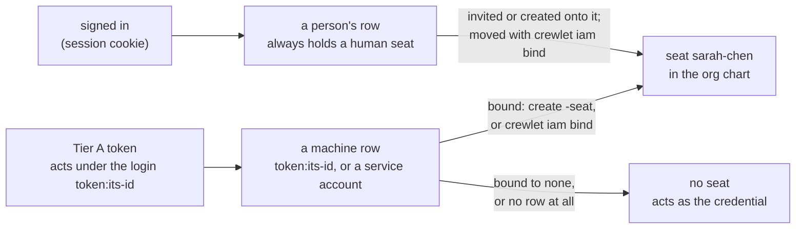
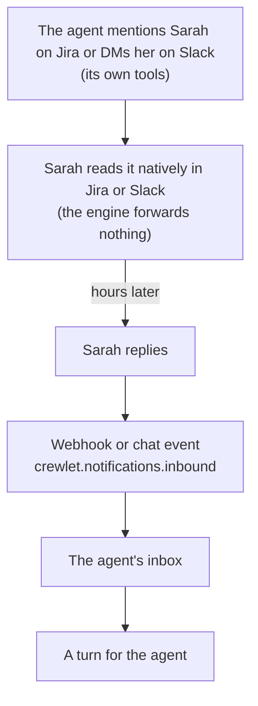
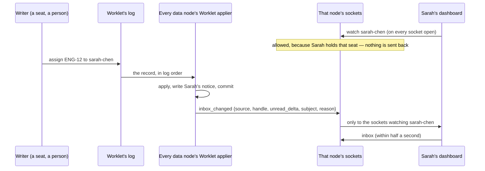

# Humans in the Org Chart

A Role in Crewlet is a **seat** in the org chart, held by an AI agent (the
default) or a **human teammate**. Human seats take part in the full hierarchy
(manage agents, lead units, appear in rosters, be escalation targets) but are
never run: no seat lease, no mailbox, no LLM, no learning rows.

Agents already collaborate through human-native surfaces (Slack, Jira,
Confluence, GitHub), so a human only needs to **exist in the model**: agents
know who they are, how to reach them and what to expect. Agents reach humans as
they reach each other: their own colleague-surface tools, with an @-mention.
**The engine never sends as itself**: no system bot, no engine→human
notification channel.

---

## Declaring a Human Seat

```yaml
units:
  - name: Core Engineering
    id: core-eng
    type: team
    lead: sarah-chen              # a human can lead an AI team, named by handle
    roles:
      - name: Sarah Chen
        kind: human
        email: sarah@example.com  # indexed for routing, not a delivery channel
        goal: "Keep the team unblocked and own final calls"
        backstory: "20 years in infrastructure"
        responsibilities:
          - "Approvals and vendor decisions"
        contact:                  # how agents mention & reach her — optional
          slack_user_id: U0123456789
          mattermost_user_id: sarah.chen       # Mattermost username, not an ID
          atlassian_account_id: 5b10ac8d-...   # one ID covers Jira + Confluence
          github_login: sarahchen
          gitlab_username: sarahchen
        availability: "CET business hours; replies within ~4h"
      - name: Engineer            # AI agent, unchanged
        goal: "Implement features and ship quality code"
```

### Human seat fields

| Field | Required | Description |
|-------|----------|-------------|
| `kind: human` | yes | Marks the seat as human |
| `contact.slack_user_id` | no | Slack member ID (`U…`): `<@…>` mentions and the channel an agent DMs on escalation |
| `contact.mattermost_user_id` | no | [Mattermost](../integrations/mattermost.md) **username**, not the 26-character user ID: the literal `@username` mention an agent writes and the account it opens a DM with. Lowercased. A post names its author by ID, so the engine asks the server which account holds the name (at connect, on every apply and every minute) and attributes that account's posts to the seat, with its authority: whoever holds the name is the person. A name holding no account of the person's own, or coming to hold another account, is reported (see [How a person's post is recognised](../integrations/mattermost.md#how-a-persons-post-is-recognised)) |
| `contact.atlassian_account_id` | no | Atlassian Cloud account ID. One ID covers Jira assignments, Confluence `<ri:user>` mentions and webhook sender attribution on both |
| `contact.github_login` | no | GitHub username: review requests, sender attribution. Lowercased |
| `contact.gitlab_username` | no | GitLab username: assignment, review and mention routing, sender attribution. Lowercased |
| `email` | no | Indexed so a notification addressed to it resolves to the seat. **Not** a delivery channel: no agent has an email tool by default |
| `availability` | no | Free text rendered into a lead's roster (timezone, hours, response expectations) |

`contact`, `availability` and `email` change through a configuration write (`PUT /config/roles/{handle}` for one seat).

**Every `contact` identity is optional** (they are how agents mention a person and how webhooks attribute activity). A person working only through the dashboard acts as their seat through the [identity directory](#acting-as-your-seat-on-the-dashboard-and-the-api); a seat with no `contact` block is legitimate. On the engine's [own chat](chatlet.md) a room addresses a person by seat handle, so a lead's roster gives each human report as `@handle` to mention or DM, unless the holder is [withheld](#a-suspended-holder-is-withdrawn-with-no-configuration-change). On a vendor's surface no agent can @-mention them: the roster tells agents to assign work in the tracker, and on a company that talks on Mattermost or Slack the configuration names the seat in a **warning** at its `contact` (printed by `crewlet validate`, carried on every `/config` write's answer), which clears when a contact identity for a surface the company runs is added.

**No two seats may claim one identity.** A duplicate fails silently (inbound routing registers it for *neither* seat, every org-chart walk answers the *first*), so validation rejects it. Validation compares values as written, a `${VAR}` reference as its own text; two *different* references resolving to one value pass it and are caught at contact registration, which registers the identity for neither seat and logs `human_contact_id_shared` naming both. Surrounding whitespace is never part of an identity, so the comparison ignores it on every field. Case is ignored where the platform ignores it: GitHub login, GitLab username and Mattermost username are lowercased before anything compares or routes on them. A Slack member ID and an Atlassian account ID are opaque and compared exactly: `U0FOUNDER` and `u0founder` are two values.

Every `contact` field accepts a literal ID or exactly one whole-value `${VAR}` reference, such as `atlassian_account_id: "${ATLASSIAN_FOUNDER_ACCOUNT_ID}"`. Values are whitespace-stripped on normalization. A literal `github_login`, `gitlab_username` or `mattermost_user_id` is lowercased there; a reference is stored verbatim and its *resolved* value is lowercased. A reference with an unset variable still counts as declared (no unreachable-seat warning) but is omitted wherever consumed until it resolves, so raw `${VAR}` text is never emitted; the unresolved count is logged on every published company (`parties_indexed`, field `unresolved`). A value that *embeds* a `${VAR}` (`"acme-${SUFFIX}"`) is rejected at validation, since it would register an identity matching nobody. References resolve like every `${VAR}`: the [secret store](secret-store.md) first, then the node's environment, identically for sender attribution, the roster, `lookup_colleague`, `a2a_ask` and the dashboard's colleague search.

Human seats keep the descriptive fields (`goal`, `backstory`, `responsibilities`), rendered into an agent lead's roster as **routing context**, and the hierarchy fields (`manages`, unit `lead`). Every runtime-only field is **rejected at validation**, each named at its own key: `llm` and every per-phase `llm_*` chain, `sandbox`, `token_budget`, `workers`, `learning_enabled`, `schedules`, `placement`, `integrations.slack` and `integrations.mattermost` (a seat's own chat app), `project` and `space` (a tracker project and knowledge container a seat owns, written at the top of the seat, not under `integrations:`), `mcp_env` and `behavioral_guidelines`. A person acts on a code host as their own identity (their own token on Gitlet, their `contact.github_login` on GitHub), so a human seat also refuses its code access tier (`code`) and its own GitHub App (`integrations.github`). Those two are [admission rules](configuration.md#what-a-stored-revision-is-held-to): nothing running reads either off a human seat, so a revision being applied that carries one still runs, and the next write that keeps it is refused. `avatar` is refused too: a person is drawn as their initials. Conversely, `contact` or `availability` on an agent seat is refused with a hint to set `kind: human`.

A unit's `mcp_env` is shared with its direct **agent** members only, so a human seat can sit in, and lead, a unit whose agents share tool credentials; only an `mcp_env` on the human seat itself is refused. The dashboard's human-seat page omits every row such a seat cannot carry.

Handles are validated for format (`[a-z0-9][a-z0-9-]*`, at most 64 bytes) and org-wide uniqueness: they are the canonical seat identity, and an agent and human sharing one would misattribute activity. A handle never carries a `.` or a `:`, which spell a person's login (`jane.doe`) and a machine's (`ci:release`); a seat called `jane.doe` would be one every name lookup sends to the identity directory instead. Nor is a handle `auto-join`, `org-chart` or `sessions`: the engine writes its own lines in a room under those names, which a seat of the same name would read as its own.

---

## Putting a person in the seat

**Every person who signs in holds exactly one human seat**, from the moment they
exist until removed
([ADR-0032](https://github.com/crewlet/crewlet/blob/main/adr/0032-every-person-holds-a-human-seat.md)),
so the seat is declared first, in the company document, and the person is then
put in it. A seat is in one of three states, shown in **Company › Structure**
(the seat's panel and page, and the **Person** section of its editor).
**Everybody** sees who holds a seat, by name; an administrator also sees the
holder's login and an open invitation, which `GET /iam/seats` sends nobody else
(to anybody else an invited seat reads as vacant):

| The seat says | What it means | What an administrator can do from its panel, its page and its editor |
|---|---|---|
| **This seat is open** | Nobody holds it and no invitation names it | **Invite**: an address and their access (every app ticked, Admin not to start); the link is shown once and the person chooses login and password when redeeming it. **Add person**: an address, optionally a name and a login (proposed from the address when empty), and access ticked the same way; the person exists at once, `active`, and you see their **first password link** once |
| **Invited** an address | An open invitation holds it until redeemed, cancelled or lapsed (a week). Nobody else can be invited, created or bound onto it meanwhile | **Cancel invitation**, which frees the seat |
| **Held by** a name | A person holds it at any stage, or a service account or a token's row is bound to it | Nothing here: change, move, suspend or remove the person in Settings › People, a service account in Settings › Service accounts |

The dialog offers only its own seat. Each gesture is a command and a route: `crewlet iam invite <address> -seat
sarah-chen` and `crewlet iam create -email <address> -seat sarah-chen` (`POST
/iam/invitations` and `POST /iam/people`, both with `seat`) — and `crewlet iam
seats -unheld` lists the seats they can name. The seat must be a human seat the running company holds, nobody holds
and no open invitation names; anything else is refused naming what is in the
way. What a link does and what is kept of it is in [A person arrives on their
seat](identity-and-access.md#a-person-arrives-on-their-seat-invited-or-created).

**A person's seat is moved, never cleared.** Move somebody with `crewlet iam bind <person-id> <seat>`, or the seat field of
**Edit** in Settings › People, which offers vacant human seats and their own,
never "No seat". The move is one record: the old seat is free the moment the
new one is taken. A suspended or retired person **keeps** their seat. To free a
seat for somebody else, move its holder or remove them; the removal's tombstone
keeps who held it, and what they did stays recorded under the seat's handle, so
a successor loses no history.

A **service account** differs only in that its seat is optional: bound to a
human seat with `-seat` at create or with `crewlet iam bind`, freed with
`crewlet iam unbind`.

---

## Acting as your seat on the dashboard and the API

The engine's own surface (the dashboard, the REST API, the operator tool server
your assistant reaches) takes no `contact` identity, because nothing is sent
there. A person acts **as their seat** on it through the [identity
directory](identity-and-access.md#the-binding-has-two-ends-and-only-one-of-them-arbitrates):
their row is bound to the seat they were invited or created onto, and every
request resolves to it.



A person never needs a bind step: they arrive bound. Every row carries a **login**, the name a person signs in with besides their address and the name a token or service account bound to no seat acts and is recorded under; every path that creates somebody ends with one (an invitation's form and a create propose it from the address). A **Tier A token** acts under the login `token:<id>`, so it acts as a seat when the directory holds a machine row under that login bound to one: `crewlet iam create -kind machine -login token:<id> -seat <handle> -grants none` enrols and binds it in one record, on a human seat nobody holds (the token's permissions are its Tier A entry's). Typed into the dashboard's sign-in screen, a Tier A token is exchanged for a one-hour session that acts exactly as the token does, binding included; the browser keeps the session, never the token. The bind is a claim on the seat: two principals can never be bound to one seat (exactly one wins), and nobody can be bound to a seat an open invitation holds.

What the binding buys:

- **The work the chart hands a seat reaches you.** `#/inbox` shows your notices, the one reason of nineteen that routed each, and what awaits a decision; `#/me` is your own work. Both are Worklet's and need the `worklet` app. Your record is kept under your seat, where assignments, mentions and a lead's priority list are addressed; your login names that same record.
- **Your seat's lead relations are yours.** Every "do you lead this" authority rule is asked about your seat: the holder of a unit's lead seat may re-route that unit's project's work, declare its fields and set a report's priorities (each with the `worklet` app), pause, steer and answer for the team's agents, and read their own trail. A token or service account bound to no seat reaches those only through `admin`. See [the authority table](identity-and-access.md#the-authority-table-one-function-decides).
- **You edit your own team.** Holding a unit's lead seat, you may change the seats and units inside it through `/config` without `admin` (add a seat, edit a goal, move somebody between your teams, remove a sub-team, restate its purpose) and read each with `GET /config/roles/{handle}` and `GET /config/units/{id}`. Handing your team to somebody else, reaching outside it, a project, space, channel, address or contact id (your own seat's included), a credential, a `${VAR}` in any field and a setting stay `admin`'s. See [A lead edits their own team](identity-and-access.md#a-lead-edits-their-own-team).
- **Your writes are the seat's.** A write through the `/worklet` and `/doclet/pages` HTTP routes or your assistant is recorded under the seat's handle with author kind `human`, which keeps you out of the wake your own change sends. No caller can name a seat to act as. See [who a write is attributed to](../reference/api-endpoints.md#who-a-write-is-attributed-to).
- **The company's own chat is yours to speak in.** On [`chat.backend: chatlet`](chatlet.md#people) every room is read, and every message written, as your seat, with the `chatlet` app; messages carry the seat's handle with author kind `human`.
- **Your git pushes are yours.** A company hosting repositories in the engine ([`code.backend: gitlet`](gitlet.md)) is cloned, fetched and pushed to over HTTPS with a token as git's password: your own machine token (`crewlet iam token -login` mints one), or a Tier A token the directory binds to a seat. git follows the same binding as the dashboard's act route, the `/worklet` and `/doclet/pages` routes and the assistant's MCP: a token acting as a human seat pushes **as that person**, while a credential bound to no seat fetches only, and a push with it is refused at its first request saying so. Every push is one `operator_acted` event with transport `git`: your seat, kind `human`, the credential beside it, the repository and what became of the push. A fetch is not recorded. A person reads **every** repository: a repository's `visibility` narrows which **seats** read it, never a person ([Visibility](gitlet.md#visibility)). The [Hosting Code on Gitlet](../guides/gitlet.md) guide sets it up, and [ADR-0085](https://github.com/crewlet/crewlet/blob/main/adr/0085-a-person-reaches-git-with-their-own-bound-token.md) says why there is no second credential for git.

**A credential bound to no seat is ordinary.** A pipeline, an automation or the deployment's break-glass token acts as itself under its own login, decided by permissions alone, and is never refused for it. Its pins, inbox marks, priorities and personal views are kept under that **login**, which every write it makes is attributed to. It lacks the work the chart addresses to a seat and the company's own chat, read and spoken in only as a seat (`unseated`); the screens say so, naming `crewlet iam bind`: bind a service account or a token's row to a human seat nobody holds. A **person** is never in this state: the directory refuses every write that would leave one without a seat.

Read and snooze marks are the `mark_inbox` tool (dashboard buttons through `/operator/act`, a script through `PUT /worklet/people/{handle}/inbox`, your assistant over `/operator/mcp`), written as the principal who made it. The dashboard never writes as itself: a button writes as the person signed in.

**Shared tools are worded for each reader.** A caveat on a landed write (the item went to triage because the project's default assignee has left the chart, a time was stored as its date) reaches an agent in words for a model, naming the next tool and argument, and a person in the words of the screen, never naming an argument they cannot control; it says whether somebody must act, which decides whether its toast stays until dismissed. A refusal follows the same rule; where nobody has worded it for a person, they get the plain sentence for its kind ("Somebody changed this after you read it"), never the agent's words ([ADR-0060](../../adr/0060-a-caveat-or-a-refusal-is-worded-for-each-reader-and-a-person-is-never-shown-a-models.md), [What it answers](../reference/api-endpoints.md#what-it-answers)).

**The binding lives in the directory**, not on the token or in the company document: Tier A may never read Tier B, so a `seat:` field on an `api.auth.tokens[]` entry would make the trusted tier depend on the untrusted one; and a seat's `contact` block says how to reach a person, not which credential they hold.

**A bound token is held to the org chart exactly as a signed-in person is.** Only an active **machine** row under the token's login binds it (a person can never hold `token:<id>`; a suspended machine binds nothing), and the seat is resolved against the company this node runs. A seat the company does not hold as a human seat (removed, or made an agent's) answers `403 seat_unavailable` naming it; a node that runs no company yet, or cannot read the directory, answers `503 identity_unavailable` and is retried. It never quietly acts as the bare credential, which would show one actor as two in the audit trail. An **unbound** token keeps break-glass working: a node whose identity applier is behind still serves it as itself, the narrower surface.

---

## How Agents Know Humans Exist

- **Identity prompt**: `Reports to: Sarah Chen (human)`; human direct reports carry the same marker.
- **Lead roster**: a human member renders with handle, a **human teammate** marker, background, goal, responsibilities, resolved contact IDs and availability. A person no message can reach says so in one line instead: no chat or code-host account, so work is assigned in the PM tool; or, for a seat whose holder the directory withholds, nobody reachable right now. On a large team the full block may not fit: see [a capped roster](#a-capped-roster-still-names-the-people-on-it).
- **`## Human colleagues` contract block**: in the executor prompt *only when the org contains human seats*, the one place the prompt says how a person is worked with: seats marked (human) or **human teammate** are reached with a mention on the team's chat or a comment where the work lives, never through `a2a_ask`, and handed work by assignment in the PM tool; they reply asynchronously, so leave full context and end the turn; their reply re-triggers you.
- **`lookup_colleague`**: resolves agents *and* humans, by handle, role name or a human's contact ID. A match renders name, handle, `kind` and resolved contact IDs; a human match adds that a person is reached with a mention, answers asynchronously, and that `a2a_ask` will not reach them. Ambiguous rows carry each candidate's kind. It renders no goal, background, responsibilities or availability, so a report learns what its **human lead** owns from the lead's messages (the roster renders only downward).
- **Sender attribution**: an inbound notification names its actor through the party registry, so a Jira comment from Sarah renders as `Sarah Chen (sarah-chen, human colleague)`, not an opaque account ID. Counterparty profiles accrue for humans like anyone else (keyed by handle).

### A capped roster still names the people on it

A lead's roster and its `Direct reports:` line share one **1,000-token allowance** ([the roster allowance](turn-engine.md#the-roster-allowance) has the full ladder). A human seat is the most expensive thing a roster renders (~148 tokens against an agent's ~119), so on a team of any size some fall past the first rung:

| Where the seat falls | What the lead is told about them |
|---|---|
| **Full profile** | Everything in the list above |
| **Name and handle only** | `- **Sarah Chen** (sarah-chen) — **human teammate**`. The marker survives the cap deliberately: without it Sarah reads as an agent that can simply be asked, and the lead waits for a turn that never comes. Background, contact IDs and availability are lost, so the lead calls `lookup_colleague` for *how* to reach her |
| **Past the cap** | Counted in ``and N more — `lookup_colleague` names them``. She is still a colleague, still managed, still resolvable by name, handle or contact ID, just not described in this prompt |

**The cap is rendering, never authorization**: a human report the roster could not describe is still managed, still in `manages`, still in every walk of the chart and on the dashboard's org chart. **`lookup_colleague` is uncapped**: it resolves any seat and answers a human match with the contact IDs, the reminder that they are reached with a mention and answer asynchronously, and that `a2a_ask` will not reach them.

---

## The Interaction Loop

Agent to human and back needs **no new machinery**: it is the existing inbound notification pipeline.



Two consequences:

1. **The engine never wakes a human seat.** A mailbox wakes an *agent* into a turn; a human has none. An inbound notification whose recipient resolves to a human seat is skipped at info level (`notification_skipped`, reason `human seat`), not warned about: the person is already notified natively where the work lives (a Jira assignment emails the assignee; a Slack mention pings them). A schedule never fires into a human seat either. What the engine does tell a person about is its OWN tracker, Worklet: see [How a person learns they have work](#how-a-person-learns-they-have-work).
2. **Agents must never wait.** The turn model is asynchronous: prompts and tool errors steer the LLM to leave state on the surface and end the turn.

**On Chatlet the first consequence holds but its reason does not.** Delivery is unchanged, but with `chat.backend: chatlet` there is no Jira or Slack to notify the person: the engine is where the conversation lives and never sends as itself. A person mentioned in Chatlet learns of it when they next open the dashboard, where they get an unread count and a mention feed. See [Chatlet § What is not here](chatlet.md#what-is-not-here); an agent that needs a person *now* escalates through a surface that does push.

---
## How a person learns they have work

A person hears about work from three places:

- **The vendor where the work lives.** A Jira assignment emails the assignee, a Slack mention pings them, a GitHub review request lands in their GitHub inbox. The engine forwards none of it.
- **The engine's own inbox.** Every change to the [Worklet](task-engine.md) writes a notice to each person it concerns, under the one reason that routed it (`assignee`, `mention`, `blocking`, …); so does every record about a change on [Gitlet](gitlet.md) (`mention`, `review_requested`, `changes_requested`, …). The two are **one inbox**: the `inbox` question (`GET /inbox`) and the dashboard's Inbox interleave every native domain's notices by time. It opens to **every signed-in person**, with no app; whose inbox it is is the composed question's rule: your own or a report's you lead. Each domain's notices are then read under its own permission:
  - Worklet's with the `worklet` app (the `work_inbox` question, which stays Worklet's own).
  - Gitlet's with the `gitlet` app, held to your grant on each change's repository (holding the app means holding it on every repository). Somebody without Gitlet is listed, counted and pushed no code notice, and marks none; the notices are still written and appear once an administrator gives them Gitlet ([ADR-0110](../../adr/0110-reaching-a-repository-takes-the-gitlet-permission.md)).

  Somebody without Worklet still sees a question a colleague put to them on a work item, among their decisions, and may open that item and post their answer ([You may answer what you were asked](identity-and-access.md#what-each-app-opens)); agents send everything else through Worklet, so the dashboard warns when Worklet is unticked for a person. A mention in the engine's own chat is not a notice here: chat keeps its own unread counts and a mention feed, read in the dashboard's Chatlet with the `chatlet` app (the dashboard warns of an unticked Chatlet on a company that runs it).
- **The dashboard, the moment that inbox moves.** For somebody with no Slack or Jira account this is the delivery surface.

The third is a **push**, not a poll:



- **Every data node applies every tracker, code and artifacts record**, and every node that serves sockets is a data node (`ingress` requires `data`), so each tells its sockets from its own applier after the batch commits. Each frame names the domain whose notices moved (`source`: `tracker`, Gitlet's `code`, the artifacts' comments `artifacts`). The dashboard always re-reads the composed `inbox` question: `work_inbox` answers the tracker's alone, so re-reading it on a `code` frame never shows what moved.
- **A node whose own copy is out of service keeps telling its sockets.** A copy that is wrong (an applier halted on a record it cannot read, rows below the log) goes out of service while the node stays in rotation. Judged per domain: while the node's copy of a domain is out, it withholds its own movements for that domain and follows those of a data node whose copy of THAT domain serves, relayed over the broker; other domains still come from its own appliers. Every ask and answer on the relay is signed under the fleet keyring and bound to the ask it answers, so an unsigned answer reaches no screen. Each switch (onto a peer, between peers, back to its own applier) sends every watched inbox one frame naming the domain and counting nothing, since what moved during the switch is not replayed: the dashboard re-reads. Falling behind the peer does the same: the peer keeps a domain's movements for one round trip (two seconds) past its latest answer to a follower, and never more than 4 000 (one transaction's worth), so a node asking later, or one transaction moving more inboxes, gets a re-read. A fleet with no copy out of service relays and keeps nothing.
- **The dashboard watches your own seat** when its socket opens and on every reconnect: the rail's inbox badge, the Inbox screen and My work re-ask within half a second of a frame. A frame carries identifiers and a count (domain, seat, subject, reason), never what the notice says; that is read through `inbox`.
- **A watch is decided like the inbox itself.** You may watch your own seat; a lead a seat they lead; an administrator any, with no app. A frame reaches the sockets whose watch was allowed and whose reader holds `worklet` for a `tracker` frame or `gitlet` for a `code` one. An `artifacts` frame asks no app (commenting is a relation to an artifact) and names no subject: it reaches every watcher, and the inbox read decides which comment notices each may see. A watch this node cannot decide (it runs no company yet) is not installed; the dashboard asks again when the refusal's `retry_after` says it may have changed, never on a timer when that is `0` (a log waiting will not clear); the next socket asks once more.
- **The poll is the fallback**: a minute for the rail, thirty seconds for the screens. A frame dropped under backpressure or lost to a reconnect is never re-sent.

A token or service account bound to no seat watches the record kept under its login: what it follows, and what names it. See [Acting as your seat](#acting-as-your-seat-on-the-dashboard-and-the-api).

**Each domain keeps its own marks.** A mark (read, snooze until an instant, or read everything up to here) is kept by the domain that told you, on its own log: a position is a place on ONE log, so "read through here" on the tracker's says nothing about Gitlet's. The rules are shared (a mark is one gesture, never the lists; a snooze is at most a year ahead; reading through a position never moves it backwards). Tools: `mark_inbox` for the tracker's notices, `code_mark_inbox` for Gitlet's, `artifact_mark_inbox` for comments on artifacts. A mark touches your own record only, written as the person who holds the seat, and is refused for anybody else whatever their authority. A code mark names the `record_id` a code notice carries (one record can tell you about several changes), and is refused naming it when that notice is somebody else's; its `read_through` is a position on the code log (`CREWLET_CODE_LOG@<generation>:<sequence>`). The dashboard's **Mark all read** sends one mark per domain the page read, each through the newest of that domain's notices on the page (no code mark to a reader without Gitlet).

**Comments on artifacts reach you here too.** A comment record carries whom it tells, worked out when it was written ([Comments](artifacts.md#comments)). The artifacts' applier writes you a notice when a thread is opened on an artifact you own, when somebody replies in, resolves or reopens a thread you are in, and when a remark mentions you; never for what you wrote yourself. The notice keeps the first 600 bytes of the remark and loses them when its author removes the remark; an artifact's purge takes its notices. A comment notice is shown only while you may open its artifact: if the share was withdrawn or the artifact trashed, it drops out of your inbox entirely and returns if you can open it again. A mention, a comment on an artifact you own, and one on an artifact made for your work item are your primary half by default; a reply in a thread you are in is context. Its card draws the thread as it stands (quote, resolved or not, remark count) and opens the artifact's comments on that thread.

A page of the composed inbox is fifty notices, newest first across every domain; its `next_cursor` carries one position per domain, so the next page resumes each where it stopped. Each code notice carries what its change says at the read: title, state and the work item it implements. A list you open a notice from asks for its card too (`cards`): the first kibibyte of the change's description, the open findings seats raised on it by severity, and, while it is open or a draft, where its merge stands: how many preconditions are met and the sentence of the first that is not, judged for you as the change's own page judges it. Cards are read only for the notices the page keeps; a count of what waits on you asks for none.

**The queue is whoever signed in.** `#/inbox`, one click from Home, is the queue of the principal the request resolved to (a person with a session, or a token the identity directory binds), read under that principal's record name (`iam.RecordOwner`): the seat they hold, or a credential's own login when the directory binds it to none. In order:

- **Needs you**: questions agents put to them, executors parked on a question to them, a seat stopped on its budget, conditions a person decides.
- **Waiting on others, you can answer**: parked runs whose question went to somebody else (a delegate, a colleague) that they may still answer, as the seat's lead or an administrator, by the same authority the answer itself uses.
- **Updates**: what reached them and is not read yet; a closed, counted group they open when they choose.

The item they open is read in full beside the list, with the answer right there. Home's **Needs your decision** card draws the same two groups.

**The Inbox badge counts what waits on you, and nothing else**: asks put to you, runs parked on you, stopped seats you can act on, and conditions you decide that you have not put off. A run you may answer that waits on somebody else counts once its delegates escalate it to people or pass their deadline. A mention, a comment on a task you are assigned or reported, or any update that only informs is listed under Updates, markable as read, and counted by no figure. On every parked run it answers about (`executors`, `decisions`) the engine states whom it is put to (`put_to`), whether to you (`put_to_you`), whether you may answer (`may_answer`) and whether it waits on you (`needs_you`); screens read those rather than deciding. `decisions` answers its `total` of what waits on you, and `answerable` for the rest you may answer. No screen asks for somebody else's queue; a lead reads a report's by name, decided by the [authority table](identity-and-access.md#the-authority-table-one-function-decides). `#/me` is the same principal's own work.

**Answering an agent's decision.** The question arrives in your Inbox with its options, the one it recommends and why, and the evidence it cites. Each option is a button, the recommended one first; one press answers, and **Something else** answers in your own words. The agent is woken with your answer. Where it promised to report the outcome in a channel, the line under the answer says *"Your answer is also posted to #&lt;channel&gt;"*, and that is enforced: the agent's turn is held open until it has posted. **Your own** asks cannot carry that promise (a person has no turn to hold), so an ask you put through the dashboard or your assistant with an `inform` is refused; post the outcome yourself.

---

## Escalation (reaching a human)

A human seat is the natural **terminus** of an escalation chain, and an agent reaches one as it reaches any colleague: with its **own colleague-surface tools** during Execute, never via the engine.

- **Chat (Slack / Mattermost)**: the agent DMs the human's member ID (or username) with its own chat tool, mention-prefixed. The engine never names the tool; prompts describe the *capability* and the LLM picks the match from its catalogue (see [Tool Capabilities](tool-capabilities.md)). The reply lands on the agent's own bot identity and re-enters through the normal inbound pipeline, so it goes back to the asking agent.
- **The engine's own chat**: the agent opens a direct conversation with `send_dm`, or names the person by handle in a room with `post_message`. The reply is a record on the chat log, and the wake it derives goes back to the agent it answers.
- **Jira / Confluence / GitHub**: the agent comments / requests review with its own tools and the mention markup; the target is the artifact (issue / page / PR), the human is mentioned in the body.
- **A2A is not a human surface.** Humans have no inbox, so `a2a_ask` against a human returns a failed result telling the agent to mention the person on a shared surface instead, and the A2A service refuses any target that is not an agent seat in the org (`a2a.ErrNotAnAgent`), so a typo or human handle fails visibly. The test is whether the target is an **agent seat in the org**, not whether it runs in the asking process: a colleague owned by another node is a normal target.

When a turn only discovers it needs a human at review, the reviewer returns `self_iterate` with a note, and the executor's next round makes the mention. Once it has gone out the reviewer ends the turn `done`: the human's reply re-triggers the agent. If the agent **can't reach the human** (no chat tool, or the human has no contact ID on the vendor surface it would mention them on; the engine's own chat needs none), that is a gap to close: give the agent the tool, or route the work through a colleague who has it. A human with no contact ID at all is legitimate: a person who works only through the dashboard. On a company that talks on Mattermost or Slack the configuration warns at the seat's `contact`, and about a seat whose only ids are for other surfaces (a GitHub login reaches nobody in a chat room): the roster tells a lead to hand them work by assigning it in the tracker, and an id on that workspace is what to add the day they join it. On the engine's own chat nothing warns, since the person reads the rooms on the dashboard as their seat. The engine never manufactures a sender: there is no "Crewlet" DM and no engine-side fallback.

---

## The Founder Seat

The recommended way to put yourself in the company: a **root-level human seat managing the top agent(s)**. The engine has no dedicated founder concept; the org chart is the model and the founder is the top of it (as with escalation: the manager handoff IS escalation).

```yaml
roles:
  - name: Jane Founder
    kind: human
    goal: "Own direction; final call on what ships"
    responsibilities: ["Approvals", "Unblock the CEO"]
    manages: [ceo]            # handles: top agents only — lead inheritance
                              # does the rest
    contact:
      slack_user_id: U0FOUNDER
      atlassian_account_id: 5b10ac8d-...
      github_login: janedoe
      gitlab_username: janedoe
```

With no further config:

- Top agents' prompts read `Reports to: Jane Founder (human)`, so manager handoffs from them end at a person instead of `None (top-level)`. A stuck CEO DMs you on Slack or mentions you on Jira with its own tools, and your reply re-triggers it.
- Your Slack, Jira and GitHub activity is attributed by name, so agents know when the founder is speaking.
- DACI: the Approver is "the driver's manager", so you are the approver of last resort for top-level decisions.

Three things to keep in mind:

- **The seat is the colleague hat, not the operator hat.** Config ownership (`PUT /config`, API auth tokens, the dashboard) stays an API-auth concern: the seat makes agents know you and, once you are invited or created onto it, carries its lead relations onto the engine's own surface; your permissions make the engine obey you.
- **It is the seat you join through.** Every person holds a human seat, so this is where you are put on first sign-in. Declare it before inviting anybody: the **Create the company** form under **Company › Structure** adds it when **Add a seat for yourself** is ticked (the default). Then sign in with the deployment's API token, open **Company › Structure**, open your seat, and press **Invite** or **Add person** on it (see [Putting a person in the seat](#putting-a-person-in-the-seat)). A company with no human seat can admit nobody, and `crewlet validate` warns about it at `roles`; that is right only for a company its agents run alone.
- **Scope `manages` to the top roles.** Root seats are searched first when a seat's manager is resolved, so a founder who lists every seat of a unit becomes the primary manager and escalation terminus of all of them, even where a unit lead also auto-manages the seat (see [Unit Lead](organization-model.md#unit-lead)). Manage the CEO (or the unit leads) and let lead inheritance do the rest; `availability` sets response expectations.

See `examples/nimbus.company.yaml` for a working org with a founder seat above the agent CEO. All its surfaces are the engine's own, where a person acts as their seat, so that founder seat carries no `contact` identity; add one per vendor surface you connect.

---

## What Humans Never Do

| Subsystem | Behavior |
|-----------|----------|
| Seat placement | Never claimed: only agent seats enter the placement sweep, so a human seat has no lease, no mailbox and no per-role MCP children, and a `placement` block on one is refused |
| Inbox | None. A notification resolved to a human seat is skipped (`notification_skipped`, reason `human seat`) |
| Engine notifications | None. The engine never sends as itself; agents reach humans with their own tools |
| Scheduler | `target: each` fans out to agent members only; an enabled `target: lead` schedule under a (possibly inherited) human lead is a **config error**; human seats cannot define role schedules |
| A2A channels | Not addressable; `a2a_ask` returns guidance and the A2A service refuses the target |
| Learning | No diary, no episodes, no synthesized skills (counterparty profiles *about* them still accrue) |
| `GET /agents` | Excluded. They appear in `GET /org` with `"kind": "human"`, and Company › Structure says `human` under their name |

## Hot Reload

A seat's kind is its `kind:` in the company document. Making a person's seat an agent's is refused `409 seat_held` while somebody holds it or an open invitation names it, naming them, exactly as removing it is. First move the person to another human seat or remove them (their seat is never cleared), unbind a service account, cancel an invitation. The change then applies like any other (see [Organization Model: Hot Reload](organization-model.md#hot-reload)):

- `human` to `agent`: the seat joins the next epoch's seat list; a node claims it, creates its mailbox and starts its per-role MCP children as for any new seat.
- `agent` to `human`: the seat leaves the seat list, the holding node releases it, and its mailbox is retired after the grace period in [Seat Ownership: The removed seat](seat-ownership.md#the-removed-seat). An agent's id is derived from the company name and its handle (`org.DeriveAgentID`), so flipping back to `agent` later is the same seat: its diary, onboarding marker and episodes are as it left them, and within the grace period so are its mailbox and the mail waiting in it.
- Contact and availability edits take effect with the next **published company** (the apply of the revision that carried them): every publish builds a new party registry and reconciles the human contact IDs into it. A Mattermost username needs the server: the new registry gets the account the name last resolved to at once, and a new or changed name is asked about straight after the publish. The publish also anchors each name to the account it holds, so a name later found holding another account is reported as moved (`contact_moved`) until the next publish; a registry rebuilt because the directory moved is not one.
- **Who holds the seat, and at what stage, takes effect with the next identity apply**, with no configuration change: suspending the person bound to a seat withdraws its contact IDs, reinstating restores them. See [A suspended holder is withdrawn](#a-suspended-holder-is-withdrawn-with-no-configuration-change).

## Identity Resolution (party registry)

`notify.Registry` answers "who is this?" for one epoch of the company. It indexes every **party**, agent and human seats alike, and resolves one by handle (`ByHandle`), exact role name (`ByRole`), derived agent id (`ByAgentID`, never a human seat, which has no agent id), email (`ByEmail`: a plus tag naming a handle wins, otherwise the seat whose declared address, `${VAR}` resolved, compares equal lower-cased with any plus tag dropped), or an external ID on a surface (`ByExternalID`). Each `Party` carries a `Human` flag, which the notification spine reads to skip a human recipient rather than wake it.

The seat indexes never change: every published company (a boot's and every apply's) builds a new registry rather than editing the one a running turn may be reading. A registry left behind answers "nobody matches" for a seat added this morning, the same answer a stranger gets, so nothing fails and nothing is logged. See [What follows a published company](configuration.md#what-follows-a-published-company).

The external-identity map is written at runtime, under a lock, and holds two kinds of entry:

- **Human contact IDs** come from `contact` and are reconciled into each new registry (`ReconcileHumanContacts`). A pair the previous reconciliation registered and the organization no longer declares (a contact edit, a removed seat, a kind flip) is withdrawn; an ID already held by a different seat is never taken over, and the conflict is logged as `human_contact_id_conflict` naming both seats. An ID two human seats resolve to (two `${VAR}` references naming one value, which validation cannot see) is registered for neither and logged as `human_contact_id_shared` naming both.
- **Human chat accounts named by NAME** are the one contact the reconcile leaves alone (`org.Transport.AddressedByName`): a Mattermost username is what an agent mentions a person by, but every post carries the user ID, so the name as written would match no post. The Mattermost transport asks the server which account holds each name and registers that account's user ID, at connect, on every apply and every minute. A name that holds no account of the person's own (nobody's, an agent's or a bot's, or one another human seat's name holds too) is registered for nobody, logged (`mattermost_person_unknown`) and reported on the integration's status as `contact_unknown`; a name that comes to hold another account moves the seat with it and is reported as `contact_moved`. A seat the directory withholds ([below](#a-suspended-holder-is-withdrawn-with-no-configuration-change)) gets no account there either, and is not reported. See [How a person's post is recognised](../integrations/mattermost.md#how-a-persons-post-is-recognised).
- **Agent identities** are registered by the integrations: the code host's and the tracker's are derived from each seat's credentials and re-resolved on every published company (lookups are keyed on the credential and cached, so unchanged credentials cost no requests). The chat transports' bot IDs, resolved against the live server at connect, are carried across into the new registry: they are facts about a server, not the company.

The engine's **own surfaces hold no entry**, and need none: on its [work tracker](task-engine.md), [knowledge base](knowledge-system.md) and [chat](chatlet.md) the actor a record names is the seat's handle, so the id a wake names its sender by IS that handle. The engine declares those three sources to every registry as namespaces whose ids are handles, and `ByExternalID` on one answers `ByHandle`. So a person's comment on a Worklet task, remark on a Doclet page or message in the engine's chat comes from their seat everywhere a sender is read: the [learning](agent-learning.md) profile it is filed under, the [requester](artifacts.md#sharing) an agent's artifact tools act for, and the colleague a [thread block](agent-runtime.md#text-somebody-else-wrote) fences them as.

### A suspended holder is withdrawn with no configuration change

A seat's `contact` block is company configuration, but whether its holder may still be reached through it is a fact about the **person**, kept in the [identity directory](identity-and-access.md#what-a-suspension-reaches-and-how-fast). So every registry is built from TWO readings, the org view and one read of the directory saying who holds each seat and at what stage, and a seat whose holder may not be reached registers **no contact identity at all**:

| Holder's standing | Contact IDs |
|---|---|
| `active`, `invited`, `enrolling`, or a binding still being enrolled | registered: each is somebody the company put in the seat |
| `suspended` | withheld |
| `retired` | withheld |
| removed while holding the seat, and the seat not bound since | withheld until the seat is next bound; that bind ends the removal's say for good, so the successor's later move off the seat, or a service account's unbind, hands it to the org chart rather than back to the leaver |
| a stage this build cannot name (a newer peer wrote it) | withheld: briefly unreachable is the safe way to be wrong during an upgrade |
| nobody bound | registered: an unheld seat is routed by the org chart |

A seat with two holders (a duplicate only a restore can produce) is withheld if either may not be reached, since one contact map cannot say which it belongs to.

**A binding names its seat by its handle**, the same lookup a sign-in uses, so suspending somebody withdraws their seat's contact identities.

**Two triggers rebuild the registry, both whole.** A published company is the first; the second is the identity applier, which signals after every committed batch that moved a seat's standing (suspension, reinstatement, bind, move, a service account's unbind, removal). The node reads the directory once and, if the answer moved, builds a new registry for the same company and swaps it in, never a diff against the live one, so a reader always sees one reading of each source. That is **within one apply** of the record on every data node, with a thirty-second re-read as the safety net. The log line `parties_indexed` reports `withheld_seats` and whether a `directory` was consulted.

**A directory this node cannot read keeps the last reading**, since falling back to the org chart alone would hand every suspended person's seat back: it logs `party_directory_unreadable` and retries on the net. **A node that has never read its directory fails closed**: the first registry is built at boot with no last reading to keep, so every human seat is withheld (`directory_unread`) until the net's first successful read. People are briefly unreachable rather than a suspended person's accounts being routed to their seat.

**Every node reads the directory, a satellite included**, since a seats-only satellite runs seats and consumes inbound deliveries like any node. A satellite that holds data runs the identity domain like every data node, so a suspension reaches it within one apply of its own. One that holds no data applies no log, so its registry asks a data node for the directory's seat bindings through the estate router, floored on the identity log so the answer is never older than a reading it already had; the thirty-second re-read stands in for the applier's signal, and until its first successful read it withholds every human seat as above. See [what a satellite holds](../guides/satellite-nodes.md#what-a-satellite-holds).

**What agents are shown follows the same reading.** Every turn pins the registry's reading beside its org, so a lead's roster renders a withheld seat with no identity (only that the person cannot be reached on any chat or code-host account right now, and that work for the seat goes in the tracker), and `lookup_colleague` neither prints their accounts nor resolves an id copied from one. Neither says *why*: a person's standing is not an agent's business. The seat stays a colleague: a mention, a hand-off and an assigned work item all still name it.

External-ID resolution is plain index lookups, since it runs on every inbound notification for sender attribution. On each surface it consults two namespaces, the surface's own (a human's member ID under `slack`, a human's user ID under `mattermost`) and the companion bot namespace (an agent's bot user under `slack_bot` or `mattermost_bot`). Both hold the ID an event names its sender by, and nothing else: a lookup is never handed a username.
