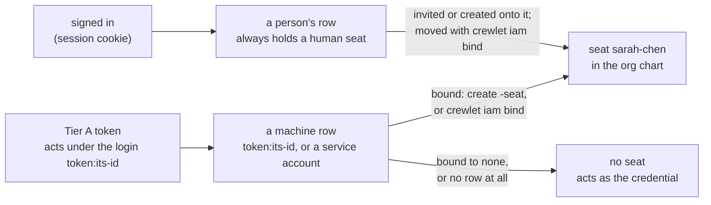
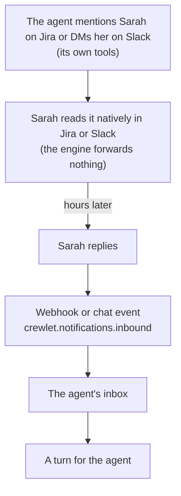
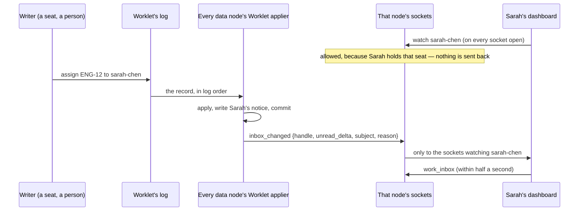

# Humans in the Org Chart

A Role in Crewlet is a **seat** in the org chart, held by either an AI
agent (the default) or a **human teammate**. Human seats participate in
the full hierarchy (they can manage agents, lead units, appear in
rosters, and be escalation targets), but they are never run: no seat
lease, no mailbox, no LLM, no learning rows of their own.

The design follows one observation: agents already collaborate through
human-native surfaces (Slack, Jira, Confluence, GitHub). A human
teammate doesn't need an engine runtime — they need to **exist in the
model** so agents know who they are, how to reach them, and what to
expect when they do. Agents reach humans exactly as they reach each
other: their own colleague-surface tools, with an @-mention. **The
engine never sends as itself** — there is no system bot, no
engine→human notification channel.

---

## Declaring a Human Seat

```yaml
units:
  - name: Core Engineering
    id: core-eng
    type: team
    lead: sarah-chen              # a human can lead an AI team, named by handle
    roles:
      - name: Sarah Chen
        kind: human
        email: sarah@example.com  # indexed for routing, not a delivery channel
        goal: "Keep the team unblocked and own final calls"
        backstory: "20 years in infrastructure"
        responsibilities:
          - "Approvals and vendor decisions"
        contact:                  # how agents mention & reach her — optional
          slack_user_id: U0123456789
          mattermost_user_id: sarah.chen       # Mattermost username, not an ID
          atlassian_account_id: 5b10ac8d-...   # one ID covers Jira + Confluence
          github_login: sarahchen
          gitlab_username: sarahchen
        availability: "CET business hours; replies within ~4h"
      - name: Engineer            # AI agent, unchanged
        goal: "Implement features and ship quality code"
```

### Human seat fields

| Field | Required | Description |
|-------|----------|-------------|
| `kind: human` | yes | Marks the seat as human |
| `contact.slack_user_id` | no | Slack member ID (`U…`) — `<@…>` mentions and the channel an agent DMs on escalation |
| `contact.mattermost_user_id` | no | [Mattermost](../integrations/mattermost.md) **username**: the name an agent writes as a literal `@username` mention, and the account it opens a DM channel with. Not the opaque 26-character user ID. Lowercased, because Mattermost stores every username in lowercase and finds one without case. A post names its author by that ID instead, so the engine asks the server which account holds the name — at connect, on every apply and every minute — and attributes that account's posts to the seat, with its authority: whoever holds the name is the person. A name that holds no account of the person's own, or comes to hold another account, is reported (see [How a person's post is recognised](../integrations/mattermost.md#how-a-persons-post-is-recognised)) |
| `contact.atlassian_account_id` | no | Atlassian Cloud account ID. One ID covers Jira assignments, Confluence `<ri:user>` mentions and webhook sender attribution on both |
| `contact.github_login` | no | GitHub username: review requests, sender attribution. Lowercased |
| `contact.gitlab_username` | no | GitLab username: assignment, review and mention routing, sender attribution. Lowercased |
| `email` | no | Indexed so a notification addressed to the address resolves to the seat. **Not** a delivery channel: no agent has an email tool by default |
| `availability` | no | Free text rendered into a lead's roster (timezone, hours, response expectations) |

**`contact`, `availability` and `email` are part of the seat in the company
document**, so they change through a configuration write — `PUT
/config/roles/{handle}` for one seat — like everything else about it.

**Every `contact` identity is optional.** They are how agents mention and
reach a person, and how inbound webhooks attribute their activity by name — so
give a person one for each surface they are on. A person who works only
through the dashboard is on none of them: they act as their seat through the
[identity directory](#acting-as-your-seat-on-the-dashboard-and-the-api), and a
seat with no `contact` block is a legitimate seat rather than a mistake. It is
not refused. On the engine's [own chat](chatlet.md) nothing changes for them: a
room addresses a person by their seat's handle, so an agent mentions them there
like anybody else — a lead's roster gives each human report as `@handle` and
tells it to mention them in the company's chat or send them a direct message,
whatever contact identities they hold, unless the seat's holder is
[withheld](#a-suspended-holder-is-withdrawn-with-no-configuration-change) —
and they read it on the dashboard. On a vendor's surface no agent can
@-mention them: a lead's roster tells its agents to hand that person work by
assigning it in the tracker, and on a company that talks on Mattermost or Slack
the configuration names the seat in a **warning** at its `contact` — printed by
`crewlet validate` and carried on every `/config` write's answer — the one
place the engine says so, and a warning because the state is legitimate. Add a
contact identity when the person joins a surface the company runs, and the
warning clears.

**And no two seats may claim one identity.** Each of these fields is an
external account, and an account belongs to one person. A duplicate is
rejected at validation because it does not fail loudly on its own: inbound
routing registers an identity two seats declare for *neither* of them, while
every walk of the org chart answers the *first*. Both people stop being
recognised by it on what they write, with both entries looking perfectly
ordinary. Validation compares the values as written, a `${VAR}` reference as
its own text, so two *different* references that resolve to one value pass
it: that collision is caught when the contacts are registered, which
registers the identity for neither seat and logs `human_contact_id_shared`
naming both. Surrounding whitespace is never part of an identity, so
the comparison ignores it on every field. Case is ignored exactly where the
platform ignores it: a GitHub login, a GitLab username and a Mattermost
username name one account however they are capitalised, so those three are
lowercased before anything compares or routes on them. A Slack member ID and
an Atlassian account ID are opaque ids the platform issues, and are compared
exactly as written: `U0FOUNDER` and `u0founder` are two values.

Each of these is a place a message can actually be sent. None of them says who
a person is on the engine's *own* surface — that is the identity directory's,
[below](#acting-as-your-seat-on-the-dashboard-and-the-api) — so nothing a roster
or a colleague card renders is an identity an agent cannot @-mention.

Every `contact` field accepts either a literal ID or exactly one
whole-value `${VAR}` reference, for example
`atlassian_account_id: "${ATLASSIAN_FOUNDER_ACCOUNT_ID}"` in a shipped
example config, where the real ID is instance-specific. Values are
whitespace-stripped when the organization is normalized. A literal
`github_login`, `gitlab_username` or `mattermost_user_id` is lowercased
there; a reference is stored verbatim (never case-mangled) and its *resolved*
value is lowercased instead. A reference whose variable is unset still counts as a
declared identity — the configuration does not warn that its seat is unreachable —
but the identity is omitted wherever it is consumed until the variable
resolves, so the raw `${VAR}` text is never emitted. The count of unresolved identities is logged on every published company
(`parties_indexed`, field `unresolved`). A value that merely *embeds* a
`${VAR}` inside a longer string (`"acme-${SUFFIX}"`) is rejected at
validation, because substituting part of it would register a wrong
identity that matches nobody.

Every consumer resolves a reference the way every other `${VAR}` in the
company is resolved: the [secret store](secret-store.md) first, then the
environment the node runs with. Sender attribution, the lead's roster,
`lookup_colleague` and `a2a_ask`, and the dashboard's colleague search all
read that one chain, so an identity whose value exists only in the secret store
resolves in every one of them or in none — never attributing a person's
activity while leaving them out of the roster an agent addresses them from.

Human seats keep the descriptive identity fields (`goal`, `backstory`,
`responsibilities`). They are the **routing context** rendered into an
agent lead's roster, so work goes to the person who owns it. They also keep
the hierarchy fields (`manages`, unit `lead`). Every runtime-only field is
**rejected at validation time**, and the refusal names each one as it is
written — a refusal of one field is placed at that key, where the dashboard
marks it: `llm` and every per-phase `llm_*` chain, `sandbox`,
`token_budget`, `workers`, `learning_enabled`, `schedules`, `placement` (a
human seat is never claimed, so there is no claim to constrain),
`integrations.slack` and `integrations.mattermost` (a seat's own chat app),
`project` and `space` (the tracker project and knowledge container a seat
owns, written at the top of the seat rather than under `integrations:`),
`mcp_env` and `behavioral_guidelines`. A seat's own GitHub App
(`integrations.github`) is refused on a human seat as well, because a person
acts on GitHub as their own `contact.github_login`. That refusal is an
[admission rule](configuration.md#what-a-stored-revision-is-held-to): a
revision being applied that carries the block still runs, and the next write
that keeps it is refused. So is an `avatar` (an agent's Crewlet character
and colour): a person is drawn as themself, the circle and their initials,
and the block would read as a setting and change nothing. The reverse holds
too: `contact` or `availability` on an agent seat is refused with a hint to
set `kind: human`.

A unit's `mcp_env` is shared with its direct **agent** members only. A
human member inherits none of it, so a human seat can sit in, and lead, a
unit whose agents share tool credentials; only an `mcp_env` written on the
human seat itself is refused.

The dashboard draws the same rule rather than restating it. A human seat's
page omits every row a human seat cannot carry — the model chain, the token
budget, the tool credentials, the turn and token tiles — instead of drawing
their fallbacks: "default provider" is a MODEL for a seat that runs none, and
a configured-settings panel asserting one is a panel claiming this company
configured something validation would have refused.

Handles are validated for format (`[a-z0-9][a-z0-9-]*`, at most 64 bytes) and
org-wide uniqueness. They are the canonical seat identity, and an agent and a
human sharing one would misattribute the person's activity to the agent. A
handle never carries a `.` or a `:`: those are how a person's login
(`jane.doe`) and a machine's (`ci:release`) are spelled, so a seat called
`jane.doe` would be one every name lookup sends to the identity directory
instead of to the seat.

---

## Putting a person in the seat

A human seat is where a person comes from. **Every person who signs in holds
exactly one human seat**, from the moment they exist until they are removed
([ADR-0032](https://github.com/crewlet/crewlet/blob/main/adr/0032-every-person-holds-a-human-seat.md)),
so the seat is declared first — in the company document, as above — and the
person is then put in it. A human seat is in one of three states, and **Company
› Org chart** draws each on the seat's card. **Everybody** sees who holds a
seat, by name — the org chart is the overview everybody signed in reads — and
an administrator also sees the holder's login and an open invitation, which
`GET /iam/seats` sends nobody else (to anybody else an invited seat reads as
vacant):

| The card says | What it means | What an administrator can do from the card's menu, its peek and its page |
|---|---|---|
| **Open seat** | Nobody holds it and no invitation names it | **Invite** (on the card's menu, **Invite someone…**) — an address and their access, every app ticked and Admin not to start; the link is shown once, and the person chooses their login and password when they redeem it. **Add person** (**Add a person…**) — an address, optionally a name and a login (proposed from the address when left empty), and their access, ticked the same way; the person exists at once, `active`, and you are shown their **first password link** once |
| **Invited ·** an address | An open invitation holds it until it is redeemed, cancelled or lapses — a week. Nobody else can be invited onto it, created on it or bound to it meanwhile | **Cancel invitation**, which frees the seat |
| **Held by** a name | A person holds it, at whatever stage, or a service account or a token's row is bound to it | Nothing here: the person is changed, moved, suspended or removed in Settings › People, and a service account in Settings › Service accounts |

The dialog is about the seat it was opened from and offers no other. The same
gestures are a command and a route each — `crewlet iam invite <address> -seat
sarah-chen` and `crewlet iam create -email <address> -seat sarah-chen` (`POST
/iam/invitations` and `POST /iam/people`, both with `seat`) — and `crewlet iam
seats -unheld` lists the seats they can name. Either way the seat must be a
human seat the running company holds, nobody holds and no open invitation
names; anything else is refused naming what is in the way. What a link does
and what is kept of it is in [A person arrives on their
seat](identity-and-access.md#a-person-arrives-on-their-seat-invited-or-created).

**A person's seat is moved, never cleared.** To put somebody on another seat,
bind them to it — `crewlet iam bind <person-id> <seat>`, or the seat field of
**Edit** in Settings › People, which offers the
vacant human seats and their own and no "No seat". The move is one record: the
old seat is free the moment the new one is taken. A suspended or retired person
**keeps** their seat. To free a seat for somebody else, move its holder or
remove them; the removal's tombstone keeps who held it, and what they did stays
recorded under the seat's handle, so a successor arriving loses no history.

A **service account** differs only in that its seat is optional: it is bound
to a human seat with `-seat` at its create or with `crewlet iam bind`, and
freed with `crewlet iam unbind`.

---

## Acting as your seat on the dashboard and the API

The engine's own surface — the dashboard, the REST API, and the operator tool
server your assistant reaches — takes no `contact` identity, because nothing is
ever sent there. A person acts **as their seat** on it through the [identity
directory](identity-and-access.md#the-binding-has-two-ends-and-only-one-of-them-arbitrates):
their row is bound to the seat they were invited or created onto, and every
request they make resolves to it.



A person never needs a bind step: they arrive bound. Every row carries a
**login** — the name a person signs in with besides their address, and the name
a token or service account bound to no seat acts and is recorded under — which
is why every path that creates somebody ends with one, and why an invitation's
form and a create propose one from the address. A **Tier A token** acts under
the login `token:<id>`, so it acts as a seat when the directory holds a machine
row under that login bound to one: `crewlet iam create -kind machine -login
token:<id> -seat <handle> -grants none` enrols and binds it in one record, on a
human seat nobody holds — the row carries nothing itself, since the token's
permissions are its Tier A entry's. Typed into the dashboard's sign-in screen, a Tier A token is
exchanged for a one-hour session that acts exactly as the token does, its
binding included — the browser keeps the session and never the token. The bind
is a claim on the seat itself, so two principals can never be bound to one seat
— they contend and exactly one wins — and nobody can be bound to a seat an open
invitation holds.

What the binding buys:

- **The work the chart hands a seat reaches you.** `#/inbox` — one click
  from the dashboard's landing screen — shows your notices, the one reason of eighteen
  that routed each one, and what is waiting on a decision; `#/me` is your own
  work, and both are Worklet's: they need the `worklet` app. Both ask the
  engine who is looking, and your own record is kept under
  the seat you hold — which is where an assignment, a mention and a lead's
  priority list are addressed. Your login names that
  same record, to you and to anybody else: a lead reading your inbox by your
  login reads your seat's.
- **Your seat's lead relations are yours.** Every authority rule that asks "do
  you lead this" is asked about the seat you hold — so the person holding a
  unit's lead seat may re-route that unit's project's work, declare its fields
  and set a report's priorities (each with the `worklet` app), pause, steer and
  answer for the team's agents, and read those agents' own trail — where a token
  or service account bound to no seat reaches those only through `admin`. See [the authority
  table](identity-and-access.md#the-authority-table-one-function-decides).
- **You edit your own team.** Holding a unit's lead seat, you may change the
  seats and units inside it through `/config` — add a seat, edit a goal, move
  somebody between two of your teams, remove a sub-team, restate your team's
  purpose — without `admin`, and read each of them with
  `GET /config/roles/{handle}` and `GET /config/units/{id}`. Handing your team to
  somebody else, reaching outside it, a project, space, channel, address or
  contact id — your own seat's included — a credential, a `${VAR}` in any
  field and a setting stay `admin`'s. See [A lead edits their own
  team](identity-and-access.md#a-lead-edits-their-own-team).

- **Your writes are the seat's.** A write you make (through the `/worklet` and
  `/doclet/pages` HTTP routes or through your assistant) is recorded under the
  seat's handle with the author kind `human`, which is what keeps you out of
  the wake your own change sends. There is still no way for a caller to name a seat to act as.
  See [who a write is attributed
  to](../reference/api-endpoints.md#who-a-write-is-attributed-to).
- **The company's own chat is yours to speak in.** On
  [`chat.backend: chatlet`](chatlet.md#people) every room is read, and every message
  written, as the seat you hold — with the `chatlet` app — because a room shows
  each speaker by seat and its members are seats. Your messages carry the
  seat's handle with author kind `human`, like every other write.

**A credential bound to no seat is ordinary.** A pipeline, an automation, the
deployment's own break-glass token — each acts as itself under its own login,
decided by its permissions alone, and is never refused for it. It has a record of
its own all the same: its pins, its inbox marks, its priorities and its
personal views are kept under that **login**, which is the name every write it
makes is attributed to and the name every personal read answers for — so what
its assistant arranges is what its screens show. What it lacks is the work the
chart addresses to a seat, and the company's own chat, which is read and
spoken in only as a seat (`unseated`), and the screens say so, naming
`crewlet iam bind`:
a service account or a token's row is bound to a human seat nobody holds. A
**person** is never in this state: they hold a human seat for as long as they
are here, and the directory refuses every write that would leave one without
it.

Read and snooze marks are the `mark_inbox` tool wherever they are made (the
dashboard's buttons through `/operator/act`, a script through
`PUT /worklet/people/{handle}/inbox`, your assistant over `/operator/mcp`), and
each is written as the principal who made it, under the same record name. The
dashboard writes no work item, page or inbox record as itself: a button in a
browser writes as the person signed in behind it, never as "the dashboard",
which is nobody, so what it shows is what the engine recorded and every write
behind it is attributed to somebody.

**The tools are shared, so what they say is worded for each reader.** A person
in the dashboard and an agent call the same tools, and a write that landed can
come back with a caveat: the item went to triage because the project's default
assignee has left the chart, a time was stored as its date. An agent is told
it in words for a model, naming the tool and argument it would use next; a
person is told it in the words of the screen, and is never shown advice that
names an argument they have no control for. Each caveat also says whether
somebody has to act on it, which is what decides whether its toast stays
until dismissed or goes by itself. A refusal follows the same rule: an agent
is told what to change in its own terms, and a person is told in the words of
the screen, or, where nobody has worded that refusal for a person yet, in the
plain sentence for its kind ("Somebody changed this after you read it"),
never in the agent's words
([ADR-0060](../../adr/0060-a-caveat-or-a-refusal-is-worded-for-each-reader-and-a-person-is-never-shown-a-models.md),
[What it answers](../reference/api-endpoints.md#what-it-answers)).

**The binding lives in the directory**, not on the token and not in the
company document. Tier A is the root of trust and may never read Tier B — it
holds the keys to the secret store — so a `seat:` field on an
`api.auth.tokens[]` entry would have the trusted tier depending on the
untrusted one; and a seat's `contact` block says how to reach a person, not
which credential they hold.

**A bound token is held to the org chart exactly as a signed-in person is.**
Only an active **machine** row under the token's login binds it — a person can
never hold `token:<id>`, and a suspended machine binds nothing — and the seat
it names is resolved against the company this node runs, as a session's is. A
seat the running company does not hold as a human seat — removed, or made an
agent's — answers `403 seat_unavailable` naming it; a node that runs no company
yet, or cannot read the directory, answers `503 identity_unavailable` and is
retried. It never quietly acts as
the bare credential instead, because one credential writing under a seat on
one node and under its own name on the next is one actor appearing as two in
the audit trail. An **unbound** token is the exception that keeps break-glass
working: a node whose identity applier is behind still serves it as itself,
since acting as the bare credential is the narrower surface.

---

## How Agents Know Humans Exist

- **Identity prompt**: `Reports to: Sarah Chen (human)`; human direct
  reports carry the same marker.
- **Lead roster**: a human member renders with its handle and a
  **human teammate** marker, its background, goal and responsibilities,
  its resolved contact IDs and its availability. A person no message can
  reach says so in one line instead — no chat or code-host account, so
  their work is assigned in the PM tool; or, for a seat whose holder the
  directory withholds, nobody reachable right now — because that is how
  they differ from what the note below says of everyone. On a large team
  that full block may not fit — see
  [a capped roster](#a-capped-roster-still-names-the-people-on-it) below.
- **`## Human colleagues` contract block**: appears in the executor prompt
  *only when the org contains human seats*, and is the one place the
  prompt says how any person is worked with: seats marked (human) or
  **human teammate** are people, reached with a mention on the team's
  chat or a comment where the work lives and never through `a2a_ask`,
  handed work by assignment in the PM tool; they reply asynchronously, so
  leave full context and end the turn; their reply re-triggers you.
- **`lookup_colleague`**: resolves agents *and* humans, by handle, role
  name or a human's contact ID. A match renders the seat's name, handle,
  `kind` and its resolved contact IDs; a human match adds that a person is
  reached with a mention and answers asynchronously, and that `a2a_ask`
  will not reach them. Rows in an ambiguous result carry each candidate's
  kind. It does not render goal, background, responsibilities or
  availability, so a report learns what its **human lead** owns from the
  lead's own messages rather than from this tool (the roster renders only
  downward).
- **Sender attribution**: an inbound notification names its actor through
  the party registry, so a Jira comment from Sarah renders as
  `Sarah Chen (sarah-chen, human colleague)` instead of an opaque account
  ID. Counterparty profiles accrue for humans like anyone else (they are
  keyed by handle).

### A capped roster still names the people on it

A lead's roster and its `Direct reports:` line share one **1,000-token
allowance** — see [the roster allowance](turn-engine.md#the-roster-allowance)
for why, and for the full ladder. A human seat is the most expensive thing a
roster renders (~148 tokens against an agent's ~119, because a person also
carries contact IDs and availability), so on a team of any size some of them
will be past the first rung. What a lead sees then:

| Where the seat falls | What the lead is told about them |
|---|---|
| **Full profile** | Everything in the list above |
| **Name and handle only** | `- **Sarah Chen** (sarah-chen) — **human teammate**`. The marker survives the cap deliberately: without it Sarah reads as an agent that can simply be asked, and the lead waits for a turn that is never coming. What it loses is her background, her contact IDs and her availability — so the lead knows *who* to hand the work to and calls `lookup_colleague` for *how* to reach her |
| **Past the cap** | Counted in ``and N more — `lookup_colleague` names them``. She is still a colleague, still managed, still resolvable by name, handle or contact ID — she is simply not described in this prompt |

Two things are deliberately not affected. **The cap is rendering, never
authorization**: a human report the roster had no room to describe is still
managed, still in `manages`, still in every walk of the chart, and still on
the dashboard's own org chart. And **`lookup_colleague` is uncapped**: it
resolves any seat in the company and answers a human match with the contact
IDs, the reminder that they are reached with a mention and answer
asynchronously, and that `a2a_ask` will not reach them — which is exactly what
a roster line that fell to rung 2 or 3 stopped saying.

---

## The Interaction Loop

Agent to human and back needs **no new machinery**: it is the existing
inbound notification pipeline.



Two consequences:

1. **The engine never wakes a human seat.** A seat's mailbox exists to
   wake an *agent* into a turn, and a human has no turn to wake. An inbound
   notification whose recipient resolves to a human seat is skipped at
   info level (`notification_skipped`, reason `human seat`) rather than
   warned about as undeliverable: the person is already notified natively
   by the tool where the work lives (a Jira assignment emails the
   assignee; a Slack mention pings them). A schedule never fires into a
   human seat either (see the table below). What the engine does tell a
   person about is its OWN tracker, Worklet: see
   [How a person learns they have work](#how-a-person-learns-they-have-work).
2. **Agents must never wait.** The turn model is already asynchronous:
   the prompts and tool errors steer the LLM to leave state on the
   surface and end the turn.

**On Chatlet the first consequence holds and its REASON does not, which is
worth knowing before you choose that backend.** A human seat still has no turn
to wake, so nothing changes about delivery. But the sentence above — "the
person is already notified natively by the tool where the work lives" — is
true because Jira emails its assignee and Slack pings its mentions, and with
`chat.backend: chatlet` there is no such tool: the engine is where the
conversation lives, and the engine has never sent anything as itself. So a
person mentioned in Chatlet learns about it when they next open the
dashboard, and not before. What they get there is an unread count and a mention
feed. See [Chatlet § What is not here](chatlet.md#what-is-not-here); an agent that
genuinely needs a person *now* escalates through a surface that does push.

---

## How a person learns they have work

A person hears about work from three places, and which ones they have depends
on where the work lives:

- **The vendor where the work lives.** A Jira assignment emails the assignee,
  a Slack mention pings them, a GitHub review request lands in their GitHub
  inbox. The engine forwards none of it — see the loop above.
- **The engine's own inbox.** Every change to the
  [Worklet](task-engine.md) writes a notice to each person it concerns,
  under the one reason that routed it to them (`assignee`, `mention`,
  `blocking`, …). It is the `work_inbox` question, and the dashboard's
  Inbox, which is Worklet's, so reading it takes the `worklet` app. Somebody
  without it still sees a question a colleague put to them on a work item,
  among their decisions, and may open that item and post their answer to it
  ([You may answer what you were asked](identity-and-access.md#what-each-app-opens));
  agents send everything else through Worklet, which is why the
  dashboard warns when Worklet is left unticked for a person. A mention in the
  engine's own chat is not a notice here: chat keeps its own unread counts and
  a mention feed, read in the dashboard's Chatlet with the `chatlet` app, and the
  dashboard warns of an unticked Chatlet on a company that runs it.
- **The dashboard, the moment that inbox moves.** For somebody with no Slack or
  Jira account — a person who works in Crewlet only — this is the delivery
  surface.

The third is a **push**, not a poll:



- **Every data node applies every tracker record**, and every node that
  serves sockets is a data node (`ingress` requires `data`), so each hears
  every movement from its own applier, after the batch commits,
  and tells the sockets it holds. A person's browser can be connected to any
  of them.
- **A node whose own copy is out of service keeps telling its sockets.** A
  copy that is wrong — an applier halted on a record it cannot read, rows
  below the log — goes out of service while the node stays in rotation, its
  dashboards reading through a sound data node. Its own applier is then the
  one thing on it nobody vouches for, so for as long as the copy is out the
  node follows a sound data node's movements instead, relayed over the
  broker, and withholds its own. Each switch — onto a peer, from one peer to
  another, back to its own applier — sends every watched inbox one frame that
  counts nothing, because what moved during the switch is not replayed: the
  dashboard reads the inbox again, as it does on any frame.
- **The dashboard watches your own seat** as soon as its socket opens, and
  again on every reconnect: the rail's inbox badge, the Inbox screen and My
  work re-ask within half a second of the frame. The frame carries identifiers
  and a count — the seat, the task, the reason — and never what the notice
  says, which is read through `work_inbox` as before.
- **A watch is decided like the inbox itself.** You may watch your own seat;
  a lead may watch a seat they lead; an administrator may watch any, each with
  the `worklet` app, since the frames are about Worklet notices. A watch
  this node cannot decide — it runs no company yet — is not installed,
  and the dashboard asks again when the refusal's `retry_after` says it may
  have changed — never, on a timer, when that is `0` (a log waiting will not
  clear); the next socket asks once more.
- **The poll is still there** — a minute for the rail, thirty seconds for the
  screens — and it is the fallback, not the mechanism: a frame dropped under
  backpressure or lost to a reconnect is never re-sent.

A token or service account bound to no seat watches the record kept under its
login: what it
follows, and what names it. See [Acting as your
seat](#acting-as-your-seat-on-the-dashboard-and-the-api).

**The queue is whoever signed in.** `#/inbox`, one click from the landing
screen (Home), is the queue of the principal the request resolved to — a person
signed in with a session, or a token the identity directory binds — read under
that principal's own record name (`iam.RecordOwner`): the seat they hold, or a
credential's own login when the directory binds it to none. First comes
**Needs you** — the questions agents put to them, the coding runs parked on a
question to them, a seat stopped on its budget, the conditions a person
decides — then **Updates**, what reached them and is not read yet, and the
item they open is read in full beside the list with the answer to it right
there.
Nothing on the screen names whose queue to read: there is no way to ask for
somebody else's from it, and a lead reading a report's queue does so by name,
decided by the [authority table](identity-and-access.md#the-authority-table-one-function-decides).
`#/me` is the same principal's own work.

**Answering an agent's decision.** When an agent asks you to choose, the
question arrives in your Inbox with its options, the one it recommends and
why, and the evidence it cites. Each option is a button, the recommended one
first; one press sends it as your answer, and **Something else** answers in
your own words instead. The agent is woken with your answer either way. Where
it promised to report the outcome in a channel, the line under the answer says
*"Your answer is also posted to #&lt;channel&gt;"*, and that is enforced, not
hoped for: the agent's turn is held open until it has posted on that chat
surface. It is also why **your own** asks cannot carry that promise. The
engine keeps it by holding the asker's turn, and a person has none, so an ask
you put through the dashboard or your assistant with an `inform` is refused;
post the outcome yourself.

---

## Escalation (reaching a human)

A human seat is the natural **terminus** of an escalation chain, and an
agent reaches one exactly as it reaches any colleague — with its **own
colleague-surface tools** during Execute, never via the engine:

- **Chat (Slack / Mattermost)** — the agent DMs the human's member ID
  (or username) with its own chat tool, mention-prefixed. The engine
  never names that tool: the deployed MCP server's names are not
  knowable here, so the prompts describe the *capability* and the LLM
  picks the match from its catalogue (see
  [Tool Capabilities](tool-capabilities.md)). The human's reply lands on
  the agent's own bot identity and re-enters through the normal inbound
  pipeline, so the answer goes back to the agent that asked.
- **The engine's own chat** — the agent opens a direct conversation with
  `send_dm`, or names the person by handle in a room with `post_message`,
  both first-party tools. The person's reply is a record on the chat log, and
  the wake it derives goes back to the agent it answers like any other.
- **Jira / Confluence / GitHub** — the agent comments / requests review
  with its own tools and the mention markup; the target is the artifact
  (issue / page / PR), the human is mentioned in the body.
- **A2A is not a human surface.** Humans have no inbox, so `a2a_ask`
  against a human returns a failed result telling the agent to mention
  the person on a shared surface instead, and the A2A service itself
  refuses any target that is not an agent seat in the org
  (`a2a.ErrNotAnAgent`), so a typo or a human handle fails visibly
  instead of opening a channel nothing answers. The question the guard
  asks is whether the target is an **agent seat in the org**, not
  whether it is running in the asking process: a colleague owned by
  another node is a normal A2A target, because the wake lands on its
  inbox and that node consumes it.

When a turn only discovers it needs a human at review, the reviewer
returns `self_iterate` with a note, and the executor's next round makes
the mention. Once the mention has gone out the reviewer ends the turn
`done` instead — the human's reply is what re-triggers the agent, so no
further round of that turn can produce it. If the agent genuinely **can't
reach the human** (it has no chat tool, or the human has no contact ID on
the vendor surface it would mention them on — the engine's own chat needs
none), that surfaces as a gap to close: give the agent the tool, or route
the work through a colleague who has it. A human with no contact ID at all
is the legitimate case of a person who works only through the dashboard.
On a company that talks on Mattermost or Slack the configuration warns
about it at the seat's `contact` — and about a seat whose only ids are for
other surfaces, since a GitHub login reaches nobody in a chat room: the
roster tells a lead to hand them work by assigning it in the tracker, and
an id on that workspace is what to add the day they join it. On the
engine's own chat there is nothing to warn about, because the person reads
the rooms on the dashboard as their seat. The engine never manufactures a
sender to bridge the gap: there is no "Crewlet" DM and no engine-side
fallback. Escalation is ordinary colleague-tool use, so a report reaches a
human exactly the way it reaches an agent.

---

## The Founder Seat

The recommended way to put yourself in the company: a **root-level
human seat managing the top agent(s)**. There is no dedicated founder
concept in the engine — the org chart is the model, and the founder is
simply the top of it (the same reasoning behind having no dedicated
escalate tool: the manager handoff IS escalation).

```yaml
roles:
  - name: Jane Founder
    kind: human
    goal: "Own direction; final call on what ships"
    responsibilities: ["Approvals", "Unblock the CEO"]
    manages: [ceo]            # handles: top agents only — lead inheritance
                              # does the rest
    contact:
      slack_user_id: U0FOUNDER
      atlassian_account_id: 5b10ac8d-...
      github_login: janedoe
      gitlab_username: janedoe
```

What this buys, with no further config:

- Top agents' prompts read `Reports to: Jane Founder (human)`, so manager
  handoffs from your most senior agents terminate at a person instead
  of `None (top-level)`. When the CEO is stuck it DMs you on Slack or
  mentions you on Jira with its own tools, and your reply re-triggers
  it.
- Your Slack, Jira and GitHub activity is attributed by name, so agents
  know when the founder is speaking.
- DACI: the Approver is "the driver's manager", so you become the
  approver of last resort for top-level decisions behaviorally.

Three things to keep in mind:

- **The seat is the colleague hat, not the operator hat.** Config
  ownership (`PUT /config`, API auth tokens, the dashboard) stays an
  API-auth concern: the seat makes agents know you, and — once you are
  invited or created onto it — carries its lead relations onto the
  engine's own surface; your permissions make the engine obey you.
  Different hats, deliberately separate.
- **It is the seat you join through.** Every person holds a human seat, so
  this is where you are put when you first sign in. Declare it before you
  invite anybody, the **Create the company** form under **Org chart › Edit
  org** adds it when **Add a seat for yourself** is ticked, as it is by
  default, then sign in with the deployment's API token, open **Company ›
  Org chart**, and press **Invite** or **Add person** on it (see
  [Putting a person in the seat](#putting-a-person-in-the-seat)). A company
  with no human seat can admit nobody, and `crewlet validate` warns about it
  at `roles`; that is right only for a company its agents run alone.
- **Scope `manages` to the top roles.** A founder managing every unit
  by name lists every seat in those units, and root seats are searched
  first when a seat's manager is resolved, so the founder becomes the
  primary manager and escalation terminus of every one of them, even
  where a unit lead also auto-manages the seat (see
  [Unit Lead](organization-model.md#unit-lead)). Manage the CEO (or the
  unit leads) and let lead inheritance handle the rest; `availability`
  sets response expectations.

See `examples/nimbus.company.yaml` for a complete working org with a
founder seat above the agent CEO. That company's only surface is chat, so
the founder seat there carries a single `contact` identity
(`mattermost_user_id`); add one per surface you connect.

---

## What Humans Never Do

| Subsystem | Behavior |
|-----------|----------|
| Seat placement | Never claimed: only agent seats enter the placement sweep, so a human seat has no lease, no mailbox and no per-role MCP children, and a `placement` block on one is refused |
| Inbox | None. A notification resolved to a human seat is skipped (`notification_skipped`, reason `human seat`) |
| Engine notifications | None. The engine never sends as itself; agents reach humans with their own tools |
| Scheduler | `target: each` fans out to agent members only; an enabled `target: lead` schedule under a (possibly inherited) human lead is a **config error**; human seats cannot define role schedules |
| A2A channels | Not addressable; `a2a_ask` returns guidance and the A2A service refuses the target |
| Learning | No diary, no episodes, no synthesized skills (counterparty profiles *about* them still accrue) |
| `GET /agents` | Excluded. They appear in `GET /org` with `"kind": "human"`, and the dashboard org chart badges them `human` |

## Hot Reload

A seat's kind is its `kind:` in the company document. Making a person's seat an
agent's is refused `409 seat_held` while somebody holds it or an open
invitation names it, naming them — exactly as removing it is. A person is moved
to another human seat or removed first (their seat is never cleared), a service
account unbound, and an invitation cancelled. The change is then applied like any other (see
[Organization Model: Hot Reload](organization-model.md#hot-reload)):

- `human` to `agent`: the seat joins the next epoch's seat list, so a node
  claims it, creates its mailbox and starts its per-role MCP children the
  way it would for a newly added seat.
- `agent` to `human`: the seat leaves the seat list, so the node holding it
  releases it, and its mailbox is retired after the grace period described
  in [Seat Ownership: The removed seat](seat-ownership.md#the-removed-seat).
  An agent's id is derived from the company name and its handle
  (`org.DeriveAgentID`), so flipping the seat back to `agent` later is the
  same seat: its diary, onboarding marker and episodes are where it left
  them, and within the grace period its mailbox and the mail waiting in it.
- Contact and availability edits take effect with the next **published
  company** — the apply of the revision that carried them: every publish
  builds a new party registry and reconciles the human contact IDs into it.
  A Mattermost username is the exception that needs the server: the new
  registry gets the account the name last resolved to at once, and a new or
  changed name is asked about straight after the publish. The publish also
  anchors each name to the account it holds, so a name later found holding
  another account is reported as moved (`contact_moved`) until the next
  publish; a registry rebuilt because the directory moved is not one.
- **Who holds the seat, and at what stage, takes effect with the next
  identity apply**, with no configuration change at all: suspending the
  person bound to a seat withdraws its contact IDs, and reinstating them
  restores them. See
  [A suspended holder is withdrawn](#a-suspended-holder-is-withdrawn-with-no-configuration-change).

## Identity Resolution (party registry)

`notify.Registry` answers "who is this?" for one epoch of the company. It
indexes every **party**, agent and human seats alike, and resolves one by
handle (`ByHandle`), exact role name (`ByRole`), derived agent id
(`ByAgentID`, which never matches a human seat because a human has no agent
id), email (`ByEmail`: a plus tag naming a handle wins, and otherwise the
seat whose declared address — its `${VAR}` resolved — compares equal
lower-cased with any plus tag dropped), or an external ID on a surface
(`ByExternalID`).
Each `Party` carries a `Human` flag, and the notification spine reads it to
skip a human recipient rather than wake it.

The seat indexes are built from the organization and never change: every
published company — a boot's and every apply's — builds a new registry rather
than editing the one a running turn may be reading. A registry left behind
answers "nobody matches" for a seat added this morning, which is the same
answer a stranger gets, so nothing fails and nothing is logged. See
[What follows a published company](configuration.md#what-follows-a-published-company).

The external-identity map is the part written at runtime, under a lock, and it
holds two kinds of entry:

- **Human contact IDs** come from `contact` and are reconciled into each new
  registry (`ReconcileHumanContacts`). A pair the previous reconciliation
  registered and the current organization no longer declares (a contact
  edit, a removed seat, a kind flip) is withdrawn, and an ID already held by
  a different seat is never taken over: the conflict is logged as
  `human_contact_id_conflict` naming both seats. An ID two human seats
  resolve to — two `${VAR}` references naming one value, which validation
  cannot see — is registered for neither, and logged as
  `human_contact_id_shared` naming both.
- **Human chat accounts named by NAME** are the one contact the reconcile
  leaves alone (`org.Transport.AddressedByName`): a Mattermost username is
  what an agent mentions a person by, while every post carries the person's
  user ID, so the name registered as written matched no post and every
  person on Mattermost read as a stranger. The Mattermost transport asks
  the server which account holds each name and registers that account's
  user ID — at connect, on every apply and every minute. A name that holds
  no account of the person's own (nobody's, an agent's or a bot's, or one
  another human seat's name holds too) is registered for nobody, logged
  (`mattermost_person_unknown`) and reported on the integration's status as
  `contact_unknown`; a name that comes to hold another account moves the
  seat with it and is reported as `contact_moved`. A seat the directory
  withholds
  ([below](#a-suspended-holder-is-withdrawn-with-no-configuration-change))
  gets no account there either, and is not reported. See
  [How a person's post is recognised](../integrations/mattermost.md#how-a-persons-post-is-recognised).
- **Agent identities** are registered by the integrations: the code host's
  and the tracker's are derived from each seat's credentials, and are re-resolved and rebuilt on every published company — the
  lookups are keyed on the credential and cached, so a company whose
  credentials did not move spends no requests. The chat transports' bot IDs,
  resolved against the live server at connect, are carried across into the
  new registry instead: they are facts about a server rather than about the
  company.

The engine's **own surfaces hold no entry at all**, and need none: on its
[work tracker](task-engine.md), its [knowledge base](knowledge-system.md) and
its [chat](chatlet.md) the actor a record names is the seat's handle, so the id a
wake names its sender by IS that handle. The engine declares those three
sources to every registry it builds as namespaces whose ids are handles, and
`ByExternalID` on one answers `ByHandle`. That is what makes a person's comment
on a Worklet task, a remark on a Doclet page or a message in the engine's chat
come from their seat everywhere a sender is read — the
[learning](agent-learning.md) profile it is filed under, the
[requester](artifacts.md#sharing) an agent's artifact tools act for,
and the colleague a [thread block](agent-runtime.md#text-somebody-else-wrote)
fences them as — rather than from an outside party nobody can name.

### A suspended holder is withdrawn with no configuration change

A human seat's `contact` block is company configuration, but whether the person
holding the seat may still be reached through it is not: it is a fact about
the **person**, and it lives in the [identity
directory](identity-and-access.md#what-a-suspension-reaches-and-how-fast). So
every registry is built from TWO readings — the org view, and one read of the
directory saying who holds each seat and at what stage — and a seat whose
holder may not be reached registers **no contact identity at all**:

| Holder's standing | Contact IDs |
|---|---|
| `active`, `invited`, `enrolling`, or a binding still being enrolled | registered — each is somebody the company has put in the seat |
| `suspended` | withheld |
| `retired` | withheld |
| removed while holding the seat, and the seat not bound since | withheld until the seat is next bound — and that bind ends the removal's say for good, so the successor's later move off the seat, or a service account's unbind, hands it to the org chart rather than back to the leaver |
| a stage this build cannot name (a newer peer wrote it) | withheld — briefly unreachable is the safe way to be wrong during an upgrade |
| nobody bound | registered — an unheld seat is routed by the org chart, as before the directory existed |

A seat with two holders — a duplicate only a restore can produce — is withheld
if either may not be reached, because one contact map cannot say which of them
it belongs to.

**A binding names its seat by its handle.** Every reading finds the seat by
it, exactly as a sign-in finds the same binding's seat, so suspending somebody
withdraws their seat's contact identities. And a removal's hold on a seat ends
at the seat's next bind.

**Two triggers rebuild the registry, and both rebuild it whole.** A published
company is the first; the second is the identity applier, which signals after
every committed batch that moved a seat's standing (a suspension, a
reinstatement, a bind or a move, a service account's unbind, a removal). The node then reads the
directory once and, if the answer moved, builds a new registry for the same
company and swaps it in — never a diff against the live one, so a reader
always sees one reading of each source. That is **within one apply** of the
record on every data node, and a thirty-second re-read is the safety net behind the
signal. The log line `parties_indexed`
reports `withheld_seats` and whether a `directory` was consulted.

**A directory this node cannot read keeps the last reading** rather than
falling back to the org chart alone, which would hand every suspended
person's seat back: it logs `party_directory_unreadable` and retries on the net. **A node
that has never read its directory fails closed**: the first registry is built
at boot, with no last reading to keep, so if the directory cannot be read then
every human seat is withheld (`directory_unread`) until the net's first
successful read — people are briefly unreachable through the engine rather
than a suspended person's accounts being routed to their seat.

**Every node reads the directory, a satellite included.** A seats-only
satellite consumes inbound deliveries and runs seats like every other node, so
it may not route by the org chart alone. A satellite that holds data runs the
identity domain like every other data node, so a suspension reaches it within
one apply of its own. One that holds no data applies no log, so its registry
asks a data node for the directory's seat bindings through the estate router,
floored on the identity log so the answer is never older than a reading the
node already had: the thirty-second re-read stands in for the applier's
signal there, and until its first successful read it withholds every human
seat exactly as above. See
[what a satellite holds](../guides/satellite-nodes.md#what-a-satellite-holds).

**What agents are shown follows the same reading.** Every turn pins the
registry's reading beside the org it runs under, so a lead's roster renders a
withheld seat with no identity at all — only that the person cannot be reached
on any chat or code-host account right now, and that work for the seat goes in
the tracker — and `lookup_colleague` neither prints their accounts nor resolves
an id copied from one. Neither says *why*: a person's standing is not an
agent's business. The seat itself stays a colleague: a mention of it, a
hand-off to it and a work item assigned to it all still name it.

External-ID resolution is plain index lookups, because it runs on every
inbound notification for sender attribution. On each surface it consults
two namespaces, the surface's own (a human's member ID under `slack`, a
human's user ID under `mattermost`) and the companion bot namespace (an
agent's bot user under `slack_bot` or `mattermost_bot`), so agent and human
senders are annotated alike. Both hold the ID an event names its sender by,
and nothing else: a lookup is never handed a username.
