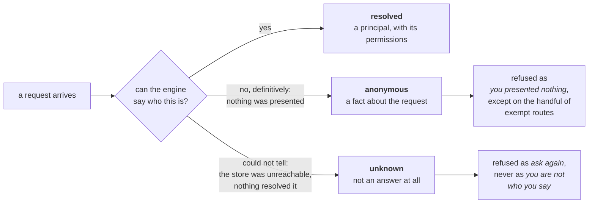
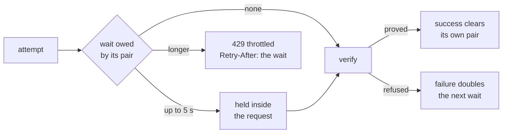

# Identity and Access

Every row the engine keeps (a work item's comment, a page revision, an audit
event) records **who did it**. Every route, query and tool decides **whether
you may**. This page is the vocabulary for both: what a *principal* is, which
*permissions* exist (`admin`, and one per app), what each opens and what
everybody sees without one, and the difference between the engine knowing you
are nobody and not being able to tell.

> The vocabulary lives in `internal/iam`, a small package that names and
> classifies things and reads, writes and stores nothing.

---

## A principal is who is acting

A principal is one actor the engine can name. The kind decides how its work is
attributed and what it may be.

| Kind | Who that is | Recorded as |
|---|---|---|
| `person` | A human: the founder at the dashboard, a teammate with a login. Always on a human seat of their own | `human`, as the seat they hold |
| `seat` | An agent seat acting inside its own turn | `agent` |
| `machine` | A token with nobody behind it: CI, a pipeline, an automation | `operator` |
| `engine` | The engine itself: a duty's repair, a config apply, a retention trim | `system` |

The recorded values (`agent`, `human`, `operator`, `system`) are the author
kinds stored beside every tracker commit and page revision, and what an audit
filter selects on.

### A person holds a human seat, and acts as it

**Every person holds exactly one human seat**, from the record that creates
them to the record that removes them. Their work lands under **that seat's
handle** with author kind `human`, and every "do you lead this" rule is asked
about that seat. A person is invited onto a vacant human seat or created on it,
from the seat in **Company › Structure** or with `-seat` on the command line
(see [A person arrives on their
seat](#a-person-arrives-on-their-seat-invited-or-created)). The seat can be
**moved** to another vacant human seat, never cleared:

```
crewlet iam bind <person-id> backend-lead
```

A suspended or retired person keeps their seat. To free it, move or remove
them; the removal's tombstone keeps who held it
([ADR-0032](../../adr/0032-every-person-holds-a-human-seat.md)).

The binding is a directory row, not a line of the company document (see [The
binding has two ends](#the-binding-has-two-ends-and-only-one-of-them-arbitrates)).
A person signed in with a session acts as the seat their row holds. A **Tier A
token** acts under the login `token:<id>`, and acts as a seat when the
directory holds a row under that login bound to a human seat. `crewlet iam
create -kind machine -login token:<id> -seat <handle> -grants none` enrols and
binds in one record; the row carries no permission, since the token's are its
Tier A entry's. A service account is bound the same way, at its create or
later with `crewlet iam bind`.

**A token or service account bound to no seat acts as the credential**, under
its own login, with author kind `operator`. That is ordinary (a pipeline, an
automation, the deployment's break-glass token) and never refused. A *person*
never acts that way. Nobody may *choose* a seat to act as: a tracker whose
author field is picked by the writer is not an audit trail.

A token's binding is held to the org chart exactly as a session's is: only an
active machine row under its login binds it, and the seat it names is resolved
against the company this node runs. It is refused `403 seat_unavailable`
naming the seat once that company does not hold it as a human seat, and `503`
on a node that cannot say (no company yet, or the directory unreadable). A
token nobody binds is served as itself even by a node whose identity applier is
behind, which keeps break-glass working.

### Names can never collide

Three kinds of name share one author column, so the engine keeps them apart by
**shape**:

| What | Shape | Example |
|---|---|---|
| A seat handle | one segment, lowercase letters, digits and hyphens | `backend-lead` |
| A person's login | segments joined by **dots** | `jane.doe` |
| A machine's handle | segments joined by a **colon** | `ci:release` |

A seat handle carries neither a dot nor a colon, so no login reads as a seat
and no machine handle as a login, and an audit filter on a name matches
everything that name did and nothing else. A login without a dot or a machine
handle without a colon is refused when written. Each shape belongs to its kind
only, at enrolment, at an invitation's redemption and at every rename. That
matters most for `token:<id>`, the login a Tier A token acts under: a person
can never hold one, so nobody can make the deployment's credential act as
their seat. The directory enrols people and machines only; a seat belongs to
the company document and the engine is the node.

**All three stop at 64 characters**, the seat handle's bound, since a login
sits in the same column. A Tier A token id therefore stops at 58 (it acts
under `token:<id>`). An address whose proposed login would run past the bound
proposes none, leaving the person to type one.

**Two machine classes are nobody's: `pat` and `session`.** `pat:<credential
id>` names a [machine token](#machine-tokens-a-persons-own-and-a-service-accounts)
in the operator column beside the owner it acts as, and `session:<lineage>`
names a browser session beside the person signed in. A service account
enrolled as `pat:something` or `session:something` would read as a credential
nobody minted, so the machine grammar refuses both.

**Every principal enrols with a login**, a person as well as a machine. It is
the name somebody signs in with besides their address, the name a lead types to
look a report up (resolved to its holder's record, never read as a seat), the
name in the trail's reasons (`suspended by jane.doe`), and the name a token or
service account bound to no seat is recorded under. No path derives one
silently:

- An invitation's form, the first person's included, arrives with a login
  **proposed from the address**: `jane.doe@example.com` proposes `jane.doe`,
  and `jane@example.com` proposes `jane.example` (the domain's first label,
  since a login needs a dot). The person keeps or changes it.
- An administrator's create takes the login typed, or, left empty, the same
  proposal, and the answer names the login taken (`crewlet iam create -email
  jane@example.com -seat backend-lead`, or the seat's **Add person**, whose
  Login field is optional). An address nothing can be proposed from is refused
  naming the login, so the administrator types one.
- A login is never cleared, only renamed. A rename, a move to another seat, or
  both is **one record** stating the login and seat from then on. One refused
  by its holder's grammar or because somebody else holds the value changes
  nothing, and the old value is free the moment the new one is taken.

---

## Access: admin and one permission per app

What a principal may do comes from the **permissions** it carries and its
**relations** in the org chart: the seat it holds, the team it leads, the work
it wrote. There are seven permissions: whether they **run** the company, and
which of its six apps they **use**.

| Permission | On the dashboard | What it is |
|---|---|---|
| `admin` | **Admin** | Runs the company and the engine: configuration, credentials, people, deployment and the company-wide trail. **It includes every app**, and it is host access ([below](#what-admin-runs)) |
| `worklet` | **Worklet** | Uses [Worklet](../guides/worklet.md), the engine's work tracker: reads and writes it |
| `doclet` | **Doclet** | Uses Doclet, the engine's [knowledge base](knowledge-system.md): reads and writes it |
| `artifacts` | **Artifacts** | **Authors** artifacts: creates them, publishes versions and shapes their data. It never gates opening one: that is decided by its [shares](#an-artifact-is-opened-by-its-shares) |
| `chatlet` | **Chatlet** | Uses the company's [chat](chatlet.md): reads its rooms and talks in them |
| `gitlet` | **Gitlet** | Uses [Gitlet](gitlet.md), the engine's git host: reads, searches and reviews code, and clones, fetches and pushes. Without it a principal reaches no repository through any door ([below](#what-each-app-opens)) |
| `atlas` | **Atlas** | Reads the company's atlas: the map of everything it runs on (vendor accounts, domains, servers, data stores, repositories, monitoring, tool servers, models) and their dependencies, private addresses included. **Opt-in**: only an administrator holds it until it is given ([below](#atlas-is-given-on-purpose)) |

They are stored in the `grants` field of a person's row, an invitation, a
machine token and a Tier A token entry; the dashboard calls the concept
**Access**. `worklet`, `doclet`, `artifacts`, `chatlet`, `gitlet` and `atlas`
are the **apps**, declared in one place, `iam.Apps`, which an agent seat's own
set, the dashboard's picker, the live socket's reader and the authority
table's checks all read. A new app is a new member there plus a new set of
rows, and the build fails until both exist. New apps are appended last, so
every list keeps its order.

**Admin includes every app.** `iam.Expand` reads a set as it is compared (its
members plus every app when it holds `admin`), and every permission comparison
goes through it: what a principal can do, a node's admin posture, a machine
token against its owner, what a writer may confer, an invitation's bound, a
Tier A token's check. So an administrator is never told they lack an app.
Ticking **Admin** in the picker, or `-grants admin`, also stores every app
this build knows, so taking admin away later leaves the person their apps.

**Everything else is everybody's.** A principal with no permission still sees
[the overview](#everybodys-overview) and manages their own account; a
permission adds an app to use or a company to run. The company's code is not
in the overview: reaching a repository takes `gitlet`, as reading a work item
takes `worklet`
([ADR-0110](../../adr/0110-reaching-a-repository-takes-the-gitlet-permission.md)).
Nor is the atlas: it takes `atlas`
([ADR-0127](../../adr/0127-reading-the-atlas-takes-the-atlas-permission.md)).
What a **lead** may do in their team, an **author** to their own work and a
**person** to their own record are relations the [authority
table](#the-authority-table-one-function-decides) asks the chart about, as is
a **share** of one artifact; on an app's verb each is asked *beside* the app
([ADR-0033](../../adr/0033-access-is-admin-and-one-permission-per-app.md)).

**`api.auth.admin` says whether this node serves admin.** A person's
permissions live in the replicated store, written by an administrator; Tier A,
which holds the keyring, states per node whether admin counts here:

| `api.auth.admin` | What a principal composed on this node carries |
|---|---|
| `serve` | What its row holds, with every app an admin holds |
| `refuse` | The same, **minus `admin`**, every app kept (apps are expanded before admin is clamped away). For a node published to the people who use the company, where nobody should run it however their row reads |

It is required once the node serves the API; a zero is refused at
`api.auth.admin`, naming both values. A posture the request path reached
without (a wiring mistake) confers nothing. It is applied at **decision time,
per node, per request**, and nothing is written when it changes: a restart
with `refuse` takes admin off that node on its next request, with no apply and
no migration. Nodes that disagree are a *legal* state (a rolling restart is
one), so each node publishes its posture on its presence lease and `GET
/query/fleet` shows it as `admin` per node; two values there are the
disagreement said out loud. It is **absent** on a node that binds no API: a
worker has no posture, and a blank must not read as one.

### Everybody's overview

Every principal the request guard resolves and whose
[stage](#stages-whether-a-principal-may-act-at-all) may act (a person, service
account, machine token or Tier A token) reads the company's **overview** with
no permission:

- **the org chart** (Company › Structure), each human seat's holder shown by
  name and seat, their login only to an administrator and the person
  themselves (`GET /iam/seats`);
- **agents' status**: who is working, on which phase, for how long, at what
  spend, and each seat's page, its status side;
- **executors' status**;
- **spend**, token rollups and series, and **budgets**;
- **schedules** and their runs, the **tools** list and the node's **health**;
- **each MCP server's condition and tools**, in a member's reading that names
  no launch line, header, variable, account or call (`GET /mcp-servers`,
  `GET /mcp-servers/{name}` and the curated half of `GET /mcp-catalogue`; an
  administrator reads the rest);
- who to ask: `lookup_colleague` and the person-facing colleague question,
  which masks a seat's external contact ids for all but an administrator;
- `viewer` (who they are, what they carry, which actions are theirs) and the
  live socket, which admits every resolved principal.

**The overview carries status, never transcripts.** An agent's and an
executor's surfaces split into a **status** half and a **body** half, declared
once per surface and held by a walk that fails the build on an unclassified
field. The body is what a turn *said*: prompts and prompt messages, responses,
tool calls and arguments, round narration, `llm_history` payloads, the text
that triggered a live call, and an executor's task, question, reply and
bridged calls. It goes to **an administrator**, to **whoever leads that
seat** (`audit.seat.read`, the rule that decides who reads a seat's diary),
and, for an executor's question, to **the person it is put to**. Everybody
else gets the status alone, with `body_withheld: true` and the body's version
counters at zero, so a screen says "not shown to you" and never re-asks.

**Their own account** is everybody's too: their own row, credentials and
sessions, the self arms of the directory ([Your own
account](#your-own-account-is-account)).

**An answer that crosses apps is filtered row by row** by `authz.Shows`, which
asks which app a row belongs to: a work row needs `worklet`, a page row
`doclet`, a chat row `chatlet`, a repository or change `gitlet`, an atlas
entry `atlas`, anything else nothing. So:

- the Home feed carries only rows its reader may see; an explicit `kinds=`
  entry they may not see is dropped, not refused, since a refusal would
  confirm what exists;
- the decisions list carries a work item's ask only to a `worklet` holder or
  the person it names;
- Spend's task tiles, an agent's current task and a page's `linked_from` tasks
  need `worklet`;
- a question answered from the company's knowledge searches pages only for a
  `doclet` holder and the board only for a `worklet` holder.

**An artifact row is never shown by its kind.** An artifact belongs to no app,
and "no app" in that filter means everybody's, so artifact rows go through
`authz.Visible`, which reads each row: shown to its owner, whoever it is shared
with, and the lead of the agent that owns it. An administrator is shown it the
same way. Opening a private artifact through the admin path is possible and
recorded (see [An artifact is opened by its
shares](#an-artifact-is-opened-by-its-shares)), but no listing, feed or search
hands an administrator private titles by that override.

### What each app opens

| App | What it opens |
|---|---|
| `worklet` | Every Worklet read and write: the board, a project, its files, views and reading the workspace catalogue (writing it is admin's); filing, updating, commenting, merging and placing work; every `work_*` question. A person's own **Inbox** (its Worklet half; the code half is `gitlet`'s), **My work** (every section but Reviews, which lists changes on Gitlet and needs `gitlet`) and person view, and the same for a report as their lead (or anybody, as an administrator). The `inbox_changed` push of Worklet's half |
| `doclet` | Reading, listing and searching pages (`get_page`, `list_pages`, `search_knowledge`, and the `pages`, `page`, `containers`, `page_activity`, `page_revision` and `page_reads` questions); writing, saving and commenting on them (`write_page`, `save_page`, `comment_on_page`) |
| `artifacts` | Authoring artifacts, beside the role each asks: creating one (`create_artifact`); on an artifact somebody holds editor on, publishing a version (`publish_artifact`), renaming it (`update_artifact`), adding an asset (`upload_artifact_asset`), changing its datastore's schema (`set_artifact_schema`) and filing it in a folder (`move_artifact`, beside contributor on the folder); creating a folder inside one they may file in (`create_artifact_folder`); trashing and restoring one they own (`artifacts.trash`, `artifacts.restore`). **Nothing else**: opening an artifact, reading and writing its data, being present on it, sharing and exporting it ask only the role |
| `chatlet` | Where the company runs Chatlet: every room a person may read and every word they say in one: listing, reading and searching rooms (`list_channels`, `read_channel`, `search_messages`); posting, replying, direct messages, reactions and their own membership (`post_message`, `reply_in_thread`, `send_dm`, `react_to_message`, `join_channel`, `leave_channel`); and a person's own gestures: making a room, opening a conversation, a room's settings, adding people and its whole membership, editing and taking back their own messages, their read state (`create_channel`, `open_dm`, `update_channel`, `add_channel_members`, `set_channel_members`, `edit_message`, `delete_message`, `mark_chat_read`). WHICH room is the chat's own rule: a private room is its members', and one a person cannot read answers as if it did not exist. Archiving a room is its creator's, its unit's lead's or an administrator's; taking back somebody else's message is an administrator's, as moderation, which reaches a room the moderator is not in without showing it to them. The `chat_*` questions (`GET /chatlet/…`) and `chat_*` pushes on the live socket |
| `gitlet` | Where the company runs Gitlet (`code.backend: gitlet`), every door to code: the Gitlet workspace and every place the dashboard shows code; Gitlet's reads under `/gitlet/` and the `code_*` questions, on REST and the socket; cloning, fetching and pushing over `/git/`; every code tool a person's assistant calls (reading, searching, committing, a change's lifecycle, reviews and merge) and a person's own `code_report_check`, `code_import_repo` and `code_purge_unreachable`; being asked to review a change; the code half of **Inbox** (code notices, listed, counted and marked with `code_mark_inbox`) and its `inbox_changed` push; the files of a change they marked viewed (`code_mark_viewed`); **My work › Reviews**; and which change woke a turn, on the trail. Without it a principal is refused before any repository is read, so no answer, count or line of git tells them what one holds. WHICH repository, and what they may do, is the repository's grant ([Who may read and push](gitlet.md#who-may-read-and-push)): a person holding the app maintains every repository, a credential bound to no seat that holds it reads every repository and never pushes, and a seat holds the lower of its `code.access` tier and its relation on the chart. Who read a repository (`code_repo_readers`), the Gitlet nodes' cache report (`code_status`) and Settings › Gitlet stay admin's |
| `atlas` | Where every holder reads every entry with its facts, sources and relations, private addresses included: the `atlas_search` tool, which a person's own assistant calls over the operator surface. Nothing narrower stands behind the app, because a map with holes cut per reader answers "what depends on this?" wrongly. A panel the atlas joins from another app's records stays that app's, so the atlas is never a way round another permission |

**A relation asks the app beside it.** Leading a project, owning an inbox,
having written a comment, owning a saved view: on an app's verb each admits
only a caller who also uses the app. A project lead who does not use Worklet
does not set its policy there; a comment's author who no longer uses Doclet
does not edit it. A refusal names what would change the answer: `[worklet]`
to a lead missing the app, `[admin]` to somebody missing the relation.

Three narrow rules sit beside the apps:

- **You may answer what you were asked, without Worklet.** When a colleague
  puts a structured ask on a work item to you, you may read that item and post
  the comment or choice that answers that ask, whether or not you hold
  `worklet`. The tool reads the item, finds the open ask that names you
  (`worklet.AskedOn`) and admits only the answer, which Worklet's writer
  checks is yours; a plain comment, a new ask and a decision are still
  Worklet's. A missing item and one you were not asked on are one refusal, so
  nothing leaks about which items exist. Once you have answered, the item is
  Worklet's again, except that repeating the same answer is admitted and
  answered from the answer that landed, writing nothing. The dashboard opens a
  work item's page (`#/worklet/{KEY}-{n}`) to somebody it was put to for this.
- **Authors tidy their own work.** Whoever created a page may rename, publish
  or take back to a draft, trash and restore it; whoever reported a work item
  may remove and restore it; beside the container's lead and an administrator,
  and with the app. An author tidies only their own item: removing or
  restoring the items beneath it stays the project lead's or an
  administrator's, and a **purge**, which nothing undoes, stays an
  administrator's, asks for a [recent
  proof](#some-gestures-ask-how-recently-you-proved-who-you-are) and is never
  an agent's.
- **A page lives in a declared space.** Creating a page under a container key
  the company does not declare is refused, naming the key and how a space is
  declared (a unit's or seat's `space:`, `knowledge.root_space`, or the
  tool-skills container), for a person and an agent alike, as filing a task in
  an undeclared project is. See [Who may write
  where](knowledge-system.md#who-may-write-where).

### Atlas is given on purpose

`atlas` is the one **opt-in** app (`iam.OptInApps`): a full map of servers,
addresses and vendors is what an intruder looks for first, so holding it is a
decision about the person. An invitation and a person's create carry every
other app when nothing names their access (`iam.DefaultApps`, the start of
`crewlet iam` and the dashboard's **Invite** and **Add person**), never
`atlas`; somebody ticks it on purpose. An administrator holds it through
`iam.Expand`, a Tier A or machine token only when its `grants` name it. An
agent seat holds it as every app, and a turn a person woke is held to whether
they use it
([ADR-0109](../../adr/0109-a-turn-somebody-woke-is-held-to-the-apps-they-use.md)).
See [ADR-0127](../../adr/0127-reading-the-atlas-takes-the-atlas-permission.md).

### An artifact is opened by its shares

Other objects are decided per **app**: whoever holds `worklet` reads every
task. An artifact is somebody's own work handed to the people it names, so it
is decided per **object**. A principal's **role** on it is a ladder where each
role includes those below:

| Role | On the dashboard | What it adds |
|---|---|---|
| `viewer` | Can view | Opens the artifact, its versions and history, and is present on it |
| `commenter` | Can comment | Comments |
| `contributor` | Can edit | Writes data where a collection's rules admit it; never the page itself |
| `editor` | Can manage | Publishes versions, renames it, adds assets, changes the schema and exports the whole data, beside the `artifacts` app where the verb authors |
| `owner` | Owner | Shares and unshares it, trashes and restores it, hands it to another seat. Held by its owner, never shared: ownership moves only by transfer |

A principal's role is the **best** of their relations to it:

- **owning it**, by the seat they hold (or, for a service account bound to no
  seat, its login), which holds every role;
- a share naming **their seat**, which follows the seat, so a successor
  inherits it;
- a share with **a unit they sit in**, or any unit above it, decided live
  against the running org chart (a unit's lead seated outside the unit is not
  in it);
- a share with **the whole company**, which admits every principal whose stage
  may act, agents included;
- **leading the agent that owns it**, which holds owner, so an agent that is
  paused or removed does not orphan its work. A person's lead holds nothing on
  that person's artifacts: a draft is theirs.

Each verb names the least role it admits, and that one rule decides every
surface (a tool, an HTTP route, a socket join, the artifact origin). Four
answers sit around it:

- **No relation at all is "not found".** Somebody holding no role is answered
  as for an id nothing holds, `404 not_found` with no reason, so a private
  artifact's existence, id and title are never disclosed. That holds for a bar
  on the verb too: a machine token asking a verb that needs somebody present
  (a transfer, a force publish), or an agent asking a person's verb (trash,
  restore, pin, transfer), is told `not_found` when it holds no relation, and
  the bar's own `403` only when the artifact is already disclosed to it.
  Somebody holding a role below the verb's is refused `403` naming the role
  they need.
- **An administrator may open anything, and it is recorded.** Admin is host
  access, so a refusal would promise a privacy the engine cannot keep. The
  admin path admits every artifact verb after the administrator's own shares
  are counted: an administrator a share admits is admitted as the sharer
  **at the share's role**, shaped and stamped by that role. An admission only
  the admin path made stands at owner and is marked **elevated**: every read
  of the artifact's content it makes (a version's files, its datastore, the
  export, a room's join, the live version a stale publish answers with) writes
  an elevated-read record before anything is shown. The artifact's history
  shows it to its owner and editors, and the company trail of every artifact
  (`artifact_trail`, `audit.read`) shows every administrator, so an override
  is found even when the owner has left. A read whose record cannot be written
  is not answered. On a node that [refuses
  admin](#access-admin-and-one-permission-per-app) the path does not exist,
  and an administrator there opens only what is shared with them.
- **The trash stops serving at once.** A trashed artifact keeps its head,
  versions list and history for the trash view and serves no content to
  anybody: files, datastore and rooms are refused until its owner restores it,
  and an agent's read tools refuse it alike.
- **A node behind its org chart says so.** A unit share or a lead the node
  cannot read is "cannot tell", `503` with a `Retry-After`, only where it could
  have changed the answer; an administrator is never told it.

**What an agent may do on somebody else's artifact.** On an artifact it does
not own, an agent holds at most `contributor`, whatever it is shared and
whoever it leads: it reads the artifact and fills in its data, and never
publishes over it, renames, reshapes or reshares it. The company document's
`artifacts.agents_manage_others: true` lifts that cap. An agent never trashes,
restores, purges, transfers or force-publishes anything: those are a person's.

**Who the agent is acting for.** Inside a turn somebody woke (a message, an
ask, or a change of theirs on a work item or page), every artifact verb an
agent takes is decided a second time for that requester and admitted only when
both may take it: the agent shows them no artifact they could not open and
writes none they could not write.
- **Exception: edits to its own work** (publishing a fix, renaming, adding an
  asset, reshaping or filling in its data, creating one): anybody who can
  message an agent may have it change work it owns. Reading its own artifact
  back and sharing it are never exempt, nor is what an edit hands back (the
  live files a stale publish answers with, a conflicting write's current
  rows): shown only where the requester could read them.
- A turn woken by somebody the company does not know reaches only those edits.
- A turn a credential acting as no seat woke with a change on a work item or
  page is decided for that credential: what is shared with it or that it owns.
- A turn nobody woke (a schedule, a watch, the engine's own notice, the
  outcome of the agent's own act such as a workflow its own push failed) is
  bounded by the agent alone.
- The bound passes to every turn the work is handed on to: a colleague the
  agent asks, the turn that answer wakes, and a colleague woken by the agent's
  writes on Worklet, Doclet, Chatlet or Gitlet or by what the engine records
  on Gitlet about them ([An agent uses only the apps of the person it works
  for](#an-agent-uses-only-the-apps-of-the-person-it-works-for)).

What the agent already knows is no read at all ([Sharing](artifacts.md#sharing)).

The decision is
[ADR-0034](https://github.com/crewlet/crewlet/blob/main/adr/0034-an-artifact-is-shared-and-a-share-is-a-relation.md);
[Artifacts](artifacts.md) describes the model the roles act on.

### What admin runs

`admin` covers every gesture that changes what the company *is* or reads what
everybody did:

- **the company document**: reading and writing `/config`, the org chart
  beyond a lead's own subtree, integrations and their setup, models, MCP
  servers, settings and budgets, and the project and space keys a unit or seat
  declares;
- **the workspace catalogue** (task types and custom fields) and the
  **tool-skill pages**, injected into every seat's turn;
- **the credential store**: listing, writing and revealing a secret;
- **people**: reading anybody else's directory row, every directory write
  (inviting, creating, changing what somebody carries, moving, suspending,
  removing, resetting a second factor or password), and ending every session
  in the company;
- **the deployment**: backups, retention, the fleet's controls and the
  broker's membership;
- **the company-wide trail**: every event, turn and phase, every
  agent-to-agent channel, the `event` push and `/iam/audit`;
- **the purges** and **chat's destructions** (erasing messages, pruning a
  room, setting its horizon), and the **admin path** of every relation rule:
  an administrator reaches a departed person's inbox, any project's policy and
  anybody's saved view.

**A lead reads their own agents' trail.** One seat's diary, episodes, threads,
memory overview, turns, phases, live bodies and executor sessions (the session
each turn's harness kept, the whole record of what the run read, called and
wrote) are its **lead's** to read as well as an administrator's, since a lead
steers, pauses and answers for their agents. It is `audit.seat.read`, decided
per seat and limited to questions about **one seat** (its turns and phases,
its memory, the executor it launched, and that executor's sessions). An
executor session holds **more** than the live output showed (a tool call's
subject, whole only within 8 KiB, and a failed result's first line): its
transcript holds every call's whole input, each result's text to an entry's
bound (file contents the run read, what its commands printed) and every
subagent's thread. A lead reads all of it; redaction at the read matches the
credential shapes the engine knows, not values. The company-wide trail stays
admin's.

**Admin is host access: running code on every engine host.** The
configuration it writes runs code: a stdio `mcp_servers` entry is a `command`
the engine starts as its own user on every node that runs seats; a seat's
per-phase model keys (`llm_*`) name `providers.llm` entries, each a harness the
engine runs; every agent seat's executor is its harness's fully permissioned
run, which `run_in: direct` on a `providers.llm` entry (or
`providers.sandbox.default_run_in: direct`) runs, setup steps included, on the
engine host as that user; a seat's `mcp_env` decides which credentials its
children get; a seat's worker grants decide which tools a worker holds. A
holder can run anything on every engine host and read whatever the engine's
user can: the Tier A file, the keyring every session cookie is signed under,
and every credential the store holds. A separate "runtime" permission would
have the same reach, so there is none. Hand admin out as you would a shell on
those hosts. A machine token may carry it (a deploy job applying configuration
is what a token is for), so minting one with it is handing that job host
access; [two locks](#some-gestures-ask-how-recently-you-proved-who-you-are)
keep it off gestures needing a person present. Every write that can start a
process (the company document, connecting an integration) asks for a [recent
step-up](#some-gestures-ask-how-recently-you-proved-who-you-are), which keeps
a stolen week-old cookie from reaching it, and every child the engine starts
gets an [allowlisted
environment](../guides/tools-and-mcp.md#what-a-stdio-servers-environment-is).
That stops the engine *handing* its secrets to a tool server, not an
administrator, who chose that server.

**A lead reaches part of it without admin.** Leads write the org chart too ([A
lead edits their own team](#a-lead-edits-their-own-team)) and may change every
field of a seat in their team but a credential and a keyed field, its model
chain among them, which also places its executor run (the `run_in` of the
entry a launch picks). What they choose from stays admin's settings, and every
`providers.llm` entry is a harness running on the engine host (or placing
executor runs in a cell there by `run_in`), so a lead who points their seats at
one runs code there. Declare those only where every lead may use them.

**Connecting an integration is admin's and nothing more.** `/setup` performs
no write of its own: a credential goes through the store `/secrets` serves,
and the `${VAR}` pointer through the merge and compare-and-set `/config`
performs, so connecting a vendor is the same permission as both.

### Agents hold every app, and never admin

An agent seat acting in its own turn holds exactly the apps (`iam.Apps`,
derived, so a seat never holds `admin`), and its **role** decides which tools
it is offered. Three verbs belong to agents alone, marked **seat-only** on
their rows: `a2a_ask`, which spends a colleague seat's turn, and
`list_sessions` and `read_session`, with which a seat's executor reads its own
executor sessions. No person and no token takes them, whatever they hold: a
person has no turn for a colleague's answer to land in, and reads a seat's
sessions as its trail, on a route of its own ([Code
Sandbox](code-sandbox.md#a-seat-reads-its-own)). Which seats may ask a
colleague is the role registry's decision. Seat-only mirrors the
**human-only** mark, and both are checked before anything else on the row
([The sixteen rules](#the-sixteen-rules)). On an artifact, an agent holds what
its relations grant, capped at `contributor` on work it does not own, and
inside a turn somebody woke it is bounded by that person too ([An artifact is
opened by its shares](#an-artifact-is-opened-by-its-shares)).
### An agent uses only the apps of the person it works for

Inside a turn somebody woke (a person's message, assignment of a work item, comment, a colleague seat's ask, a pipeline's token filing work) an agent uses **only the apps that somebody uses**. Every verb whose row names an app is decided twice: for the agent, which holds every app, and for the app of whoever woke the turn ([ADR-0109](../../adr/0109-a-turn-somebody-woke-is-held-to-the-apps-they-use.md)). A person kept off Worklet cannot have an agent create, read or close work items for them; off Doclet, read or write pages; off Chatlet, post in a room; without `artifacts`, author an artifact; without `gitlet`, read, search, review or change a repository, and an executor the agent launches in their turn gets no repository to check out ([ADR-0110](../../adr/0110-reaching-a-repository-takes-the-gitlet-permission.md)). The agent is told which app the person lacks, and that an administrator can give it to them.

| The turn was woken by | The apps the agent uses in it |
|---|---|
| nobody: a schedule, a watch, the agent's own work | every app |
| a colleague agent seat working for nobody but itself | every app |
| a colleague agent seat's ask, the answer to the agent's own ask, or what that seat wrote on Worklet, Doclet, Chatlet or Gitlet, from a turn that seat worked for somebody | what that somebody uses, by this table, carried through every ask, answer and write |
| a person of the company | the apps their permissions name (`admin` includes every app) |
| a person who may not act now: invited and not yet enrolled, suspended or removed | none |
| a person on a human seat nobody holds in the directory: known to the chart by their contacts alone | none |
| a credential acting as no seat, with a change on a work item or a page: a Tier A token, or a service account bound to no seat | the apps its permissions name (`admin` includes every app), on the node that took the write and on the node running the turn alike: only an app both give it |
| a credential the node running the turn cannot place: a Tier A token that node's configuration does not declare, a service account removed, suspended or bound to a seat | none |
| somebody the company does not know: a chat sender no seat or person maps to | none |

**A token's work is held to the token.** A pipeline's token that files or comments on a work item, or writes a page, wakes the agents it names in turns worked for that token, by its login, never its value. The apps it used when the writing node resolved it travel with the write; each call uses only an app those name and the node running the turn gives the login now, so a token narrowed later, or declared narrower on one node, never acts wider than the narrower answer. A `token:` login is placed by that node's own `api.auth.tokens` alone, any other login by the identity directory alone. Nobody is asked anything for a credential: a question its turn's executor addresses to the requester goes to the seat's lead chain, as in a turn nobody woke. A token pushes to no repository itself, so what its turn changes of the company's code is the seat's own work only (its own namespace and the repositories it owns), whatever the seat may change for anybody else: code tools' writes, what its executor's box pushes, and the change its run opens. What no app gates stays out of reach: a token's turn reads no fleet health and reaches no server (`fleet_health`, `code_status`, `ssh_read`, `ssh_operate`), an `admin` token's included.

**A colleague's ask works for whoever the asking turn worked for.** An agent that asks a colleague with `a2a_ask` hands over who its own turn works for: the person, the credential at the apps it was held to, or the stranger. The engine composes this from the asking turn's own ceiling, never the ask's words. The colleague's turn uses only what they use, composed again on its own node, so a person revoked since the ask uses nothing and a credential is narrowed again, never widened. The answer wakes the asking agent in a turn worked for them too, through every ask of a chain.

**So does what an agent writes.** Each of these, written in a turn somebody woke, carries that somebody: a work item filed or assigned, a comment on one, a page or a comment on it, a Chatlet message, and on Gitlet a change opened, edited, closed or reopened, a review request, a review, a comment on a change, an answer to a finding, a push, a merge or an enqueue (what its executor pushes and the change its run opens included). The engine composes it from the writing turn's own ceiling, never the tool's arguments, and records it on every write a later turn reads:

- a work item's creation and every move of its assignee, whatever they wake, since an idle agent's pickup of its next item reads both;
- a change's open and reopen, a push and a merge, whatever they wake; the engine's later records about them read it back: a revision's facts, a failed check of its head and a landing the change's home found each wake the agent they tell for whom the push was made;
- an enqueue, whatever it wakes; the merge queue reads it back: its landing, its removal of the change and a close it could not make each wake the agent they tell for whom the enqueue was made, and its close of the landed change's work item is made for them and decided within the apps they use;
- any other write where it may wake another agent.

The agent it wakes works for them, composed again on its own node, as does every agent a chain of writes reaches; two writes one agent makes for two different people wake its colleague in two turns wherever the wake asks something of the colleague. The pickup of an item filed or assigned for somebody works for them too, a turn works through only the waiting messages in its thread written for whom it works for, and a parked run's question is answered only by a reply written for whom the run works for. A wake that asks nothing of the agent, arriving after a turn of its already read past the change, is dropped whoever it was written for and runs nothing ([ADR-0120](../../adr/0120-a-wake-a-completed-turn-already-read-past-starts-no-turn.md)). An agent writing in a turn nobody woke writes for itself, and the agent it wakes works for it.

**Where the bound ends.** What an agent writes on a vendor's surface (Slack, Mattermost, Jira, GitHub, GitLab, Confluence) returns as that vendor's webhook, which carries nobody, so the agent it wakes works for the agent that wrote it. To keep the bound, keep agents' work for each other on the engine's own surfaces: Worklet, Doclet, Chatlet, Gitlet and `a2a_ask`.

**Rolling upgrade.** An older node cannot read a record the newer build wrote with its requester, so it hands that write's wake back for a newer node instead of waking anybody. A wake no newer node took is kept until one delivers it (a node already running within seconds of the keep, else the next to start), save the losses [Running a Fleet](../guides/fleet.md#draining-and-rolling-upgrades) names. During the roll a wake can come late, never from a node that could not read whom its write was made for ([ADR-0109](../../adr/0109-a-turn-somebody-woke-is-held-to-the-apps-they-use.md)).

- An older data node refuses a routed write whose actor carries a requester, naming the key (`actor.provenance.WrittenFor` for Worklet, `args.Actor.WrittenFor` for Doclet and Chatlet, `args.written_for` for a Gitlet write, which an older Gitlet node refuses too), and runs none of it. The router asks the next node (the next data node; for Gitlet the repository's next committer or the next Gitlet node), so a newer node serves it; a coding box's refused push is pushed again by its harness.
- A node that does not know the kind of requester a Gitlet write names, or an app of the credential it names, answers the same way, over the network or from its own copy: the write moves on rather than being refused as malformed, since only a node that knows the value can judge the rest.
- Where no newer node exists, the agent's tool answers `fleet_builds_differ` and nothing is written: `save_work_view`'s prior read is refused alike, and `code_merge_change` merges and leaves its item open, saying so. A coding run whose collection meets no newer Gitlet committer returns with commits pushed and its change not opened, its report saying so; the agent opens the change with `code_open_change`.
- A write that carries nobody (a turn for its own seat, the engine's own write as a seat, a person's, a credential's or the engine's) crosses without the key; either build serves it.
- Upgrading the data nodes first avoids the refusal; [crewlet-operator](https://github.com/crewlet/crewlet-operator/blob/main/docs/concepts/runtime.md#the-seat-pods-follow-the-data-pods) rolls the data pods first.
- Until the roll completes, writes from an older seat node, an older Gitlet node, and the pushes and change of a run an older build launched carry no requester, so a newer data node reads them as made for nobody and they wake the colleague in a turn worked for the writing agent. Such a run's repositories were checked out for nobody, and that run is never used for somebody: once a newer node carries it on in a turn worked for somebody, every checkout it asks for is refused (a repository it already has as of another), and the agent is told that a turn worked for somebody starts a new run.
- Records an older node writes (a revision's facts, a failed check of a change's head, a landing its home found) carry no requester, so the agent they wake works for the agent that pushed. So do the merge queue's landing, removal of a change and a close it could not make: they wake their agents for the agent that enqueued, or for themselves, and an older-node agent reads no requester off those two.
- A merge queue's home reads its queue only from a data node of its own build: a newer home closes each landed change's item within the apps of whom its enqueue was made for; an older home closes it for the agent that enqueued alone. Where no data node of a home's build is left, its queue waits, losing nothing: an older home's once every data node is upgraded (crewlet-operator does this first), until the home is upgraded; a newer home's only in a roll that upgrades homes first, until a data node of its build serves it.

Exceptions and non-exceptions:

- **The person asked still answers.** A work item's open ask lets the person it names read the item and answer without Worklet ([The sixteen rules](#the-sixteen-rules)), and an agent they wake may do the same for them.
- **An agent's own work is no exception.** Steering an agent's edits to its own artifact still takes the artifacts app, and its own branches and repositories take `gitlet`: the app is decided before the rule that lets anybody steer an agent's own work. So for a person without `gitlet`, a person who may not act and a stranger, a seat changes nothing of the company's code, its own work included.
- **What no app gates stays open.** Asking a colleague, the agent's own memory, and filling in the agent's own data name no app, so they are unaffected.
- **Relations are not added.** An agent's own record, priorities and inbox stay its own; only the app is decided for the person. Where a family holds a relation for whoever woke the turn as well (an artifact's shares, a colleague seat's grant on a repository) it does so as before ([Reads made for somebody else](gitlet.md#reads-made-for-somebody-else)).

**To have agents act for somebody, they need a person in the directory.** A human seat the chart knows only by its contacts (a Slack id, a Mattermost account) holds no permission, so agents use no app for its messages. An administrator creates the person on that seat with the apps they use (Settings › People, or `crewlet iam create -email … -seat … -grants …`, [`crewlet iam`](../reference/cli.md#crewlet-iam)). The create lands them active with a first password link; they need never sign in for their agents to act for them.

**Each call reads the person afresh.** Which apps somebody uses is read from the identity directory once per tool call, never once per turn, so an administrator who takes an app away stops the turn's very next call. A node that cannot read the directory refuses the call and says to try again; it never guesses. The bound covers the turn and every turn it hands on to: a colleague the agent asks, and a colleague its writes wake on the engine's own surfaces, work for the same person. What the agent already knows it may still say.

### Nobody confers what they do not hold

A caller may not confer a permission they do not hold, on anybody, themselves included, judged through `iam.Expand`, so an administrator may confer every app. The rule lives at the **record**, not the route, because a record can be published by a CLI, a duty and a migration, none of which passes through a route. Taking a permission *away* is always allowed.

It holds on every record that hands a permission out: an edit of somebody's row, **an enrolment** (a change from nothing to what it carries) and **an invitation**, whose permissions are decided once, by whoever issues it. An administrator's create and an invitation must both **state** what they confer: `grants` is required on `POST /iam/people` and `POST
/iam/invitations`, an omitted field is `400` naming it, and `[]` is a value: the overview alone. One enrolment is not the writer's to authorise, because the node's own writer performs it; it names the authority it rests on, and the record checks it in the same snapshot the permissions land from:

| Enrolment | Its authority | What the record refuses |
|---|---|---|
| Created by an administrator (`POST /iam/people`) | The administrator's own permissions | Any permission they do not hold, before anything is published; and for a person, no seat, or a seat that is not a vacant human seat |
| Redeeming an invitation — the company's first person's included | The invitation, as its issuer wrote it, and the secret its link carries | A secret that is not the link's, a permission the invitation did not carry, an address it was not issued to, a seat other than the one it binds — or that one, once it is removed, an agent's or held by somebody else — an invitation that names no seat, and a link already spent or aged out |

An enrolment is **one record** on the directory (the person, their address, login, the seat (always for a person; when it binds one, for a service account) and, for a redemption, the spent link or, for a person's create, their first password link). The table's authority is checked in that record's own snapshot against every row, so a refusal leaves nothing behind and a half-finished enrolment cannot exist.

**An administrator's create is derived, and never rewrites somebody who exists.** Its person comes from the operation's key (the one an `unknown` answer hands back to retry under), so the retry names the person its first attempt created and is answered from the ledger. The key sent with another body is another operation, which meets the person the first created and is refused as a reused key, so it never gives an existing person a second address or rewrites their credentials. A redemption's person is minted per attempt: the link keeps it single-use, the record that creates the person spends it, and a second redemption is refused in its own snapshot as a link already used.

**An administrative record is never written through a machine token.** Every enrolment, invitation, edit of somebody's row, suspension, removal and company-wide invalidation is refused at the record if the request came through a `pat:` credential, whatever it carries: `403 token_refused`. A token is what an attacker holding a pipeline's environment already has, and deciding who may do anything needs a person at a keyboard. It sits beside the authority table's own [presence rows](#some-gestures-ask-how-recently-you-proved-who-you-are), at the record, so a harness, a duty or a test is held to it as a route is.

Whether **anybody exists yet** is one predicate (a person or a machine that is enrolled and not removed; a suspended person is somebody), asked in two places, both about the first person: `GET
/health`'s `identity`, and the line a node logs at boot while the answer is no.

**`POST /iam/invalidate-all` is admin's, a person's, and a recent proof's.** It is the restore runbook's last step; it ends every person's authority at once (every session and every machine token) and cannot be taken back. A Tier A token holds `admin`, is its own credential rather than a machine token and is fresh by construction, so the runbook's harness step still runs on the day nobody can sign in; a machine token is refused twice, by the row and by the record.

### A permission this build has never heard of

During a rolling upgrade a newer node may write a permission an older one cannot read, and a row written before a vocabulary change may carry a name this build no longer knows. Such a name is **kept and ignored**: it stays in the row, opens nothing, and the person keeps every permission this build knows (refusing the principal would log everybody out for the length of a deploy). A writer may **remove** an unknown name from a row and never **add** one; a whole-set edit that restates one the row already carries adds nothing and is allowed. Tier A is stricter, because a file an operator wrote is a typo, not an upgrade: an unknown name in an `api.auth.tokens` entry is refused, naming the six.

**`gitlet` is such a name on a node older than the app.** Until every node runs a build that knows it, an older node keeps and ignores it and answers the code requests it serves under its own rule, where everybody of the company reaches code. The narrowing holds fleet-wide once the roll completes ([ADR-0110](../../adr/0110-reaching-a-repository-takes-the-gitlet-permission.md)). Nothing is migrated: an administrator holds `gitlet` at once through `admin`; everybody else who uses Gitlet needs it ticked (Settings › People, or `crewlet iam grant ID -grants` restating what they hold with `gitlet` added, since the flag is the whole set); a Tier A token that fetches the company's code needs `gitlet` in its `grants`. A person's machine token carries the grants it was minted with, so one minted before `gitlet` existed lacks it, unless it carries `admin`, and is minted again to reach code.

---

## Stages: whether a principal may act at all

Before any permission is consulted, a principal has to be *enrolled*.

| Stage | May act | Means |
|---|---|---|
| `invited` | no | Created, has proved nothing yet |
| `enrolling` | no | Part-way through proving who they are. Nothing moves a person here on its own; an administrator may set it. A person who must [enrol a required second factor](#a-required-second-factor-is-enrolled-before-anything-else) first is `active`, holding a session that may only do that |
| `active` | **yes** | Enrolled |
| `suspended` | no | Enrolled and blocked, reversibly, with the record kept |
| `retired` | no | Has left; the record is kept so their audit rows still resolve to a name |

Only `active` may act, an allowlist: a stage this build does not recognise may not act either.

A person an administrator creates is `active` from the moment the create lands, not `invited`: what they lack is a password, and the [first password link](#a-person-created-directly-gets-their-first-password-link) the create hands back is how they set one. Somebody invited has no row at all until they redeem their link.

Seats and the engine are always `active`: neither enrols, and neither can be suspended by anything but the org chart and the process.

### What a suspension reaches, and how fast

A suspension is ONE record on the identity log (`crewlet iam suspend`, or a `PATCH /iam/people/{id}` naming the stage), with no configuration change. Every data node applies it, whatever its other roles, and decides what follows from its own rows. A seats node that holds no data applies no log and serves no request (only a data node serves the API), so it decides the routing and what its agents are shown, and learns of the suspension on its next thirty-second read of the directory through a data node:

| What | When | How |
|---|---|---|
| Signing in | refused from the apply on | the stage is read from the row, and only `active` may act |
| Every session and machine token they hold | ended, and refused at the next request, `401 session_revoked` | the record moves their revocation epoch as a `crewlet iam revoke` does, so reactivating them revives none: they sign in again and mint new tokens; a browser told `401` has dropped its cookie |
| An open dashboard tab | closed `4401` as the record applies, or `1013` on a node that cannot read the record yet, whose reconnect answers that person `503` until it can | each node's identity applier says whose credentials a committed batch moved (the person, their login, the session it ended) and the node decides again exactly the sockets opened with one; a move that can name nobody (the company's session generation, a record the node retains instead of applying, its identity log passing the stall grace) closes every open tab `1013` without reading anything, and each reconnect's handshake decides |
| Their seat's contact identities — the Slack member, the Jira account, the GitHub login | withdrawn within one apply on a data node, with a 30-second re-read behind it; within that 30-second re-read on a node holding no data | a data node's identity applier signals after the commit and the node rebuilds its party registry for the same company from a fresh directory read; a node without `data` has no applier, so it re-reads the directory through a data node every thirty seconds and rebuilds from that |
| What agents are shown of them — a lead's roster, `lookup_colleague` | their accounts left out from the next turn once the node's registry has moved | every turn pins the registry's reading beside its org, so the prompt and the tools leave out the same people |
| Their `inbox_changed` watch | gone with the socket | a watch needs a resolved caller |

So a message the person sends from Slack stops being attributed to their seat (a suspended lead's DM to an agent no longer arrives as "your lead says"), with nothing about the seat edited. Reinstating them (`crewlet iam activate`) restores all of it on the same terms, except their sessions and tokens, which the suspension ended. See [Humans in the Org Chart: A suspended holder is withdrawn](humans-in-the-org.md#a-suspended-holder-is-withdrawn-with-no-configuration-change) for the routing rule for every stage, removal included.

**The stage sticks through every edit.** It has one writer, the status record, and a later rename, permission change or credential change forms its document from the stage the row holds, so no edit made while somebody is suspended can reinstate them.

**What it does not reach is the seat.** It stays in the org chart, work can still be assigned to it, and Worklet still writes its notices. The suspended person **keeps it**, as a retired one does, so nobody else can be invited onto it, created on it or bound to it while they hold it, and whoever holds it next reads what accumulated: the person once reinstated, or a successor once the person is moved to another seat or removed. Suspending a person neither removes their seat nor frees it.

---

## Anonymous is not unknown

Remember this distinction when a request is refused.



**Anonymous** is a finding: the resolver ran, and nobody presented a credential. It is refused on every guarded route; the probes, the webhook edge, the per-run token paths, a coding box's git and the dashboard shell are the whole of what is served without one.

**Unknown** is the absence of a finding: the identity store could not be reached, a session lookup failed, or nothing resolved the request at all. Collapsing it into anonymous would answer *invalid credential* to somebody holding a good one for as long as the outage lasted, teaching everybody to reset a password that was never wrong. Treating "could not tell" as "definitely not" is a mistake this engine refuses everywhere.

So: **if you are refused and the reason says the engine could not determine who you are, check the engine's health before you check your token.** A silence (a request nothing resolved at all) is read as unknown too, never as anonymous.

---

## How the first person exists

A fresh deployment's identity estate is **empty**, and its one credential is a **Tier A token** (`api.auth.tokens`, which configuration requires on every node that serves the API for this reason). A Tier A token is an operator carrying the `grants` its own `api.auth.tokens` entry declares (the founder's is `grants: [admin]`), read through the node's [admin posture](#access-admin-and-one-permission-per-app) on every request (see [Tier A](../getting-started/configuration.md#tier-a)). So the first person arrives **like everybody after them**: onto a human seat, invited or created by whoever holds a token declaring `admin`, on a node that serves it.

**The seat comes first.** A person holds a human seat from the moment they exist, so the company must declare yours first: a `kind: human` seat in the `company.yaml` you import or boot with, or, on a node that runs no company yet, the **Create the company** form under **Company › Structure**, whose **Add a seat for yourself** is ticked by default. A node that runs no company has no seat to put anybody on: naming a seat there (an invitation, a create) answers `409
no_active_revision`, as `GET /iam/seats` does, with a hint to import or create a company that declares a human seat. A company that declares none can admit nobody until one is added (**Company › Structure › Add › Add human seat**), and
`crewlet validate` warns about one at `roles`.

Then, on the dashboard: sign in with the token (the sign-in page opens its token form while `/health` says nobody has joined), open **Company › Structure**, and open your seat: its page says **This seat is open**, and the page, the seat's panel and the **Person** section of its editor each offer two gestures:

- **Invite**: your address and your access; tick **Admin**, which ticks and locks every app beside it. The link is shown once; you open it, choose a login (one is proposed from the address) and a password, and redeem it as [the next section](#a-person-arrives-on-their-seat-invited-or-created) describes, which signs you in.
- **Add person**: your address, optionally your name and login, and your access (tick **Admin** here too). You are created active on the seat at once, and handed a **first password link**, shown once, that sets your password and signs nobody in: you sign in afterwards with the login or the address.

**Settings › People** says the same while nobody has joined, and links to Structure (or, in a company with no human seat, to adding one). Or from a shell:

```sh
export CREWLET_API_TOKEN=...   # the value of one of api.auth.tokens
crewlet iam seats -unheld      # the human seats nobody holds
crewlet iam invite founder@example.com -seat founder -grants admin
```

`-grants admin` stores `admin` and every app beside it. Or `crewlet iam create -email founder@example.com -seat founder -grants admin`, which prints the first password link instead. Nothing about the first person is special:

- **An invitation or a create confers only what its writer holds**, and a Tier A token holds its own declared `grants`, read through the node's admin posture. So the token that puts the first person on their seat must itself list `admin` (the quickstart's founder token is `grants: [admin]`), on a node whose `api.auth.admin` is `serve`. A permission the token does not hold is refused `403`, naming the permission that would have admitted it; add it to the token's entry and restart, as [Tier A](../getting-started/configuration.md#tier-a) states. Give the first person `admin`, or nobody after them can be invited or created except through the token again; `crewlet iam check` names a company in that state as `no_admin_holder`, counting only an **active person** who holds `admin`, never a service account, because no machine token may write an administrative identity record.
- **The node says the company is waiting for it.** `GET /health` answers `identity: unclaimed` while no person is enrolled, `ready` once one is (a person created directly counts the moment the create lands, before their first password link is spent; a service account alone does not count), and `unknown` where this node cannot read the estate, never folded into `unclaimed`. A node that boots with no person in its estate logs `iam_unclaimed` saying what comes next: a company where it runs none, a human seat where its company declares none, the link of an invitation already open, or an invitation onto one of the VACANT seats it names (never a seat a service account holds or an open invitation names, which refuse one) and, where every seat is held, what holds each and how to free one. Where the seats cannot be read it names none and points at `crewlet iam seats -unheld`. Neither ever moves `status`.
- **After that, the token is the way back in, not the way people arrive.** Once somebody holds `admin`, people are invited and created by them; the token stays the break-glass credential for the day nobody who can do that is reachable.

There is no one-time code a node mints onto its own disk: the token is already the root of trust, and an invitation or a create is the path everybody else takes. `api.auth.bootstrap` is removed, and a file still carrying it is refused, with a message saying it was removed and that the first person is invited with an `api.auth.tokens` token instead.

## A person arrives on their seat: invited, or created

A person comes to exist in one of two ways, and **both start from a vacant human seat**: one no person holds and no open invitation names. The seat is part of the gesture: every person holds one from the moment they exist ([ADR-0032](../../adr/0032-every-person-holds-a-human-seat.md)), so neither way can be taken without naming it, and a person's seat is afterwards moved, never cleared.

| | Invite | Create |
|---|---|---|
| Who chooses the login | the person, from a proposal | the administrator, or the same proposal |
| Who chooses the password | the person, while redeeming | the person, through their first password link |
| When the person exists | when the link is redeemed — until then the invitation holds the address and the seat | the moment the create lands, `active` |
| Shown once, to whoever did it | the invitation link | the first password link |
| Good for | one week | one week |
| On the dashboard | **Invite** on the seat | **Add person** on the seat |
| From a shell | `crewlet iam invite EMAIL -seat SEAT` | `crewlet iam create -email EMAIL -seat SEAT` |
| Over HTTP | `POST /iam/invitations` | `POST /iam/people` |

Both are directory writes, so both take `admin` and a [recent proof](#some-gestures-ask-how-recently-you-proved-who-you-are) from a person present, and both confer only what their writer holds. Both **state** what they confer: `grants` is required, `[]` meaning the overview alone, and the dashboard's dialogs and the harness each state a default out loud before they send ([Nobody confers what they do not hold](#nobody-confers-what-they-do-not-hold)). Both name a **human** seat of the company the node runs: a handle the company does not hold, or an agent's seat, is `400`; a seat somebody holds is `409` naming them; a seat an open invitation holds is `409` naming the invitation, with `DELETE /iam/invitations/<id>` as the way to free it; a node that runs no company yet answers `409 no_active_revision`. Leaving the seat out is `400
seat_required`, refused before anything is minted.

**On the dashboard both live on the seat.** In **Company › Structure**, a human seat's panel and page say who holds it, by name, to everybody (Structure is part of [everybody's overview](#everybodys-overview)), or that the seat is open; an administrator also sees the holder's login and an open invitation (its address), which `GET /iam/seats` sends nobody else. For an administrator the seat's panel, page and the **Person** section of its editor offer **Invite** and **Add person** on a vacant seat and **Cancel invitation** on an invited one. A seat a service account or a token holds offers none. The dialog's seat is the one it was opened from (neither offers a choice) and its link is shown once. **Settings › People** lists, changes, suspends and removes people, and sends you to Structure to invite or create one; **Settings › Service accounts** lists and creates the machine principals.
### An invitation names its seat, and holds it

An invitation is a **claim on an address and a human seat by somebody who does
not have a person yet**, so it arbitrates where both do: an invite and a create
for one address or one seat contend, as do two nodes redeeming one link. **The
seat is required**, and **while the invitation is open it holds the seat as it
holds the address**: a create on that seat, a bind to it and a second invitation
naming it are each refused naming the invitation, and a company write that would
remove the seat or make it an agent's is refused `409 seat_held` naming the
invitation (never its address). So the invitee is never told at the last step
that somebody took their seat. Cancelling, redeeming and lapsing each free the
seat.

What redeeming confers is decided **once, by whoever issued it**. Issuing is
held to the issuer's own permissions, and the redemption names the invitation as
its authority, so the record refuses anything the invitation does not cover. A
link spent or aged out between opening the form and posting it answers
`410 invite_spent`, like one already spent.

**The link is an id and a secret, and it opens the dashboard.**

```text
https://crewlet.example.com/dashboard#/invite/<id>.<secret>
```

It is the dashboard's invitation screen, built from `api.external_url`, with the
credential after the `#`: a browser never sends a fragment to any server, so
neither half reaches a proxy's access log. The screen asks `/auth/invite/{id}`
with the id in the path and the secret **beside** it, never in a URL: in the
`X-Crewlet-Invite-Secret` header to render and in the JSON body to redeem. The
id alone opens nothing (it is the row's key, in every snapshot, backup and
access log); the estate keeps the secret's SHA-256. A missing or wrong secret is
answered exactly as an id nobody issued is: the same `410`, counted against the
caller's source, because told apart it would say which ids exist.

**The GET renders and never spends.** Mail prefetchers, security scanners and
chat previews all GET the link; an invitation spent by one would create an
account nobody saw, or tell the real person their link was used. The GET answers
what the form needs and changes nothing; the POST is the person, having typed a
password.

**Redeeming binds the seat, in the record that creates the person**, so there is
no instant at which they exist without it. The invitation records the seat's
handle, and the seat is asked again there:

- Removed or made an agent's since the issue (only a company write racing the
  issue, or one that could not ask the directory, such as an offline `crewlet config
  import`, leaves that — is refused as the link's own refusal: `410`, ask
  whoever sent it for a new link.
- Held by somebody since (only a retained record or a restore leaves that): `409`,
  saying the seat is taken and naming nobody.

Either way nothing is written. The screen says which seat the link is for
(`seat` on `GET /auth/invite/{id}`, which carries no handle where the company no
longer holds it as a human seat), so the person knows before typing a password.

The form needs **a login to propose**: every person enrols with one, so the GET
answers `login` derived from the address in the person grammar. The POST carries
the login the person settled on; an absent one is `400`, one somebody else holds
is `409` without saying who.

**A redemption can be retried until it lands.** It is one record, so an attempt
the directory refuses (a taken login) writes nothing and the person chooses
another. The link stays single-use: a redeemed or expired invitation is refused
before anything is written, the record that creates the person spends it, and an
address somebody is already enrolled under is refused in that record's own
snapshot.

Absent, redeemed, expired and wrong-secret are **one refusal**: the remedy is
the same, and telling them apart would send somebody whose link merely aged out
looking for who used it.

**The link is shown once and nothing can read it back.** The estate holds the
invitation's id and the SHA-256 of the secret; the issuing record carries the
same hash, never the secret, and the redemption's own record checks the secret
against it again where the permissions land. A lost invitation is re-issued, not
recovered; the one answer that carries a link again is a **retry of the issue
itself** under the same key, because the id is derived from the key and the
secret from the id, both under the company's own key. The address is sealed
under the fleet keyring and bound to the invitation, so an address typed and
never sent leaves no cleartext anywhere, and the sweep that collects the
invitation takes the sealed copy with it.

An invitation with no verifier is **redeemable by nobody**: admitting it on its
id would admit exactly what the secret closes.

**The engine never sends mail.** `crewlet iam invite` and `POST
/iam/invitations` hand the inviter the URL; delivery is theirs. A person whose
seat has a contact identity can also be sent it over the company's chat
surface.

**It stays redeemable for one week**, the security horizon: the link is a bearer
credential in a mailbox, so the window is how long a compromised mailbox yields
an account, and a week survives somebody being away. A created person's first
password link gets the same week.

**An invitation is listed and withdrawn, never read back.** `GET
/iam/invitations` (`crewlet iam invitations`) lists invitations nobody has
redeemed and that are still good; `?all=true` (`-all`) adds the redeemed and
expired, each with its `state`. Every row says for whom (the address, opened on
the listing node's keyring), which seat it holds, what it confers, who issued it
and until when. It is read like the directory, by an administrator, and no row
carries the link, its secret or its stored hash: an inviter who lost the link
cancels and issues another. `DELETE /iam/invitations/{id}`
(`crewlet iam cancel-invite`) withdraws one nobody has redeemed and takes `admin` like every
directory write. It is one directory record whose apply deletes the row, so the
link answers as one nobody issued and the address and seat are free at once, for a new invitation or a person created or moved onto the seat. A
redeemed invitation is refused `409 stale` naming the person it created; undoing
that is a removal. Each cancellation is an `iam_invitation_cancelled` event,
naming the invitation by id, never the address. On the dashboard, cancel from the
seat in Company › Structure (**Cancel invitation**) or from the Invitations list
in Settings › People.

### A person created directly gets their first password link

An administrator's create (`POST /iam/people`, `crewlet iam create -email …
-seat …`, or **Add person** on the seat) **is** the enrolment: the person is
`active` on their seat from the moment it lands, under the login the
administrator typed or the one proposed from their address (the answer names
which). It lands nothing but `active`; a different stage is a later stage
change. The administrator never chooses a password; the same record carries the
person's **first password link**,

```text
https://crewlet.example.com/dashboard#/reset/<id>.<secret>
```

a `reset` credential like the [reset link an administrator
issues](#a-forgotten-password-is-a-one-time-link-from-an-administrator), spent
through the same screen and route, so everything said there about opening and
spending one and its one `410 reset_spent` holds. Spending it sets the first
password and **signs nobody in**: they sign in afterwards with login or address,
and a required second factor is enrolled then. The screen knows which it is
(`first` on `GET /auth/reset/{id}`) and asks for a password rather than a
replacement. Until it is spent nobody can sign in as them.

- **It is shown once**, to whoever created the person (the dialog's **Password
  link**, printed once by the harness); the engine never sends it. A create
  needs `api.external_url`, and a node with none refuses it naming the setting.
  Whoever sees it could spend it, so a create, like an invitation, confers only
  permissions its writer holds.
- **Its retry hands back the same link.** The person is derived from the
  create's operation key and the link from the person, under the company's key,
  so the same request under the same `Idempotency-Key`, or
  `crewlet iam create -op-id <op>`, answers the link the first attempt issued, with its stored
  expiry. A retry that finds the link no longer opens (spent, revoked, ended or
  aged out) answers without one and says so; the remedy is a reset link.
- **It is good for one week**, an invitation's horizon: the same person's
  position, sent a link before their first day.
- **It ends as every reset link ends**: an edit that gives the person a
  permission revokes it, and suspending them, signing them out everywhere,
  resetting their second factor and `crewlet iam invalidate-all` end it. One
  that lapses or is ended unspent leaves an active person with no way in, which `crewlet
  iam check` reports as `person_without_credential`; the remedy is a password
  reset link, `crewlet iam reset-password`, or removing them.
- **It is on the trail without its secret**: issuing is an
  `iam_password_reset_issued` event and spending an `iam_password_reset` one,
  each marked `first`.

A service account gets no link (no password, no sign-in page) and proves itself
only with a [machine
token](#machine-tokens-a-persons-own-and-a-service-accounts) minted on it. Its
seat is optional, and a human seat when given.

## The binding has two ends, and only one of them arbitrates

Every person is bound to a human seat, and a service account or a Tier A token's
row may be. The directory holds `seat_id` on the principal's row (and an open
invitation's); the company document holds the seat. The directory is a log with
its own applier and arbitration; the document is a revision the control plane
activates, so neither can refuse a write the other is making.

- **A binding names the seat by its handle**, which is immutable
  ([ADR-0013](https://github.com/crewlet/crewlet/blob/main/adr/0013-a-seats-identity-is-derived.md)).
  The bind checks the handle against the company this node runs: it must be a
  **human** seat, for a person and a service account alike, since whoever is
  bound to an agent's seat is refused on every request. Every reader turns the
  handle back into a seat the same way (request path, dangling-binding check,
  contact routing). An unknown handle or an agent's seat is `400`; a node running
  no company yet answers `409 no_active_revision`. The check is **advisory**: a
  revision applied elsewhere first is one this node has not seen.
- **The bind arbitrates.** Every binding is decided on the directory's one
  subject, against every row in one snapshot, so two principals cannot be bound
  to one seat and nobody can be bound to a seat an **open invitation** holds. Two
  binds contend at the broker; the second is decided again and refused naming the
  first, or the invitation, cancelled with `DELETE /iam/invitations/<id>` to
  free it.
- **The seat's removal does not.** A configuration write that removes a human
  seat or makes it an agent's reads the directory first and is refused
  `409 seat_held` naming whoever holds it (at any stage short of their removal)
  or the open invitation holding it, by id and never address. But a bind or
  invitation landing at the same instant passes its own decide too, and an
  offline `crewlet config import` or `activate` has no directory to ask. Both can
  land.

The residue is somebody bound to a seat the running company does not hold as a
human seat. Only a record clears it: a person is moved to another vacant human
seat (`crewlet iam bind`) or removed (a person's seat is never cleared); a
service account is unbound (`crewlet iam unbind`) or moved. It is a **named
legal state**, not corruption, and the honest price of two writers: arbitration
across them would serialise every configuration change against every sign-in.

A binding is dangling exactly when the [seat table the request path
uses](#validation-is-three-valued-twice) would refuse its person or hold them
off for want of the seat, and **one report says so**: `crewlet iam check` and
[`GET /iam/check`](../reference/api-endpoints.md) list each as
`binding_dangling`, with the seat and which form it is in. A binding a node with
no company yet **cannot judge** is counted as `bindings_unchecked`, so a report
printed before the first apply never reads as a clean directory.

It is a finding, never an [alarm](../reference/alarms.md): an alarm says a node
is not doing its job, while this is a fact about the company's content that every
node would raise at once and none could repair. Enforcement stops the harm: the
request path refuses its person `403 seat_unavailable` naming the seat, and a
company write that would strand somebody or take the seat an open invitation was
sent for is refused `409 seat_held` naming them.

**A node that cannot read the directory refuses a write that would remove a held
seat** (`503`; only a write taking a human seat away asks). A failed read has
said nothing, and reading it as "nobody holds this seat" would make a store
fault the moment every removal succeeds. The refusal (`503 seat_holders_unavailable`) says the directory could not be read and what clears
it: where waiting does, a `Retry-After` and a try-again sentence; where it does
not (a node evicted from the identity log, or a log at its ceiling), no
`Retry-After` and the identity estate's own sentence for what an administrator
does.

**A Tier A token's binding has a third end, on a node's disk.** A token acts
under the login `token:<id>`, and a directory row holding that login binds it to
a seat, but the label is written in a node's Tier A file and the row through
`/iam`, by two people at two times. A mistyped label names a login nobody holds
and the token keeps working as itself, unbound, while its operator believes it
acts as a seat. Nothing dangles, so `GET /iam/check` has nothing to name.
**`GET /iam/node-tokens`** answers it per node: each of the answering node's
labels (never a value) joined to the row holding its login (none, or a row with
its stage and the seat it binds the token to, if any). It reports what the row
holds without a verdict; whether the seat is still the company's is
`GET /iam/check`'s finding about the same row, whose login is `token:<id>`. It
is decided on `admin` like every directory listing, and Settings › API tokens
reads it.

## Sessions go stale, and an unset deadline is stale

Every principal carries the instant after which its proof of identity is too old
for a [step-up gesture](#some-gestures-ask-how-recently-you-proved-who-you-are),
and **an unset deadline is treated as already stale, not as eternal**: only that
reading fails safe, since "never expires" would turn a forgotten field into a
credential that outlives the company.

---

## What somebody proves themselves with

Everything the engine stores for a credential is a **verifier**: something a
presented secret is checked against, which cannot itself be presented. The
identity estate is replicated, snapshotted, backed up and donated to joining
peers, so a replayable value would be a credential every operator with a backup
holds.

| Credential | What is stored | Why that and not something else |
|---|---|---|
| Password | argon2id, 64 MiB, t=3, p=1, as a PHC string | A person chose it, so its space is small enough to grind; memory is the cost a GPU cannot buy around |
| Second factor | The TOTP shared secret, sealed under the **fleet keyring** and bound to the person, the credential it was enrolled as and the field; see [below](#what-is-in-the-clear-and-what-is-not) | Only a six-digit code is *presented*; the secret generates it, so it is encrypted rather than hashed |
| Recovery code | SHA-256 | Minted from `crypto/rand`: no dictionary to grind, no memory cost to buy |
| Machine token | SHA-256 over the prefix, the credential id and the secret, everything but the log position the value carries (a hint about *when* to look, proving nothing) | The same, plus: it is presented on *every* request a pipeline makes, and a hundred milliseconds of argon2id each is an outage |
| Password reset link | SHA-256 over a prefix of its own, the credential id and the secret | Minted from `crypto/rand` like a machine token, and it opens nothing but its own two routes, once |

The rule is **spend cost where an attacker has a shortcut**, and against a
32-byte value this engine minted there is none.

**A node runs at most one password derivation per core at once**, hashing and
verifying alike; the rest queue. Each holds 64 MiB, and verifying precedes
authentication, so without the cap a burst is an out-of-memory kill. Under the
cap sign-in slows under attack and the node stays up.

### Twelve characters, and no other rule

No required digit, symbol or forbidden repeat, and no expiry: composition rules
shrink the set people choose from (everybody appends `1!`), are enumerable by an
attacker and push people to write the result down. Length is the only property
that buys entropy from a human at no cost to them.

Twelve is the engine's floor. The company may raise it (`sign_in.min_password_length`,
see [The company sets its sign-in
policy](#the-company-sets-its-sign-in-policy-within-each-nodes-limits)), and a
node's operator may hold it higher still (`api.auth.limits.min_password_length`);
nothing lowers it. The floor in force holds every redemption's and every change
of password, and is what `GET /auth/config` and an invitation's view report, so a
form refuses exactly what the route would. A raised floor applies to the next
password set; one set under a lower floor still signs in.

Behind the floor is a deliberately small blocklist of hundreds of entries: human
passwords cluster at six to ten characters, so almost none of a published
top-ten-thousand corpus is reachable behind twelve. What is reachable is a few
families (word plus padding, keyboard walk, repeated block). A candidate is
folded before comparison (lower-cased, with `4`→`a`, `3`→`e`, `0`→`o` and the
rest undone), so `password1234`, `P@ssw0rd1234` and `p4$$w0rd1234` are one string.

### Raising the cost re-hashes on the next sign-in

The parameters ride in the stored verifier, and plaintext is not stored, so a
stronger digest can only be computed when somebody presents their password. A
verifier under an older cost verifies under *its own* parameters and is reported
stale; a sign-in or step-up that just succeeded on it rewrites it at the current
cost (same credential, id kept, one write to the person's own credentials decided
in the write's snapshot, so a password changed meanwhile keeps its change).

It only goes **up**: a verifier is stale when its cost is *below* this build's in
memory, passes or digest length and above it in none. During a rolling upgrade an
older node meets verifiers the newer one wrote at a raised cost; rewriting them
would be a downgrade redone on every alternating sign-in. So a verifier at a
higher cost, or higher in one parameter and lower in another, is left alone.
Parallelism is not a cost and decides nothing.

It is **best effort and never on the sign-in's time**: it starts after the
sign-in has answered, in the background, takes a derivation slot only if one is
free (under load it skips), runs one rewrite per person at a time, and its write
has the identity log's resolve budget (five seconds). Anything short of a
confirmed write is logged (`api_password_rehash_skipped`,
`api_password_rehash_unrecorded`) and changes nothing: the old verifier still
verifies and the next sign-in asks again. Each attempt is one operation, its id
derived from the person and the verifier it replaces. A node shutting down waits
for a rewrite in flight within the listener's shutdown grace and cuts it after.

### Changing your own password ends everything else

A signed-in person changes their password with `POST /auth/password`, presenting
the current one beside the new. **The proof is a step-up's, taken in the same
request**: the current password is verified as a step-up's is (on the throttle's
curve for the login they are signed in as, under the verify cap), and a wrong one
is the one refusal every sign-in arm gives and a counted failure, with a detail
naming the current password as the field (which tells somebody already signed in
nothing new). **Somebody who holds a second factor presents its `code` too**: the
current authenticator code or a recovery code, decided as a step-up decides it.
Without one the answer is `401 second_factor_required`, which changes nothing and
counts as no attempt; a wrong one is the one refusal, counted on [the person's own
curve](#a-failure-costs-a-wait-never-a-lockout) as well as the pair's; a right
one is [spent](#a-code-is-spent-when-it-is-used). That is the recent proof the
change needs, so the route asks for no step-up first. Somebody with no second
factor presents the password alone, the whole of a step-up from them. The new
password is held to the same floor and blocklist as every other.

The code is asked because the change ends every other session, token and reset
link: on the password alone, somebody with a session cookie and the password but
not the authenticator could lock the real owner out, the takeover a second factor
exists to stop.

It needs **a person present**: a request that presented a machine token is
refused (`reason: token_refused`), as a second factor's enrolment is, and a
session exchanged from a Tier A token (no person's) has no password to change and
is told so.

**The new password and a moved revocation epoch are one record.** The change
ends every session and machine token the person held, and every outstanding reset
link, in the record that sets it, so there is no instant at which the new
password works and a thief's session still does. **This browser stays signed
in**: it is handed a new session as a step-up hands one, the presented session
ended first and the new one keeping its absolute deadline. Its proof is the
change itself, dated now.

A change this node has not applied yet answers `202` with `status:
password_changed` and **no session** (the epoch is read from rows that do not
hold the move yet), so the person signs in again with the new password. Each
change is an `iam_password_changed` event.

In the dashboard it is **Change password…** under the Account page's Security
(`#/account`): a dialog asking for the current password, a code where the person
holds a second factor, and the new one typed twice.

### A forgotten password is a one-time link from an administrator

Somebody who cannot sign in has no current password, so an administrator issues a
**reset link**: `POST
/iam/people/{id}/password-reset`, or `crewlet iam reset-password` with their id or login, on `admin` and a recent proof, as
resetting a second factor is. The link reads

```text
https://crewlet.example.com/dashboard#/reset/<id>.<secret>
```

the invitation link's shape for its reasons: the dashboard's reset screen with
the credential after the `#`; the screen asks `/auth/reset/{id}` with the id in
the path and the secret beside it, in the `X-Crewlet-Reset-Secret` header to say
whose password it sets and in the body to set one. It is **shown once** and never
sent: the estate keeps a `reset` credential on the person (the secret's SHA-256,
listed among their credentials and revoked like any), and issuing another revokes
the one before, so a person holds at most one. A machine has no password and is
refused, as is somebody suspended or retired, since a link would hand back an
account somebody stopped.

It is issued **only for somebody whose every permission the issuer holds**
(`403 unauthorized` naming the one they lack otherwise, judged in the record's
own snapshot): whoever issues the link sees it and could spend it, so
administering people must never be a way to act with a permission one lacks. It
is the rule an invitation and an edit are held to, and the reason a machine token
is minted only for a service account. An administrator holds every app, so what
reaches that refusal today is a permission this build does not know, kept on the
person's row and never one an issuer can be shown to hold: `403 forbidden`
rather than `unauthorized`, because no permission would make it one. Because it
is judged at issue, **an edit that gives the person a permission revokes their
outstanding link** in the same record; they ask for another, judged against the
new set. Storing `[admin]` as `[admin, worklet, doclet, artifacts, chatlet,
gitlet, atlas]` adds nothing, since the comparison expands both sides. Taking a
permission away revokes nothing. The issue does not follow the *issuer*: an
administrator demoted after issuing still leaves a link that opens, as an
invitation they issued still confers what it carries, so whoever demotes them
revokes it with `DELETE /iam/credentials/{id}`.

**It ends with the person's sessions and tokens.** A link is stamped with the
person's revocation epoch and the company's session generation at issue, and is
refused once either moves: suspending them, resetting their second factor, signing
them out everywhere or ending their sessions, and the restore runbook's `crewlet
iam invalidate-all` all end it, and it is listed as revoked. Reactivating does not
bring it back (the copy somebody else kept is the one it would revive); issue a
fresh one. **Issue the link after any of those, never before**: somebody who lost
phone and password needs their second factor reset *and* a link, and a link sent
first is ended by the reset and opens nothing but `410 reset_spent`. The
dashboard's **Suspend**, **Reset two-step verification** and **Sign out
everywhere** dialogs say so, and the link's own says to issue it after them.

**It is good for one day.** It travels out of band to somebody locked out
*today*, where links sit unread and get forwarded, so it lives long enough to
reach them the next working day. An invitation's week, and a created person's
[first password link](#a-person-created-directly-gets-their-first-password-link),
is for somebody who does not work here yet.

**Opening it spends nothing**, as an invitation's GET does not, and every way a
link fails to open (an id that is no link, a wrong secret, a link spent, revoked,
ended or aged out, a person the reset no longer reaches) is **one `410
reset_spent`** in the same bytes, counted as a failed attempt (method `reset`)
only where the link did not prove itself. It meets no curve: it names nobody
until it opens, and its secret is 256 bits (`crypto/rand` for a reset, a MAC
under the company's key for a first password link, whose retry must hand back the
same one). A `410` is said only by a node whose identity rows **vouch** for it:
that hold every record the identity log does and retain none they could not
apply. One behind the log, or holding a record signed under a keyring key it was
not restarted with, may be missing a link issued through a peer, so it answers
every link that does not open there `503 identity_unavailable`, counting nothing
(an unheld id and a wrong secret alike, so the two still say nothing about which
ids exist). An invitation's link is answered the same way.

**Spending it is one record, and it signs nobody in.** The new password, the link
spent with every other the person held, and their revocation epoch moved (every
session and machine token ends) are one record, as a change of their own is,
judged by the link again in the record's own snapshot, so one spent from another
tab opens nothing. The answer is the login and nothing else: the person signs in
next, where a second factor they hold still applies, which a session handed out
by the link would skip. Each spend is its own operation, so a second one (another
tab, or a retry of a spend whose answer was lost) finds the link spent and is the
same `410 reset_spent`; the first spend's password is the one that works. Issuing
is an `iam_password_reset_issued` event and spending an `iam_password_reset` one;
neither carries the link, and a first password link's two are marked `first`.

### A required second factor is enrolled before anything else

`sign_in.require_second_factor: true` (the default when the line is absent, and
the only value a node allows unless its operator sets
`api.auth.limits.second_factor: optional`) means **nobody acts on a password
alone**. A person who holds a second factor is asked for it at every password
sign-in and step-up. A person who holds **none** (freshly invited or created, the
company's first person, somebody an administrator reset) has nothing to present,
and refusing their sign-in would lock them out of the gesture that satisfies the
rule. Instead the sign-in succeeds into a session that may do **nothing but enrol
one**:

- `POST /auth/login`, `POST /auth/invite/{id}` and a password `POST /auth/step-up` that proved a password and no second factor answer `200` with
  `"status": "second_factor_enrolment_required"` and that session's cookie.
  `GET /auth/session` says the same.
- The request guard answers **every other route** `403
  second_factor_enrolment_required` for that session: `/iam`, `/worklet`, the
  socket, and the rest of `/auth` too (which regenerates recovery codes and signs
  a person out everywhere). It admits exactly three: `GET /auth/session`,
  `POST /auth/totp` and `POST /auth/step-up` (enrolling asks a proof inside
  `step_up`, and somebody slow to find their phone re-confirms the password
  without signing out). `POST /auth/logout` is reached too, because the guard does
  not stand in front of it at all; see
  [Every route is guarded](#every-route-is-guarded-and-the-exemptions-are-the-list).
- Completing `POST /auth/totp` through that session **replaces it** with a whole
  one, as a step-up does: the restricted session is ended first, the new one keeps
  its absolute deadline, and the answer carries the new session beside
  `"status": "enrolled"`, its cookie on the response. It keeps the restricted
  session's **proof instant** (when the password was proved) and is never dated at
  the enrolment: the code proves possession of a seed that session was handed a
  moment earlier, not who holds it, so it earns no fresh step-up window. Recovery
  codes come after, from the whole session, while the password's proof is still
  inside `step_up` or after a step-up presenting the new factor. They are issued
  **only beside an authenticator app**: held alone they are a second factor of
  their own, and a person who asked for a set with no app would face a code at
  every later sign-in that only those ten single-use codes answer. For the same
  reason revoking a person's last authenticator app (`DELETE
  /iam/credentials/{id}`) revokes their recovery codes with it, as the
  second-factor reset clears both.
- A restricted session enrols **only while its person holds no second factor**,
  decided in the snapshot the factor would land on. Its proof is a password alone,
  fresh enough for the enrolment, so without this a holder of such a session
  (signed in before the person enrolled their own authenticator elsewhere) could
  enrol theirs over it, lock the person out and be handed a whole session. Once a
  factor is held that enrolment is `403 second_factor_required` and nothing is
  stored: sign in again with the factor. A whole session may still replace its own.

The restriction is **the session's own fact**, decided by the sign-in that opened
it, not re-derived per request from credentials and node configuration (which
would restrict one browser on one node and free it on the next). It is written in
**two places, and both are read**:

- **the cookie itself.** The bearer carries a signed scope, `enrol` (see [The
  session cookie](#the-session-cookie)), so every node reads the restriction
  whether or not it has applied the session's start. It must: a sign-in answers
  before any node applies the session it opened, and a node that has not applied
  it serves reads on the cookie alone.
- **the session's start record**, which `GET /iam/people/{id}/sessions` reads to
  mark it `"enrolment_only": true`, so an administrator can tell a person
  part-way through their first sign-in from one who is working.

A node on an older build refuses the scoped cookie as not of its format: during a
rolling upgrade somebody part-way through enrolling may be asked to sign in again
there, and is never served whole.

A Tier A token's exchanged session is never restricted. `optional` opens whole
sessions on a password alone, which is why it is refused off loopback unless
`accept_insecure` says so.

### A code is spent when it is used

Either second factor works at a sign-in, a step-up or a password change: an app
code, or a recovery code when the phone is not to hand. Both are **spent by the
sign-in they complete**, as a write to the person's own credentials decided in
the snapshot that checked them:

- an **app code** records the time step it was accepted at, and a code at or
  before that step is refused. Otherwise the drift tolerance (the codes before and
  after the current one are accepted, because clocks disagree) is a ninety-second
  window in which one code read over a shoulder works as often as it is typed;
- a **recovery code** is removed: a one-time value that stayed would be a second
  password on paper.

Two sign-ins presenting the same code at once are arbitrated like any write to
the same person: one lands, the other finds it spent and gets the same generic
error as a wrong code. A sign-in whose spend cannot be recorded (the identity log
is unreachable) or whose outcome nobody can establish (the broker took the append
and never answered) is answered 503 rather than opening a session on a code that
would still work. Presenting the code again decides afresh: a spend that landed
refuses it as spent.

The same holds for every write the sign-in surface and the directory make: an
`unknown` outcome is never built on and never announced. A session start nobody
can confirm mints no cookie, an invitation no link, a machine token no value, and
a logout, revocation, removal or reset says nothing on the audit feed until its
record is durable.
### A sign-in endpoint is not a roster

The failure to close is an attacker learning **who works here**, in unlimited requests, from which requests were throttled or how long each took. Two mechanisms:

1. **The throttle is keyed on what was typed, never on what it resolved to,** and decides before anything is looked up. A throttle keyed on the resolved person can only be triggered by real people, so its delay becomes the oracle. Keyed on the typed value, a name nobody holds climbs the curve like a real one.
2. **A subject that does not exist is still verified against.** What was presented is checked against one dummy verifier at this build's cost, drawn once at node start, so a miss (no such login or address, a suspended person, a person with no password) is one argon2id derivation exactly as a hit is. That derivation dominates sign-in time, so the arms take the same time to within one indexed read.

**Not equalised.** No answer is padded to a common deadline. What still differs: the directory read before the derivation (a name nobody holds answers a little sooner), and a verifier written at another cost than this build's (a password that predates a cost raise verifies at its cheaper cost until the next sign-in rewrites it; a verifier a newer build wrote during a rolling upgrade, at the higher one).

**The verify cap is one queue.** A node runs as many argon2id derivations at once as it has cores (each holds 64 MiB); every verification, dummy verification and new password's hash waits for a slot, first come first served. Under a flood every arm queues behind the same line, so the queue reveals nothing about which names exist. A request that goes away while waiting gives up its place: nothing is derived, it is answered `503`, and it counts as no attempt.

The refusal is **one generic error for every arm**: no such login, wrong password, wrong code, code already spent. The one exception is choosing a *new* password, answered to somebody who has already proved who they are; it must say what is wrong.

### A failure costs a wait, never a lockout

A hard refusal after N failures is a lockout an outsider can cause: keyed on a login, anybody typing an administrator's name shuts them out; keyed on an address, one guesser shuts out everybody behind it (an office, or the whole company behind a proxy not named in `api.trusted_proxies`). So a failure costs **time**:



Each failure doubles the wait before the next attempt on its key: 1, 2, 4, 8, 16, then 30 seconds, never more. A correct credential after the wait always succeeds. The key is **the pair**: the subject as typed (an address folded the way the directory folds one, anything else by case) from one source, the client's address as the trusted proxies resolve it (an IPv6 client by its `/64`, since every address in it is one customer's). There is no allowance: the first failure costs a second. **A success clears this pair and nothing else**, so somebody holding an account cannot sign in as themselves between guesses at another's and wipe the record.

**A second factor also climbs the person's own curve.** Past the password, the code is decided on the pair's curve *and* on one keyed on the person the login resolved to, because otherwise somebody holding the password could divide the curve by every address they have (a `/48` of IPv6 is 65,000 fresh pairs; six digits fall to that in about an hour). Every address's wrong codes climb the one curve, a wait past five seconds is `429`, and the code that completes the sign-in lifts it. Keying on the resolved person is safe here only because only somebody holding the password reaches it, so it tells nobody who exists. A person's curve reaching its ceiling is announced as `iam_second_factor_throttled`: somebody holding their password is guessing at their code; rotate the password.

**There is no curve on the source alone.** A refusal decided on an address is one anybody sharing it holds shut for everybody else: one stranger failing every 25 seconds at any name kept every sign-in from an office, VPN or proxy at `429`, and attempts still being checked counted against it, so a dozen colleagues signing in at once met `429` with nobody failing. What stays unslowed is one password tried against many names from one address. That is bounded by cost (every name tried, held or not, is an argon2id derivation waiting for a verify-cap slot), the twelve-character floor and its blocklist; it is shown by the audit trail's per-minute failure count, which names the source.

A credential that **names nobody** (an invitation link) meets no curve: there is no subject to pair with its address, and its secret is 256 bits from `crypto/rand`, so an address curve would only let one stranger hold every invitation from that address shut. Every refusal of one is still a failed attempt in the per-minute count.

An attempt still being checked counts as a failure against its pair until it resolves, so concurrent guesses at one account are served one after another along the curve. At most 64 attempts are held waiting on a curve at once on a node; past that, a wait is answered `429` straight away rather than parked on an open connection.

**Each node keeps its own curve.** The window is fifteen minutes: long enough that a run held at the ceiling (one attempt every 30 seconds) never ages back down, short enough that an honest mistake stops costing inside the quarter hour. The curve lives in the node's memory and nothing is written to the coordination store, so a sign-in never waits on a round trip. On a fleet of N nodes serving sign-ins, a guesser spread across all of them meets N separate curves and is admitted up to **N times as often**. That residual is deliberate: sharing the curve through the coordination store put a read and a write on every step of every sign-in, plus clock skew, per-address read budgets and a pause for an unresponsive store, for a factor of N on a rate already cut sixty-fold at its first step. A run at one account on N nodes is still bounded by one guess per node every 30 seconds at the ceiling, each an argon2id verification under the verify cap, against a password of at least twelve characters not on the blocklist, and for a person who holds one, a second factor whose curve a guesser reaches only holding the password. A node holds a pair under a keyed digest, the key generated by the process and never written anywhere, never what was typed (a password typed into the login box often lands in that field).

A spent invitation link that **proved itself** (redeemed, expired, its address already enrolled) is refused like every other `410` and is **not** a failure: that is the link's holder or a mail scanner re-reading it, and counting it would name the scanner's address as a guesser. A guesser without the link can never reach the difference.

### A bearer is protected by its value, not by a curve

Every guarded route compares the bearer it is handed (a Tier A token, a machine token or a session cookie); the caller learns only `401` or the route's own answer. That comparison is answered as fast as requests arrive, on every guarded route alike. Guessing is hopeless because of the value: a machine token carries 32 bytes from `crypto/rand`, a session cookie is an HMAC under the fleet's keyring, and a Tier A value is at least 26 characters (`crewlet validate` refuses a shorter one; `crewlet secrets keygen` mints one).

No curve stands in front of the comparison. A bearer names nobody until compared, so a curve could only key on the **address**, and a refusal decided on an address is one anybody sharing it holds shut for everybody else (an office behind one NAT, a VPN's egress, or the whole internet behind a proxy not named in `api.trusted_proxies`). One stranger's guess every 25 seconds kept every valid token at that address, the break-glass Tier A token included, answering `429`; a client with a dozen *valid* requests in flight met `429` with nobody guessing. A curve on `POST /auth/token` alone would slow nobody guessing (every other guarded route answers the same guess the same way) and would still let a stranger close the one route a break-glass holder uses to reach the dashboard.

A guess costs the guesser **visibility**: every refused bearer on a guarded route is a failed attempt in the audit trail's per-minute count, `iam_login_failures`, naming the source and how many attempts it failed.

An **unguarded** route (`/health`, the dashboard's assets, the webhooks, the sign-in routes) never compares a bearer: nothing there acts on whom a bearer names, and comparing one would answer right and wrong values at different speeds (a matching Tier A token reads the identity directory for its seat binding first) on routes whose refusals nothing counts. Such a request is simply anonymous. The Forge relay's own JWT on `/webhooks/forge` is that route's to verify, never the guard's.

---

## Machine tokens: a person's own, and a service account's

A **machine token** is the third credential, beside the deployment's Tier A tokens and a person's session: a bearer minted *for somebody in the directory*, either a person's own token for the assistant they work through, or the token a **service account** (a directory row of kind `machine`, with a coloned login such as `ci:release`) presents from a pipeline. A service account has no password and no session, so it acts only through its tokens. It holds whichever permissions an administrator states for it (the apps, `admin`, or neither), with no default, since nobody is behind it to have meant one. It is what `crewlet iam token` prints, and it is a `CREWLET_API_TOKEN` like any other:

```bash
# Your own, for the assistant you work through: signs in as you for the one
# request (the password is read without echo), mints, and signs out.
crewlet iam token -login jane.doe -label "my assistant" -grants worklet

# A service account's, minted by an administrator.
crewlet iam token -person <service account id> -label "release pipeline" -grants worklet -days 30

export CREWLET_API_TOKEN=cwl_pat_…
```

**A person's token is theirs alone to mint.** Whoever mints a token is shown its value, and the token acts as its owner, so one minted on somebody else's account is a credential acting as them, held by somebody else. `admin` therefore mints for **service accounts** and nobody else. A person mints their own from their own session: `POST
/iam/credentials` with no `?person=`. The dashboard's Account page (`#/account`, **Personal access tokens › New token**) makes that request from the signed-in session, with **nothing ticked** to start and each of their own permissions theirs to tick, so a token carries what its holder chose rather than everything they hold (minted with none, it reads the overview and manages nothing, and the dialog says so). A lifetime past the 365-day ceiling is refused before it is sent.

`crewlet iam token -login` is that same request, signing in exactly as the dashboard does: the password from the terminal without echo or the first line piped in, a second-factor code the same way or the line after it, never either as a flag (a recovery code on a command line stays good in the shell's history). It signs out after, so its session does not outlive the command. It reads no `CREWLET_API_TOKEN`.

The decision is made in the owner's own snapshot, on the **id** of the party minting rather than its login (a rename moves a login between people), and that party is the one the identity writer was derived for from the signed-in principal, never a field of the request, so the rule holds for anything that publishes a mint. Nothing is minted through a machine token either, whoever it acts as: one minted from another would renew itself for ever with nobody present.

The value is `cwl_pat_<credential id>_<log position>_<secret>` and is shown **once**. The prefix is what a secret scanner matches on; the id and position are in the clear so checking one is a single keyed read of this node's own rows; the secret is 32 random bytes, and the estate stores a SHA-256 over the prefix, the id and the secret.

**Somebody holds at most 64 credentials.** A password, an authenticator and a recovery set are three; the rest are machine tokens. A revoked or expired one stays on the person's record, listed with when and why it stopped, until the retention sweep collects it seven days after it lapsed, or until a change needs its place: a mint, a second factor or new recovery codes that would leave more than 64 drops the credentials that lapsed **earliest**, as many as needed and never a live one. A token ended by signing out everywhere, a password change, a suspension or an administrator ending somebody's sessions has lapsed too and goes first (nothing records when it stopped, and it can never verify again). Only a change that would leave more than 64 **live** credentials is refused, `400 invalid_body`; revoking an unused token makes room at once. The bound keeps a person's record (every credential change republishes all of them) inside the identity log's 128 KiB largest record, which its [gate reserve](../guides/retention.md#the-gate-reserve) is sized by; a person's name and address are bounded for the same reason, at 256 and 320 bytes.

**It acts as its owner.** A person's token is that person, as their seat exactly as their session would be; a service account's is that machine, or the seat it is bound to. No token acts as anybody else.

**And every write it makes says it was the token.** The owner is the author, and the credential rides beside them as `operator_id: pat:<credential id>` on every work item and page change it writes, so what somebody's assistant filed is never mistaken for what they filed themselves. A configuration revision and a stored secret record the same two: the owner as `created_by` / `updated_by`, with its kind beside it, and `pat:<credential id>` as `operator_id`. The identity estate's audit events carry it beside `by`, and its own trail, `GET /iam/audit`, beside the actor, so whatever a token did to the directory (a removal and a company-wide invalidation included) is not read as done by the owner alone. The `pat` class is reserved for this: no service account may enrol under a login that starts `pat:`. See [who a write is attributed to](../reference/api-endpoints.md#who-a-write-is-attributed-to).

**It carries what it was minted with that its owner still holds.** The permissions are named at the mint (`-grants`); left out, the token carries every permission its owner holds that whoever mints it may confer: `admin` included where the minting session holds it, and the owner's apps alone on a node whose `api.auth.admin` is `refuse`, since a token carries nothing its minter does not hold. On every request the minted set is cut to the owner's **current** permissions (both sides expanded, so a token minted `[admin]` for an owner who has since lost admin keeps the apps they still hold) and to this node's [admin posture](#access-admin-and-one-permission-per-app). Demoting a person demotes every token they made; nothing widens one.

**A token may carry `admin`**, because a deploy job applying a configuration is what a token is for. Two locks keep it off the gestures that need a person present: the authority table refuses a request that presented a token on every [person-present row](#some-gestures-ask-how-recently-you-proved-who-you-are) (revealing a secret, every directory write, ending everybody's sessions, changing how somebody proves who they are), and the identity domain refuses an [administrative record](#nobody-confers-what-they-do-not-hold) written through one, whatever it carries.

**What a mint refuses:**

| Refused | Why |
|---|---|
| A permission the owner does not hold | A token narrows its owner and never widens them |
| A permission the **minting party** does not hold | Whoever mints sees the value once, so minting for somebody else is holding their permissions oneself; same rule as an enrolment |
| A permission this build does not know | Refused naming the set, `400`: a mint adds every name it lists, and nobody adds an unknown name |
| A **person's** token minted by anybody but that person — an administrator included | It acts as them, and its value is shown to whoever minted it |
| A **service account's** token minted without `admin` | It has no login page, so nobody can mint for it as itself; minting for it is managing people |
| An owner who is not active, and the machine row that binds a Tier A token (`token:<id>`) | That row is the deployment's credential's place in the directory, not an account |
| No expiry, one already past, or one more than a year away | Ninety days by default and 365 at most: "forever" is deliberately unexpressible |
| A request that presented a machine token | A token minted from a token is one whoever holds a pipeline's environment can renew for ever, with nobody present |

A refusal a permission would lift (the minting party's missing permission, a service account's token minted without `admin`) is `403 unauthorized` naming that permission. The rest are the mint's own rule, which no permission changes, so they are `403 forbidden` with the rule's sentence (an administrator asking for a person's token is told only that person may mint it, not to ask for access). A request through a machine token is `403 token_refused`.

A Tier A token minting one names the service account (`?person=`, or `-person` on the harness): it is the deployment's credential and owns no tokens itself, and a person's are theirs to mint.

**What ends one.**
- Revoking it (`crewlet iam revoke-credential <id> -person
<owner>`, or `DELETE /iam/credentials/{id}`): on each node the moment the revocation's record applies there, whatever instant it is stamped with (the stamp is the revoking node's clock, kept so the listing can say when; a node whose clock ran behind would otherwise keep serving the token).
- Its expiry.
- Its owner being suspended, retired or removed.
- Its owner being **signed out everywhere** (`crewlet iam revoke`): a token is minted at its owner's revocation epoch and refused once that moves, which makes offboarding complete.
- `crewlet iam invalidate-all`: a token is minted at the company's session generation too, for [a restore's reason](#two-counters-and-why-there-are-two).

**A token manages no proof.** It is stepped up by construction (it has nothing else to present), so what keeps it off every gesture about *how its owner proves who they are* is the credential the request presented, which the authority table refuses on every such row (`token_refused`, see [Some gestures ask how recently you proved who you are](#some-gestures-ask-how-recently-you-proved-who-you-are)). It cannot enrol or replace a second factor or regenerate the recovery codes, and `DELETE /iam/credentials/{id}` from one revokes machine tokens (itself included) and nothing else, refused with nothing written whether or not the node had listed the credential yet. It cannot mint another token or answer a step-up; those two routes refuse themselves. Whoever finds a token leaked can withdraw it from wherever they found it; nobody holding one can take the account it belongs to.

**Three answers, and the third is not the second.** A node that knows the token is no good answers `401`. A node that cannot tell answers `503` and a pipeline retries: one that has not yet applied the mint the token names (the position in the value tells "not yet" from "gone"), one whose identity applier is past the sixty-second stall grace, and one holding a record it cannot decode about the owner. Every data node applies the directory from boot, company or none, and only a data node serves the API, so a token minted on a peer is one the node a request reaches can answer for once it has applied the mint. A `401` there would teach a pipeline that a good credential is broken.

---

## The company sets its sign-in policy, within each node's limits

How people sign in is the company's, written in its document under `sign_in` and changed from **Settings › Sign-in policy** without a restart, so every node enforces the same values (ADR-0152):

| Setting | Default | Engine range |
|---|---|---|
| `require_second_factor` | `true` | |
| `min_password_length` | 12 | 12 to 256 characters |
| `session_lifetime_seconds` | 604800 (7 days) | 1 hour to 30 days |
| `idle_timeout_seconds` | 43200 (12 hours) | 15 minutes to 30 days |
| `step_up_seconds` | 3600 (1 hour) | 5 minutes to 1 day |

**Each node holds them within its operator's limits**, `api.auth.limits` in its own file: `max_session_lifetime`, `max_idle_timeout`, `max_step_up`, `min_password_length`, and `second_factor`, whose default `required` keeps the company from dropping the second factor. A write past the answering node's limit is refused at the setting's path, naming the limit, and a value set before an operator lowered a limit is enforced at the limit. So an administrator, or a stolen administrator session, cannot weaken sign-in past what the operator set.

**A change asks for a recent proof and is recorded**, as every configuration write is: in the revision history and the audit log. A change that weakens the policy (a second factor dropped, a lower password floor, a longer lifetime, idle limit or step-up window) is checked with a warning saying what it allows, which the page asks you to confirm before it saves.

**What a change does to people already signed in:**

- A **shorter lifetime or idle limit** ends a live session at its next request once it is past the new limit, measured from its sign-in or its last use.
- A **longer lifetime or idle limit** reaches only sessions signed in after it: a live session keeps the shorter limits it signed in under.
- The **step-up window** is measured from a session's proof on every request, so a change applies at the next request either way.
- **Requiring a second factor** applies at each person's next sign-in, and a **raised password floor** to the next password they set. To make everybody sign in again now, sign everybody out (`crewlet iam invalidate-all`).

What stays in each node's file is what a node needs before it can read any company, or what a company must not change about the node that serves it: the API tokens and the keyring, `admin`, `allowed_origins`, `company_writers`, `accept_insecure` and the `audit` horizons (an administrator shortening them could erase the trail of what they did).

## The session cookie

A signed-in browser holds one cookie, **signature-stateless and row-stateful** because neither half works alone. A purely stateless cookie cannot be revoked before it expires, so off-boarding would be impossible. A purely stateful one (an opaque id into a table) costs a database read for every forged cookie and has nothing to say until the row it names has been applied on the node the request reached.

```
__Host-crewlet_session=v4.<key tag>.<generation>.<lineage>~<person>.<epoch>.<start position>.<signed in>.<absolute expiry>.<issued>.<idle expiry>[.<scope>].<mac>
                        Path=/; HttpOnly; Secure; SameSite=Lax
```

The name is `__Host-crewlet_session` when `api.external_url` is https, and `crewlet_session` on a loopback http deployment: the `__Host-` prefix requires `Secure`, and a browser rejects the `Set-Cookie` outright without it, so a sign-in would appear to succeed and not stick. The scheme comes from the *configured* url, not the request, because the engine sits behind a TLS-terminating proxy and reads no `r.TLS`.

A node **issues** one name and **authenticates only that one**. A browser sets `__Host-crewlet_session` only from this exact host, while any sibling host under the same registrable domain can write `crewlet_session` with a `Domain` covering this one. Were the bare name read on https too, a sibling that planted its *own* valid session would sign a visitor in as that session's person, and everything they then did would land in an account the sibling's author can read. So a deployment that corrects its url from http to https signs each browser in again once. **Signing out reaches both names**: it ends the session behind either one the browser holds and clears both.

A sign-out closes and announces only a session this node's rows still hold. A cookie past its deadline, a revoked person's cookie and one naming a session a record already ended are cleared and nothing else: each was already over, and writing a close per post would let anybody holding such a cookie author an `iam_session_ended` row per request. A node that cannot read its rows still records the close `POST /auth/logout` asked for (the lineage and person come off the cookie's own verified signature, so nothing is looked up) and announces nothing, since it cannot say the session was live. That works only because neither sign-out of this session is behind the request guard; guarded, such a node would answer `503 identity_unavailable` before they ran and the cookie would stay set. Ending one **named** session also reads its owner and liveness in one snapshot, but there the owner **is** the read: it is what the caller is checked against, because a lineage is not a secret. So a node that cannot read its rows answers `503 identity_unavailable` with a `Retry-After` and writes nothing, rather than ending a session it cannot say is the caller's.

**A sign-in signs the browser out first.** Every way in that opens a fresh session (the password form, an invitation's redemption, a Tier A token's exchange) replaces whatever cookie the browser held, so it first ends the session that cookie named, exactly as a sign-out would; otherwise the first person's session would stay live, listed on their Account, with no browser holding it. The invitation's screen says which session it is about to end before anything is pressed.

**A sign-out empties the browser's cache, and nothing else does.** An answer read by object id is kept by the browser under a key naming who it is for (the bearer a client sets, and the reader a dashboard tab names), never the cookie, because the cookie's bytes move at every re-issue (five minutes of use apart) and a key holding them would miss everything kept by the next one. A sign-in, a re-issue, and the session a step-up, an enrolment or a password change opens empty nothing, and neither does the engine's refusal of a cookie it no longer accepts, which only deletes the cookie. A person's own sign-out carries `Clear-Site-Data: "cache"`, so what a tab that named no reader kept is not served to whoever uses the browser next. What a browser honours, and what it costs, is under [Security headers on every response](../reference/api-endpoints.md#security-headers-on-every-response).

Every field is there because a node has to answer with it and has no other way to know it:

| Field | What it is for |
|---|---|
| key tag | Which keyring entry signed this, so a verifier looks one key up rather than trying each; this makes adding a key zero-downtime |
| generation | The fleet-wide counter `crewlet iam invalidate-all` moves, so one write ends every session and every machine token in the company |
| lineage | The session's identity, and the subject its records arbitrate on |
| person | So a node can read their row without first reading the session's |
| epoch | The person's revocation epoch at sign-in: a node that has **not yet applied** the session's start record still holds proof the sign-in happened |
| start position | What turns "no row" into the two answers it actually is |
| signed in | When the sign-in this session continues happened: a step-up's or a password change's replacement carries it, so a lowered lifetime is measured from the sign-in |
| absolute expiry | The lifetime it signed in under. Never moved by a re-issue |
| issued | When this cookie was signed: every re-issue moves it, so a lowered idle limit is measured from the last use |
| idle expiry | The idle limit it was issued under. Moved by every re-issue, with no store write, never past the window it was issued with |
| scope | **Present only on a session that may do less than everything**: `enrol`, one that may only [enrol a second factor](#a-required-second-factor-is-enrolled-before-anything-else). Signed with the rest and carried through every re-issue, so a node that has not applied the session's row still knows what it may reach. Absent on a whole session, so an ordinary cookie is the same eleven fields every build reads; a scoped one, or a scope a build cannot name, is refused by any build that does not know it rather than served whole |

Nothing in it is secret and nothing grants anything alone: a bearer in a proxy log discloses a lineage, a person id, two deadlines and whether the session may only enrol a second factor, and is worthless without the mac. It carries nothing *about* the person (no login, address or permissions), because a cookie is the value most likely to end up somewhere unintended.

**There is no validation cache**: the lookup is a local read of a replicated row and a map lookup on the running organization, and the store is never on a network path from the request.

### The dashboard is the browser half

The dashboard holds **no credential of its own**: the cookie above is all a browser presents, on every REST call and the live socket's handshake, and being `HttpOnly` it is out of reach of page scripts. No token is in the browser's storage or any URL; the socket reads no `?token=`, because a query string is written into every proxy's access log. Its sign-in surface is four screens outside the frame:

| Screen | What it does |
|---|---|
| `#/login?next=` | A login or address and a password, then the six-digit code or a recovery code when the engine answers `second_factor_required`. Behind **Use an API token instead**, open from the start where `/health` says `identity: unclaimed` (nobody has joined; an open invitation does not count until redeemed), with a line saying to open Company › Structure once signed in, choose your human seat and invite or create yourself on it, or to open the link you already hold, it takes **an API token**, which it sends once, as a header, to `POST /auth/token` and keeps nowhere; the answer is a one-hour session like any other. `next` is honoured only as a route of this dashboard, so a link cannot use the sign-in to send somebody elsewhere |
| `#/invite/<id>.<secret>` | [The invitation link](#an-invitation-names-its-seat-and-holds-it). It renders the invitation with the secret in the `X-Crewlet-Invite-Secret` header (the seat the person will hold, or a warning that redeeming will be refused where the company no longer holds the seat it names as a human seat), spends nothing by being opened, and redeems it with the login, name and password the person chose (typed twice), which signs them in |
| `#/reset/<id>.<secret>` | [A password reset link](#a-forgotten-password-is-a-one-time-link-from-an-administrator), or a created person's [first password link](#a-person-created-directly-gets-their-first-password-link); the view says which (`first`) and asks for a new password or the person's first. It says whose password it sets with the secret in the `X-Crewlet-Reset-Secret` header, spends nothing by being opened, and sets the password (typed twice) once, which signs nobody in, so it ends on the sign-in form |
| `#/enrol?next=` | Where a session that may only [enrol a second factor](#a-required-second-factor-is-enrolled-before-anything-else) goes first: the seed from `POST /auth/totp` (a QR code of its `otpauth://` URI for a phone's authenticator app, with the key to type and a link that opens the URI in an app on the same device), the first code, and the recovery codes shown once. The Account page's **Two-step verification** draws the same seed the same way. The code is inline SVG the page draws from the URI the engine answered; no image is fetched, so the seed reaches no server but the engine that minted it |

A button that changes something (filing work, a save, marking the inbox, pausing a seat, answering a decision) posts to `POST /operator/act/{tool}` with that same cookie, so it runs the tool the person's own assistant would and is decided and recorded exactly as that call would be: as the principal the session resolves to, never as "the dashboard", and never refused for being unbound (see [ADR-0024](https://github.com/crewlet/crewlet/blob/main/adr/0024-the-dashboard-acts-as-the-principal-its-session-resolves-to.md)).

How the dashboard treats the session follows the answers a guarded route gives:
- A `401`, from any call or from the socket's plain-HTTP re-ask (a refused handshake reaches a page with no status), sends the reader to `#/login` with the screen they were on as `next`.
- A `403
second_factor_enrolment_required` sends them to `#/enrol`; a `403` of any other kind is not a sign-in's to fix and is shown where it happened.
- A `403 step_up_required` opens **one** "Confirm it’s you" dialog however many requests it refused, posts the password (and the code where a second factor is held) to `POST /auth/step-up`, and replays each refused request once; see [Some gestures ask how recently you proved who you are](#some-gestures-ask-how-recently-you-proved-who-you-are).
- The sidebar's user block signs out (`POST /auth/logout`, or `POST /auth/logout/all` for every session the person holds) and then reloads into the sign-in with the tab's `sessionStorage` emptied, because a route change would leave the last person's company in the tab's memory for whoever sits down next.
- A session that ended with nobody signing out routes the tab to the sign-in instead; a sign-in there by anybody other than the person the tab was read by hands it over the same way, while the same person carries on where they were.
- Every request a tab makes names the person it was read by (`X-Crewlet-Reader`, and on the socket's handshake, which a browser can put no header on, the `reader` parameter of its URL). When somebody signs in as somebody else in another tab, the shared cookie is theirs, and a request from a tab still drawn for the last person is refused `409 reader_changed` before it runs, so it makes no change as the new person and its socket draws nothing of theirs; that tab is handed over the same way.

[Dashboard Design](../reference/dashboard-design.md#signing-in-is-a-screen-outside-the-frame) has the whole of it.

### Your own account is `#/account`

The signed-in person's own name at the foot of the sidebar opens their **Account** page, as do the user block's menu and the **Your account** card on their own seat's page. Everything this page says a person does about *themselves* is a control there, each asking about the caller and nobody else:

| Section | What it does, and what it ends |
|---|---|
| **Profile** | Their login, name, address and seat, and **Access** (Admin, the apps, or the overview only), read-only: an administrator changes them |
| **Two-step verification** | First under Security, because it is what a person comes to check: sets up or replaces the authenticator app, and issues new [recovery codes](#a-code-is-spent-when-it-is-used), only beside an app |
| **Change password…** | A dialog: [the current password, a code where a second factor is held, and the new one](#changing-your-own-password-ends-everything-else), typed twice. Ends every other session and every personal token; this browser stays signed in |
| **Where you are signed in** | Their live sessions, each named by its device ("Firefox on macOS") and the address it signed in from, this browser marked (`GET /auth/session`'s `lineage`); any other signed out by name with `POST /auth/logout/{lineage}`, or all of them, and every personal token, with **Sign out everywhere**, which asks first |
| **Personal access tokens** | [Their machine tokens](#machine-tokens-a-persons-own-and-a-service-accounts): minted with no `?person=`, starting with nothing ticked and offering their own permissions, the value shown once, and revoked |

A session exchanged from a Tier A token is no person's, so its Account page names the token and offers none of this.

A session's start record keeps the browser that opened it, its `User-Agent` clipped to 512 bytes, and the address it signed in from, resolved through `api.trusted_proxies` as the sign-in's own `iam_session_started` row names it. `GET /iam/people/{id}/sessions` answers both as `user_agent` and `remote`, and the Account page and an administrator's view of somebody's sessions name each session by them, so the one on a lost laptop is the one signed out. Both are written once, when the session opens; a session an earlier build opened, or a Tier A token's exchange from no browser, has neither.
### People join on their seat, and are managed from Settings › People

A person is invited or created **on their seat**: a vacant human seat's panel
and its page in **Company › Structure** offer an administrator **Invite** and
**Add person**, and an invited seat offers **Cancel invitation** — see [A person
arrives on their seat](#a-person-arrives-on-their-seat-invited-or-created).
Everything else happens on **Settings › People** and, for machine principals,
**Settings › Service accounts**, through the same `/iam` routes `crewlet iam`
calls. Both are an administrator's; People sends you to Structure to invite or
create somebody. Each list's **Access** column reads permissions in words:
"Admin", "Worklet · Doclet", "Overview only".

**The access picker** is the same in every dialog that sets permissions.
**Admin** is one switch: ticking it ticks every app and locks them ("Included
with Admin"), and stores every app beside `admin`, so unticking Admin later
leaves the apps ticked. Defaults:

- **Invite** and **Add person**: every app but **Atlas** ticked, Admin not, since Atlas is [given on purpose](#atlas-is-given-on-purpose).
- A **new service account**: nothing ticked.
- **Create token** for a service account: the account's own permissions that the minter holds too, since the account exists to act with them.
- A person's own **New token**: nothing ticked.

A note under the picker says what an unticked app costs, the first that applies:

- **Worklet** unticked: the person receives no work from their agents, who send work through Worklet.
- On a company whose chat is the engine's own, **Chatlet** unticked: nothing agents say to them in a room or direct message reaches them.
- On a company hosting its code in Gitlet, **Gitlet** unticked: agents cannot ask them to review changes and the code is closed to them.
- Nothing ticked: overview only ("Overview only: no tasks, pages, chat or code.").

What each gesture ends is the route's:

| Gesture | What it does, and what it ends |
|---|---|
| **Invitations** · **Cancel** | Lists what nobody has redeemed (asked, also what expired or was redeemed); cancelling ends the link at once and frees the address and the seat |
| **New service account** · **Create token** | A machine with a coloned login and the ticked permissions (none by default; `admin` allowed), on a human seat nobody holds if it is to act as one, or none; then a [token](#machine-tokens-a-persons-own-and-a-service-accounts) out of its permissions, shown once |
| **Edit** | One edit carrying only what changed: name (emptied, it clears), login, seat, access. A name this node's keyring cannot open is not offered for change, since a save would overwrite a name nobody read. A person's seat is chosen among the vacant human seats and their own, with no "No seat": it is moved, never cleared; a service account's may be none. Lowering what somebody holds reaches every token they minted, which carries only what its owner still holds. Taking Admin from yourself, suspending yourself or removing yourself while you are the only active person holding it says so first: afterwards only the deployment's own token (`api.auth.tokens`) could administer people |
| **Suspend** · **Reactivate** | A suspended person may not act; every session, token and password reset link they hold ends, and their seat (which they keep) is withheld from contact routing. Reactivating restores routing and sign-in, and brings back nothing the suspension ended |
| **Get reset link** | A [one-time link](#a-forgotten-password-is-a-one-time-link-from-an-administrator), shown once, good for a day, listed among their credentials. Spending it ends every session and token they hold. Every gesture that ends their sessions ends it too, so issue it after them |
| **Reset two-step verification** | Clears their authenticator and recovery codes and ends every session, token and password reset link; where a second factor is required they enrol again at next sign-in, where optional they sign in on password alone until they set one up |
| **Sign out everywhere** | Moves their revocation epoch: every session, personal token and password reset link they hold ends |
| **Revoke** (a credential) | Ends that one credential: a token, a reset link, or how they prove who they are |
| **Remove** | Typed back by login. Deletes the person, frees their seat (vacant in the org chart), and [erases what is theirs](#removing-somebody-erases-what-is-theirs-from-every-data-nodes-rows); undone only by inviting or creating them on a seat again |

Its **Human seats** list shows every human seat with its holder or open
invitation, and its tile counts the seats nothing holds. Every write here asks
for a recent proof: a stale one opens the step-up dialog first, then the
gesture goes through.

### A cookie cannot tell its owner from a copy, and nothing pretends it can

A re-issue moves the idle deadline, which lives in the cookie's own signed
payload, so an hour of use writes nothing anywhere. A cookie **cannot** carry
evidence that it was copied: somebody returning at two to a cookie issued at
noon and somebody replaying a copy captured at noon hold **the same bytes**.
Telling them apart needs a record of what was last issued, one write per
session per re-issue, which is the traffic this design exists not to write.

A captured cookie is bounded by the **idle deadline** (from last use), the
**absolute deadline** (from sign-in), both the company's
([below](#the-company-sets-its-sign-in-policy-within-each-nodes-limits)), and
one write that ends it everywhere at once: the person's revocation epoch
through **sign out everywhere**, or the fleet's generation. A replay rule keyed
on clock skew (`session.rotate_after`) is gone: it signed honest people out.

### Validation is three-valued, twice

Two tables resolve the session and the seat. The session's row is in a domain
that **lags**, so its table has a third answer for a node that cannot yet say;
the seat is answered from the company this node runs, which every node applies
within seconds of the activation pointer moving.

| What this node's rows say about the session | Reads | Writes | Step-up surfaces |
|---|---|---|---|
| Signature valid, row present, the row's epoch equals the bearer's and the person's, generation current, both deadlines unexpired | serve | serve | serve if the proof is inside the window the gesture asks for; otherwise `403 step_up_required` |
| Row ended, the person's epoch ahead of the bearer's, the person suspended, or the generation moved | 401 `session_revoked` | 401 | 401 |
| Row absent, and this node's iam position covers the bearer's start position | 401 `session_revoked` | 401 | 401 |
| Row absent, this node below the bearer's start position, applier lag under 60 s | serve: the signature and the epoch are the proof, and the cookie's own scope what it may reach | wait up to 5 s for this node to apply the bearer's start position, then decide on the rows; 503 `identity_unavailable` if it has not | the same wait, then the same answer |
| The iam applier stalled past 60 s, the person's bucket deferred, or the replicated store answers `ErrNoEstate` | 503 | 503 | 503 |
| Not a bearer of this format at all | 401 | 401 | 401 |

| What the company this node runs says about the seat | Answer |
|---|---|
| The row holds no binding — a token's or a service account's bound to none (a person always holds one) | The seatless arm: the login is the handle, and the org chart is never consulted |
| The company holds the seat, `kind: human` | The seat's handle is the actor |
| The company does not hold the seat, or holds it as an agent's | 403 forbidden **naming the seat**; never a fall-through to an empty handle |
| This node runs no company yet, or the lookup failed | 503 |

There is no "not yet applied" row: a node that has not applied a revision
adding a seat answers 403 for it for the few seconds until it does, which is
not worth a position on every binding and a comparison on every request.

**`reauth_at` is the session's own proof plus `step_up`.** Every session a
sign-in opens (password and second factor, redeemed invitation, step-up)
records the instant it was proved on its row; the guard composes the deadline
from that and the step-up window in force at decision time. Which gestures ask
is [the authority table's](#some-gestures-ask-how-recently-you-proved-who-you-are).
Proof belongs to one sign-in, not the person: a proof on a laptop says nothing
about a phone signed in last week. A step-up opens a new session that **ends
the one it replaces** first (so a close that fails fails the step-up rather
than leaving two live sessions) and keeps the replaced session's absolute
deadline, or confirming would keep a session alive for ever. A session
exchanged from a Tier A token is the exception: the guard re-composes it from
the token's entry on every request, so it is fresh for as long as the entry is
held, since break-glass must reach a step-up gesture on the day nobody can sign
in as a person. A node that has not yet applied the session's row (the
read-only grace above) claims no proof it cannot see.

**503 and never 401 on a node that is behind.** A browser reads 401 as "sign in
again" and discards the cookie, so one stalled applier answering 401 would log
everybody on that node out and send them through the sign-in page and its
throttle at once. The grace covers only what a lagging node can honestly
serve, reads of a session it has not yet seen, and ends at the same sixty
seconds the alarm table calls a stall, so a node serving stale identity is
already alarmed.

**How far behind a node is, is the larger of two figures**: its backlog at its
applier's drain rate, and how long its applier has made no progress while
records waited (the first alone cannot see a wedge). Both tables above read it,
as does a Tier A token's seat binding. A heartbeat that cannot read the log's head
keeps its last answer rather than reading as caught up. "Progress" is the
applier's **checkpoint**, which moves past a record the node holds but cannot
apply exactly as past one it applied, so holding a newer build's record during
a rollout is never read as a stall (which would answer 503 for everybody); it
is answered for the people that record is about, below.

A node holding a record about the person it **cannot apply** (a newer build's
during a rollout, or one signed under a keyring key it was not restarted with
during a rotation) answers 503 however current its position reads: its applier
moved past the record without writing its rows, so a missing session row may be
exactly the session that record opened. Every set-aside record is checked, not
only the earliest, and only for the person's own bucket, so a record about
somebody else refuses nobody here.

**A write waits for the session it presents.** A sign-in answers *before* any
node applies the session it opened (nothing in its answer reads the row), and
the cookie carries the position the session's start landed at. A read honours
that position already. A write on a node below the cookie's start position
waits for this node's applier to reach it, at most five seconds (the budget a
write gives its own record), then is decided on the rows like any other
request; a node that does not arrive in time is behind for real and answers
`503` with its retry hint. Without the wait, a client that signs in and acts at
once, such as `crewlet iam token -login`, was refused on every real run. The
position is the one inside the signed cookie, so no caller can name one to park
a request on.

### The three credential shapes meet at one frame

The guard resolves a request once and attaches an `iam.Principal`, so nothing
downstream branches on how somebody authenticated. A Tier A bearer becomes one
from configuration alone; a cookie from the two tables above; a [machine
token](#machine-tokens-a-persons-own-and-a-service-accounts) becomes its owner
from one read of the directory. The two bearers are told apart by the value's
shape, which chooses how it is checked and never admits anything by itself.

**The header wins when both arrive.** A browser sends its cookie on every
request, while an `Authorization` header is there only because somebody put it
there. So `curl -H 'Authorization: Bearer $TOKEN'` from a signed-in browser
acts as the token, and if the token is wrong as *nobody*, never upgraded to the
cookie's person.

**A Tier A token can be exchanged for a session** (`POST /auth/token`), so a
browser can use break-glass without holding the token's value, which matters
on the one day it exists for. The session is the token and nothing else: it
names the token's login (`token:<id>`), not a person, and every request
re-composes it from the entry this node holds *now*, through the same function
as the bearer: the entry's permissions read through the node's admin posture,
the seat the directory binds the token to, and stepped up by construction. Its
lifetime is one hour. Removing or renaming the entry ends it on the next
request (and clears the cookie) wherever the node stands on the log, because a
configuration entry is never late. `POST /auth/logout` from it closes it like
any session (the sign-in surface reads a token's session from the entry, since
the estate holds no row for a token's login); `POST /auth/logout/all` ends
every session that token opened; `crewlet iam invalidate-all` ends it with
everybody else's.

**It answers to the token's id, not its value.** A new value under the same id
leaves the old value's sessions working until their hour ends, carrying
whatever the entry now carries. **To cut a leaked value's sessions off at once,
rotate by giving the token a new id** (`id: ops` becomes `id: ops-2`, with the
new value): the old id is an entry no node holds, which ends every session
exchanged from it on its next request, everywhere. The id is also the login,
`token:<id>`, so a directory row binding the old login to a seat has to move to
the new one.

**The admin posture applies to a person too.** `api.auth.admin` is applied to
every principal as the request is resolved, so a node restarted with `refuse`
clamps admin away on its next request, not on a row somebody must rewrite, and
keeps every app. A mixed fleet mid-rollout is legal, which is why each node
publishes its own posture.

**A seat refusal does not reach `/auth/*`.** The `403` naming the seat is
written for every guarded route *except* that surface, because nothing under it
consults the org chart: ending a session, re-proving identity, enrolling a
second factor and regenerating a recovery set are gestures about a person's own
credential. Otherwise an offboarded person would hold a live cookie with no way
to end it, and every screen would loop through a refusal.

---

## Every route is guarded, and the exemptions are the list

There is no "read posture" to configure and no way to open the surface. A
request with no credential is refused wherever it lands, **except** on the
routes below, each exempt because it authenticates by other means or because a
client must reach it to obtain a credential.

| Route | Why it is exempt |
|---|---|
| `/health`, `/ready` | Probes: an orchestrator holds no token. Exact paths, never prefixes, so a later `/health-admin` does not inherit this. |
| `/webhooks/…` | Every one verifies a provider signature over the body first, a stronger check than a shared bearer. Includes the Slack OAuth landing page, which a browser reaches mid-install with no token. |
| `/otlp/…`, `/mcp/…` | The per-run signed token **in the path** is the credential. Both are reached from *inside a sandbox*, where the API's own token (which reads the whole company) must never go, since the box runs generated code. |
| `/box/git/…` | A box's git, from inside a sandbox for the same reason: a coding box's per-run signed token, or a check's box's per-check one, is the credential, as git's **Basic password**. The guard never reads it; Gitlet admits the box by its run's row, or its check's attempt's ([Gitlet → Coding boxes](gitlet.md#coding-boxes), [Check boxes](gitlet.md#check-boxes)). Neither this route nor a person's `/git/` takes the other's credential. |
| `/box/gitlet/…` | A check's box's reads of the commit its check measures, with the credential its git presents, admitted by Gitlet the same way. |
| `/`, `/dashboard`, `/favicon.ico`, `/static/…` | The page that prompts for a credential cannot require one. It ships no data; everything it renders comes from an authenticated fetch. |
| `/auth/config`, `/auth/login`, `/auth/invite/…`, `/auth/reset/…` | How somebody **obtains** a credential; an invitation's link and a reset link are each the credential. Exact paths plus the two prefixes, never `/auth/`, which also ends every session a person holds and enrols second factors. Instead of the guard they get the sign-in throttle and the origin check below. |
| `/auth/logout` | Signing out of **this** session clears the cookie whatever the node can read; guarded, a node unable to read its identity estate answered `503` and left a person on a shared machine signed in. It verifies every bearer the browser holds itself, ends only a session its rows hold, and the origin check still judges it. Signing out everywhere and ending a named session stay guarded, because they act on a caller the guard resolved. |

Everything else needs a credential, **reads included**: `/events`,
`/agents/{id}/memory` and `/ws/stream` serve full LLM transcripts and the
roster. `allow_anonymous_read` is removed: an `omitempty` bool whose safe value
was its zero, so `false` did not survive `PUT /config`.

A credential for a script that only reads what the company is doing is a
service account holding no permission at all: its tokens read the
[overview](#everybodys-overview) and nothing else, and it is listable,
revocable without a restart, and in the audit log.

There is deliberately no list of *especially* guarded routes. Guarded is what a
route **is**; each surface states its own authority where it is enforced, as a
verb on the route and an [authority rule](#the-authority-table-one-function-decides)
deciding whether this caller may do that.

### `/operator` is not under `/mcp/`

The operator surface files and moves work and writes the company's knowledge
base, over MCP at `/operator/mcp` for a person's assistant and over
`/operator/act` for the dashboard's buttons. Every record it writes names the
caller as `iam.ActorFor` makes them:

- A person writes as the seat they hold, and so does a token the directory binds to one, with author kind `human`.
- A token or service account bound to no seat writes under its own login, with author kind `operator`.
- The credential it came through rides beside either, as `operator_id`.

`/mcp/` is exempt **wholesale**, so mounting the operator there would have put
a writable company surface behind no credential; it has its own always-guarded
prefix.

---

## A cross-site write is refused by its Origin

A browser's same-origin policy stops an attacker's page **reading** a
cross-origin response, not the request being *sent*: a form post and a `fetch`
with `credentials: include` both arrive with whatever the browser attaches
automatically, and on a state-changing request reading the answer is not what
an attacker needs. CORS does not cover this, so a separate check does.

The rule, on every method that is not a read:

- **A present `Origin` that does not match is refused**, with `403`
  `csrf_origin`. This is the whole browser case: a browser sends the header on
  every non-GET, cross-site or not, and cannot be talked out of it.
- **An absent `Origin` is allowed** *unless* the request authenticated by
  cookie. Every non-browser client (curl, the operator CLI, a CI pipeline)
  sends none, and a bearer is attached by script, so a cross-site page holding
  no token cannot make one travel.
- **A cookie with no `Origin` is refused**: a browser always sends the header on
  a non-GET, so such a request did not come from the browser the cookie was
  issued to.

**What counts as a match** is `api.external_url`'s own origin plus every
`api.auth.allowed_origins` entry, the same list CORS reads: another address
this deployment is genuinely reached at. A deployment behind two hostnames
names both, or the second one's writes are refused with a message saying so.
The comparison:

- **The path is dropped**: `api.external_url` may carry one for a path-routing proxy, while a browser at `https://ops.example.com/crewlet` sends `Origin: https://ops.example.com`.
- Both sides are compared **as a browser spells an origin**: scheme and host in lower case, an IP address in canonical form, no port where it is the scheme's default. Otherwise `https://Crewlet.Example.com` or `https://crewlet.example.com:443` would be refused from the deployment's own address.
- Three spellings cannot be compared this way, so the configuration refuses them and names the form to write: a host outside ASCII (a browser sends its punycode form), an IPv4 address written other than as four decimal octets (`127.1`, `0x7f.0.0.1`, an octet with a leading zero), and an IPv6 zone, which no browser can address.

Reads are never refused for their origin, which would break every cross-origin
dashboard the CORS allowance serves, to prevent a request that alters nothing.
The **server-to-server edges** are not refused either: `/webhooks/…`,
`/otlp/…`, `/mcp/…`, `/box/git/…` and `/box/gitlet/…`. A vendor's webhook
delivery is a server POST with no `Origin` that verifies its own signature, and
a box presents the signed token in its path or as git's Basic password.

**The sign-in routes are judged, although no credential guards them.**
`POST /auth/login`, `/auth/invite/{id}` and `/auth/reset/{id}` are exempt from
the *guard* and from nothing else. A form on somebody else's page that posted
an attacker's password to the sign-in, or redeemed an attacker's invitation,
would leave the victim signed in as somebody the attacker controls, with their
work readable by the attacker (login CSRF).

A deployment that names **no** address permits no origin at all, the
fail-closed direction: nobody has said where it is reached, so no cross-origin
claim can be believed.

---

## The authority table: one function decides

A permission says what a principal *carries*, not whether they may do a
particular thing to a particular object; most answers are about a **relation**:
your own inbox, the project you lead, the comment you wrote. One function takes
that decision, over one table, and every surface asks it: an HTTP route, a
seat's own tool, the operator's assistant.

Worklet still takes an authority value on the writes that need one, but it
states what the table **decided**, never the inputs a caller resolved, and
keeps only the half a chart cannot know: which facet of a write each answer
unlocks. Operators, project leads and the deployment's administrator all get
the same answer from every surface.
### The sixteen rules

| Rule | Covers | Decided by |
|---|---|---|
| **Everybody** | The overview's reads a tool or route asks about: `lookup_colleague`, `GET /iam/seats`; `work.thread` (admits the request; `comment_on_work_item` decides once the item is read); `fleet.health.read`, which `fleet_health` asks of whoever woke a granted seat's turn before reading anything, so a seat whose role carries the health grant reads it for anybody of the company who may act, nobody else; `list_artifacts` (a filter answering only what reading admits); `list_dashboard_sources` (names reads, holds no row); a browser's report that an artifact finished rendering (`artifacts.ready`) | Any principal whose stage may act |
| **App** | Every Worklet and Doclet read and write: the board, a project, its files, views and reading its catalogue (writing it is Admin's); filing, updating, merging and placing work, a project's tags; reading, listing, searching, writing, saving and commenting on pages. The chat: reading and searching rooms, saying something, reacting, moving one's own membership, and, a person's, making a room, opening a conversation, a room's topic, purpose and whole membership. And the company's code ([ADR-0110](../../adr/0110-reaching-a-repository-takes-the-gitlet-permission.md)): every code verb admits a holder of the app and leaves the decision to the repository's grant where it is decided; inside a turn a colleague seat woke, the colleague's grant too (writes: only for the seat's own work, at the access the write needs; [Reads made for somebody else](gitlet.md#reads-made-for-somebody-else), [Writes made for somebody else](gitlet.md#writes-made-for-somebody-else)). **Reads**: `code.read`, `code.git` (git transport), and thirteen tools (`code_list_repos`, `code_get_repo`, `code_resolve`, `code_read`, `code_diff`, `code_compare`, `code_landed_in`, `code_log`, `code_blame`, `code_list_changes`, `code_get_change`, `code_get_check_failures`, `code_search`, which leaves each repository to the Gitlet node that answers it), decided on the node that answers ([Who may read and push](gitlet.md#who-may-read-and-push)). **Branch and repository changes**: ten tools (`code_commit_files`, `code_revert`, `code_cherry_pick`, `code_create_branch`, `code_delete_branch`, `code_create_repo`, `code_update_repo`, `code_delete_repo`, `code_restore_repo`, `code_protect_branch`), on the git transport's footing: a token bound to nobody is refused by the tool before routing; decided by the Gitlet node and the repository's committer for a commit, the data node for a repository's lifecycle ([Engine-built commits](gitlet.md#engine-built-commits), [Repositories made by tools](gitlet.md#repositories-made-by-tools)). **Changes**: `code_open_change`, `code_update_change`, `code_close_change`, decided by the repository's committer from its own chart: whoever may push a branch opens a change from it; its owner, a maintainer or any person steers it ([Opening, editing and closing a change](gitlet.md#opening-editing-and-closing-a-change)). **A change's conversation**: `code_request_review`, `code_review_change`, `code_comment_on_change`, `code_resolve_finding`, `code_apply_suggestions`, `code_rebase_change` and `code_revert_change` (engine writes and forced pushes judged as every engine write; a revert's push opens its own change), decided by the data node that commits the repository: who reviews the repository and did not write the change reviews it; a person is asked to review only where they hold the app; an author answers a finding and its raiser, a maintainer or a person dismisses one ([Reviews and findings](gitlet.md#reviews-and-findings)); `code_merge_change` and `code_dequeue_change`, decided by the committer from the target's gate. **Checks**: `code_get_check_failures` (as the code reads) and `code_rerun_checks`, decided by the repository's checks writer from its own chart: a person reruns any ended attempt, a seat only one its infrastructure ended and only where it may write the repository or wrote the change ([Who records a check](gitlet.md#who-records-a-check)). **Human-only** beside the class: `code_report_check` (a seat runs no CI); `code_import_repo` (Gitlet dials another host; the grant is no question, every person holding the app creates a project for any owner the chart holds); `code_purge_unreachable` (asks a recent proof, by whoever maintains the repository) | The row's app (`worklet`, `doclet`, `chatlet` or `gitlet`), which an administrator holds through `Expand`. WHICH room is the chat's own rule, decided where the write lands: a private room is its members'. WHICH repository, and what on it, is the repository's grant: a person holding `gitlet` maintains every repository, a credential bound to no seat reads every one, and a seat holds the lower of its `code.access` tier and its relation on the chart. Inside a turn somebody woke, the app is decided for them too ([An agent uses only the apps of the person it works for](#an-agent-uses-only-the-apps-of-the-person-it-works-for)) |
| **Any app** | `answer_knowledge`, a person's question answered from what the company has written down; a principal no seat binds (a token or service account bound to none) is refused, since it runs on the bound seat's model | Any one of the apps the row names (`worklet` or `doclet`): the answer searches pages only for a `doclet` holder and the board only for a `worklet` holder |
| **App or asked** | Reading one work item, and commenting on it (`get_work_item`, `comment_on_work_item`) | `worklet`, or the person an open ask on the item names, and on the comment only their answer ([You may answer what you were asked](#what-each-app-opens)) |
| **Self** | The caller's own diary, episodes, skills and onboarding marker, and an agent seat's own executor sessions (`list_sessions`, `read_session`) | The caller, **nobody else**, not even admin |
| **Own record** | Marking an inbox, pinned views; `mark_chat_read`, marks over one's own code notices (`code_mark_inbox`) and comment notices (`artifact_mark_inbox`, no app), files of a change marked viewed (`code_mark_viewed`) | The owner, or admin, with the row's app |
| **Own or lead** | Priorities, a person's day and queue (`set_priorities`, `my_work`, `work_inbox`, `get_person`); whether a seat works (`pause_seat`, `resume_seat`, `steer_turn`); `run_schedule` (decided on every seat the schedule wakes); `answer_executor`; and one seat's own trail (`audit.seat.read`: memory, turns, executor's live output, executor sessions with transcripts) | The owner, whoever leads them, or admin, with `worklet` on the four Worklet verbs and no app on the rest (a lead who uses no app still runs their team). A seat's owner is the person bound to it; for a note to a turn whose executor is in its box, the seat the executor's record names under its sealed anchor, which the asking node reads itself ([ADR-0067](https://github.com/crewlet/crewlet/blob/main/adr/0067-a-note-to-an-executor-waits-sealed-on-its-record.md)). An executor's question: its **requester** (the person whose message woke the turn that launched it), otherwise whoever leads the executor's seat, so nobody who merely leads the requester answers it |
| **Saved view** | Saving a view | With `worklet`: a **personal** view (naming an owner) is its owner's, or admin's; a **shared** one is its container's lead's (a project's, a unit's, or the page owner and whoever leads them) or admin's, the only way to a workspace-wide tab. Replacing a stored view asks twice: for the view written and for the one it overwrites as it stands |
| **Container** | A project's policy (fields, default assignee, tag renames and archives, archiving it) and re-routing a task to another team | The project's lead, or admin, with `worklet` |
| **Tidy** | Removing and restoring a work item; renaming, trashing and restoring a page; archiving a chat room and opening it again (`chat.channel.archive`, asked inside `update_channel` once the room is read) | The container's lead, the item's **reporter**, the page's or room's **creator**, or admin, with the app. A unit's room has its unit as container (that unit's lead, or a lead above, archives it); a named room has none, so only its creator and admin do. An author tidies their own item, never a subtree beneath it |
| **Subtree** | The org chart, seats and units, through `/config` (`config.org.read`, `config.org.write`) | `admin`, or a person who **leads** the part concerned: a unit is in their subtree when they lead it or a unit above, a seat when its unit is. A lead's write is judged on **both sides** ([A lead edits their own team](#a-lead-edits-their-own-team)). The company root is nobody's subtree; no agent takes either verb |
| **Destructive** | Moving a task out of its project; removing a project's file | The project's lead, or admin, with `worklet` |
| **Authored** | Editing and removing a comment on a page or work item; `edit_message`, `delete_message` | Whoever wrote it, or admin, with the remark's app. Admin is decided on the remark **unread**, so a moderator takes down a chat message in a room they cannot read; anybody else reads it and is decided on its author. An edit is its author's alone (the chat's writer refuses others), because an edit puts words in somebody's mouth where a take-down only removes them |
| **Admin** | Configuration, secrets, integrations, the deployment (a verify of a Gitlet node's cache; its health read through `fleet_health` and `code_status`, which an agent seat reads by its role's grant instead, below), the company-wide trail, who read a `visibility: unit` repository (`code_repo_readers`, the operator tool and `GET /gitlet/repos/{name}/readers`; the owning unit's leads read the repository itself: [Who read it](gitlet.md#who-read-it)), the workspace catalogue, a page in the tool-skills container, every directory write, ending every session in the company, the purges (an artifact's, with a person present), artifacts' quota use, and a public chat room taking in everybody the company takes on (`chat.channel.autojoin`, asked inside `update_channel`) | `admin` |
| **Shared** | One artifact: reading it and its data, writing its data, publishing, renaming, assets and schema, sharing, trashing and restoring, a forced publish, a transfer, a pin, an export | The caller's **role** on the artifact: the best of owning it, a share naming their seat, a unit they sit in or the whole company, and leading the agent that owns it; the verb names the least role it admits, and an authoring verb asks the `artifacts` app beside it. No relation is "not found". Admin through the admin path, marked elevated where nothing else admitted. An agent holds at most `contributor` on work it does not own unless the company allows more ([An artifact is opened by its shares](#an-artifact-is-opened-by-its-shares)) |
| **Directory** | One person's directory row and what hangs off it (reading it, their credentials and sessions, minting and revoking their machine tokens, ending sessions, changing how they prove who they are) and the directory's listings: people, open invitations, `GET /iam/check`, and the answering node's Tier A token labels joined to the rows holding their logins (`GET /iam/node-tokens`) | The person the row is about, by their **ID**, or admin |

**Some verbs are no agent's, whatever their rule says.** Purging a task or a
page, archiving a project and writing a tool skill carry a mark beside their
rule: no seat takes them, whatever it holds or leads, because an irreversible
delete, a project nobody can file into again and the instructions every seat
obeys are not for a model to decide inside a turn. The seat controls and the
two answers carry it too: a seat that could pause a colleague, resume itself,
steer another's turn or answer its own run's question would overrule the
people who run it, and a seat already has `search_knowledge` and a model of its
own. So does who read a unit's repository: a seat that could ask would be a
model watching the people it works for. The mark composes with the rule
(archiving is still the project lead's, a purge still needs `admin`) and is
checked **first**, so an agent is told it is a seat rather than that it lacks
a permission.

**And three verbs are only an agent's.** `a2a_ask`, `list_sessions` and
`read_session` carry the opposite mark, **seat-only**: no person and no token
takes them (`403` with the reason `seat_only`, no permission named), and an
agent seat takes them with no permission at all, offered or not by its role.
Asking a colleague spends that seat's turn and budget (which seats may ask is
the role registry's decision), and a person has no turn for an answer to land
in. The two session reads are **Self**, so even admin is refused; a person
reads a seat's executor sessions as its trail (`audit.seat.read`), a lead's or
admin's. Seat-only is checked where human-only is, before the rule; no row
carries both.

**And some are made as a seat.** `answer_knowledge` and every chat verb carry
a third mark, **seated**: the answer is given on the model of the seat its
asker acts as, and a room renders a speaker by seat, its membership is seats
and a private room's contents are its members'. A credential acting as itself
(a Tier A token, a service account the identity directory binds to no seat,
the development principal) is refused them whatever it holds, the chat's reads
included: `403` with the reason `unseated`, no permission named, because what
would change the answer is a binding (`crewlet iam bind`), not a permission. A
person is never refused this way: every person acts as their human seat
([ADR-0032](../../adr/0032-every-person-holds-a-human-seat.md)). It is checked
after seat-only and before the rule; a screen asking what it may offer an
unbound credential is told the same, so it draws no control every press of
which would be refused.

**And two are an agent's only by its role's grant.** `fleet_health` and
`code_status` are admin's, and a seat never holds admin, so their rows name a
**seat grant** the role carries in the company document (`health_tools`): an
agent seat whose role carries it is admitted (reason `seat_grant`), every
other agent is refused `not_granted` (naming the grant, no permission), and a
person is decided by the rule as on any row. The grant is checked before the
rule, and a seat's surfaces ask the same decision before offering a tool. The
field is admin's to set, even on a seat inside a team the writer leads ([A lead
edits their own team](#a-lead-edits-their-own-team)). In a turn somebody woke,
the seat reads the two for that somebody only where they may act in the
company: whoever woke it is decided on `fleet.health.read` (`fleet_health`),
which everybody of the company holds, or on `code.read` (`code_status`), which
takes `gitlet`, never on the grant's own row, which no requester holds. So a
turn a stranger woke is answered nothing by either, and one a person without
Gitlet woke nothing by `code_status`. See [The health
tools](../guides/fleet.md#the-health-tools).

**And the SSH tools the same way.** `ssh_read` and `ssh_operate` are admin's,
and their rows name the seat grants an agent's SSH block carries: `ssh_read`
where the block is on with a server, `ssh_operate` where it is at `operate`.
In a turn somebody woke, whoever woke it is decided on `ssh.requester.read`,
which everybody of the company holds, so a turn a stranger woke reaches no
server. Answering an `ssh_operate` call is `ssh.operate.approve`,
**human-only**: an administrator, or a person `integrations.ssh.approvers` or
the `ssh_operate` rule's `escalate_to` names, at a fresh step-up; choosing the
approving option of an `ask_to_operate` decision is decided on the same row.
`ask_to_operate` is admin's with the `ssh_operate` seat grant. See
[SSH](../integrations/ssh.md#the-agents-tools).

**And a growth product's tools.** No row is written per tool: each tool a
growth product's catalog lists is admin's with that product's seat grant at the
least level its tool's class needs (`google_analytics_read`, `_operate` or
`_administer`), which an agent's role carries where its lane is on at that
level or above. Its held acts are answered on `growth.spend.approve`,
`growth.public.approve` and `growth.admin.approve`, **human-only**, and App
Store analytics is turned on with an Admin key pasted once on
`app_store_connect.analytics.enable`, the same. See
[ADR-0170](../../adr/0170-a-growth-integrations-credential-stays-in-the-engine.md).

**And a delegate's verdict.** `review_delegated` is admin's, and its row names
the `delegated_decisions` seat grant an enabled rule of the company's
`delegated_decisions` gives each seat it names a delegate; what its allow
carries out is bounded by the engine's own limits. Reading what delegates
decided is `delegated_decisions.read`, **human-only**: an administrator, or a
person a rule's `escalate_to` names. See
[Delegated Decisions](../guides/delegated-decisions.md).

**And a merge or a deploy asked for.** `ask_to_merge` and `ask_to_deploy` are
everybody's: asking changes nothing, and what an approval carries out is the
agent's own credential's and its target's rules'. Answering one is
`release.approve`, **human-only**, at a fresh step-up: an administrator, a
lead of the agent, or a person the kind's rule names in `escalate_to`
(`own_or_lead`, whose object names those people beside the leads).

A lead may re-order what their report works on; marking somebody's mail read
is a different gesture nobody asked a lead to make. Whether a seat works is its
lead's or an administrator's to decide, never any reader's: everybody signed in
holds a credential, so "any operator" would let every reader of the board stop
any seat, end its turn or put words in it. Each seat control is decided on the
seat, inside its tool, because the seat is never simply what the arguments
state: a typed handle resolves through the chart, a turn names its seat only
to the node running it (so a note asks that node first, and a probe nobody
answers is `unavailable`, not a refusal), and a run names the seat its row
recorded. A colleague may file work in a project and may not take it out
again. Adding a tag and renaming one are two rules for the same reason: the
first files work, the second changes the word on everybody's board.

**A view's rule is chosen by the view, not by the caller.** The table is keyed
on the verb, so separate personal and shared verbs would let a caller writing
a shared view ask the personal question. There is one verb, and the payload
decides: naming an owner makes it that person's strip, naming none a tab on
its container.

**Four relations, and none is asked with another's key.** A unit declares its
tracker project in `project:` and its page container in `space:`; those are
unrelated strings, and a unit is a third key of its own. So the chart is asked
four questions: who is above this person, who leads this project, who leads
this page container, who leads this unit. Asking one with another's key
answers correctly only for a company that spelled its keys the same, and
refuses a lead everywhere else with no error to notice.

**Self has no admin path, and that is why it is its own rule.** A seat's
memory tools take no handle, because an agent recalling another's episodes
would make per-seat memory shared. Somebody else *reading* a seat's memory is
`audit.seat.read`, the seat's lead or an administrator, decided per seat over
`/agents/{id}/memory`, `/agents/{id}/sessions` (and each session's transcript)
and the seat's own turns; admitting it here too would be a second answer to
one question.

### A lead edits their own team

An administrator may change any of the org chart, part of the company
document. A person who **leads** a unit may change what is inside it without
`admin`: the seats and units of their **subtree**, the unit they lead and every
unit beneath it, and every seat in one of them. The company root, where the
CEO's seat and the top-level units sit, is nobody's subtree.

A lead's write is judged **change by change, on both sides of it** (against the
revision it replaces and the one it proposes), the same whether it arrives as a
whole document (`PUT` or `PATCH /config`), one seat or unit
(`PUT /config/roles/{handle}`, `PUT /config/units/{id}`), or a revert, which is
judged on everything it would undo. Every part has to land inside their
subtree:

| A change | Is the lead's when |
|---|---|
| A seat or unit **added** | where it lands is inside their subtree afterwards: a seat's unit, a unit's parent |
| A seat or unit **removed** | where it was is inside their subtree before: a lead removes a team beneath them, not the unit they lead, whose parent is not theirs |
| A seat or unit **moved** | both where it was and where it lands |
| A seat **edited** | its unit, before and after |
| A seat or unit **reordered** among its siblings | the unit holding it, before and after (the root for the top level). Order is part of the chart: a seat with two managers reports first to the one earlier in the document. So a lead orders the seats and teams inside their units, not the top level nor their own unit among its siblings. A seat or unit added or removed beside another reorders nothing |
| A unit's **own fields** edited | the unit itself, before and after: a lead renames their team or restates its purpose, but handing it to another `lead:`, or clearing its lead so it inherits one from above, is refused unless they also lead the unit above it |
| A new **`lead:`** or **`manages:`** entry | what it names is inside their subtree afterwards: no outsider as a sub-team's lead, none of their reports as the CEO's manager; a name that resolves to nothing is refused |
| A seat or unit **added** under a name another object's `lead:` or `manages:` entry already states | that object is inside their subtree before the write. A `lead:` may name a seat nobody has added yet, and a `manages:` entry naming a unit's key resolves to a seat of that handle first, so the addition would take the reference over without the object changing: a seat added as `ghost` to the lead's team would lead an outside team whose `lead: ghost` was waiting |
| A **project**, **space** or **channel**, or a seat's **email** or **contact identity**, set, cleared or changed | never: it takes `admin`. Each is how something outside the document finds the seat or unit: whoever leads the unit declaring a project or space leads it, a channel's messages are routed to its unit, a vendor's actions are attributed by an address or account id. A project outlives its declaring unit, and an account exists at its vendor whether or not a seat names it; a lead declaring an orphaned project as their team's would become its lead |
| A **credential** set, cleared or changed (a credential field such as `mcp_env`, a sandbox's `env`, a setup file, a seat's own app tokens, compared whole, keys as well as values), and a `${VAR}` set, cleared or changed in **any** field | never: it takes `admin`, because a reference names any variable the engine can resolve, the company's secrets and the node's keyring and tokens alike. Pointing a seat's tools at one hands it to a process the lead configures, and a seat's `email` and contact ids resolve one too and are recited to anybody who looks the seat up. A key also decides something: an `mcp_env` block naming a per-seat tool server starts that server for the seat, whatever the block holds (`github: {}` included) |
| A **grant** a seat's role carries (`health_tools`) set or cleared, on a seat edited or added | never: it takes `admin`. The grant hands a seat the administrator's view of the deployment ([The health tools](../guides/fleet.md#the-health-tools)); a lead who could give one to a seat in their team would read that view through the seat's trail |
| An **MCP limit** (`mcp_limits`) lifted or loosened for any agent seat, as the seat is held to its own block and every enclosing unit's | never: it takes `admin`. A lead only narrows servers an administrator granted their teams ([Narrowing a server for a team](../guides/tools-and-mcp.md#narrowing-a-server-for-a-team)): turning a server off for a team or holding a tool at `approve` or `blocked` is an ordinary field, while lifting an `enabled: false`, loosening a tool, or moving a seat out from under a unit's limits hands back what a limit held, which is a grant. Each such seat is named in the refusal (`why: widens`) |
| A **setting**, anything outside `roles:` and `units:` | never: it takes `admin` |
| **Nothing**, a write whose document is the one it replaces | never: storing it still makes a new revision and re-activates it on every node, rebuilding every seat's tools, providers and MCP children, which is `POST /config/reload`'s gesture and takes `admin`. Its dry run is answered for one seat or unit of theirs sent back to its own address, since a check stores nothing |

Only what a write **changes** is judged: a reference or key the object already
carried was somebody else's decision, and judging it again would leave a team
an administrator wired to another team's channel uneditable by its own lead. A
removal is judged by where the object was, which leaves one residual: a lead
may remove a sub-team or seat that declares a project or space, and the
project stays in the tracker with its tasks, or the space in the knowledge
base with its pages, an orphan nobody leads until an administrator declares it
again. It takes authority away and gives none. A seat edited within the lead's
subtree may otherwise change anything (model chain, sandbox settings,
schedules) among what the company's settings offer, which stay admin's: which
`providers.llm` entries (each a harness on the engine host) exist, and which
cell each runs its executors in (`run_in`, or the default). A lead who points
a seat at an entry takes its cell with it.

A refused write is answered by the rule that refused it. A write that reaches
outside the caller's subtree, or changes what is never a lead's, is `403 unauthorized` with a `refused` list of every such part, each with the place it
reaches and its own `reason` and `grants`; the top-level `reason` is the
parts' own where they agree and `no_grant` where they do not, and `grants`
names the permission that would admit every part: `admin`. An agent's seat is
refused `seat_refused` with no list, and a write refused only because the
caller's proof lapsed is `403 step_up_required`. A dry run (`?dry_run=true`)
answers the same, so a lead learns before saving. A lead reads what they may
write the same way: `GET /config/roles/{handle}` and `GET /config/units/{id}`
serve a seat or unit of their subtree, masked as every read of the document
is; the whole document stays admin's. A read or write of one seat or unit is
decided where it sits **before** it is looked up or its body is read (at the
company root for a name the company does not have), so one in another team,
one at the root and one that does not exist are refused in the same words;
only an administrator is told a name is missing. The chart's **shape** is no
secret from them: a refused write's `refused` list names the place each part
reaches (which unit a seat named in `manages:` or `lead:` sits in), so anybody
bound to a seat can learn which seats exist and where by naming them, as
everybody is shown the org chart whole. A seat's or unit's fields are what
only a read serves, to whoever may read it. The route admits anybody bound to
a seat before the body is read, and nobody else; an agent never writes the
chart, and a lead's write asks for the same recent proof of identity every
other configuration write does.

### Every tool call goes through it

A seat's own tools and the operator's assistant serve the same tool
implementations, each wrapped once, where it is registered, by the same
decision over the same chart. The verb *is* the tool's name, and a surface
that wired no decision refuses every call rather than allowing it. What a tool
is *about* (which argument names the project, container or person) is read out
of its own arguments; a personal tool that takes no handle is about the
caller.

A few checks cannot be taken before the tool runs, because the object is not
in the arguments (which project a task is filed under comes out of the stored
row). Those ask the same table from inside the tool once it has read, under a
verb of their own: re-routing a task, a project's policy facets, archiving it,
setting somebody's priorities. Two rules the table cannot state stay with the
domain that owns them, being about the gesture rather than authority: an agent
never re-orders a colleague's queue even when it leads them (Worklet), and
never writes into a [reserved page
container](knowledge-system.md#who-may-write-where) (Doclet's store refuses it
on every write path).

**A verb with no row is refused.** Not defaulted, not passed through: a
default is how a new verb ships ungated, looking correct. Build-time walks
hold this:

- Over the table: the build fails if a verb resolves to no rule, a rule is declared and no verb uses it, or a permission the vocabulary declares opens nothing.
- Over the vocabulary: every app is the app of a row a person can take; every app's row admits a holder and refuses a non-holder naming exactly that app; human-only and seat-only are checked before the rule and no row carries both; every dotted verb (`work.route`, `pages.trash`, `iam.seats.read`) is asked by some call site outside the tests.
- Against the tools the build registers, over both surfaces (a seat's own and the operator's assistant), in both directions: a verb removed from the engine would otherwise leave a consistent row that decides nothing.
- Against the **argument names**: which argument a tool's object is read from is data, checked against the tool's own schema. A wrong name reads an empty owner, every personal rule refuses an empty owner, and so `my_work`, `mark_inbox`, `set_pins` and `save_work_view` would be refused to everybody but an administrator, with a refusal naming a permission the caller already held.

### Cannot-tell is not no

Every rule that asks about the chart can fail to get an answer, and that
outcome is its own: the decision reports **unknown**, and a surface answers
`503 try again` rather than `403 forbidden`. Telling somebody they may not do
something sends them to ask for an authority they already hold.

Admin is checked *before* the chart on every rule that has an admin path, so
an administrator is never told "I cannot tell" by a node that is merely
lagging. **A refusal names the least that would change it**: any one of the
permissions it lists, added to what the caller holds, admits them: `[worklet]`
on a Worklet row, `[admin]` to somebody missing a relation, the apps a gesture
draws on where any one would do (`[worklet, doclet]` for a question answered
from both, never an app it reads nothing of), and nothing at all where no
permission would: a seat-only verb asked by a person, or a verb made as a seat
asked by a credential bound to none.

### Some gestures ask how recently you proved who you are

A session lives for days and a laptop is left unlocked, so gestures that change what a company *is* ask for a proof of identity taken recently: the **step-up**. Every row of the table states whether its verb asks for one:

| Window | Sized by | Asked by |
|---|---|---|
| none | — | Every read; every work, knowledge, artifact and chat verb but the three purges and chat's three destructions, and every code tool but a repository's purge; ending your own sessions (an administrator ending *somebody else's* asks `step_up`: a row states a window for each arm); changing your own password (the current password is the proof) |
| `step_up` | `sign_in.step_up_seconds` (1 hour) | The company's configuration writes, connecting an integration, writing a credential, revealing a secret's value; the deployment's own controls (a backup, the object store's migration, the retention and capacity gestures, the fleet broker's removals, discarding a wake feed's dead letter, ending every session in the company); purging a work item, a page or an artifact, or a repository's unreachable objects (`code_purge_unreachable`); erasing or pruning a chat room or setting its horizon; every identity-directory write: enrolling, inviting, cancelling an invitation, editing or removing somebody, resetting their second factor, issuing them a password reset link, minting or revoking a machine token or any other credential, ending somebody else's sessions, enrolling or replacing your own second factor, regenerating your recovery codes |

**One window, not two.** It is GitHub's sudo mode (one window over every sensitive gesture) at the stricter end (GitHub's is two hours). A shorter second window for gestures handing over a value or authority made an administrator re-prove between screens; what keeps those gestures from a stolen credential is not a proof's age (see below). Changing how somebody proves who they are is one rule through every door: the `/iam` reset, revoking a factor through `/iam/credentials`, replacing your own factor through `/auth/totp`.

The window is decided **on the row**, beside the rule, so a REST route and a tool asking about one verb get one answer. A row may ask its **self arm** a different window from its other arms, and one does: ending every session somebody holds asks nothing of the person themselves (it is the first thing they do on finding an intruder, and a re-proof of a password the intruder may hold would make the fastest response the slowest), while an administrator ending a colleague's, which stops every pipeline they run, asks `step_up`. Every row states its window; the engine's build refuses a row that states none, since it would read as "no proof needed" and ship a step-up verb open to a week-old session.

The proof is asked **after** the rule admits you, so somebody who could never make the gesture is told what they lack instead of being sent to confirm who they are. A proof that is too old is `403 step_up_required` naming the window it needs. The remedy is the caller's: `POST /auth/step-up` with your password and second factor, then send the same request again. The step-up replaces the session it was made from with one proved now.

Having proved is a fact about the **credential**. A session proved when it signed in or stepped up; each node composes the deadline from that instant and its own window on every request, so a shortened window takes effect at once. A credential with nobody at a keyboard is **fresh by construction**: a Tier A token, the session exchanged from one, the development principal, and a **personal access or service token**. The break-glass credential has to reach a step-up gesture on the day nobody can sign in as a person.

What keeps a machine token off gestures that need a person present (revealing a secret, changing somebody's authority or how they prove who they are, ending sessions that are not its owner's) is never the clock. It is two locks, one in the authority table and one at the identity record, both held by the build. Neither is a permission the token cannot carry, since a token may be minted with `admin`:

- **The row says so.** Every verb that needs somebody at a keyboard states it beside its rule and window, and a request that **presented a machine token** is refused there, `403 token_refused`, whatever its owner may do. Some rows need a person on every arm: revealing a secret, every directory write, ending every session in the company, and changing how somebody proves who they are (enrolling or replacing a second factor, regenerating the recovery codes, revoking a password, a second factor or the recovery codes). A person does the last about *themselves* with no permission at all, so this is the only lock there. Others spare the token's own owner: a token may revoke its owner's tokens, itself included, and end its owner's sessions (which ends it too; what somebody who finds one leaked reaches for), and neither about anybody else.
- **The record says so.** The identity domain refuses every administrative record (an enrolment, an invitation, an edit of somebody's row, a suspension, a removal, ending everybody's sessions) whose request came through a machine token (`pat:<id>`), `403 token_refused`, whatever the token carries. It sits where the record is formed, since a CLI, a duty and a migration publish records too.

Answering a step-up is not a verb in the table (it is about nothing and asks no permission), so `POST /auth/step-up` refuses a token itself with `403 token_refused`: nobody is there to confirm. A session that is no person's (exchanged from a Tier A token, or a service account's) is refused there and at the second-factor routes, `403 forbidden`: it has no password or second factor, and a refusal asking for a fresher proof would send its client to a step-up that refuses it again.

**No tool a seat may take** asks for a proof or needs a person present, nor does any verb a tool asks from inside itself once it has read what a gesture is about (archiving a project, renaming a page, re-routing a task). A seat has no keyboard, and the operator's assistant connects through a machine token, so either would refuse every call. A tool only a person may take can ask a proof: `code_purge_unreachable` asks `step_up` as the other purges do. No seat is offered it, every credential reaching the operator's MCP surface with nobody at a keyboard is fresh by construction, and a dashboard session whose proof has aged is asked to confirm when it presses it. The build checks all three, reading which verbs the tools ask off their code.

### Every row says what Ask Crewlet may do with it

Ask Crewlet acts as the person using it: a request it makes is decided as that person's own click is, and its credential is recorded beside them as `assist:<grant>`. So the table can only take away from what the person holds, and every row states how far it lets Ask Crewlet reach (ADR-0052):

- **read**: a read grant takes the verb, so a turn reads what the person may read with nothing to approve, but for `code_change`'s `viewed_key`, which is never answered: it has no use for the key, and its conversation would keep it past the repository's purge ([Viewed files](gitlet.md#viewed-files));
- **approve**: the verb runs only as the one request the person approved, carried by a grant bound to that request;
- **never**: no grant takes it, whoever approved what.

A row that does not decide fails the build. **Never** covers what a model must never be one step from: every secret, setup and fleet control, the company document but for its principles, every identity directory verb but the org chart's seat read, every credential and session control, every purge, transfer, forced publish and export, a question answered by a model at the company's expense, the agents' own verbs, and Ask Crewlet's own verbs. A verb no Ask Crewlet tool reaches is **never** too, even where reading it would be harmless, and moves only with the tool that exposes it. A row that needs a person present is refused to Ask Crewlet whatever it says.

**The company's principles are the one part of the company document Ask Crewlet reaches** (ADR-0052). Their mission, vision and standing policies are read and written on verbs of their own, `config.principles.read` (**read**) and `config.principles.write` (**approve**), decided for a person as `config.read` and `config.write` decide the whole document: an administrator's, the write at the step-up window. The write is admitted only while it changes those three settings and nothing else, is sent through the route Company › Principles saves through, and runs only from a before-and-after its owner approved. Every other verb of the document stays **never**.

A refusal through Ask Crewlet is `403 unauthorized` with `reason:
assist_refused` (the person takes the gesture themselves) or `reason:
assist_scope` (a write asked through a read grant: the remedy is a proposal the person approves), naming no permission, since none would change either. The identity domain refuses the record as well: an administrative identity record or a token mint whose request came through Ask Crewlet is refused
`assist_refused`, as one through a machine token is.

### Route policy travels with the route

An HTTP route declares its verb where it is **mounted**, not in a middleware that inspects the request. A middleware runs before the router matches, so it has no route identity and anything it decided from would be a second router that must agree with the real one (the divergence that made `/worklet/items/` and `/worklet/items/{key}/purge` one gate). A route mounted without a policy, or naming a verb with no rule, fails where it is written.

One authority concern lives outside: a request whose path is not canonical is refused, because `/worklet/items/../config` matches one pattern and reads to a person as another. It must be outside, since Go's router cleans the path and redirects before it matches.

---

## The audit feed: what is said, and what never is

Identity has **two trails**.

- **`iam_history`** is the *record*. The identity applier writes a row for every identity write on every data node, from the log, so it is the same on all of them and survives any node ([Two retention horizons](#two-retention-horizons-and-one)). Each row names its **actor** and the **credential** the actor acted through (`operator_id`): a machine token's `pat:<id>`, a browser session's `session:<lineage>`, a Tier A token's own login. A token acts as its owner, so the actor is the owner and the credential says their token did it. A gesture a person makes through the sign-in surface (signing in or out, spending a second factor, redeeming an invitation, setting a password from a reset link, enrolling their own authenticator) is written by the node under its own authority and names the person as actor, with the session it opened or closed as credential, or their login where no session exists yet. What the engine decides for itself (a sweep, a re-seal, a password re-hashed at the current cost) names the node and no credential.
- **The `auth` category** of the ordinary event feed is what *this node saw*: who signed in here and how, what ended a session, how many attempts failed and from where. Each row goes through the node's event queue like every event, so it lands in that node's event store, on every dashboard's activity feed under the **auth** chip, and at an OpenTelemetry collector. It is the live half and per node; a fleet's feeds read side by side, with the source node on each row.

| Event | Published by | How often |
|---|---|---|
| `iam_session_started` | The sign-in surface, on a password, app-code, invitation or token sign-in | Once per session |
| `iam_stepup_completed` | The sign-in surface, when a signed-in person confirms who they are: the person, the new session and the one it replaced, the second factor presented and the client. Never which surface it was for: a step-up proves the session for every surface until `reauth_at`, and the refused request never reaches it, so the only source would be the client's word | Once per step-up |
| `iam_session_ended` | A logout (`logout`, `logout_all`) or an administrator (`revoked`, `person_removed`) | Once per ending, by whoever wrote the record that ended it. A session past its own idle or absolute deadline is not announced; see below |
| `iam_login_failures` | The engine's own flush loop | One row per node per minute that had a failure, counting each source; see below |
| `iam_recovery_code_used` | The sign-in surface | Once per code, with how many are left |
| `iam_second_factor_throttled` | The sign-in surface, when a person's second-factor curve reaches its ceiling (somebody holding their password is guessing at their code, so rotate the password) | On the wrong code that takes the curve to its ceiling, per node; a run held there announces nothing more, and one that has aged back down announces its next climb. Names the address that code came from |
| `iam_credential_minted`, `iam_credential_revoked` | The directory (a machine token) and the sign-in surface (an app code or a new set of recovery codes) | Once per gesture |
| `iam_mfa_reset` | The directory, when an administrator clears somebody's second factor | Once per reset |
| `iam_invitation_cancelled` | The directory, when an administrator withdraws an invitation nobody redeemed (by its id, never the address), which frees the address and the seat it held | Once per cancellation |
| `iam_password_reset_issued` | The directory, when an administrator issues somebody a one-time password reset link, or creates a person and so issues their first password link (`first: true`): for whom, by whom and until when, never the link | Once per link, by the call whose record issued it; a retry that hands the same first link back publishes nothing |
| `iam_password_changed` | The sign-in surface, when a person changes their own password, which ended every other session and token they held | Once per change |
| `iam_password_reset` | The sign-in surface, when a reset link is spent (password set, every session and token the person held ended, nobody signed in) or a first password link is (`first: true`: sets the first password, nothing of theirs to end) | Once per link |
| `iam_grants_changed` | The identity writer, from the snapshot it decided the write in | One per person write that moved a permission, with what it added and removed (compared through `Expand`, so storing `[admin]` as `[admin, worklet, doclet, chatlet]` moves nothing), by whoever decided it: for a redemption, the person who issued the invitation, never the one redeeming it |
| `iam_session_generation_bumped` | The identity writer | Once per company-wide invalidation, with the generation it moved to |
| `statelog_record_unverifiable`, `statelog_record_tampered` | Any domain's applier, for a record signed under a key this node lacks, or failing under one it holds | Once per domain and key id per node process, capped at sixteen ids |

### A failed attempt is a count, never a row

Anybody who can reach the API can fail to sign in for free, with no credential to revoke and no identity on the row. A row per attempt would hand the size of every data node's event store, backups and snapshots included, to whoever makes the attempts. So these each add to a count and publish nothing: a failed sign-in, a refused second factor, an invitation or password reset link that answers `410` without proving itself, and a bearer credential refused by a route that needs one. A `410` link counts only when nobody issued the id or the secret is not that link's (the link is the credential, so a source walking ids is guessing); a link that proved itself and is spent, revoked or aged out is its holder or a mail scanner re-reading it, the same `410` uncounted. Each failure:

- adds one to the `crewlet.auth.attempts.failed` counter, by `method` and whether the throttle turned it away: the per-attempt number for a dashboard or alert (see [Metrics](../reference/metrics.md));
- adds one to its source's count for the minute.

A credential the guard never relied on is not an attempt. Routes served without one (the webhooks, the sign-in routes, the per-run sandbox paths) authenticate by their own means: the Atlassian Forge relay sends its own signed JWT as a bearer on every Jira and Confluence delivery, and a browser loading the sign-in page may hold a cookie signed under a retired key. Neither is a failed sign-in, nor is an open dashboard tab deciding again the credential it connected with. A refusal counts where a route that needs a credential answered `401` because of it.

When the minute closes, the engine publishes **one `iam_login_failures` row for the node**: each source that failed in it (the client address as the trusted proxies resolve it, an IPv6 client by its `/64`, the unit the [throttle](#a-failure-costs-a-wait-never-a-lockout) keys on) with how many of its attempts failed, busiest first. A minute with no failure writes nothing, and a node that stops publishes the minute it still holds.

**It carries nothing about who.** Not the login, the typed password, a token, a hash of any of them (it would reverse against the company's own roster), nor who the engine resolved a failure to (the row would list the people being guessed at). A spray across the directory and a run at one person both show as one source's count climbing; which door it pushed on is the counter's `method`.

A row names at most **64 sources**; every further source's failures fold into one `overflow` count. More distinct failing sources than that is a distributed attack, and its size is what is worth recording; uncapped, the row would grow with the attacker's address pool (an IPv6 `/48` is 65,536 sources). A source is a `/64` rather than an address so one host cycling addresses in its own `/64` cannot take all 64 places and fold every other caller's failures into the overflow unnamed.

### A token's use is on its records, and its overreach is a log line

A Tier A token's use is no row of its own: everything it writes already names it (the author and `operator_id` columns every work item, page and identity record carries, and a configuration revision's `created_by`). A request a route **refuses** with 403 (something holding the token reaching past what it was pinned for) is a **WARN log line**, `api_auth_token_overreach`, on the node it reached, naming the token, the route, the status and the client: the signal an operator's log alerting picks up.

### What has no event at all

Three facts are deliberately not events:

- **the authorization decision**: the answer is the response the caller got and the question is the route they asked; a refusal worth auditing is already the overreach log line or the failure count;
- **a session being used**: a re-issue moves a deadline inside the cookie's own signature, so an hour of use writes nothing;
- **a session reaching its own deadline**: idle and absolute deadlines live in the cookie, so an expiry is noticed only when the cookie is next presented, on whichever node it reaches; it is refused like any ended session, and nobody authored it. Every ending somebody *did* author (a sign-out, a revocation, a removal, a company-wide invalidation) is announced by whoever wrote it.

---

## Where identity is kept: the fourth state-log domain

Identity is **stored** in a replicated state machine of its own: the state log's fourth domain, beside Worklet, the vectors and Doclet. Every change is one record on one ordered stream (`CREWLET_IAM_LOG`), applied by a deterministic applier into identical SQL tables on every data node, with the checkpoint committed in the same transaction as the rows.

### Uniqueness is arbitrated, not indexed

The replicated estate **forbids a `UNIQUE` index outside a primary key**. A constraint violation inside an apply transaction aborts it *deterministically on every data node at once*, so a rare anomaly becomes a fleet-wide stalled log, and here a stalled log is every login in the company.

So nothing here is unique, and uniqueness is enforced **at the broker, by the one subject every such decision arbitrates on.**

| What is decided | Subject | How it is taken |
|---|---|---|
| Every address, login and seat binding — an enrolment, an invitation's issue, a login or seat change, a removal | `crewlet.iam.log.directory` | conditional on the subject's last record |
| A person's own content — name, permissions, credentials, stage | `crewlet.iam.log.person.<id>` | conditional on the subject's last record |
| A session | `crewlet.iam.log.session.<lineage>` | create-only, expectation zero |
| Ending every session at once | `crewlet.iam.log.invalidation` | one object for the whole company |

Every write that sets or frees an address, a login or a seat is **one record on the directory**, and its decide reads every row in one snapshot. A value somebody else holds is refused naming who holds it (an address or seat an open invitation holds names the invitation), and the broker accepts the record only if no other directory record landed since that snapshot. Two administrators enrolling one address contend; the broker accepts one, and the other is decided again and told who holds it. The directory serialises only writes that change who is called what (administrators' gestures and redemptions, never a request path); everything else about a person is on their own subject.

**The directory owns a row's existence and its three unique columns; the person's own subject owns the rest.** An enrolment creates the row whole and a removal deletes it, so a record on a person's own subject never creates anybody.

**A node holding an identity record it cannot decode refuses directory writes**: the record it cannot read may have taken the value, so the write is refused `deferred` (`503`) and another node decides it, until this one is upgraded or restarted with the key. A removal is exempt: it frees values.

**Two rows holding one value are an answer nobody can give.** Ordinary traffic never produces one. A node that retained the record moving somebody off a login and applied a later one giving it to somebody else holds both until it reprocesses the first, and a restore can bring one back. A lookup or seat listing that meets two rows answers `503` (ask another node) rather than picking one. A sign-in that meets them is refused like any failed sign-in, since a different answer would say the name exists; the node logs `api_sign_in_lookup_failed`.

> **If you are reading the schema and reaching for a unique index as a backstop: don't.** A duplicate cannot arise from ordinary traffic, and it *can* arise from a restore, a reanchor or a retained record; every lookup that meets one answers `503` rather than either row. A unique index would turn an anomaly an operator can repair into an outage nobody can: a violation inside an apply would stop that node's log for good. The engine never picks who keeps a duplicated value; you do. A duplicated login or seat is changed on the others: a new login, or another vacant human seat (none, for a service account; a person's seat is moved, never cleared). An address has no change gesture, so a duplicated one is repaired by removing the extra person. Two open invitations naming one seat (left only by an invitation issued before invitations held their seats, or a restore) are not an error: the seat lists the newer, and cancelling the other frees nothing anybody needs.

### What is in the clear, and what is not

A person's **name** and **email address** are sealed under the **fleet keyring** (the Tier A `secrets.keys` every node holds) *before* the record is published, with the person's id and which value it is as additional authenticated data. They are ciphertext on the broker, in every node's database, snapshot and backup, and a value moved to another person's row or another column does not open. Sealing happens at the **writer**, so every data node writes the same ciphertext (the fleet's byte-for-byte identity) and the applier never opens anything.

An authenticator app's **seed** is sealed the same way. It is the one credential kept as a secret rather than a verifier (TOTP is symmetric, so a digest could check nothing); the enrolment seals it before the write is formed, so the person's document, credential row and trail entry all carry ciphertext. Its associated data is the person, **the credential it was enrolled as**, and the field: without the credential, a replaced seed in an old backup could be pasted over the current one and would open. It is opened only to check a code, at a sign-in and a step-up. A seed that does not open (not this credential's, or sealed under a key this node's ring no longer holds) is never a match: it is refused like a wrong code and logged (`api_totp_seed_unopenable`, naming the person and the credential), because somebody has to repair the row and no retry could change it.

An invitation's address is sealed under the same keyring, bound to the **invitation**, since there is no person yet.

**A seed enrolled before seeds were sealed was stored in the clear**, and is in the identity log, every snapshot and every backup since. Such a seed no longer verifies; treat it as disclosed rather than sealing it after the fact, which would leave every written copy readable. The person signs in with a recovery code and enrols their app again, or an administrator resets their second factor (`crewlet iam reset-mfa`), which ends their sessions and has them enrol afresh.

A **login** is in the clear, deliberately: it is a name the company chose, printed beside every change an operator reads, and blinding it would cost you your own audit trail for nothing.

**Rotating the keyring moves these values too.** `crewlet secrets rekey` re-seals the secret store's rows in place; these rows are derived from the log, so a node rewriting its own would disagree with its peers. The rekey therefore publishes one record per person holding a value under an old key, which every data node applies, and reports how many it moved. It counts the addresses of **outstanding invitations** under an old key and leaves them: only a re-issue could carry one again, so the old key stays on the ring until each is redeemed or lapses (at most a week). See [the secret store's rotation runbook](secret-store.md#rotating-the-keyring-with-nothing-in-flight-lost).

An address is looked up by its **blind**: a keyed hash, so a node holding the key computes it from an address and nobody else can go the other way. Signing in opens nothing.

The key is `iam/blind-index-key` in the company's secret store, in the [engine's own namespace](secret-store.md#the-engines-own-keys-share-the-bucket-and-never-the-namespace), which no operator surface lists, reveals, writes or deletes and no `${VAR}` can name. **The first node that needs one mints it**, under a fleet-wide hold, so two nodes booting together cannot mint different keys and derive blinds the other cannot match. It is never minted over a deleted key: every blind was derived under the old one, so a new key would orphan every address and let each be enrolled a second time. A node that finds the key missing while the estate holds any blinded value refuses every address write by name until the key comes back with the coordination store it lived in, from the backup that holds it. Rotating it is a migration, not a setting.

### The seven tables

| Table | What it holds |
|---|---|
| `iam_people` | One person or machine, with the login, address blind and seat the directory decided for them |
| `iam_credentials` | The **verifier** for each way somebody proves themselves: a password digest, a machine token's hash, the recovery codes' digests, an app code's sealed seed. Never a secret that could be presented to anything |
| `iam_invites` | An address and a human seat spoken for by somebody with no person yet, and the permissions redeeming it confers. The seat is a column of its own (`seat_id`, from replicated migration 0042), written by the apply and recomputed from the row's document whenever a node's rows were derived under other rules (a reanchored checkpoint, or a snapshot from a peer on another build), so a seat an open invitation holds is one indexed read |
| `iam_sessions` | One row per session **lineage**. A re-issue is not a row (the deadline it moves is inside the cookie's signature), so this grows with sign-ins, not requests |
| `iam_revocation_epochs` | One person's **revocation epoch**, in its own table because every request compares against it |
| `iam_session_generation` | The **fleet-wide generation** every bearer carries: one row, about nobody, that `crewlet iam invalidate-all` moves to end every session and machine token in the company |
| `iam_history` | The authentication trail: who did what to whom, through which credential, and why |

Every statement over the people, the invitations and the trail is planned by a gate in `internal/iamdomain`: a sign-in's lookup, a directory decision's check of who holds a value, and a page of the trail each read through an index, and an index no statement reaches is dropped. A page of the trail is read newest first in log order from its own index (replicated migration 0069), so it costs the page, not the trail.

Beside those sit three **gate** tables, `iam_evictions`, `iam_log_generations` and `iam_removed`: state an apply reads *before* it writes anything. They outlive the records that made them: a removal below the trim floor has no record left on the log, and `iam_removed` still says it happened.

The log's own three machinery tables (the operation ledger, the deferred records and their scope index) are excluded from the identity claim and do not all travel. The deferred records and scope are this node's own verdict about bytes its build could not decode, and are scrubbed from any snapshot a node donates to a joiner. The operation ledger **travels** with the snapshot: its rows are what every data node writes from the same records (only the apply instant differs), and a joiner without them could not tell a retry of something the donor applied from a first attempt: a second enrolment, permission change or bump of a revocation epoch.

### Two counters, and why there are two

Ending a session is a **counter moving forward**, never a row deleted and never two nodes comparing clocks. Two counters end different sets of sessions:

- **A person's revocation epoch** (`iam_revocation_epochs`) ends every session *that person* holds. Signing out everywhere, an administrator ending their sessions and a second-factor reset all move it, and no permission is needed to move your own: gating it would make the fastest response to a stolen cookie the one that needs an administrator.
- **The fleet-wide session generation** (`iam_session_generation`) ends *every* session in the company, and every machine token. One row, about nobody, moved by `crewlet iam invalidate-all`, which requires `admin`, a person present and a recent proof (a Tier A token among them, never a machine token).

The second is not the first at a larger scale; the difference is what a **restore** does. Restoring rolls the identity estate back to the backup's instant, so a revocation made after it is rolled back and the revoked session comes back. The fleet-wide generation is the only number that can be pushed *forward* without knowing which sessions were affected (every cookie carries a lower value), which is why bumping it is the restore runbook's last step.

It ends **bearers**, and nothing else. A restore also rolls back every other directory change made after the artefact (a removal, a suspension, a withdrawn credential, a reduced permission), and none of those is a bearer: the person comes back with the password, second factor and permissions they had, and signs in again. No forward number can undo those, since each is about somebody in particular, so the runbook re-applies them by hand, from a record kept outside the estate, before it bumps the generation ([Backups & Restore](../guides/backup.md#the-last-step-is-crewlet-iam-invalidate-all)).

Both counters are stated on the record, not incremented by the applier: an applier doing `+ 1` would fold over an arrival order, and two nodes at one checkpoint have seen the same records in a different order.

A session is **opened at** both. The writer reads the person's current epoch and the fleet's current generation in the same snapshot it forms the session's start record in, stamps the epoch on the record and hands both to the sign-in that mints the bearer. So each counter ends exactly the sessions that predate it (one opened after an `invalidate-all` carries the new generation), never those that follow.

A **machine token is minted at both** likewise, and refused once either moves past it. The epoch makes signing somebody out everywhere end their tokens too. The generation makes a restore safe for them: a token revoked after the backup comes back unrevoked and nothing can say which, so the only honest move is to end every one issued before the bump. Pipelines re-mint their tokens after a restore; the Tier A tokens in the configuration file are not in the estate and are untouched, which keeps a restored deployment reachable.

### Two retention horizons, and one

`iam_history` is the only table here with **two** horizons, separated by a `class` column the engine derives from the operation, not from the record:

- a **change** (who suspended this person, who granted this access) is an audit somebody asks a year later, and in several jurisdictions must be able to;
- a **session** (who signed in on Tuesday) answers an investigation days old, and is a record of a person's working hours for as long as it is kept, so it is not kept as long as the first.

The operation ledger has its own horizons, measured against the longest a client will retry: a month for everything a seat may carry an operation id forward for, an hour for a session's, which nothing re-asks after its request.

The sweep that enforces them is a **record on the log**, not a local delete, naming a *position range* the publisher resolves once, so two nodes with skewed clocks delete identical rows. It runs per **bucket**: the estate is divided into 64 partitions by a hash of the person's id, so one horizon's deletions are 64 bounded transactions. The publisher is the `iam_sweep` duty, hourly, publishing only for a bucket holding something at least a day past its horizon, which bounds it at 64 records a day. The same record collects sessions, invitations and credentials a week after they stopped being presentable (lapsed, redeemed or revoked); a credential leaves the person's own row as well as the credentials listing, so the next change to their credentials cannot bring it back. See [Retention](../guides/retention.md#the-identity-duties).
### Removing somebody erases what is theirs from every data node's rows

A removal deletes the person's row, credentials, sessions and revocation epoch,
and leaves a **tombstone** (who removed them, when, what they held), which every
later question about them reads. Two kinds of row outlive them on purpose; the
removal **erases** their sealed values in the same transaction:

- an **invitation** addressed to them keeps its row until the sweep collects it
  (so an operator sees who invited whom), without its sealed address;
- the **authentication trail** keeps a row per record that changed them (an
  audit trail needs its authors), but each row carried the record that wrote it,
  whose payload held their name, address and any enrolled seed. Every sealed
  value is cleared; ids, logins, actors, operations and instants stay.

Both rows are about an **address**, not a person, so the removal finds them by
the address it releases. That is the only address a person ever holds: a
redemption binds the invitation's address, and no record moves it after
enrolment. An issue's trail row is filed under that address, so it is found even
after the sweep collected the invitation.

After the removal applies, **no row on any node holds a value of theirs that
opens** under any keyring, and every snapshot a node donates afterwards copies
those rows. Every data node erases the same bytes, so byte-for-byte identity
holds, including on a node that held back an invitation to that address (signed
under a keyring key it was not restarted with, or a newer build's). An
invitation is filed under its address's bucket, so the removal's record names
that bucket as well as the person's, and that node applies the invitation first
and erases it like its peers.

**What a removal cannot reach, and when each copy goes.** All of it is sealed
under the fleet keyring, so only whoever holds the keyring and the copy (you, the
operator, by design) can read it:

- **The identity log.** Records that wrote their name, address and seed stay on
  `CREWLET_IAM_LOG` until the [trim](../guides/retention.md#a-removed-persons-values-stay-on-the-identity-log-until-the-trim)
  passes them: never before `min_age` (a week by default), later while a trim
  term holds the log. A node that retained one of those records (a newer
  build's, or signed under a keyring key it was not restarted with) keeps its
  copy in its deferred table until it applies it.
- **Backups.** A `crewlet backup` carries the stream as well as the rows: one
  taken before the removal holds the person whole, and one taken after still
  holds the log's records for as long as the log did then. The erasure finishes
  in each only when it is deleted or ages out: on the
  [tiered schedule](../guides/backup.md#where-to-put-it-and-how-often), a
  fortnight after it was taken. [Restoring
  one](../guides/backup.md#the-last-step-is-crewlet-iam-invalidate-all) taken
  before the removal brings the person back whole.
- **A raw copy of `stream.store_dir`** (the cold runbook's copy, a filesystem or
  volume snapshot) holds the log as it was. The broker reclaims a trimmed
  record's bytes only when it rewrites the file holding them, so a raw copy can
  carry them *even when taken after the trim*.
- **An external NATS cluster's own backups**, on a node that dials one
  (`stream.type: nats`): the log is that cluster's stream, on its retention.

So when an erasure must be complete (a request you must answer), remove the
person, let `min_age` pass with the identity log's trim unblocked (`crewlet retention status` names any term holding it), then delete or expire
every backup and raw copy taken before the trim passed the records. There is no per-person
key a removal destroys: it cost a key per person in the secret store, a retrying
duty and a sign-in that could fail on a coordination read.

**The login is not sealed, and it outlives the removal in the clear.** A login
is printed beside everything its holder does, so it is a plain value and the
erasure leaves it: on the removal record in the identity log (so in every backup
and donated snapshot while retention keeps the log), in the tombstone's
`iam_removed.claims_json`, and in the trail's reasons (`suspended by jane.doe`).
The login an invitation's form or a create **proposes** derives from the address
(`jane.doe@example.com` proposes `jane.doe`; `jane@example.com` proposes
`jane.example`), so a removed person's address is often still partly readable
from their login. If an erasure request must reach the login too, put no
personal data in it: give such a person a login naming nothing about them, and
do not accept the proposed one.

**A value that will not open is not a removed person.** A removal deletes the
row, so a node that has not applied it yet still shows the person (opened), and
one that has shows nobody. A value that does not open is a key this node's
keyring lacks: dropped from the ring before `crewlet secrets rekey` moved the
values off it, or a restore under a different keyring. It renders as *sealed*;
putting the key back on the ring ends it.

### A stalled identity log does not stop your agents

This is the first strictly-ordered domain whose health does **not** gate seat
admission.

An agent seat never reads this domain: its principal is its own handle, its
authority comes from the [org chart](organization-model.md), and its work
arrives on its mailbox. A node whose identity applier has stalled runs every seat
it holds as correctly as a current node; shedding seats because a human cannot
sign in would be an outage caused by the wrong subsystem.

A stall gates the request path, one request at a time: a node that has not yet
applied a revocation answers a session with **503**, never 401. A 401 tells a
browser to sign in again, and one stalled applier would sign everybody on that
node out at once.

**Every data node runs this domain, whatever its other roles; a node without
`data` runs none.** A data node applies every state log, the identity directory
included, from boot, company or none, so it answers sign-ins, sessions and tokens
from its own rows, which is why the `ingress` role requires `data`. A seats node
without data holds no copy and runs no applier, but still routes inbound
deliveries by who holds each human seat. So it asks a data node, through the
[estate router](scaling.md#how-a-request-reaches-the-estate), for a login's
binding row and for who holds each seat, floored on the identity log so an answer
is never older than a reading it already had. The request and reply are signed
under the fleet keyring in a key domain of their own
([ADR-0031](../../adr/0031-every-state-log-record-is-signed.md)); the chart and
that node's own Tier A tokens are applied on the asking side. Its party registry
rereads the directory every thirty seconds, and until its first read it
withholds every human seat rather than route by the org chart alone, which would
attribute a suspended person's word to their seat.

Keeping rows off a node is not a confidentiality boundary: every node's host
holds the fleet keyring (a data node verifies every record on every log, and
every node signs and checks estate requests), and the keyring opens the
company's secret store and every person's sealed values alike. A node goes
without `data` because it should keep no estate of its own
([ADR-0025](../../adr/0025-a-node-without-data-reaches-the-estate-through-one-that-holds-it.md)),
not because it is trusted less. See
[what a satellite holds](../guides/satellite-nodes.md#what-a-satellite-holds).

### Sizing `stream.iam_log_max_bytes`

This ceiling is **not derived from your disk**: it grows with headcount and
sign-in frequency, not your volume.

Sessions size it. People, credentials and invitations are hundreds of records a
year; a session writes one record when it opens and one when it closes. Read
barriers add nothing: no read of the identity estate is `linearizable`, so none
appends one, and the log's census is zero (see [Retention § The storage
forecast](../guides/retention.md#the-storage-forecast)). Unset, it is a flat
**512 MiB**: about eighteen months of a *completely blocked* trim at a
pessimistic rate for a few hundred people, and about five years at a realistic
one.

Set it down toward its **64 MiB** floor for a small company (the broker reserves
a stream's whole ceiling at creation, so this is free space a node needs before
it can boot) and up for a large one. Its top sixteenth is the log's
[gate reserve](../guides/retention.md#the-gate-reserve), kept for evictions: one
record is at most 128 KiB, so seven nodes' appends in flight need less. See
[Configuration](configuration.md) and [Retention](../guides/retention.md).

---

## What is configured today

The identity vocabulary above is what the engine *names*. What an operator sets
today is smaller, in three places:

- **Tier A, `api.auth`**:
  - `tokens`: the deployment's own credentials, each with an id recorded as the
    author of anything written with it and the `grants` it may use (`admin`,
    `worklet`, `doclet`, `artifacts`, `chatlet`, `gitlet`; a CI runner that
    fetches the company's code needs `gitlet`).
  - `admin`: whether this node [serves admin](#access-admin-and-one-permission-per-app)
    at all (`serve` or `refuse`).
  - `limits`: this node's bounds on the company's sign-in policy.
  - `accept_insecure`: needed for an optional second factor off loopback.
  - the `audit` block under it.

  Password sign-in is always served; no setting turns it off.
  `allow_anonymous_read`, `disabled` and `oidc` are retired: a file still
  carrying one is refused (Tier A refuses unknown keys) by a message naming the
  key as removed and what replaced it. See
  [Configuration § Auth](configuration.md#auth).
- **Tier B, `sign_in`**: the company's sign-in policy: whether a second factor
  is required, the shortest password, how long a session lives and stays unused,
  and the step-up window. Changed from Settings › Sign-in policy (see [The
  company sets its sign-in policy](#the-company-sets-its-sign-in-policy-within-each-nodes-limits)).
- **The identity directory**: who is a *person*, who is a machine, and which seat
  each is bound to: the human seat every person holds, and the one a service
  account or a token's row may be bound to. It is written from the seat in
  Company › Structure, with `crewlet iam` or through `/iam`, not in a file. A
  token acts as a seat when the directory holds a row under its login
  (`token:<id>`) bound to one. The binding lives there, not on the token,
  because Tier A is the root of trust and may never read Tier B, and not in the
  company document, because a seat's `contact` block says how to reach a person,
  not which credential they hold. See [Humans in the Org
  Chart](humans-in-the-org.md#acting-as-your-seat-on-the-dashboard-and-the-api).
  A [machine token](#machine-tokens-a-persons-own-and-a-service-accounts) is
  minted here, for a person or a service account, never in a file.

Which surfaces always need a credential, reads included, is in
[Configuration § Auth](configuration.md); the operator MCP surface an assistant
reaches the company through is in [Tools and MCP](../guides/tools-and-mcp.md).
