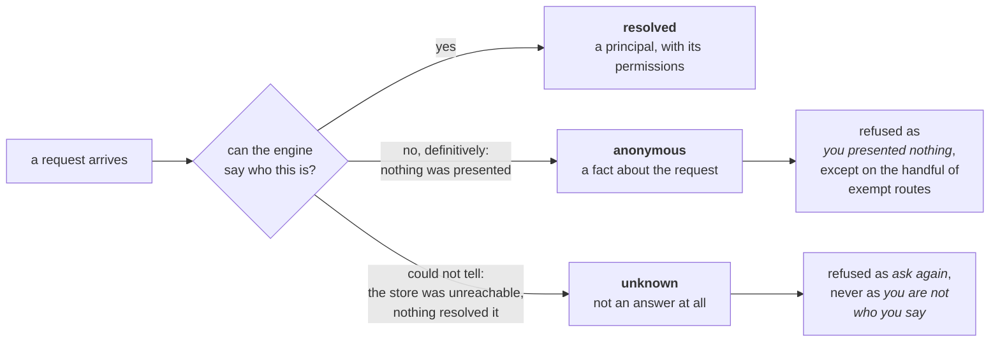
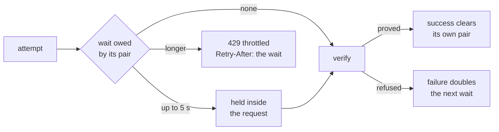

# Identity and Access

Every row this engine keeps — a work item's comment, a page revision, an audit
event — records **who did it**. Every route, query and tool it serves decides
**whether you may**. This page is the vocabulary both of those use: what a
*principal* is, which *permissions* exist — `admin`, and one per app — what
each one opens and what everybody sees without one, and — the part that
matters when something goes wrong — the difference between the engine knowing
you are nobody and the engine not being able to tell.

> The vocabulary lives in `internal/iam`. It is a deliberately small package:
> it names things and classifies them, and it reads nothing, writes nothing
> and stores nothing.

---

## A principal is who is acting

A principal is one actor the engine can name. There are four kinds, and the
kind is not a label — it decides how the actor's work is attributed and what
it is allowed to be.

| Kind | Who that is | Recorded as |
|---|---|---|
| `person` | A human being — the founder at the dashboard, a teammate with a login — always on a human seat of their own | `human`, as the seat they hold |
| `seat` | An agent seat acting inside its own turn | `agent` |
| `machine` | A token with nobody behind it: CI, a pipeline, an automation | `operator` |
| `engine` | The engine itself — a duty's repair, a config apply, a retention trim | `system` |

Those four recorded values (`agent`, `human`, `operator`, `system`) are the
author kinds already stored beside every tracker commit and every page
revision, and they are what an audit filter selects on.

### A person holds a human seat, and acts as it

A person is the one kind that is always somebody in the org chart. **Every
person holds exactly one human seat**, from the record that creates them to the
record that removes them, and their work lands under **that seat's handle**,
with author kind `human`; every authority rule that asks "do you lead this" is
asked about that seat. A person never joins without one: they are invited onto
a vacant human seat or created on it, from the seat itself in **Company › Org
chart**, or with `-seat` on the command line (see [A person arrives on their
seat](#a-person-arrives-on-their-seat-invited-or-created)). Their seat can be
**moved** to another vacant human seat, and is never cleared:

```
crewlet iam bind <person-id> backend-lead
```

A suspended or retired person keeps their seat. To free it for somebody else,
move them or remove them — the removal's tombstone keeps who held it. That is
[ADR-0032](../../adr/0032-every-person-holds-a-human-seat.md).

The binding is a directory row, not a line of the company document — see [The
binding has two ends](#the-binding-has-two-ends-and-only-one-of-them-arbitrates).
A person signed in with a session acts as the seat their row holds. A **Tier A
token** acts under the login `token:<id>`, and it acts as a seat the same way:
when the directory holds a row under that login bound to a human seat, which
`crewlet iam create -kind machine -login token:<id> -seat <handle> -grants
none` enrols and binds in one record — the row carries no permission of its
own, since the token's are its Tier A entry's. A service account is bound the same way, at its create or
later with `crewlet iam bind`.

**A token or a service account bound to no seat acts as the credential**, under
its own login, with author kind `operator`. That is ordinary — a pipeline, an
automation, the deployment's own break-glass token each act as themselves and
are never refused for it. A *person* never acts that way: they hold a human
seat for as long as they are here. What you cannot do, in either
direction, is *choose* a seat to act as: a tracker whose author field is picked
by the writer is not an audit trail.

A token's binding is held to the org chart **exactly as a session's is**: only
an active machine row under its login binds it, and the seat it names goes
through the same lookup a signed-in person's does — resolved against the
company this node runs, refused `403 seat_unavailable` naming the seat once that
company does not hold it as a human seat, and `503` on a node that cannot say
(one that runs no company yet, or cannot read the directory). A token answered as the
bare credential there would author under its seat on one node and under its own
name on the next. A token nobody binds is served as itself even by a node whose
identity applier is behind, which is what keeps break-glass working.

### Names can never collide

Three kinds of name land in one author column, with nothing but the kind beside
them, so the engine keeps them apart by their **shape**:

| What | Shape | Example |
|---|---|---|
| A seat handle | one segment, lowercase letters, digits and hyphens | `backend-lead` |
| A person's login | segments joined by **dots** | `jane.doe` |
| A machine's handle | segments joined by a **colon** | `ci:release` |

A seat handle can carry neither a dot nor a colon, and the other two each
require a different one — so no login can be read as a seat, no machine handle
as a login, and an audit feed filtered on a name matches everything that name
did and nothing else. A login without a dot, or a machine handle without a
colon, is refused when it is written rather than discovered later.

**All three stop at 64 characters.** A login sits in the same author column a
seat handle does, beside every change an operator reads, so it takes the
handle's bound. A Tier A token id therefore stops at 58, since it
acts under `token:<id>`; and an address whose proposed login would run past the
bound proposes none, leaving the person to type one rather than handing them a
name cut at an arbitrary letter.

**Two machine classes are nobody's: `pat` and `session`.** `pat:<credential
id>` is how a [machine token](#machine-tokens-a-persons-own-and-a-service-accounts)
is named in the operator column beside the owner it acts as, and
`session:<lineage>` is how a browser session is named there beside the person
signed in with it — so a service account enrolled as `pat:something` or
`session:something` would be a principal whose name reads as a credential
nobody minted. The machine grammar refuses both classes.

**Each shape belongs to its kind, and to no other.** A person's login must be
dotted and a machine's must be coloned — at enrolment, at an invitation's
redemption and at every rename. That matters most for one family of names:
`token:<id>` is the login a Tier A token acts under, so the directory row
holding it is what binds that token to a seat. A person can never hold one, so
no person can make the deployment's own credential act as their seat. The
directory enrols people and machines only; a seat belongs to the company
document and the engine is the node.

**Every principal enrols with a login** — a person as well as a machine,
although a person's address already finds them. A login is the name somebody
signs in with besides their address, the name a lead types to look a report up
(a login is resolved to its holder's record, never read as a seat), the name
the trail's reasons carry (`suspended by jane.doe`), and the name a token or
service account bound to no seat is recorded under. So every path that creates
a person ends with one, and none of them derives it silently. An invitation's
form — the first person's included — arrives with one **proposed from the
address**: `jane.doe@example.com` proposes `jane.doe`, and `jane@example.com`
proposes `jane.example`, borrowing the domain's first label because a login
without a dot is not a login; the person keeps it or changes it. An
administrator's create takes the login they type, or, left empty, the same
proposal — and the answer names the login it took (`crewlet iam create -email
jane@example.com -seat backend-lead`, or the org chart's **Create**, whose
Login field is optional). An address nothing can be proposed from is refused
naming the login, so the administrator types one. A login is never cleared
afterwards, only renamed — and a rename, a move to another seat, or both, is
**one record** that states the login and the seat the person holds from then
on, so one refused by its holder's grammar or by somebody else holding the
value changes nothing, and the old value is free the moment the new one is
taken.

---

## Access: admin and one permission per app

What a principal may do comes from two things: the **permissions** it carries,
and its **relations** in the org chart — the seat it holds, the team it leads,
the work it wrote. There are four permissions, because there are four things
a company actually decides about somebody who joins it: whether they **run**
it, and which of its three apps they **use**.

| Permission | On the dashboard | What it is |
|---|---|---|
| `admin` | **Admin** | Runs the company and the engine — its configuration, its credentials, its people, its deployment and its company-wide trail. **It includes every app**, and it is host access ([below](#what-admin-runs)) |
| `worklet` | **Worklet** | Uses [Worklet](../guides/worklet.md), the engine's own work tracker: reads it and writes it |
| `doclet` | **Doclet** | Uses Doclet, the engine's own [knowledge base](knowledge-system.md): reads it and writes it |
| `artifacts` | **Artifacts** | **Authors** artifacts: creates them, publishes their versions and shapes their data. It never gates opening one: what somebody may do on an artifact is decided by its [shares](#an-artifact-is-opened-by-its-shares) |

They are stored in the `grants` field of a person's row, an invitation, a
machine token and a Tier A token entry — the field keeps its name, and the
dashboard calls the concept **Access**. `worklet`, `doclet` and `artifacts`
are the **apps**, and `iam.Apps` is the one place an app is declared: an agent
seat's own set, the dashboard's picker, the live socket's reader and the
authority table's checks all read it, so a new app is a new member there and a
new set of rows, and the build fails until both are in place.

**Admin includes every app.** One function, `iam.Expand`, reads a set as it is
compared — its own members, plus every app when it holds `admin` — and every
comparison of permissions goes through it: what a principal can do, a node's
admin posture, what a machine token carries against its owner, what a writer
may confer, an invitation's bound and a Tier A token's check. So an
administrator is never told they lack an app. Ticking **Admin** in the
dashboard's picker, or `-grants admin` on the command line, also stores every
app this build knows, so taking admin away later leaves the person their apps.

**Everything else is everybody's.** Somebody holding no permission at all still
sees [the overview](#everybodys-overview) and manages their own account; what
a permission adds is an app to use or a company to run. What a **lead** may do
in their own team, an **author** to their own work and a **person** to their
own record are relations the [authority
table](#the-authority-table-one-function-decides) asks the chart about, and so
is a **share** of one artifact; on an app's verb each is asked *beside* the
app. That is
[ADR-0033](../../adr/0033-access-is-admin-and-one-permission-per-app.md).

It replaced eleven grants — a read and a write for each surface, plus a
deployment operator, a manager of people and a sandbox run — that nobody
inviting a teammate could tell apart, and that left somebody handed none of
the right ones on a "no access yet" panel with no step they could take,
because reading the company was itself a grant.

**`api.auth.admin` says whether this node serves admin.** A person's
permissions live in the replicated store, written by an administrator; Tier A,
the tier that holds the keyring, states per node whether admin counts here at
all:

| `api.auth.admin` | What a principal composed on this node carries |
|---|---|
| `serve` | What its row holds, with every app an admin holds |
| `refuse` | The same, **minus `admin`** — and every app kept, because the apps are expanded before admin is clamped away. A node published to the people who use the company, where nobody should be able to run it however their row reads |

It is required once the node serves the API — a zero is refused at
`api.auth.admin`, naming both values — and a posture the request path somehow
reached without (a wiring mistake) confers nothing at all rather than guessing.
It is applied at **decision time, per node, per request**, and nothing is
written when it changes: a restart with `refuse` takes admin off that node on
its next request, with no apply and no migration. A fleet whose nodes disagree
is therefore a *legal* state — a rolling restart **is** that state for as long
as it runs — and an invisible one would be a problem: an administrator who can
revoke a credential on one request and cannot on the next, with nothing saying
why. So each node publishes its posture on its presence lease, and `GET
/query/fleet` shows it as `admin` per node — two different values there is the
disagreement said out loud. It is **absent** on a node that binds no API: a
worker has no posture, and a blank must not read as one.

### Everybody's overview

Every principal the request guard resolves and whose
[stage](#stages-whether-a-principal-may-act-at-all) may act — a person, a
service account, a machine token, a Tier A token — reads the company's
**overview**, with no permission at all:

- **the org chart**, with each human seat's holder shown by name and seat —
  their login only to an administrator and to the person themselves
  (`GET /iam/seats`);
- **the agents' status** — who is working, on which phase, for how long and at
  what spend — and each seat's page, its status side;
- **coding runs' status**;
- **spend**, the token rollups and series, and **budgets**;
- **schedules** and their runs, the **tools** list and the node's **health**;
- who to ask: `lookup_colleague` and the person-facing colleague question —
  the latter masking a seat's external contact ids for anybody but an
  administrator;
- `viewer` — who they are, what they carry, which actions are theirs — and
  the live socket, which admits every resolved principal.

**The overview carries status, never transcripts.** An agent's and a coding
run's surfaces split into a **status** half and a **body** half, declared once
per surface and held by a walk that fails the build on a field nobody
classified. The body is what a turn *said*: its prompts and prompt messages,
its responses, its tool calls and their arguments, its round narration, its
`llm_history` payloads, the text that triggered a live call, and a coding run's
task, question, reply and bridged calls. It goes to **an administrator**, to
**whoever leads that seat** — `audit.seat.read`, the same rule that decides
who reads a seat's diary — and, for a coding run's question, to **the person
it is put to**. Everybody else receives the status alone, with
`body_withheld: true` and the body's version counters at zero, so a screen
says "not shown to you" and never asks again for what it will not be sent.

**Their own account** is everybody's too: their own row, their own
credentials, their own sessions — the self arms of the directory, which no
permission is needed to take ([Your own account](#your-own-account-is-account)).

**An answer that crosses apps is filtered row by row**, through one helper
(`authz.Shows`) that asks which app a row belongs to: a work row needs
`worklet`, a page row `doclet`, and anything else nothing. So the Home
feed carries only the rows its reader may see — an explicit `kinds=` entry
they may not see is dropped rather than refused, since a refusal would confirm
what exists; the decisions list carries a work item's ask only to a `worklet`
holder or to the person it names; Spend's task tiles and an agent's current
task need `worklet`; a page's `linked_from` tasks need `worklet`; and a
question answered from the company's knowledge searches the pages only for a
`doclet` holder and the board only for a `worklet` holder.

**An artifact row is never shown by its kind.** An artifact belongs to no app,
and "no app" in that filter means everybody's, so artifact rows go through a
second helper, `authz.Visible`, which reads each row: it is shown to its owner,
to whoever it is shared with and to the lead of the agent that owns it. An
administrator is shown it the same way. Opening a private artifact through the
admin path is possible, and recorded (see [An artifact is opened by its
shares](#an-artifact-is-opened-by-its-shares)), but no listing, feed or search
hands an administrator private titles by that override.

### What each app opens

| App | What it opens |
|---|---|
| `worklet` | Every Worklet read and write: the board, a project, its files, its views and reading the workspace catalogue (writing it is admin's); filing, updating, commenting, merging and placing work; and every `work_*` question. A person's own **Inbox**, **My work** and person view, and the same for a report as their lead (or anybody, as an administrator). The `inbox_changed` push |
| `doclet` | Reading, listing and searching the company's pages (`get_page`, `list_pages`, `search_knowledge`, and the `pages`, `page`, `containers`, `page_activity`, `page_revision` and `page_reads` questions); writing, saving and commenting on them (`write_page`, `save_page`, `comment_on_page`) |
| `artifacts` | Authoring artifacts, beside the role each asks: creating one (`create_artifact`), and on an artifact somebody holds editor on, publishing a version (`publish_artifact`), renaming it (`update_artifact`), adding an asset (`upload_artifact_asset`), changing its datastore's schema (`set_artifact_schema`) and filing it in a folder (`move_artifact`, beside contributor on the folder); creating a folder inside one they may file in (`create_artifact_folder`); trashing and restoring one they own (`artifacts.trash`, `artifacts.restore`). **Nothing else**: opening an artifact, reading and writing its data, being present on it, sharing it and exporting it ask only the role |

**A relation asks the app beside it.** Leading a project, being the owner of an
inbox, having written a comment, owning a saved view: each is a relation, and
on an app's verb it admits only a caller who also uses the app. A project lead
who does not use Worklet does not set its policy there, and a comment's
author who no longer uses Doclet does not edit it there. A
refusal names exactly what would change the answer: `[worklet]` to a lead
missing the app, `[admin]` to somebody missing the relation.

Three narrow rules sit beside the apps, each the owner's own decision:

- **You may answer what you were asked, without Worklet.** When a colleague
  puts a structured ask on a work item to you, you may read that item and post
  your answer to it — the comment or choice that answers that ask — whether or
  not you hold `worklet`. It is a self arm on the read and on the answer, and
  nothing wider: the tool reads the item, finds the open ask that names you
  (`worklet.AskedOn`), and admits only the answer, which Worklet's writer
  checks again is yours; a plain comment, a new ask and a decision are still
  Worklet's. A missing item and one you were not asked on are one
  refusal, so the arm says nothing about which items exist, and once you have
  answered the item is Worklet's again. The dashboard opens a work item's
  own page (`#/worklet/{KEY}-{n}`) to somebody it was put to for exactly this.
- **Authors tidy their own work.** Whoever created a page may rename, trash
  and restore it, and whoever reported a work item may remove and restore it —
  beside the container's lead and an administrator, and with the app. An
  author tidies only their own item: removing or restoring the items beneath
  it stays the project lead's or an administrator's, and a **purge**, which
  nothing undoes, stays an administrator's, asks for a [recent
  proof](#some-gestures-ask-how-recently-you-proved-who-you-are) and is never
  an agent's.
- **A page lives in a declared space.** Creating a page under a container key
  the company does not declare is refused, naming the key and how a space is
  declared — a unit's or a seat's `space:`, `knowledge.root_space`, or the
  tool-skills container — for a person and an agent alike, exactly as filing a
  task in a project the company does not declare is. See [Who may write
  where](knowledge-system.md#who-may-write-where).

### An artifact is opened by its shares

Every other object is decided per **app**: whoever holds `worklet` reads every
task. An artifact is decided per **object**, because it is somebody's own work
handed to the people it names. What a principal may do on one is their
**role** on it, a ladder where each role includes every role below it:

| Role | On the dashboard | What it adds |
|---|---|---|
| `viewer` | Can view | Opens the artifact, its versions and its history, and is present on it |
| `commenter` | Can comment | Comments |
| `contributor` | Can edit | Writes data where a collection's rules admit it; never the page itself |
| `editor` | Can manage | Publishes versions, renames it, adds assets, changes the schema and exports the whole data, beside the `artifacts` app where the verb authors |
| `owner` | Owner | Shares and unshares it, trashes and restores it, and hands it to another seat. Held by its owner, and never shared: ownership moves only by transfer |

A principal's role is the **best** of their relations to it:

- **owning it**, by the seat they hold (or, for a service account bound to no
  seat, its login), which holds every role;
- a share naming **their seat**, which follows the seat as an inbox does, so a
  successor on the seat inherits it;
- a share with **a unit they sit in**, or any unit above the one they sit in,
  decided live against the running org chart (a unit's lead seated outside the
  unit is not in it);
- a share with **the whole company**, which admits every principal whose stage
  may act, agents included;
- **leading the agent that owns it**, which holds owner. A lead already steers,
  pauses and reads the trail of their agents, and an agent that is paused or
  removed must not orphan its work. A person's lead holds nothing on that
  person's artifacts: a draft is theirs.

Each verb names the least role it admits, and the table decides every surface
(a tool, an HTTP route, a socket join, the artifact origin) with that one rule.
Three answers sit around it:

- **No relation at all is "not found".** Somebody holding no role is answered
  exactly as for an id nothing holds, `404 not_found` with no reason, so a
  private artifact's existence, id and title are never disclosed. That holds
  for a bar on the verb as well: a machine token asking a verb that needs
  somebody present (a transfer, a force publish), or an agent asking a
  person's verb (trash, restore, pin, transfer), is told `not_found` when it
  holds no relation, and the bar's own `403` only when the artifact is already
  disclosed to it. Somebody holding a role below the verb's is refused `403`,
  naming the role they need.
- **An administrator may open anything, and it is recorded.** Admin is host
  access, so a refusal would promise a privacy the engine cannot keep. The
  admin path admits every artifact verb, after the administrator's own shares
  are counted: an administrator a share already admits is admitted as the
  sharer they are, **at the share's role**, so what they read is shaped and
  what they write is stamped by that role and nothing beyond it reaches them
  unrecorded. An admission only the admin path made stands at owner and is
  marked as **elevated**: every read of the artifact's content it makes (a
  version's files, its datastore, the export, a room's join, the live version
  a stale publish answers with) writes an elevated-read record before anything
  is shown, which the artifact's own history shows its owner and editors and
  the company trail of every artifact (`artifact_trail`, `audit.read`) shows
  every administrator, so an override is found even when its owner has left
  or never opens the history. A read whose record cannot be written is not
  answered. On a node that
  [refuses admin](#access-admin-and-one-permission-per-app) the path does not
  exist, and an administrator there opens only what is shared with them.
- **The trash stops serving at once.** A trashed artifact keeps its head, its
  versions list and its history for the trash view, and serves no content to
  anybody: its files, its datastore and its rooms are refused until its owner
  restores it, and an agent's read tools refuse it alike.
- **A node behind its org chart says so.** A unit share or a lead the node
  cannot read is "cannot tell", `503` with a `Retry-After`, only where it could
  have changed the answer; an administrator is never told it.

**What an agent may do on somebody else's artifact.** An agent never manages
another principal's work by default: on an artifact it does not own it holds at
most `contributor`, whatever it is shared and whoever it leads, so it reads the
artifact and fills in its data and never publishes over it, renames it,
reshapes it or reshares it. The company document's
`artifacts.agents_manage_others: true` lifts that cap. An agent never trashes,
restores, purges, transfers or force-publishes anything: those verbs are a
person's.

**Who the agent is acting for.** Inside a turn somebody woke, every artifact
verb an agent takes is decided a second time for that requester, on the same
artifact, and admitted only when both may take it: an agent never shows a
requester an artifact the requester could not open, nor writes into one on
their behalf what they could not write. The one exception is the agent's
**edits to its own work** (publishing a fix, renaming it, adding an asset,
reshaping or filling in its data, and creating a new one): anybody who can
message an agent may have it change work it owns, as with every other piece of
work an agent owns. Reading its own artifact back, and sharing it, are never
exempt, and neither is what such an edit hands back: the live files a stale
publish answers with, and a conflicting data write's current rows, are shown
only where the requester could read them. A turn woken by somebody the company does not know reaches only those
edits; a turn nobody woke (a schedule, a watch) is bounded by the agent alone.

The decision is
[ADR-0034](https://github.com/crewlet/crewlet/blob/main/adr/0034-an-artifact-is-shared-and-a-share-is-a-relation.md),
and [Artifacts](artifacts.md) describes the model the roles act on.

### What admin runs

`admin` covers every gesture that changes what the company *is* or reads what
everybody did:

- **the company document** — reading and writing `/config`, the org chart
  beyond a lead's own subtree, integrations and their setup, models, MCP
  servers, settings and budgets, and the project and space keys a unit or seat
  declares, which are keyed fields of it;
- **the workspace catalogue** — task types and custom fields — and the
  **tool-skill pages**, which are injected into every seat's turn;
- **the credential store** — listing, writing and revealing a secret;
- **people** — reading anybody else's directory row, every directory write
  (inviting, creating, changing what somebody carries, moving, suspending,
  removing, resetting a second factor or a password), and ending every
  session in the company;
- **the deployment** — backups, retention, the fleet's controls and the
  broker's membership;
- **the company-wide trail** — every event, turn and phase, every
  agent-to-agent channel, the `event` push and `/iam/audit`;
- **the purges**, and the **admin path** of every relation rule: an
  administrator reaches a departed person's inbox, any project's policy and
  anybody's saved view.

**A lead reads their own agents' trail.** One seat's diary, episodes, threads,
memory overview, turns, phases and live bodies are its **lead's** to read as
well as an administrator's — a lead steers, pauses and answers for their
agents, and could do none of it well without reading what those agents did.
It is `audit.seat.read`, decided per seat, and it is limited to questions
about **one seat** (a seat page's own turns and phases, its memory, a coding
run that seat launched). The company-wide trail stays admin's.

**Admin is host access: running code on every engine host**, and that is what
it confers rather than a side effect of it. It is one permission by decision,
and the configuration it writes runs code — a stdio `mcp_servers` entry is a
`command` the engine starts as its own user on every node that runs seats; a
seat's per-phase model keys (`llm_*`) name `providers.llm` entries, each a
coding CLI the engine runs, and a `sandbox` cell of `run_in: self` does its code work inside
it; a `run_in: direct` sandbox cell runs a coding agent, and every setup step,
as that user; a seat's `mcp_env` decides which credentials its children are
handed; and a seat's worker grants decide which of its tools a worker holds.
So a holder can run anything on every engine host and read whatever the
engine's user can: the Tier A file, the keyring every session cookie is signed
under, and every credential the store holds. A separate "runtime" permission
would be this one's whole reach under a second name. Hand it out as you would a
shell on those hosts. A machine token may carry it — applying a configuration
from a deploy job is what a token is for — so minting a token with it is
handing that job host access; what keeps such a token off the gestures that
need a person present is [two locks](#some-gestures-ask-how-recently-you-proved-who-you-are),
not a permission it cannot carry. Every write that can start a process — the
company document, connecting an integration — asks for a [recent
step-up](#some-gestures-ask-how-recently-you-proved-who-you-are), which is what
keeps a stolen week-old cookie from reaching it, and every child the engine
starts is handed an [allowlisted
environment](../guides/tools-and-mcp.md#what-a-stdio-servers-environment-is)
rather than the engine's own — which stops the engine *handing* its secrets to
a tool server, and does nothing about an administrator, who chose that server.

**A lead reaches part of it without admin.** The org chart is written by its
leads as well ([A lead edits their own team](#a-lead-edits-their-own-team)),
and a lead may change every field of a seat in their team but a credential and
a keyed field — its model chain and its sandbox among them. What they choose
from is what the settings declare, which stay admin's: every `providers.llm`
entry is a coding CLI that runs on the engine host, and so is a sandbox cell
there, so a lead can give either to their own seats, and through them run code
there. Declare those
only where every lead may use them.

**Connecting an integration is admin's and nothing more.** `/setup` performs
no write of its own — a credential goes through the store `/secrets` serves,
and the `${VAR}` pointer through the merge and compare-and-set `/config`
performs — so connecting a vendor is the same permission as both.

### Agents hold every app, and never admin

An agent seat acting in its own turn holds exactly the apps — `iam.Apps`,
derived, so a seat can never hold `admin` — and its **role** decides which
tools it is offered. Two verbs belong to agents alone, marked **seat-only** on
their rows: `a2a_ask`, which spends a colleague seat's turn, and
`run_sandbox`, which hands a box the seat's whole tool surface. No person and
no token takes either, whatever they hold, because a person has no turn for a
colleague's answer to land in and no executor for a run to resume; which seats
may is the role registry's decision, which already says which seat runs which
tool. Seat-only is the mirror of the **human-only** mark, and both are checked
before anything else on the row ([The sixteen rules](#the-sixteen-rules)). On
an artifact, an agent holds what its relations grant, capped at `contributor`
on work it does not own, and inside a turn somebody woke it is bounded by that
person too ([An artifact is opened by its
shares](#an-artifact-is-opened-by-its-shares)).

### Nobody confers what they do not hold

A caller may not confer a permission they do not hold — on anybody, themselves
included — judged through `iam.Expand`, so an administrator may confer every
app. That rule lives at the **record** rather than at the route, because a
record can be published by a CLI, a duty and a migration, none of which passes
through one. Taking a permission *away* is always allowed: nobody escalates by
narrowing.

It holds on every record that hands a permission out: an edit of somebody's
row, **an enrolment** — which is a change from nothing to what it carries —
and **an invitation**, whose permissions are decided once, by whoever issues
it. Both an administrator's create and an invitation must **state** what they
confer: `grants` is required on `POST /iam/people` and `POST
/iam/invitations`, an omitted field is `400` naming it, and `[]` is a value —
the overview alone. One enrolment is not the writer's to authorise, because
the node's own writer performs it; it names the authority it rests on instead,
and the record checks it in the same snapshot the permissions land from:

| Enrolment | Its authority | What the record refuses |
|---|---|---|
| Created by an administrator (`POST /iam/people`) | The administrator's own permissions | Any permission they do not hold, before anything is published; and for a person, no seat, or a seat that is not a vacant human seat |
| Redeeming an invitation — the company's first person's included | The invitation, as its issuer wrote it, and the secret its link carries | A secret that is not the link's, a permission the invitation did not carry, an address it was not issued to, a seat other than the one it binds — or that one, once it is removed, an agent's or held by somebody else — an invitation that names no seat, and a link already spent or aged out |

An enrolment is **one record** on the directory — the person, their address,
their login, the seat (always, for a person; when it binds one, for a service
account) and, for a redemption, the spent link or, for a person's create, their
first password link — and the authority in that table is checked in that
record's own snapshot, against every row: so a refusal leaves nothing behind,
and a half-finished enrolment is not a state the estate can be in.

**An administrator's create is derived, and never rewrites somebody who
exists.** Its person comes from the operation's key — the one an `unknown`
answer hands back to retry under — so the retry names the person its first
attempt created and is answered from the ledger. The key sent with another
body is another operation, which meets the person the first created and is
refused as a reused key, so it never hands an existing person a second address
or rewrites their credentials. A redemption's person is minted per attempt:
what keeps a link single-use is the link, which the record that creates the
person spends, and a second redemption is refused in its own snapshot as a link
already used.

**An administrative record is never written through a machine token.** Every
enrolment, invitation, edit of somebody's row, suspension, removal and
company-wide invalidation is refused at the record if the request came
through a `pat:` credential, whatever that token carries — `403
token_refused` — because a token is what an attacker holding a pipeline's
environment already has, and deciding who may do anything needs a person at a
keyboard. It sits beside the authority table's own [presence
rows](#some-gestures-ask-how-recently-you-proved-who-you-are), at the record,
so a CLI, a duty or a test is held to it exactly as a route is.

Whether **anybody exists yet** is one predicate — a person or a machine that is
enrolled and not removed; a suspended person is somebody — and it is asked in
two places, both about the first person: `GET
/health`'s `identity`, and the line a node logs at boot while the answer is no.

**`POST /iam/invalidate-all` is admin's, a person's, and a recent proof's.** It
is the restore runbook's last step, and it ends every person's authority at
once — every session and every machine token — and cannot be taken back. A
Tier A token holds `admin`, is its own credential rather than a machine token
and is fresh by construction, so the runbook's CLI step still runs on the day
nobody can sign in; a machine token is refused it twice, by the row and by the
record.

### A permission this build has never heard of

During a rolling upgrade a newer node may write a permission an older one
cannot read, and a row written before a vocabulary change may still carry a
name this build no longer knows. Such a name is **kept and ignored**: it stays
in the row, it opens nothing, and the person keeps every permission this build
does know — refusing the principal would log everybody out for the length of a
deploy. A writer may **remove** an unknown name from a row and never **add**
one; a whole-set edit that restates one the row already carries adds nothing
and is allowed. Tier A is stricter, because a file an operator wrote is a typo
rather than an upgrade: an unknown name in an `api.auth.tokens` entry is
refused, naming the three.

---

## Stages: whether a principal may act at all

Before any permission is consulted, a principal has to be *enrolled*.

| Stage | May act | Means |
|---|---|---|
| `invited` | no | Created, has proved nothing yet |
| `enrolling` | no | Part-way through proving who they are. Nothing moves a person here on its own; an administrator may set it. A person who must [enrol a required second factor](#a-required-second-factor-is-enrolled-before-anything-else) first is `active`, holding a session that may only do that |
| `active` | **yes** | Enrolled |
| `suspended` | no | Enrolled and blocked, reversibly, with the record kept |
| `retired` | no | Has left; the record is kept so their audit rows still resolve to a name |

Only `active` may act, and that is an allowlist rather than a blocklist: a
stage this build does not recognise may not act either.

A person an administrator creates is `active` from the moment the create lands,
not `invited`: what they lack is a password, and the [first password
link](#a-person-created-directly-gets-their-first-password-link) the create
hands back is how they set one. Somebody invited has no row at all until they
redeem their link.

Seats and the engine are always `active` — neither enrols, and neither can be
suspended by anything but the org chart and the process.

### What a suspension reaches, and how fast

A suspension is ONE record on the identity log — `crewlet iam suspend`, or a
`PATCH /iam/people/{id}` naming the stage — and no configuration change. Every
data node applies it, whatever its other roles, and what follows is decided on
each of them from that node's own rows. A seats node that holds no data applies
no log and serves no request — only a data node serves the API — so what it
decides is the routing and what its agents are shown, and it learns of the
suspension on its next thirty-second read of the directory through a data
node:

| What | When | How |
|---|---|---|
| Signing in | refused from the apply on | the stage is read from the row, and only `active` may act |
| Every session and machine token they hold | ended, and refused at the next request, `401 session_revoked` | the record moves their revocation epoch as a `crewlet iam revoke` does, so reactivating them revives none: they sign in again and mint new tokens. Refused only while the stage stood, a reactivation brought back every session — whose browser had been told `401` and dropped its cookie, so the one copy revived was a copy somebody else kept |
| An open dashboard tab | closed `4401` as the record applies — or `1013` on a node that cannot read the record yet, whose reconnect answers that person `503` until it can | each node's identity applier says whose credentials a committed batch moved — the person, the login they hold, the session it ended — and the node decides again exactly the sockets opened with one; a move that can name nobody (the company's session generation, a record the node retains instead of applying, its identity log passing the stall grace) closes every open tab `1013` without reading anything, and each reconnect's handshake decides |
| Their seat's contact identities — the Slack member, the Jira account, the GitHub login | withdrawn within one apply on a data node, with a 30-second re-read behind it; within that 30-second re-read on a node holding no data | on a data node the identity applier signals after the commit, and the node rebuilds its party registry for the same company from a fresh read of the directory; a node without `data` has no applier to signal it, so it re-reads the directory through a data node every thirty seconds and rebuilds from that |
| What agents are shown of them — a lead's roster, `lookup_colleague` | their accounts left out from the next turn once the node's registry has moved | every turn pins the registry's reading beside its org, so the prompt and the tools leave out the same people |
| Their `inbox_changed` watch | gone with the socket | a watch needs a resolved caller |

So a message the person sends from Slack stops being attributed to their
seat — a suspended lead's DM to an agent no longer arrives as "your lead
says" — and nothing about the seat has to be edited to make that true.
Reinstating them (`crewlet iam activate`) restores all of it on the same terms
— all but their sessions and tokens, which the suspension ended. See
[Humans in the Org Chart: A suspended holder is
withdrawn](humans-in-the-org.md#a-suspended-holder-is-withdrawn-with-no-configuration-change)
for the routing rule for every stage, removal included.

**The stage sticks through every edit.** It has one writer — the status
record — and a later rename, permission change or credential change forms its
document from the stage the row holds, so no edit made while somebody is
suspended can quietly reinstate them.

**What it does not reach is the seat.** It stays in the org chart, work can still
be assigned to it, and Worklet still writes its notices. The suspended
person **keeps it** — as a retired one does — so nobody else can be invited
onto it, created on it or bound to it while they hold it, and whoever holds it
next reads what accumulated: the person themselves once reinstated, or a
successor once the person is moved to another seat or removed. Suspending a
person is neither removing their seat nor freeing it.

---

## Anonymous is not unknown

This is the distinction to remember when a request is refused.



**Anonymous** is a finding: the resolver ran, and nobody presented a
credential. It is a refusal on every guarded route — the probes, the webhook
edge, the per-run token paths and the dashboard shell are the whole of what is
served without one.

**Unknown** is the absence of a finding: the identity store could not be
reached, a session lookup failed, or nothing resolved the request at all.
Collapsing it into anonymous is the mistake this engine refuses to make
anywhere — treating "could not tell" as "definitely not" is what tears a
healthy company down over a two-second store blip, and on this surface it
would answer *invalid credential* to somebody holding a perfectly good one and
keep answering it for as long as the outage lasted, teaching everybody to go
and reset a password that was never wrong.

So: **if you are refused and the reason says the engine could not determine who
you are, check the engine's health before you check your token.** A silence —
a request nothing resolved at all — is read as unknown too, never as
anonymous: the absence of an answer is not evidence of absence.

---

## How the first person exists

A fresh deployment's identity estate is **empty**, and the one credential it
has is a **Tier A token** — `api.auth.tokens`, which configuration requires on
every node that serves the API for exactly this reason. A Tier A token is an
operator, and it carries the `grants` its own `api.auth.tokens` entry declares
— the founder's is `grants: [admin]` — read through the node's
[admin posture](#access-admin-and-one-permission-per-app) on every request
(see [Tier A](../getting-started/configuration.md#tier-a)). So the first person
arrives **like everybody after them**: onto a human seat, invited or created by
whoever holds a token declaring `admin`, on a node that serves it.

**The seat comes first.** A person holds a human seat from the moment they
exist, so the company has to declare yours before you can be put on it: a
`kind: human` seat in the `company.yaml` you import or boot with, or, on a
node that runs no company yet, the **Create the company** form under **Org chart
› Edit org**, whose **Add a seat for yourself** is ticked by default. A node that runs no company
has no seat to put anybody on, and says so rather than asking you to wait:
naming a seat there — an invitation, a create — answers `409
no_active_revision`, as `GET /iam/seats` does, with a hint to import or create
a company that declares a human seat. A company that declares none can admit
nobody until one is added (**Org chart › Edit org › Add human seat**), and
`crewlet validate` warns about one at `roles`.

Then, on the dashboard: sign in with the token (the sign-in page opens its
token form while `/health` says nobody has joined), open **Company › Org
chart**, and open your seat — it is drawn **Open seat**, and its card's menu, its
peek and its page each offer the same two gestures:

- **Invite** — your address and your access: tick **Admin**, which ticks and
  locks every app beside it. The link is shown once; you open
  it, choose a login (one is proposed from the address) and a password, and
  redeem it exactly as [the next section](#a-person-arrives-on-their-seat-invited-or-created)
  describes, which signs you in.
- **Add person** — your address, optionally your name and login, and your
  access — tick **Admin** here too. You are created active on the seat at
  once, and handed a **first
  password link**, shown once, that sets your password and signs nobody in:
  you sign in afterwards with the login or the address.

**Settings › People** says the same while nobody has joined, and
links to the org chart — or, in a company with no human seat, to adding one.
Or from a shell:

```sh
export CREWLET_API_TOKEN=...   # the value of one of api.auth.tokens
crewlet iam seats -unheld      # the human seats nobody holds
crewlet iam invite founder@example.com -seat founder -grants admin
```

— `-grants admin` stores `admin` and every app beside it — or `crewlet iam
create -email founder@example.com -seat founder -grants admin`,
which prints the first password link instead. Nothing about the first person
is special:

- **An invitation or a create confers only what its writer holds**, and a Tier
  A token holds its own declared `grants`, read through the node's admin
  posture — so the token that puts the first person on their seat must itself
  list `admin` (the quickstart's founder token is `grants: [admin]`), on a node
  whose `api.auth.admin` is `serve`. A permission the token does not hold is
  refused `403`, naming the permission that would have admitted it; add it to
  the token's entry and restart, as [Tier
  A](../getting-started/configuration.md#tier-a) states. Give the first person
  `admin`, or nobody after them can be invited or created except through the
  token again; `crewlet iam check` names a company in that state as
  `no_admin_holder` — counting only an **active person** who holds `admin`,
  never a service account, because no machine token may write an
  administrative identity record.
- **The node says the company is waiting for it.** `GET /health` answers
  `identity: unclaimed` while no person is enrolled (`ready` once one is — a
  person created directly counts the moment the create lands, before their
  first password link is spent; a service account alone does not count, since
  it signs nobody in with a password; and `unknown` where this node cannot
  read the estate, never folded into `unclaimed`), and a node that boots with
  no person in its estate logs `iam_unclaimed` saying what comes next: a
  company where it runs none, a human seat where its company declares none,
  the link of an invitation already open, or an invitation onto one of the
  VACANT seats it names — never a seat a service account holds or an open
  invitation names, which refuse one — and, where every seat is held, what
  holds each and how to free one. Where the seats cannot be read it names
  none and points at `crewlet iam seats -unheld`. Neither ever moves
  `status`.
- **After that, the token is the way back in, not the way people arrive.** Once
  somebody holds `admin`, people are invited and created by them; the
  token stays the break-glass credential for the day nobody who can do that is
  reachable.

There used to be a second way — a one-time code a node minted onto its own
disk when it found an empty estate — and it is gone. It bought a first person
who needed no configured token, on a deployment where configuration requires
one anyway, and it cost a code file on every node, a log subject that
arbitrated between two people redeeming two codes at once, and a superuser
claim sitting on disk until somebody enrolled. The token is already the root
of trust, and putting somebody on their seat — an invitation or a create — is
already the path everybody else takes.
`api.auth.bootstrap`, which configured it, is gone, and a file still carrying
it is refused, with a message saying it was removed and that the first person
is invited with an `api.auth.tokens` token instead.

## A person arrives on their seat: invited, or created

A person comes to exist in one of two ways, and **both start from a vacant
human seat** — one no person holds and no open invitation names. The seat is
part of the gesture rather than a step after it: every person holds one from
the moment they exist
([ADR-0032](../../adr/0032-every-person-holds-a-human-seat.md)),
so neither way can be taken without naming it, and a person's seat is
afterwards moved, never cleared.

| | Invite | Create |
|---|---|---|
| Who chooses the login | the person, from a proposal | the administrator, or the same proposal |
| Who chooses the password | the person, while redeeming | the person, through their first password link |
| When the person exists | when the link is redeemed — until then the invitation holds the address and the seat | the moment the create lands, `active` |
| Shown once, to whoever did it | the invitation link | the first password link |
| Good for | one week | one week |
| On the dashboard | **Invite** on the seat | **Add person** on the seat |
| From a shell | `crewlet iam invite EMAIL -seat SEAT` | `crewlet iam create -email EMAIL -seat SEAT` |
| Over HTTP | `POST /iam/invitations` | `POST /iam/people` |

Both are directory writes, so both take `admin` and a [recent
proof](#some-gestures-ask-how-recently-you-proved-who-you-are) from a person
present, and both confer only what their writer holds. Both **state** what
they confer — `grants` is required, `[]` meaning the overview alone, and the
dashboard's dialogs and the CLI each state a default out loud before they send
([Nobody confers what they do not hold](#nobody-confers-what-they-do-not-hold)).
Both name a **human**
seat of the company the node runs: a handle the company does not hold, or an
agent's seat, is `400`; a seat somebody holds is `409` naming them; a seat an
open invitation holds is `409` naming the invitation, with `DELETE
/iam/invitations/<id>` as the way to free it; and a node that runs no company
yet answers `409 no_active_revision`. Leaving the seat out is `400
seat_required`, refused before anything is minted.

**On the dashboard both live on the seat.** In **Company › Org chart**, a human
seat's card says who holds it, by name, to everybody — the org chart is
[everybody's overview](#everybodys-overview) — or that it is **Open seat**; an
administrator also sees the holder's login and an open invitation (**Invited
·** an address), which `GET /iam/seats` sends nobody else. For an
administrator the card's menu offers **Invite someone…** and
**Add a person…** on a vacant seat and **Cancel invitation**
on an invited one, and the seat's peek and its page offer the same as
**Invite**, **Add person** and **Cancel invitation**. A seat a service
account or a token holds offers none of them. The dialog's seat is the one it
was opened from — neither offers a choice — and its link is shown once.
**Settings › People** lists, changes, suspends and removes people, and sends
you to the org chart to invite or create one; **Settings › Service accounts**
lists and creates the machine principals.

### An invitation names its seat, and holds it

An invitation is a **claim on an address and a human seat by somebody who does
not have a person yet**, so it arbitrates where both do — which is what makes
an invite and a create for one address, or for one seat, contend, and what
makes two nodes redeeming one link contend with each other. **The seat is
required**, and **while the invitation is open it holds the seat as it holds
the address**: a create on that seat, a bind to it and a second invitation
naming it are each refused naming the invitation, and a company write that
would remove the seat or make it an agent's is refused `409 seat_held` naming
the invitation (never its address). That is what stops the person the link was
sent to being told, at the last step, that somebody took their seat in the
meantime. Cancelling the invitation, its redemption and its lapse each free the
seat.

What redeeming confers is decided **once, by whoever issued it**, rather than
again by whoever happens to process the redemption. A redemption is therefore
not a way to ask for more than was offered: issuing one is held to the issuer's
own permissions, and the redemption names the invitation as its authority, so the
record refuses anything the invitation does not cover — and a link that was
spent or aged out between opening the form and posting it answers
`410 invite_spent`, the same as one that was already spent.

**The link is an id and a secret, and it opens the dashboard.** An invitation
link reads

```text
https://crewlet.example.com/dashboard#/invite/<id>.<secret>
```

— the dashboard's invitation screen, built from `api.external_url`, with the
credential after the `#`. A browser never sends a URL's fragment to any server,
so neither half reaches a proxy's access log on the way to the page. The screen
then asks `/auth/invite/{id}` itself, with the id in the path and the secret
**beside** it and never in a URL: in the `X-Crewlet-Invite-Secret` header to
render and in the JSON body to redeem. The id alone opens nothing — it is the row's key, in every
snapshot, backup and access log — and what the estate keeps of the secret is
its SHA-256. A missing or wrong secret is answered exactly as an id nobody
issued is: the same `410`, counted against the caller's source, because told
apart it would say which ids exist.

**The GET renders and never spends.** A link is followed by things that are not
the person it was sent to: a mail client prefetching, a security scanner opening
every URL in a message, a chat app building a preview card. Every one of those
is a GET, and an invitation spent by one is an account created for somebody who
never saw it — or, far more often, a person told their link was already used by
whoever scanned their mailbox. So the GET answers what the form needs to render
and changes nothing; the POST is the person, having typed a password.

**Redeeming binds the seat, in the record that creates the person.** The
invitation records the seat's handle, and the redemption binds the person to
it in the same record that creates them, so there is no instant at which they
exist without it. The seat is asked again there. One that was removed or made
an agent's since the issue — only a company write racing the issue, or one
that could not ask the directory at all, such as an offline `crewlet config
import`, leaves that — is refused as the link's own refusal: `410`, ask
whoever sent it for a new one. One somebody
holds since — only a retained record or a restore leaves that, since the
invitation held it — is `409`, saying the seat is taken and naming nobody.
Either way nothing is written. The invitation screen
says which seat the link is for — `seat` on `GET /auth/invite/{id}`, which
carries no handle where the company no longer holds it as a human seat — so
the person is told before they type a password, not after.

What the form needs includes **a login to propose**. Every person enrols with
one, and somebody following a link has typed nothing yet, so the GET answers
`login` derived from the address in the person grammar. The POST carries
whatever login the person settled on — the proposal or their own — and an
absent one is refused `400`, as a login somebody else holds is refused `409`
without saying who.

**A redemption can be retried until it lands.** It is one record, so an attempt
the directory refuses — a login somebody already holds — writes nothing, and
the person simply chooses another. What keeps the link single-use is the link:
a redeemed or expired invitation is refused before anything is written, the
record that creates the person spends it, and one whose address somebody is
already enrolled under is refused in that record's own snapshot.

Absent, redeemed, expired and a secret that is not the link's are **one
refusal**, because the remedy is the same and telling them apart would say
"this was already used" to somebody whose link merely aged out, and send them
looking for who used it.

**The link is shown once and nothing can read it back.** What the estate holds
is the invitation's id and the SHA-256 of the secret its link carries — the
record that issued it carries the same hash and never the secret, and the
redemption's own record checks the secret against it again where the
permissions land. An invitation an administrator lost is re-issued with one more call
rather than recovered; the one answer that carries a link again is a **retry of
the issue itself** under the same key, because the id is derived from the key
and the secret from the id, both under the company's own key. And the address it
was for is sealed under the fleet keyring and bound to the invitation, so an
address somebody typed and never sent leaves no cleartext anywhere — and the
sweep that collects the invitation takes the sealed copy with it.

An invitation with no verifier is **redeemable by nobody**: admitting it on its
id would admit exactly what the secret closes.

**The engine never sends mail.** `crewlet iam invite` and `POST
/iam/invitations` hand the inviter the URL; getting it to the person is
theirs. A person whose seat carries a contact identity can also be sent it
over the chat surface the company already runs; somebody who will work only
through the dashboard has none, and the link reaches them however the inviter
chooses.

**It stays redeemable for one week.** That is the security horizon rather than
a convenience: the link is a bearer credential sitting in somebody's mailbox,
so the window is how long a compromised mailbox yields an account. A week
survives somebody being away without making the link a standing way in. A
created person's first password link gets the same week, because it is the
same person's position.

**An invitation is listed and withdrawn, never read back.** `GET
/iam/invitations` (`crewlet iam invitations`) lists the invitations nobody has
redeemed and that are still good — `?all=true` (`-all`) adds the redeemed and
the expired, each with its `state` — and every row says for whom (the address,
opened on the listing node's own keyring), which seat it holds, what it
confers, who issued it and until when. It is read like the directory, by an
administrator, and no row carries the link,
its secret or what the estate keeps of it: the link is shown once, and an
inviter who lost it cancels and issues another. `DELETE /iam/invitations/{id}`
(`crewlet iam cancel-invite`) withdraws one nobody has redeemed, and takes
`admin` like every directory write. It is one directory record, and
its apply deletes the invitation's row, so the link answers exactly as one
nobody issued, and the address and the seat it held are free at once — for a
new invitation, or a person created or moved onto the seat. A
redeemed invitation is refused `409 stale` naming the person it created: what
to undo then is that person, and that is a removal. Each cancellation is an
`iam_invitation_cancelled` event, naming the invitation by its id and never
the address. On the dashboard, an open invitation is cancelled from its seat in
the org chart — **Cancel invitation** — or from the Invitations list in
Settings › People.

### A person created directly gets their first password link

An administrator's create — `POST /iam/people`, `crewlet iam create -email …
-seat …`, or **Add person** on the seat — **is** the enrolment: the person
is `active` on their seat from the moment it lands, under the login the
administrator typed or the one proposed from their address, and the answer
names which; it lands nothing but `active`, and a different stage is a stage
change afterwards. What they lack is a password, and the administrator
never chooses one for them: the same record carries their **first password
link**,

```text
https://crewlet.example.com/dashboard#/reset/<id>.<secret>
```

— a `reset` credential like the [reset link an administrator
issues](#a-forgotten-password-is-a-one-time-link-from-an-administrator), spent
through the same screen and the same route, so everything said there about
opening one, spending one and its one `410 reset_spent` holds for it. Spending
it sets the person's first password and **signs nobody in**: they sign in
afterwards with their login or their address, and a required second factor is
enrolled then, as for anybody. The screen knows which it is (`first` on `GET
/auth/reset/{id}`) and asks them to choose a password rather than replace one.
Until it is spent nobody can sign in as them.

- **It is shown once**, to whoever created the person — in the dialog, under
  **Password link**, and printed once by the CLI — and the engine never sends
  it. So a create needs `api.external_url`, and a node with none refuses a
  person's create naming the setting. Whoever is shown it could spend it
  themselves, which is why a create, like an invitation, confers only
  permissions its writer holds.
- **Its retry hands back the same link.** The person is derived from the
  create's operation key and the link from the person, under the company's
  own key, so the retry an unknown answer asks for — the same request under the
  same `Idempotency-Key`, or `crewlet iam create -idempotency-key <op>` — answers
  the link the first attempt issued, with the expiry it stored. A retry that
  finds the link no longer opens — spent, revoked, ended or aged out — answers
  without one and says so; the remedy then is a reset link.
- **It is good for one week**, an invitation's horizon, because it is the same
  person's position: somebody who does not work here yet, sent a link before
  their first day.
- **It ends as every reset link ends**: an edit that gives the person a
  permission revokes it, and suspending them, signing them out everywhere, resetting
  their second factor and `crewlet iam invalidate-all` end it. One that lapses
  or is ended unspent leaves an active person with no way in, which `crewlet
  iam check` reports as `person_without_credential`; the remedy is a password
  reset link, `crewlet iam reset-password`, or removing them.
- **It is on the trail without its secret**: issuing it is an
  `iam_password_reset_issued` event and spending it an `iam_password_reset`
  one, each marked `first`.

A service account gets no link — it has no password and no sign-in page — and
proves itself only with a [machine
token](#machine-tokens-a-persons-own-and-a-service-accounts) minted on it. Its
seat is optional, and a human seat when it is given.

## The binding has two ends, and only one of them arbitrates

Every person is bound to a human seat, and a service account or a Tier A
token's row may be; the two facts live in two places: the directory holds
`seat_id` on the principal's row (and on an open invitation's), and the company
document holds the seat. The directory is a log with its own applier and arbitration; the
document is a revision the control plane activates — so neither can refuse a
write the other is making.

What that means in practice:

- **A binding names the seat by its handle**, which is immutable
  ([ADR-0013](https://github.com/crewlet/crewlet/blob/main/adr/0013-a-seats-identity-is-derived.md)).
  The bind checks the handle against the company this node runs — it must
  be a **human** seat there, for a person and a service account alike, since
  whoever is bound to an agent's seat is refused on every request — and every
  reader turns it back into a seat the same way: the request path, the
  dangling-binding check, contact routing. An unknown handle or an agent's
  seat is `400`, and a node that runs no company yet answers `409
  no_active_revision`. The check against the running company is
  **advisory**: a revision applied elsewhere first is one this node has not
  seen.
- **The bind arbitrates.** Every binding is decided on the directory's one
  subject, against every row in one snapshot, so two principals cannot be
  bound to one seat, and nobody can be bound to a seat an **open invitation**
  holds: two binds contend at the broker, and the second is decided again and
  refused naming the first — or the invitation, which is cancelled with
  `DELETE /iam/invitations/<id>` to free it.
- **The seat's removal does not.** A configuration write that removes a human
  seat, or makes it an agent's, reads the directory first and is refused
  `409 seat_held` naming whoever holds it — at any stage short of their
  removal — or the open invitation that holds it, by its id and never its
  address. But a bind or an invitation landing at the same instant passes its
  own decide too, and an offline `crewlet config import` or `activate` has no
  directory to ask. Both can land.

The residue is somebody bound to a seat the running company does not hold as a
human seat. Nothing clears it but a record: a person is moved to another
vacant human seat (`crewlet iam bind`) or removed, since a person's seat is
never cleared; a service account is unbound (`crewlet iam unbind`) or moved. It
is a **named legal state**, not corruption, and it is the honest price of two
writers: arbitration across them would serialise every configuration change
against every sign-in.

What decides a binding is dangling is the [seat table the request path
uses](#validation-is-three-valued-twice) — a binding dangles
exactly when that table would refuse its person or hold them off for want of
the seat — and **one report says so**: `crewlet iam check` and
[`GET /iam/check`](../reference/api-endpoints.md) list each one as
`binding_dangling`, with the seat and which form it is in. A binding a node
that runs no company yet **cannot judge** is counted as `bindings_unchecked`
rather than reported either way, so a report printed before the node's first
apply never reads as a clean directory.

It is a finding and never an [alarm](../reference/alarms.md). An alarm says a
node is not doing its job; a person bound to a seat the company no longer
holds is a fact about the company's content, which every node would raise at
once and none could repair. What stops the residue doing harm is enforcement,
not reporting: the request path refuses its person `403 seat_unavailable`
naming the seat, and a company write that would strand somebody, or take the
seat an open invitation was sent for, is refused `409 seat_held` naming them.

**A node that cannot read the directory refuses a write that would remove a
held seat rather than allowing it** — `503`, and only a write that takes a
human seat away asks. A read that failed has said nothing, and reading that silence as
"nobody holds this seat" would make a store fault the one moment every removal
succeeds. The refusal says the directory could not be read; the remedy is to
try again once it can.

**A Tier A token's binding has a third end, and it is on a node's disk.** A
token acts under the login `token:<id>`, and a directory row holding that
login is what binds it to a seat — but the label is written in a node's Tier A
file and the row through `/iam`, by two people at two times. A label somebody
mistyped on either side names a login nobody holds, and the token goes on
working as itself, unbound, while its operator believes it acts as a seat:
nothing dangles, so `GET /iam/check` has nothing to name, and no directory
read can reach a node's configuration. **`GET /iam/node-tokens`** answers it
per node: each of the answering node's labels — never a value — joined to the
row holding its login (none, or a row with its stage and the seat it binds the
token to, if any). It reports what the row holds and passes no verdict on it:
whether that seat is still the company's is `GET /iam/check`'s finding about
the same row, whose login is `token:<id>`. It is decided like
every other directory listing, on `admin`, and it is what Settings › API
tokens reads.

## Sessions go stale, and an unset deadline is stale

Every principal carries the instant after which its proof of identity is too
old for a [step-up gesture](#some-gestures-ask-how-recently-you-proved-who-you-are)
— and **an unset deadline is treated as already stale, not as eternal**.
The two readings are one keystroke apart and only one of them fails safe: a
deadline nobody set is a session nobody bounded, and reading it as "never
expires" turns a field somebody forgot to fill in into a credential that
outlives the company.

---

## What somebody proves themselves with

Everything the engine stores for a credential is a **verifier** — something a
presented secret is checked against, and which cannot be presented to
anything. The identity estate is replicated to every data node, snapshotted,
backed up and donated to joining peers, so a value that could be replayed out of it
would be a credential every operator with a backup holds.

| Credential | What is stored | Why that and not something else |
|---|---|---|
| Password | argon2id, 64 MiB, t=3, p=1, as a PHC string | A person chose it, so the space it came from is small enough to grind — and memory is the cost a GPU cannot buy its way around |
| Second factor | The TOTP shared secret, sealed under the **fleet keyring** and bound to the person, the credential it was enrolled as and the field — see [below](#what-is-in-the-clear-and-what-is-not) | Nothing is *presented* to the engine but a six-digit code; the secret is what generates it, so it is encrypted rather than hashed |
| Recovery code | SHA-256 | Minted here from `crypto/rand`, so there is no dictionary to grind and no memory cost to buy |
| Machine token | SHA-256 over the prefix, the credential id and the secret — everything but the log position the value carries, which is a hint about *when* to look and proves nothing | The same, plus: this is presented on *every* request a pipeline makes, and a hundred milliseconds of argon2id on each is a different kind of outage |
| Password reset link | SHA-256 over a prefix of its own, the credential id and the secret | Minted here from `crypto/rand`, as a machine token is — and it opens nothing but its own two routes, once |

The rule is not "hash secrets with argon2id", it is **spend cost where an
attacker has a shortcut** — and against a 32-byte value this engine minted,
there is none.

**A node runs at most one password derivation per core at once**, hashing and
verifying alike, and the rest queue. Each one holds 64 MiB for as long as it
runs, and verifying is what every sign-in does before anybody is authenticated
— so without the cap a burst of sign-in attempts is 64 MiB per request in
flight, an out-of-memory kill rather than a slow login. Under the cap the same
burst is a queue: sign-in slows down under attack, and the node stays up.

### Twelve characters, and no other rule

No required digit, no required symbol, no forbidden repeat, no expiry.
Composition rules are measurably counter-productive: they shrink the set people
actually choose from (everybody appends `1!`), an attacker who knows the rule
enumerates it, and they push people to write the result down. Length is the
only property that buys entropy from a human at no cost to them.

Twelve is the engine's floor and a deployment may raise it with
`api.auth.min_password_length`; nothing lowers it. The raised floor is
the one every password is held to — every redemption's and every change of a
password — and the one `GET /auth/config` and an invitation's view
report, so a form refuses exactly what the route would. It used to be validated
and reported as twelve whatever it said, and enforced by nothing.

Behind that floor there is a small blocklist, and it is deliberately hundreds
of entries rather than a published top-ten-thousand corpus: those lists are
ranked by observed frequency and human-chosen passwords cluster at six to ten
characters, so almost none of one is reachable behind a twelve-character rule.
What *is* reachable is a handful of families — a word with padding after it, a
walk along the keyboard, a repeated block — and a candidate is folded before it
is compared (lower-cased, with `4`→`a`, `3`→`e`, `0`→`o` and the rest undone),
so one entry stands for every spelling of its family. `password1234`,
`P@ssw0rd1234` and `p4$$w0rd1234` are one string.

### Raising the cost re-hashes on the next sign-in

The parameters ride in the stored verifier, which is what makes a cost raise
possible at all: the plaintext is not stored, so the only instant a stronger
digest can be computed is the one where somebody presents their password. A
verifier written under an older cost verifies under *its own* parameters and is
reported stale, and a sign-in or a step-up that has just succeeded on it
rewrites it at the current cost — the same credential, its id kept, one write to
the person's own credentials decided in the write's snapshot, so a password
changed in the meantime keeps its change.

It only ever goes **up**. A verifier is stale when its cost is *below* this
build's in memory, passes or digest length and above it in none — never merely
because its parameters differ. The cost is a property of the build, so it
moves during a rolling upgrade, when a node still on the older build meets the
verifiers the newer one has written at the raised cost; rewriting those at its
own cost would be a downgrade, undone by the person's next sign-in on an
upgraded node and redone by the one after on an old node, for as long as the
rollout lasts. So a verifier at a higher cost verifies and is left exactly as
it is, and so is one that is higher in one parameter and lower in another.
Parallelism is not a cost — it changes how soon one verification finishes, not
what an attacker pays — so it decides nothing. A new cost therefore reaches
existing verifiers only when it lowers none of the three.

It is **best effort and never on the sign-in's time**: the person is waiting
for a session, not a stronger digest, so the rewrite starts only once the
sign-in has answered, in the background, and nothing in the answer waits on it.
It takes a derivation slot only if one is free at that moment — under the load
the cap exists for it skips rather than queueing ahead of the sign-ins behind
it — one rewrite per person runs at a time, and its write has the identity
log's own resolve budget (five seconds). Anything short of a confirmed write is
logged (`api_password_rehash_skipped`, `api_password_rehash_unrecorded`) and
changes nothing: the old verifier still verifies, so the next sign-in asks
again — and every attempt to retire one verifier is one operation, its id
derived from the person and the verifier it replaces. A node shutting down
waits for a rewrite in flight within the listener's shutdown grace and cuts it
after.

### Changing your own password ends everything else

A signed-in person changes their own password with `POST /auth/password`,
presenting the current one beside the new. **The proof is a step-up's, taken
in the same request.** The current password is verified exactly as a step-up's
is: on the throttle's curve for the login they are signed in as, under the
verify cap, and a wrong one is the one refusal every sign-in arm gives and a
counted failure — with a detail naming the current password as the field,
which tells somebody already signed in as that person nothing they did not
know. **Somebody who holds a second factor presents its `code` too** — the
current code from their authenticator app, or one of their recovery codes —
decided exactly as a step-up decides it: without one the answer is `401
second_factor_required`, which changes nothing and counts as no attempt; a
wrong one is the one refusal, counted on [the person's own
curve](#a-failure-costs-a-wait-never-a-lockout) as well as the pair's; and a
right one is [spent](#a-code-is-spent-when-it-is-used), as every code is.
Together that is the recent proof the change needs, so the route asks for no
step-up first. Somebody who holds no second factor presents the password
alone, which is the whole of a step-up from them. The new password is held to
the same floor and blocklist as every other.

The code is asked because of what the change ends. On the current password
alone, somebody who had a person's session cookie and their password — but
not their authenticator — could change the password, which ends every other
session and token the person holds and every outstanding reset link, and so
lock the real owner out of their own account until an administrator issued
them a reset link: the takeover a second factor exists to stop.

It is how somebody proves who they are, so it needs **a person present**: a
request that presented a machine token is refused (`reason: token_refused`), as a second
factor's enrolment is, and a session exchanged from a Tier A token — which is
no person's — has no password to change and is told so.

**The new password and a moved revocation epoch are one record.** Somebody
changes a password when they think somebody else has it, so the change ends
every session and machine token the person held, and every outstanding reset
link, in the same record that sets it — there is no instant at which the new
password works and a thief's session still does. **This browser stays signed
in**: it is handed a new session exactly as a step-up hands one, the session
it presented ended first and the new one keeping its absolute deadline. Its
proof is the change itself, dated now, because the change proved everything a
step-up from that person proves.

A change this node has not applied yet answers `202` with `status:
password_changed` and **no session**: the epoch a new session is opened at is
read from rows that do not hold the move yet, so the person signs in again with
the new password. Each change is an `iam_password_changed` event.

In the dashboard it is **Change password…** under the Account page's Security
(`#/account`), which opens a dialog asking for the current password, a code
where the person holds a second factor, and the new one typed twice.

### A forgotten password is a one-time link from an administrator

Somebody who cannot sign in at all has no current password to present, so an
administrator issues them a **reset link**: `POST
/iam/people/{id}/password-reset`, or `crewlet iam reset-password` with their id
or login, on `admin` and a recent proof, as resetting a second factor
is. The link reads

```text
https://crewlet.example.com/dashboard#/reset/<id>.<secret>
```

— the invitation link's shape, for the invitation link's reasons: the dashboard's
reset screen with the credential after the `#`, which no browser sends to a
server; the screen asks `/auth/reset/{id}` with the id in the path and the
secret beside it, in the `X-Crewlet-Reset-Secret` header to say whose password
it sets and in the body to set one. It is **shown once** and the engine never
sends it: what the estate keeps is a `reset` credential on the person — the
SHA-256 of the secret, listed among their credentials and revoked like any of
them — and issuing another revokes the one before, so a person holds at most
one. A machine has no password and is refused, and so is somebody suspended or
retired, because a link would hand back an account somebody stopped. And it is
issued **only for somebody whose every permission the issuer holds** — `403`
otherwise, judged in the record's own snapshot: whoever issues the link is shown
it and could spend it themselves, so administering people must never be a way
to act with a permission one does not have. It is the rule an invitation and an
edit are held to — nobody hands out what they do not hold — and the reason a
machine token is minted only for a service account. An administrator holds
every app, so what reaches that `403` today is a permission this build does
not know, kept on the person's row and never one an issuer here can be shown
to hold. Because it is judged when the link is issued, **an edit that gives the
person a permission revokes their outstanding link** in the same record: that
permission was never judged against whoever holds the link, so they ask for
another, judged against the new set — and storing `[admin]` as `[admin,
tracker, knowledge]` adds nothing, since the comparison expands both sides.
Taking a permission away revokes nothing. What
the issue does not follow is the *issuer*: an administrator demoted after
issuing a link still holds one that opens, as an invitation they issued still
confers what it carries — so whoever demotes them revokes it with `DELETE
/iam/credentials/{id}`.

**It ends with the person's sessions and tokens.** A link is stamped with the
person's revocation epoch and the company's session generation when it is
issued, as a machine token is, and refused once either moves: suspending them,
resetting their second factor, signing them out everywhere or ending their
sessions, and the restore runbook's `crewlet iam invalidate-all` all end it,
and it is listed as revoked. Reactivating somebody does not bring it back — it
was sent out of band, and the copy somebody else kept is exactly the one a
reactivation would revive — so an administrator issues a fresh one. **Issue
the link after any of those, never before**: somebody who lost both their phone
and their password needs their second factor reset *and* a link, and a link
sent first is ended by the reset and opens nothing but `410 reset_spent`. The
dashboard's **Suspend**, **Reset two-step verification** and **Sign out everywhere**
dialogs say so, and the link's own says to issue it after them.

**It is good for one day.** It travels out of band — by chat or mail, where a
link sits unread and gets forwarded — to somebody locked out *today*, so it
lives long enough to reach them the next working day and no longer.
An invitation's week, and a created person's [first password
link](#a-person-created-directly-gets-their-first-password-link), is for
somebody who does not work here yet.

**Opening it spends nothing**, as an invitation's GET does not, and every way a
link fails to open — an id that is no link, a secret that is not the id's, a
link spent, revoked, ended or aged out, a person the reset no longer reaches — is
**one `410 reset_spent`** in the same bytes, counted as a failed attempt (method
`reset`) only where the link did not prove itself. It meets no curve: it names
nobody until it opens, and its secret is 256 bits — of `crypto/rand` for a
reset, and of a MAC under the company's key for a first password link, whose
retry has to hand back the same one. A `410`
is said only by a node whose identity rows **vouch** for it — that hold every
record the identity log does and retain none they could not apply. One behind
the log, or holding a record signed under a keyring key it was not restarted
with, may be missing a link issued through a peer, so it answers every link
that does not open there `503 identity_unavailable`, counting nothing — an id
it does not hold and a wrong secret alike, so the two still say nothing about
which ids exist. An invitation's link is answered the same way.

**Spending it is one record, and it signs nobody in.** The new password, the
link spent with every other the person held, and their revocation epoch moved
— every session and machine token they held ends — exactly as a change of their
own does, judged by the link again in the record's own snapshot, so one spent
from another tab in between opens nothing. The answer is the login and nothing
else: the person signs in next, where a second factor they hold still applies,
which a session handed out by the link would skip. Each spend is its own
operation, so a second one — another tab, or a retry of a spend whose answer
was lost — finds the link spent and is the same `410 reset_spent`; the password
the first spend set is the one that works. Issuing is an `iam_password_reset_issued` event and spending an
`iam_password_reset` one; neither carries the link, and a first password
link's two are marked `first`.

### A required second factor is enrolled before anything else

`api.auth.totp: required` — the default, when the line is absent — means
**nobody acts on a password alone**. A
person who holds a second factor is asked for it at every password sign-in and
step-up, as they always were. A person who holds **none** — freshly invited
or created, the company's first person among them, somebody an administrator
reset — has
nothing else to present, so
refusing their sign-in would lock them out of the one gesture that satisfies
the rule. Instead the sign-in succeeds into a session that may do **nothing but
enrol one**:

- `POST /auth/login`, `POST /auth/invite/{id}` and a
  password `POST /auth/step-up` that proved a password and no second factor
  answer `200` with `"status": "second_factor_enrolment_required"` and the
  cookie of that session. `GET /auth/session` says the same.
- The request guard answers **every other route** `403
  second_factor_enrolment_required` for that session: `/iam`, `/worklet`, the
  socket, and the rest of `/auth` too, which regenerates recovery codes and
  signs a person out everywhere. It admits exactly three: `GET /auth/session`,
  `POST /auth/totp` and `POST /auth/step-up` (enrolling asks a proof inside
  `step_up`, and somebody who took longer than that to find their phone
  re-confirms the password without signing out). The sign-out of this
  session, `POST /auth/logout`, is reached too, because the guard does not
  stand in front of it at all — see
  [Every route is guarded](#every-route-is-guarded-and-the-exemptions-are-the-list).
- Completing `POST /auth/totp` through that session **replaces it** with a
  whole one, as a step-up does: the restricted session is ended first, the new
  one keeps its absolute deadline, and the enrolment's
  answer carries the new session beside `"status": "enrolled"`, its cookie on
  the response. It also keeps the restricted session's **proof instant** —
  when the password was proved — and is never dated at the enrolment: the code
  the enrolment checks proves possession of a seed that same session was
  handed a moment earlier, not who is holding it, so it earns no fresh
  step-up window. Recovery codes come after, from the whole session, while the
  password's proof is still inside `step_up` — or after a step-up that
  presents the new factor. They are issued **only beside an authenticator
  app**: held alone, recovery codes are a second factor of their own, and a
  person who asked for a set with no app would have every later sign-in
  demand a code that only those ten single-use codes answer. For the same
  reason revoking a person's last authenticator app
  (`DELETE /iam/credentials/{id}`) revokes their recovery codes with it, as
  the second-factor reset clears both.
- A restricted session enrols **only while its person holds no second
  factor**, decided in the snapshot the factor would land on. Its proof is a
  password alone, and fresh enough for the enrolment's window, so without this
  whoever held such a session — signed in before the person enrolled their own
  authenticator from somewhere else — could enrol theirs over it, lock the
  person out and be handed a whole session. Once a factor is held that
  enrolment is `403 second_factor_required` and nothing is stored: sign in
  again with the factor. A whole session may still replace its own.

The restriction is **the session's own fact**, decided by the sign-in that
opened it rather than re-derived on each request from the person's credentials
and the node's configuration: what restricts it is what its sign-in proved, and
a per-node derivation would restrict one browser on one node and free it on the
next. It is written in **two places, and both are read**:

- **the cookie itself.** The bearer carries a signed scope, `enrol` (see [The
  session cookie](#the-session-cookie)), so every node reads the restriction
  whether or not it has applied the session's start. It has to: a sign-in
  answers before any node applies the session it opened, and a node that has
  not yet applied it serves reads on the cookie alone — so a restriction only
  the row carried was one every node ignored for the first moments after every
  password sign-in.
- **the session's start record**, which `GET /iam/people/{id}/sessions` reads
  to mark it `"enrolment_only": true`, so an administrator can tell a person
  part-way through their first sign-in from one who is working.

A node running an older build refuses the scoped cookie outright, as a cookie
not of its format — during a rolling upgrade somebody part-way through enrolling
may be asked to sign in again there, and is never served whole.

A Tier A token's exchanged session is never restricted. `optional` opens whole sessions on a
password alone, which is why it is refused off loopback unless
`accept_insecure` says so.

### A code is spent when it is used

Either second factor works at a sign-in, a step-up or a password change,
whichever the person holds: an app code, or one of their recovery codes when
the phone is not to hand. Both are **spent by the sign-in they complete**, as a
write to the person's own credentials decided in the same snapshot that checked
them:

- an **app code** records the time step it was accepted at, and a code at or
  before that step is refused. Without it, the drift tolerance — the code
  before and after the current one are also accepted, because clocks disagree —
  is a ninety-second window in which one code read over somebody's shoulder
  works as often as it is typed;
- a **recovery code** is removed. It is a one-time value by definition, and one
  that stayed would be a second password written on paper.

Two sign-ins presenting the same code at once are arbitrated like any other
write to the same person: one lands, the other finds the code already spent and
is refused with the same generic error as a wrong code. A sign-in whose spend
cannot be recorded — the identity log is unreachable — or whose outcome nobody
can establish — the broker took the append and never answered — is answered
503 rather than opening a session on a code that would still work afterwards.
Presenting the code again decides afresh: a spend that did land refuses it as
spent.

The same rule holds for every write the sign-in surface and the directory
make: an `unknown` outcome is never built on and never announced. A session
start nobody can confirm mints no cookie, an invitation no link, a machine token
no value, and a logout, a revocation, a removal or a reset says nothing on the
audit feed until its record is durable.

### A sign-in endpoint is not a roster

The failure that shapes this whole surface is not a guessed password — it is an
attacker learning **who works here**, in as many requests as they care to make,
from nothing but which requests were throttled or how long each took. Two
mechanisms close it:

1. **The throttle is keyed on what was typed, never on what it resolved to,**
   and decides before anything is looked up. A throttle keyed on the person a
   login turned out to be is one that only *real* people can trigger, so its
   delay becomes the oracle it was added to prevent. Keyed on the typed value,
   a name nobody holds climbs the curve exactly as a real one does.
2. **A subject that does not exist is still verified against.** What was
   presented is checked against one dummy verifier at this build's cost, drawn
   once when the node starts, so a miss — nobody by that login or address, a
   person suspended, a person who holds no password — is one argon2id
   derivation exactly as a hit is. That derivation is what dominates how long
   a sign-in takes, so the two arms take the same time to within one indexed
   read.

**What is not equalised, stated rather than hidden.** No answer is padded to a
common deadline. What still differs between the arms is the directory read
before the derivation, which a name nobody holds answers a little sooner, and a
verifier written at another cost than this build's — a person whose password
predates a cost raise verifies at the cheaper cost it was written at until
their next sign-in rewrites it, and a verifier a newer build wrote during a
rolling upgrade at the higher one. Every refusal used to be padded to one
deadline measured from admission, and keeping that deadline honest under load
took a turn per address at the verify cap and a decoy whose hold was drawn
from the node's recent verifications — a scheduler and a sampler to hide one
indexed read.

**The verify cap is one queue.** A node runs as many argon2id derivations at
once as it has cores, because each holds 64 MiB; every verification, dummy
verification and new password's hash waits for a slot, first come first
served. Under a flood every arm queues behind the same line, so the queue
says nothing about which names exist. A request that goes away while it waits
gives up its place: nothing is derived for it, it is answered `503`, and it
counts as no attempt.

The refusal itself is **one generic error for every arm** — no such login,
wrong password, wrong code, code already spent. The one exception is choosing a
*new* password, which is answered to somebody who has already proved who they
are and must say what is wrong, or they will type variations until one sticks.

### A failure costs a wait, never a lockout

A hard refusal after N failures is a lockout an outsider can cause. Keyed on a
login, anybody who can type an administrator's name shuts them out for as long
as they keep typing it; keyed on an address, one guesser shuts out everybody
behind it — an office, or the whole company behind a proxy nobody named in
`api.trusted_proxies`. So a failure costs **time**:



Each failure doubles the wait before the next attempt on its key — 1, 2, 4, 8,
16, then 30 seconds, and never more — and a correct credential after the wait
always succeeds. The key is **the pair**: the subject as typed (an address
folded the way the directory folds one, anything else by case), from one
source — the client's address as the trusted proxies resolve it, an IPv6
client by its `/64`, since every address in it is one customer's. It catches a
run at one account, and has no allowance: the first failure already costs a
second. **A success clears this pair and nothing else**, so somebody holding an
account cannot sign in as themselves between guesses at somebody else's and
wipe the record of every one.

**A second factor also climbs the person's own curve.** Past the password,
the code is decided on the pair's curve *and* on one keyed on the person the
login resolved to, because the pair alone
lets somebody holding the password divide the curve by every address they have
— a `/48` of IPv6 is sixty-five thousand fresh pairs, and six digits fall to
that in about an hour. Every address's wrong codes climb the one curve, a wait
past five seconds is `429`, and the code that completes the sign-in lifts it. It
is keyed on the resolved person here and nowhere else, because only somebody
holding the password can reach it, so it tells nobody who exists. A person's
curve reaching its ceiling is announced as `iam_second_factor_throttled`:
somebody holding their password is guessing at their code, and the password is
what to rotate.

**There is no curve on the source alone.** There was one — ten failures from an
address free, then the same doubling wait — and it was a lockout by another
name: a refusal decided on an address is one anybody sharing it holds shut for
everybody else, so one stranger failing once every twenty-five seconds, at any
name at all, kept every sign-in from that office, that VPN or that proxy at
`429`, the right passwords included; and since an attempt still being checked
counted against it, a dozen colleagues signing in at once met the same `429`
with nobody failing. What that leaves unslowed by a curve is one password tried
against many names from one address. What bounds that is cost — every name
tried, held or not, is an argon2id derivation waiting for a slot of the verify
cap — and the twelve-character floor and its blocklist; what shows it is the
audit trail's per-minute failure count, which names the source.

A credential that **names nobody** — an invitation link — meets no curve at
all: there is no subject to pair with its address, and its secret is 256 bits
from `crypto/rand`, so a curve on the address alone would only have been a way
for one stranger to hold every invitation from that address shut. Every
refusal of one is still a failed attempt in the per-minute count.

An attempt still being checked counts as a failure against its pair until it
resolves, so a burst of concurrent guesses at one account is served one after
another along the curve rather than all at once; and at most sixty-four
attempts are held waiting on a curve at once on a node — past that, a wait is
answered `429` straight away rather than parked on an open connection an
attacker chose to open.

**Each node keeps its own curve.** The window is fifteen minutes — long
enough that a run held at the ceiling, one attempt every thirty seconds, never
ages back down the curve, and short enough that an honest mistake stops
costing anything inside the quarter hour — and the curve lives in the memory
of the node that served the attempt. Nothing about it is written to the
coordination store, so a sign-in never waits on a round trip, and on the single
node most deployments are there is nothing more to say. On a fleet of N nodes
serving sign-ins, a guesser whose attempts a load balancer spreads across all
of them meets N separate curves and is admitted up to **N times as often** as
on one node. That residual is deliberate: the curve was once shared through the
coordination store, which put a read and a write on every step of every sign-in
and a subsystem of its own — clock skew between writers, a per-address budget
for the reads a spray of fresh names drove, a pause for a store that stopped
answering — behind a factor of N on a rate the curve has already cut sixty-fold
at its first step. What still bounds a run at one account on N nodes is what
bounds it on one, times N: at the ceiling, one guess per node every thirty
seconds, each an argon2id verification under the verify cap, against a password
of at least twelve characters that is not on the blocklist — and, for a person
who holds one, a second factor whose own curve a guesser reaches only once they
already hold the password. A node holds a pair under a keyed digest, the key
generated by the process and never written anywhere, never what was typed — a
password typed into the login box is what lands in that field often enough to
matter.

A spent invitation link that **proved itself** — redeemed, expired, its
address already enrolled — is refused like every other `410` and is **not** a
failure: that is the link's holder, or a mail scanner re-reading it, and
counted it named the scanner's address as a guesser. A guesser who does not
hold the link can never reach the difference.

### A bearer is protected by its value, not by a curve

The password routes are not the only place a guess is answered. Every guarded
route compares the bearer it is handed — a Tier A token, a machine token or a
session cookie — and whether it matched is the whole of what the caller learns:
`401`, or the route's own answer. That comparison is answered as fast as
requests arrive, on every guarded route alike, and what makes guessing through
it hopeless is the value itself: a machine token carries 32 bytes from
`crypto/rand`, a session cookie is an HMAC under the fleet's keyring, and a
Tier A value is at least 26 characters — `crewlet validate` refuses a shorter
one, and `crewlet secrets keygen` mints one.

No curve stands in front of the comparison, deliberately. A bearer names
nobody until it is compared, so the only thing a curve there could be keyed on
is the **address**, and a refusal decided on an address is one anybody sharing
it holds shut for everybody else — an office behind one NAT, a VPN's egress, or
the whole internet behind a proxy not named in `api.trusted_proxies`. One was
tried, and one stranger's guess every twenty-five seconds kept every valid
token at that address, the break-glass Tier A token included, answering `429`
on every guarded route; a client with a dozen *valid* requests in flight met
the same `429` with nobody guessing at all. A curve on `POST /auth/token` alone
would slow nobody who is guessing — every other guarded route answers the same
guess the same way — and would still let a stranger at the address close the
one route a break-glass holder uses to reach the dashboard.

What a guess costs the guesser is **visibility**: every refused bearer on a
guarded route is a failed attempt in the audit trail's per-minute count —
`iam_login_failures`, naming the source and how many attempts it failed.

An **unguarded** route never compares a bearer at all — `/health`, the
dashboard's assets, the webhooks, the sign-in routes. Nothing there acts on
whom a bearer names, and comparing one anyway answered a right value and a
wrong one at different speeds (a matching Tier A token reads the identity
directory for its seat binding first) on routes whose refusals nothing counts.
Such a request is simply anonymous. The Forge relay's own JWT on `/webhooks/forge` is that route's to
verify, and never the guard's.

---

## Machine tokens: a person's own, and a service account's

A **machine token** is the third credential, beside the deployment's Tier A
tokens and a person's session: a bearer minted *for somebody in the
directory* — a person's own token for the assistant they work through, or the
token a **service account** (a directory row of kind `machine`, with a coloned
login such as `ci:release`) presents from a pipeline. A service account has
no password and no session, so it acts only through its tokens. It holds
whichever permissions an administrator states for it — the apps, `admin`, or
neither — with no default, since nobody is behind it to have meant one. It is
what `crewlet iam token` prints, and it is a `CREWLET_API_TOKEN` like any
other:

```bash
# Your own, for the assistant you work through: signs in as you for the one
# request (the password is read without echo), mints, and signs out.
crewlet iam token -login jane.doe -label "my assistant" -grants worklet

# A service account's, minted by an administrator.
crewlet iam token -person <service account id> -label "release pipeline" -grants worklet -days 30

export CREWLET_API_TOKEN=cwl_pat_…
```

**A person's token is theirs alone to mint.** Whoever mints a token is shown
its value, and the token acts as its owner — so one minted on somebody else's
account is a credential that acts as them, held by somebody who is not them.
`admin` therefore mints for **service accounts** and for nobody else;
a person mints their own from their own session, which is `POST
/iam/credentials` with no `?person=` — the dashboard's Account page
(`#/account`, **Personal access tokens › New token**) makes that request from
the signed-in session — with **nothing ticked** to start, each of their own
permissions theirs to tick, so a token carries what its holder chose rather
than everything they hold (a person who pressed Mint without reading once held
a bearer secret carrying everything they could do; minted with none, it reads
the overview and manages nothing, and the dialog says so), and with
a lifetime past the 365-day ceiling refused before it is sent — and `crewlet
iam token
-login` is that request too,
signing in for it exactly as the dashboard does —
the password from the terminal without echo or the first line piped in, a
second-factor code the same way or the line after it, and never either as a
flag, because a recovery code on a command line stays good in the shell's
history — and signs out after,
so the session it opened does not outlive the command. It reads no
`CREWLET_API_TOKEN`. The
decision is made in the owner's own snapshot, on the
**id** of the party minting rather than its login, because a login is a name a
rename moves between people — and that party is the one the identity writer was
derived for from the signed-in principal, never a field of the request, so the
rule holds for anything that publishes a mint, not only for the route. Nothing
is minted through a machine token either, whoever it acts as: one minted from
another would renew itself for ever with nobody present.

The value is `cwl_pat_<credential id>_<log position>_<secret>` and is shown
**once**. The prefix is what a secret scanner matches on; the id and the
position are in the clear so that checking one is a single keyed read of this
node's own rows; the secret is 32 random bytes, and what the estate stores is a
SHA-256 over the prefix, the id and the secret.

**Somebody holds at most 64 credentials.** A password, an authenticator and a
recovery set are three; the rest are machine tokens. A revoked or expired one
stays on the person's record — listed with when and why it stopped — until
the retention sweep collects it, seven days after it lapsed, or until a change
needs its place: a mint, a second factor or new recovery codes that would
leave more than 64 drops the credentials that lapsed **earliest**, as many as
it needs and never a live one. A token ended by signing out everywhere, a
password change, a suspension or an administrator ending somebody's sessions
has lapsed too, and goes first: nothing records when it stopped, it can never
verify again, and the sweep would otherwise keep it until its own expiry.
Only a change that would leave more than 64
**live** credentials is refused, `400 invalid_body`, and revoking a token
nothing uses makes room at once. The bound is what keeps a person's record —
every credential change republishes all of them — inside the identity log's
128 KiB largest record, which its
[gate reserve](../guides/retention.md#the-gate-reserve) is sized by; a
person's name and address are bounded for the same reason, at 256 and 320
bytes.

**It acts as its owner.** A person's token is that person — as their seat,
exactly as their session would be — and a service account's is that machine, or
the seat it is bound to. There is no way to mint
one that acts as anybody else.

**And every write it makes says it was the token.** The owner is the author —
it is their authority being exercised — and the credential rides beside them
as `operator_id: pat:<credential id>` on every work item and page change
it writes, so what somebody's assistant filed is never mistaken for what they
filed themselves. A configuration revision and a stored secret record the same
two — the owner as `created_by` / `updated_by`, with its kind beside it, and
`pat:<credential id>` as `operator_id` — where they used to have room for one
name and gave it to the credential, which named nobody once the token's own
row was swept. The identity estate's audit events carry it beside `by`, and
its own trail, `GET /iam/audit`, beside the actor — which used to name the
owner alone, so whatever a token did to the directory read there as done by
them — a removal and a company-wide invalidation included. The `pat` class is
reserved for exactly this: no service account may enrol under a login that
starts `pat:`, so the name always means a machine token. See [who a write is
attributed to](../reference/api-endpoints.md#who-a-write-is-attributed-to).

**It carries what it was minted with that its owner still holds.** The
permissions are named at the mint (`-grants`); left out, the token carries
every permission its owner holds, `admin` included. On every request the
minted set is cut to the owner's **current** permissions — both sides
expanded, so a token minted `[admin]` for an owner who has since lost admin
keeps the apps they still hold — and to this node's [admin
posture](#access-admin-and-one-permission-per-app); so demoting a person
demotes every token they made, and nothing ever widens one.

**A token may carry `admin`**, because a deploy job applying a configuration is
what a token is for. What keeps it off the gestures that need a person present
is not a permission it cannot carry but two locks: the authority table refuses
a request that presented a token on every [person-present
row](#some-gestures-ask-how-recently-you-proved-who-you-are) — revealing a
secret, every directory write, ending everybody's sessions, changing how
somebody proves who they are — and the identity domain refuses an
[administrative record](#nobody-confers-what-they-do-not-hold) written through
one, whatever it carries.

**What a mint refuses:**

| Refused | Why |
|---|---|
| A permission the owner does not hold | A token narrows its owner and never widens them |
| A permission the **minting party** does not hold | Whoever mints a token sees its value once, so minting one for somebody else is holding their permissions oneself — the same rule as an enrolment |
| A permission this build does not know | Refused naming the set, `400`: a mint adds every name it lists, and nobody adds a name nobody knows |
| A **person's** token minted by anybody but that person — an administrator included | It acts as them, and its value is shown to whoever minted it |
| A **service account's** token minted without `admin` | It has no login page, so nobody can mint for it as itself; minting for it is managing people |
| An owner who is not active, and the machine row that binds a Tier A token (`token:<id>`) | That row is the deployment's credential's place in the directory, not an account |
| No expiry, one already past, or one more than a year away | Ninety days by default and 365 at most: "forever" is deliberately unexpressible |
| A request that presented a machine token | A token minted from a token is one whoever holds a pipeline's environment can renew for ever, a year at a time, with nobody present |

A Tier A token minting one names the service account (`?person=`, or
`-person` on the CLI): it is the deployment's credential and owns no tokens
itself, and a person's are theirs to mint.

**What ends one.** Revoking it (`crewlet iam revoke-credential <id> -person
<owner>`, or `DELETE /iam/credentials/{id}`) — on each node the moment the
revocation's record applies there, whatever instant it is stamped with: the
stamp is the revoking node's clock, kept so the listing can say when, and a
node whose own clock ran behind would otherwise go on serving the token until
it caught up; its expiry; its owner being
suspended, retired or removed; its owner being **signed out everywhere**
(`crewlet iam revoke`), because a token is minted at its owner's revocation
epoch and refused once that moves — which is what makes offboarding complete;
and `crewlet iam invalidate-all`, because it is minted at the company's session
generation too, for [a restore's reason](#two-counters-and-why-there-are-two).

**A token manages no proof.** It is stepped up by construction — it has
nothing else to present — so what keeps it off every gesture about *how its
owner proves who they are* is the credential the request presented, which the
authority table refuses on every such gesture's row (`token_refused`, see
[Some gestures ask how recently you proved who you are](#some-gestures-ask-how-recently-you-proved-who-you-are)):
it cannot enrol or replace a second factor or regenerate the recovery codes,
and `DELETE /iam/credentials/{id}` from one revokes machine tokens (itself
included) and nothing else — refused with nothing written whether or not the
node it asks had listed the credential yet. Nor can it mint another token or
answer a step-up, which those two routes refuse themselves. Whoever finds a
token leaked can withdraw it from wherever they found it; nobody holding one
can take the account it belongs to.

**Three answers, and the third is not the second.** A node that knows the
token is no good answers `401`. A node that cannot tell answers `503` and a
pipeline retries: one that has not yet applied the mint the token names (the
position in the value is what tells "not yet" from "gone"), one whose identity
applier is past the sixty-second stall grace, and one holding a record it
cannot decode about the owner. Every data node applies the directory from boot,
company or none, and only a data node serves the API, so a token minted on a
peer is one the node a request reaches can answer for once it has applied the
mint. A `401` there would teach a pipeline that a
credential that is fine is broken.

---

## The session cookie

A signed-in browser holds one cookie, and it is **signature-stateless and
row-stateful** because neither half works alone. A purely stateless cookie
cannot be revoked before it expires, so off-boarding somebody would be
impossible. A purely stateful one — an opaque id into a table — costs a
database read for every forged cookie an attacker sends, and has nothing to say
at all until the row it names has been applied on the node the request reached.

```
__Host-crewlet_session=v3.<key tag>.<generation>.<lineage>~<person>.<epoch>.<start position>.<absolute expiry>.<idle expiry>[.<scope>].<mac>
                        Path=/; HttpOnly; Secure; SameSite=Lax
```

The name is `__Host-crewlet_session` when `api.external_url` is https, and
`crewlet_session` on a loopback http deployment — the `__Host-` prefix requires
`Secure`, and a browser rejects the `Set-Cookie` outright without it, so a
sign-in would appear to succeed and then not stick. The scheme comes from the
*configured* url rather than from the request, because the engine sits behind a
TLS-terminating proxy and reads no `r.TLS`.

A node **issues** one name and **authenticates only that one**. The prefix is
the whole of what keeps another host's cookie out: a browser sets
`__Host-crewlet_session` only from this exact host, while `crewlet_session` any
sibling host under the same registrable domain can write, with a `Domain`
covering this one. Were the bare name read on https too, a sibling that planted
its *own* valid session would sign a visitor who held none in as that session's
person — and everything they then did would land in an account the sibling's
author can read. So a deployment that corrects its url from http to https
signs each browser in again once. **Signing out reaches both names** — it ends
the session behind either one the browser holds and clears both — so a browser
still holding the bare name from before the move has that session closed, not
merely its cookie forgotten.

A sign-out closes and announces only a session this node's rows still hold. A
cookie past its deadline, a revoked person's cookie and one naming a session a
record already ended are cleared and nothing else: each of them was already
over, whatever ended it already said so, and writing a close per post would let
anybody holding such a cookie author an `iam_session_ended` row per request.
A node that cannot read its rows still records the close `POST /auth/logout`
asked for — the lineage and the person come off the cookie's own verified
signature, so nothing has to be looked up to write it — and announces nothing,
since it cannot say the session was live until then. That is only reachable
because neither sign-out of this session is behind the request guard: guarded,
such a node answered them `503 identity_unavailable` before they ran, and the
cookie stayed set. Ending one **named**
session reads the same way — its owner and whether it is still live, in one
snapshot — but there the owner **is** the read: it is what the caller is
checked against, because a lineage is not a secret. So a node that cannot read
its rows answers `503 identity_unavailable` with a `Retry-After` and writes
nothing, rather than ending a session it cannot say is the caller's.

**A sign-in signs the browser out first.** Every way in that opens a fresh
session — the password form, an invitation's redemption, a Tier A token's
exchange — replaces whatever cookie the browser held, so it ends the session
that cookie named exactly as a sign-out would before it opens its own. A
browser signed in as one person that redeemed another person's invitation used
to switch to the new person and leave the first one's session live, listed as
signed in on their Account, with no browser holding it until its deadline. The
invitation's screen says which session it is about to end before anything is
pressed.

Every field is there because a node has to answer with it and has no other way
to know it:

| Field | What it is for |
|---|---|
| key tag | Which keyring entry signed this, so a verifier looks one key up rather than trying each — which is what makes adding a key zero-downtime |
| generation | The fleet-wide counter `crewlet iam invalidate-all` moves, so one write ends every session — and every machine token — in the company |
| lineage | The session's identity, and the subject its records arbitrate on |
| person | So a node can read their row without first reading the session's |
| epoch | The person's revocation epoch at sign-in: a node that has **not yet applied** the session's start record still holds proof the sign-in happened |
| start position | What turns "no row" into the two answers it actually is |
| absolute expiry | Never moved by a re-issue |
| idle expiry | Moved by every re-issue, with no store write at all |
| scope | **Present only on a session that may do less than everything**: `enrol`, one that may only [enrol a second factor](#a-required-second-factor-is-enrolled-before-anything-else). Signed with the rest and carried through every re-issue, so a node that has not applied the session's row still knows what it may reach. Absent on a whole session, which is why an ordinary cookie is the same nine fields every build reads, and a scoped one — or a scope a build cannot name — is refused by any build that does not know it rather than served whole |

Nothing in it is secret and nothing in it grants anything alone: a bearer in a
proxy log discloses a lineage, a person id, two deadlines and whether the
session may only enrol a second factor, and is worthless without the mac. It deliberately carries nothing *about* the person — no login,
no address, no permissions — because a cookie is the value most likely to end up
somewhere nobody meant it to.

**There is no validation cache**, and that is not an omission — there is
nothing to cache. The lookup is a local read of a replicated row and a map
lookup on the running organization, and the store is never on a network path from
the request.

### The dashboard is the browser half

The dashboard holds **no credential of its own**: the cookie above is the whole
of what a browser presents, on every REST call and on the live socket's
handshake alike, and being `HttpOnly` it is out of reach of every script on the
page. There is no token in the browser's storage and none in any URL — the
socket reads no `?token=`, because a query string is written into every proxy's
access log. Its sign-in surface is four screens outside the frame:

| Screen | What it does |
|---|---|
| `#/login?next=` | A login or address and a password, then the six-digit code or a recovery code when the engine answers `second_factor_required`. Behind **Use an API token instead**, open from the start where `/health` says `identity: unclaimed` (nobody has joined, an open invitation does not count until it is redeemed), with a line saying to open Company › Org chart once signed in, choose your human seat and invite or create yourself on it, or to open the link you already hold, it takes **an API token**, which it sends once, as a header, to `POST /auth/token` and keeps nowhere; the answer is a one-hour session like any other. `next` is honoured only as a route of this dashboard, so a link cannot use the sign-in to send somebody elsewhere |
| `#/invite/<id>.<secret>` | [The invitation link](#an-invitation-names-its-seat-and-holds-it). It renders the invitation with the secret in the `X-Crewlet-Invite-Secret` header — the seat the person will hold among it, or a warning that redeeming it will be refused where the company no longer holds the seat it names as a human seat — spends nothing by being opened, and redeems it with the login, name and password the person chose, the password typed twice — which signs them in |
| `#/reset/<id>.<secret>` | [A password reset link](#a-forgotten-password-is-a-one-time-link-from-an-administrator), or a created person's [first password link](#a-person-created-directly-gets-their-first-password-link) — the view says which (`first`), and asks for a new password or for the person's first. It says whose password it sets with the secret in the `X-Crewlet-Reset-Secret` header, spends nothing by being opened, and sets the password — typed twice — once, which signs nobody in, so it ends on the sign-in form |
| `#/enrol?next=` | Where a session that may only [enrol a second factor](#a-required-second-factor-is-enrolled-before-anything-else) goes first: the seed from `POST /auth/totp` — a QR code of its `otpauth://` URI for a phone's authenticator app to scan, with the key to type and a link that opens the URI in an app on the same device beside it — the first code, and the recovery codes shown once. The Account page's **Two-step verification** draws the same seed the same way. The code is inline SVG the page draws from the URI the engine answered — no image is fetched, so the seed reaches no server but the engine that minted it |

A button that changes something — filing work, a save, marking the inbox,
pausing a seat, answering a decision — posts to `POST /operator/act/{tool}`
with that same cookie, so it runs the tool the person's own assistant would
and is decided and recorded exactly as that call would be: as the principal
the session resolves to, never as "the dashboard", and never refused for being
unbound (see [ADR-0024](https://github.com/crewlet/crewlet/blob/main/adr/0024-the-dashboard-acts-as-the-principal-its-session-resolves-to.md)).

What the rest of the dashboard does with the session follows the three answers
a guarded route gives. A `401` — from any call, or from the socket's plain-HTTP
re-ask, since a refused handshake reaches a page with no status — sends the
reader to `#/login` with the screen they were on as `next`; a `403
second_factor_enrolment_required` sends them to `#/enrol`; a `403` of any other
kind is not a sign-in's to fix and is shown where it happened. A `403
step_up_required` opens **one** "Confirm it’s you" dialog however many
requests it refused, posts the password (and the code where a second factor is
held) to `POST /auth/step-up`, and replays each refused request once — see
[Some gestures ask how recently you proved who you
are](#some-gestures-ask-how-recently-you-proved-who-you-are). The sidebar's
user block signs out — `POST /auth/logout`, or `POST /auth/logout/all` for
every session the person holds — and then reloads into the sign-in with the
tab's `sessionStorage` emptied, because a route change would leave the last
person's company in the tab's memory for whoever sits down next. A session
that ended with nobody signing out routes the tab to the sign-in instead, so a
sign-in there by anybody other than the person the tab was read by hands it
over the same way; the same person signing back in carries on where they were.
And every request a tab makes names the person it was read by
(`X-Crewlet-Reader`): when somebody signs in as somebody else in another tab of
the browser, the cookie every tab shares is theirs, and a request from a tab
still drawn for the last person is refused `409 reader_changed` before it runs
— so it makes no change as the new person — and that tab is handed over the
same way.
[Dashboard Design](../reference/dashboard-design.md#signing-in-is-a-screen-outside-the-frame)
has the whole of it.

### Your own account is `#/account`

The signed-in person's own name at the foot of the sidebar opens their
**Account** page, so do the user block's menu and the
**Your account** card on their own seat's page — where
everything this page says a person does about *themselves* is a control, each
asking about the caller and nobody else:

| Section | What it does, and what it ends |
|---|---|
| **Profile** | Their login, name, address and seat, and **Access** — Admin, the apps, or the overview only — read-only: an administrator changes them |
| **Two-step verification** | First under Security, because it is what a person comes to check: sets up or replaces the authenticator app, and issues new [recovery codes](#a-code-is-spent-when-it-is-used) — only beside an app |
| **Change password…** | A dialog: [the current password, a code where a second factor is held, and the new one](#changing-your-own-password-ends-everything-else), typed twice. Ends every other session and every personal token; this browser stays signed in |
| **Where you are signed in** | Their live sessions, this browser marked (`GET /auth/session`'s `lineage`); any other signed out by name with `POST /auth/logout/{lineage}`, or all of them — and every personal token — with **Sign out everywhere**, which asks first |
| **Personal access tokens** | [Their machine tokens](#machine-tokens-a-persons-own-and-a-service-accounts): minted with no `?person=`, starting with nothing ticked and offering their own permissions, the value shown once, and revoked |

A session exchanged from a Tier A token is no person's, so its Account page
names the token and offers none of this.

### People join on their seat, and are managed from Settings › People

A person is invited or created **on their seat**: a vacant human seat's card in
**Company › Org chart**, its peek and its page offer **Invite** and **Create
person** to an administrator, and an invited seat offers **Cancel
invitation** — see [A person arrives on their
seat](#a-person-arrives-on-their-seat-invited-or-created). Everything else the
directory does happens on its own screens, **Settings › People** and, for
machine principals, **Settings › Service accounts**, through the same `/iam`
routes `crewlet iam` calls, and they are an administrator's; People sends you
to the org chart to invite or create somebody. Each list's **Access** column
reads a row's permissions in words: "Admin", "Worklet · Doclet",
"Overview only".

**The access picker** is the same in every dialog that sets permissions.
**Admin** is one switch: ticking it ticks every app and locks them, marked
"Included with Admin", and it stores every app beside `admin`, so unticking
Admin later leaves the apps ticked. **Invite** and **Add person** open with
every app ticked and Admin not; a **new service account** opens with nothing
ticked; and **Create token** for a service account opens with the account's own
permissions that the minter holds too — the account exists to act with them —
while a person's own **New token** opens with nothing ticked. A note under
the picker says what an unticked app costs: with **Worklet** unticked a person
receives no work from their agents, who send work through Worklet, and with
nothing ticked they have the overview only. What each gesture ends is the
route's:

| Gesture | What it does, and what it ends |
|---|---|
| **Invitations** · **Cancel** | Lists what nobody has redeemed (and, asked, what expired or was redeemed); cancelling one ends its link at once and frees the address and the seat |
| **New service account** · **Create token** | A machine with a coloned login and the permissions ticked for it — nothing by default, `admin` among what it may hold — on a human seat nobody holds if it is to act as one, or none; then a [token](#machine-tokens-a-persons-own-and-a-service-accounts) out of its permissions, shown once |
| **Edit** | One edit carrying only what changed. A person's seat is chosen among the vacant human seats and their own, with no "No seat" — it is moved, never cleared; a service account's may be none. Lowering what somebody holds reaches every token they minted, which carries only what its owner still holds. Taking Admin from yourself, suspending yourself or removing yourself while you are the only active person holding it says so first: afterwards nobody but the deployment's own token (`api.auth.tokens`) could administer people |
| **Suspend** · **Reactivate** | A suspended person may not act, every session, token and password reset link they hold ends, and their seat — which they keep — is withheld from contact routing; reactivating restores the routing and lets them sign in again, and brings back none of what the suspension ended |
| **Get reset link** | A [one-time link](#a-forgotten-password-is-a-one-time-link-from-an-administrator), shown once, good for a day, listed among their credentials. Spending it ends every session and token they hold. Every gesture that ends their sessions ends it too, so it is issued after them |
| **Reset two-step verification** | Clears their authenticator and recovery codes and ends every session, token and password reset link they hold; where `api.auth.totp` is `required` they enrol again at their next sign-in, and where it is `optional` they sign in on their password alone until they set one up |
| **Sign out everywhere** | Moves their revocation epoch: every session — and every personal token and password reset link — they hold ends |
| **Revoke** (a credential) | Ends that one credential — a token, a reset link, or how they prove who they are |
| **Remove** | Typed back by login. Deletes the person, frees their seat, which stands vacant in the org chart, and [erases what is theirs](#removing-somebody-erases-what-is-theirs-from-every-nodes-rows); undone only by inviting or creating them on a seat again |

Its **Human seats** list shows every human seat with its holder or its open
invitation, and its tile counts the seats nothing holds. Every write among these asks
for a recent proof, so a stale one opens the step-up dialog first and the
gesture then goes through.

### A cookie cannot tell its owner from a copy, and nothing pretends it can

A re-issue moves the idle deadline, which lives in the cookie's own signed
payload, so an hour of use writes nothing anywhere. What a cookie **cannot**
carry is evidence that it was copied: somebody who stopped at noon and came
back at two holds a cookie issued two hours ago, and so does somebody replaying
one they captured at noon — **the same bytes**. The only thing that could tell
them apart is a record of what was last issued, one write per session per
re-issue, which is exactly the traffic this design exists not to write.

An earlier format carried a **rotation index** — the session's age in hourly
windows — and treated one *ahead* of the validating node's clock by more than
two minutes as a replay, bumping the person's revocation epoch. The index was
inside the signed payload, so only a node holding the keyring could have
written it, from its own clock: the rule fired on two hosts' clocks
disagreeing and on nothing else, and its answer signed an honest person out of
every session and machine token they held. It is gone, along with
`session.rotate_after`. What bounds a captured cookie is what always did: the
**idle deadline** (twelve hours from the last use), the **absolute deadline**
(`session.absolute`), and one write — the person's revocation epoch through
**sign out everywhere**, or the fleet's generation — which ends it everywhere
at once.

### Validation is three-valued, twice

The session and the seat are resolved by two tables. The session's row is in
a domain that **lags**, so its table has a third answer for a node that cannot
yet say; the seat is answered from the company this node runs, which every node
applies within seconds of the activation pointer moving.

| What this node's rows say about the session | Reads | Writes | Step-up surfaces |
|---|---|---|---|
| Signature valid, row present, the row's epoch equals the bearer's and the person's, generation current, both deadlines unexpired | serve | serve | serve if the proof is inside the window the gesture asks for; otherwise `403 step_up_required` |
| Row ended, the person's epoch ahead of the bearer's, the person suspended, or the generation moved | 401 `session_revoked` | 401 | 401 |
| Row absent, and this node's iam position covers the bearer's start position | 401 `session_revoked` | 401 | 401 |
| Row absent, this node below the bearer's start position, applier lag under 60 s | serve: the signature and the epoch are the proof, and the cookie's own scope what it may reach | wait up to 5 s for this node to apply the bearer's start position, then decide on the rows; 503 `identity_unavailable` if it has not | the same wait, then the same answer |
| The iam applier stalled past 60 s, the person's bucket deferred, or the replicated store answers `ErrNoEstate` | 503 | 503 | 503 |
| Not a bearer of this format at all | 401 | 401 | 401 |

| What the company this node runs says about the seat | Answer |
|---|---|
| The row holds no binding — a token's or a service account's bound to none (a person always holds one) | The seatless arm: the login is the handle, and the org chart is never consulted |
| The company holds the seat, `kind: human` | The seat's handle is the actor |
| The company does not hold the seat, or holds it as an agent's | 403 forbidden **naming the seat**; never a fall-through to an empty handle |
| This node runs no company yet, or the lookup failed | 503 |

There is no "not yet applied" row. A node that has not applied a revision adding
a seat answers 403 for that seat for the few seconds until it does, and that
window is not worth a position on every binding and a comparison on every
request.

**`reauth_at` is the session's own proof plus `step_up`.** Every session a
sign-in opens — a password and its second factor, a redeemed invitation, a
step-up — records the instant it was proved on its row, and the guard composes
the deadline from that and this node's window at decision time — which
gestures ask for it is [the authority table's](#some-gestures-ask-how-recently-you-proved-who-you-are). Proof is a
fact about one sign-in rather than about the person, so a proof on a laptop
says nothing about a phone signed in last week, and a step-up re-proves by
opening a new session rather than by moving a field. That new session **ends
the one it replaces** — first, so a close that does not land fails the step-up
rather than leaving two live sessions — and it confirms the sign-in rather
than repeating it: it keeps the replaced session's absolute deadline, or
confirming a session would keep it alive for ever. A session exchanged from a Tier A token is the one exception, and it is
not a session's proof at all: the guard re-composes it from the token's entry
on every request, exactly as it composes the bearer, so it is fresh by
construction for as long as the entry is held — the break-glass credential
must reach a step-up gesture on the day nobody can sign in as a person. A
node that has not yet applied the session's row — the read-only grace in the
table above — claims no proof it cannot see.

**503 and never 401 on a node that is behind.** A browser reads 401 as "sign in
again" and discards the cookie, so one stalled applier answering 401 would log
everybody on that node out and send them all back through the sign-in page —
and its throttle — at once. The grace exists only for the arm a lagging node can
honestly serve — reads of a session it has not yet seen — and it ends at the
same sixty seconds the alarm table already calls a stall, so a node serving
stale identity is by definition a node already alarmed.

**How far behind a node is, is the larger of two figures**: its backlog at the
rate its applier has been draining it, and how long its applier has made no
progress while records were waiting. The first alone cannot see a wedge — the
drain rate is measured while batches run, so an applier that stops with a
handful of records outstanding keeps the rate it last had and would read as a
fraction of a second behind for as long as it stayed stopped, serving sessions
it has not seen and never honouring a revocation stuck in that backlog. With
the second, it reads as stalled a minute after it stops. Both tables above
read it, as does a Tier A token's seat binding. A heartbeat that cannot read
the log's head keeps its last answer rather than reading as caught up.
"Progress" is the applier's **checkpoint**, which moves past a record the node
holds but cannot apply exactly as past one it applied — so holding a newer
build's record during a rollout is never read as a stalled node, which would
answer 503 for everybody on it; it is answered for the people that record is
about, below.

A node holding a record about the person it **cannot apply** — a newer build's
during a rollout, or one signed under a keyring key it was not restarted with
during a key rotation — answers 503 for the same reason, however current its
position reads: its applier moved past that record without writing its rows,
so a missing session row there may be exactly the session that record opened.
It is asked of every record the node has set aside, not only the earliest, and
only for the person's own bucket, so one record about somebody else refuses
nobody here.

**A write waits for the session it presents.** A sign-in answers *before* any
node applies the session it opened — it is the one identity write that does
not wait for its own record, because nothing in its answer reads the row — and
the cookie carries the position the session's start landed at. What the
sign-in owes in return is that whoever reads the cookie next honours that
position. A read already does. A write used to be refused `503` outright on a
node below it, which is every node for the few hundred milliseconds an apply
takes — exactly when a client that signs in and then acts makes its first
request, so `crewlet iam token -login`, which signs in and mints in one breath,
was refused on every real run. Now a write on a node below the cookie's start
position waits for this node's applier to reach that position — at most five
seconds, the same budget a write gives its own record — and is then decided on
the rows like any other request; a node that does not arrive in time is behind
for real and answers `503` with its retry hint. The position waited for is the
one inside the signed cookie, so no caller can name a position of their own to
park a request on.

### The three credential shapes meet at one frame

The guard resolves a request once and attaches an `iam.Principal`, so nothing
downstream branches on how somebody authenticated. A Tier A bearer becomes one
from the configuration alone; a cookie becomes one from the two tables above;
a [machine token](#machine-tokens-a-persons-own-and-a-service-accounts)
becomes its owner from one read of the directory. The two bearers are told
apart by the value's shape, which chooses how it is checked and never admits
anything by itself.

**The header wins when both arrive.** A browser sends its cookie on every
request whether or not the caller meant to present it, and an `Authorization`
header is only ever there because somebody put it there. So `curl -H
'Authorization: Bearer $TOKEN'` from a signed-in browser acts as the token —
and, if the token is wrong, as *nobody*, rather than being quietly upgraded to
the person whose cookie happened to be in the jar.

**A Tier A token can be exchanged for a session** (`POST /auth/token`), so a
browser can use break-glass without holding the token's value — which matters
on the one day it exists for, when nobody can sign in as a person. The session
is the token and nothing else: it names the token's login (`token:<id>`) rather
than a person, and every request re-composes it from the entry this node holds
*now*, through the same function the bearer goes through — the entry's
permissions read through the node's admin posture, the seat the directory binds
the token to, and stepped up
by construction. Its lifetime is one hour. Removing or renaming the entry ends
it on the next request (and clears the cookie) wherever the node stands on the
log, because a configuration entry is never late; `POST /auth/logout` from it
closes it like any other session — the sign-in surface reads a token's session
the way the guard does, from the entry, where the bare estate holds no row for
a token's login and read it as already over; `POST /auth/logout/all` from it
ends every session that token opened; and `crewlet iam invalidate-all` ends it
with everybody else's.

**It answers to the token's id, not its value.** Putting a new value under the
same id leaves the sessions the old value opened working until their hour
ends — re-composed from the entry on every request, so they carry whatever the
entry now carries. **To cut a leaked value's sessions off at once, rotate by
giving the token a new id** (`id: ops` becomes `id: ops-2`, with the new
value): the old id is then an entry no node holds, which ends every session
exchanged from it on its next request, everywhere. Remember that the id is
also the token's login, `token:<id>`, so a directory row binding the old login
to a seat has to be moved to the new one.

**The admin posture applies to a person too.** `api.auth.admin` is applied
to every principal at the moment the request is resolved, so a node restarted
with `refuse` clamps admin away on its next request rather than on a row
somebody has to rewrite — and keeps every app. A mixed fleet mid-rollout is a
legal state, which is why each node publishes its own posture.

**A seat refusal does not reach `/auth/*`.** The `403` naming the seat is
written for every guarded route *except* that surface, because nothing under
it consults the org chart: ending a session, re-proving identity, enrolling a
second factor and regenerating a recovery set are gestures about a person's own
credential. Without the exemption an offboarded person would hold a live cookie
with no way to end it, and every screen they opened would loop through a
refusal.

---

## Every route is guarded, and the exemptions are the list

There is no "read posture" to configure and no way to open the surface. A
request that presents no credential is refused wherever it lands, **except** on
the routes below — which are exempt because each authenticates by other means,
or because a client must reach it to obtain a credential at all.

| Route | Why it is exempt |
|---|---|
| `/health`, `/ready` | Probes. An orchestrator holds no token, and a liveness check that answers 401 is a liveness check that fails. Exact paths, never prefixes — a `/health-admin` added later must not inherit this. |
| `/webhooks/…` | Every one verifies a provider signature over the body before doing anything, which is a stronger check than a shared bearer. Includes the Slack OAuth landing page, which a browser reaches mid-install with no token in hand. |
| `/otlp/…`, `/mcp/…` | The per-run signed token **in the path** is the credential. Both are reached from *inside a sandbox*, which is the one place the API's own token must never go: it reads the whole company, and the box is running generated code. |
| `/`, `/dashboard`, `/favicon.ico`, `/static/…` | The page that prompts for a credential cannot itself require one. It ships no data — every byte it renders comes from an authenticated fetch. |
| `/auth/config`, `/auth/login`, `/auth/invite/…`, `/auth/reset/…` | A login cannot require a login: these are how somebody **obtains** a credential, and an invitation's link and a password reset link are each the credential. Exact paths plus the two prefixes, never `/auth/` — the same surface ends every session a person holds and enrols second factors. What stands in for the guard is the sign-in throttle and the origin check below, which they are not exempt from. |
| `/auth/logout` | Signing out of **this** session clears the cookie whatever the node can read — guarded, a node that could not read its identity estate answered it `503` before it ran, and a person left a shared machine still signed in. It verifies every bearer the browser holds itself and ends only a session its rows hold, and the origin check still judges it. Signing out everywhere and ending a named session stay guarded, because they act on a caller the guard resolved. |

Everything else needs one, **reads included**. `allow_anonymous_read` used to
decide this and defaulted to open, so `/events`, `/agents/{id}/memory` and
`/ws/stream` served full LLM transcripts — prompts, tool arguments, diary
entries — and the roster named everybody who works here, to anyone who could
reach the port. It could not be closed durably either: it was an `omitempty`
bool whose safe value was its zero, so `false` did not survive an export round
trip and a deployment that had closed it re-opened itself the first time its
config went through `PUT /config`.

A credential for a script that only reads what the company is doing is a
service account holding no permission at all — its tokens read the
[overview](#everybodys-overview) and nothing else — listable, revocable without
a restart, and present in the audit log.

There is deliberately no list of *especially* guarded routes to go with this
one. Guarded is what a route **is**; each surface states its own authority
where it is enforced, as a verb on the route and an
[authority rule](#the-authority-table-one-function-decides) deciding whether
this caller may do that.

### `/operator` is not under `/mcp/`

The operator surface files and moves work and writes the company's knowledge
base — over MCP at `/operator/mcp` for a person's assistant, and over
`/operator/act` for the dashboard's buttons — and every record it writes names
the caller as `iam.ActorFor` makes them: a person writes as the seat they
hold, and so does a token the directory binds to one, with author kind
`human`; a token or a service account bound to no seat writes under its own
login, with author kind `operator`; and the credential it came through rides
beside either, as `operator_id`. `/mcp/` is exempt **wholesale**, so mounting
it there would have put a writable company surface behind no credential at
all. It has its own always-guarded prefix for exactly that reason.

---

## A cross-site write is refused by its Origin

A browser's same-origin policy stops an attacker's page **reading** a
cross-origin response. It does not stop the request being *sent* — a form post
and a `fetch` with `credentials: include` both leave the browser and arrive
here with whatever the browser attaches automatically. On a state-changing
request, reading the answer is the part an attacker does not need. CORS
therefore does not cover this, and a separate check does.

The rule, on every method that is not a read:

- **A present `Origin` that does not match is refused**, with `403`
  `csrf_origin`. This is the whole of the browser case: a browser sends the
  header on every non-GET it makes, cross-site or not, and cannot be talked out
  of it.
- **An absent `Origin` is allowed** *unless* the request authenticated by
  cookie. Every non-browser client sends none — curl, the operator CLI, a CI
  pipeline — and refusing them would refuse the callers this API mostly has, to
  close a hole none of them can be used for: a bearer is attached by script, so
  a cross-site page holding no token cannot make one travel.
- **A cookie with no `Origin` is refused**, which is the one arm the rule above
  must not swallow. A browser always sends the header on a non-GET, so a
  cookie-authenticated request carrying none did not come from the browser the
  cookie was issued to.

**What counts as a match** is `api.external_url`'s own origin plus every
`api.auth.allowed_origins` entry — the same list CORS reads, meaning the same
thing here: another address this deployment is genuinely reached at. A
deployment behind two hostnames names both, or the second one's writes are
refused with a message saying exactly that. The **path is dropped** from the
comparison: `api.external_url` legitimately carries one for a path-routing
proxy, while a browser at `https://ops.example.com/crewlet` still sends
`Origin: https://ops.example.com`, so comparing the whole value would refuse
every write from precisely the deployment shape the path exists for. And both
sides are compared **as a browser spells an origin** — the scheme and host in
lower case, an IP address in its canonical form, no port where it is the
scheme's default — because a browser serializes the origin rather than echoing
the address somebody typed: compared as written, `https://Crewlet.Example.com`
or `https://crewlet.example.com:443` refused every write from the deployment's
own address. Three spellings cannot be compared this way, because a browser
rewrites them in ways that need more than the engine knows, so the
configuration refuses them and names the form to write: a host outside ASCII
(a browser sends its punycode form), an IPv4 address written other than as
four decimal octets (`127.1`, `0x7f.0.0.1`, an octet with a leading zero), and
an IPv6 zone, which no browser can address.

Reads are never refused for their origin — refusing one would break every
cross-origin dashboard the CORS allowance exists to serve, to prevent a request
that alters nothing. The **server-to-server edges** are not refused either —
`/webhooks/…`, `/otlp/…` and `/mcp/…`: a vendor's webhook delivery is a POST
from a server carrying no `Origin` and verifying a signature of its own, a
sandbox box presents the signed token in its path, and refusing either would
take every integration off the air.

**The sign-in routes are judged, although no credential guards them.** A login
cannot require a login, so `POST /auth/login`, `/auth/invite/{id}` and
`/auth/reset/{id}` are exempt from the *guard* — and from nothing else. They
are routes a browser posts to, and each one ends with that browser holding a
session: a form on somebody else's page that could post an attacker's password
to the sign-in or redeem an attacker's invitation would leave the victim signed
in as somebody the attacker controls, doing their work in an account the
attacker can read (login CSRF). They used to be exempt from this check too.

A deployment that names **no** address permits no origin at all, which is the
fail-closed direction: nobody has said where this deployment is reached, so no
cross-origin claim can be believed.

---

## The authority table: one function decides

A permission says what a principal *carries*. It does not say whether they may do a
particular thing to a particular object — because most of the interesting
answers are about a **relation**: your own inbox, the project you lead, the
comment you wrote. One function takes that decision, over one table, and every
surface asks it: an HTTP route, a seat's own tool, the operator's assistant.

That matters because there used to be no such function. Three structs carried
pre-resolved booleans into Worklet, each filled by a different surface from
a different lookup, and two of them were filled *wrong* in ways that only
showed up as a support question:

- one flag existed purely because an operator's actor was a token label, which
  is never a handle in the chart — so the lead check was false for every
  operator by construction, and a founder re-ordering an agent's queue was
  refused by the only tool that offered it;
- the project lead lookup answered `false` both for "you do not lead this" and
  for "this node holds no company yet". A node that is booting or installing a
  revision therefore told every lead in the company
  that they lead nothing — while reporting itself healthy.

And none of those lookups consulted a permission, so the deployment's own
administrator was refused by a tool where every HTTP route let them through.
Worklet still takes an authority value on the writes that need one, but it
states what the table **decided** — never the inputs a caller resolved — and
keeps only the half a chart cannot know: which facet of a write each answer
unlocks.

### The sixteen rules

| Rule | Covers | Decided by |
|---|---|---|
| **Everybody** | The overview's reads that a tool or a route asks about, such as who to ask (`lookup_colleague`) and who holds each human seat (`GET /iam/seats`); the route to a work item's thread (`work.thread`), which admits the request and leaves the decision to `comment_on_work_item` once the item is read; listing artifacts (`list_artifacts`), a filter answering only the artifacts reading admits; the dashboard source catalogue (`list_dashboard_sources`), which names reads and holds no row; and a browser's report that an artifact finished rendering (`artifacts.ready`) | Any principal whose stage may act |
| **App** | Every Worklet and Doclet read and write: the board, a project, its files, its views and reading its catalogue (writing it is Admin's); filing, updating, merging and placing work, and a project's tags; reading, listing, searching, writing, saving and commenting on pages | The row's app (`worklet` or `doclet`), which an administrator holds through `Expand` |
| **Any app** | A person's question answered from what the company has written down (`answer_knowledge`), which a principal no seat binds (a token or a service account bound to none) is refused, because it runs on the bound seat's model | Either app; the answer searches the pages only for a `doclet` holder and the board only for a `worklet` holder |
| **App or asked** | Reading one work item, and commenting on it (`get_work_item`, `comment_on_work_item`) | `worklet`, or the person an open ask on the item names, and on the comment only their answer to it ([You may answer what you were asked](#what-each-app-opens)) |
| **Self** | The caller's own diary, episodes, skills and onboarding marker | The caller, and **nobody else** — not even admin |
| **Own record** | Marking an inbox, pinned views | The owner, or admin, with `worklet` |
| **Own or lead** | Priorities, a person's day and queue (`set_priorities`, `my_work`, `work_inbox`, `get_person`); whether a seat works (pausing it, resuming it, a note to the turn it is running: `pause_seat`, `resume_seat`, `steer_turn`); answering the question a coding run parked on (`answer_run`); and reading one seat's own trail (`audit.seat.read`) | The owner, whoever leads them, or admin, with `worklet` on the four Worklet verbs, and with no app on the rest, since a lead who uses neither app still runs their team. For a seat's controls the owner is the person bound to the seat; for a run's question it is the run's **requester** (the person whose message woke the turn that launched it), and otherwise whoever leads the run's seat, so nobody who merely leads the requester answers a question the run put to them |
| **Saved view** | Saving a view | With `worklet`: a **personal** view (one naming an owner) is its owner's, or admin's; a **shared** one is its container's lead's (a project's, a unit's, or the person whose page it sits on and whoever leads them) or admin's, which is the only way to a workspace-wide tab. Replacing a stored view asks this twice: for the view written, and for the view it overwrites as it stands |
| **Container** | A project's policy (its fields, default assignee, tag renames and archives, archiving the project) and re-routing a task to another team | The project's lead, or admin, with `worklet` |
| **Tidy** | Removing and restoring a work item; renaming, trashing and restoring a page | The container's lead, the item's **reporter** or the page's **creator**, or admin — with the app. An author tidies their own item and never a subtree beneath it |
| **Subtree** | The org chart — its seats and units — read and written through `/config` (`config.org.read`, `config.org.write`) | `admin` for any of it, or a person who **leads** the part concerned: a unit is in their subtree when they lead it or a unit above it, and a seat when its unit is. A write by a lead is judged change by change on **both sides** of it — see [A lead edits their own team](#a-lead-edits-their-own-team). The company root is nobody's subtree, and no agent takes either verb |
| **Destructive** | Moving a task out of its project; removing a project's file | The project's lead, or admin, with `worklet` |
| **Authored** | Editing and removing a comment, on a page or a work item | Whoever wrote it, or admin — with the comment's app |
| **Admin** | Configuration, secrets, integrations, the deployment, the company-wide trail, the workspace catalogue, a page in the tool-skills container, every directory write, ending every session in the company, the purges (an artifact's among them, with a person present), and what the company's artifacts hold against their quotas | `admin` |
| **Shared** | One artifact: reading it and its data, writing its data, publishing it, renaming it, its assets and schema, sharing it, trashing and restoring it, a forced publish, a transfer, a pin and an export | The caller's **role** on the artifact, the best of owning it, a share naming their seat, a unit they sit in or the whole company, and leading the agent that owns it; the verb names the least role it admits, and an authoring verb asks the `artifacts` app beside it. No relation is "not found". Admin through the admin path, marked elevated where nothing else admitted. An agent holds at most `contributor` on work it does not own unless the company allows more ([An artifact is opened by its shares](#an-artifact-is-opened-by-its-shares)) |
| **Directory** | One person's directory row and what hangs off it — reading it, their credentials and sessions, minting and revoking their machine tokens, ending their sessions, changing how they prove who they are — and the directory's own listings: the people, the open invitations, `GET /iam/check` and the answering node's Tier A token labels joined to the rows holding their logins (`GET /iam/node-tokens`) | The person the row is about, by their **ID**, or admin |

**Some verbs are no agent's, whatever their rule says.** Purging a task or a
page, archiving a project, and writing a tool skill carry a mark beside their
rule rather than a rule of their own: no seat takes them, whatever it holds or
leads, because an irreversible delete, a project nobody can file into again
and the instructions every seat obeys are not something a model decides inside
a turn. The seat controls and the two answers carry it too: a seat that could
pause a colleague, resume itself, steer another's turn or answer its own run's
question would be overruling the people who run it, and a seat already has
`search_knowledge` and a model of its own. The mark composes with the rule rather than
replacing it — archiving is still the project lead's, and a purge still needs
`admin` — and it is checked **first**, so an agent is told it is a seat
rather than that it lacks a permission it may well hold.

**And two verbs are only an agent's.** `a2a_ask` and `run_sandbox` carry the
opposite mark, **seat-only**: no person and no token takes them, whatever they
hold — `403` with the reason `seat_only` and no permission named, because none
would change the answer — and an agent seat takes them with no permission at
all, offered or not by its role. Asking a colleague spends that seat's turn and
budget, and a coding run hands a box the seat's whole tool surface; which seats
may do either is the role registry's decision, and a person has no turn for an
answer to land in. Seat-only is checked where human-only is, before the rule,
and no row carries both.

A lead may re-order what their report works on; marking somebody's mail read is
a different gesture and nobody asked a lead to make it. And whether a seat
works is its lead's to decide, or an administrator's, exactly as what it works
on is — never any reader's: everybody signed in holds a credential, so "any
operator" would let every reader of the board stop any seat in the company,
end the turn it is on, or put words in it. Each seat control is decided on
the seat, inside its tool, because the seat is never simply what the
arguments state: a typed handle resolves through the chart, a turn names its
seat only to the node running it — so a note asks that node first, and a probe
nobody answers is `unavailable` rather than a refusal — and a run names the
seat its row recorded. A colleague may file
work in a project and may not take it out again. Adding a tag and renaming one
are two rules for the same reason: the first files work, the second changes the
word on everybody's board.

**A view's rule is chosen by the view, not by the caller.** The table is keyed
on the verb, so two verbs — one for personal views, one for shared — would let
a caller writing a shared view ask the personal question instead. There is one
verb, and the payload decides: naming an owner makes it that person's strip,
naming none makes it a tab on its container.

**Four relations, and none is asked with another's key.** A unit declares its
tracker project in `project:` and its page container in `space:`, and those are
unrelated strings; a unit is a third key of its own. So the chart is asked four
different questions — who is above this person, who leads this project, who
leads this page container, who leads this unit. Asking one relation with
another's key answers correctly only for a company that happened to spell its
keys the same, and refuses a lead everywhere else with no error to notice.

**Self has no admin path, and that is why it is its own rule.** A seat's memory
tools take no handle at all, because an agent recalling another's episodes
would make the per-seat memory a shared one. Somebody else *reading* a seat's
memory is a different verb with a rule of its own — `audit.seat.read`, the
seat's lead or an administrator, decided per seat over
`/agents/{id}/memory`, `/agents/{id}/conversations` and the seat's own turns —
and admitting it here too would be a second answer to one question.

### A lead edits their own team

The org chart is part of the company document, and an administrator may
change any of it. A person who **leads** a unit may change what is inside it
without `admin` — the seats and units of their
**subtree**: the unit they lead and every unit beneath it, and every seat in
one of them. The company root, where the CEO's seat and the top-level units
sit, is nobody's subtree.

A lead's write is judged **change by change, on both sides of it** — against
the revision it replaces and the one it proposes — so it is the same whether
it arrives as a whole document (`PUT` or `PATCH /config`), one seat or one unit
(`PUT /config/roles/{handle}`, `PUT /config/units/{id}`), or a revert, which is
judged on everything it would undo. Every part has to land inside their
subtree:

| A change | Is the lead's when |
|---|---|
| A seat or unit **added** | where it lands is inside their subtree afterwards — a seat's unit, a unit's parent |
| A seat or unit **removed** | where it was is inside their subtree before — so a lead removes a team beneath them, and not the unit they lead, whose parent is not theirs |
| A seat or unit **moved** | both where it was and where it lands |
| A seat **edited** | its unit, before and after |
| A seat or unit **reordered** among its siblings | the unit holding it, before and after — the root for the top level. Order is part of the chart: a seat with two managers reports first to the one earlier in the document, so a lead orders the seats and teams inside their units, and neither the top level nor their own unit among its siblings. A seat or unit added or removed beside another reorders nothing |
| A unit's **own fields** edited | the unit itself, before and after — so a lead renames their own team or restates its purpose, while handing it to another `lead:`, or clearing its lead so it inherits one from above, is refused unless they also lead the unit above it |
| A new **`lead:`** or **`manages:`** entry | what it names is inside their subtree afterwards — a lead cannot name an outsider as a sub-team's lead, or make one of their reports the CEO's manager; a name that resolves to nothing is refused too |
| A seat or unit **added** under a name another object's `lead:` or `manages:` entry already states | that object is inside their subtree before the write. A `lead:` may name a seat nobody has added yet, and a `manages:` entry naming a unit's key resolves to a seat of that handle first, so the addition would take the reference over without the object stating it changing at all — a seat added as `ghost` to the lead's team would lead an outside team whose `lead: ghost` was waiting, with the lead above every member of it |
| A **project**, **space** or **channel**, or a seat's **email** or **contact identity**, set, cleared or changed | never: it takes `admin`. Each is how something outside the document finds the seat or unit — whoever leads the unit declaring a project or a space leads it, a channel's messages are routed to its unit, and a vendor's actions are attributed by an address or an account id — and who else holds it is not something the company document says: a project outlives the unit that declared it, in the tracker with every task in it, and an account exists at its vendor whether or not a seat names it. A lead declaring an orphaned project as their team's would become its lead |
| A **credential** set, cleared or changed — a credential field (`mcp_env`, a sandbox's `env`, a setup file, a seat's own app tokens) compared whole, its keys as well as its values, and a `${VAR}` set, cleared or changed in **any** field | never: it takes `admin`, because a reference names any variable the engine can resolve — the company's secrets and the node's own keyring and tokens alike. Pointing a seat's tools at one hands it to a process the lead configures, and a seat's `email` and contact ids resolve one too and are recited to anybody who looks the seat up, so a lead naming a secret as their own Slack id would read it back. And a key decides something of its own: an `mcp_env` block naming a per-seat tool server starts that server for the seat, with the environment and headers its template declares, whatever the block holds — `github: {}` included |
| A **setting** — anything outside `roles:` and `units:` | never: it takes `admin` |
| **Nothing** — a write whose document is the one it replaces | never: storing it still makes a new revision and re-activates it on every node, rebuilding every seat's tools, providers and MCP children, which is `POST /config/reload`'s gesture and takes `admin`. Its dry run is answered for one seat or unit of theirs sent back to its own address, since a check stores nothing |

Only what a write **changes** is judged: a reference or a key the object
already carried was somebody else's decision, and judging it again would make a
team an administrator wired to another team's channel uneditable by its own
lead. A removal is judged by where the object was and nothing else, which
leaves one residual: a lead may remove a sub-team or a seat that declares a
project or a space, and the project stays in the tracker with its tasks, or the
space in the knowledge base with its pages, declared by nothing in the company
document — an orphan nobody leads until an administrator
declares it again, since a lead may not. It takes authority away and gives
none. A seat edited within the lead's subtree may otherwise change anything —
its model chain, its sandbox, its schedules — among what the company's settings
offer, which stay admin's: which `providers.llm` entries — each a coding CLI
on the engine host — and which sandbox cells on the engine host exist for a
lead to choose is the administrator's decision.

A refused write is `403 unauthorized` naming `admin` — the permission that
would admit all of it — and a `refused` list of every part that is not the
caller's, each with the place it reaches; a dry run (`?dry_run=true`) answers
the same, so a lead learns before saving. A lead reads what they may write the
same way: `GET /config/roles/{handle}` and `GET /config/units/{id}` serve a seat
or unit of their subtree, masked as every read of the document is, while the
whole document stays admin's. A read or a write of one seat or unit
is decided where it sits **before** it is looked up or its body is read — at
the company root for a name the company does not have — so one in another
team, one at the root and one that does not exist are refused in the same
words; only an administrator is told a name is missing. The chart's
**shape** is still no secret from them: a refused write's `refused` list names
the place each part reaches — which unit a seat they named in `manages:` or
`lead:` sits in — because that place is what they are refused on, so anybody
bound to a seat can learn which seats exist and where they sit by naming them,
as everybody is shown the org chart whole. A seat's or a unit's fields are
what only a read serves, to whoever may read it. The route admits anybody bound to a seat before the body is read, and nobody else; an agent never
writes the chart, and a lead's write asks for the same recent proof of
identity every other configuration write does.

### Every tool call goes through it

A seat's own tools and the operator's assistant serve the same tool
implementations, and every one of them is wrapped once, where it is
registered, by the same decision over the same chart. The verb *is* the tool's
name, so there is exactly one place the check could be forgotten, and a
surface that wired no decision refuses every call rather than allowing it.
What each tool is *about* — which argument names the project, the container or
the person — is read out of the tool's own arguments; a personal tool that
takes no handle is about the caller.

A few checks cannot be taken before the tool runs, because the object is not
in the arguments: which project a task is filed under comes out of the stored
row. Those ask the same table from inside the tool once it has read, under a
verb of their own — re-routing a task, a project's policy facets, archiving it,
setting somebody's priorities. And two rules the table cannot state stay with
the domain that owns them, because they are about the gesture rather than
anybody's authority: an agent never re-orders a colleague's queue even when it
leads them, which Worklet enforces on top of the table's answer, and an
agent never writes into a [reserved page
container](knowledge-system.md#who-may-write-where), which Doclet's
own store refuses on every write path.

**A verb with no row is refused.** Not defaulted, not passed through: a default
is how a new verb ships ungated, and it ships looking correct. A walk over the
table fails the build if a verb resolves to no rule, if a rule is declared and
no verb uses it, or if a permission the vocabulary declares opens nothing at
all — that last one once caught a read grant being asked for by nothing, back
when reads were "any authenticated principal". The vocabulary has walks of its
own: every app is the app of a row a person can take, every app's row admits a
holder and refuses a non-holder naming exactly that app, human-only and
seat-only are checked before the rule and no row carries both, and every
dotted verb — `work.route`, `pages.trash`, `iam.seats.read` — is asked by some
call site outside the tests, so a verb nothing asks cannot sit in the table
deciding nothing.

Those three walks hold the table against **itself**, which is not enough on its
own: a verb removed from the engine leaves behind a row that is perfectly
consistent and decides nothing. So a fourth walk holds it against the tools the
build actually registers, over both surfaces — a seat's own and the operator's
assistant — in both directions. It earned its place twice on its first run: two
rows had outlived the goal verbs being removed from Worklet, and seven
tools a seat uses every turn had no rule at all.

A fifth goes one level further down, to the **argument names**. Which argument
a tool's object is read from is data, and each name is checked against the
tool's own schema. It exists because four of them named arguments their tools
do not have: the owner read empty on every call, every personal rule refuses an
empty owner, and so `my_work`, `mark_inbox`, `set_pins` and `save_work_view`
were refused to everybody but an administrator — with nothing to show for it
but a refusal naming a permission the caller already held.

### Cannot-tell is not no

Every rule that asks about the chart can fail to get an answer, and that
outcome is its own: the decision reports **unknown**, and a surface answers
`503 try again` rather than `403 forbidden`. Telling somebody they may not do
something sends them to go and ask for an authority they already hold.

Admin is checked *before* the chart on every rule that has an admin path, so
an administrator is never told "I cannot tell" by a node that is merely
lagging. **A refusal names the least that would change it** — any one of the
permissions it lists, added to what the caller holds, admits them: `[tracker]`
on a tracker row, `[admin]` to somebody missing a relation, both apps where
either would do, and nothing at all where no permission would — a seat-only
verb asked by a person.

### Some gestures ask how recently you proved who you are

A session lives for days and a laptop is left unlocked, so the gestures that
change what a company *is* ask for a proof of identity taken recently rather
than on Monday — the **step-up**. Every row of the table states whether its
verb asks for one:

| Window | Sized by | Asked by |
|---|---|---|
| none | — | Every read; every work, knowledge and artifact verb but the three purges; ending your own sessions — while an administrator ending *somebody else's* asks `step_up`, because one row states a window for each arm; and changing your own password, whose current password is itself the proof |
| `step_up` | `api.auth.session.step_up` (1 hour) | The company's configuration writes, connecting an integration, writing a credential and revealing a secret's value, the deployment's own controls — a budget reset, a backup, the retention and capacity gestures, ending every session in the company — purging a work item, a page or an artifact, which nothing undoes, and every identity-directory write: enrolling, inviting, cancelling an invitation, editing or removing somebody, resetting their second factor, issuing them a password reset link, minting or revoking a machine token or any other credential, ending somebody else's sessions, and enrolling or replacing your own second factor or regenerating your recovery codes |

**One window, not two.** It is the practice of GitHub's sudo mode — one window
over every sensitive gesture — at the stricter end of it (GitHub's is two
hours). A second, shorter window once stood beside it for the gestures that
hand over a value or an authority somebody already holds; it sent an
administrator who had proved half an hour earlier to prove again between one
screen and the next, while what actually keeps those gestures from a stolen
credential is not the age of a proof — see below. Changing how somebody proves
who they are is one rule whichever door it comes through — the `/iam` reset,
revoking a factor through `/iam/credentials`, or replacing your own factor
through `/auth/totp` — because each is the others by another name.

It is decided **on the row**, beside the rule, for the same reason the rule
is: a REST route and a tool asking about one verb get one answer. A row may ask
its **self arm** a different window from its other arms, and one does:
ending every session somebody holds asks nothing of the person themselves —
it is the first thing they do on finding an intruder in their account, and a
re-proof of a password the intruder may also hold would make the fastest
response the slowest — while an administrator ending a colleague's, which
stops every pipeline they run too, asks `step_up`. It used to be
a setting nothing read — the sign-in surface recorded when a session proved
who its holder was, and no surface outside it ever asked — so a cookie from last
week reached every one of these. Every row states its window, and a row that
states none is refused by a check in the engine's own build: read as "no proof
needed", it would be a step-up verb shipped open to anybody's week-old session.

The proof is asked **after** the rule admits you. Somebody who could never make
the gesture is told what they lack, rather than sent to confirm who they are
only to be refused by a rule the confirmation never changes. A proof that is too
old is `403 step_up_required` naming the window it needs, and the remedy is the
caller's own: confirm who you are and send the same request again —
`POST /auth/step-up` with your password and second factor. The step-up
replaces the session it was made from with one proved now.

What counts as having proved is a fact about the **credential**. A session
proved when it signed in or stepped up, and each node composes the deadline
from that instant and its own window on every request, so a shortened window
takes effect at once. A credential with nobody at a keyboard is **fresh by
construction**, because there is nothing else it could ever present: a Tier A
token, the session exchanged from one, the development principal, and a
**personal access or service token**. The break-glass credential has to reach
a step-up gesture on the day nobody can sign in as a person.

So what keeps a machine token off the gestures that need a person present —
revealing a secret, changing somebody's authority or how they prove who they
are, ending sessions that are not its owner's — is never the clock. It is two
locks, one in the authority table and one at the identity record, and the build
holds both — and neither is a permission the token cannot carry, since a token
may be minted with `admin`:

- **The row says so.** Every verb that needs somebody at a keyboard states it
  beside its rule and its window, and a request that **presented a machine
  token** is refused there — `403 token_refused` —
  whatever its owner may do. Some rows need a person on every arm: revealing a
  secret, every directory write, ending every session in the company, and
  changing how somebody proves who they are (enrolling or replacing a second
  factor, regenerating the recovery codes, revoking a password, a second
  factor or the recovery codes) — which a person does about *themselves* with no
  permission at all, so this is the only lock there. Others spare the token's own
  owner: a token may revoke its owner's tokens, itself included, and end its
  owner's sessions, which ends it too — what somebody who finds one leaked
  reaches for — and do neither about anybody else. It used to be a refusal
  each route remembered to make while the table admitted the token on the same
  verb, so the next route on that verb could forget it.
- **The record says so.** The identity domain refuses every administrative
  record — an enrolment, an invitation, an edit of somebody's row, a
  suspension, a removal, ending everybody's sessions — whose request came
  through a machine token (`pat:<id>`), `403 token_refused`, whatever the
  token carries. It sits where the record is formed rather than where a route
  is, because a record is published by a CLI, a duty and a migration as well
  as by the routes the table guards.

Answering a step-up is not a verb in the table — it is about nothing and asks
no permission — so `POST /auth/step-up` refuses a token itself: nobody is there to
confirm.

And **no tool** asks for a proof — a seat has no keyboard, and the operator's
assistant's surface is not a step-up surface — which the build checks too.

### Every row says what the Dashboard Assistant may do with it

The Dashboard Assistant acts as the person using it: a request it makes is
decided exactly as that person's own click is, and the credential it came
through is recorded beside them as `assist:<grant>`. So the table can only
take away from what the person holds, never add to it, and every row states
how far it lets the assistant reach (ADR-0052):

- **read**: a read grant takes the verb, so a turn reads what the person may
  read with nothing for them to approve;
- **approve**: the verb runs only as the one request the person approved,
  carried by a grant bound to that request;
- **never**: no grant takes it, whoever approved what.

A row that does not decide fails the build. **Never** covers what a model must
never be one step from: every secret, setup and fleet control, the company
document but for its principles, every identity directory verb but the org
chart's seat read, every
credential and session control, every purge, transfer, forced publish and
export, a question answered by a model at the company's expense, the agents'
own verbs, and the assistant's own verbs. A verb no assistant tool reaches is
**never** too, even where reading it would be harmless, and moves only with the
tool that exposes it. And a row that needs a person present is refused to the
assistant whatever it says, because the assistant is not a person at a
keyboard.

**The company's principles are the one part of the company document the
assistant reaches** (ADR-0052). Their mission, vision and standing policies are
read and written on verbs of their own, `config.principles.read` (**read**) and
`config.principles.write` (**approve**), decided for a person exactly as
`config.read` and `config.write` decide the whole document: an administrator's,
the write at the step-up window. The write is admitted only while it changes
those three settings and nothing else, is sent through the same route Company ›
Principles saves through, and runs only from a before-and-after its owner
approved. Every other verb of the document stays **never**.

A refusal through the assistant is `403 unauthorized` with `reason:
assist_refused` (the person takes the gesture themselves) or `reason:
assist_scope` (a write asked through a read grant: the remedy is a proposal
the person approves), naming no permission, since none would change either.
The identity domain refuses the record as well: an administrative identity
record or a token mint whose request came through the assistant is refused
`assist_refused`, as one through a machine token is.

### Route policy travels with the route

An HTTP route declares its verb where it is **mounted**, not in a middleware
that inspects the request. A middleware runs before the router matches, so it
has no route identity to decide from — anything it decided from would be a
second router that has to agree with the real one, which is the divergence that
made `/worklet/items/` and `/worklet/items/{key}/purge` one gate. A route mounted
without a policy, or naming a verb with no rule, fails where it is written.

One authority concern *does* live outside: a request whose path is not already
canonical is refused, because `/worklet/items/../config` matches one pattern and
reads to a person as another. It has to be outside, because Go's router cleans
the path and redirects before it matches at all.

---

## The audit feed: what is said, and what never is

Identity has **two trails**, and they answer different questions.

- **`iam_history`** is the *record*. The identity applier writes a row for
  every identity write on every data node, from the log, so it is the same on all of
  them and survives any node — see [Two retention horizons](#two-retention-horizons-and-one).
  Each row names its **actor** and, beside it, the **credential** the actor
  acted through (`operator_id`): a machine token's `pat:<id>`, a browser
  session's `session:<lineage>`, a Tier A token's own login. A token acts as
  its owner, so the actor is the owner either way, and the credential is what
  says their token did it. A gesture a person makes through the sign-in
  surface — signing in or out, spending a second factor, redeeming an
  invitation, setting a password from a reset link, enrolling their own
  authenticator — is written down by the node under its own authority and
  names the person as its actor, with the session it opened or closed as the
  credential, or their login where it came through no session yet. What the
  engine decides for itself — a sweep, a re-seal, a password re-hashed at the
  current cost — names the node and no credential, since the node acts on
  nobody's.
- **The `auth` category** of the ordinary event feed is what *this node saw*:
  who signed in here and how, what ended a session, how many attempts failed
  and from where. Each row is published through the
  node's event queue like every other event, so it lands in that node's event
  store, on every dashboard's activity feed under the **auth** chip, and at an
  OpenTelemetry collector. It is the live half, and it is per node — a fleet's
  feeds read side by side, with the source node on each row.

| Event | Published by | How often |
|---|---|---|
| `iam_session_started` | The sign-in surface, on a password, app-code, invitation or token sign-in | Once per session |
| `iam_stepup_completed` | The sign-in surface, when a signed-in person confirms who they are: the person, the new session and the one it replaced, the second factor presented and the client — and never which surface it was for, because a step-up proves the session for every surface until `reauth_at`, and the request that prompted it is refused before it and never reaches it, so the only source would be the client's word | Once per step-up |
| `iam_session_ended` | A logout (`logout`, `logout_all`) or an administrator (`revoked`, `person_removed`) | Once per ending, by whoever wrote the record that ended it. A session past its own idle or absolute deadline is not announced at all — see below |
| `iam_login_failures` | The engine's own flush loop | One row per node per minute that had a failure, counting each source; see below |
| `iam_recovery_code_used` | The sign-in surface | Once per code, with how many are left |
| `iam_second_factor_throttled` | The sign-in surface, when a person's second-factor curve reaches its ceiling — somebody holding their password is guessing at their code, so the password is what to rotate | On the wrong code that takes the curve to its ceiling, per node — a run held there announces nothing more, and one that has aged back down announces its next climb — naming the address that code came from |
| `iam_credential_minted`, `iam_credential_revoked` | The directory (a machine token) and the sign-in surface (an app code or a new set of recovery codes) | Once per gesture |
| `iam_mfa_reset` | The directory, when an administrator clears somebody's second factor | Once per reset |
| `iam_invitation_cancelled` | The directory, when an administrator withdraws an invitation nobody redeemed — by its id, never the address — which frees the address and the seat it held | Once per cancellation |
| `iam_password_reset_issued` | The directory, when an administrator issues somebody a one-time password reset link, or creates a person and so issues their first password link (`first: true`) — for whom, by whom and until when, never the link | Once per link, by the call whose record issued it — never by a retry that hands the same first link back |
| `iam_password_changed` | The sign-in surface, when a person changes their own password — which ended every other session and token they held | Once per change |
| `iam_password_reset` | The sign-in surface, when a reset link is spent — the password set, every session and token the person held ended, and nobody signed in — or a first password link is (`first: true`), which sets the person's first password and has nothing of theirs to end | Once per link |
| `iam_grants_changed` | The identity writer, from the snapshot it decided the write in | One per person write that moved a permission, with what it added and removed (compared through `Expand`, so storing `[admin]` as `[admin, worklet, doclet]` moves nothing), by whoever decided it: for a redemption, the person who issued the invitation, never the person redeeming it |
| `iam_session_generation_bumped` | The identity writer | Once per company-wide invalidation, with the generation it moved to |
| `statelog_record_unverifiable`, `statelog_record_tampered` | Any domain's applier, for a record signed under a key this node lacks, or failing under one it holds | Once per domain and key id per node process, capped at sixteen ids |

### A failed attempt is a count, never a row

Anybody who can reach the API can fail to sign in as often as they like, for
free, with no credential to revoke and no identity on the row. A row per
attempt would hand the size of every node's event store — and of every backup
and snapshot taken from it — to whoever is making the attempts. So a failed
sign-in, a refused second factor, an
invitation or password reset link that answers `410` without
proving itself (nobody issued the id, or the secret is not that link's — the
link is the credential, so a source walking ids is guessing at one; a link
that proved itself and is spent, revoked or aged out is its holder or a mail
scanner reading it again, and is the same `410` uncounted) and a bearer
credential refused by a route that needs one each do two things and publish
nothing:

- add one to the `crewlet.auth.attempts.failed` counter, by `method` and
  whether the throttle turned it away — the per-attempt number, for a
  dashboard or an alert (see [Metrics](../reference/metrics.md));
- add one to its source's count for the minute.

A credential the guard never relied on is not an attempt. The routes served
without one — the webhooks, the sign-in routes, the per-run sandbox paths —
authenticate by their own means, so what they carry is not the guard's to
count: the Atlassian Forge relay sends its own signed JWT as a bearer on
every Jira and Confluence delivery, and a browser loading the sign-in page
may still hold a cookie signed under a key the deployment has since retired.
Neither is a failed sign-in, and neither is an open dashboard tab deciding
again the credential it connected with. A refusal is counted where a route that
needs a credential answered `401` because of it.

When the minute has closed, the engine publishes **one `iam_login_failures`
row for the node**: each source that failed in it — the client address as the
trusted proxies resolve it, and an IPv6 client by its `/64`, exactly the unit
the [throttle](#a-failure-costs-a-wait-never-a-lockout) keys on — with how many
of its attempts failed, the busiest first. A minute with no failure writes
nothing, and a node that stops publishes the minute it is still holding on the
way down.

**It carries nothing about who.** Not the login, not the password somebody
typed into the login box, not a token, not a hash of any of them — which
would reverse against the company's own roster in one pass — and not who the
engine resolved a failure to, which would make the row a list of the people
being guessed at. A spray across the directory and a run at one person both
show as one source's count climbing; which door it was pushing on is the
counter's `method`.

The one size here an attacker would otherwise choose is bounded: a row names
at most **64 sources**, and every further source's failures fold into one
`overflow` count. A minute with more distinct failing sources than that is a
distributed attack, and what is worth recording is its size — without the cap
the row would grow with the attacker's address pool, and an IPv6 `/48` alone
is 65,536 sources. A source is a `/64` rather than an address for the same
reason it is one for the throttle: counted per address, one host cycling
addresses inside its own `/64` took every one of the 64 places in the first
moments of a minute, and every other caller's failures folded into the
overflow with no name on them.

### A token's use is on its records, and its overreach is a log line

A Tier A token's use is no row of its own. Everything it writes already names
it — the author and `operator_id` columns every work item, page and identity
record carries, and a configuration revision's `created_by` — so a
row for its first use in each hour said again, coarsely, what those records
say exactly, and took a remembered set of its own to say it once. A request a
route **refuses** with 403 — something holding the token reaching past what it
was pinned for — is a **WARN log line**, `api_auth_token_overreach`, on the
node it reached, naming the token, the route, the status and the client: the
signal an operator's log alerting picks up, at whatever rate it arrives.

### What has no event at all

Three facts are deliberately not events, rather than events filtered out of
the store:

- **the authorization decision** — the answer is the response the caller got,
  and the question is the route they asked; a refusal worth auditing is already
  the overreach log line, or the failure count;
- **a session being used** — a re-issue moves a deadline inside the cookie's
  own signature, so an hour of use writes nothing, and a touch event would be
  the one row per request the rest of this design exists to avoid;
- **a session reaching its own deadline** — the idle and absolute deadlines
  live in the cookie, so an expiry is noticed only when the cookie is next
  presented, on whichever node it reaches; it is refused like any ended
  session, and nobody authored it. Announcing it once per session took a
  remembered set the size of every session a node had ever noticed. Every
  ending somebody *did* author — a sign-out, a revocation, a removal, a
  company-wide invalidation — is announced by whoever wrote it.

---

## Where identity is kept: the fourth state-log domain

The vocabulary above is what the engine *names*. Where it is **stored** is a
replicated state machine of its own: the state log's fourth domain, beside
Worklet, the vectors and Doclet. Every change is one record on one ordered stream
(`CREWLET_IAM_LOG`), applied by a deterministic applier into an identical set
of SQL tables on every data node, with the checkpoint committed in the same
transaction as the rows.

### Uniqueness is arbitrated, not indexed

This is the one decision the whole schema is built around, and it is the
opposite of what an identity database normally does.

The replicated estate **forbids a `UNIQUE` index outside a primary key**. A
constraint violation inside an apply transaction aborts it *deterministically
on every data node at once* — so a rare, cosmetic anomaly becomes a fleet-wide
stalled log, and in this domain a stalled log is every login in the company.

So nothing here is unique, and the uniqueness an identity estate obviously
needs is enforced somewhere else entirely: **at the broker, by the one subject
every such decision arbitrates on.**

| What is decided | Subject | How it is taken |
|---|---|---|
| Every address, login and seat binding — an enrolment, an invitation's issue, a login or seat change, a removal | `crewlet.iam.log.directory` | conditional on the subject's last record |
| A person's own content — name, permissions, credentials, stage | `crewlet.iam.log.person.<id>` | conditional on the subject's last record |
| A session | `crewlet.iam.log.session.<lineage>` | create-only, expectation zero |
| Ending every session at once | `crewlet.iam.log.invalidation` | one object for the whole company |

Every write that sets or frees an address, a login or a seat is **one record
on the directory**, and its decide reads every row in one snapshot: a value
somebody else holds is refused naming who holds it — an address or a seat an
open invitation holds, naming the invitation — and the broker accepts the record
only if no other directory record landed since that snapshot. Two
administrators enrolling one address contend; the broker accepts exactly one,
and the other is decided again and told who holds it. The directory serialises
only the writes that change who is called what — everything else about a
person is on their own subject — and those are an administrator's gestures and
redemptions, never a request path.

**The directory owns a row's existence and its three unique columns; the
person's own subject owns the rest.** An enrolment creates the row whole and a
removal deletes it, so a record on a person's own subject never creates
anybody, and the two subjects meet on one row and never on one column.

**A node holding an identity record it cannot decode refuses directory
writes.** A login, an address or a seat is decided against every row, and the
record that node cannot read may be the one that took the value — so the write
is refused `deferred` (`503`) and another node decides it, until this one is
upgraded or restarted with the key. A removal is exempt: it frees values
rather than taking one.

**Two rows holding one value are an answer nobody can give.** Ordinary traffic
never produces one. A node that retained the record moving somebody off a login
and applied a later one giving it to somebody else holds both until it
reprocesses the first, and a restore can bring one back. A lookup or a seat
listing that meets two rows answers `503` — ask another node — rather than
picking one. A sign-in that meets them is refused exactly like any other failed
sign-in, because a sign-in that answered differently would say the name exists;
the node logs `api_sign_in_lookup_failed`.

> **If you are reading the schema and reaching for a unique index as a
> backstop: don't.** A duplicate cannot arise from ordinary traffic, and it
> *can* arise from a restore, a reanchor or a retained record — and every
> lookup that meets one answers `503` rather than either row, as above. A
> unique index would convert an anomaly an operator can repair into an outage
> nobody can: a violation inside an apply would stop that node's log for good.
> The engine never picks who keeps a duplicated value; you do. A duplicated
> login or seat is changed on the others — a new login, or another vacant human
> seat (none, for a service account; a person's seat is moved, never cleared);
> an address has no change gesture, so a duplicated one is repaired by removing
> the extra person. Two open invitations naming one seat — only an invitation
> issued before invitations held their seats, or a restore, leaves that — are
> not an error: the seat lists the newer, and cancelling the other frees
> nothing anybody needs.

### What is in the clear, and what is not

A person's **name** and **email address** are sealed under the **fleet
keyring** — the Tier A `secrets.keys` every node already holds — *before* the
record is published, with the person's id and which of their values it is as
additional authenticated data. They are ciphertext on the broker, in every
node's database, in every snapshot and in every backup, and a value moved to
another person's row, or to another column of the same row, does not open.

Sealing happens at the **writer** rather than on each node, which is what keeps
the fleet's byte-for-byte identity claim meaningful: every data node writes the
same ciphertext, and the applier never opens anything.

An authenticator app's **seed** is sealed the same way. It is the one
credential this estate keeps as a secret rather than a verifier — TOTP is
symmetric, so an engine holding only a digest could check nothing — and the
enrolment seals it before the write is formed, so the person's document, their
credential row and the trail entry all carry ciphertext. Its associated data is
the person, **the credential it was enrolled as**, and the field: without the
credential a replaced seed sitting in an old backup could be pasted over the
current one and would open. It is opened only to check a code, at a sign-in and
a step-up. A seed that does not open is never a match — one that is not this
credential's, or one sealed under a key this node's ring no longer holds — and
it is refused like a wrong code and logged (`api_totp_seed_unopenable`, naming
the person and the credential), because it is a row somebody has to repair and
no retry of the code could change it.

An invitation's address is sealed under the same keyring, bound to the
**invitation** rather than to a person, because there is no person yet.

**A seed enrolled before seeds were sealed was stored in the clear**, and it is
in the identity log, every snapshot and every backup taken since. Such a seed no
longer verifies; treat it as disclosed rather than sealing it after the fact,
which would leave every copy already written readable. The person signs in with
a recovery code and enrols their app again, or an administrator resets their
second factor (`crewlet iam reset-mfa`), which ends their sessions and has them
enrol afresh.

A **login** is in the clear, and the asymmetry is deliberate — a login is a
name the company chose, printed beside every change an operator reads. Blinding
a value the dashboard renders on every row would cost you the ability to read
your own audit trail for nothing.

**Rotating the keyring moves these values too.** `crewlet secrets rekey`
re-seals the secret store's rows in place; these rows are derived from the log,
so a node that rewrote its own would disagree with its peers — the rekey
therefore publishes one record per person holding a value under an old key,
which every data node applies, and reports how many it moved. It counts the
addresses of **outstanding invitations** under an old key as well and leaves
them: only a re-issue could carry one again, so the old key stays on the ring
until each is redeemed or lapses — at most a week. See [the secret store's
rotation runbook](secret-store.md#rotating-the-keyring-with-nothing-in-flight-lost).

An address is looked up by its **blind**: a keyed hash, so a node holding the
key can compute it from an address and nobody else can go the other way.
Signing in opens nothing.

The key is `iam/blind-index-key` in the company's secret store — in the
[engine's own namespace](secret-store.md#the-engines-own-keys-share-the-bucket-and-never-the-namespace),
which no operator surface lists, reveals, writes or deletes and no `${VAR}`
can name — and **the first node that needs one mints it**, under a fleet-wide
hold, so two nodes booting together cannot each mint their own and go on
deriving blinds the other cannot match. It is never minted over a key that was
deleted: every blind in the estate was derived under the old one, so a new key
would orphan every address in the directory and let each be enrolled a second
time. A node that finds the key missing while the estate holds any blinded
value refuses every address write by name instead, until the key comes back
with the coordination store it lived in, from the backup that holds it.
Rotating it is a migration, not a setting.

### The seven tables

| Table | What it holds |
|---|---|
| `iam_people` | One person or machine, with the login, address blind and seat the directory decided for them |
| `iam_credentials` | The **verifier** for each way somebody proves themselves — a password digest, a machine token's hash, the recovery codes' digests, and an app code's sealed seed. Never a secret that could be presented to anything |
| `iam_invites` | An address and a human seat spoken for by somebody who has no person yet, and the permissions redeeming it confers. The seat is a column of its own (`seat_id`, from replicated migration 0042), written by the apply and recomputed from the row's own document whenever a node's rows were derived under other rules — a reanchored checkpoint, or a snapshot from a peer on another build — so a seat an open invitation holds is one indexed read |
| `iam_sessions` | One row per session **lineage**. A re-issue is not a row — the deadline it moves is inside the cookie's own signature — so this grows with sign-ins, not with requests |
| `iam_revocation_epochs` | One person's **revocation epoch**, in its own table because every request compares against it |
| `iam_session_generation` | The **fleet-wide generation** every bearer carries: one row, about nobody, that `crewlet iam invalidate-all` moves to end every session and machine token in the company at once |
| `iam_history` | The authentication trail: who did what to whom, through which credential, and why |

Beside those sit three **gate** tables — `iam_evictions`, `iam_log_generations`
and `iam_removed` — which are not objects a record writes but the state an
apply reads *before* it writes anything. They outlive the records that made
them: a removal below the trim floor has no record left on the log to prove it
happened, and `iam_removed` is what still says so.

Beside them sit the log's own three machinery tables — the operation ledger,
the deferred records and their scope index — all excluded from the identity
claim. They do not all travel. The deferred records and their scope are this
node's own verdict about bytes its build could not decode, and are scrubbed
out of any snapshot a node donates to a joining peer. The operation ledger
**travels** with the snapshot: its rows are what every data node writes from
the same records, only the instant each node applied them differs, and a joiner
that arrived without them could not tell a retry of something the donor
applied from a first attempt — in this estate, a second enrolment, a second
permission change or a second bump of somebody's revocation epoch.

### Two counters, and why there are two

Ending a session is a **counter moving forward**, never a row being deleted and
never two nodes comparing clocks. There are two of them, and they end different
sets of sessions:

- **A person's revocation epoch** (`iam_revocation_epochs`) ends every session
  *that person* holds. Signing out everywhere, an administrator ending their
  sessions and a second-factor reset all move it, and no permission is needed
  to move your own:
  gating it would make the fastest response to a stolen cookie the one that
  needs an administrator.
- **The fleet-wide session generation** (`iam_session_generation`) ends *every*
  session in the company, and every machine token. One row, about nobody,
  moved by `crewlet iam invalidate-all`, and it requires `admin`, a person
  present and a recent proof — a Tier A token among them, never a machine
  token.

The second is not the first at a larger scale, and the difference is what a
**restore** does. Restoring rolls the identity estate back to the instant the
backup was taken, so a revocation performed after that instant is rolled back
with it and the session somebody revoked comes back. The fleet-wide generation
is the only number that can be pushed *forward* without knowing which sessions
were affected — every cookie in existence carries a value below the new one —
which is why bumping it is the restore runbook's last step.

It ends **bearers**, and nothing else. A restore rolls back every other change
to the directory made after the artefact was taken as well — a removal, a
suspension, a withdrawn credential, a reduced permission — and none of those is a
bearer: the person comes back holding the password, the second factor and the
permissions they had, and signs in again like everybody else. No number moved
forward can undo those, because each one is about somebody in particular, so
the runbook re-applies them by hand, from a record kept outside the estate,
before it bumps the generation
([Backups & Restore](../guides/backup.md#the-last-step-is-crewlet-iam-invalidate-all)).

Both counters are stated on the record rather than incremented by the applier.
An applier that did `+ 1` would fold over an arrival order, and two nodes at
one checkpoint have seen the same set of records in a different order.

And a session is **opened at** both. The writer reads the person's current
epoch and the fleet's current generation in the same snapshot it forms the
session's start record in, stamps the epoch on the record and hands both to the
sign-in that mints the bearer. A session opened after somebody signed out
everywhere therefore carries the epoch that sign-out moved to, and one opened
after an `invalidate-all` carries the new generation — so each counter ends
exactly the sessions that predate it, never the ones that follow it.

A **machine token is minted at both** in the same way, and refused once either
moves past it. The epoch is what makes signing somebody out everywhere end
their tokens too. The generation is what makes a restore safe for them: a
token revoked after the backup was taken comes back unrevoked, and nothing can
say which ones did — so, exactly as for a session, the only honest move is to
end every one issued before the bump. Pipelines re-mint their tokens after a
restore; the Tier A tokens in the configuration file are not in the estate and
are untouched, which is what keeps a restored deployment reachable.

### Two retention horizons, and one

`iam_history` is the only table here with **two** horizons, separated by a
`class` column the engine derives from the operation rather than taking from
the record:

- a **change** — who suspended this person, who granted this access — is an
  audit somebody asks a year later, and in several jurisdictions one they must
  be able to ask;
- a **session** — who signed in on Tuesday — answers an investigation that is
  days old, and is a record of a person's working hours for as long as it is
  kept.

Keeping the second as long as the first would be storing more about people than
there is a reason to. The operation ledger has its own horizons, which is not
a contradiction: it answers "did my write land", and is measured against the
longest a client will retry — a month for everything a seat may carry an
operation id forward for, and an hour for a session's, which nothing re-asks
after its request.

The sweep that enforces them is a **record on the log**, not a local delete,
and it names a *position range* the publisher resolves once — so two nodes with
skewed clocks delete identical rows. It runs per **bucket**: the estate is
divided into 64 partitions by a hash of the person's id, so one horizon's worth
of deletions is 64 bounded transactions rather than one unbounded one. The
publisher is the `iam_sweep` duty, hourly, and it publishes only for a bucket
holding something at least a day past its horizon, which bounds it at 64
records a day. The same record collects sessions, invitations and credentials
a week after they stopped being presentable — whether
they lapsed, were redeemed or were revoked — and a credential leaves the
person's own row as well as the credentials listing, so the next change to
their credentials cannot bring it back. See
[Retention](../guides/retention.md#the-identity-duties).

### Removing somebody erases what is theirs from every node's rows

A removal deletes the person's row, their credentials, their sessions and their
revocation epoch, and leaves a **tombstone** — who removed them, when, and what
they held — which is what every later question about them reads. Two kinds of
row outlive them on purpose, and the removal **erases** its sealed values from
both in the same transaction:

- an **invitation** that was addressed to them keeps its row until the sweep
  collects it, so an operator can still see who invited whom — without its
  sealed address;
- the **authentication trail** keeps a row per record that changed them,
  because a history whose authors evaporate is not an audit trail — and each
  row carried the record that wrote it, whose payload held their name, their
  address and any seed they enrolled. Every sealed value in it is cleared; the
  ids, the logins, the actors, the operations and the instants stay.

An invitation and its trail row name nobody — they are about an **address** —
so the removal finds them by the address it releases, which is the only one a
person ever holds: a redemption binds the address its invitation was sent to,
and no record moves an address after the enrolment. An issue's trail row is
filed under that address, so it is found even once the sweep has collected the
invitation itself.

After the removal applies, **no row on any node holds a value of theirs that
opens** under any keyring, and every snapshot a node donates from then on is a
copy of those rows. Every data node erases the same bytes, so the fleet's
byte-for-byte identity claim holds across it — including a node that held back
an invitation to that address (one signed under a keyring key it was not
restarted with, or a newer build's): an invitation is filed under its address's
bucket rather than a person's, so the removal's record names that bucket as
well as the person's, and that node applies the invitation first and erases it,
exactly as its peers did.

**What a removal cannot reach, and when each copy goes.** Everything below is
sealed under the fleet keyring, so it is readable only by whoever holds the
keyring and the copy — which you, the operator, do by design:

- **The identity log.** The records that wrote their name, address and seed
  stay on `CREWLET_IAM_LOG` until the [trim](../guides/retention.md#a-removed-persons-values-stay-on-the-identity-log-until-the-trim)
  passes them: never before `min_age` (a week by default), and later while a
  trim term holds the log. A node that retained one of those records — a newer
  build's, or one signed under a keyring key it was not restarted with — keeps
  its copy in its deferred table until it applies it.
- **Backups.** A `crewlet backup` carries the stream as well as the rows, so a
  backup taken before the removal holds the person whole, and one taken after
  it still holds the log's records for as long as the log did when it was
  taken. The erasure finishes in each only when it is deleted or ages out: on
  the [tiered schedule](../guides/backup.md#where-to-put-it-and-how-often), a
  fortnight after it was taken. [Restoring
  one](../guides/backup.md#the-last-step-is-crewlet-iam-invalidate-all) taken
  before the removal brings the person back whole.
- **A raw copy of `stream.store_dir`** — the cold runbook's copy, or a
  filesystem or volume snapshot — holds the log as it was, and the broker
  reclaims a trimmed record's bytes only when it rewrites the file holding
  them, so a raw copy can carry them *even when it was taken after the trim*.
- **An external NATS cluster's own backups**, on a node that dials one
  (`stream.type: nats`): the log is that cluster's stream, on that cluster's
  retention rather than yours.

So when an erasure has to be complete — a request you must answer, not a leaver
you are tidying up after — remove the person, let `min_age` pass with the
identity log's trim unblocked (`crewlet retention status` names any term
holding it), and then delete or expire every backup and raw copy taken before
the trim passed the records. There was once a
per-person key a removal destroyed, which made every copy unreadable at the
instant of the removal; it cost a key per person in the secret store, a duty
that retried and collected keys, and a sign-in that could fail on a
coordination read, and it is gone.

**The login is not sealed, and it outlives the removal in the clear.** A
login is printed beside everything its holder does, so it is deliberately a
plain value rather than a sealed one, and the erasure leaves it where it is:
on the removal record in the identity log — and so in every backup and donated
snapshot for as long as retention keeps the log — in the tombstone's
`iam_removed.claims_json`, and in the trail's reasons (`suspended by jane.doe`).
The login an invitation's form or a create **proposes** is derived from the
address (`jane.doe@example.com` proposes `jane.doe`, and
`jane@example.com` proposes `jane.example`), so a removed person's address is,
more often than not, still partly readable from their login. If an erasure
request has to reach the login too, the only way is not to have put personal
data in it: give such a person a login that names nothing about them, and do
not accept the proposed one.

**A value that will not open is not a removed person.** A removal deletes the
row, so a node that has not applied it yet still shows the person — opened, as
before — and one that has shows nobody. A value that does not open is a key
this node's keyring does not hold: dropped from the ring before `crewlet
secrets rekey` moved the values off it, or a restore under a different keyring.
It is rendered as *sealed*, and putting the key back on the ring ends it.

### A stalled identity log does not stop your agents

This is the first strictly-ordered domain whose health does **not** gate seat
admission, and the reason is worth knowing before you see the alarm.

An agent seat never reads this domain. A seat's principal is its own handle,
its authority is decided from the [org chart](organization-model.md), and its work
arrives on its mailbox. So a node whose identity applier has stalled runs every
seat it holds exactly as correctly as a node that is current — and shedding a
company's seats because a human cannot sign in would be an outage caused by the
wrong subsystem, at the moment you most need the company still working while
you fix it.

What a stall gates instead is the request path, one request at a time: a node
that has not yet applied a revocation is designed to answer a session with
**503**, never 401. A 401 tells a browser to sign in again, and one stalled
applier would sign everybody on that node out at once.

**Every data node runs this domain, whatever its other roles; a node without
`data` runs none.** A data node applies every state log, the identity directory
included, from boot, company or none — so it answers sign-ins, sessions and
tokens from its own rows, which is why the `ingress` role requires `data`. A
seats node that holds no data holds no copy and runs no applier, but it still
routes inbound deliveries by who holds each human seat. So it asks a data node,
through the [estate router](scaling.md#how-a-request-reaches-the-estate),
for a login's binding row and for who holds each seat, floored on the identity
log so an answer is never older than a reading it already had; the request and
its reply are signed under the fleet keyring in a key domain of their own
([ADR-0031](../../adr/0031-every-state-log-record-is-signed.md)), and the chart
and that node's own Tier A tokens are applied on the asking side. Its party
registry reads the directory again every thirty seconds, and until its first
read it withholds every human seat rather than route by the org chart alone,
because the chart alone would attribute a suspended person's word to their
seat.

Keeping the rows off a node is not a confidentiality boundary, and nothing
here pretends it is: every node's host holds the fleet keyring — a data node
verifies every record on every log under it, and every node signs and checks
the estate requests that pass between them — and the keyring opens the
company's secret store and every person's sealed values alike. A node goes without `data` because it should keep no estate of its own
([ADR-0025](../../adr/0025-a-node-without-data-reaches-the-estate-through-one-that-holds-it.md)),
not because it is trusted less. See
[what a satellite holds](../guides/satellite-nodes.md#what-a-satellite-holds).

### Sizing `stream.iam_log_max_bytes`

This ceiling is **not derived from your disk** — what it grows with is your
headcount and how often people sign in, and your volume has nothing to say about
either.

Sessions are what size it. People, credentials and invitations are hundreds of
records a year; a session writes one record when it opens and one when it
closes and nothing in between. Unset, it takes a flat **512 MiB**, which is
roughly eighteen months of a *completely blocked* trim at a pessimistic rate
for a company of a few hundred people, and about five years at a realistic one.

Set it down toward its **64 MiB** floor for a small company — the broker
reserves a stream's whole ceiling when it creates it, so this number is free
space a node needs before it can boot at all — and up for a large one. Its top
sixteenth is the log's
[gate reserve](../guides/retention.md#the-gate-reserve), kept for evictions:
one record here is at most 128 KiB, so seven nodes' appends in flight need
less than that. See [Configuration](configuration.md) and
[Retention](../guides/retention.md).

---

## What is configured today

The identity vocabulary above is what the engine *names*. What an operator sets
today is smaller, and lives in two places:

- **Tier A, `api.auth`** — `tokens`, the deployment's own credentials,
  each carrying an id recorded as the author of anything written with it and
  the `grants` it may use (`admin`, `worklet`, `doclet`, `artifacts`); `admin`, whether
  this node [serves admin](#access-admin-and-one-permission-per-app) at all
  (`serve` or `refuse`); what a password
  sign-in asks for — `totp` (unset is `required`), `accept_insecure` and
  `min_password_length`; and the `session` and `audit` blocks under it.
  Password sign-in is always served; there is no setting that turns it off. `allow_anonymous_read`,
  `disabled` and `oidc` are all retired, and a file still carrying one is
  refused (Tier A decodes with unknown keys refused) by a message that names
  the key as removed and says what replaced it — see
  [Configuration § Auth](configuration.md#auth) for each.
- **The identity directory** — who is a *person*, who is a machine, and which
  seat each is bound to: the human seat every person holds, and the one a
  service account or a token's row may be bound to. It is written from the seat
  in Company › Org chart, with `crewlet iam` or through `/iam`, rather than in a
  file. A token acts as a seat when the directory holds a row under its login
  (`token:<id>`) bound to one. The binding lives there rather than on
  the token because Tier A is the root of trust and may never read Tier B, and
  rather than in the company document because a seat's `contact` block says how
  to reach a person, not which credential they hold. See [Humans in the Org
  Chart](humans-in-the-org.md#acting-as-your-seat-on-the-dashboard-and-the-api).
  The directory is also where a [machine
  token](#machine-tokens-a-persons-own-and-a-service-accounts) is minted —
  for a person or a service account, never in a file.

Which surfaces always need a credential — reads included — is covered in
[Configuration § Auth](configuration.md), and the operator MCP surface an
assistant reaches the company through is in
[Tools and MCP](../guides/tools-and-mcp.md).
