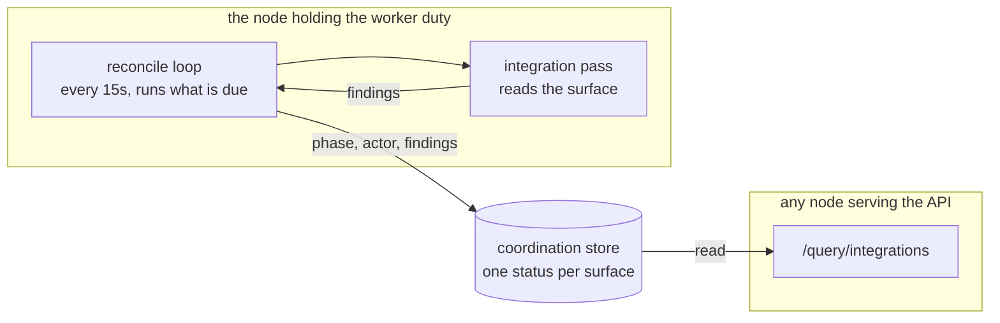

# Integration Reconcile

Every integration can break quietly: a revoked tracker token, a narrowed group, a deleted webhook. A webhook that stopped arriving looks like a quiet afternoon, and an idle agent looks the same.

The **reconcile loop** (`internal/integration`) looks. It runs each configured surface on a cadence, reports what it found in one vocabulary shared by every third-party app, and records the result where the API and dashboard read it.

---

## What a pass reports

A pass produces **findings**, each one observation that is not "fine". An app says what it found; it does not decide what that means or which finding matters most, because those decisions must agree across every surface.

| Finding | Means |
|---|---|
| `credential_missing` | The block is enabled and the credential its `${VAR}` names resolved to nothing. |
| `credential_rejected` | The credential resolved and the app refused it: revoked token, rotated key, lost access. |
| `credential_expiring` | A credential that works today and stops on a date the app has published, inside the **14-day** warning window (`integration.ExpiryWarning`). Carries the date in `expires_at`. GitLab is the case: the pass mints every seat's token, but the group Owner token it runs on was pasted in by a person and nothing rotates it. Each pass reads its own token's `expires_at` (`GET /personal_access_tokens/self`, GitLab 15.5+) and warns while two weekly looks are left to act. An advisory (the integration is ready) owned by the **operator**: the replacement is a value in this deployment's secret store. A GitLab that cannot say (older instance, credential not an access token) leaves a note and no finding. |
| `credential_shared` | A shared credential an agent once kept its own in, found when the company moved onto per-seat access: a variable something else also names (a company setting, a unit's shared credentials or another agent), so its value may be in more than one hand. `subject` names the variable (never its value), `subjects` the agents. **Degraded**, owned by the **operator**: replace the company credential first. Until the variable is written again, every step that would retire the value it may hold (minting the agent's own credential, rotating, turning off, revoking, removing) waits, so the company's connection never loses its key; the agent keeps working on the value it has. Once written, the agent's next sync mints its own credential and the finding clears. |
| `approval_required` | A person must install or approve something at the app. |
| `ingress_blocked` | Deliveries cannot reach this engine, and it will not fix itself. |
| `ingress_pending` | The delivery path is not established yet; the next pass tries again. |
| `identity_missing` | A seat has no account at the app yet. |
| `identity_failed` | A seat's account could not be created or its credential was refused, or a lane's access names more scope entries and grants than its record in the fleet's ledger holds (256 KiB: some 700 entries of 60 bytes on a lane whose vendor names them apart from their ids, 1,400 where it does not): that lane takes no step until its scope or grants are narrowed, while the seat's other lanes, and a lane being turned off, are synced. The record keeps each sentence and name a vendor or a step writes cut to a kilobyte. |
| `grant_pending` | The app accepted access and has not applied it yet. Atlassian is the case, twice: an accepted invitation shows in the directory later, so the grant just made reads back as *no such user*; and once granted, Jira and Confluence refuse the new credential for about a minute with a 401 identical to a wrong credential. Both are a wait, not a failure. See [When a new account is still coming up](#when-a-new-account-is-still-coming-up). |
| `unknown_tier` | The company document names something the app does not have. |
| `grant_short` | A seat holds less access than its role asks for. |
| `contact_unknown` | A **human** seat's contact names no account of the person's own at the app: a name nobody holds there, one since renamed, one an agent or bot posts as, or one another human seat's name holds too. Agents still work; what is lost is that person's name on what they write, which reaches agents from a stranger. *Degraded*, owed by the **operator**: the fix is the name in the company document (or the person joining the surface). Mattermost is the case: its contact is a username, which the transport resolves to the account its posts carry; see [How a person's post is recognised](../integrations/mattermost.md#how-a-persons-post-is-recognised). Ranked below every problem about an agent. |
| `contact_moved` | A **human** seat's contact is a name that now holds another account than when the company was last applied: the person renamed and somebody took the name, or the account was made again. The seat follows the name on every node, so the new account's posts reach agents as that person's, with their authority; whether it is theirs is the question. *Degraded*, owed by the **operator**, until the next apply: re-applying unchanged (`POST /config/reload`) answers that it is theirs, a corrected name that it is not. Any apply clears it (including the re-activation after a provisioning pass seals a credential it minted); nothing else does, since a registry rebuilt because the identity directory moved states nobody's name. So the producer's log line is the lasting record. Mattermost is the case. The last of the real problems. |
| `grant_excess` | A seat holds **more** access than its role asks for. |
| `level_unavailable` | An access level no seat that is on holds, which the company's connection cannot grant yet: the granting credential lacks what the level grants, or the app offers the account none of it. An advisory, owed by an **admin** at the app. The level is offered disabled with the same reason; a seat that is on at it makes the gap the vendor's blocking finding (`grant_short` or `unknown_tier`) instead, so a company that never wants the level never sees it as needing attention. |
| `registration_orphaned` | Something this engine registered at the app that it no longer manages, because its name changed. Datadog's webhook definition is the case: addressed by NAME, which is also the handle a monitor writes, with no listing served, so the previous definition keeps delivering for every monitor naming it and nothing could find it. Reported rather than removed, because removal would silence those monitors. Datadog's [service accounts](../integrations/datadog.md#accounts-this-engine-made-and-no-longer-manages) are the second case, for the same reason: a seat whose handle changed is a removed seat whose account stays behind, and an account is a colleague with history. Only **enabled** ones are reported; a disabled one already reached the state the advisory asks for. An advisory names what somebody might still act on, never what they already did. |
| `coverage_partial` | An integration working as asked over less than all it could reach, reported so nobody infers a decision from silence. GitHub is the case: agents that each carry their own App hear about the repositories those Apps are installed on and nothing else in the organization, the arrangement the setup form recommends. The mildest advisory, ranked last: the other two are loose ends, this is a decision taken. Actor: the **operator**, since widening it is a value in the company's configuration. Reported as `ingress_blocked` it read as Action required over agents receiving events fine; as a note it reached nobody, because a pass discards its notes. |

Findings fold into one **report**, which is what an operator reads:

- **`phase`** is where the integration got to: `disconnecting`, `unconfigured`, `awaiting_admin`, `provisioning`, `activating`, `degraded` or `ready`.
- **`actor`** is who has to act for the phase to end: nobody, the `engine`, the `provider`, an `admin` (a person, at the app), or the `operator` (a person, in this deployment's own config).
- **`detail`** is one sentence naming what is outstanding, and **`action_url`** is where the person named by `actor` goes to do it. Both are filled only when a person owes something.

### The advisories are always last

**An advisory leads with a title.** Each advisory finding carries `title`, a few words naming it ("GitHub can't reach this engine"), beside `detail` and `remedy`, so the dashboard sets the lead in bold, then the sentence and what would change it. A config key or an address in either sentence is written in backticks.

**An agent's own wait is said on its row.** A finding the seat access sync reports about one agent's account (a step waiting on a person, a vendor's refusal) carries `seat`. The Agents tab draws it on that agent's row with the step's own control, so the integration's issue list leaves it out, while it still counts toward the integration's phase and the home's list of what waits on you.

**A finding about many things gives the count and carries the list beside the sentence.** A finding's detail is the card's one-line status, capped at 500 bytes, so the sentence gives the count (a 36-account list once ended `…@agents.cr…`) and the list travels in `subjects`, which the screen folds away, cut only past what the surface's findings record keeps ([below](#what-a-surfaces-records-keep)). A finding about one thing names it and carries no list.

**A seat that needs a person shows action required, never a finished status.** Where an act belongs to somebody at the app and the engine can never perform it (creating or installing a GitHub App), the finding is `approval_required`, verdict *awaiting_admin*, owed to an admin. `identity_missing` is the engine's own work and reads *Setting up agents*, which over an act nobody performs waits for a pass that never changes anything. This extends to the tool's own `satisfied`: a surface that requires per-seat identities and has no working seat is not satisfied, whatever its company block says.

Five findings have a verdict of **ready**: `credential_expiring`, `grant_excess`, `level_unavailable`, `registration_orphaned` and `coverage_partial`. `credential_expiring` ranks first among them because it is the only note with a deadline (it becomes `credential_rejected` on its own date), and it is the one advisory the [tool roll-up](#one-state-per-tool) reads as needing attention. Everything below is about `grant_excess`, and applies to the other three.

The engine did not grant `grant_excess` access and cannot revoke it: it comes from the operator's own scheme, usually inherited from a parent group or a second role. Agents keep working, so the integration is ready with a note.

Its rank is load-bearing: anything the advisory outranks disappears from the report, so it ranks below every real problem, else it would hide a short grant, a failed agent, or a webhook that reached nobody. One test pins the ordering.

---

## The cadence follows who has to act

Not what failed. An accepted grant lands in seconds; a person told to install an app is usually installing it as they read; a `${VAR}` nobody set will still be unset in an hour.

| The report says | Next pass |
|---|---|
| `ready` | 10 minutes, or `integrations.check_interval_seconds` |
| the `engine` or the `provider` is working | 30 seconds, doubling to 5 minutes |
| an `admin` must act at the third-party app | 15 seconds, doubling to 10 minutes |
| the `operator` must edit config | 1 hour, flat |

The brisk admin cadence means: install the app and provisioning continues without you pressing anything. The operator cadence is flat because nothing at the app will change a variable this deployment did not set; backing off buys nothing and asking often only spends requests.

**An applied revision ignores all of it and reconciles now.** The intervals wait to ask an *app* again; a configuration change is the answer changing *here*. It marks every surface due and brings the tick forward: save the setup dialog and the pass runs within about a second. One operator action is one pass: the dialog writes one request per surface (saving Atlassian applies three revisions), and applies inside a short window fold into one tick.

**So does somebody finishing what the card asked for.** Otherwise the admin backoff leaves a card asking for the install up to ten minutes after the person acted. GitHub's App-install redirect lands back at this engine, and that arrival brings the surface's next pass forward. **Nothing about the redirect is believed.** It carries no installation id into anything; it says *look now*, and the pass that follows is the ordinary verified one, which lists the app's own installations and trusts GitHub, not a query string. So it is safe on a route nobody signed: the worst an arrival can do is make the engine ask a question it was going to ask anyway.

Because that route is unauthenticated, the ask is rate limited to one every five seconds: an install round trip cannot finish faster, so back-to-back installs by a multi-agent company each get a look, while a caller hammering the URL cannot drive more than twelve passes a minute against somebody's GitHub rate limit. Two more bounds: the loop folds asks that arrive before its next tick into one pass, and a pass takes the surface's own lease. A lost ask falls back to the cadence.

**A forced look at a surface another writer holds stays owed.** If the lease is held when an applied revision or a redirect forces a look (a person's pass, an access sync, a teardown), nothing is recorded and the look is kept for the next tick, so the surface is looked at once its holder lets go, not at the end of its cadence.

It is deliberately **narrower than an applied revision**: a config change moves the answer for every surface; a person finishing something at one app moves it for one, and sweeping all eight would spend seven other vendors' rate limit on a click that said nothing about them.

**Surfaces are visited in dependency order, not reading order.** Atlassian creates an agent's service account; Jira and Confluence check for it with the credential Atlassian minted. So the loop visits Atlassian, then its two products, then everything else. Otherwise a reconnect has the tracker find the seat mapped to the deleted account and report a `401` as *Action required — you, at the third-party app* until Atlassian's pass makes the new one (about thirty-five seconds measured). The order is a separate list from the one the screen reads in, since they answer different questions; a test pins them to the same *set*.

**Slack is not on this cadence, because it is not reconciled at all.** Its apps are created from the command line, one per agent, from a manifest, so there is nothing to converge: it is registered teardown-only, which gives a disconnect somewhere to run without giving the loop a pass. *Teardown-only* is not *nothing to tear down*; see [Slack's teardown is on the document, not at the vendor](#slacks-teardown-is-on-the-document-not-at-the-vendor) below. It carries no reconcile report, and its row holds only the address its setup form was saved against (below). That row **ends** when the `slack:` block leaves the document: a pass reporting `ErrNotConfigured` is what forgets a departed surface, and Slack has no pass, so the loop asks the document about Slack directly.

**The settled interval is the company's to choose, because its cost is the company's size.** It is the only thing that finds access somebody revoked by hand at the app, so it decides how long a card can say *Connected* over an agent already cut off (measured: eight minutes). A converged pass asks each seat's own credential who it is and reads memberships and hooks per seat and per project: O(seats × projects) requests per surface per interval, tens for a small company, a few hundred for a large one on GitLab or Mattermost. Ten minutes is the default because it is affordable at the large end; a five-seat company can set `integrations.check_interval_seconds: 60`, and a two-hundred-seat one should probably lengthen it. The floor is 60 seconds; a shorter value is **refused naming the field**, not clamped, since the likeliest cause is writing seconds meaning minutes. Zero is the field unset, never "off": a surface nothing reads back would be reported healthy forever. It is read fresh on every pass, so shortening it takes effect on the pass after the edit.

A surface *can* be given a settled interval of its own, for an app whose reads are rate limited hard enough that the shared one would be spent waiting. No surface in this build sets one.

---

## When the deployment's address moves

Every registration an app holds points at the deployment's **webhook address** as it was when registered: `api.public.external_url` when the deployment has a [public listener](../guides/deployment.md#exposing-webhooks-without-the-admin-api), `api.external_url` otherwise. That value moves (a tunnel restarts, a rename, a proxy, a public listener is added). The integrations answer's `endpoint_current` compares what each surface was registered at with that address, never the one people reach the dashboard at, which behind a public listener is a different socket that answers `404` for every webhook route.

Where a pass registers the hook, the next tick registers it again at the new address and the surface heals itself. Jira and GitLab match their hooks **by name** (`webhook_name` on each block, default `crewlet`), so the address is a field they rewrite, and a hook left at an address no longer used is removed. Confluence matches on the **address**: its Cloud endpoint takes no name (undocumented, it swallows unknown fields), so a hook is recognised only by where it points. Two deployments watching one Confluence site therefore cannot be told apart; give them two different webhook addresses, as either needs anyway to receive a delivery. GitLab sweeps both levels: a run that establishes a group hook removes this engine's project hooks and a run that registers project hooks removes its group hook, because the level a pass writes at moves with the group's plan and a hook at the unwritten level delivers everything twice.

GitHub is the exception: a webhook has **no name**, only its delivery URL, so a hook at a previous address is indistinguishable from one a second deployment of the same company registered at its own. It is neither removed nor reported, since calling a live hook orphaned would send somebody to delete another deployment's working registration. A GitHub hook left at a moved address is debris to remove by hand, and GitHub disables one after repeated delivery failures.

Where nothing registers the hook, nothing heals. Slack's request URL lives in each agent's app at Slack and can only be read back with an app-configuration token an operator may not have, so the engine cannot see it is stale or fix it, and the app goes on delivering to an address that no longer answers. Nothing reconciles Slack, so the surface reports **no phase**, and never will: the [tool roll-up](#one-state-per-tool) judges it *Connected* from what the engine can see (whether the route takes deliveries, its secret resolved and its address is the current one), and the first symptom is an agent that stopped replying.

So the address is **recorded and compared**. Every pass stamps the base it ran against onto the surface's status row, and a surface no pass converges is stamped when its setup form is saved. A row whose recorded address is not the one in force is an **ingress fault**: the card reads *Action needed*, the surface carries an `address moved` badge, and the note names both addresses, because the fix is to replace one with the other at the app.

It clears itself: a surface with a pass is re-stamped on the next tick. A surface with no recorded address reports `null` rather than `false` ("nothing here can say" is not "the address moved"), so a fresh company does not open with a warning on every card.

---

## When a new account is still coming up

Atlassian creates an agent's service account, grants it Jira and Confluence access, and mints its credential, and for about a minute after that the products refuse the credential (**measured on a live Cloud site: about seventy seconds, twice**). The gateway accepts the token; Jira answers `401 Client must be authenticated to access this resource`. Nothing is wrong and nobody can act. A reconnect hits this window **every time**, because a disconnect that removes accounts means the next connect creates new ones.

It reads as one answer:

- The organization surface reports `grant_pending` for a seat it has just granted, because an accepted grant is not a grant in force.
- The tracker reports `grant_pending` too, but only for a credential **sealed within the last five minutes**, which is what separates a grant still landing from a wrong credential. Outside that window a refusal is a failure, owed by an admin.
- The engine's wiring adds no second finding about a seat the surface's own pass already reported: both resolve the same seats, credentials and instance, so the pass's answer, with the vendor's own words, stands.
- The roster's badge follows. `satisfied` answers "is a credential sealed where this app looks for it", which stays true of a seat the app refuses, so an agent any of the card's surfaces has a finding about shows **not ready**. The reason is printed once, in the surface's own band.

The five-minute window is a four-times margin over the measured propagation, and no longer, so a grant genuinely not landing becomes somebody's work within one settled interval instead of waiting forever under "the provider is working on it".

---

## A fleet singleton

The loop is a **worker duty**, claimed per tick like the retention sweep and the sandbox waiter, so exactly one node runs it. That is correctness: two nodes reconciling one surface both read an app with no account for a seat and both create one, leaving two identities for one agent that no later pass can detect or repair.

Three separate things stop a node running it; debugging *"why is nothing being reconciled"* needs all three:

- **`node.roles` excludes `workers`**: the node never claims the duty.
- **The coordination store cannot say** whether this node holds it: treated as **not held**, because entering the two-nodes case on a store blip is what the singleton exists to rule out.
- **This node's [config posture](control-plane.md) is `shed` or `stuck`**: it declines *before* claiming, so its lease lapses and a peer on the current revision takes over; a node the fleet has moved past would converge an app to a replaced revision. Only this one logs: `integration_reconcile_shed` going in, `integration_reconcile_resumed` coming out, once per transition.

**The duty outlives one pass, deliberately.** Its TTL derives from the deadline a single pass may take (minutes), not the tick interval (fifteen seconds); a short TTL lapsed mid-sweep and a peer claimed it, making the sweep nondeterministic (the *surface's* own lease still stops two writers at one app). The cost: a node that dies holding the duty leaves it unclaimable for that long rather than three ticks.

The status lives on the **coordination store**, not the node's own database, because the reader is usually not the writer: `-roles data,ingress` puts the API and the seats on separate hosts on purpose.

**Reading a vendor's inventory is not this loop's.** A converged pass writes nothing, by contract, and its cadence is tuned to catching revoked access. The `atlas-collect` duty reads what the company runs on at each vendor, hourly, and records on the [atlas](atlas.md#what-integrations-read) only what changed; where the two read one listing (Cloudflare's zones), the atlas repeats one cheap call an hour rather than reading inside a pass that may not write.



---

## A seat's account is named after its handle

**An agent's account at an app is named after the seat's handle.** None of these apps stores a Crewlet seat id or lets the engine attach a field that survives (Atlassian accepts a description on create, answers `200`, and keeps nothing). So the account's **own name is the only thing a later pass can match on**, and the handle makes it one: it is immutable ([ADR-0013](https://github.com/crewlet/crewlet/blob/main/adr/0013-a-seats-identity-is-derived.md)), and a document that changes it removes the seat and creates another. The new seat gets a new account; the old one is a departed seat's, which `-decommission` removes and Datadog's orphan sweep reports.

Every `crewlet-<handle>` below is one rule, `internal/seatname`: lowercase letters, digits and hyphens, the handle cut to the vendor's length where it is too long (30 characters where the vendor publishes none; the level word after it is kept). It holds no company name, since the vendor account it sits in is the company's already.

| App | The account's name | What follows the document instead |
|---|---|---|
| Mattermost | `{username_prefix}{handle}`, token description `crewlet-<handle>` | the bot's **display name**, patched to `{role name}{display_name_suffix}` on every pass |
| GitLab | `{username_prefix}-{handle}`, token name `crewlet-<handle>` | — |
| Datadog | the account address, `crewlet-<handle>@{email_domain}` | — |
| Cloudflare | the account API token's name, `crewlet-<handle>`, beside the token ID recorded at mint | Nothing |
| Scaleway | the IAM application's name, `crewlet-<handle>` (its policy shares it), beside the application ID recorded at creation | Nothing |
| Google Cloud | the service account's ID, `crewlet-<handle, at most 17 characters>-<4 characters>`, display name `Crewlet <company> <handle>`, beside the unique ID recorded at creation | Nothing |
| Expo | the robot user's name, `crewlet-<handle>`, which a person gives the robot at Expo, beside the robot ID recorded from the first token pasted for the seat | Nothing |
| DigitalOcean | the personal access token's name, `crewlet-<handle>-<level>`, which a person gives the token in the control panel, beside a keyed fingerprint of the token and its team's ID, recorded from the token pasted for the seat | Nothing |
| AWS | the IAM role's name, `crewlet-<short name>-<seat>` under the path `/crewlet/<short name>/seat/`, beside the role ID recorded at creation; a role of that name the engine has no record of is refused, never adopted | Nothing |
| Atlassian | the marker inside the display name, `{role} (crewlet:<handle>)` | the `{role}` label in front of the marker |

## What the loop does, and what it leaves alone

**It does not tear anything down.** Removing an integration block says what the engine should stop talking to, not that fifteen service accounts and everything attributable to them should be destroyed. A removed block makes the loop forget the surface's status and nothing else; decommissioning stays an explicit flag on the app's own subcommand, where you type it and read what it is about to delete.

**A teardown reports what it removed, and the credentials go with it.** Each vendor teardown walks its own plan and deletes the accounts it created, so it knows which seats went and, because every planned seat carries the `${VAR}` names its credentials live in, which sealed values are now dead. Before, no teardown or decommission path deleted a secret (it was dropped at an `error`-only return boundary): disconnecting Atlassian with *remove accounts* left `SRE_ATLASSIAN_TOKEN` and `SRE_ATLASSIAN_EMAIL` sealed and resolving. On reconnect the tracker mapped the seat to the vanished account (its identity cache is keyed on the **credential**, which had not changed) and showed a `401` as *Action required, you, at the third-party app* for about thirty-five seconds, and the setup roster kept reporting the seat satisfied.

Two rules travel with the report. It names the **end state** the teardown established, not the delta this call performed: every step is "remove this if it is there" and retried, so a delta would come back empty on the retry and let the block drop with credentials still sealed. And it names **only what is genuinely dead**: a merely *disabled* account does not count, because a token on one works again when anybody re-enables it (Datadog's teardown deletes each account's application key for that reason). The test is whether the value can be **recovered**: "gone at the vendor" is the usual way to be sure and not the only one, which lets Slack delete credentials for apps it cannot delete (below).

**A teardown is carried out for whoever asked for it.** The disconnect route records who asked on the fleet row beside the intent (the author, their kind and the credential they asked through), and every write the teardown makes is recorded under them: the revision that drops the block, each Slack seat's cleared credentials, the sealed values it deletes. The loop only carries it out, minutes later on whichever node holds its duty, and those writes are not recorded as its own (`reconcile loop`, of kind `system`), so one gesture has one author whether or not the disconnect is forced.

**Every teardown revokes the credentials before it touches the account.** A revoked token on a live account is an agent that can do nothing; a live token on a removed account works again when anybody restores it. GitLab's service-account delete **blocks rather than erases**: `crewlet-sre-lead` ended up `state: blocked`, out of the group, holding one active token, after the engine had deleted the company's own copy, so GitLab kept a working credential on an account one click restores. A token that cannot be revoked now leaves the account **visibly intact** and the seat unreported: an account still listed holding a credential nobody could withdraw is visible to an operator, and deleting the only copy of a live credential is the one move nothing can undo.
### Three apps disable rather than delete, and one rule covers all three

Datadog, Mattermost and GitLab cannot erase an agent's account: Datadog's user delete *disables*, Mattermost's bot delete *deactivates*, GitLab's service-account delete *blocks*. A disconnect leaves the account, and the next connect finds it. All three answer "bring it back?" the same way, so an operator learns it once.

**The rule: an account this engine disabled is re-enabled on connect. One somebody else disabled is reported, never touched.** Re-enabling what a person switched off at the vendor overrules an administrator who cannot make it stick; leaving the engine's own disconnect disabled forever means a reconnect never works.

**Which it was is written on the account**, not in the engine's records: a status row is forgotten once a disconnect succeeds and does not survive a lost coordination store or a restore. A teardown *marks* the account before disabling it, and a connect reads the marker back:

| App | Marker | Where |
|---|---|---|
| Datadog | `crewlet:disconnected` | the service account's `title` |
| Mattermost | `crewlet:disconnected` | the bot's `description` |
| GitLab | — | nothing to mark; see below |

The marker is written **unconditionally and before the disable**. Writing it inside an `if !account.Disabled` branch was the bug: a second disconnect over an already-disabled account (a retry, or after somebody disabled it at Datadog) marked nothing and left an account no connect touches, the seat stuck at `degraded / admin`. An interrupted teardown then leaves a *marked but enabled* account, which the next connect clears: the harmless direction.

A connect clears the marker once the account is enabled, so an administrator who disables the agent later is not mistaken for a past disconnect. Clearing is best effort and noted, not fatal: the account already works.

**GitLab reports instead.** Unblocking is `POST /users/:id/unblock`, an **instance-admin** route, and the ordinary deployment provisions with a group Owner token, so the engine cannot re-enable a blocked account whoever blocked it (a `403` every tick). No marker is written, since there is nothing to act on it. A connect *stops*: it mints nothing into a blocked account and reports the seat as `identity_failed`, naming the account and the state GitLab reports. An instance-mode deployment also gets a link to `/admin/users?filter=blocked`, since its credential is an instance administrator; a group-mode one gets the state in words and no link, because where a group Owner administers service accounts differs between GitLab versions.

**GitHub is the exception.** No API deletes an App registration, so a disconnect *uninstalls* each agent's App (which revokes its access) and hands over a link to the page where a person deletes it. The `private_key` and the App's webhook secret stay valid for an App that still exists, so they are **named to the operator rather than deleted**: no API can restore a company's only copy of a working key. The disconnect does remove the recorded **installation**, so the seat no longer reports `satisfied: true` with its App slug and `/query/integrations` keeps no `github` row (which would render the card as *Connecting* with a `routes nowhere` badge permanently).

### Slack's teardown is on the document, not at the vendor

Slack has no reconcile pass. For the **apps** nothing is removed: they are created from the command line or by hand, and deleting one needs an app-configuration token Slack issues only by hand. But every agent's seat carries an `integrations.slack` block naming a sealed **bot token** and **signing secret**, and dropping only the company block would leave both, (both attempts logged `accounts=[] secrets=[]`), with the card settling on **Paused** (a state an operator chose) over the residue of a removal.

**So the teardown removes the seat blocks and deletes the values they named**, on *remove accounts*, like Atlassian, GitLab and Datadog. Deleting a credential for a live app is normally irreversible (hence GitHub's private key is named, not deleted), but Slack shows the bot token and signing secret on the app's settings page on **every** visit, unlike Datadog's application key, shown once. The owner can read back anything deleted; what they could not reconstruct is which `${VAR}` each seat used, and the report has that.

A seat is addressed through the **per-entity route** (`PUT /config/roles/{handle}`), one seat per write, because a merge patch over the document replaces a list wholesale and a teardown must not rewrite every other seat. Left *unticked*, the apps keep working and every credential stays: the disconnect drops the company block, the transport retires, nothing is deleted.

**What only a person can do is handed over.** Each agent is named with the app id the running transport learned from `auth.test` (the only identifier of one agent's app, since the company document names none), and the disconnect dialog links each to the page it is deleted from.

**A shared credential is not reported orphaned while a sibling still reads it.** Jira and Confluence normally share one seat credential (one API token per Atlassian account, usually in the shared `mcp_env.atlassian` block), so disconnecting one product must not name a token the other still uses. A sibling counts as a user unless it is itself disconnecting; so a whole-card disconnect works: surfaces are taken in order, each request records its intent before the next, and the dialog's union names the credential once.

Only a seat's **own** credentials are deleted. A company-level one (an admin token, a webhook secret, an organization key) survives by design and is [named to the operator](../reference/api-endpoints.md#disconnecting): it may be shared with another deployment.

**It does not rotate a credential that works.** A third-party app serves a token once, and minting every pass would revoke what every running agent uses. Rotation is a flag on the subcommand.

**It registers webhooks, and it creates the accounts.** The loop runs each third-party app's pass with the sink and the public base URL supplied, so a pass mints a signing secret when the config's `${VAR}` resolves to nothing, creates or updates the hook, and creates the service account each seat acts as. Connecting **is** the permission: an explicit act by a person naming one app, with an administrator's credential given for this. Withholding both left an integration nobody could finish from the dashboard.

**It still does not tear anything down on its own, nor rotate a working credential.** Provisioning converges towards the company's seats: an account that should exist is created; one that should not is left alone until somebody disconnects.

**A pass that seals a credential re-activates the revision.** `${VAR}` resolves from a snapshot taken at apply time (which keeps the secret store off every config read), so a seat token minted by a pass lands in a company where everything reading it resolved it to nothing at the last apply. Seat identities, parsers, transports, provider clients and MCP children are built only by the apply, including a seat's per-role children, whose node starts the one that was [waiting for the sealed token](../guides/tools-and-mcp.md#shared-vs-per-role-servers) and restarts one the token rotated. So the pass makes one apply through the control plane's [rotation gesture](control-plane.md#rotation): re-activating the current revision unchanged, which every node watches. The node the pass ran on does not wait: it asks every seat it holds to converge its tool servers on the refreshed snapshot as soon as the seal lands. Without this, connecting Atlassian left Jira's live routing with zero seat identities and every issue naming the agent fell to its project's lead while the card said fine. On a node with no config surface (worker-only) the values are still sealed, its own seats' tool servers still converge, and the rest of the rebuild is logged as outstanding, naming `POST /config/reload`.

**Re-activations are coalesced into one apply per 15 seconds.** Connecting is a **burst** (one request per surface; Atlassian's alone applies three revisions), so an apply per seal would mean several whole-company rebuilds and permanent revisions. The first request in a quiet period runs immediately, because somebody is watching; those behind it fold into one run at the window's end. Nothing is dropped.

> **The bound is not optional.** "Only a real write triggers it and every reconciler is [certified](#adding-a-surface-to-the-loop) against 'a converged pass writes nothing'" holds only for a *converged* world; a pass that can never converge writes every tick. GitLab once created a service account with an unconfirmable address, GitLab refused its tokens, and the pass read that as a stale credential and minted another: 144 live year-long `api`-scoped tokens from one connect, at a five-second cadence behind an apply that wakes the pass. [That vendor fault is fixed where it lives](../integrations/gitlab.md#provisioning); the bound stops the next one being amplified.

**A pass also re-resolves this node's own seat identities.** A tracker or code-host webhook names people by *account*, which the org model does not give, so the engine asks with that seat's own credential and registers the answer. That lookup runs whenever the node publishes a company (activation or boot) as the `seat_identities` step of [the convergence](configuration.md#what-follows-a-published-company); lookups are keyed on the credential and cached, so unchanged credentials cost no requests. A seat whose lookup FAILED cannot be helped by a publish, and nothing else scheduled one: a transient `403` (the account not yet grantable a second after the token was sealed) persisted, with zero identities and every card Connected.

So each visit re-resolves before it reports, and a seat still holding no account is an `identity_missing` finding. The surface therefore stops classifying `ready` over an agent that receives nothing, and the loop revisits it on the **engine's** cadence (30 seconds doubling to 5 minutes). A seat that resolves is registered into the **live** registry and receives work at once, with no config change. A seat with no credential at all is never reported: it opted out, and listing it would put every human seat on the card.

**A disconnect refused by a concurrent writer is worth repeating.** The guard below is one surface at a time, so a disconnect pressed during a reconcile tick or an operator's pass is refused with a `503` carrying `surface_busy` (formerly `internal_error`, which callers must treat as terminal), the one refusal on this route that clears on its own. The request first waits the collision out briefly; past that the answer names the surface and the operator (or dashboard) repeats it. Every step is idempotent. The dialog submits one request per surface in order, and the order is load-bearing (the organization's credential is what removes the accounts), so it sits a busy surface out rather than skipping it, waiting between attempts what the refusal's `Retry-After` says, at most 45 seconds in all.

**A person can still ask for a pass.** `POST /setup/integrations/{kind}/provision` runs the same function on demand, under the same guard, and folds its outcome into this status. The guard is a surface's own lease **plus** an in-process claim, taken alike by the operator's pass, the loop's tick and a disconnect's teardown. Both halves are needed: a lease claim by an owner that already holds it doubles as a renew, so two goroutines in one process would both be told yes, and a single-node install has no lease. Together, two writers at one third-party app never overlap.

**The guard is held across the write that records the pass, not only the pass.** Otherwise a writer would fold its outcome into a status row read *before* the pass, silently overwriting a disconnect pressed meanwhile (the card going from *Disconnecting* back to *Connected*). The guard spans the row re-read, the pass and the write, and *what to do* (converge or tear down) is decided from the re-read row, so a disconnect that arrived earlier gets a teardown, not a converge pass that reports healthy.

**The pass is bounded inside its own lease.** The lease is taken once and never renewed, so work outliving it would create accounts with nothing excluding a peer. `internal/setup` holds the two values together: a pass is cut off strictly before the lease expires, and the margin is what the status write runs in. Nothing in the dashboard calls it any more; it is for an operator who wants a pass now rather than at the next tick. See [Setting an integration up](../reference/api-endpoints.md#running-the-provisioning-pass).

---

## Reading the status

Every row of the `integrations` question carries a `reconcile` object, or `null`.

```
GET /query/integrations
```

```json
{
  "key": "jira",
  "configured": true,
  "enabled": true,
  "routes": true,
  "reconcile": {
    "phase": "degraded",
    "phase_label": "needs attention",
    "actor": "admin",
    "detail": "swe has no Jira account, so no issue reaches it: no credential under mcp_env.atlassian",
    "action_url": "",
    "outcome": "blocked",
    "attempts": 3,
    "last_error": "",
    "teardown_held_by": "",
    "last_attempt_at": "2026-03-01T12:00:00Z",
    "settled_at": "2026-03-01T09:14:00Z",
    "next_attempt_at": "2026-03-01T13:00:00Z",
    "findings": [
      { "kind": "identity_failed", "subject": "swe", "detail": "...", "action_url": "" }
    ],
    "findings_omitted": 0,
    "seat_findings_omitted": 0,
    "words_omitted": 0,
    "findings_unread": false
  }
}
```

### What a surface's records keep

The fleet keeps each surface in **two records** ([Coordination](coordination.md#what-one-key-holds)): its **status**, at most 16 KiB, read at the read term by every reader that keeps a window (the loop's tick, a turn's atlas, the check of a credential an integration mints, every write's re-read under the surface's lease); and its **findings**, at most 64 KiB, which the status names by size and SHA-256 and only a reader that shows them reads (this answer, the Advisor). A pass writes its findings first, then the status naming them; a reader whose findings do not match the status reads them as unread (`findings_unread`, the list empty until the next read).

Each writer **cuts to fit rather than refuse**, since a refused status would stop the surface recording anything:

- **The status** halves its `last_error`, then its report's `detail`, and drops its `action_url`, each only as far as fitting needs. The address and the registration's name are kept exact, since they are compared with the ones in force; their settings are bounded instead (`api.external_url`, `api.public.external_url` and `api.artifacts.external_url` at 2,048 characters as written, Datadog's `webhook_name` at 255 whether or not its block is on).
- **The findings** keep every text field to 500 bytes and drop a link past 2 KiB. Past 64 KiB as stored the record cuts every word before any name, and what nobody owes before what a person does, each step only while still past the bound and from the end: an agent's own findings (`seat`, which each agent's row draws from its access record) lose their words (`seat_findings_omitted`); then findings no person owes lose theirs, then those a person owes (`words_omitted`, which the dashboard says under the list); findings that can name no seat (naming nothing, or advisories) are dropped (`findings_omitted`), those no person owes first; `subjects` lists are cut to a common length, the reported finding's last, each counting what it lost (`subjects_omitted`); and the rest are dropped, those no person owes first. Each finding is counted once, by what the cut left of it. The reported finding is first, never dropped and never without its words, and the report and its "(and N more)" are decided before the cut. Everything a bound or the cut shortens or leaves out is logged whole, once, where the pass ran, as the pass made it (`integration_finding_shortened`, `integration_finding_unkept`).

**Findings not in hand are never read as none.** The status counts what a person owes, what names a subject and the expiring credentials before the cut, and apart from the rest how many findings that may name a seat (no advisory) the cut dropped or cut the list of, which nothing bounding a company's seats keeps at zero. Where the findings cannot be read, or that count is above zero, a reader judging a seat says it cannot tell: the check of a minted credential holds the child on that integration, saying why (warned of, unless this node is only still reading the findings), unless what is in hand shows a stop or an earlier judgement found one, and the setup roster confirms no seat the findings may name, saying whether a read failed or the record was cut. The Advisor leaves the integrations unread only for findings it could not read. A cut record is a partial reading of that surface alone: of its open findings the record does not carry, one a person owes stays open only where the record dropped one a person owes, which the status counts apart for the Advisor and no screen shows, any other only where it dropped one nobody owes; a finding kept without its words keeps the words it had; and the cut is said by surface and count (`integration.record_cut`). The dashboard says it could not read them, and the tools' roll-up raises **Credential expiring** from the status's count. A findings read that fails leaves the statuses standing, each naming findings reading them unread.

`reconcile` is **three-valued**, like `routes` and `secret_usable` beside it:

- **`null`** means this node cannot say: it could not read the fleet's rows (a briefly unreachable coordination store), or the loop has not reached the surface yet. It is not "nothing has been reconciled".
- An object is a real finding.

The **findings list travels with the report**: the report says what to do next, the findings what is wrong. A broken webhook plus four under-granted seats reports the webhook, and the operator need not wait a full pass to learn of the four.

`phase_label` is the phase in a person's words, derived **once, in the engine**, so every screen and client shows the same status and none maps phases itself.

| Phase | Label |
|---|---|
| `ready` | Connected |
| `degraded` | Action required |
| `awaiting_admin` | Action needed |
| `provisioning` | Setting up agents |
| `activating` | Waiting for the provider |
| `unconfigured` | Failed |
| `disconnecting` | Disconnecting |

`unconfigured` reads **Failed**, not "not connected", because it is only reached with a block present (an absent one is `ErrNotConfigured` and the row is forgotten): somebody configured it and its credential is missing or the app refused it. A phase a newer node wrote is rendered as its own value with the underscores opened up, never guessed at.

There is no `disconnected` phase:

- An integration nobody has connected is a company document with no block, so there is no row and no phase. The screen shows **no status badge**, only a Connect button.

`disconnecting` sorts **first**, so it wins a tool row's tag over every other surface: disconnect asks the app to remove what the engine registered before the block leaves the document, so a surface sits in it as long as that takes and reports a failure.

### One state per tool

A company connects **tools**, not surfaces: Atlassian is one tool over the organization, Confluence, Jira and the Forge relay. The answer carries one **roll-up** per tool in `tools`, for every tool this build serves whether or not configured, decided in the engine (`integration.Rollup`) rather than by each screen.

```json
{ "key": "atlassian", "surfaces": ["atlassian", "confluence", "jira", "forge"],
  "state": "attention", "label": "Action required",
  "reason": "swe has no Jira account", "surface": "jira" }
```

| `state` | Means |
|---|---|
| `attention` | A **person** has to act: a phase whose actor is an `admin` or the `operator`, a `ready` surface whose deliveries cannot work, or a credential about to expire. Only what a person can do, which makes it countable. |
| `not_connected` | Configured and not working **yet**, nobody owing anything: the engine or vendor is mid-flight (setting up agents, applying a grant, the window before the loop's first report, a disconnect being carried out), or this node could not read the fleet's status. Nothing a person does moves it. |
| `connected` | Every configured surface works. |
| `not_in_use` | No block at all (`label` *Not in use*), or every block switched off (`label` *Paused*). |

Each configured surface is judged by its report's **outcome** (who has to act, not what failed): *settled* is connected, *blocked* is attention, *waiting* is not connected. Over a `ready` phase two more facts are read: a delivery path that cannot work (`secret_usable`, `routes` or `endpoint_current` false) is **Action needed**, and a `credential_expiring` finding is **Credential expiring**. A surface with no report is *Paused* where its block is off; judged on those same ingress facts where no pass converges it (Slack's apps are created by hand, so it never gets a report and "connecting" would be permanent); *Status unavailable* where this node could not read the status; else *Connecting*, the window of one reconcile interval after a connect.

The tool takes one surface's verdict: a **teardown** first, whatever else is wrong; then the first state in the order above, so a surface a person owes something outranks one the engine is still bringing up; then, within a state, the least ready phase by `Phases` (a phase a newer node wrote sits between the worst phase this build knows and ready, never presented as ready and never masking a known phase); then the catalogue's order. `label` is that surface's phase label or the roll-up's own word, `reason` its sentence, `surface` which surface it was.

### What the dashboard shows

**On the dashboard** Company › Integrations lists every tool in a directory grouped by need, beside the page of the chosen one, and draws each from the roll-up: its `label` as the state on its line and page once the company has set the tool up, and, while something is owed, the reason as an issue on its page. A tool nobody set up carries no state on its line; its page says what connecting gives. Each page carries **one action** in its header: **Connect** where nothing is configured; **Replace key** where a configured surface holds a `credential_expiring` or `credential_rejected` finding, which opens the tool's settings form (a new key typed over the held one is sealed and the revision re-activated); **Finish setup** where the form is unfinished; none otherwise. Its **Agents** tab, labelled with how many agents are on, carries **Check now**, which asks this loop to look at the tool at once ([`POST /setup/integrations/{kind}/check`](../reference/api-endpoints.md)), for a person who has just made an app or account at the vendor. A change on the tab itself needs no press: every access sync (a save, an action at the vendor, a keep) ends in the same read-only pass, recorded on the surface's row before the tab stops reading as syncing, and the page then re-reads the rows. The tool's issues sit above its agents and its advisories, as notes led by their titles, below them.

**A key can be tested before it is stored.** The setup form offers **Test key** under every credential the vendor can check with a read-only call (`checkable` on the requirement), and one **Test keys** control for credentials checked together (`check_with`, Datadog's two keys). It calls [`POST /setup/integrations/{kind}/verify`](../reference/api-endpoints.md#checking-a-credential-before-it-is-stored), which asks the vendor who the credential is (Datadog's organization, the GitHub or GitLab account, Mattermost's administrator, Slack's bot, Atlassian's organization), answers *works*, *refused* or *unreachable*, and **writes nothing**: no secret, config, revision or row on this loop. A key that tested working is connected only once saved and the next pass has run. Webhook signing secrets cannot be tested ahead (a vendor only signs deliveries with it): those fields say the vendor proves them with its first signed delivery, which this loop's ingress facts then see.

Every state is the roll-up's (the phase labels above and its own words: **Connecting**, **Paused**, **Action needed**, **Credential expiring**, **Status unavailable**, **Not in use**); the screen adds none. While it has not read the `integrations` answer (loading, refused for want of `admin`, or failed) it draws **no state** at all, on the page and in the peek, and once the read is refused or failed the banner says why: a refusal names the access that would admit the reader (Admin), a failure offers to ask again. None of these claims the integration works. A reader without Admin is never asked: the page shows Crewlet's own services and lists the apps with no state.

A tool's page holds everything else in the object: each faulted surface with its `detail`, named, so "Jira: swe has no Jira account" reads on the Atlassian page; the actor, link, fault and findings the phase was not derived from; each agent's row with its own step at the vendor; the settings form, Disconnect, the provisioning passes and each surface's deliveries. A line is *drawn* by the `actor`, not the phase: amber only where a person owes the next step (`admin` or `operator`) or ingress is broken.

**A failed disconnect says what holds it.** `teardown_held_by` is `vendor` where the app's half of a teardown failed, `settings` where that half finished and the company's settings refused the revision that removes the block, and empty where no teardown pass failed. A vendor that will not let go is forced past; a settings refusal is moved by changing the setting `last_error` names, since forcing writes the same revision. The disconnect's revision turns off every agent that was on at the integration as it removes the block, so the rule refusing an agent turned on where the company has no connection cannot trip it.

`last_error` is a **fault**, not a finding: the engine or app failing to look at the world at all. A failed pass drops the previous pass's findings rather than leaving them under a fresh timestamp, because it observed nothing.

A fault is normally reported as `activating`, owned by the engine, since almost every fault is an app briefly unreachable. **One fault is not a wait.** When the app answers `401` or `403` it looked and refused the credential, and every later pass is refused identically until a person changes it. That is reported as `credential_rejected`, making the surface `unconfigured` and the operator's to fix. Rate limits, timeouts, `404`s and `5xx`es stay waits.

---

## Adding a surface to the loop

A third-party app contributes one method:

```go
type Reconciler interface {
    Kind() Kind
    Reconcile(ctx context.Context) ([]Finding, error)
}
```

and is registered in `internal/engine/integrations.go`. Findings (statements about your world) and errors (a failure to read it) are different answers and must not be collapsed.

Every implementation is certified against **one suite**, `internal/integration/integrationtest`, like `queuetest` and `coordtest`. Each app's package holds its own harness, which stands its world up already converged (every seat has its account, every credential works, every webhook points at the address in force) and counts what the pass writes into it.

The load-bearing case is that **a pass over a converged world writes nothing**; its failure is a credential rotated every ten minutes for ever. A write is anything a person would have to undo, wider than a request to the app (re-sealing a seat's credential into this deployment's sealed store every run is writing) and narrower than a non-`GET` (some apps model a listing as a `POST`). Count by route.

That clause makes "safe to leave switched on" a fact: three of seven reconcilers once wrote on every pass behind a suite pointed only at a stub. The fix is to **read the current state and write only on a real difference**, never to soften the clause.
