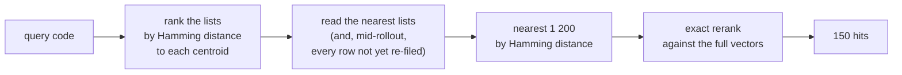
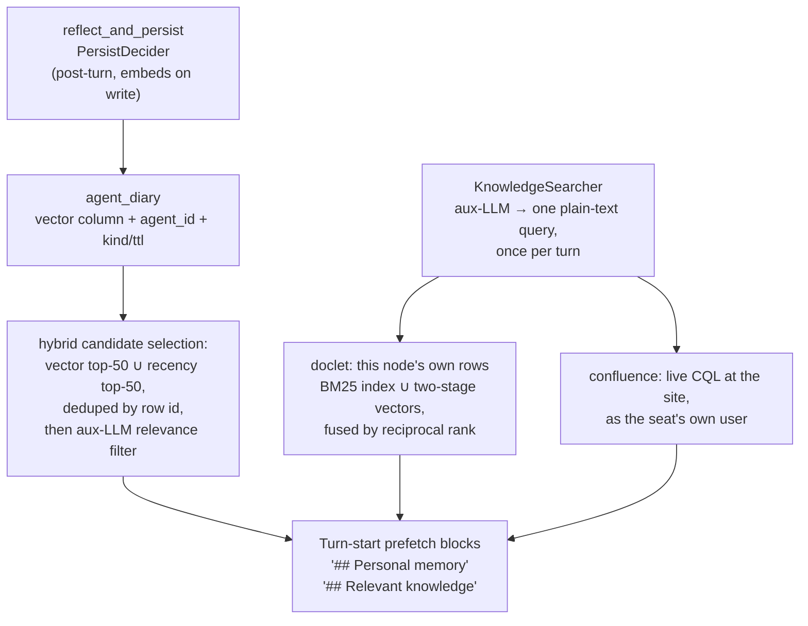
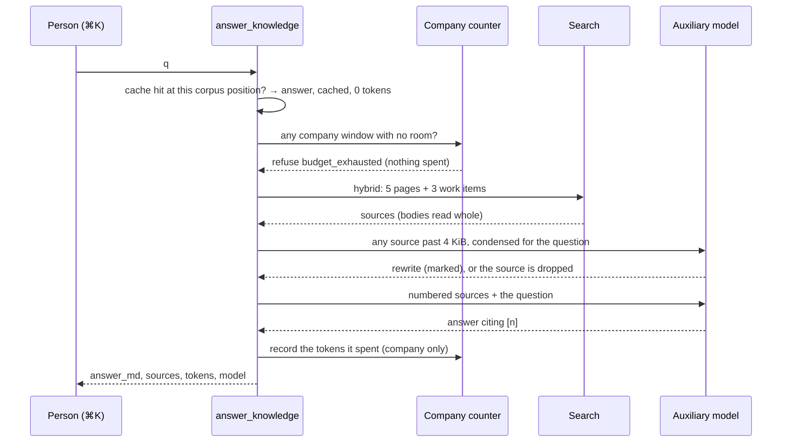

# Knowledge System

The knowledge system (`internal/knowledge`) is the read path agents use to find context not in their system prompt. It is two reads composed into the agent runtime:

- **Shared knowledge**: the team knowledge base. **Exactly one backend per company**, chosen by `knowledge.backend`, behind a `knowledge.Searcher` seam every consumer reads through. A `Searcher` takes plain text (never a backend fragment or space key) and answers ranked hits. The turn-start prefetch turns the trigger into that text once per turn with the auxiliary LLM; the executor can re-run the search with `search_knowledge`.
- **`agent_diary`** (a vector column, scanned per agent; no vector index): the agent's private observation log. One row per declarative fact the agent captured via `reflect_and_persist` (or the post-turn `PersistDecider` saved for it), scoped to the agent's id. Each row says what it is about (`company`, `preference`, `capability` or `platform`, named by its writer) and which engine build wrote it. Held back from `## Personal memory` and from a memory refresh, with a line counting them, until the agent keeps the fact again: a `capability` note written before the seat was last told its access (its newest told record, however old, or the turn itself where it tells a change), and a `platform` note another build wrote. The hold is part of each read's query, so a held note never takes a current note's place. A note is marked the first time it is held; the retention sweep retires one held for thirty days (`agent_diary_held`). Rows are embedded on write, and the node holding the seat fills any note without a vector of the current model. The `## Personal memory` prefetch picks candidates by **hybrid selection**: a vector top-K (semantic matches) union a recency top-K (broadly applicable operational rules that may not match topically), deduped by row id (50 each, so the union is the bound), then an aux-LLM relevance filter.

**A diary is read where it is kept current.** It is written to the store of the node running the agent and follows the agent when placement moves it. The dashboard's **Doclet › Agent diaries** reads every diary from the node HOLDING its agent: the list (`memory_overview`) counts every agent in the chart at its holder in one round; one agent's page (`agent_memory`) is its holder's answer, naming that node. An agent no node holds shows nothing rather than a copy of unknown age. See [seat ownership](seat-ownership.md#a-seats-memory-follows-it).

**One backend is a rule, not a limitation.** "What do we already know about this" must not depend on which searcher was asked, so the config refuses a company that wires two.

## The two backends

```yaml
knowledge:
  backend: doclet      # the default: Doclet, the engine's own pages
# backend: confluence  # a live search against Confluence at query time
# backend: none        # no knowledge base; every turn gets an empty block
```

| | `doclet` | `confluence` |
|---|---|---|
| Where pages live | the fleet's own ordered log, applied into every data node's database | a Confluence site |
| How search works | keyword (BM25 over the node's own lexical index), semantic (two-stage 1-bit retrieval: an index over the codes, then an exact rerank), or `hybrid` (both, fused) | CQL against the site's search API, live at query time |
| Who it searches as | the engine: every seat reads every page, so no per-seat credential can be missing | **the agent's own user**, so Confluence enforces its page permissions natively |
| Staleness | the index is built behind the node's own applied rows; a node still indexing SAYS SO rather than answering empty | none: no local copy |
| What it costs to set up | nothing | a site, a space, and a per-seat account |

### Doclet: an index, and what that means

Every page change is one record on an ordered log; every data node applies it into its own database, and a lexical index is built behind those rows asynchronously (tokenising a large wiki takes minutes; inline it would sit inside the apply transaction that holds the node's only writer).

So a search on a freshly joined node can run against an index still building, which is **a different fact from an empty company**. The dashboard and a seat's own prompt both say which: a seat is told "the knowledge base is not searchable from this node yet — ask a colleague rather than concluding nothing has been written down", because a seat reading an empty result would write a page that already exists.

Ranking is BM25 with term-frequency saturation and length normalisation (so a 20 KB runbook does not outrank the one-paragraph page that is the answer). There is no phrase query, proximity or query language: an agent writes a keyword line and a person types into a box.

The engine keeps three keyword indexes, each over its own rows and none ranked against another: the knowledge base's (pages and work items); chat's ([Chatlet](chatlet.md)); and the words of Gitlet's changes ([Searching changes by their words](gitlet.md#searching-changes-by-their-words)), which narrow a listing of changes and are never ranked.

### Semantic search: two stages, the first one indexed, no new dependency

Keyword search finds what shares words; semantic search finds what shares *meaning* ("how do we handle rate limits" against "429 backoff in the GitLab client"). A document only the semantic half found leaves the fused answer entirely if that half drops it, where a document both halves found merely slides down.

The driver has **no approximate-nearest-neighbour index** (`internal/store/caps.go` measures once per process and reports on every open). Rather than a full exact scan per query or an embedded search library with its own format, file and backup story, the search is **two stages**:

1. **Stage one** ranks a narrow table of **1-bit sign codes** (one bit per dimension: 387 bytes at 3 072 dimensions against 12 KB for the vector) and keeps the nearest 1 200 by Hamming distance.
2. **Stage two** reranks exactly those candidates against their full vectors, by primary key, and returns 150.

The narrow *sibling table* is load-bearing: a row is stored contiguously, so reading any column of a 12 KB row traverses its overflow pages. The identical 1-bit column measures 7.31 µs/row inside the wide row and 0.99 µs/row in a narrow one. A generated column, an expression index and a second column on the vector table all buy the compression; none buys the speed.

**The score you see is always the exact one.** A sign code decides which documents are looked at, never their order.

#### Three modes, and the query's own vector

Every ranked search takes a **mode**: `hybrid` (the default; both halves, fused), `keyword` (BM25 alone) or `semantic` (meaning alone; a screen labels it "Meaning"). One vocabulary covers the knowledge search and Worklet's item search, on the `knowledge` and `work_search` queries alike.

A semantic ranking needs the **query** in the documents' embedding space, so the asking node embeds it once through `providers.embeddings` (at the corpus's model and width) and sends the vector with the request. It keeps the last **1 024** query vectors per node, emptied when the model changes, and bounds one query embedding at two seconds.

The answer says what it served. With nothing to rank by meaning (no provider, `knowledge.vectors: false`, or a provider that did not answer in time), a hybrid search serves its keyword half and says `served_mode: keyword`; a semantic search serves **nothing** and says why, because a keyword ranking cannot find a page sharing no word with the question. The full table of reasons is in the [search guide](../guides/search.md#three-modes-and-what-an-answer-says-it-served).
#### The first stage is an index over the codes

Stage one is an **inverted file** built in-tree over the same codes ([ADR-0028](https://github.com/crewlet/crewlet/blob/main/adr/0028-the-semantic-first-stage-is-an-index.md)): the codes are filed in *lists* by k-means in Hamming space, and a search ranks the lists by its own code and reads only the nearest ones. The rerank above it is unchanged.



- **It is replicated state, like the vectors.** The embedding duty trains it from the corpus's own codes and publishes it as a record on the vector log; every data node applies it, so all hold the same centroids and file every document in the same list, and a node adopting a snapshot adopts the index inside it. Integer Hamming distance with a fixed tie break means no two CPUs disagree about a list.
- **How many lists a search reads is measured, never configured.** Every training measures recall against the exact scan on 25 documents sampled from the corpus (kept out of the training, never counted as their own answer) in **every shape a search is issued in**: unfiltered, narrowed to each source, and narrowed to one container. It installs the smallest number of lists at which every shape meets the recall floor with no document missing from the top ten. An index that would need more than **half** its lists is **not installed**: the full scan stays the first stage, since such an index costs the scan's time for the scan's answer.
- **A narrowed search reads more lists, or scans.** A filter keeps only matching rows, so the answer is spread over lists an unfiltered search never reads (on the test corpus the unfiltered count recalled 0.949 with three top-ten misses for a search narrowed to the tenth of the corpus that is pages, and under 0.75 for one container). So a narrowed search reads lists, nearest first, until it has seen as many of **its own** rows as an unfiltered search reads rows, and runs the full scan instead when that would take more than half the lists.
- **It follows the corpus.** It is retrained when the corpus has doubled or halved since training, and when its fullest list has grown past four times the mean **and** doubled its share since training (a corpus of identical documents piles them into one list whatever the training, so retraining changes nothing). The duty **re-measures** it every day, adjusts how many lists a search reads, and retrains on the spot if no count within half the lists meets the floor any more. A corpus below **1 024** sources has no index.
- **A new index never hides a document.** It is installed by one record and its rows are re-filed in batches of a thousand (ranges fixed by the training, published on the duty's next tick); until the last batch applies, a search reads the not-yet-re-filed rows in full beside the lists it probes.
- **It is decided only from a node that has applied the whole log.** A node catching up would see the index the log has already replaced, or none, and train over a healthy one, so the duty takes no step there and logs `search_index_behind`.
- **It costs a second copy of the narrow table**, a covering index of ≈ 450 bytes a source (about 3 % of what the vectors hold), which makes a list one sequential read.

What it buys depends on your corpus. Measured at 3 072 dimensions on four cores, p95, on the test fixture's *topical* corpus (clustered by subject, which an index can find):

| 40 000 sources | Full scan | Index |
|---|---|---|
| 1 search in flight | 116 ms | 73 ms (half the lists) |
| 8 in flight | 294 ms | 219 ms |
| Recall against the exact scan | 0.994 | 0.992 |

Half its lists is the most an installed index may read, so this is the *least* an index buys. How many lists a training needs is a property of the corpus, and the fixtures disagree at every size:

| Sources | Topical corpus | Corpus with no topics |
|---|---|---|
| 20 000 | half the lists | every list — no index installed |
| 120 000 | an eighth (recall 0.985) | half (0.966) |
| 500 000 | half (0.993) | every list — no index installed |

Where training installs nothing, the scan answers exactly as before. The rule that holds the count highest at scale is *no document missing from the top ten*: at 500 000 topical sources the recall floor alone is met by 8 of 2 048 lists, and one top-ten miss among 25 held-out queries keeps the count at half. That is the evaluation's own definition of passing, so an index never installs a first stage `crewlet search eval` would report as failing.

These figures hold for a search not narrowed, or narrowed to a source that is all of its corpus. A search narrowed to a small share reads proportionally more lists, and past half it is on the full scan's figures.

#### What the quality of this can and cannot be promised

A sign code keeps only each vector's orthant; how much that says about cosine rank depends on *your corpus's* distribution. Over a family of embedding-shaped generators at one corpus size, recall at the shipped over-fetch spans **0.29 to 0.98**. So the engine's gate measures the *arithmetic* (an exact rerank over a 1-bit candidate pool recovers the exact ranking at sufficient depth; an engine-trained index meets the floor on queries its training never saw) and makes no claim about recall on your documents.

`crewlet search eval` answers that against your own vectors. The ground truth is the exact scan's own top-K, so nobody authors a judgement. When the corpus has an index the search is measured **through it** and again with the full scan as first stage, so the report says what the index costs. Each query document is measured unfiltered, narrowed to each source and narrowed to its own container, each against its own floor, never counted as its own answer:

```console
$ crewlet search eval -store /var/lib/crewlet/crewlet-replicated.db
corpus       118432 sources, text-embedding-3-large at 3072 dimensions
measured     25 queries at depth 150 from 1200 candidates
first stage  the semantic index: 128 of 1024 lists probed (generation 1099511744562)
index        measured on 118432 sources: 0.9812 against a 0.9800 floor in its worst shape (container:task), 0 head miss(es)
recall       0.9761  (floor 0.9312 for this corpus size)
worst query  0.9467
head misses  0  (documents dropped from the exact top ten)
scan recall  0.9803 with 0 head miss(es), from the same search with the full scan as its first stage
narrowed     source:page      recall 0.9950  floor 0.9800  head misses 0  (25 of 25 scanned)  (scan 0.9950, 0 head miss(es))
narrowed     source:task      recall 0.9772  floor 0.9368  head misses 0  (scan 0.9810, 0 head miss(es))
narrowed     container:task   recall 0.9967  floor 0.9800  head misses 0  (19 of 21 scanned)  (scan 0.9967, 0 head miss(es))
narrowed     container:page   recall 1.0000  floor 0.9800  head misses 0  (4 of 4 scanned)  (scan 1.0000, 0 head miss(es))
verdict      the two-stage search recovers the exact ranking at the shipped depth, in every shape
window       8192 bytes a source (the corpus's opening): a semantic search sees each source's title and body up to it, a keyword search the whole body
past window  task  2110 of 104208 sources (2.0%), 7.4 MiB of 196.0 MiB of text (3.8%)
past window  page  9874 of 14224 sources (69.4%), 402.1 MiB of 518.6 MiB of text (77.5%)
```

It exits non-zero when any shape's recall is below its floor or any drops a top-ten document, so it can go in a schedule. Run it **monthly, and after any change to `providers.embeddings.model` or `.dimensions`**, the two inputs that move the answer. It reads a *file*, not a running node: point it at the copy inside a backup (nothing stopped; same rows). `-probes N` measures what reading *N* lists would recall instead of the count the index reads now (a narrowed search still reads more from there).

**The last lines say what a search by meaning cannot see.** A source is embedded as its opening ([below](#where-the-vectors-come-from)), so per corpus the report counts the sources whose text runs past that window and how much text lies past it: each source's title and whole body with whitespace collapsed, against the opening the duty really sends, formed from the first 16 384 characters of the body (so a body opening on a long run of whitespace, such as deeply indented code or a padded table, counts what follows as past the window, since the duty never read it). That text is still found by its words but never by meaning: a `semantic` search cannot reach it and a `hybrid` one reaches it only through its keyword half. It decides whether a source needs more than one vector: a tracker of short items loses almost nothing, a wiki of long runbooks may lose most of each page. The window is 8 KiB, cut to the model's own per-input bound where this build knows a smaller one. The store does not carry the company's configuration, so where `providers.embeddings.max_input_tokens` or `max_batch_tokens` lowers the bound (one input must fit one request, so a request total below the window lowers the per-input bound too), pass the bound the duty runs at as `-window BYTES`. This part reads every source's whole body, which is why it is an operator command and not a gauge the engine evaluates.

The floor is a **curve**, because recall from a sign code decreases as the corpus grows: 0.98 at twenty thousand sources, 0.93 at a hundred and twenty thousand, 0.88 at half a million. A narrowed shape is judged at the size of the corpus **it** searches. The index's training and daily re-measurement are judged against the same curve, and the [`ivf_recall_below_floor`](../reference/alarms.md) alarm fires when the latest one found recall below it even reading every list (the full scan's own candidate pool), meaning the codes are failing this corpus rather than the index.

If a run comes back below the floor, the remedy is decided in advance:

1. **If only the index is below it** and the scan recall beside it is not, the corpus has moved since the index was last measured. The duty re-measures daily and, when no count of lists within half of them meets the floor, retrains in the same tick; `-probes` shows what reading more lists recovers meanwhile.
2. **If the scan is below it too**, raise the quantization over-fetch. It measured **free** in latency, because the rerank's cost does not depend on how many candidates stage one keeps.
3. Failing that, an 8-bit first stage, a code change shipped in the same release that moves the model default.

#### Where the vectors come from

Embedding a document costs a provider call and is the one thing in the search path a node cannot recompute. So it is not done per node nor on the write path (a page save would carry a third-party HTTP round trip inside its transaction). One **fleet-singleton duty** embeds each source once and publishes a record; every data node applies it, so the company pays once. A node whose copy of the vectors, Worklet or Doclet is out of service does not hold the duty (what it publishes and withdraws would be decided from rows it has stopped serving): it gives the duty back if it holds it, and a node whose copies serve takes it at its next tick ([singleton duties](seat-ownership.md#singleton-duties)).

**Tick.** Every minute, at most **1 024 sources in at most 32 provider requests**, 128 sources a request at most. A tick on a caught-up company reads the semantic index's head and per-list counts, counts the embedding space, runs one indexed anti-join that returns nothing, and stops; a tick on one that is behind cannot monopolise the provider budget.

**Training** is the one long tick: about 120 µs a source to read every code and make one exact pass, plus a k-means and a filing of every code on **half the node's cores, never fewer than two** (so seats and searches on four or more cores keep the other half), a little over three minutes at the largest corpus an index serves. Two is the floor because on a two- or three-core node one worker bought searches nothing measurable and nearly doubled the training. A **single-core** node trains on it: with searches always in flight, about three and a half minutes of reading and seven and a half of arithmetic.

**Lease.** The training renews the duty's lease as it runs and stops publishing, handing its cores back within a fraction of a second, when a renewal answers that another node holds the duty, or once no renewal has confirmed it for two and a quarter minutes (the three-minute lease less one of its four renewals per lease). It stops the same way at the first renewal after this node's copy of the vectors, the tracker or the knowledge base goes out of service, renewing nothing and giving the duty back once stopped. A renewal the coordination store refuses, or holds while its leader moves, costs nothing, since none waits longer than one renewal for its answer.

**Cut-off.** A tick is cut off after **five minutes without progress**, never after five minutes of running. Progress is every request answered, every vector published or withdrawn, every 1 024 rows a training reads, and the end of its k-means and filing: a wedged tick never holds the duty, while a slow node still finishes its training once instead of restarting it every tick.

**What is embedded is a source's opening.** The title, one space, then the body, every run of whitespace collapsed, and of that the first **8 KiB** (less where the model's own per-input bound is smaller). Collapsed first and cut second, so indentation and blank lines spend none of the 8 KiB. One vector stands for one source, and 8 KiB of prose is about 2 000 tokens, what a page or task is about, while a vector over a long multi-topic page matches none of its topics well. It is also the most provably inside OpenAI's 8 192-token window without counting tokens, since no tokenizer emits more than one token a byte. The **keyword half indexes the whole body**, so a `hybrid` search still finds a passage deep in a long runbook by its words; a `semantic` search cannot see past the window. A selection reads only the first 16 384 characters of a body, and the digest each vector carries is of exactly the bytes the provider received.

**A change that leaves the text alone costs no provider call.** Every change to a work item moves its version (status, assignee, label, move to another project) and the duty selects it; but where the vector it holds was computed from exactly the text it would send now, at the same model and width, it republishes that vector under the item's new version and container instead of asking the provider. A status change costs one replicated record, and a project move takes the container a scoped search filters on with it. Only a changed title or body is embedded again.

Both source kinds are covered: the tracker's work items and the knowledge base's published pages. **A page is selected again exactly when what its vector was computed from moved**: its body (the page's own edit number, which a save moves), its title (moved by a rename or retitle; the first thing the vector embeds), or its container (moved by a rename across containers; every scoped semantic search filters on it). A renamed or retitled page is embedded again; a page moved to another container under the same title keeps its text, so its vector is restamped under the new container with no provider call, and a scoped search finds it where it now lives, as the keyword half already did. A comment, watcher change or re-parent moves none of the three and costs nothing, which is why the selection does not key on the page's log version, which all of them stamp.

**Requests are the whole company's**, handed out **round robin** between the two corpora, one at a time. With both behind, each gets half a tick's requests and holds half its sources in reserve while it has work; with one caught up, the other takes them all. So a tracker being cold-filled, or written faster than 1 024 items a minute, **cannot stop the wiki being embedded**: a corpus never reached is permanently unsearchable by meaning, and the coverage figure below sums both corpora and would report it as merely behind. Shares are equal rather than weighted by backlog, so how stale a corpus gets depends on *its own* size, not the biggest corpus's.

A cold fill of 110 000 sources is roughly **108 minutes and 860 requests** across every corpus together (more requests but the same minutes where sources run long). These do not move with the configured width: providers bill per input *token*, and `dimensions` is a truncation parameter the request already carries wherever the endpoint takes one.

**Every request is one the model accepts for its size.** The duty forms each request through the provider's own packing rule: at most 128 sources, and no more than the model's limits admit (inputs a request and tokens a request, counted in bytes so no tokenizer is needed; see [Configuration](../getting-started/configuration.md#providers)). On OpenAI, whose request total is 300 000 tokens, 128 sources of the full 8 KiB are four requests; sent as one, a corpus of code, markup or non-Latin script ran past the total and was refused every tick. Every request has a one-minute ceiling, a single embedding fifteen seconds, and a search's query vector its own two-second budget.

**A source the provider refuses costs only itself.** A refusal (HTTP 400, 413 or 422) says the request is unacceptable, not which input, so a refused request is split in halves, sent ahead of everything else, until the refused input is alone (at most fifteen requests for one input among 128), and every half accepted on the way is embedded as it goes. With the two corpora, each is guaranteed sixteen of a tick's requests and half of its sources, so a neighbour embedding a backlog of short items cannot spend the tick out from under the isolation, which finishes inside the tick it is met in. Where it cannot (more corpora, a model taking few inputs a request, or a rate limit ending the tick's requests partway), the halves not reached are kept, the one in flight among them, and the next tick resumes where it stopped rather than from the whole request.

The input refused alone is logged as `search_embed_input_refused`, naming the source, the model, the bytes sent and the per-input bound the model's limits assume. A refusal inside that bound means `max_input_tokens` is declared wider than the endpoint enforces, or the endpoint refuses the text for what it says; the error says which, since it carries the endpoint's own redacted message and codes, such as `code context_length_exceeded`. The source is then **held back for an hour**: the selection passes over it, so it costs no request and takes no place in the tick's 1 024 (a thousand refused sources at the front of the oldest-first order do not stop later writes being embedded). A held source still costs the coverage figure, which counts it as behind while the provider refuses it. When its hour is up it is offered again **alone**, one request and one warning, at most two of a corpus's a tick, the longest refused first, so refusals falling due together cannot take a corpus's requests; a corpus holding more than the 120 an hour that reaches offers each less often than hourly. A rewritten source is a new text and is offered at once, with its neighbours; a change that leaves its text alone (a status, a move) keeps it held.

The memory follows the provider's **configuration** (model, width, limits, endpoint): changing any of those (a lowered `max_input_tokens`, another gateway) forgets every refusal and the fix is tried at once, while an apply changing something else, or rotating the key, keeps it. A duty moving to another node isolates each one again once.

A source the provider **accepts** but answers with a vector the duty will not publish (a component that is not finite, which every search would score a perfect match, or every component zero, which no search would find) also costs only itself: its neighbours are embedded, `search_embed_vector_refused` names it with its bytes, and it is held back for the hour and offered again alone exactly as a refused one is.

Any other failure (rate limit, timeout, server down, credential refused) is about the provider, not an input, so it ends the tick's requests and the next tick asks again; nothing is lost, since the selection is derived from the rows.

When the provider has accepted **no** request since the node began embedding with it as configured, and a tick sees it refuse at least two different inputs sent alone for the first time with nothing else failing, the duty says so once that tick (`search_embed_every_request_refused`): the configuration is being refused (a parameter the endpoint does not take, a model it does not serve at that width), not any document. One refused document, the hourly retry of one already held, and refusals beside requests the provider accepted are each a document's refusal and never blame the configuration. A node that restarts or takes the duty over with two refused documents and nothing else to embed cannot tell those apart from a refused configuration, and says so as well.

**A batch response has to say which input each vector answers.** The API allows results back in any order, so each is filed by the `index` it carries, not by arrival. The engine accepts only a response that maps onto the batch exactly once: as many results as inputs, every index inside the batch, no index twice, and either every result indexed or none. A response with no indices is read in arrival order (which keeps a compatible server that omits the field working); one indexing only some results is refused, because position and index are two claims about the same result and nothing says which to believe.

**"No index" means the field is absent, and only that.** An `index` that is `null` or not a position in the batch is refused, not read as silence: it is a claim the server *did* make and the engine could not parse, and falling back to arrival order would file a deliberately ordered batch onto whatever came first.

This binds a self-hosted endpoint or gateway rather than OpenAI itself. A response repeating an index would store one document's vector against another (a wrong answer with nothing to trace it to, since a stored vector carries no evidence of its text) and leave a third with no vector, which the duty reads as "nothing to embed" and re-selects every pass for ever. So a non-conformant endpoint surfaces as coverage that never rises, the refusal named in the log, and eventually the alarm below, never as a quietly wrong corpus.

**Coverage is published** as `crewlet.tracker.vector.coverage`: the fraction of sources carrying a current vector, summed across both corpora rather than averaged, so a small fully embedded corpus cannot mask a large uncovered one. The [`recall_below_floor`](../reference/alarms.md) alarm fires below 95 %, which is how a stalled backlog is reported: it never drops a seat, and semantic recall answering from a corpus it does not cover has no other symptom. A company with no embeddings configured measures nothing rather than zero.

**A model change at the same width is the case to know about.** Until the refill finishes, the corpus holds two incompatible embedding spaces and a search filters on the *pair*, so documents still on the old model are not ranked badly, they are not in the candidate pool. `crewlet search eval` names every space it finds, which is how you see a refill in progress.

### Every document carries a bucket

Worklet and Doclet both stamp each document with a **search shard**: a stable hash of its own identity into 64 fixed buckets, written beside the row by the same function in both estates.

It is unrelated to anything else the engine partitions on (stream, project, container, log position, node holding the row), and that independence is the point:

- **A source that moves keeps its bucket.** Bucketing on the filed project would re-bucket every task a re-file touches, and a search over the old bucket would miss it silently (a result set one document short looks like a corpus one document short).
- **The division follows the corpus, not the company's shape.** Bucketing on a project puts the busiest project in one bucket.
- **A document with no embedding is still in a bucket**, because the bucket is a function of the id, not of anything derived from it.

**A single node reads every bucket.** A fleet above 10 000 documents divides them: each live data node scans a contiguous range, returns its best candidates *with scores*, and the asking data node merges. There is no routing plan and nothing to configure: the division is a sorted roster of the data nodes and a remainder, and every node computes the same one. See [Search](../guides/search.md) for the merge order, why BM25 stays comparable across a divided scan, and what a partial answer names.

The count is fixed for the life of a deployment and not configurable: changing it re-buckets every document, costing a full index rebuild rather than a rebalance.

### Confluence: no local copy at all

Shared knowledge is read straight from the backend on demand: no sync worker, no index to keep fresh, no staleness window. It authenticates as the agent's own user, so the backend's own permissions apply.

There is no shared vector index and no scope ladder for shared docs on this backend.

---

## Data flow



The two reads are independent. The diary is read by hybrid candidate selection (vector top-K ∪ recency top-K → aux-LLM relevance filter), scoped to the calling agent. The knowledge base is read through the backend the company wired (this node's own applied rows on Doclet, a live query at the site on Confluence), scoped to the role's accessible containers. Each renders into its own block of the executor's prompt.

---

## The knowledge.Searcher seam

`internal/knowledge` defines the one seam between the agent runtime and the knowledge backend:

```go
type Hit struct {
    Title     string
    URL       string   // shareable human link; "" when unbuildable
    Container string   // Confluence space key
    PageID    string
    Snippet   string   // plain text, <= 200 chars; may be ""
    Ancestors []string // ancestor page titles, outermost first
}

type Query struct {
    Text             string            // plain language, never a CQL fragment
    Seat             *org.Role         // whose credential the search runs as
    Org              *org.Organization // supplies the read scope, per call
    Limit            int               // 0 takes DefaultLimit (8)
    ExcludeAncestors []string          // nil takes the auto-draft default
}

type Searcher interface {
    // Backend names the integration answering, for logs and for the
    // operator surface that reports which one a company wired.
    Backend() string

    // CanSearch is the cheap, no-I/O pre-gate.
    CanSearch(seat *org.Role, o *org.Organization) bool

    // Search returns up to Query.Limit ranked hits, and what the search
    // did: the mode it served, the modes this backend can serve, what part
    // of the fleet it covered, and why it served less than was asked. It
    // never reports an error: every failure path is an answer with no hits.
    Search(ctx context.Context, q Query) Result
}
```

**A search that did not run says so.** Doclet is searched on a data node (this one with the `data` role, else another). A search no data node could run returns no hits, **no mode served** and none of the corpus covered, never a plain empty list: "nothing matched" and "the knowledge base could not be searched" send a seat to different places. The turn-start block and `search_knowledge` say the second in words.

Contract semantics every backend honors:

- **Scope lives behind the seam.** `Search` derives its container scope from the organization ([`knowledge.scope`](#accessible-containers)); callers pass a role, a plain-text query and ancestor-title exclusions, never CQL fragments, space keys or project lists. The organization is a per-call parameter, so live edits to `knowledge.scope` need no refresh hook.
- **Unscoped-vs-nothing is enforced inside `Search`**: empty scope + a self-authenticating role searches unscoped (the backend's ACLs bound the hits); empty scope + a credential-less role returns no results.
- **`CanSearch` is a cheap, no-I/O pre-gate** ("could a search hit anything?"). It lets the [relevant-knowledge prefetch](#relevant-knowledge-prefetch) skip the aux-LLM query-generation call when the search is a guaranteed no-op.
- **Best-effort, never silent**: `Search` never reports an error; a failure returns no hits, and a search that did not run serves no mode, so the turn-start block (`UnsearchedKnowledgeHint`) and `search_knowledge` say the knowledge base "could not be searched" (`search_knowledge`: "the knowledge base could not be searched just now") instead of an empty block, "nothing surfaced" or "no team documents match". The `Result` carries an `Outcome`: `ServedMode`, `Modes`, `Coverage{nodes, complete, buckets_missing}` and a `Degraded` reason, so a caller can tell "nothing matched" from "part of the corpus was not scanned" and from "this could not rank the way it was asked". `search_knowledge` says the second to the seat in words.
- **`Query.Mode`** is `hybrid` (the zero value), `keyword` or `semantic` ([modes](#three-modes-and-the-querys-own-vector)). A backend that cannot rank that way says so in the outcome; Confluence answers `modes: [keyword]`.
- **`Query.ExcludeAncestors`** drops hits whose ancestor chain matches any listed title. Nil takes the default `"Auto-Drafted Skills"` (`knowledge.AutoDraftedParent`), so unreviewed [promotion drafts](agent-learning.md) never surface before a lead publishes them; an empty, non-nil list disables the exclusion. Every draft title also carries the `[Auto-draft] ` prefix (`knowledge.AutoDraftTitlePrefix`) as a fail-closed backstop when a backend's parent lookup fails.

**Selection is by `knowledge.backend`, and single-homed.** Engine start constructs exactly one searcher: Doclet's over this node's own page index, the Confluence one, or none. One home keeps the turn-start prefetch, the `search_knowledge` builtin and skill promotion agreeing about what the company knows. With `backend: none` no searcher is wired and the `## Relevant knowledge` block renders empty. A live config change re-points the running turn engine at the new searcher (or none).

An empty `backend` **derives**: a company that declares `integrations.confluence` gets `confluence`, one that declares nothing gets `doclet`.

The seam has two implementations because consumers (the prefetch, the `search_knowledge` builtin, the promotion pass) declare `knowledge.Searcher`, so a new backend is a new implementation, not a rewrite.

### Doclet backend: the engine's own pages

`internal/doclet` + `internal/search`. The knowledge base is a [state-log domain](../guides/replication.md): every change is one record on `CREWLET_PAGES_LOG`, a deterministic applier writes it into every data node's replicated database, and a lexical index is built behind those rows. The log's byte ceiling is `stream.pages_log_max_bytes`, reserved beside every other state log's inside one budget (see [how the byte ceilings are sized](../guides/replication.md#how-the-byte-ceilings-are-sized)). A search is BM25 over that index (term-frequency saturation and length normalisation), so a long runbook that mentions a word thirty times does not outrank the short page about it.

A search is **hybrid by default**: the query is embedded once through the company's embeddings provider, and the BM25 ranking and the [two-stage semantic scan](#semantic-search-two-stages-the-first-one-indexed-no-new-dependency) are fused by reciprocal rank fusion. With no provider, or `knowledge.vectors: false`, it is BM25 alone and the answer says `served_mode: keyword` with `degraded: no_embeddings`.

Properties that differ from the vendor path:

- **Every seat reads every page.** There is no per-seat credential, so `CanSearch` reduces to "is there an index at all" and the credential-less case below does not arise.
- **An index that is still building says so**, distinct from an empty company: "the knowledge base is not searchable from this node yet — ask a colleague rather than concluding nothing has been written down". The gate is this node's FIRST BUILD (one lap over every corpus), not "nothing is waiting to be indexed": a page saved a moment ago is ordinary staleness, and gating on a pending count made every empty search on a busy company answer "still building". After the first lap a search is a true answer over slightly older rows.
- **A CONTAINER IS A DOCUMENT**, and the engine writes one for every `space:`
  the org chart names (a unit's, a seat's own) plus the two reserved ones,
  on every config apply and every boot. It is idempotent: a container whose
  row already matches the org chart is not rewritten, so the log grows with
  edits, not restarts.

  Its name and purpose follow the configuration **activated last**. The row
  carries the instant its configuration was activated (`chart_epoch`, Unix
  milliseconds), and an earlier activation never overwrites a later one, so a
  node restarting on a replaced revision leaves the newer names alone, as
  Worklet's projects do (see [Worklet](../guides/worklet.md#projects-and-keys)).
  A later activation over unchanged settings is still written (a **re-stamp**),
  so no activation in between can overwrite the row. A node never runs a
  configuration no activation has named: it starts on the revision its store
  activated, or with no company.

  A page merely **names** its container, so a page can exist in a container
  with no document: reachable by address and search, missing from
  `GET /containers` and the dashboard's row of spaces. That is what an
  undeclared space looks like.
- **THE DASHBOARD BROWSES A SPACE AS AN OUTLINE**, one level at a time: a
  space's top (`pages{container, roots: true}`) and one page's children
  (`pages{parent}`), each read when its row opens, in windows of 500 with the
  listing's `total` and an `after` cursor. Each page says how many `children`
  the same listing would show under it, so an expander never opens onto a level
  of trashed pages. A later window resumes the listing's order (space, title,
  id), so the tenth window of a large space costs what the first does. A search
  there reads THIS NODE'S OWN COPY (the rows, the lexical index and the
  replicated vectors), as current as this node's place on the pages log, and
  the screen says so.
  See [the dashboard's Doclet](../reference/dashboard-design.md#doclet-the-spaces-a-landing-and-search-with-real-modes).
- **THE NEWEST TOOL SKILLS ARE READ IN THEIR OWN ORDER.** `pages{skills:
  true, order: "newest"}` lists the tool skills by last change, newest first,
  from an index of the skill rows' own (replicated migration 0067), paged by a
  cursor in that order; Agent skills' **Newest** and Home's Agent skills widget
  read it. Whether a page is a skill is derived from its body on every node,
  not stored, so `newest` is
  refused anywhere but beside `skills=true`.
- **A PAGE KNOWS WHO READ IT AND WHO LINKS TO IT.** Every read a seat makes
  is a recorded `knowledge_read`, kept per company day in the replicated
  `usage` domain, so `page_reads` names each seat, how the page reached it and
  in which turn, identically on every node, a departed node's reads included.
  Backlinks are the answering data node's, one whose copies of both Doclet and
  Worklet serve, since links are read from both: the lexical indexer extracts
  every page id a body links to (`doclet.Links`: `/doclet/pages/<id>` or the
  dashboard's `#/doclet/pages/<id>`, outside code) into `page_links`, and a
  task links a page as a page relation or by an address in its description. A link is BY ID, never by title (a rename moves
  a title); `write_page` and `save_page` tell a seat so on their `body`
  parameter, with an example a test holds against `doclet.Links`:
  `[its title](#/doclet/pages/<page id>)`. A `[[CONTAINER/Title]]` wiki link is
  not read by the engine: it is drawn as the brackets it is and counts for
  nothing in "Linked from". A build that changes what the index derives
  re-derives every older row once, on its own (`search.IndexDerivation`).
- **THE DASHBOARD EDITS AS THE PERSON.** A save, a new page and a comment go
  through `/operator/act` as the principal the person signed in as: a person
  writes as the seat they hold, as does a token or service account the
  identity directory binds to one, and a credential bound to no seat writes
  under its own login. History names who wrote it, never "the dashboard". A
  save states the revision it edited; one against a stale revision is refused
  rather than overwriting somebody else's prose.
- **THE AUTHOR IS ONE NAME, AND EVERYTHING ABOUT THE WRITER READS IT.** A
  person writes as the seat they hold, so a page's author, last saver, a
  revision's author, a comment's and a change's are that seat's handle; a
  credential bound to no seat writes under its whole login (author kind
  `operator`); the credential a write came through rides beside either as
  `operator_id`. No second field names a person behind a credential. A watch
  follows the page under the seat the writer acts as, because a wake reaches a
  seat and nothing else: a credential bound to no seat subscribes nobody, so
  its create is watched by whoever it named and its `watch` moves no set and
  writes no record. A page somebody creates subscribes them; their own write
  wakes neither their subscription nor the lead's copy for a space they lead;
  and a page that names no space lands in the space of the seat that wrote it
  (`engine.LiveSeatSpace`), while a credential bound to no seat, whose login
  no seat matches, is told the page needs a container. This is Worklet's rule,
  applied to Doclet.
- **A BODY HAS A HISTORY**, and revision N is the body at version N. The
  dashboard reads any one back and shows what a save changed against the
  version before it, by line.
- **A body is MARKDOWN**, the only format (see `internal/doclet`). The
  dashboard renders it (headings, lists, tables, code, links), shows raw HTML
  as text and restricts a link's scheme to `http(s):`, `mailto:` and the app's
  own routes: an agent writes pages from content it read elsewhere, so a href
  is untrusted input.
- **A title is an ADDRESS.** It is unique within its container, claimed
  first-writer-wins on the fleet, and a page is fetched by `CONTAINER/Title`
  as readily as by id. The address is the title NORMALISED (lowercased, runs of
  whitespace collapsed), so `ENG/deploy runbook` reaches "Deploy  Runbook" and
  titles differing only in spacing or case cannot coexist.
- **The address and the displayed title are two things, and a rename can move
  either.** The page stores the address it is claimed at and the title as its
  author capitalised it; a link is resolved by the first and rendered by the
  second. Renaming "Deploy Runbook" to "Deploy Guide" moves the address (the
  old one is freed and can be taken again); renaming it to "DEPLOY RUNBOOK"
  leaves the address and changes only what readers see. **Both are real
  changes**: each writes a revision and tells watchers. Only a rename to the
  title already displayed does nothing, and it reports success.
- **A container is a TREE, and a parent has to keep it one.** A page's
  `parent` must exist, be in the **same container**, not be in the trash, and
  be neither the page itself nor beneath it. Anything else is refused at write,
  naming `parent_id` and what to do instead, because the tree is read from the
  top down and a page under a missing page, or two pages under each other, is
  never reached. An empty parent is the container's top.
  Two sound moves can still race (A under B on one node, B under A on another),
  as can a move and its parent's purge. Every data node then files the page
  where it can, identically: a move whose parent it can no longer hold leaves
  the page where it was, a create lands at the top, and a
  `pages_parent_salvaged` warning names the page. **Purging a page re-files
  its children** under its own parent (or the top).
- **A FOLDER IS A PAGE WITH NOTHING WRITTEN IN IT.** There is no folder type:
  a page with an empty body is a folder, one that only groups the pages filed
  under it. The mark is derived from the body on every read, never stored:
  write a paragraph into a folder and it is a page with children; empty a page
  and it is a folder. `write_page` files one with an empty body.
- **"Last saved" is a change to what the page says.** A listing names the last
  create, save or rename (`saved_by`, `saved_at`), each of which writes a
  revision; a label, a watch or a move updates the page and leaves its last
  save where it was.
- **A save's note is the one its writer gave.** The one line `save_page`
  takes as `message` is what the page's activity and each watcher's wake show
  under the saver's name; a save without one shows none. It never falls back
  to a line of the page (the opening heading is the same before and after an
  edit below it). What changed is the revision's to say, and History shows it
  by line.

The tool-skills container is excluded from every result: a tool skill is machinery the engine injects into a phase, and a seat told to read one as knowledge would follow it as an instruction. The exclusion costs a result that page, never a place: the search walks its fused ranking past every page it does not return, so a full answer still comes back.

#### Who may write where

Reading and authoring pages (`get_page`, `list_pages`, `search_knowledge`, `write_page`, `save_page`, `comment_on_page`) is the **`doclet` app**, which every agent seat holds and a person holds when an administrator ticks it (`admin` includes it). Five rules sit beside it.

**A page lives in a space the company declares.** Creating a page under a container key the company does not declare is refused, for a person and an agent alike, with a sentence naming the key and how a space is declared (as for a task in an undeclared project). The declared spaces are every unit's and seat's `space:`, `knowledge.root_space` and the tool-skills container (`knowledge.skills_container`), read off the configuration current at each create; a company that declares none can create no page. Creating is the only way into a container (a save cannot move a page and a rename keeps its container), so Doclet's own store asks the rule of `write_page`, the human write surface's `POST /doclet/pages` and the operator's assistant alike, and never re-judges a page's existing container. A container the chart's apply creates for a declared space needs no create of its own.

**Two containers are reserved from agents, for different reasons, so they hold back different writes.** Doclet's own **store** enforces both, answering `ErrReserved`:

| Container | What it holds | What an agent may not do there |
|---|---|---|
| The tool-skills container (`knowledge.skills_container`) | Pages the engine injects into a phase of every seat's turn as instructions. Excluded from knowledge search and routing | **Anything**: create, save or rename a page, or add, edit or remove a remark. A page a seat wrote there would never be read, or be read by every seat as an order |
| The org root (`knowledge.root_space`) | What is true of the whole company, starting with the Onboarding page every seat reads first. Searched and routed like any other container | **Add a page.** A new page at the top of the company is a person's decision; a seat publishes into its own team's space. Keeping a root page current, renaming it and remarking on it is ordinary upkeep, not refused |

The rule is in the store because it was once one check on `write_page`, and a seat barred from creating in the skills container could still save over, rename and comment on one. It is about the **actor**, not capability: an agent cannot see that a page is machinery or a container is the company's canon, while a person publishing into either on purpose (through their own assistant over [`/operator/mcp`](#on-doclet-your-own-assistant)) is what they are for. Container keys are read off the configuration current at each write, so an apply that moves `skills_container` or `root_space` moves the rule.

**A tool skill is configuration, and a person writing one needs `admin`.** The store exempts every person, since it holds no permissions, so the tool layer asks once the container is known. Creating or saving a page in the skills container (`write_page`, `save_page`), and renaming, trashing, restoring or purging one over the [write surface](../reference/api-endpoints.md#the-human-write-surface), is decided as `pages.skill.write` on top of the verb's own rule: `admin`, the permission that edits the company document, because a skill page is injected into every seat's turn. The `doclet` app alone does not put words in every agent's mouth. A remark on a skill page is not the skill and stays an ordinary comment. The org root needs only the app: publishing the onboarding tree there is what a `doclet` holder does.

**A remark is its author's.** Only the author edits a comment (nobody puts words in another's mouth on a record that outlives the body). Removing one is the author's or an administrator's (`admin`); a lead is not automatically a moderator. Both need the `doclet` app beside the authorship.

**A page's creator tidies it.** Renaming a page, publishing a draft or taking it back to a draft, trashing it and restoring it are its **creator's** (whoever wrote it first, which a save never changes), its container's lead's and an administrator's, each with the `doclet` app. A **purge**, which nothing undoes, stays an administrator's alone, asks for a recent proof, and is never an agent's.

**A page container is led through a unit's `space:`.** The container lead's rules (renaming, publishing, trashing and restoring a page) ask who leads the unit whose `space:` names the container (or the seat whose own container it is). That is separate from the project question: a unit declares its tracker project and page container in two fields, and asking one with the other's key would refuse the lead of every company that spells them differently. See [the authority table](identity-and-access.md#the-authority-table-one-function-decides).

### The trash is emptied after thirty days

A trashed page is out of every reader's way and restorable by anybody who could trash it, for **thirty days**. After that the `trash-reaper` [fleet duty](seat-ownership.md#singleton-duties) purges it through the same purge record an administrator's purge writes: the page, revisions, comments and history go (a page beneath it is filed under its parent), and a deletion marker keeps who purged it (`trash-reaper`, recorded as an operator) and why (the cutoff). The marker stops a redelivered record resurrecting the page.

- **The term runs from the latest trash.** A page restored and trashed again restarts its thirty days, and a page restored while a pass runs is never purged: each purge is decided in the snapshot its record is decided in, so a restore that lands first refuses it.
- **Hourly, oldest first, in bounded passes.** A pass purges at most 1,000 pages, oldest first, and runs the next pass at once when it stops at that bound, so a backlog drains without one burst competing with seat writes. A failed purge is retried ten minutes later under the same operation id, so a purge that landed is never published twice.
- **Nobody is woken.** Watchers were told when the page went into the trash; the purge carries no notification.
- **What a pass did** is recorded in the coordination store (the `objects` bucket's trash reap record) by whichever node held the duty, and logged as `trash_reap_pass` at `info` when it purged, skipped or failed anything. A failed purge logs `trash_reap_purge_failed` with the page and the error.

The trash on Confluence is Confluence's own: this duty empties Doclet's trash only.

### Confluence backend — the Confluence searcher

`internal/confluence` (`confluence.Searcher`). The query text is wrapped into a CQL `text ~ "..."` clause (`confluence.BuildCQL`), optionally narrowed by `space IN (...)` from the [read scope](#accessible-containers), and run against the Confluence REST API (`/rest/api/content/search`), so Confluence does the matching and ranking. Authentication is **as the agent's own Atlassian user**, using the seat's Confluence credential from its `mcp_env` (the `atlassian` or `confluence` server entry, read by `atlassian.CredentialOf`, which accepts `CONFLUENCE_API_TOKEN`, `CONFLUENCE_PERSONAL_TOKEN`, `CONFLUENCE_TOKEN` or `ATLASSIAN_API_TOKEN`, and a `JIRA_API_TOKEN` on the shared `atlassian` entry). Confluence enforces page permissions natively: a restricted page the agent's user cannot see does not come back, with no engine-side handling. Seats without their own credential fall back to the **org token** (`integrations.confluence.token`) and see whatever that account sees, subject to the empty-scope rule below. Hits carry the full ancestor-title chain, so the auto-draft exclusion filters at any depth.

---

## Accessible containers

The search scope is set by **one** thing: the org-wide `knowledge.scope` list, normalised once by `internal/knowledge`:

```text
knowledge.scope: ["HANDBOOK"]   # scoped to these containers
knowledge.scope: []             # empty ⇒ unscoped / ACL-bound for
                                            # self-authenticating agents
```

It is **role- and unit-independent**: every agent has the same read scope.

> **Read scope ≠ team identity.** A unit's own container, `space` (runtime `org.Unit.Space`), is *integration identity*: it decides webhook routing (page activity → the unit lead) and is the team's write / skill-promotion home. It does **not** narrow reads: an Engineering agent searches everything its own account can read, not just `ENG`. (See [Confluence § integration identity](../integrations/confluence.md).)

**The list is optional, and empty is the useful default.** With an empty list, behaviour depends on how the search authenticates:

- A role with **its own backend credentials** searches **unscoped**: the container clause is dropped and the backend's ACLs bound the results.
- A **credential-less** role (engine/admin-token fallback) searches **nothing**: an unscoped query would read the shared account's entire view, so empty means "no search", not "everything".

Set `knowledge.scope` only to *narrow* reads to a curated floor (e.g. a company handbook); a fully per-agent-credentialled org leaves it unset. The backend's permissions remain the hard boundary regardless.

> **Single-homed, and validation enforces it.** A company that sets `knowledge.backend: doclet` *and* declares `integrations.confluence` is refused, because "what do we already know about this" would depend on which searcher was asked. Also refused: a read scope with no backend behind it (`knowledge.scope` under `backend: none` narrows nothing).

---

## Where content comes from

Shared knowledge **is** the backend; there is no separate engine-managed store to populate. The writers feeding the two reads:

| Writer | Read by | Reach |
|---|---|---|
| Humans + agents via the backend's MCP tools (`confluence_create_page` / `confluence_update_page` / `confluence_add_comment`) | `knowledge.Searcher` (live query) | Whoever the page's backend permissions allow |
| `crewlet confluence import` ([below](#publishing-knowledge-docs)) | `knowledge.Searcher` (live query) | Same |
| Agents via `reflect_and_persist` (in-flight) and `PersistDecider` (post-turn) | `agent_diary` (hybrid vector ∪ recency selection → aux-LLM filter) | The writing agent only |

**The company's chat is not in this corpus, by design.** Chat has its own index and tool (`search_messages`); a knowledge query never reaches it. A work item's comment thread is not indexed either: a thread is a conversation *about* something, and one busy conversation would outrank every page written on purpose for any word said in passing. Also, chat has no semantic half: a year of it at the declared census needs several times the whole supported vector corpus. See [Chatlet § Search](chatlet.md#search) and [ADR-0071](../../adr/0071-chat-is-a-keyword-corpus-and-takes-no-vectors.md).

Static org configuration (mission, vision, policies, role profile, team roster, unit context, integration hints) is a third source but not "knowledge" in the read-path sense: it renders straight into the executor's system prompt via the section builders in `internal/agent/prompts`, with no seed step or reconcile pass, because the prompt **is** the configuration. Documents that change often (procedures, ADRs, runbooks) belong in the knowledge base.

---

## Answering a question

The same search answers **a person's question**: the dashboard's ⌘K answer block calls the operator tool
[`answer_knowledge`](../reference/api-endpoints.md#answering-a-question-from-the-companys-knowledge),
which writes a short Markdown answer from what the company has written down and
lists its sources.



- **From the sources and nothing else.** The model says only what the numbered sources say, cites each claim as `[n]`, and says so in one sentence when they do not answer. Each source reaches it inside a [fence](agent-runtime.md#text-somebody-else-wrote) of a token minted for the call (a page labelled as the search that found it, a work item's description as a colleague's with nobody named), with the standing sentence on what a fence means, so a page that addresses the model is read as the page's words. A long source is condensed under the same label, and the answer has the fence's two escapes applied. Source `[n]` is the n-th entry of `sources`, so a screen links every citation; each source's title is its writers' words and gets the same escapes, and the answer's `provenance` envelope says what the sources were read as (the least trust among them and every writer they name), since a person's assistant reading the answer reads those titles too. A question nothing matches is answered without a model and costs nothing.
- **A person's, not a seat's, and only what the asker uses.** It takes either app and a caller who holds a seat: it searches pages only for a `doclet` holder and the board only for a `worklet` holder; a caller with neither is refused naming both. The answer cache is kept apart per set of apps, so an answer drawn from pages never reaches somebody who cannot read them. The seat is required (a person's, from the dashboard or their own assistant over `/operator/mcp`, or that of a token or service account the identity directory binds to one) because the spend is on somebody's behalf and runs on that seat's model; every person holds a human seat. A credential bound to no seat (a pipeline's token) is refused rather than answered on the company's default model, since a spend cannot be attributed to it. No seat is given the tool: a seat has `search_knowledge` and its own model, and a second model's summary in its context could not be checked.
- **Charged to the company.** It runs on the auxiliary model of the asker's seat and is judged against the company's day, week and month (a person has no seat budget). A company window with no room refuses it before the call; after the call, exactly what the reply spent is recorded on the company's counter, whatever becomes of the answer, an empty reply the tool declines to show ("The model wrote no answer") included.
- **A model at its usage limit is a wait.** Where the asker's auxiliary model has reached a usage limit its harness reported, nothing is launched or spent: the person is told the model has reached its limit, with the company's models as where an administrator gives it a fallback, and the answer carries the time until the model is tried again as its `Retry-After`, as every caller of a model at its limit reads it
  ([ADR-0064](https://github.com/crewlet/crewlet/blob/main/adr/0064-a-model-at-its-limit-parks-the-seats-it-holds-and-a-seat-says-one-steady-thing.md)).
- **Cached at a corpus position.** Each node keeps 256 answers, keyed on the question (case and spacing folded) and where its tracker, pages and vector rows last changed. Any write that could change an answer moves the position and retires every answer cached at the old one; a read, even a linearizable one that appends a barrier, moves nothing. A repeat spends nothing and says `cached: true`. A company on Confluence has no position to key on (the wiki changes without the node hearing), so its answers are never cached.

---

## Publishing knowledge docs

Most shared knowledge is authored directly: a seat calls `write_page` (Doclet) or the vendor's MCP tools (Confluence). For docs kept in **version control** (onboarding pages, runbooks, playbooks) there are two paths, one per backend.

### On Doclet: your own assistant

There is no import CLI. Point any MCP client
at [`/operator/mcp`](../reference/api-endpoints.md#operatormcp--your-own-assistant)
with your API token and tell it what to publish:

> Publish everything under `examples/nimbus-docs/` — one container per
> directory, the page title from each file's first `# H1`.

It calls `write_page` per file, and each page names its author as every write through that surface does, with the credential beside it: the seat you hold (every person holds one) through a token you minted for yourself (`crewlet iam token -login`), or the deployment token's own login (`token:<id>`) through a Tier A token bound to no seat. It handles what a flag-driven CLI handles badly: the parent chain, a title that already exists (`save_page` with the version it read), and a file that turns out to be a [tool skill](tool-skills.md) rather than prose.

The [reserved containers](#who-may-write-where) are **not** refused to it, unlike a seat: publishing the tool skills and the onboarding tree on purpose is what a person does there. The onboarding tree takes the token's ordinary `doclet`; the tool skills take **`admin`**, because each is injected into every seat's turn. It is also how [tool skills](tool-skills.md) are seeded on Doclet: a file with a `trigger:` in its frontmatter belongs in the skills container, where it is injected into a phase as an instruction, and every other file belongs anywhere else. Which containers those are is read from the running company at each write, so a revision that moves `knowledge.skills_container` or `knowledge.root_space` moves the rule with no restart.
### On Confluence: the import CLI

```
crewlet confluence import <company.yaml> <directory>
```

The first argument is the **Tier B company YAML** (the importer reads credentials from its `integrations.confluence` block); the second is the directory to publish, walked recursively, dot-directories skipped. Each `.md` file is routed by frontmatter: a `trigger:` makes it a [Tool Skill](tool-skills.md) (published to the Tool Skills container); **every other file is a knowledge doc.**

Knowledge docs follow a **directory-based convention**; files are pure prose, no frontmatter required:

- **Container = the file's immediate parent directory name.** `<root>/ENG/onboarding.md` publishes to container `ENG`: a Doclet container, or a Confluence space of that key.
- **Title = the file's first `# H1` heading.** That line is stripped from the body, since the backend shows the title separately.

`examples/nimbus-docs/` holds the Nimbus company's pages. The bundled example runs **Doclet**, so it is no argument to this CLI; its pages publish through the assistant path above. A company moving to Confluence adds the `confluence:` block per [Confluence](../integrations/confluence.md); its company YAML is then the argument.

```
examples/nimbus-docs/
├── HOME/
│   └── Onboarding.md          → the ROOT container: the page every seat
│                                reads before its own team's
├── ENG/
│   └── Onboarding.md          → space ENG,  title "Onboarding"
├── LEAD/
│   ├── Onboarding.md          → space LEAD, title "Onboarding"
│   ├── Repo Ownership.md      → space LEAD, title "Repo Ownership"
│   └── Manager 1-1.md         → space LEAD, title "Manager 1:1"
└── PROD/
    └── Onboarding.md          → space PROD, title "Onboarding"
```

`HOME` is `knowledge.root_space`'s default. It holds what is true of the whole company, so it is not repeated (and left to go stale) in every team's `Onboarding`.

```markdown
# Onboarding

## Who is here
...
```

Optional frontmatter is for **overrides only**:

| Field | Required | Description |
|---|---|---|
| `title` | no | Overrides the H1 as page title. Onboarding pages must be titled exactly `Onboarding` ([onboarding convention](organization-model.md#onboarding-convention)); naming the file `Onboarding.md` gives that from the H1. |
| `space` | no | Overrides the container for a doc the tree cannot place. |
| `parent` | no | Title of a page in the same space to nest under. Parents publish first, so one published by the **same run** resolves; a `parent:` cycle stops the walk naming the files. A parent nobody publishes is a note and a page at the space root. An *existing* page is **never re-parented**: people move pages deliberately. |
| `labels` | no | The author's page labels, lower-cased and de-duplicated (as Confluence stores them). Attached on every run, not only create; a label that will not attach is a note, not a page failure. |

A doc with neither a frontmatter `title:` nor an `# H1` **stops the walk** naming the fix; so do two files that would publish as the same page. Skipping them would report success with a doc unpublished.

Key properties:

- **Clean prose.** The markdown body renders straight to the backend's page format (Confluence storage XHTML), with no YAML metadata box (skill pages carry a binding-metadata code block the engine parses back).
- **Idempotent, and always a write.** An existing page is updated in place, so an edited file always reaches the backend. `-dry-run` previews without page writes. The match key is `(space, title)`. The importer never creates its container: a missing space fails before any page is written, naming the space to create.
- **Searched live, not registered.** Docs are read on demand through the query-time `## Relevant knowledge` search, not loaded into an in-memory registry, so nothing needs resyncing (`crewlet confluence resync` is skills-only).

---

## Wiring it up

There is no orchestrator object; engine start wires the two reads independently:

- **The `knowledge.Searcher`** is built from the backend `knowledge.backend` names (see [the seam](#the-knowledgesearcher-seam)). Confluence's needs the site connection and nothing local; Doclet's needs this node's own store and lexical index, and fuses the [semantic half](#semantic-search-two-stages-the-first-one-indexed-no-new-dependency) whenever `knowledge.vectors` is on, embedding each query through `providers.embeddings` (a vector model, not an LLM). Neither takes an LLM: the [prefetch](#relevant-knowledge-prefetch) writes its query on the seat's auxiliary model, and `search_knowledge` uses the executor's own words. With `backend: none`, or a `confluence` company missing its integration, no searcher is wired and the `## Relevant knowledge` block stays empty.
- **`learning.Diary`** is built over the node's store (`learning.NewDiary`); a node with no store has no diary and the `## Personal memory` block stays empty without error. Writes are embedded when `providers.embeddings` is configured, and the node holding a seat fills notes written without a vector or under another model. Without it the diary is a pure recency list (vector candidate selection is a no-op); writes and recency reads still work.

The two are independent: knowledge search without reflection, or the reverse.

---

## Relevant-knowledge prefetch

The executor's prompt carries a `## Relevant knowledge` block that pre-runs a knowledge-base search. Once per turn the auxiliary LLM writes a short plain-text query from the trigger context, the searcher runs it live (scoped to the role's accessible containers), and the executor sees title + snippet bullets. They sit inside one [fence](agent-runtime.md#text-somebody-else-wrote) of the turn's token, under the label the backend stamped on each hit (`knowledge.Hit.Provenance`: a Doclet page is a colleague's with nobody named, a Confluence page `external` with nobody named); `search_knowledge` renders through the same function. When the block is thin (a pointer trigger gates the search off), the executor searches the same seam itself with the `search_knowledge` builtin. The `CanSearch` pre-gate skips the aux-LLM call when a search could not return anything. The search runs as the agent's own backend user, so restricted pages it cannot see never appear; no draft or restriction filter is applied engine-side.

Full page bodies open via the backend's page-read MCP tool, further searches via its search tool (`confluence_get_page` / `confluence_search`).

See [Agent Learning § Relevant-knowledge prefetch](agent-learning.md#relevant-knowledge-prefetch) for rationale and failure modes.

## What agents read

Each time a seat reads from the knowledge base the engine records one `knowledge_read` event per act, so a company can tell which pages staff actually read (retire the unread; weigh the mistakes in pages every turn is given).

A read names the pages it reached (`pages[{id, container, title, rank}]`), the backend their ids address, the seat, turn and phase, and **how** they arrived (`via`):

| `via` | What happened | Phase |
|---|---|---|
| `get_page` | The seat read one page in full with `get_page` (Doclet). | the phase that called it |
| `search` | The seat ran `search_knowledge`; `pages` are the ranked hits shown, `query` what it searched for. | the phase that called it |
| `prefetch` | The turn-start `## Relevant knowledge` block showed these pages; `query` is the auxiliary model's. | none — it runs before the first phase |
| `skill_loaded` | The seat loaded a [tool skill](tool-skills.md)'s body with `load_tool_skill`; the page is the skill's source. | the phase that loaded it |
| `skill_injected` | A phase was offered tool skills: its prompt carried the catalogue, or its harness was handed them as its own; `pages` are the pages behind each skill offered. One read per rendered catalogue (the reviewer's and each delegate worker's) and per launch of the executor's run. | the phase offered them |

Rules:

- **One event per act, listing its pages.** A six-page search is one read with six pages, since rank is a fact about that search.
- **Nothing is recorded for nothing.** A search with no hits, a page not found and a catalogue listing no skill publish no event; an empty row would count toward every "read today" total.
- **Only a seat reads.** The operator surface serves `get_page` and `search_knowledge` to people too, but those calls are audited by its own `operator_acted` record, never a `knowledge_read`.

A search's `query` is clipped to 200 bytes on a character boundary (trailing `…` when cut); it is a label, not an input anything re-runs. The event is stored under the `learning` category beside `skill_used`; see [Event System](event-system.md) for the catalogue entry.

---

## Onboarding markers

The `mark_onboarded` builtin records that an agent has read its team's Onboarding pages, so the dedicated onboarding pass does not run for it again. Markers live in their own table, `agent_onboarding_markers`, keyed by `agent_id` with UPSERT semantics (re-onboarding never accumulates stale rows); one indexed equality lookup answers `learning.Onboarding.Onboarded`. The marker carries a `chain_hash` over the agent's org chain (`learning.ChainHash`); a chain change (role moved units, an ancestor unit replaced by one under another key, a new unit inserted) silently invalidates it, and the pass runs again until the agent re-reads and re-marks. The same row holds the cross-process pass lease that stops two turns onboarding one seat at once.

---

## Configuration

The block is `knowledge.backend`, `knowledge.scope`, `knowledge.skills_container`, `knowledge.root_space` and `knowledge.vectors`, field by field in [Configuration](../getting-started/configuration.md#knowledge). On Doclet an administrator changes the last four in place on Settings under Company › Integrations (**Company pages**, **Tool skills**, **Search reaches**, **Search by meaning**), each shown as applied beside its default (the derived one included) and checked by the engine before storing. Two upstream configs determine the rest:

- **`integrations.confluence`**: required by `backend: confluence`, and refused beside `backend: doclet` (pages would live in two places with nothing keeping them in step). The query-time search authenticates with each role's per-agent token (`mcp_env.atlassian`), falling back to the org-level `confluence.token`; a `confluence` company missing both has no searcher, so `## Relevant knowledge` stays empty and only the diary contributes. Doclet needs none of it: it searches as the engine, over this node's applied rows.
- **`providers.embeddings`**: required for the diary's vector path (the vector half of the `## Personal memory` prefetch's hybrid selection, plus write-side embedding), for `episodes` vector recall (`query_episodes` and the `## Similar prior work` prefetch), **and** for the [semantic half](#semantic-search-two-stages-the-first-one-indexed-no-new-dependency) of Doclet's search. `knowledge.vectors` switches that half on and **derives** from whether this block is configured; an explicit `vectors: true` with no provider is refused at validation. An explicit `vectors: false` turns off everything that embeds the corpus: the embedding duty stops (no provider bill for documents), the coverage gauge measures nothing, and every search is keyword and says so; diary and episode recall keep using the provider. Without a provider, Doclet's search is lexical only (BM25 over this node's index), the diary is recency-only, and episodic recall is disabled. On `backend: confluence` the question does not arise: its search is a live CQL query that embeds nothing.

See [Configuration](../getting-started/configuration.md) for the YAML shape, [Confluence integration](../integrations/confluence.md) for setup, and [Agent Learning](agent-learning.md) for diary mechanics.
