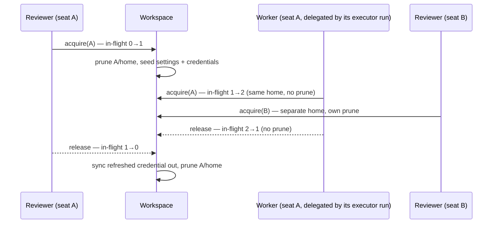
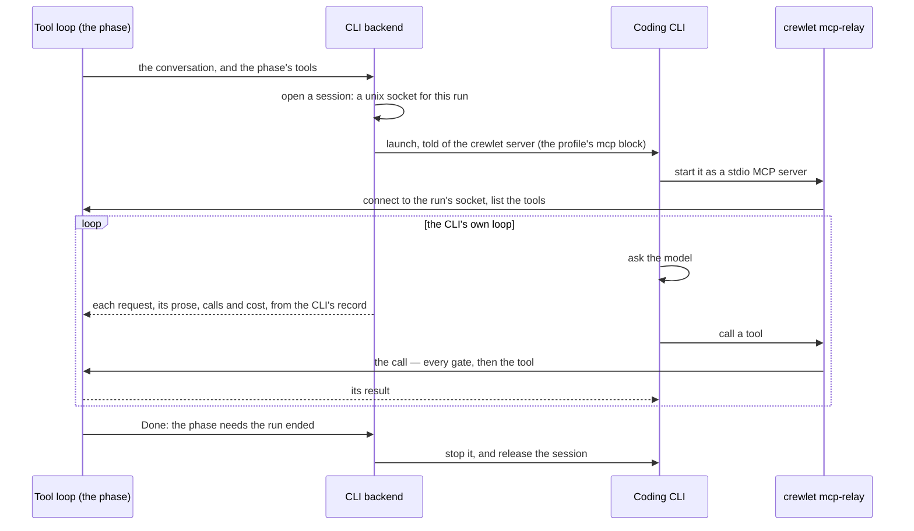

# LLM Backends

**Every model a seat runs on is reached through a coding CLI** — Claude Code
for Anthropic's models, Codex for OpenAI's, OpenCode for open models on any
provider it speaks to (a local server included), and the rest of the
[supported CLIs](#supported-clis). The engine drives the vendor's own
command-line tool as a process: it hands the CLI a conversation, serves it the
seat's tools as one MCP server the CLI calls in its own loop, and reads back
what the CLI's record shows of each model request — its prose, its calls and
its cost. There is no other kind of `providers.llm` entry.

```yaml
providers:
  llm:
    default:
      model: sonnet              # in the CLI's own grammar; claude-code is the default agent
```

```bash
# Signing in on a Claude subscription? Adopt the login this machine already has:
crewlet llm login default -from-host
# Otherwise log in (or mint a headless token) inside Crewlet's own dir:
crewlet llm login default -capture-token
crewlet llm doctor default                  # verify before the first turn
```

On an Anthropic API key instead, the same entry says so, and the key is read
from `ANTHROPIC_API_KEY` — the secret store first, then the environment:

```yaml
providers:
  llm:
    default:
      model: sonnet
      auth: { mode: api-key }
```

The CLI holds the sign-in — your plan's OAuth login, or your key — so Crewlet
never sees a password and never re-implements a vendor's auth. What Crewlet
controls is *where* that login lives, what each seat's copy of the CLI can see,
and how its answer is read back.

> **The trade-off up front.** A CLI is a *process*, not an HTTP endpoint. Each
> run pays a launch before its first byte — seconds, for a Node runtime — and
> a subscription's terms are generally written for interactive use. What it
> buys is the vendor's own harness for every model the vendor ships, the day it
> ships it: its own loop, its own way of calling a tool, its own cache. A seat's
> phase runs in that loop, which calls the seat's tools over MCP; a cheap side
> call — a summary, a judge — is a launch of its own. Size those
> accordingly: see [Auxiliary work and latency](#auxiliary-work-and-latency).

---

## Why the CLI is the only backend

Each model vendor ships its own harness: the request shape each of its models
accepts, how a model's thinking is carried from one round to the next, what is
cached and where, how a stream ends, which sign-in bills which account. And it
moves that harness with every model it releases. An engine that called the
vendors' HTTP APIs itself had to re-implement all of it, per vendor and per
model — a second copy of work the vendors already do, permanently a release
behind theirs, and wrong in exactly the places a new model differs from the
last one.

So Crewlet does not compete with the vendors' harnesses; it drives them. Claude
Code reaches Anthropic's models on a Claude plan *or* an Anthropic API key, Codex
reaches OpenAI's on a ChatGPT plan or an OpenAI key, and OpenCode reaches open
models — through OpenRouter, a hosted provider or a server on your own network.
Whatever a vendor changes about its wire format is the vendor's CLI's to follow,
and the engine's side is the same for all of them: a conversation in, an answer
out. The decision is recorded, with what the HTTP backends cost while the engine
had them, in [ADR-0045](https://github.com/crewlet/crewlet/blob/main/adr/0045-every-model-is-reached-through-its-vendors-cli.md).

The one vendor client the engine keeps is OpenAI's SDK, for
[`providers.embeddings`](../getting-started/configuration.md#providers): a
coding CLI computes no embeddings.

### What driving a CLI takes

Four problems have to be solved before a coding CLI can sit behind
[`llm.Provider`](overview.md#llm-provider), and each one is a section
below.

| Problem | Why it bites | Where it's solved |
|---|---|---|
| **Shared memory** | A CLI keeps sessions, history, todos, and project notes under one home. Seven seats on one login would read each other's transcripts. | [Isolation](#isolation-the-part-that-actually-matters) |
| **One model per entry** | A CLI takes `--model`, so per-phase models mean several entries — which must not mean several logins. | [Per-phase models](#per-phase-models) |
| **A loop of its own** | The CLI asks its model, calls tools and asks again by itself, and knows nothing of the seat's fence, budget or round cap. | [Tool calls](#tool-calls-on-this-host) |
| **Browser-only auth** | Subscription logins are OAuth (PKCE) with MFA — no password grant to script. | [Authentication](#authentication) |

---

## Picking a CLI

Pick the CLI by whose models you want, then the sign-in by how you pay for
them:

| Models | `agent` | Signs in with | Runs a seat's executor |
|---|---|---|---|
| Anthropic's (Claude) | `claude-code` — the default | a Claude Pro / Max login, a headless `CLAUDE_CODE_OAUTH_TOKEN` minted from it, or an Anthropic API key (`auth.mode: api-key`) | yes |
| OpenAI's (GPT) | `codex` | a ChatGPT Plus / Pro login, or an OpenAI API key (`auth.mode: api-key`) | no — the other phases only |
| Open models: OpenRouter, a hosted provider, a local server | `opencode` | the model provider's key in `env`, under that provider's own variable, or a login of OpenCode's own | yes |
| Gemini, Qwen, Cursor, Copilot, Grok, Muse, Kimi, Hermes, Pi | see [Supported CLIs](#supported-clis) | the vendor's own login, or a key (Qwen Code: a key only) | no — the other phases only |

The last column is whether the CLI can run a seat's executor: every agent
seat's executor is its coding CLI's own run in a [sandbox](code-sandbox.md),
where it does the seat's work and its code work alike, and this build has a
coding-agent runner for two CLIs, `claude-code` and `opencode`. Any other CLI
serves a seat's reviewer, workers and side passes (`llm_review`,
`llm_subagent`, `llm_auxiliary`, `llm_judge`) — its own loop on this host, with
its shell and editor denied and the seat's tools as its only working tools —
and a seat whose `llm` chain holds no `claude-code` or `opencode` entry is
refused on the write ([Where the CLI runs](#where-the-cli-runs)).

A seat can mix them: its executor on one entry, its reviewer on another, its
auxiliary work on a third, each a different CLI if you like — see
[Per-phase models](#per-phase-models).

### Anthropic's models: Claude Code

```yaml
providers:
  llm:
    claude:                       # on your Claude plan
      model: opus                 # an alias or an id: sonnet, opus, claude-opus-5-5
    claude-key:                   # on an Anthropic API key
      model: sonnet
      auth:
        mode: api-key             # reads ANTHROPIC_API_KEY; or name one:
        # api_key: "${ANTHROPIC_KEY_FOR_CREWLET}"
```

Claude Code is the default `agent`, so neither entry names it. **On a plan**,
the login is the CLI's own OAuth sign-in, which `crewlet llm login` brokers into
the entry's own directory or adopts from your home with `-from-host`; better
still where you can, `-capture-token` mints a headless `CLAUDE_CODE_OAUTH_TOKEN`
into the secret store, which survives an ephemeral container and needs no
refresh — see [Authentication](#authentication).

**On an API key**, `auth.mode: api-key` puts one key into the CLI's
`ANTHROPIC_API_KEY` and removes the plan's token variable, so the call bills the
metered account and never the plan. `auth.api_key` names the key as a `${VAR}`;
left out, the entry reads `ANTHROPIC_API_KEY` itself, through the secret store
and then the environment — so a key already exported, or stored with
`crewlet secrets set ANTHROPIC_API_KEY`, signs the entry in with no YAML change.
An entry in `subscription` mode never forwards a key, whatever the engine's own
environment holds: a subscription entry that silently picked up a
stray `ANTHROPIC_API_KEY` would bill the metered account while you believed you
were on a flat-rate plan.

`model` is what Claude Code's `--model` accepts — an alias that follows the
vendor's current model (`sonnet`, `opus`, `haiku`) or an exact id
(`claude-opus-5-5`). The model's thinking, its effort and its output limits are
Claude Code's to decide, as they are at a terminal; see
[What an entry does not set](#what-an-entry-does-not-set).

A seat's executor run on a Claude Code entry takes a person's notes between its
own steps, through hooks the run is started with; that needs Claude Code 2.1.163
or later — an older release is started without them, and its notes wait for its
review — and was measured on 2.1.263 and 2.1.310; see [The executor's run in a
box](#the-executors-run-in-a-box).

### OpenAI's models: Codex

```yaml
providers:
  llm:
    gpt:                          # on your ChatGPT plan
      agent: codex
      model: gpt-5
    gpt-key:                      # on an OpenAI API key
      agent: codex
      model: gpt-5
      auth: { mode: api-key }     # reads CODEX_API_KEY
```

The ChatGPT login is `codex login`, which `crewlet llm login` brokers, or the
`~/.codex/auth.json` your own Codex already holds, which `-from-host` adopts.
Codex mints no headless token, so a container that is rebuilt on every deploy
carries its login as a [credential bundle](#4-move-a-login-onto-another-host).
On an API key, `auth.mode: api-key` reads `CODEX_API_KEY` exactly as the Claude
Code entry reads Anthropic's — `CODEX_API_KEY` and not `OPENAI_API_KEY`, because
it is the variable `codex exec` signs its requests with: with only
`OPENAI_API_KEY` set it sent no `Authorization` header at all (measured on
0.153.4 and 0.164.0). An OpenAI key you already keep under `OPENAI_API_KEY` is
named as `auth.api_key: "${OPENAI_API_KEY}"`.

Codex runs with its shell switched off and its own `--sandbox read-only`, so the
one local tool it keeps, `apply_patch`, writes nothing — see [Tool calls on
this host](#tool-calls-on-this-host) — and it has no coding-agent runner, so a Codex
entry cannot run an executor: a seat's `llm` points at a `claude-code` or
`opencode` entry, and Codex serves its reviewer, workers or side passes.

### Open models, OpenRouter and local servers: OpenCode

OpenCode reaches models on any provider it speaks to, and reads its model as
`<provider>/<model>`, split at the first slash:

```yaml
providers:
  llm:
    open:
      agent: opencode
      model: openrouter/qwen/qwen3-coder     # the openrouter provider's qwen/qwen3-coder
      env:
        OPENROUTER_API_KEY: "${OPENROUTER_API_KEY}"
```

**OpenCode 2 only** — the `@opencode/cli` package; 1.x (`opencode-ai`) can run
neither this profile nor a coding box. Its key goes in `env` under the variable
of the provider the model names (`OPENROUTER_API_KEY`, `ANTHROPIC_API_KEY`,
`NVIDIA_API_KEY`, …), because OpenCode reads each provider's key from that
provider's own variable — see [A provider key in
`env`](#6-a-provider-key-in-env-opencode-hermes-pi). `crewlet llm login` runs
OpenCode's own `auth login` instead, for a provider it signs in to itself. A
bare model (`qwen3-coder`) names a provider and no model, which OpenCode refuses
as "Invalid model reference", so a write naming one is refused;
`opencode models --standalone` lists the spellings.

**A server on your own network** — vLLM, llama.cpp's server, Ollama, a gateway —
is reached as a provider *declared* in OpenCode's own configuration, with the
address it listens on. Under this profile that configuration is the file the engine
seeds into every call's own directory (see [Tool calls on this
host](#tool-calls-on-this-host)), so the declaration rides an override of that
seed. `seed_files` is a list and replaces wholesale, so the override restates the
profile's own policy beside the provider:

```yaml
providers:
  llm:
    local:
      agent: opencode
      model: local/qwen3-coder               # the provider declared below, and its model
      overrides:
        seed_files:
          - path: .crewlet-config/opencode.json
            in: work
            content: '{"$schema":"https://opencode.ai/config.json","update":"disable","share":"disabled","snapshots":false,"plugins":["-opencode.tools"],"permissions":[{"action":"*","resource":"*","effect":"deny"},{"action":"webfetch","resource":"*","effect":"allow"},{"action":"websearch","resource":"*","effect":"allow"}],"providers":{"local":{"package":"@opencode/ai/providers/openai-compatible","name":"Local server","settings":{"baseURL":"http://127.0.0.1:8000/v1"},"models":{"qwen3-coder":{}}}}}'
```

The `providers` block is OpenCode 2's format: the package for the server's wire
(`@opencode/ai/providers/openai-compatible`, or `…/anthropic-compatible`), its
`baseURL` under `settings`, and the models it serves. A server that takes a key
names the **variable** it is read from (`"env": ["LOCAL_LLM_KEY"]`), and the
entry's `env` carries the value — never the file, which is configuration and is
neither `${VAR}`-resolved nor redacted. A server that takes no key leaves the
entry with no sign-in the engine can see, which `crewlet llm doctor` clears once
its smoke test is answered. The declaration reaches the entry's own calls; an
[executor run](#the-executors-run-in-a-box) writes OpenCode's configuration of
its own, so there the model has to be one OpenCode knows by name.

A seat's executor run on an OpenCode entry takes a person's notes at its next
step, through a plugin the engine hands the run's server; measured on OpenCode
2.0.32 and 2.1.4 — see [The executor's run in a box](#the-executors-run-in-a-box).

### The other CLIs

Gemini CLI, Qwen Code, Cursor, Copilot, Grok, Muse Code, Kimi Code, Hermes and
Pi each have a built-in profile, and each serves the phases on this host only: its own login
or its own key, its own model grammar, and its own way of being handed the
seat's tools ([per CLI](#what-each-cli-does-with-the-seats-tools)). [Supported CLIs](#supported-clis)
says how each one signs in and what is particular about it, and `custom` is a
profile you write entirely yourself.

**Qwen Code signs in with a key and nothing else.** Both measured builds
(0.23.4 and 0.26.1) refuse the Qwen OAuth login, so the profile keeps no login
and runs the CLI's OpenAI-compatible sign-in (`--auth-type openai`): the key in
`OPENAI_API_KEY`, the endpoint in `OPENAI_BASE_URL`. `OPENAI_API_KEY` is a name
other vendors' keys are kept under too, so a `qwen-code` entry is
`auth.mode: api-key` and names its key — the engine never fills that variable
from its own secret store or environment in the entry's place, and a write that
leaves either out is refused:

```yaml
providers:
  llm:
    qwen:
      agent: qwen-code
      model: "${QWEN_MODEL}"                       # a model the endpoint serves, as it names it
      auth:
        mode: api-key
        api_key: "${DASHSCOPE_API_KEY}"            # put in the CLI's OPENAI_API_KEY
      env:
        OPENAI_BASE_URL: https://dashscope-intl.aliyuncs.com/compatible-mode/v1
```

`OPENAI_BASE_URL` names DashScope's endpoint, a Coding Plan's or any other
OpenAI-compatible one; left unset, the CLI falls back to an endpoint of its own.

---

## Configuration reference

An entry is the CLI's own settings and nothing else: which CLI, which model in
that CLI's grammar, where a seat's executor launched on it runs (`run_in`),
where its login and per-seat homes live, and how it signs in.

```yaml
providers:
  llm:
    default:
      agent: claude-code             # optional: claude-code (default) | codex | opencode
                                     #   | gemini-cli | qwen-code | cursor-agent | copilot
                                     #   | grok | muse-code | kimi-code | hermes | pi | custom
      model: sonnet                  # REQUIRED — passed to the CLI's model flag in its own
                                     #   grammar (opencode: <provider>/<model>). A ${VAR}
                                     #   works; one that resolves to nothing is refused
                                     #   when the entry is built, naming the variable,
                                     #   rather than run on a model nobody chose
      run_in: ""                     # where a seat's executor runs on this entry (claude-code
                                     #   and opencode only): direct | container | e2b. Empty
                                     #   = providers.sandbox.default_run_in — see "Where the
                                     #   CLI runs"

      state_dir: /var/lib/crewlet/llm-cli/claude
      # Where the login and the per-seat homes live, each CLI in a
      # subdirectory of its own (<state_dir>/<agent>). Empty uses
      # $CREWLET_LLM_CLI_HOME/<key>, falling back to ~/.crewlet/llm-cli/<key>.
      # Point it at a persistent volume when the engine runs in an
      # ephemeral container. A LITERAL PATH — unlike the credential fields
      # it is not ${VAR}-expanded, because it names where the engine keeps
      # files rather than a secret (the same reason the store path is a
      # Tier A field).

      timeout_seconds: 600           # one stretch of a CLI run on this host, wall clock (default 600);
                                     #   an executor run is bounded by its turn cap instead
      max_concurrent: 4              # live CLI processes on this host (default 4); executor
                                     #   runs are not counted: each seat runs at most one

      env:                           # extra child environment, ${VAR}-resolved
        OPENROUTER_API_KEY: "${OPENROUTER_API_KEY}"

      auth:
        mode: subscription           # subscription (default) | api-key | inherit-env
        token: "${MY_OAUTH_TOKEN}"   # subscription only; else the profile's own token variable
        # api_key: "${MY_API_KEY}"   # api-key only — refused under any other mode;
                                     #   else the profile's own key variable
        credential_bundle: "${MY_BUNDLE}"  # else CREWLET_LLM_CLI_<KEY>_CREDENTIALS

      overrides: {}                  # any field under "Profile fields"
```

**`model` is required.** A CLI with no model named runs the vendor's current
default, which moves under you and bills as a model nobody chose. A reference
that resolves to nothing is refused when the entry is built for the same reason,
naming the variable: one nothing answers for, one set to an empty value or to
white space (a compose file passing an unset host variable through, an empty
stored secret), and one part of a composite like `${PROVIDER}/sonnet` alike. A
missing *credential* still builds: every call then fails with the CLI's own
sign-in error, which names it, and a missing model has no such tell. The model
is trimmed before the CLI is handed it.

**`timeout_seconds` caps one stretch of the CLI's own work, wall clock**: from
its launch, or from the moment the last of the seat's tool calls in flight
returned, to its next tool call or its exit — the process launch, its model's
answers and its own internal retries and backoff. The seat's tools are not on
the clock: each is bounded by its own deadline, and a run that drives a phase
through many requests and calls is never cut for its length, only for a stretch
in which it made no progress the engine could see. A text function — a summary,
a judge — is one stretch from launch to exit. Ten minutes, because a stretch is
at least one answer of a current model, thinking against a 128K-token output
cap, which runs that long at the tail, and two minutes was measured cutting off
exactly the calls doing the most work; the launch comes on top of the first
stretch. On breach the process *group* is terminated (so the runtime's helpers
go too) and the call is reported as `timeout`, which the seat's fallback chain
carries to its next entry. A value of `0` takes the default; a negative one is
refused. It bounds the **phases on this host** only — the reviewer, a worker,
the onboarding pass, a side pass: an executor run is its CLI's own detached run
in a box, bounded by its turn cap (`role.sandbox.max_turns`, else
`providers.sandbox.default_max_turns`) rather than a clock.

**`max_concurrent: 4`** bounds the entry's **live CLI processes**, and keeps
peak memory near 1.5 GB: each CLI is a full Node or Rust runtime at roughly
200–400 MB resident, and an unbounded fleet of seats starting turns together can
exhaust a small engine host. A process holds its slot for its whole run — every
request and every tool call of it — and a model call made from *inside* one of
those tool calls on the same entry (a delegated worker, a condensing pass)
borrows the run's slot when no free one comes first, since the run is idle until
the call answers and a call waiting for a slot only its own caller can free would
wait for ever. Subscription plans also throttle concurrency well below what an
API key allows, so a much higher number mostly buys rate-limit errors. A call
waiting for a slot gives up when its turn is cancelled rather than launching a
process nobody is waiting for. Raise it on a large host with an account that
permits it; it is per entry, so size entries together (see [Per-phase
models](#per-phase-models)). Like `timeout_seconds` it counts the phases on this
host only: an executor run is a process in its own box, not counted against
it, and each seat runs at most one at a time.

**`env`** is the one way to give the CLI anything beyond `PATH`, locale, TLS
trust and proxy settings, because the child gets an
[allowlisted](#isolation-the-part-that-actually-matters) environment rather than
the engine's. It is `${VAR}`-resolved when the entry is built and redacted on
every config read; a reference that resolves to nothing is warned about
(`cli_agent_env_unresolved`) rather than refused, since a CLI whose optional
variable is unset still runs.

**`auth.mode` defaults to `subscription`, not `inherit-env`**, on purpose: an
entry that silently picked up a stray `ANTHROPIC_API_KEY` from the engine's
environment would bill the metered account while you believed you were on a
flat-rate plan. The three modes:

| `auth.mode` | What reaches the CLI |
|---|---|
| `subscription` (default) | its login — credential files in the entry's directory, or a database export — and a headless token in its `token_env` where `auth.token` or that variable resolves. Its `api_key_env` is removed. |
| `api-key` | one key in its `api_key_env`: `auth.api_key`, or that variable itself looked up through the secret store and then the environment (never for a [shared](#profile-fields) variable). Its `token_env` is removed, and no login is seeded: the call runs in the seat's [key home](#isolation-the-part-that-actually-matters). |
| `inherit-env` | whichever of the two variables the **engine's own** environment holds — the deliberate escape hatch for an unusual CLI, and the only mode in which a host credential reaches the child. Where that is the key, the call runs in the key home, as under `api-key`; otherwise beside the login, as under `subscription`. |

**One key, never a list.** A CLI holds one sign-in and rotates nothing, so an
entry has at most one token or one key; a second key is a second entry, placed
after the first in the seat's [fallback chain](#falling-back-between-entries).

**Every credential an entry configures has to reach the CLI, or a write
keeping it is refused.** The engine puts a credential only into a variable the
profile names for it — `api_key_env` for a key, `token_env` for a headless
token — so each of these would run with the credential unused:

| Written | Refused because | Instead |
|---|---|---|
| `auth.mode: api-key` on a CLI whose profile names no `api_key_env` (`hermes`, `pi`, `opencode`, `kimi-code`) | the key has no variable to go in | `hermes`, `pi`, `opencode`: leave `auth.mode` at `subscription` and set the key in `env` under its provider's own variable ([below](#6-a-provider-key-in-env-opencode-hermes-pi)). `kimi-code`: put the key in the credential directory's `config.toml` — `crewlet llm login`, or a [credential bundle](#4-move-a-login-onto-another-host). A build of the CLI that does read a key variable: name it with `overrides.api_key_env` |
| `auth.api_key` under `subscription` or `inherit-env` | only `api-key` mode reads it | set `auth.mode: api-key`, or drop it |
| `auth.token` on a CLI whose profile names no `token_env` (every built-in profile but `claude-code`) | the CLI mints no headless token | remove it |
| `auth.token` under `api-key` or `inherit-env` | `api-key` removes the token variable and `inherit-env` forwards the engine's own | `auth.mode: subscription` |
| `auth.mode: inherit-env` on a CLI that names neither variable | nothing would be forwarded | `subscription`, with the key in `env` or a login |
| `auth.mode: subscription` — the default — on a CLI that keeps no login and mints no token but reads a key (`qwen-code`) | `subscription` removes the key variable, so the entry would sign in to nothing | `auth.mode: api-key`, with the key as `auth.api_key` |
| `auth.mode: api-key` with no `auth.api_key` on a CLI whose key variable is [shared](#profile-fields) (`qwen-code`'s `OPENAI_API_KEY`) | that variable holds other vendors' keys too, so the engine never reads it in the entry's place | name the key: `auth.api_key: "${DASHSCOPE_API_KEY}"` |
| `auth.mode: inherit-env` on a CLI whose key variable is [shared](#profile-fields) | it would forward whichever vendor's key the engine's process holds under that name | `auth.mode: api-key`, naming the key as `auth.api_key` |
| the profile's `token_env` or `api_key_env` in `env` | `auth` owns those: whether a value there reaches the CLI depends on `auth.mode` and on whether a credential resolves from the secret store or the engine's environment, which the document cannot show | `auth.token`, or `auth.api_key` with `auth.mode: api-key` |
| `overrides.token_env` or `overrides.api_key_env` that is not an environment variable name (letters, digits and underscores, not starting with a digit — `MY-TOKEN`, say) | no secret store, `${VAR}` or `crewlet llm login` can hold a name outside that grammar, no shell exports one for `inherit-env` to forward, and a name carrying `=` sets a different variable in the CLI's environment | the variable your build of the CLI reads, e.g. `MY_TOKEN` |
| a variable the engine sets to isolate the call in `env` (`HOME`, an XDG home, `TMPDIR`, the profile's relocation and isolation variables) | it would replace that isolation for every seat on the entry | drop it; the refusal names the profile field that moves it, where one does |

An `api-key` entry whose key resolves to nothing is not refused — the document
cannot see the secret store — but `crewlet llm doctor` reports it as "no
sign-in", naming `auth.api_key` and the variable it fell back to.

Each rule is checked against the profile with `overrides` merged in, and each
refusal names the field and the route to take. They are **admission** rules:
every write path — `crewlet validate`, a `PUT` or `PATCH` of the config, a
setup write, a revert — refuses a document that breaks one, while a revision
being *applied* that breaks one is applied and warned about, because the
entry still runs (signed in by whatever the CLI does read) and refusing it
there would take a node off the fleet's configuration during a rolling
upgrade. A profile that cannot drive its CLI at all — an override typo, a
missing `binary`, no `model_args` carrying `{model}` — is different: no
node can build it, so it is refused at apply too.

**A model has to be one the CLI can read, or a write naming it is
refused.** `opencode` reads its model as `<provider>/<model>` and splits it
at the first slash, so a model with nothing before or after that slash —
`claude-sonnet-5`, `anthropic/` — names no model at all, and every call the
entry makes, an executor run included, fails inside the CLI with its own
"Invalid model reference". Name the provider as the CLI spells it:
`anthropic/claude-sonnet-5`, `openrouter/anthropic/claude-sonnet-5`
(`opencode models --standalone` lists them). It is judged on the value the CLI is
handed — the model rendered through `model_args`, a joined
`--model={model}` read past its `=` — and a `${VAR}` model is not judged,
since its value is the secret store's and the environment's. The grammar is
a profile declaration, `model_names_provider`, so there are two ways past
it when a CLI release relaxes it: `overrides.model_names_provider:
false`, or a `model_args` override that writes the provider into the flag
itself (`["--model", "anthropic/{model}"]`), which makes a bare model whole.
This too is an **admission** rule, for its own reason: the entry builds and
the CLI starts, and the grammar is a vendor fact that moves between releases
— a newer build, or a newer peer, may know it better — so a revision being
applied is warned about rather than refused.

**A profile's `passthrough_env` may not name a
[credential](#6-a-provider-key-in-env-opencode-hermes-pi)** — an admission
rule like the ones above. Everything listed there is forwarded from
the engine's own environment *before* `auth.mode` is consulted, so a key
named there would reach every seat whatever the mode says — the same
metered-bill-on-a-flat-rate-plan failure the mode exists to prevent. Use
it for genuine non-secret configuration (`GOOGLE_CLOUD_PROJECT`, a
region); a CLI's key belongs in `api_key_env` or `token_env`, and
`auth.mode: inherit-env` is the deliberate way to let the host's value
through.

**Nor may a profile's `env`**, for the same reason and one more:
`overrides` is neither `${VAR}`-resolved nor redacted, so a key written
there would sit in the stored revision in plain text and come back on every
config read. A credential the CLI needs goes in the entry's `env`, which is
both, or through `auth`. A profile's `env` may not name its `token_env` or
`api_key_env` either, whatever they are called: `auth` owns those, and the
entry's `env` and `auth` are both layered over the profile's, so whether a value
there reached the CLI would turn on the mode and the secret store rather
than on anything the profile says.

---

## What an entry does not set

A coding CLI driven headlessly takes a model and a prompt, and reads everything
else about how its model behaves from its own configuration. So an entry has no
field for any of it, and neither does a call:

- **No sampling.** No temperature is sent by any phase; every call runs at what
  the CLI sends, which is what it sends at a terminal.
- **No effort and no thinking switch.** How hard a model thinks is the CLI's
  configuration of that model, or the model you pick. A model that habitually
  spends its whole answer thinking is changed with `model`.
- **No output cap.** A caller that needs a short answer — the round-cap judge,
  a summary — asks for one in its prompt, the one channel every CLI reads, and
  [token budgets](../getting-started/quickstart.md#token-budgets-optional) bound
  what a seat spends.
- **No endpoint.** Where a CLI sends its requests is the CLI's own setting —
  for OpenCode a provider declaration ([above](#open-models-openrouter-and-local-servers-opencode)).
- **No key rotation and no shared bench.** One sign-in per entry, and a spent
  plan sits the entry out on the node that heard it, not across the fleet (see
  [Falling back between entries](#falling-back-between-entries)).

Where you do want a CLI configured differently from its vendor's defaults, the
entry reaches each of the CLI's own channels: its environment variables through
`env`, its flags through `overrides.complete_args`, and a settings file through
`overrides.seed_files`, written into the seat's home or the call's directory
before every call. Each is the vendor's configuration surface rather than
Crewlet's, so check it against the version `crewlet llm doctor` reports.

---

## Per-phase models

Phase selection resolves by `providers.llm` **key**, so `llm`,
`llm_review`, `llm_subagent`, `llm_auxiliary` and `llm_judge`
each name an entry, including list-form fallback chains. The seat's code
work is its executor's run, so it runs on `llm` like the rest of the executor. See
[Turn Engine — per-phase LLM models](turn-engine.md#per-phase-llm-models).

The model goes on the CLI's `--model`, so one entry is one model, and per-phase
models mean one entry per model:

```yaml
providers:
  llm:
    opus:
      model: opus
      state_dir: /var/lib/crewlet/llm-cli/claude
    sonnet:
      model: sonnet
      state_dir: /var/lib/crewlet/llm-cli/claude   # the same login as `opus`
    haiku:
      model: haiku
      state_dir: /var/lib/crewlet/llm-cli/claude
    claude-key:                                    # the plan's backstop
      model: opus
      auth: { mode: api-key }

roles:
  - name: Engineer
    llm: [opus, claude-key]         # the executor: the plan first, the key when it is spent
    llm_review: sonnet              # the reviewer, on a cheaper model
    llm_auxiliary: haiku            # see the latency note below
    llm_judge: haiku
```

**Point them at the same `state_dir` and they share one login.** The three plan
entries above then use the credential directory a single `crewlet llm login`
wrote, instead of needing one login per entry — the default `state_dir` is per
provider key precisely so unrelated entries do *not* collide, which means
entries that should share must say so. They also share one set of per-seat
homes and one generation, so a call on one entry never wipes a live call on the
other.

**Sharing is per CLI.** Each CLI keeps its files in a subdirectory of the
`state_dir` named for it (`<state_dir>/claude-code`, `<state_dir>/codex`, …),
because two CLIs disagree about which files are credentials and which are
conversation memory. So entries on one `state_dir` share a login only when they
drive the same CLI — an entry that leaves `agent` out drives `claude-code` and
shares with one that names it — and entries on different CLIs share the
directory and nothing in it, which is what lets an entry [move to another
CLI](#an-entry-moved-to-another-cli) without a restart.

**Keep the key entry's directory apart.** `claude-key` above takes the default
`state_dir`, so its seats' homes are seeded with no plan login: with one, which
of the two the CLI bills is the vendor's precedence rather than anything the
entry says.

**Concurrency is per entry.** `max_concurrent` caps one entry's processes, so
the four entries above at the default of 4 can run 16 CLI processes at once.
Size them together against the engine host's memory.

### An entry moved to another CLI

Moving an entry to another CLI (changing its `agent`) is an ordinary revision,
applied live on every node: the key keeps its `state_dir`, the new CLI opens a
login directory of its own, signed out until you sign it in (`crewlet llm login
<key>`, or the CLI's own sign-in adopted with `-from-host`), and moving back
finds the old CLI's login where it was left.

**A credential bundle does not move with it.** A bundle belongs to the CLI it
was exported from, and names it, but it is keyed by the entry —
`CREWLET_LLM_CLI_<KEY>_CREDENTIALS`, or the secret `auth.credential_bundle`
references — so after the move it still holds the old CLI's login and names
the old CLI. A restore reads that name rather than the files' names, which
cannot tell two CLIs apart: Codex, Cursor Agent, Grok, Hermes, Muse Code and Pi
each keep a login in an `auth.json`. Wherever the new CLI's credential directory is empty —
every node you have not signed it in on, and every container on a fresh
volume — each boot and apply refuses the bundle and writes nothing, logged as
`cli_agent_bundle_restore_failed` with the CLI the bundle names, and `crewlet
llm list`, `status`, `export` and `doctor` say so too, as `crewlet llm import`
does for a bundle of another CLI's, until it is replaced: sign the new CLI in,
then export its bundle in the old one's place (`crewlet llm export <key>
-secret-store`, or pipe `crewlet llm export <key>` into the secret
`auth.credential_bundle` references). A deployment that relies on the bundle
runs the entry signed out until then.

### Auxiliary work and latency

`llm_auxiliary` serves the calls around a turn: the turn-start prefetch (the
knowledge query, the relevance filter, a recalled turn's rewrite), the
condensing of a tool result too large for the conversation, and every
reflection and learning pass after it. `llm_judge` serves the onboarding pass's
round-cap [extension judge](turn-engine.md#round-cap-extension-judge), the one
pass the engine extends: the executor is its CLI's own run, capped by its
`max_turns`. Each of those calls
is one CLI process, so each pays a launch before its model starts — and each has
a **fixed deadline**, which no entry setting widens:

| Calls | Deadline |
|---|---|
| The turn-start prefetch — the knowledge query and the relevance filter, each call; a recalled turn's rewrite, the whole render | 30 s |
| The extension judge | 30 s |
| Condensing a tool result or a payload, each piece | 60 s |
| Each reflection and learning pass — the persist decider, the counterparty profiler, skill synthesis, refinement and promotion, episode compaction | 60 s |

The entry's `timeout_seconds` caps the process; these cap the *call*, and
whichever ends first ends it. They are fixed because each sits in front of
something: the prefetch is latency a person is waiting through before the
executor sees anything, the judge runs on a phase that has already run out of
rounds, and a learning pass that hangs holds up the company's reflection rather
than one turn's. A call cut off degrades rather than fails — the prefetch
goes without what the call would have added (a summary falls back to the raw
recalled turns), the judge falls through to the rescue it was there to avoid,
the learning pass persists nothing — so a slow auxiliary model does not stall
turns, it quietly does less.

**So point `llm_auxiliary` and `llm_judge` at a fast, cheap model** — `haiku` on
Claude Code, a small open model on OpenCode — rather than the seat's own. A
frontier model thinking at length behind a Node launch is the shape most likely
to be cut off at thirty seconds.

---

## Falling back between entries

A seat's `llm` (and every per-phase field) takes a **list**, tried in order for
every call, and the walk moves on whenever a failure is one another entry might
not share: a spent plan or a rate limit (`rate_limit`), a missing or expired
login (`auth`), a `timeout`, or a run that failed for no reason the profile
recognises (`server`) — an error or an overload the CLI relayed from its vendor,
a crash, output this build can no longer read, a run not seen to its end (see
[a helper that outlives the CLI](#a-helper-that-outlives-the-cli)). Only a
`fatal` failure stops it, and that is a call the engine itself cannot make: a
prompt it cannot render, a file of the call's it cannot write, a CLI it cannot
start on this host — the binary missing or not executable there, or no pipe or
process for it, refused before any CLI exists. Those are yours to fix, and
walking past one would only carry every call to the next entry, and its bill,
until somebody read why. A CLI that started is never `fatal`, however it ended.

A call its caller **cancelled** (`canceled`) stops the walk too: a person
pressed Stop, a seat's turn was stopped, a node began to drain. The CLI was
signalled with the call and exits as if it had crashed (143 for a Node
runtime), so the kind is read from the caller's context and never from the
exit status. Nothing is learned from it: no `provider_fallback` is logged,
the next entry is not started, and the entry's readiness is left as it was.

The natural chain is **one CLI, two ways to pay**: the plan first, the key
after it.

```yaml
providers:
  llm:
    plan:
      model: sonnet
    key:
      model: sonnet
      auth: { mode: api-key }       # ANTHROPIC_API_KEY

roles:
  - name: Engineer
    llm: [plan, key]                # flat-rate first, metered as the backstop
```

A spent subscription window arrives as prose on a *successful* exit ("Usage
limit reached · continuing automatically"). Crewlet matches that wording — and,
where the CLI relays the API's own error instead, the
`"type":"rate_limit_error"` in it — and reports it as `rate_limit`, so the seat
moves to `key` for that call.

**And the entry then sits out, on this node.** A spent window lasts hours and a
seat starts a CLI for every phase it runs and every side call around it, so
without it every one of those, on every seat on the entry, would start a CLI — seconds of a runtime holding one of the entry's few
slots — only to hear the same sentence and fall through anyway. Instead every
call to the entry fails at once as a rate limit — one already queued for a slot
as soon as it gets one — saying `sitting out until …` with the CLI's own
sentence, until the window ends:

- at the reset instant the CLI named, where its profile can read one, and never
  more than **an hour** away, so a plan you raised or a login you renewed has
  the entry back within the hour even when the vendor's window runs for days;
- otherwise after **one minute** — which is every shipped profile today: the
  current Claude Code prints no reset instant at all. A probe costs at most
  the entry's `max_concurrent` process launches a minute — the calls that take
  a slot once the window ends, before the first of them answers; every call
  queued behind them is refused as soon as one reports the plan still spent.
  Sitting out a plan that has already reset costs the fallback's spend for as
  long as it sits.

The sit-out is the entry's own, on the node that heard the sentence: every other
node learns the same thing from its own calls, once per window. A later sit-out
never shortens an earlier one.

**An executor's run is heard too.** A seat's executor is its CLI's own run in a
box, which never goes through a call on this host, so the node that collects a run
reads how it ended — its answer, its error, whether it failed — against the
same `limit_markers`, by the same rules as a call, and sits the entry out
before the turn launches again (`cli_agent_run_limit_reported`). A launch picks
the first member of the seat's chain that is not sitting out, so a reviewer
sending the turn back an hour into the same window moves to the next entry
rather than walking into the same limit. **An apply keeps it**: an entry an
apply rebuilds with its specification unchanged carries the sit-out over,
since its plan is no less spent for a new configuration revision.

**A login is never sat out.** An expired or missing login is `auth`, which also
moves the seat down its chain, but the very next call tries the entry again:
`crewlet llm login` mends a login from another process, usually while seats are
running, and a window would hold a signed-in seat on its fallback for nothing.
Finding out a login is still missing costs a CLI that exits at once rather than
a model call.

### What a sentinel may be

Both recognitions are `limit_markers` / `auth_markers` on the profile: a
literal substring the vendor emits, plus (where it carries one) the field
holding the reset instant, so the sit-out is a datum rather than a
guess. They are matched against what the CLI printed, and on a healthy call
that is **the model's own answer** — its prose and the arguments of every tool
call it makes — while a limit match throws the answer away, sits the entry out
for every seat on the node and hands the seat to the next entry in the chain.
So what the CLI said on stdout is read on terms:

- In a run the CLI **reported failed** — a non-zero exit, or its own failure
  flag (`error_paths`) — a sentinel counts anywhere in it. The CLI has said
  this was no answer, so what it printed is its account of why.
- In a run it did **not**, a sentinel counts only where it **opens** what was
  said: the first non-empty line begins with it. That is the vendor's report
  standing where the answer should be — Claude Code's
  `Usage limit reached · resets …` — and an answer that merely mentions a
  limit, or a tool call carrying one in its arguments, is the answer it is.

Stderr is matched anywhere: the answer does not reach it. The anchoring is what
makes the built-in profiles' generic sentinels safe to ship — Copilot's
`rate limit` and `usage limit`, Cursor's `usage limit` and `quota` are not
measured vendor sentences, and on a clean run they count only as the opening of
a report. Under
`marker_scope: events` a sentinel is instead the failure *class*, compared whole
with the CLI's own failure event and nothing else
(see [CLI flags drift](#cli-flags-drift--and-thats-a-config-edit-not-a-release)).
Every sit-out logs `cli_agent_limit_reported` with where its sentinel matched —
`report`, `failed-run`, `stderr` or `event` — and the line it matched, so one
you doubt can be traced to what the vendor said.

So a sentinel has to be the vendor's *wording*, and a profile is refused
at `crewlet validate` if one contains no letters. The rule exists because
a shipped profile carried `sentinel: "429"`, and three digits matched as
a substring is not a rate limit — it is a model quoting an HTTP status, a
stack trace's line number, a token count, or any ten-digit epoch. Every
one of those took a working subscription out of service.

The other way a sentinel stops working is quieter — the vendor reworded
it, so it simply never fires. A spent plan the CLI reports as a failed run
then reaches the chain as `server`: the seat still moves on, but the entry
never sits out, so every call of every seat on it starts a CLI to hear the
same sentence again. One it reports on a successful exit is taken for the
model's answer. Both are fixed the same way, with `overrides.limit_markers`; see
[CLI flags drift](#cli-flags-drift--and-thats-a-config-edit-not-a-release)
for the shape, and take the wording from the sentence your CLI actually
printed, which a `server` failure carries verbatim so that you can.

---

## Isolation: the part that actually matters

One provider instance serves every seat in the org. Each **call** gets
its own place to run:

```
<state_dir>/
└── <agent>/                          # one per CLI: claude-code/, codex/, …
    ├── credentials/                  # the login — ONE per state_dir and CLI
    ├── credentials.lock              # taken by every writer and reader of it
    ├── credentials.pending           # a write of the login, while one is in progress
    ├── seats/                        # where a call signed in with the login runs
    │   ├── sarah-chen/
    │   │   ├── cache/                # XDG_CACHE_HOME — warm, holds no conversation
    │   │   ├── home/                 # HOME + XDG config/data/state + vendor dirs
    │   │   └── work/<call-id>/       # cwd for one call, then deleted
    │   └── marcus-rivera/
    │       └── …
    └── key-seats/                    # where a call signed in with a key runs
        └── sarah-chen/
            └── …                     # the same layout, never holding the login
```

**Between seats.** Every seat gets its own `home`. `HOME`,
`XDG_CONFIG_HOME`, `XDG_DATA_HOME`, `XDG_STATE_HOME`, `TMPDIR` and the
vendor's own relocation variable (`CLAUDE_CONFIG_DIR`, `CODEX_HOME`, …)
all point inside it — or, for a variable naming configuration a call must
not share with the seat's other calls (`OPENCODE_CONFIG_DIR`), inside that
call's own working directory — and a vendor's own switch that stops it
reading configuration from anywhere else (`OPENCODE_CONFIG_PROJECT_DISABLE`,
the profile's `isolation_env`) is set beside them. Nothing in a CLI's state
layout is reachable across that boundary, and nothing configured may move
it: a profile's `env` or `passthrough_env`, or an entry's `env`, naming
one of those variables is refused, because each is layered over the
isolation and would replace it without a word.

**Between a login and a key.** A call that hands its CLI a key — every call
under `auth.mode: api-key`, and one under `inherit-env` whose engine
environment holds the profile's `api_key_env` — runs in the seat's
`key-seats/` home, which is never seeded with the login and from which nothing
is carried back to `credentials/`. A CLI may keep what a key signed it in to in
the very file its login lives in: `cursor-agent` writes the session
`CURSOR_API_KEY` bought, and the key itself, into its `auth.json`, and prefers
that file to the variable on its next start. In a login's home that file would
be carried back as the login of record and sign every subscription seat on the
directory in with the key; so a key home's credential files are removed as
each of its generations opens and closes, and the key stays no longer than the
calls it was handed to.

**Between turns.** Each profile declares its `volatile_paths` —
sessions, transcripts, history, todo state. They are deleted whenever none of
the seat's calls is in flight: as its first call opens a generation and as its
last one closes it ([Concurrency within a seat](#concurrency-within-a-seat)).
Crewlet's memory model is the [agent diary](agent-learning.md) and the episode
store; a second, invisible memory inside the CLI would make turns
non-reproducible and would carry one task's context into the next.

**The temporary directory is the engine's.** `TMPDIR` names `tmp` inside the
seat's home, so what a CLI unpacks or spools there stays with the seat it ran
for rather than in the engine's own temporary directory — and every CLI leaves
something there: Claude Code a probe directory on almost every call, Qwen Code a
compile cache, OpenCode its scratch. So `tmp` is pruned with the volatile paths
whatever the profile lists, and made again, empty and `0700`, for the
generation that follows: a program finds its temporary directory rather than
making it, and a `TMPDIR` that names nothing fails the first temporary file a
CLI opens (every codex call from 0.164 did, before the directory was made).

**Between the seat and the host.** The child process gets an
**allowlisted** environment — `PATH`, locale, `TERM`, TLS trust, proxy
settings, plus whatever the profile and the entry's `env` declare — never the
process environment. It is the one allowlist every child the engine starts is
handed, a [stdio MCP server](../guides/tools-and-mcp.md#what-a-stdio-servers-environment-is)
and a local sandbox's coding agent included, so the three cannot disagree about
what a child may see. Inheriting the engine's environment would hand every seat
the keyring every session cookie is signed under, the Tier A token values, the
org's `SLACK_BOT_TOKEN` and the collector credential in
`OTEL_EXPORTER_OTLP_HEADERS`. It would also silently bill a metered
`ANTHROPIC_API_KEY` that happened to be exported to an entry signed in on a
plan.

**Working directory.** Each call runs in a per-call scratch directory,
created empty and removed afterwards, which holds only what the engine writes
there for that call — the `.git` marker below, the profile's `in: work` seed
files, the system prompt file — so a CLI that reads `AGENTS.md` / `CLAUDE.md`
from `cwd`, or writes scratch files, finds nothing from anyone else.

**An empty directory is not enough for a CLI that also walks *up* from
it.** The per-call directory is `<state_dir>/<agent>/seats/<seat>/work/<call>`, and
`state_dir` defaults to a directory under the engine user's home, so whatever
sits above it — that home, or a repository you pointed `state_dir` into —
is an ancestor of every call. Vendor CLIs look for project files — `AGENTS.md`,
`CLAUDE.md`, their own rules, skills, hooks, a project configuration — from
their working directory up to the nearest repository root, and some run git
there, so a `state_dir` inside a checkout handed every seat the instructions of
a repository the engine does not control.

**So each call's directory is a project root of its own.** Before the CLI
starts, the engine writes a `.git` *file* into the call's directory:

```
gitdir: .crewlet-not-a-repository
```

It names a git directory inside the call's own `0700` directory that never
exists, so git reports "not a git repository" there, and a walk that stops at a
repository root stops where the call begins. A file, and one naming a gitdir,
because those are the shapes every CLI measured stops at: an empty `.git`
*directory* is ignored by git and by the CLIs that ask git where the root is
(OpenCode, Qwen Code, Copilot), and Kimi Code accepts a `.git` file only when
its first line is `gitdir:`. Measured against the installed CLIs, the file keeps
the project files above the call out of codex, OpenCode, Kimi Code, Qwen Code,
Hermes, Copilot's instruction files and Gemini CLI's `GEMINI.md`, and changes
nothing else they send. The path is the engine's: a `seed_files` entry may not
claim it.

**Not every walk ends there, so each profile closes the rest itself.** Every
built-in profile was measured through the engine's own code path with the state
directory inside a git checkout whose levels above the call held the project
files that CLI reads — instruction files, rules, skills and a `.env`, and for
most also hooks and MCP configurations — and none of them reached a request.
What does that, CLI by CLI, and which of its own tools each call is offered
(each profile's comments in the shipped table record the versions and the
measurement). A run that offers the seat's tools is offered them besides, as the
one MCP server `crewlet`, and no other MCP server — the home's, a project's or a
plugin's — starts beside it ([per CLI](#what-each-cli-does-with-the-seats-tools)):

| `agent` | Tools offered | What keeps the call to its directory |
|---|---|---|
| `claude-code` | `WebFetch`, `WebSearch` (`--tools` names the tools that exist; `--allowedTools` lets them run) | `--setting-sources ""`, so no user, project or local settings file adds hooks, permissions, MCP servers or plugins, and `CLAUDE_CODE_DISABLE_CLAUDE_MDS` and `CLAUDE_CODE_DISABLE_AUTO_MEMORY` (`isolation_env`), which keep the `CLAUDE.md` family and the auto-memory out — the `.git` file does not end this CLI's walk for them, and they are no setting source. Plus `--strict-mcp-config` (no MCP server but the ones `--mcp-config` names: none on a text function, the seat's on a run with tools), `--disable-slash-commands` and `--no-session-persistence`. `CLAUDE_CODE_DISABLE_NONESSENTIAL_TRAFFIC` stops every connection that is not the call's own, and `CLAUDE_CODE_DISABLE_GIT_INSTRUCTIONS` drops the repository status the CLI would attach to a seat's call. A machine-wide managed settings file, which only an administrator of the host can write, still applies |
| `codex` | web search, and `apply_patch`, which `--sandbox read-only` keeps from writing anything | `project_root_markers=[]` beside the `.git` file; skills, rules, hooks, connectors, plugins and memories off; the shell, `view_image`, the goal, multi-agent and `request_user_input` tools off; `--ignore-user-config`, so no `config.toml` in the seat's home — and no MCP server one declares — is read; `--ephemeral` on a text function, and `CODEX_SQLITE_HOME` in the call's own directory, so nothing is left in the seat's home for the next call. A run with tools drops `--ephemeral`, because the session file it then writes is the record of its requests; the sessions directory is volatile, so it goes with the seat's generation |
| `gemini-cli` | `web_fetch`, `google_web_search` | A policy file in the seat's home denies every tool and allows the two web tools above the denial (a machine-wide policy under `/etc/gemini-cli/policies`, which only an administrator can write, outranks it). The CLI loads the first `.gemini/.env` or `.env` it finds walking up to `/`, which the `.git` file does not stop, so the call's directory holds one of each, holding only a comment. `GEMINI_CLI_TRUST_WORKSPACE=true` trusts the call's own directory, which a headless run requires (untrusted, every call exited 55); usage statistics off |
| `qwen-code` | `web_fetch` (`web_search` only where a DashScope search backend is configured) | `tools.core` allows the web tools and `permissions.deny` names every other tool either build registers; memory extraction, chat recording, usage statistics, skills, hooks and the CLI's own retry rounds off. Its `.env` walk is not stopped by the `.git` file, so the call's directory holds its own `.qwen/.env` |
| `opencode` | `webfetch`, `websearch` | `OPENCODE_CONFIG_PROJECT_DISABLE` (`isolation_env`) switches off the walk for project configuration, and `OPENCODE_CONFIG_DIR` points into the call's own directory, where the policy is seeded — see [Tool calls on this host](#tool-calls-on-this-host). The machine's managed configuration (`/etc/opencode` on Linux), which only an administrator can write, still applies |
| `cursor-agent` | `WebFetch` (a `.cursor/cli.json` in the call's directory denies shell, write and read) | `--trust`, without which print mode refuses the call's new directory ("Workspace Trust Required"), and `--exclude-workspace-context`. With the `.git` file no hook, `cli.json` or `mcp.json` above the call is read. **Its rule loader does walk to `/`**: both measured builds open every `AGENTS.md`, `CLAUDE.md` and `.cursor/rules` file from the call's directory up, with or without the flag. None was in the run request, which carries the user message alone; what the service asks the CLI for after that could not be measured. Put `state_dir` outside any directory tree holding such files, and they are not there to open |
| `copilot` | `web_fetch` (`--available-tools`; the 1.0.103 bundle lists a `web_search` among the tools of its GitHub server on a GitHub sign-in, which was not measured) | The `.git` file ends the walk for instruction files, hooks and repository settings. Its custom-agent discovery walks past it to the enclosing repository's root and opens the agent files on the way; none reaches a request, since the task tool that lists them is not available. `--disable-client-telemetry`, and `COPILOT_AUTO_UPDATE=false` |
| `grok` | `web_search`, `web_fetch` (`--tools`, with every other built-in in `--disallowed-tools`; `GROK_WEB_FETCH=1`, since the fetch ships off, and `--allow WebFetch`, without which a headless run's first fetch cancelled the run) | No `--trust`, so a headless run loads no project rules. It reads the enclosing repository's `.git/config` and `HEAD` past the `.git` file; nothing of them reached the request. Background workflows, the turn-summary request and cross-session memory off |
| `muse-code` | `web_search`, `web_fetch` (`run.toolset` in the seeded settings) | Untrusted, the CLI admits no project rules, skills or hooks, and the `.git` file ends its walk besides. `--no-foreign-personal-context` keeps other CLIs' personal rules and skills (a `CLAUDE.md` under the home's `.claude`) out, and `--disable-reminders` turns off the reminder requests that each re-sent the call's prompt |
| `kimi-code` | `FetchURL`, and `WebSearch` where a Moonshot search service is configured (the agent file's allowlist) | The `.git` file ends the `AGENTS.md` chain the vendor's prompt reads; project skills need a `Skill` tool the allowlist leaves out. Telemetry off |
| `hermes` | `web_search`, `web_extract` (`--toolsets web`) | The `.git` file ends its walk for `.hermes.md` and the `AGENTS.md` chain, and it reads `CLAUDE.md` and `.cursorrules` from the call's directory alone. A seeded `config.yaml` turns off the coding brief a project marker within six levels above would switch on, the title request and memory |
| `pi` | none — its built-in set has no web tool (`--no-tools`) | `--no-context-files`, because its `AGENTS.md` / `CLAUDE.md` walk goes up to `/` and ignores `.git`; `--no-approve` pins project trust to none; `--no-extensions`, `--no-skills` and the other discovery switches |

`crewlet llm doctor`'s shell probe is the measurement on your host: it asks the
CLI to run a command and believes only an answer it could not have guessed —
run it from the state directory you deploy with.

### Concurrency within a seat

Delegated [workers](turn-engine.md#workers) run in parallel and belong to the
*same* agent, so they share that seat's home — sharing memory between an
agent and its own workers is harmless by definition. Pruning is keyed
to the seat's in-flight count crossing zero: the first concurrent call
wipes and seeds, the last one to finish wipes again. Parallelism inside a
seat is preserved; nothing crosses a seat or a turn. Every one of those calls
still takes one of the entry's `max_concurrent` slots, for as long as its CLI
lives, as does a seat's auxiliary command (an export, a usage report), which
runs inside the slot of the call it brackets. The one exception is a model call
made from *inside* a run's tool call on the same entry — the workers a
`delegate` call starts, a tool's condensing pass — which borrows that run's slot
when the entry has no free one, one borrower at a time: the run's CLI is idle
until the call answers, and a slot only that run could free is one it would
never get.



---

## Where the CLI runs

**In every phase the CLI drives its own loop.** It asks its model, calls the
seat's tools as the tools of one MCP server named `crewlet`, and asks again, the
way it would at a terminal; no tool rides a prompt and no call is read out of a
model's prose ([ADR-0049](https://github.com/crewlet/crewlet/blob/main/adr/0049-a-phases-tools-reach-its-cli-as-one-mcp-server.md)).
What differs is where that loop runs, what else it may touch and how long it
lives — and that is the **phase's** to decide, never the entry's. There is no
setting for it:

| | A seat's executor | Every other phase — the reviewer, a delegated worker, the onboarding pass, a side pass |
|---|---|---|
| Where it runs | a sandbox box: the launching entry's `run_in`, else `providers.sandbox.default_run_in` | a subprocess of this engine |
| The CLI's shell and editor | **enabled** — the run is a fully permissioned coding agent | denied — the seat's tools are its only working tools |
| How it reaches the seat's tools | over HTTP, the [MCP bridge](#the-tool-bridge) | a stdio relay into a unix socket this process serves for the run alone ([below](#the-seats-tools-as-one-mcp-server)); no listener |
| Who decides each call | the bridge: grant, skill guard, fence, order and the run's end, per call; the rounds are the CLI's alone | the phase's tool loop: grant, skill guard, fence, budget, round cap, terminator, a person's note ([every gate](#every-call-passes-the-phases-gates)) |
| Lifetime | **detached** — outlives the turn, resumes it later | the turn's own: the phase starts a run, ends it when the phase needs it ended, and starts the next |
| Needs | a sign-in *plus* a coding-agent runner for the CLI (`claude-code` or `opencode`), `providers.sandbox` and a bridge the box can reach | a sign-in on this host, and a tool route in the CLI's profile (`mcp`) |

**The executor is the vendor's whole harness**: a real shell, a real editor
and a real checkout, which is what the seat's work — code or not — gets done
with. **Every other phase is the turn's own**: every call passes the gates a
phase holds — its rounds are capped, a person's note reaches it between runs —
and it needs no sandbox. The reviewer in particular stays on this host and
stays a separate model call: the point of a reviewer is that it is not the
thing being reviewed.

So the same entry serves both: a seat whose `llm` names a `claude-code` entry
runs its executor as Claude Code's own run in a box and its reviewer, workers
and side passes as Claude Code on this host. A CLI with no coding-agent runner
serves the second column alone — a launch passes over it — and a seat whose
executor chain holds no `claude-code` or `opencode` entry is refused on the
write.

### The executor's run in a box

```yaml
providers:
  llm:
    executor:
      model: sonnet
      run_in: direct                 # direct | container | e2b; empty = providers.sandbox.default_run_in
```

`run_in` names a cell of [`providers.sandbox`](code-sandbox.md), and it
sits on the **entry** rather than on the seat because it is a property of
this runtime: the CLI's login lives on the engine host, so
`direct` and `container` reach it directly while a remote cell needs the
headless token or a key instead. Want both? Make two entries and point each seat
at the one that is right for it — the same way you already choose between
two models. Empty takes `providers.sandbox.default_run_in`. A `run_in` on an
entry whose CLI has no runner is refused: no run is ever launched on it, so
nothing would read where it is placed.

The cell is checked at validation rather than at the seat's first turn:
every runner member of every agent seat's executor chain must resolve a cell
the catalogue configures, an empty one needs a default to fall to, and a
company with agent seats and models but no `providers.sandbox` at all is
refused outright. The backend behind the cell is built for it, so
`run_in: container` needs `local.image`. Only entries some seat's executor
actually resolves to are checked and built for; an entry nobody runs on is
checked the day a seat points at it. A seat that names no `llm` resolves the
company-wide fallback (the entry called `default`, else the first declared),
so an entry can be reached without any seat naming it — but a **human seat**
never resolves one at all: it is addressable and never spawned, so it runs no
executor and reaches no entry.

**Fallback is per launch.** Each launch — the turn's first, every relaunch
after a reviewer's `self_iterate`, and every relaunch that carries a run on
with a person's answer — walks the seat's executor chain, from the
configuration the turn started under, for the first member whose CLI has a
runner and that is not [sitting out](#falling-back-between-entries) a spent
plan on this node. A member with no runner is skipped, and a chain that holds
one beside a runner is valid but warned about: the executor never falls back
to it. A run that hits its plan's limit mid-run is not relaunched on the next
member — the run is the CLI's own, hours long, with no call to hand over — but
its entry sits out on the node that collects it, so the next launch skips it.
Every runner member sitting out fails the launch the way a chain that ran out
fails a call on this host: a `*chain.Error`, published as `llm_unavailable`,
the seat reading as stopped on its provider. A member the launch hands off
from is announced against the turn as `provider_fallback`, as a call's is.

The credential guard that refuses a remote run nothing signs in, and names
the remedy the entry's `auth.mode` reads (see
[Code Sandbox](code-sandbox.md#failure-modes)), reads **this**
entry the launch picked — the run *is* the executor.

**The run names the model exactly as the entry's other calls do.** An
entry's `model` is written in its CLI's own grammar, and an executor run —
like every call the same entry makes on this host for the reviewer, a
worker, the auxiliary model, the round-cap judge or a fallback — hands it
to the CLI as written (its `${VAR}` resolved, through the profile's
`model_args`). For `opencode` that grammar is `<provider>/<model>`, split
at the first slash, so one value serves both:

```yaml
providers:
  llm:
    oc:
      agent: opencode
      model: anthropic/claude-sonnet-5     # or openrouter/anthropic/claude-sonnet-5
      run_in: e2b                          # or empty: providers.sandbox.default_run_in
      env:
        ANTHROPIC_API_KEY: "${ANTHROPIC_API_KEY}"   # the key of the provider the model names
```

The key of the provider the model names goes in `env`, and it
travels into a box in any cell, a remote one included, like a headless
token — see [A provider key in `env`](#6-a-provider-key-in-env-opencode-hermes-pi).
A `crewlet llm login` (OpenCode's own `opencode auth login`) signs that
provider in too, but only in a local cell (`run_in: direct` or
`container`): the login stays on the engine host — as the document
OpenCode's `auth export` prints, imported into the box's OpenCode before the
run and exported back over it after — and it never follows a run to a
remote box.

The run is **detached**: the turn parks at launch, the turn's state goes on
a durable row in the [coordination store](coordination.md), the completion
poll collects it, and the *same turn* resumes — possibly in another process
on another node, days later; see
[Code Sandbox](code-sandbox.md#how-a-coding-task-runs).

**The run is prompted in the two halves a phase on this host sends.** The
seat's system prompt — its identity, policies, roster and memory — goes on the
in-box CLI's **append channel**, after the CLI's own system prompt, which
stays whole: that prompt is the harness the executor runs to use, its shell,
its editor and how it works through a task. The brief — the prompt the CLI
runs — carries the turn's task, with its earlier rounds where a reviewer sent it back. The seat's prompt opens with
one constant note, the [harness note](#the-harness-note) a call on this host
sends where the CLI's own prompt stays in force, less the sentence that tells a
model on this host to act through the `crewlet` server's tools and never the
CLI's own — in a box the shell and the editor are what the run is for:

> You are running inside a command-line coding tool as one seat of a Crewlet
> company, and Crewlet — not a person at a terminal — reads what you report.
> The tool's own instructions describe the program you run in, not your role:
> who you are and what you do are the instructions that follow, and they win
> wherever the two disagree.

The run's other standing instructions — what the box provides, how to ask a
person, and the report it writes before it stops — follow the seat's prompt
on the same channel. Claude Code takes the text with
`--append-system-prompt-file` and OpenCode as an `instructions` entry in the
configuration the run writes, each from a private file in the box, never from
argv: see [What a coding agent is told](code-sandbox.md#what-a-coding-agent-is-told).

**A person's notes reach a Claude Code run between its steps.** The run is
started with `-p` and no prompt, reading its brief on standard input from a
file in the box — a brief carries every note the turn has read, and one
argument is capped at 128 KiB — and with `--settings` naming a file of two
`mcp_tool` hooks, which call the bridge's unlisted `steer_take` tool after each
batch of the main agent's tool calls and as the run is about to finish. The
wrapper unsets `CLAUDE_CODE_SIMPLE` and `CLAUDE_CODE_SAFE_MODE` first, since
either switches those hooks off. Measured on Claude Code 2.1.263 and 2.1.310;
it needs 2.1.163 or later, and the run's script starts an older release without
`--settings` and without telling it of notes. See [Claude Code's
hooks](code-sandbox.md#claude-codes-hooks).

**A person's notes reach an OpenCode run at its next step.** The run's
configuration names a plugin the engine writes into the box beside it, which
the run's server loads: while the run's session works, it polls the bridge's
notes route and admits each note to the session as a steer with `resume:
false`, and OpenCode puts it before the model at the session's next step —
after a step's tool results, or after a final step that called no tool — and
reports it delivered, which the plugin confirms to the engine. A note that
arrives once the session has settled is not admitted, and waits for the
review; and the run's result is its last message's text. Measured on OpenCode
2.0.32 and 2.1.4. See [OpenCode's notes plugin](code-sandbox.md#opencodes-notes-plugin).

A CLI run on this host gets neither hooks nor a plugin: the engine's own loop
puts a note before the next run it opens, so a phase here reads one only at its
loop's run boundaries.

**The engine's correctives do not reach the run.** The rounds are the CLI's
own, so the engine's tool loop never sees one end in prose and cannot ask the
model again: a run whose model writes its report as text instead of calling
`submit_work` over the bridge comes back with no submission, and the phase is
rescued as `incomplete` straight away. On this host a phase that finishes by
a call — the reviewer by `submit_review`, a worker by `submit_result`, the
onboarding pass by `mark_onboarded` — follows the same ending with another
run, opened by a corrective naming its tool, up to twice (see
[Turn Engine](turn-engine.md#round-cap-extension-judge)).
What the executor's run has instead is the seat's system prompt, which tells
it the run ends with that call. Its rounds are bounded by the CLI's own turn
cap on both runners — Claude Code's `--max-turns`, OpenCode's agent `steps` —
set from the seat's `role.sandbox.max_turns`, else
`providers.sandbox.default_max_turns`: 96 unless set, `0` uncapped.

#### The tool bridge

The seat's tools cannot be shipped into the box: most are MCP children
holding the **seat's** credentials, several are engine control, and the
whole point of a sandbox is that its credentials are not the company's.
So the box gets one server on the engine, the bridge, named `crewlet`,
beside whatever servers the seat's `role.sandbox.mcp.servers` scopes into it
([MCP inside the sandbox](code-sandbox.md#mcp-inside-the-sandbox)) — and the
seat's own tool surface reaches the run through the bridge, each call coming
back out through the *same* `tools.Surface` a phase on this host calls. A
tool denied there is denied here; the skill guard, the recording and the
failure shape are the ones already tested. That name is **reserved**: an
`mcp_servers` entry may not use it, because the bridge is written into every
executor run's server list under it and would replace the entry there. The
server behind the route is the one a phase on this host reaches through its
relay (`internal/toolsession`), kept in step with the seat's *live* tool set:
a tool the coding agent activates mid-run with `activate_tool` is listed on
its next request, the answer to the activation held until the CLI has re-read
the list, up to two seconds.

What the bridge owes a detached run's calls, each one, is what a phase owes its
own — less the rounds, the terminator and the per-request budget, which belong
to a loop the box's CLI runs itself and are settled when the run is collected
and its turn resumes (a person's notes reach the run over the bridge too — by a
tool no model is offered, which Claude Code's hooks call, or by a notes route
OpenCode's plugin polls: see [Notes to a running
run](code-sandbox.md#notes-to-a-running-run)):

- **The seat's fence**, before and after the call. The run outlives the turn
  that launched it; once this node stops holding the seat, or a person asks the
  seat to stop, the call and every call after it are refused rather than made
  as a seat this node no longer speaks for.
- **The order calls arrived in**, fixed as each is admitted rather than as it
  returns, so a response's calls made at once read the same call log a re-run
  making the same calls would.
- **The run's context, never the request's.** A box that disconnects mid-call
  abandons only the answer, never a tool half-way through a write.
- **A panic contained.** A tool that panics is answered as failed and logged
  with its stack, and the run's tools are closed to it.
- **A run that is over refuses.** A call that reaches a session after its run
  ended, or after a relaunch replaced it, is answered and not run.
- **A record a resume can read**: each call's order, when it started, how long
  it took and which server answered it (below).

The endpoint names the run's **job** — the launch the run's durable row records
— and the seat it acts as, in a token signed under the fleet's keyring and
expiring with the run, and the session is closed the moment the run ends,
whatever ended it. Where the box dials it depends on its cell and on the node.
A **`direct`** box is a process tree on the launching node's own host, so on a
node that serves the API itself it dials that node's own listener on loopback,
which the node derives from the socket it binds — nothing to set. Every other
box — a **`container`** or **`e2b`** box, which cannot reach the host's
loopback, or a `direct` box on a node without the `ingress` role — dials
**`CREWLET_MCP_BRIDGE_URL`**, set to a URL that box can reach. A launch whose
box has no address to dial is **refused** rather than started — a coding agent
with none of the seat's tools cannot answer anybody, cannot touch a ticket and
cannot submit its work — naming what to set: `api.port` on an `ingress` node
that binds no listener for the route (`api.port: 0`), the variable for a cell
it is missing for. Each such cell is also said once when a company is applied
(`executor_bridge_unreachable`). With `api.public.port` set the bridge is
served on that public listener and nowhere else, so a direct box dials it
there and the variable names it. A loopback `CREWLET_MCP_BRIDGE_URL` serves a
`container` box on the engine host too: the box is handed the runtime's name
for the engine host in its place
([Local sandboxes](code-sandbox.md#local-sandboxes)), which on Linux needs the
API to listen beyond loopback. Docker Desktop and Podman's machine on macOS
and Windows deliver that name on the host's loopback instead, where the bridge
admits it beside a loopback host name, and refuses any other name there.

> **In a fleet, that URL is the fleet's, the same on every node.** A session
> is a live tool surface — the seat's MCP children, its skill guard, its
> per-turn recording, all objects in the process that holds the seat — but
> the box need not dial that process. Any node that serves the API takes the
> call, reads the seat's lease (the token names the seat), and relays the
> whole exchange to the node holding the seat over the broker, event stream
> included. So the URL can be a load balancer in front of every `ingress`
> node, and a seat on a node that serves no API at all runs its executor as
> well as one on a node that does. See [Code Sandbox](code-sandbox.md#the-tool-bridge--a-seats-own-tools-from-inside-a-box).

**A run outlives the node that launched it.** The token names the job, never
a process, so whichever node takes the seat over — the same node after a
restart, or a peer — re-opens the run's session as it recovers the seat: the
surface rebuilt from the run's own row: the tools and skills it launched with,
those the run activated or loaded over the bridge, its call log and what its
bridged calls have cost. The box's token, unchanged, reaches it there through
the same URL. A relaunch is a new job, and the old box's token stops
resolving. A session that cannot be re-opened logs `bridge_not_reopened` and
never fails the recovery.

The run ends by calling `submit_work` over that bridge, exactly as a
phase on this host ends by calling it, so the outcome vocabulary and the
rescue path are shared. A run that stops without submitting is rescued as
`incomplete` and judged on its record — the engine never reads the prose
a CLI happened to end with as a delivery.

Every bridged call is appended to the run's own durable row, bounded at
200 with the **middle** dropped, because that log is the whole record a
resume has: the process collecting a run may not be the one that launched
it, and without it a restart mid-run would leave the reviewer judging a
turn whose entire tool log is gone.

Each append also carries what the run's bridged calls have cost the engine so
far — the auxiliary rewrites the seat's tools asked for and the workers the CLI
delegated to — because those calls happen after the part of the turn that
launched the run has ended and charged what it spent. The part of the turn that
resumes from the run pays them to the turn's [work
item](../guides/worklet.md#spend-is-on-the-task), beside the run's own
tokens. Each call is recorded under the run it was made for — the bridge
session is given the run's name before its box exists — so a call still in
flight when the turn launches its next run (a delegated worker outliving the
CLI that asked for it) is dropped rather than landing on the next run's record,
where that run's resume would pay for it as its own. A late call that finishes
after its run was collected but before any next run is recorded on its own run
and is not paid: the resume paid what the run's record held when it was
collected, so the task can fall short of the turn's cost and never exceed it.

---

## The system prompt on this host

A coding CLI takes a prompt, not a conversation, so the transcript is
flattened into one text, each message under a heading naming its author ([How
the prompt itself travels](#how-the-prompt-itself-travels)). Everything below
is about the one part that does **not** belong there.

Folded into that text, a system prompt arrives as **user content** — the
model is asked to treat an ordinary message as its standing instructions,
underneath a vendor prompt that keeps saying what it is. So where a CLI has a
channel of its own for a system prompt, the profile names it and the text
travels there instead. Vendors offer two kinds, and a profile declares each one
its CLI has:

| Field | The CLI's own system prompt | The engine's text |
|---|---|---|
| `system_prompt` | **replaced** | is the system prompt; whatever the vendor still adds around it (an identity line, the working directory) is the vendor's |
| `append_system_prompt` | **kept in force** | is added to it — after it, in place of its identity sentence, or in an addendum block, wherever the vendor puts it |

### Which channel a call takes

Each call takes the channel its kind of work wants:

| Call | First | Then | Then |
|---|---|---|---|
| A seat's run — every CLI run of a phase, the seat's tools served to it (an `llm.Request` with `Agent` set) | `append_system_prompt` | `system_prompt` | the transcript |
| Every other call: a side pass the engine runs on the seat's behalf — the turn-start prefetch, condensing a tool result, the reflection and learning passes, episode compaction, the round-cap judge | `system_prompt` | `append_system_prompt` | the transcript |

**A seat keeps the vendor's prompt.** The vendor's harness prompt is written for
an agent and moves with every model the vendor ships, and the seat's prompt
follows it. **A side pass replaces it.** Its system prompt is the whole
instruction and its answer is parsed, and a coding agent's guidance in front of
it would cost a few thousand tokens on every call and push it toward prose.

Each falls back to the other where its own is not declared. A seat on a CLI
that can only replace takes the replacement rather than the transcript: the
vendor prompt it would keep is written for a coding agent at a terminal, and
the seat's own instructions would arrive as a user message under it. Only a CLI
with neither channel leaves the text in the transcript. A call that carries no
system prompt at all takes a seat's route whatever its kind, because a channel
whose file carries policy is passed on every call ([below](#a-channel-with-a-shape))
and its replacing form with no text in it is a system prompt of nothing — on
Kimi Code an agent file with no body, which the CLI refuses ("Missing prompt
body", exit 1).

`crewlet llm doctor` prints where each kind of call's prompt goes, as its
`system prompt` lines ([Operating it](#operating-it)), and sends its probes as
a seat's call, so they run under the prompt a seat does.

### The harness note

Where the CLI's own prompt stays in force — the append channel, or no channel
at all, where the engine's text rides the transcript under the vendor's prompt
— the engine opens its system prompt with one constant note:

> You are running inside a command-line coding tool as one seat of a Crewlet
> company, and Crewlet — not a person at a terminal — reads everything you
> write. The tool's own instructions describe the program you run in, not your
> role: who you are and what you do are the instructions that follow, and they
> win wherever the two disagree.

and, on a call that offers tools, one sentence more:

> Act through Crewlet's tools, the `crewlet` MCP server's — never through the
> coding tool's own file, shell or task tools.

The vendor's prompt says what the model is, and says it first. Claude Code
2.1.310 opens every request that appends with "You are Claude Code, Anthropic's
official CLI for Claude", which no flag removes, and its default goes on to
describe a user at a terminal, a software-engineering task and its own file and
shell tools. A seat whose prompt only implies its identity loses to that:
measured on 2.1.263, a PM seat asked who it was answered that it was helping
"through Claude Code". And a model told to prefer its editor and its shell
reaches for tools this backend denies instead of the seat's. So the engine
says outright which of the two prompts is the role, and whose tools are the
seat's.

The note is the same bytes on every call, so it is part of the prefix a vendor
caches, and it belongs to the provider rather than to the seat's prompt
builders: a seat's fallback chain can move a call from a CLI that keeps its
prompt to one that replaces it, and every side pass shares the provider. A
replaced prompt gets no note — nothing is left for it to disagree with — and a
request with no system prompt gets none, since there are no instructions to
introduce.

### Which CLIs actually have one

Checked against each CLI as installed, at the versions named — its `--help`,
its bundle, and the request it actually sent through the engine's own code
path — not from vendor documentation, which lags. That distinction is not
academic: several rows were drafted from a vendor's published reference and
then **corrected** by the installed binary. `hermes`'s docs list `--toolsets`
under a subcommand it also accepts at the top level; `pi`'s README lists eight
built-in tools where the Linux build registers four; `kimi-code`'s tool table
lists a `WebSearch` its binary only registers once a search service is
configured, and omits a whole `Goal` family it ships; and Gemini CLI and Qwen
Code, which read their prompt from a file a *variable* names — the channel
`--help` never shows — were once both recorded here as having no channel at
all, on the strength of reading `--help`. `crewlet llm doctor` prints `written for` beside the version
you actually have, and every field is a
[config edit away](#cli-flags-drift--and-thats-a-config-edit-not-a-release):

| `agent` | Measured on | `system_prompt` — replaces | `append_system_prompt` — keeps the CLI's own | Per-call text ahead of the engine's |
|---|---|---|---|---|
| `claude-code` | 2.1.303, 2.1.310 | flag, file: `--system-prompt-file` | flag, file: `--append-system-prompt-file`, with `--exclude-dynamic-system-prompt-sections` | none, on either channel |
| `codex` | 0.153.4, 0.164.0 | config key, file: `-c model_instructions_file={file}`, with the permissions and environment blocks switched off | discovered file, read always: `AGENTS.md` in the call's directory, after codex's own prompt | replace: none — the engine's text is the first prompt byte; append: codex's heading naming the call's directory |
| `gemini-cli` | 0.58.0, 0.65.0 | variable, file: `GEMINI_SYSTEM_MD` | — none, in either release | none |
| `qwen-code` | 0.23.4, 0.26.1 | variable, file: `QWEN_SYSTEM_MD` | variable, file: `QWEN_SYSTEM_IDENTITY_MD` — the engine's text in place of the vendor's opening identity sentence, the rest kept byte for byte | none |
| `opencode` | 2.0.32, 2.1.4 | discovered file, selected: `.crewlet-config/agents/crewlet-seat.md`, run with `--agent crewlet-seat` | discovered file, read always: `.crewlet-config/AGENTS.md` | replace: none; append: an `Instructions from: <path>` line naming a file in the call's directory |
| `cursor-agent` | 2026.09.10, 2026.10.22 | — | — (Cursor's service assembles the system prompt, and the run request carries none) | — |
| `copilot` | 1.0.103 | — none in prompt mode | discovered file, read always: `AGENTS.md` in the call's directory | its environment block, naming the call's directory |
| `grok` | 1.0.70 | flag, text on argv: `--system-prompt-override` | flag, text on argv: `--rules`, at the very end of the vendor's prompt | none |
| `muse-code` | 1.0.3, 1.4.13 | — none per call | variable, file: `TBH_EVAL_APPEND_SYSTEM_PROMPT_FILE`, undocumented | none |
| `kimi-code` | 0.42.0, 2.3.1 | flag, agent file: `--agent-file`, body `{system}` | flag, agent file: `--agent-file`, body `{system}` then `${base_prompt}` | none — the vendor's per-call text follows the engine's |
| `hermes` | 0.21.5 | — | — | — |
| `pi` | 0.85.1, 1.4.0 | flag, file: `--system-prompt` | flag, file: `--append-system-prompt` | none; the working directory follows the engine's text, in the same block |

So where a CLI has one channel, both kinds of call take it: `gemini-cli`
replaces its prompt for a seat as well as for a side pass, `copilot` and
`muse-code` keep theirs for a side pass as well as for a seat, and
`cursor-agent` and `hermes` carry the engine's text in the transcript, under the
vendor's prompt, for both.

**What a row says, where it is not obvious:**

- `codex` cuts `AGENTS.md` at 32 KiB by default, without a word, so the profile
  sets `project_doc_max_bytes` to its largest value: a 240 KB seat prompt
  reached the model whole with it. Not `developer_instructions`, the
  developer-role setting, although it would sit higher: it is a string, so it
  reaches codex on argv, or in a `--profile` file a seat's concurrent calls
  share.
- `gemini-cli` has no channel that keeps its prompt: no flag, setting or
  variable adds to it, and a `GEMINI.md` arrives as user content.
- `copilot` has no flag, variable or file that replaces its prompt in prompt
  mode. Its `AGENTS.md` text lands inside the system prompt as a custom
  instruction block, after the vendor's identity, its tool guidance and its
  environment block; `--no-custom-instructions` would switch that file off, so
  the profile does not pass it.
- `muse-code`'s variable names a file whose text the CLI appends, after a blank
  line, at the very end of its own instructions. It is in the binary's own list
  of what it reads at startup on both builds and in none of the vendor's
  documentation, so a release may drop it without notice — and the seat's text
  would then reach the model nowhere, with no error. `overrides:
  {append_system_prompt: {env: ""}}` returns the text to the transcript under
  the vendor's prompt; a build other than 1.4.x is the moment to check. There is
  no replacing channel per call: `run.system_prompt` lives in the seat's
  settings file, which every call it runs at once shares.
- `kimi-code`'s two channels write the same agent file under one name and one
  frontmatter, and only the body differs: on the appending one, the engine's
  text first and Kimi's default after it, because Kimi's default carries the
  call's working directory, a listing of it and the `AGENTS.md` chain — placed
  first, every call's copy of a seat's prompt would follow bytes no other call
  sends.
- `hermes` has two candidates and takes neither. Its identity slot, `SOUL.md`,
  lives in the CLI's home, which every call a seat runs at once shares. A
  `.hermes.md` in the call's directory lands in the system message, but the CLI
  scans it as project content and **replaces all of it** with a `[BLOCKED: …]`
  line when anything in it matches one of its patterns — silently, exiting 0 —
  and ordinary company prose matches: "You must report weekly progress to the
  CEO" and "Check in with your manager before shipping" each blocked the file
  when run through 0.21.5's own scanner. So the seat's text rides the
  transcript.
- `grok`'s two flags take the text itself, and a path in their place is sent as
  the text, so `grok` is the one profile whose channels put the system prompt on
  argv. (`hermes`, which has none, carries it in the transcript, and its
  transcript is on argv too — see [How the prompt itself
  travels](#how-the-prompt-itself-travels).)

**Some CLIs edit the text.** `gemini-cli` writes in its tool list, its bundled
skills, its sub-agents or a tool's name wherever the text says
`${AvailableTools}`, `${AgentSkills}`, `${SubAgents}` or `${<tool>_ToolName}`,
and collapses three or more newlines to two. `kimi-code` substitutes its
template variables across the whole body, the engine's text included, so a
`${cwd}` in a seat's prompt reaches the model as the call's directory. Neither
has an escape. OpenCode interpolates nothing: `{env:…}`, `{file:…}` and `@path`
in a seat's prompt reach the model as written.

**The last column is what keeping a vendor's prompt can cost.** The system
prompt on its own channel is what makes it cacheable: it is the large,
byte-stable prefix of every request — within a run, where the CLI's own loop
re-sends it each time it asks its model, and across runs and calls — and the
vendor's harness caches it the way it caches any session's system prompt. The engine sets no cache breakpoint of
its own and reads back what the CLI reports it read from the cache and wrote to
it. Where per-call text comes ahead of the engine's, though, every call's copy
of a seat's prompt follows bytes no other call sends and is never a cached
prefix: OpenCode's `Instructions from:` line, Copilot's environment block,
codex's `AGENTS.md` heading. Codex, Kimi Code and Muse Code key their prompt
cache per session besides, and every CLI run here is a session of its own. The
`opencode` profile keeps its append channel anyway, because OpenCode's prompt is
written for the loop it runs; an operator who would rather have a seat's text
cached drops it — `overrides: {append_system_prompt: null}` — and seats then
take the agent file a side pass takes. Claude Code is the other way round:
`--exclude-dynamic-system-prompt-sections` rides its append channel so that the
working directory, the environment and git status stay out of the system
prompt by the vendor's own switch rather than by today's placement.

### What a channel is

A channel is `{args, env, file}`, and a profile declares each of its two the
same way — Claude Code's:

```yaml
system_prompt:
  args: ["--system-prompt-file", "{file}"]
append_system_prompt:
  args: ["--exclude-dynamic-system-prompt-sections", "--append-system-prompt-file", "{file}"]
```

**`args`** adds flags to the argv, with one of two placeholders, and the
difference is not cosmetic. `{file}` writes the text `0600` into the per-call
working directory and substitutes its path — prefer it always. `{system}`
substitutes the text itself into argv, for a CLI that offers no file variant. A
seat's system prompt carries the org chart, the company's policies, that seat's
backstory and roster, and its `## Personal memory` and `## Relevant knowledge`
prefetches; on argv all of that is readable by every account on the machine
through `/proc/<pid>/cmdline`, and bounded by `ARG_MAX` (256 KB on macOS — the
limit `grok`'s channels live under). The per-call directory is created empty
for one call and removed on release, so the file cannot outlive the call or
reach the next one.

**`env`** names an environment variable the CLI reads a file's path from —
`GEMINI_SYSTEM_MD`, `QWEN_SYSTEM_MD`, `QWEN_SYSTEM_IDENTITY_MD`,
`TBH_EVAL_APPEND_SYSTEM_PROMPT_FILE`. It is a file by construction, so the text
never reaches argv, and it is the channel `--help` never shows.

**One carrier per channel.** A channel declares `args` or `env`, never both:
which copy a CLI honours when handed the same prompt twice is the vendor's
business. And one `args` naming *both* `{file}` and `{system}` is refused for a
sharper reason than ambiguity: the renderer writes the private file and
substitutes the text into argv on the same pass, so
`["--agent-file", "{file}", "--system-prompt", "{system}"]` produced a `0600`
file *and* put every byte of the seat's identity in `/proc/<pid>/cmdline`.
Overrides are where a hand-written argv actually appears, so that is where the
check matters.

#### A channel with a shape

**`file`** shapes the file a `{file}`, `env` or discovered channel writes —
`{name, template, discovered}`. Without it the file is the system prompt and
nothing else, under a name no CLI reads on its own.

Kimi Code's only per-call channel is `--agent-file`, which takes an *agent
definition*: YAML frontmatter naming the agent, describing it (required) and
listing its tools, with the **body** as the system prompt. Handed a bare prompt
it does not degrade — a file passed explicitly "must be valid, otherwise the CLI
reports the error and exits" — so the profile declares the frontmatter beside each
channel, and the appending one ends with the vendor's own default:

```yaml
system_prompt:
  args: ["--agent-file", "{file}"]
  file:
    name: crewlet-seat.md          # the file to write; some vendors key on the extension
    template: |                    # {system} is the engine's text
      ---
      name: crewlet-seat
      description: The Crewlet seat this run serves. Its own tools are the crewlet MCP server's.
      tools:
        - WebSearch
        - FetchURL
        - mcp__crewlet__*            # the seat's tools: an agent file names every tool the run may call
      ---
      {system}
append_system_prompt:
  args: ["--agent-file", "{file}"]
  file:
    name: crewlet-seat.md
    template: |                    # the same frontmatter, then Kimi's default after the text
      ---
      name: crewlet-seat
      description: The Crewlet seat this run serves. Its own tools are the crewlet MCP server's.
      tools:
        - WebSearch
        - FetchURL
        - mcp__crewlet__*
      ---
      {system}

      ${base_prompt}
```

**A channel whose file carries policy is passed on *every* call**, including a
request that carries no system prompt at all. That is not a detail: on Kimi
Code the same frontmatter is also the only per-call place its tools can be
denied — so skipping it when there is nothing to put in it would hand the
vendor's default agent, and every tool it has, to exactly the calls that would
never notice. A file that would hold the prompt alone is written only when
there is a prompt, because written empty it still says something: OpenCode puts
an `Instructions from:` line in front of an empty `AGENTS.md`.

`file` only means something on a channel that writes a file (`{file}`, `env`,
or a discovered file); on a `{system}` channel it is refused, because the text
would go to argv bare and the frontmatter would configure nothing. A template with
no `{system}` is refused for the same kind of reason: every call would hand the
CLI the same fixed file and no seat's identity. Both channels may name one
file, as Kimi Code's do, since a call takes one of them; a `seed_files` entry
at that path is still refused.

#### A channel the CLI finds

`discovered` says the CLI **finds** the file by its location in the working
directory rather than being handed its path:

- **`selected`** — the CLI finds it, and the channel's `args` then select it by
  name. OpenCode 2 discovers the agents in its configuration directory, at
  `agents/<name>.md`, and `--agent <name>` selects one.
- **`always`** — the CLI reads it on every run it makes in that directory, with
  nothing on argv asking for it, so the file alone declares the channel:
  codex's and Copilot's `AGENTS.md` in the call's directory, and OpenCode's in
  its configuration directory.

The `opencode` profile points that configuration directory —
`OPENCODE_CONFIG_DIR` — at `.crewlet-config` inside the per-call working
directory (`work_config_env`), so both of its files are the call's own:

```yaml
work_config_env:
  OPENCODE_CONFIG_DIR: .crewlet-config         # relative to the per-call directory
system_prompt:                                 # a side pass: the body replaces OpenCode's prompt
  args: ["--agent", "crewlet-seat"]
  file:
    name: .crewlet-config/agents/crewlet-seat.md
    discovered: selected                       # found by its location: the argv carries no {file}
    template: |
      ---
      description: The Crewlet seat this run serves. Its own tools are the crewlet MCP server's.
      mode: primary
      ---
      {system}
append_system_prompt:                          # a seat: OpenCode's default agent reads it every run
  file:
    name: .crewlet-config/AGENTS.md
    discovered: always
```

Never both files on one call: an `AGENTS.md` beside the selected agent is
appended to that agent's prompt as well, so each call writes only its own
channel's file. Per call rather than in the seat's home, because a seat runs
calls concurrently in one home and each call's system prompt is its own. It
used to be `.opencode/agents/` in the working directory, OpenCode's *project*
location — and reading project configuration is what let every ancestor of that
directory configure the call (see [Tool calls on this host](#tool-calls-on-this-host)).

A discovered file's `name` is the one that may carry a directory; it must stay
inside the per-call directory and name a *file* there — not the directory
itself (`.`, `x/..`), and not a path ending in a separator, which would write a
file where the CLI looks for a directory of agents and fail every call. A
`selected` file needs `args` to select what was found, and neither kind takes
`{file}` or `{system}` in its `args`, or an `env`: handing over the path or the
text as well would be two channels for one prompt — and `{system}` would put the
seat's whole system prompt on argv.

### Check the CLI you actually have

`grok` is the trap: xAI's own CLI (`x.ai/cli`,
[xai-org/grok-build](https://github.com/xai-org/grok-build)) and a same-named
community package on npm both put a `grok` on PATH, and they are different
programs — the official one has the flags above, the npm one has none of this
profile's flags at all. If `grok --version` prints a `0.0.x`, you have the
other one. `kimi-code` is the same trap: the unscoped `kimi-code` package on
npm is a Claude Code wrapper that installs its own `kimi`, and MoonshotAI's is
`@moonshot-ai/kimi-code`. A `kimi --version` printing a `1.0.x` is the other
one.

For a CLI with no channel, or the day a vendor ships a new one,
`overrides.system_prompt` and `overrides.append_system_prompt` are how you adopt
it — no engine release needed — and setting either to `null` drops it.

---

## How the prompt itself travels

The rendered prompt is the *largest* thing this backend hands a CLI and,
after the system prompt, the most sensitive: the conversation so far, flattened
into one text, every tool result in it. A text function's is a labelled
transcript — `## user`, `## assistant`, `## tool result: name (call id)`, the
heading of a failed call's result saying so. A run that offers tools is handed
a **fenced** one instead, and no tool definitions at all: the seat's tools reach
the CLI as its MCP server's ([Tool calls](#tool-calls-on-this-host)), never in
a prompt.

**A phase's first run is handed its opening conversation; every run after it
is a fresh process handed the whole of it** — the earlier runs' prose, every
call they made and every result those calls returned, a person's note or a
corrective that opens this run last. A fallback member continuing a run another
member began is handed what that run already did too, so the work is shown
rather than done again. Each run is a CLI session of its own — none resumes a
session the vendor kept — so what one run knew reaches the next only through
this text.

**The parts are fenced, because a result is whatever the tool returned** — a
web page, a message somebody wrote, a file. Under plain headings, a result
carrying a line that read `## user` would open a part the model reads as the
person speaking. So every part of a run's transcript opens with a line of the
form `=== <nonce> <part> ===` — `user`, `assistant`, `call to <tool> (call
<id>)`, `result of <tool> (call <id>)`, `, failed` on a failed call — where the
nonce is 64 random bits drawn for that one render, named in the preamble as
appearing on those lines and nowhere else, and drawn again in the vanishing
case the conversation already holds it. Nothing in a result can carry it,
because it did not exist when the result was written.

`prompt_mode` says which channel carries the prompt, and the three are not
equivalent:

| `prompt_mode` | How | Ceiling | On `/proc/<pid>/cmdline`? |
|---|---|---|---|
| `stdin` (default) | written to the child's stdin | none | no |
| `file` | written `0600` into the per-call working directory; `prompt_args` carries the **path** through `{file}` | none | no — only the path |
| `argv` | appended as the last argument (or as `prompt_args`' value) | `ARG_MAX` — ~2 MB on Linux, 256 KB on macOS | **yes, in full** |

Every built-in profile takes stdin but four: `grok` and `muse-code` take a
file, and `kimi-code` and `hermes` take argv.

`argv` is a last resort, taken only where a vendor offers nothing else —
`kimi-code` and `hermes` today. It has both failure modes: a long transcript
fails at `exec` rather than at the model, and every account on the machine can
read the conversation out of the process table while the call runs. On
`hermes`, which has no system-prompt channel, the seat's system prompt rides
that transcript, so both halves of a turn are visible in the process table.
`copilot`, `grok` and `pi` used to be on the list and are not: each also reads
its prompt from stdin or a file, and their profiles now take that route —
`copilot` and `pi` read stdin to its end when no prompt is on argv, and `grok`
takes `--prompt-file`. Measured, `grok`'s request is the same either way, and
`pi`'s is the same less the transcript's trailing newline, which it trims.

**Both take the prompt as a FLAG'S VALUE rather than as a positional
argument**, so the flag sits in `prompt_args` and stays adjacent to the prompt:
`--prompt` on `kimi-code`, `-z` on `hermes`. Put one in `complete_args` instead
and the next flag becomes the prompt — which is how `copilot` and `grok` each
once failed every call that named a model: `-p` takes the prompt as its value on
both, and sitting in `complete_args` it read the model flag as the prompt.

**`-p` does not mean the same thing on every CLI.** It is print mode on
`claude-code`, `cursor-agent` and `pi`, the prompt's value on `copilot` and
`grok` (neither profile passes it), and on `hermes` it selects a **profile** — a
different Hermes instance entirely. Borrowing the reflex from one profile to
another is how a seat ends up running against a profile named after its own
transcript.

`file` is the same trade this backend already makes for the system prompt,
in the same directory, at the same mode, and for the same reasons. It needs a
vendor flag that takes a path; `muse-code` (`muse exec --prompt-file`) and
`grok` (`--prompt-file`, a headless single turn like `-p`) have one, and both
profiles read

```yaml
prompt_mode: file
prompt_args: ["--prompt-file", "{file}"]
```

A `file` profile whose `prompt_args` contains no `{file}` is refused at
load: without it the CLI is run with no prompt at all, which a vendor
answers by opening an interactive session or printing usage — neither of
which looks like the configuration error it is.

---

## Tool calls on this host

On this host — every phase but a seat's executor, whose run is in a box
([above](#the-executors-run-in-a-box)) — a seat's phase runs as the CLI's own
loop, and the CLI has two kinds of tools to call: **the seat's** — every tool the phase's grant offers,
served by the engine as one MCP server named `crewlet` — and **its own**. The
seat's are the work; the CLI's own are denied, all but the web. The CLI calls
the seat's tools natively, the way it calls any tool, and the engine decides
every call as it arrives; nothing about a tool rides the prompt, and no call is
read out of a model's prose
([ADR-0049](https://github.com/crewlet/crewlet/blob/main/adr/0049-a-phases-tools-reach-its-cli-as-one-mcp-server.md)).



### The CLI's own tools, denied

Every one of these CLIs has its own tools — file edits, shell, web
fetch. On this host Crewlet does **not** use them: they run in the CLI's sandbox,
invisible to the [tool registry](../guides/tools-and-mcp.md), the
permission model and the event stream. Routing agent
work through them would fork the engine's tool surface in two.

So every profile **denies the CLI's shell and file tools** wherever the
vendor offers a way to, and each says how: a flag on the command line
(Claude Code's `--tools` and `--disallowedTools`, Copilot's
`--available-tools` and `--deny-tool`, grok's `--tools` and
`--disallowed-tools`, Hermes's `--toolsets`, Pi's `--no-tools`, Codex's
feature switches and read-only sandbox), a settings file the engine writes
into the seat's own home or the per-call working directory before every call
(Gemini CLI's policy file, Qwen Code's `settings.json`, OpenCode's
`opencode.json`, Cursor's `.cursor/cli.json`, Muse Code's `run.toolset`), or
Kimi Code's agent file. The shell is the one that matters: the seat's home and
environment are isolated, but the filesystem is not, and a CLI with a shell on
the engine host reads whatever the engine user can read. Every built-in profile
ends with the web tools and nothing else ([which ones, per
CLI](#isolation-the-part-that-actually-matters)). A vendor with no such switch
is declared as `local_tools: vendor-default` with a note saying which switch is
missing — and `crewlet llm doctor` **measures** the stance rather than trusting
it (see [Operating it](#operating-it)).

**Name the tools that exist, not only the ones to deny.** A deny list leaves on
offer whatever it does not name, and every vendor ships more than its file and
shell tools: with the file and shell tools denied, Claude Code 2.1.303 still
offered fourteen tools — scheduling, worktrees, agent messaging, workflows —
and ran a `CronCreate` the model asked for; Copilot 1.0.103 offered 21, refused
only once called; grok 1.0.70 twelve, among them `write` and the image and video
tools; Gemini CLI its sub-agents, plan mode and skills; Qwen Code its worktree,
agent and skill tools, and an `enter_worktree` the model asked for ran without a
prompt. So each of those profiles names the tools a call *has* — `--tools
WebFetch,WebSearch`, `--available-tools`, grok's `--tools`, a Gemini policy that
denies every tool and allows the two web tools above the denial, Qwen Code's
`tools.core` — and a call the model makes to anything else is refused and runs
nothing.

**And read how each vendor applies its allowlist.** grok's fails *open*: a name
the build does not know makes the CLI warn that "other tools stay available"
and apply none of the list. So the profile names only the two web tools 1.0.70
knows, and passes a deny list naming every other built-in beside it — a
denial wins over the allowlist, and a name the deny list does not know is only
skipped — so the two fail closed in either direction: a renamed web tool leaves
the deny list in force, and a new tool is outside the allowlist. Copilot's
`--available-tools` fails closed on its own: a name that matches no tool adds
nothing. Qwen Code's `tools.core` covers only the tools the vendor calls core,
so its profile's `permissions.deny` names every other tool either build
registers.

**Unless the vendor allows whatever a list does not name.** OpenCode 2 takes
an ordered rule list in which the *last* match wins, and allows any tool no
rule denies — so a list of local tools to deny, which is what its 1.x profile
seeded, let 2.0's new tools straight through: `execute` (Code Mode, a
JavaScript runtime with `fetch`) and the session and worktree tools it
exposes. The profile denies every action first and then allows the two web
tools:

```json
{"permissions": [
  {"action": "*",         "resource": "*", "effect": "deny"},
  {"action": "webfetch",  "resource": "*", "effect": "allow"},
  {"action": "websearch", "resource": "*", "effect": "allow"}
]}
```

Beside it, `"plugins": ["-opencode.tools"]` turns off the built-in plugin that
adds OpenCode's own session tools — which the policy withholds anyway — and a
sentence at the end of the system prompt telling the model to call one of them
through `execute`, a tool no call is offered. Measured on 2.0.32 and 2.1.4,
that sentence leaves both channels' requests and nothing else in them changes.

**And only if nothing else configures the call.** OpenCode also reads
*project* configuration — `opencode.json`, and `.opencode/` agents, skills and
plugins — from the working directory and every ancestor of it, and a
project's permissions beat the global ones. Measured on 2.0.32 with that
policy in the seat's home: an `opencode.json` or `.opencode/opencode.json`
above the state directory allowing everything — in 2.0's `permissions` shape
or 1.x's `permission` map, which 2.0 translates — widened the model's tools
from `webfetch` and `websearch` to `shell`, `read`, `write`, `edit` and
`execute`, and a plugin there was loaded and ran. So the profile sets
`OPENCODE_CONFIG_PROJECT_DISABLE=1` on every command it runs, and points
`OPENCODE_CONFIG_DIR` at `.crewlet-config` inside the call's own directory
(`work_config_env`), where the policy above is seeded on every call as
`.crewlet-config/opencode.json` beside the seat's agent file. That variable
*replaces* the global directory under the seat's home rather than adding to
it (measured: a provider declared only there was not found), which is why the
policy moved into the call — and why a provider of your own is declared in
that same seeded file ([above](#open-models-openrouter-and-local-servers-opencode)).
Measured on 2.0.32 under exactly that
environment, with those ancestor files planted — each shape in each location,
beside an ancestor agent of the seat's own name, a plugin, skills,
`AGENTS.md` and `CLAUDE.md`: the seat's agent is found and its body is the
system message, the model is offered exactly `webfetch` and `websearch`, no
ancestor file reaches the request, and no plugin loads. A command with no
call of its own — the credential store's `auth import` and `auth export`,
`auth login`, `auth list` — runs with the walk off and no
`OPENCODE_CONFIG_DIR`, so it reads no configuration at all. `auth import`,
`auth export` and `auth list` were measured working so, under an ancestor
holding a plugin and an allow-all `opencode.json`, and loading no plugin;
`auth login` is OpenCode's own interactive picker, runs in the same
environment, and was not measured in it. The usage command
(`api session.get`) runs as part of the call and reads the call's directory.
One configuration no variable switches off remains: OpenCode's machine-wide
*managed* configuration (`/etc/opencode` on Linux, read from the 2.0.32
bundle rather than measured), which only an
administrator of the host can write. On a host that has one it applies to
every seat, and nothing in a profile overrides it.

The switch is `OPENCODE_CONFIG_PROJECT_DISABLE` because that is the name
OpenCode 2 reads *first*: it reads
`OPENCODE_CONFIG_PROJECT_DISABLE ?? OPENCODE_DISABLE_PROJECT_CONFIG` (in the
2.0.0 bundle and the 2.0.32 one), so the older spelling is overruled by any
value of the newer one, an empty value included — and an empty value reads
as off. And it is part of the isolation (`isolation_env`) rather than an
ordinary `env` setting, because the entry's `env` is layered over the
profile's: written as an ordinary setting, `OPENCODE_CONFIG_PROJECT_DISABLE`
set to `0` or to nothing in the entry's `env` reopened the walk — measured, the
model was offered a shell, file writes and code execution, an ancestor agent
named like the seat's replaced its system prompt, and the ancestor's plugins
ran. So the entry's `env` naming it is refused, as `HOME` is, and the older
spelling is never read, because the newer one is always set.

**A refusal and a removal are not the same guard, and only one of them
is a denial.** `muse-code` is the profile that makes the difference
concrete. Its `--disable-shell` and `--disable-write` flags read like tool
denials and are not: measured against 1.0.3, `bash`, `bash_input`,
`write_file` and `edit_file` are still *advertised to the model*,
byte-identical to the baseline surface — the flags refuse the call when it
comes. A model that can see a shell will try to use it, and every such
attempt is a wasted round inside a CLI whose tool log the engine never
sees. What actually removes them is `run.toolset` in the seeded
`settings.json`: an allowlist of exact tool names, validated against the
CLI's own registry at startup, which replaces the surface outright. The
profile ships both — the allowlist because it is the denial, the flags
because a settings file that failed to apply should still refuse the call.
`codex` shows the residual a removal can leave. Its profile switches the shell
off (`features.shell_tool` and `features.unified_exec`) with `view_image`, the
goal, multi-agent and `request_user_input` tools and image generation, so a
shell call the model makes is answered "unsupported call" and runs nothing. That
leaves web search and `apply_patch`, which has no switch: codex offers it
whenever the model's catalogue entry names a patch format. `--sandbox read-only`
makes it write nothing, inside the call's directory or out of it — but it still
reads a file to check a patch against it, so a patch naming a file outside the
call is answered with whether that file exists and holds the patch's lines,
never with its content. A filesystem permission profile reading only the call's
directory would close that too, and was measured and not adopted: codex then
reads even the call's `AGENTS.md` through its bubblewrap helper, and on a host
where no user namespace can be created every call failed. That residual is why
`local_tools: denied` is a claim `crewlet llm doctor` **measures** rather than
one you take on trust, and why the Dashboard Assistant, which needs a CLI left
with no tool at all, refuses codex.

**An allowlist is safe on its own where a stale name costs one tool.**
`kimi-code` is that case: an entry the CLI does not recognise "is reported with
a warning" and simply matches nothing, so a name that went stale costs that one
tool rather than lifting the restriction. Read how each vendor applies the list
before choosing the shape; the flag's name says nothing about which way it
fails.

**The denial does not always live in a flag.** `kimi-code`'s tool policy is
`[tools]` and `[[permission.rules]]` in `config.toml` — and `config.toml` is
where `kimi login` writes the OAuth reference and the model catalogue, so it
is a *credential* here and seeding a policy into it would destroy the login
it carries. What is left is the **agent file**, the same `--agent-file` that
carries the system prompt: its frontmatter allowlist is the denial. That is
the concrete reason a channel whose file carries policy is passed on every
call — see [A channel with a shape](#a-channel-with-a-shape).

**An approval prompt is a wedge in a headless run.** A CLI that stops to
ask sits on the seat's concurrency slot until `timeout_seconds` fires,
because there is nobody to answer. Most profiles therefore remove the
asking rather than the guard: OpenCode's seeded policy is all `allow` and
`deny` — the tool that asks a person denied with the rest — and `muse-code` passes
`--disable-approval`, which is the posture its own vendor's headless
guidance asks for — approval prompts off, the OS sandbox still on.

**`hermes` needs neither, and reading its parser is what settled that.** Its
one-shot flag documents its own posture — "approvals are auto-bypassed" — so
there is no prompt to wedge on and `--yolo` would widen what a run may do for
nothing. And `--toolsets`, which the vendor's prose lists under `hermes chat`,
is a *top-level* flag whose own help says "Applies to -z/--oneshot": passing
it **replaces** the enabled set for the invocation and the config file is not
consulted. So the denial is `--toolsets web` on argv — `web_search` and
`web_extract` and nothing else — rather than a seeded settings file. That is
the better shape wherever a vendor offers it: a flag fails at argument
parsing when it is renamed, where a settings *key* a vendor renamed is
ignored and the run quietly keeps every tool.

**Web is the one local tool that stays on.** A seat must not have less reach
than the same CLI at a terminal, and a fetch is a read — it never gates a
delivery. Where a vendor gates its web tools
behind an approval a headless run cannot answer, the profile allows them
explicitly (`--allowedTools WebFetch WebSearch`, Copilot's
`--allow-tool`, the `allow` rule in Gemini CLI's policy — a headless Gemini run
registers no tool whose default is to ask, so without it there was no
`web_fetch` at all); where a vendor ships its fetch switched off, the profile
switches it on (grok's `GROK_WEB_FETCH=1`); where its default web search answers
from an offline index, the profile switches it live (Codex's
`web_search="live"`). What
the CLI reads on the web is not in the engine's event stream — the cost
of an unrecorded read, accepted. A seat on a CLI with no web tool of its own
reaches the web the way it reaches everything external, through the MCP servers
you configure.

**An entry can turn the web off, and the Dashboard Assistant requires it.**
Web stays on for every seat unless its entry says otherwise. An entry whose
model must read nothing the engine's own guard did not hand it (the
[Dashboard Assistant's](../getting-started/configuration.md#the-dashboard-assistant)) sets `overrides: {web_tools: denied}`, and the profile's `web_denial` says
what that CLI runs with instead:

| Profile | How web is turned off | Measured |
|---|---|---|
| `claude-code` | `WebFetch` and `WebSearch` move from `--allowedTools` to `--disallowedTools` | refused on 2.1.310 |
| `codex` | `-c web_search="disabled"` in place of `"live"`; the read-only sandbox already cuts the shell's network | refused on 0.150.1 |
| `opencode` | the seeded policy keeps its deny-all rule and drops the two allow rules | not measured; derived from the 2.0 permissions format |
| `pi` | nothing changes: `--no-tools` already sends no tools | measured on 0.85.1 (no web tool exists) |

Every other profile has no `web_denial`, says why in `web_tools_note`, and
refuses `web_tools: denied`, so it cannot serve the assistant until one is
measured and added (an operator may supply their own `web_denial` in
`overrides`, and owns that claim). Whichever profile it is, `crewlet llm
doctor` runs its web probe on a denied entry and reports a fetch that
succeeded as a problem, exactly as it reports a shell that ran on a profile
denying local tools; run it before the assistant goes live.

**The Dashboard Assistant needs more than a denial: no tool of its own, by
construction.** Its tools are the person's own requests, served to its CLI as
the `crewlet` server like any phase's ([ADR-0049](https://github.com/crewlet/crewlet/blob/main/adr/0049-a-phases-tools-reach-its-cli-as-one-mcp-server.md)),
and nothing else may be on offer. A deny list names the tools a release had;
measured on Claude Code 2.1.310 with no login (so no model was reached), the
seats' deny list still left thirteen tools on offer, Workflow, SendMessage and
EnterWorktree among them. So a profile the assistant runs on declares
`tools_off`: the argument runs that leave the CLI with no built-in tool and no
server but the ones its `mcp` block names, and the flags that would bring one
back. The assistant's chain admits an entry only when the argv its calls run
(web denied) carries each run once and none of those flags, and its `mcp`
allow list names the engine's tools alone, which an override cannot quietly
undo:

| Profile | No tool by construction | Assistant |
|---|---|---|
| `claude-code` | `--tools ""` (an empty allow list) in the denied argv, `--strict-mcp-config` with no server but `crewlet`, and `mcp__crewlet__*` the only allowed tools | eligible, measured on 2.1.310 |
| `pi` | `--no-tools` sends no tool, `--no-extensions` loads none | eligible, measured on 0.85.1 |
| `codex` | none: its shell is switched off, but `apply_patch` has no switch, and its patch check answers whether a file outside the call holds given lines | refused |
| `opencode` | none measured: the seats' policy offers only the web tools (measured on 2.0.32 and 2.1.4), but the denial's deny-all has not been measured to offer nothing | refused until measured |

**`pi` is the one profile that denies every tool outright** (`--no-tools`),
and it is honest there for a reason no other vendor gives it: measured off
the request its CLI actually sent, the baseline is `bash`, `edit`, `read`
and `write` — there is no web tool in it to keep, and `--no-tools` sends the
tool array empty. Adopting the same flag on a CLI that *has* one would cut
the web silently, so a test refuses it for every other profile.

Both stances are profile fields, so an operator can override them like
any other — `overrides.local_tools`, `overrides.local_tools_note`,
and `overrides.seed_files` (a list of `{path, in: home|work, content}`;
lists replace wholesale). On an `opencode` entry the policy goes at
`{path: .crewlet-config/opencode.json, in: work}`, the call's own
configuration directory: under `OPENCODE_CONFIG_DIR` a file in the seat's
home is read by nothing, and the CLI would run on its vendor defaults.

### The seat's tools, as one MCP server

For the length of one CLI run, the phase's tools are served as an MCP server
named `crewlet` (`internal/toolsession`), kept in step with what the phase
offers *now*: a tool activated mid-run is added to the list, and the CLI is told
the list changed. The profile's [`mcp` block](#profile-fields) tells the CLI to
start that server as `crewlet mcp-relay <socket>` — on its argv, in a
configuration file written into the call's own working directory, or through
its environment, never in a file in the seat's home, which every call of the
seat shares — and to let its model call the server's tools without asking
anybody: a headless run has nobody to ask, and a tool its permission policy
does not allow is refused rather than run. The allowlist names the server
rather than each tool (`mcp__crewlet__*`, Copilot's `crewlet`), so a tool
activated mid-run is on it too. The model sees the tools under the CLI's own
spelling — `mcp__crewlet__search` on most, `crewlet_search` on OpenCode,
`crewlet-search` on Copilot — and every call is matched back to the engine's
name.

**The relay is a pipe.** [`crewlet mcp-relay`](../reference/cli.md#crewlet-mcp-relay)
copies the CLI's stdin to the run's unix socket and the socket back to its
stdout, and reads nothing but the socket path on its command line: not the
environment, which the CLIs disagree about handing a server, and not a
configuration file. It is not a client of a node's API and carries no
credential.

**The socket is in a directory only the engine's user can open.** Each engine
process creates one at boot under the system's temporary directory (`TMPDIR`,
`/tmp` by default): a fresh random name, mode `0700`, and checked after it is
made — a directory, not a link, owned by the engine's user and open to nobody
else — or the boot is refused. That directory is the whole of what admits a
connection: the socket carries no token, and its path on the relay's command
line is no secret. It separates the engine's user from every other user on the
host. It does **not** separate one seat from another — every seat's CLI runs as
the engine's user — and what keeps one seat's model off another's tools is each
CLI's own tool confinement, which leaves it no shell ([above](#the-clis-own-tools-denied)).
Each run gets a socket of its own, removed when the run ends, so a run that
outlives its end — a CLI killed past its grace whose relay was in a process
group of its own — finds its socket gone rather than the next run's calls.

**No listener for these phases.** Nothing here binds a port, so a node with
`api.port: 0` — a seats node that accepts no connection of any kind — still
gives its seats' phases on this host their tools. Only a seat's executor, in a
box, reaches its tools over HTTP, through [the bridge](#the-tool-bridge).

**`TMPDIR` has a length limit.** A unix socket's path is bounded — 108 bytes on
Linux, 104 on macOS, the terminating byte included — and a session's socket
lives under `TMPDIR`. A `TMPDIR` long enough to push it past the bound fails the
engine's boot with an error naming `TMPDIR`, rather than every seat's first
call with one naming nothing. On macOS the per-user `TMPDIR` is about fifty
characters already; set a shorter one there if the boot refuses it.

**Each tool is advertised with its hints.** A tool's MCP annotations travel with
it, because CLIs decide with them: Claude Code and Qwen Code make two calls at
once only when both are to read-only tools, and Codex runs a read-only tool its
approval policy would otherwise refuse. A tool advertised with none is one the
CLI treats as an unknown write.

**A profile with no `mcp` block cannot be handed tools.** Its entry still
answers a text function — a judge, a classifier, a summary — and a seat's phase
on it is refused, naming `overrides.mcp`, rather than run with no tools. Every
built-in profile has one; `custom` starts without.

### Every call passes the phase's gates

The CLI decides *when* to call; the phase decides *whether*. Every call reaches
the tool loop's dispatcher, which holds it to each gate the phase holds, in the
order the calls arrive — and a gate that ends the phase ends the CLI's run: the
engine stops the CLI, and every answer it would act on from then is withheld, so
it makes no further request it would be billed for.

- **The grant and the skill guard** are the phase's tool surface, as they always
  were. A call naming a tool the phase does not offer now is answered and runs
  nothing — and so is a call the CLI made under another name than the model
  asked for: Hermes rewrites a name its list does not hold to a close one that
  it does, and runs that with the model's arguments.
- **The seat fence** before every run and before and after every call, because
  the calls are what reach outside the engine. A node whose lease on the seat
  moved stops there.
- **The budget.** Each model request is charged as the CLI's record shows it,
  before any call it asked for runs; a charge the counter refuses cuts the
  phase, and none of that request's calls run. A window already full is asked
  about only where the CLI would ask its model again — once every call of a
  response is answered — never as a call is admitted, so the calls of the
  request that filled it still run, and a submission among them still finishes
  the phase.
- **The round cap.** A round is one model request. The last allowed round's
  calls run, their answers are withheld, and the run ends with the phase out of
  rounds (`exhausted_rounds`), where the [round-cap judge](turn-engine.md#round-cap-extension-judge)
  takes over. A window the last round filled is a phase out of rounds, not one
  the budget refused.
- **A call that ends or parks the phase runs alone** — a terminator
  (`submit_work`, `submit_review`, …) or a detached call (a proposal the
  Dashboard Assistant parks its turn on) — after every other call of its
  response has run, so a delivery the model made beside its submission is
  recorded before the submission is judged. It waits only for
  calls the CLI could be making beside it (the profile's `concurrency`), and for
  at most two seconds.
- **A call too long to hold the CLI for** — any call still running a tenth of
  the CLI's own tool timeout (at least five seconds) before it would fire — is
  answered "still running". The run ends, the call goes on, and the next run
  is handed its result. A CLI that gave up on a call the engine was still running would send
  its model to make it again.
- **A person's note** ends the run once the calls of the response it arrived
  during have their answers, and the next run reads it as a **user message** —
  never inside a tool's result, which any tool's output could imitate (see
  [Steering a running turn](turn-engine.md#steering-a-running-turn)).
- **A tool activated mid-run** is offered at once on a CLI that re-reads the
  list (`mcp.relists`), the activation's answer held until it has — at most two
  seconds — so the request it lets the CLI make already offers the new tool. On
  a CLI that does not, the run ends after the activation and the next starts
  with the new list.
- **Arguments that did not parse** are answered with why, as a failed result the
  model can fix, and the tool never runs on an empty object — nor on an object
  the CLI made of what the model wrote, where the CLI's record shows that the
  model wrote something else.
- **A panic** in a tool cuts the phase, logged with its stack.
- **A call is the phase's, not the connection's.** It runs under the phase's
  context, so a CLI that gives up on it, or dies, cancels nothing a tool is
  half-way through writing; its result is recorded either way.
- **A run that is over takes no call.** Each run's session hands its calls to
  that run alone, so a call that still reaches one once its CLI was released is
  refused and never runs — for that run, or for whichever run is out by then.

Every refusal is a failed result the model reads, and carries its class on the
record, as any tool's failure does.

### Rounds, runs and the CLI's record

The engine sees every call the CLI makes to its server, and nothing between
them: not the model's requests, their prose or what each cost. Those are in the
CLI's own **record** — its output stream, or a session file it writes as it runs
— which the profile's [`requests` block](#profile-fields) reads as it grows: each
request's prose, the calls it asked for, the model that answered, why it
stopped and what it cost. A request is told to the loop as soon as the record
shows it saying something, so it is placed before its calls arrive; on a record
that shows a request's calls only once they have run (`late_calls`: Gemini CLI,
OpenCode) each call is placed at once and joined to its request when the record
catches up.

**A call is joined to the request that asked for it** by the id the CLI hands
the server with the call, under the `_meta` key the profile names
(`call_id_meta`: Claude Code's `claudecode/toolUseId`, Codex's `callId`, Muse
Code's `idempotencyKey`), and otherwise by its name and its arguments. Its id —
the CLI's where one was named — is `call_id` on the call's
`tool_executions[]` row.

**A CLI whose record shows no requests is not refused.** Its whole run counts as
one round, untimed, and is charged when it ends. Every built-in profile reads a
record today; an override that drops `requests` falls back to this.

**Each CLI run is on the record as one invocation** — `invocations[]` on the
phase record and on the live frames, each with its start and duration, the entry
and model that served it, how it ended, its first and last round, whether its
record showed requests, its tokens and how many of the seat's tools it called.
A run ends one of four ways:

| `outcome` | What ended it |
|---|---|
| `end` | the model stopped: its last response called nothing — read as a round of prose always was, a finish or a [corrective](#when-the-cli-answers-with-nothing) |
| `cap` | the CLI's own turn cap (the profile's `cap`) — the phase out of rounds by another name, never a failure; that round's stop reason is `cap` |
| `stopped` | the engine: the phase finished, parked, paused for a note, handed a call to the next run, needed a re-list, ran out of rounds or was stopped |
| `failed` | the CLI failed, or never started |

A failed run says why from its stderr and from the CLI's own failure events
(`mcp.failure_events`) and nothing else: a run with tools prints every call's
arguments and every result, so its output is never quoted in an error or a log
line.

**Every run after a phase's first is a fresh process** handed the whole
conversation ([fenced](#how-the-prompt-itself-travels)), with what the last run
left — a call's result, a person's note, a corrective — at its end. A fallback
member continuing a run another member began is handed what that run already
did, and the chain stops walking once the phase is decided: a phase that
finished, parked or was stopped is not handed to the next member.

**Spend is charged as the record shows it** — each request's counts as they are
read, while the run goes, and whatever the run spent beyond them when it ends,
on **every** outcome: a failure, a timeout and a run the engine ended included.
Where nothing reports, it is estimated ([Token accounting](#token-accounting)).

**A refreshed login is carried out at each call.** A CLI refreshes its OAuth
login mid-run, and a phase's run now lives for minutes; so as each of the seat's
tool calls starts, the engine carries a refreshed credential back to the shared
login by the same compare-and-swap a closing generation uses ([Token refresh
across seats](#token-refresh-across-seats)).

### What each CLI does with the seat's tools

Measured per CLI against the installed binary, through the engine's own code
path, in a network namespace whose only peer was a stand-in for the vendor's
API (each profile's comments record the version and the run); Cursor Agent is
the exception, below.

| `agent` | Handed the server by | Record of its requests | Call joined by | A response's calls | Re-reads the list | Tool timeout | Own turn cap |
|---|---|---|---|---|---|---|---|
| `claude-code` | a file in the call's directory named by `--mcp-config`; `--strict-mcp-config` admits no other; `--allowedTools mcp__crewlet__*` | its `stream-json` output, with `--include-partial-messages` for true counts | `claudecode/toolUseId` | at once only when every one is to a read-only tool | yes | 600 s (the server's `timeout`) | `--max-turns`, where added: exit 1, `error_max_turns` |
| `codex` | `-c mcp_servers.crewlet.…` on argv: approval `approve`, not deferred behind its tool search; `--ignore-user-config` | its rollout file in the seat's home, told from a concurrent run's by the working directory its first line names | `callId` | at once (`supports_parallel_tool_calls`) | no | 600 s (`tool_timeout_sec`) | none |
| `gemini-cli` | the call's own `.gemini/settings.json`; `--allowed-mcp-server-names crewlet`; a home policy allowing it | its chat file in the seat's home, by session id; a response's calls only once they have run | name and arguments | at once | yes | 600 s | `model.maxSessionTurns`, where set: exit 53 |
| `qwen-code` | a file named by `--mcp-config`; `--allowed-mcp-server-names crewlet`; `--allowed-tools mcp__crewlet` | its `stream-json` output | name and arguments | at once only when every one is to a read-only tool | no | 600 s | `--max-session-turns`, where added: exit 53 |
| `opencode` | `opencode serve` started first, the server in the call's own `opencode.jsonc` (`codemode: false`, `crewlet_*` allowed), polled until connected; the run is `run --server` | its JSON output, a step per request; calls only once they have run; the last step's counts from the server's session | name and arguments | at once | yes | 600 s (`timeout.execution`) | none it reports: its step limit exits 0 |
| `cursor-agent` | the call's own `.cursor/mcp.json` (the call's directory is its project root); `--approve-mcps`; `cli.json` allows `Mcp(crewlet:*)` | its `stream-json` output — **read from its bundle, not measured** | name and arguments | declared at once — **not measured** | declared no — **not measured** | 60 s, the SDK's, with no knob in print mode | none |
| `copilot` | `--additional-mcp-config` naming a file in the call's directory; `--available-tools crewlet`, `--allow-tool crewlet`; the home's own server list seeded empty | its session's events file in the seat's home, by the working directory it names | name and arguments | at once | yes | 600 s | none |
| `grok` | an agent file in the call's directory declaring the server (`--agent`); `--allow MCPTool(*)`; `--deny Read(**)`; only `crewlet` on the home's MCP allowlist; the model reaches the tools through `search_tool` and `use_tool` | its `streaming-json` output | name and arguments | at once | no | 6,000 s, fixed | `max_turns_reached`: exit 1 |
| `muse-code` | `-c mcpServers.crewlet=…`, and `run.toolset` naming `mcp__crewlet__*` beside the web tools | its JSON output; counts only for the whole run, so each request is estimated as it is read and the total settles it | `idempotencyKey` | one at a time | no | 300 s, its own, with no knob | none — the round cap stops it |
| `kimi-code` | the call's own `.kimi-code/mcp.json` (`KIMI_CODE_TRUST_WORKSPACE=1`); the agent file lists `mcp__crewlet__*` | its wire log in the seat's home, by the working directory its `profile.bind` names | name and arguments | one at a time | no | 600 s (`toolTimeoutMs`) | none, unless `KIMI_LOOP_MAX_STEPS_PER_TURN` is set |
| `hermes` | the home's `config.yaml`, the run's relay and socket through its environment; `--toolsets web,crewlet` | a file in the call's directory a post-request hook appends each response to, under the names the model asked for | name and arguments | one at a time | no | 600 s (in that file) | none — the round cap stops it |
| `pi` | `-e builtin:mcp` and an extension in the call's directory registering the server; `--tools mcp__crewlet__*` | its session file in the call's directory | name and arguments | at once | yes, a request or two late | 600 s (the registration's `timeout`) | none |

**Where a CLI departs from what the gates assume:**

- **Arguments a CLI repairs or replaces.** Most CLIs check what the model
  wrote against the tool's schema before they call the server, and answer the
  model themselves when it does not fit. Claude Code hands the server an
  array's elements as an object (`["a","b"]` arrives as `{"0":"a","1":"b"}`);
  its record keeps the array, so the engine answers that call as one whose
  arguments did not parse, as it answers a call the server could not read.
  Qwen Code repairs malformed arguments — an unterminated object is closed —
  and records the repair, so the repaired call runs; Kimi Code reads arguments
  it cannot parse as `{}`, in its record too, and calls the server only where
  `{}` fits the tool's schema, a tool with no required argument. On those two
  a tool's own validation of its arguments is what stands between a model's
  typo and a write. Muse Code instead asks its model again, up to eight times,
  and Hermes five times before it exits 2.
- **A name a CLI rewrites.** Hermes runs a close listed tool in place of a name
  its list does not hold. The engine refuses such a call, because Hermes's
  record — the file its hook writes — carries the name the model asked for.
  Grok refuses an unqualified name itself.
- **No cap of its own.** Muse Code and Hermes have none a headless run can set
  (measured against a stand-in: over a thousand requests in ninety seconds on
  Muse Code, 948 in two minutes on Hermes), so the phase's round cap is what
  ends a run that will not stop; OpenCode's step limit ends a run like an
  answer.
- **A short tool timeout.** Cursor Agent's sixty seconds is near enough a slow
  tool's time that the engine answers "still running" ahead of it more often
  than on any other CLI; the run ends and the next one is handed the result.
- **Cursor Agent is mostly unmeasured.** Its model runs on Cursor's own service,
  which no stand-in answers, and print mode starts no MCP server before it has
  reached that service. What was measured is what it loads: the call's own
  server, approved for the run, and nothing above the call. The calls
  themselves, its record, its counts, how a response's calls run and whether it
  re-reads the list are taken from its bundle and left to `crewlet llm doctor`'s
  smoke test on a real sign-in, which fails when the record never shows the call
  the CLI made. **On a Cursor team account** the service hands the CLI its
  team's required plugins, which may bring MCP servers and hooks of their own,
  and `--approve-mcps` approves every server: a seat signed in to a team runs
  what that team configures, its text functions included, and no profile
  setting keeps it out. Sign the entry in to an account whose team configures
  nothing you would not hand a seat.

### Finding the answer in the CLI's output

Something has to decide *which part of what the CLI printed is the model's
reply*. On a run that offers tools that is the CLI's [record](#rounds-runs-and-the-clis-record):
each request's prose, read as the record shows it, and the last request's is
the run's answer — `mcp.output` names the format such a run prints where it
differs from a text function's (Grok's `streaming-json`, Cursor Agent's
`stream-json`). A text function — a side pass, a probe — reads `output` plus
`text_paths` on the profile: `text` takes the whole of stdout, `json` reads one document and
`jsonl` concatenates every event that carries a text path, in stream
order. `text_paths` is a **list** so a vendor that moved the field
between releases needs no override — the first path that resolves to a
non-empty string wins, and an empty one falls through to the next.

**What streams.** A caller that asks to watch an answer being written — the
dashboard's live view of a round — gets text as the CLI writes it down. On a run
with tools every record streams each request's prose as the record shows it:
in fragments as the model writes, where a `delta` path reads them (Claude Code's
`text_delta` events, Muse Code's `run.output.delta`), and a piece at a time
otherwise. A text function streams only from a CLI that prints JSON lines —
Claude Code, Codex, OpenCode, Qwen Code, Kimi Code and Muse Code. A `json` or
`text` profile is read from the whole of what the CLI printed, so there is no
faithful view of it in progress, and its answer arrives at the end in one
piece.

**A wrapped stream needs one more thing than paths.** Muse Code wraps
every event in a single shape and puts the kind in
`payload_type`, so `payload.text` is a *token fragment* of the reply on a
`run.output.delta`, a *tool's output* on a `tool.result`, and the
assembled reply on `run.terminal.completed`. A path walk cannot tell the
three apart: it would splice the tool output into the answer and then
repeat the answer. `event_type_path` names where the kind lives and
`text_events` says which kinds carry the reply:

```yaml
output: jsonl
event_type_path: ["payload_type"]
text_events: ["run.terminal.completed"]
text_paths: [["payload", "text"]]
```

`kimi-code` needs the same pair for a different stream shape: its stdout is
an OpenAI-style chat stream discriminated by `role`, so a profile reading
every line would splice the user's own prompt and any tool result into the
reply.

```yaml
output: jsonl
event_type_path: ["role"]
text_events: ["assistant"]
text_paths: [["content"], ["content", "0", "text"]]
```

Both or neither — one without the other configures nothing and is refused
at load, as is either on a profile that is not `jsonl`. They scope **text
only**: usage and error paths are still read across the whole stream,
because a stream reports those wherever it likes and the last value wins.
A profile that names an event filter also *streams* through it, so a
`jsonl` profile taking its answer from one terminal event delivers that
answer in a single delta at the end rather than pushing a tool's output
through as though the model had said it.

Four outcomes, kept apart on purpose, because three of them used to be
one — and only two of them are failures:

| What happened | What the engine does |
|---|---|
| A text path resolved to text | That text is the reply. |
| A text path resolved and every one was **empty** | The CLI answered with nothing. **An answer, not a failure**: a completion with empty content and the round's real token usage attached — what a model that spent its whole answer thinking produced. The [tool loop](agent-runtime.md) corrects it — see [When the CLI answers with nothing](#when-the-cli-answers-with-nothing). |
| **No** text path resolved at all | The profile no longer matches the installed CLI. A retryable `server` failure that names `text_paths`, points at `crewlet llm doctor`, and prints the **tail** of what the CLI output so you can write the override. |
| The CLI printed **nothing at all** on a zero exit | Its own message, because neither of the two above can say anything true about output that does not exist. A retryable `server` failure carrying whatever it wrote on stderr, which is the only clue there is. |

Output that is not JSON at all is still an answer: a CLI that printed a
banner, a warning, or the vendor's own sentence about a spent plan is
read as prose rather than refused, which is what lets the
[limit sentinels](#falling-back-between-entries) be recognised on a
zero exit. Where no answer is located they are matched against the
CLI's whole stdout instead, on the terms an answer is read on — the
vendor's report opens it, or the run failed
([What a sentinel may be](#what-a-sentinel-may-be)) — so a drifted
profile still yields a real `rate_limit` where the vendor said one, and
a sentinel buried in a field this build no longer reads is the drift it
looks like.

**Why the last two are failures rather than answers.** They used to be
one case with the empty one, and the answer handed back was the CLI's raw
stdout — on the reasoning that an operator would then see the shape and
write an override. They would, but only after it had been *spoken as an
agent* first: an empty `result` in Claude Code's result document meant the
seat's reply became
`{"duration_api_ms":11377,…,"result":"","type":"result"}`, the tool loop
appended that to the conversation and re-sent it every round, the
reviewer judged the turn on it, and the dashboard printed it as the
sentence the agent had said. The shape belongs in the error message,
where the only person who can act on it is the only one reading. Both
remaining failures are about *this build not being able to read the CLI*,
which is a fact about your machine — so the chain walking to another
entry is the right move.

### When the CLI answers with nothing

A model that spends its whole output budget on hidden reasoning exits 0,
reports success, bills hundreds of output tokens and leaves the answer
field **empty**. That is a *model* outcome, so the backend hands it back
as an answer of nothing rather than dressing it as an outage:

- **The round is charged.** An empty answer costs tokens, and it used to
  be the one outcome that spent them without ever reaching a budget.
- **The tool loop asks again.** A run whose model stopped with nothing — or,
  in a phase that finishes by a call, with prose and no call — is followed by
  another run, opened by a corrective. In every phase that finishes by a call —
  the reviewer, onboarding, a worker — it is the
  finishing corrective naming the phase's submission, up to twice in a
  row on one allowance with a round that answered in prose: there, a
  round without the call ends the phase only into its rescue, so a
  second identical send is worth its round. A loop that does not finish
  by a call gets a single corrective naming what went wrong instead:
  there a prose answer is a legitimate finish, whatever the model writes
  next is the result, and there is no rescue for a second nudge to beat.
- **It is counted.** `empty_answer_rounds` on the phase record is the
  number of rounds that reached nobody. A seat whose model habitually
  answers nothing shows up there, and in `crewlet llm doctor`, which
  names an empty answer as such rather than reporting `it said: ""`.

If you see it repeatedly, the entry's **`model`** is the field to change. There
is no per-call effort or thinking budget to turn down: a headless coding CLI
takes neither, and its own configuration of the model is the CLI's (see
[What an entry does not set](#what-an-entry-does-not-set)).

### A helper that outlives the CLI

A CLI that exits while something it started still holds its output open — a
helper forked with the CLI's standard output or error inherited — is waited for
five seconds. Then whatever still holds it is ended with the CLI's process
group, as on a timeout, since closing the pipe under a Node runtime ends nothing,
and the stream is read as far as it got. Which stream decides the call:

- **standard error held**: the answer on standard output is whole, so it
  stands; the cut costs only the CLI's own commentary, and
  `cli_agent_output_held` is logged with `stream: stderr`.
- **standard output held**: what was read stops wherever the five seconds ran
  out, so no reading of it can be shown to be the whole answer. The call fails
  as `server`, as a clipped answer does: the chain carries it to the next entry,
  and the entry is not sat out. `cli_agent_output_held` is logged with
  `stream: stdout`.

A CLI whose wait fails another way after it started is `server` too. A helper
that holds standard input with the prompt unread is one such case, and it is
ended the same way. A CLI that exits 0 when its deadline's signal arrives is a
`timeout`.

### Token accounting

**A run with tools is charged request by request**, as its
[record](#rounds-runs-and-the-clis-record) shows each one's counts (the
`requests` block's `usage` paths, read by the same rules as below), so a phase
is gated on its budget while its CLI works rather than once it is over. When the
run ends — on every outcome, a failure, a timeout and a run the engine stopped
included — whatever it spent beyond what was charged is charged too: the CLI's
own total for the run where it reports one (Muse Code's record carries counts
only for the whole run, so each of its requests is estimated as it is read and
the total settles them; OpenCode's last step prints none, and the server's
session holds them), and an estimate where nothing reports.

A text function's `Completion.InputTokens` / `OutputTokens` come from the CLI's
own usage report where the profile can find one: on stdout (Claude Code, Codex,
Gemini CLI, Qwen Code, Cursor Agent, Muse Code), in a usage file the CLI writes
(Copilot, Hermes), or from a command run after the call (OpenCode). Where it
can't — Grok, Kimi Code and Pi report no counts on a text function the profile
can read — the counts are estimated at four characters per token over everything
the engine handed the CLI: the transcript **and** the system prompt on its channel, since a
budget charged for the transcript alone would undercount every call by the
largest stable thing in it. What no estimate holds is a vendor's own system
prompt kept beside the engine's, which the engine never sees. An estimate is an
approximation, but [budgets](../getting-started/quickstart.md#token-budgets-optional)
must keep moving or a seat on this backend would run with no ceiling. `crewlet
llm doctor` tells you which of the two you are getting.

**`InputTokens` is always the full prompt**, so a budget is charged correctly
whatever the cache did, and the two cache figures break that total down for
cost reporting only. Vendors report it two ways, and the profile says which:

- **Apart from the cache** — Anthropic's arithmetic, and every CLI that passes
  it through: `input_tokens` is the uncached remainder, so the engine adds the
  cache reads and writes reported beside it. The default.
- **With the cache inside it** — OpenAI's: `input_tokens` already holds the
  cached tokens. `usage.input_includes_cache: true` declares it, and the cache
  figures are then not added again; `codex`, whose `turn.completed` passes
  OpenAI's usage through, declares it, and so does `copilot`, whose usage
  report counts the cached reads inside its input (measured: 1,000 input
  tokens, 600 of them cached). Read the other way, every cached token was
  charged twice. Qwen Code reports an input count that holds the cached part
  too, and its profile reads no cache figure at all.

Two figures are **added** rather than reported as themselves, each because a
vendor reports it apart from the count it belongs to and bills it with that
count: `usage.reasoning` is added to the output (below), and `usage.tool_prompt`
to the input — the prompt a model-side tool built, the page a URL-context fetch
read or the results a search grounding returned, which Gemini reports as
`toolUsePromptTokenCount` apart from the prompt and bills as input. A fetching
seat is charged for what it read, not only for its question.

**A usage path may sum over every member.** A step spelled `*` stands for every
member of the object or array at that point, and the count is the sum over the
members that carry it. Gemini CLI reports its counts per model —
`stats.models.<model>.tokens`, one entry for each model a call used, and its
web tools ask a second model on the side — so no fixed path could read them:

```yaml
usage:
  input:       [["stats", "models", "*", "tokens", "input"]]
  output:      [["stats", "models", "*", "tokens", "candidates"]]
  cache_read:  [["stats", "models", "*", "tokens", "cached"]]
  reasoning:   [["stats", "models", "*", "tokens", "thoughts"]]
  tool_prompt: [["stats", "models", "*", "tokens", "tool"]]
```

A member without the count adds nothing, and a path no member resolves is
unread usage, estimated as any other. Only a usage path may take the step: an
answer, a failure flag, an event's kind and a failure class are each one value,
and which member's would be a guess.

**A CLI can report its tokens honestly and still not put them in the
answer.** Hermes's one-shot entry point is `hermes -z`, whose whole contract
is "single prompt in, final response text out, nothing else on stdout or
stderr" — so there is no document for a usage path to walk, and the figures
ride `--usage-file` instead. `usage_file_args` carries that path through a
`{usage_file}` placeholder; the file lands in the per-call working directory
and is read back through the **same** `usage` paths every other profile uses:

```yaml
usage_file_args: ["--usage-file", "{usage_file}"]
usage:
  input:  [["input_tokens"]]
  output: [["output_tokens"]]
```

Copilot's is the same shape: its answer is plain text, and
`--usage-output-file` writes the counts of the model that served the call
(`providerModelMetrics.0.metrics.usage.inputTokens` and `outputTokens`), so a
Copilot seat is charged real figures rather than an estimate. Its input count
already holds the cached tokens, so the profile reads no cache figure.

Three rules travel with it. A report that never arrived is not a call that
cost nothing — the counts fall back to what stdout reported, which for
`hermes -z` is nothing, so the estimate — because the vendor writes the file
"even when the run fails", so its absence means the run did not get that far
and failing a completion the model answered over a count would throw away work
you paid for; that is the one fallback that logs nothing. A file that is there
and cannot be read, or holds nothing, logs `cli_agent_usage_file_unreadable`.
A report whose keys this profile cannot read is **drift**, not a zero-token
turn: it falls back the same way rather than charging zero, and logs
`cli_agent_usage_report_unreadable` with the reason (`the report is not one
JSON object`, or `usage.input and usage.output do not both resolve in it`),
the paths it looked in and what the counts came from instead — on a run the
CLI did not report failed. A failed call is charged nothing, and a vendor's
report of one may hold no counts by design: Hermes 0.21.5 writes
`input_tokens` and `output_tokens` as `null` for a refused key or a spent plan,
and exits 2. And both prompt counts come from the file or neither does: a
partial overlay would pair one source's input count with another's output
count, and the sum is what a budget is charged. (The two cache figures are
not part of that test — a provider that caches nothing reports neither, and
zero is the true answer there.) For the same reason a profile setting
`usage_file_args` must declare **both** `usage.input` and `usage.output`:
declaring one means every call quietly falls back to an estimate while
`crewlet llm doctor` reports the vendor's own figures, which is precisely
what that line exists to settle.

**Or record them and only ask afterwards.** OpenCode 2's `run --format json`
emits each step's counts in a `step_finish` event — and drops the *final*
step's: measured on 2.0.32, a text-only call printed no `step_finish` in six
runs of six, and a call that used a tool printed the tool step's counts and
not the answer's. Read from stdout, every call would be charged for nothing
or for its first step. The session the call ran in holds the whole total, so
the profile names the call's session and asks about it once the call has
ended:

```yaml
session_args: ["--session", "ses_{session}"]   # {session}: 32 hex characters minted per call
usage_args: ["api", "--standalone", "session.get", "--param", "sessionID=ses_{session}"]
usage:
  input:       [["data", "tokens", "input"]]
  output:      [["data", "tokens", "output"]]
  cache_read:  [["data", "tokens", "cache", "read"]]
  cache_write: [["data", "tokens", "cache", "write"]]
  reasoning:   [["data", "tokens", "reasoning"]]
```

`usage_args` is a command run after the call in the same home, working
directory and environment, whose stdout is read through the `usage` paths
exactly as a usage file is — with the same three rules, plus one: it must
name `{session}`, and `session_args` must give the call one, because a
seat's home holds every call running in it at once and "the latest session"
can be a sub-agent's. Either way the call keeps its answer, and the counts
fall back to what stdout reported — for OpenCode, whose stdout carries no
`data.tokens`, the estimate — with a warning naming which way it failed: a
command that exits non-zero, times out, overflows its output or exits 0 having
printed nothing logs `cli_agent_usage_report_failed`; one that printed a
report this profile cannot read logs `cli_agent_usage_report_unreadable`, as a
usage file does. `usage_args` and `usage_file_args` are refused together: one
call, one report. The command, like an export or an import of a login, is
held to 30 seconds — sixty times what it takes on an idle host — and runs
inside the slot of the call it brackets.

**`reasoning` is the one figure that is added, not reported as itself.**
Every provider bills a model's reasoning as output, and OpenCode's session
totals carry `output` as the visible text alone, with `reasoning` beside it;
the profile declares the path so the two are charged together. Declare it
only where a CLI's output count *excludes* reasoning — OpenAI's own usage,
and every CLI that passes it through, counts it inside output already.

**Not every vendor's richer channel is worth taking.** `pi` has one —
`--mode json` streams every session event and carries real counts — and this
build deliberately uses print mode for a text function instead (a run with
tools reads its session file, request by request, which is a record rather than
an answer, and has its counts; `--mode json` also exits 0, silently, on a
failed request). Its answer lives at
`message.content[N].text`, an array of text, thinking and tool-call blocks
whose index moves with whether the model reasoned, and a model that
interleaves thinking with prose spreads one reply across several of them.
Reading it by index would be a guess about *which part of the output is the
model's reply*, which is the one thing this backend must never get wrong. A
text function's counts are estimated instead, and the profile's comment carries
the override that takes the stream if you want it.

---

## Authentication

There are two ways to pay for a model, and an entry signs in one of them:

- **A plan** — Claude Pro / Max, ChatGPT Plus / Pro, a Copilot or Cursor seat.
  The login is the vendor's browser OAuth with PKCE, often with SSO, MFA, or a
  one-time code. **There is no username/password grant to script**, and driving
  a headless browser to type into one would break on the vendor's next
  login-page change. Crewlet does not pretend otherwise: routes 0 to 4 below put
  the vendor's own login where the entry reads it.
- **A key** — an Anthropic or OpenAI API key, or the key of the provider an
  OpenCode model names. Routes 5 and 6.

### 0. Already logged in on this machine? Adopt it

```bash
crewlet llm login default -from-host
```

The usual starting point: you have been running `claude` on this box
yourself for months. Crewlet **does not** use that login on its own —
the child process is given its own `HOME`, so your `~/.claude` is
invisible to it, which is exactly the isolation the rest of this page
depends on. `-from-host` copies the CLI's credential files out of your
home directory into Crewlet's, once, on request.

It is a *copy*, not a redirect: agents never write into your personal
credential file, so a fleet refreshing a token mid-session is not a
surprise you get handed. The cost is that both copies then descend from
one refresh token, and a vendor that rotates refresh tokens can log out
whichever side refreshes second. Where the CLI mints a headless token
(option 2 below), that is the better answer and avoids the fork
entirely — `crewlet llm login -from-host` says so after it runs.

`-home PATH` reads from somewhere other than the engine user's own home,
for a deployment where the engine runs as a different user than the one
that logged the CLI in.

`crewlet llm doctor` looks for a host login too, so "no sign-in" on a
machine where the CLI plainly works explains itself — for a `subscription`
entry, which is the one it offers a host login and a token to ([how `doctor`
judges a sign-in](#how-doctor-judges-a-sign-in)):

```
credentials   : none on disk
host login    : /home/you/.claude/.credentials.json (not adopted)
token env     : unset
sign-in       : none
problems:
  - no sign-in for "default": no credential files in
    /var/lib/crewlet/llm-cli/default/claude-code/credentials, and nothing in the
    environment the CLI is given authenticates it — this machine has
    a login at /home/you/.claude/.credentials.json: adopt it with
    `crewlet llm login default -from-host`, or mint a headless
    CLAUDE_CODE_OAUTH_TOKEN with `-capture-token` (preferred: no
    shared refresh token)
```

How `doctor` decides what the `sign-in` line says is under [Operating
it](#how-doctor-judges-a-sign-in).

### 1. Broker the vendor's own login (any CLI)

```bash
crewlet llm login default
```

Runs the real `claude auth login` / `codex login` / `opencode auth login`
attached to your terminal — follow its prompts exactly as you would by
hand. The only thing Crewlet controls is *where* the credential lands:
in the provider's isolated `credentials/` directory
(`<state_dir>/<agent>/credentials`), separate from your personal CLI login on
the same machine.

Each profile names its vendor's own one-shot **auth subcommand**, which
prints its OAuth URL and returns once you have signed in. A profile that
named an in-session slash command instead would open an interactive
session rather than run a login: the session asks you to sign in itself,
then replays the slash command and asks a *second* time, and leaves you
in a REPL you have to interrupt — after a login that had already
succeeded. `crewlet llm login` returning you to your shell is the
signal that it worked; `crewlet llm doctor <KEY>` confirms it.

**A login that leaves no login fails**, even when the CLI exited 0: if
nothing ends up where the entry reads its login — its credential files, or
for OpenCode the document its export prints — `crewlet llm login` says the
CLI exited without leaving one and writes nothing, rather than printing
`Login written to …` over an empty directory. Backing out of the vendor's
sign-in is the usual way to get there; run the login again.

**One `crewlet llm` command at a time per state directory and CLI.** `login`,
`status` and a vendor's own `logout` all run the CLI in the same login home,
rebuilt from the shared login for each command and emptied after it, so a
second one started while the first is running — a `status` in another terminal
while a login waits on its browser flow — is refused at once with a message
saying so, rather than pruning the database the sign-in is about to store its
login in. Entries that share a `state_dir` and drive one CLI share one login
home, so a command for one refuses a command for the other.

**`pi` is the one CLI where the REPL *is* the login**, and its profile says
so rather than pretending otherwise: `/login` there is a slash command and
the vendor ships no login subcommand at all. So the broker starts pi's own
interactive session — ephemeral, with `--no-session`, in the isolated
credential directory — and you type `/login`, complete the browser flow, then
`/exit`. Declaring no login instead would leave `crewlet llm login` nothing
to run, and you to sign in with pi by hand and adopt that login with
`-from-host`.

**Not every CLI has all three commands.** `kimi-code` has `kimi login` (a
device-code flow) but no logout and no status subcommand — both are its
TUI's slash commands, which a headless run cannot reach. `hermes` has
`hermes auth` and `hermes status`, but `hermes auth logout` requires a
provider name, which is yours to know rather than the profile's to guess.
`opencode` has `auth logout`, but it removes *one* credential, picked in an
interactive menu, from a database the profile rebuilds on every command
anyway (below) — so the profile declares none, and `crewlet llm logout`
removes the exported login, which is every login the entry holds.
A profile declares only the commands its vendor actually has, and
`crewlet llm logout` / `status` say so plainly for the ones that do not.

**A login the CLI keeps in a database of its own travels as its export.**
Most CLIs keep a login in a file, which is copied into each seat's home and
copied back when a refresh rewrote it. OpenCode 2 keeps every login in the
`credential` table of `opencode.db` — the same SQLite file it keeps every
session in — and reads them nowhere else: a 1.x `auth.json` copied into a
fresh home is ignored. Copying that file would carry one seat's
conversations into every other seat, so the profile declares a
`credential_store` instead:

```yaml
credential_store:
  export_args: ["auth", "export", "--standalone"]   # prints every login as one document
  import_args: ["auth", "import", "--standalone"]   # reads such a document on stdin
```

The document `auth export` prints is the login of record, kept as
`<state_dir>/opencode/credentials/exported-credentials`. `crewlet llm login`
runs OpenCode's own `auth login` in a home rebuilt from it and exports what it holds afterwards;
each seat's generation starts from an **empty** database with the document
imported into it, and ends by exporting the database and carrying the export
back when OpenCode changed it — so a token OpenCode refreshed mid-call reaches
every seat ([below](#token-refresh-across-seats)) — and the database itself is
then pruned with the rest of the seat's sessions. An import always lands in an
empty database because OpenCode skips a credential id it already holds rather
than updating it.
`-from-host` exports the login from your own home with your own OpenCode,
bundles carry the document, and a [local coding box](code-sandbox.md)
imports it before a run and exports it back after. Measured on 2.0.32, an
import followed by an export reproduces the document byte for byte, and an
empty database exports `[]`.

**A login replaces a shared login the CLI cannot read.** If OpenCode refuses
to import the document — a bundle exported by another 2.x build, whose shapes
this one decodes strictly, is the usual way to get there — every seat's call
fails as an authentication failure naming the three ways out. `crewlet llm
login <KEY>` starts its sign-in from an empty database and writes what you sign
in with over the unreadable document, saying so on your terminal (and as
`cli_agent_shared_login_refused` in the log); `-from-host` adopts a working
login without importing the old one; `crewlet llm logout <KEY>` removes it.
`status` keeps refusing, since it makes no login to put in the document's
place.

**Only a login creates the shared login, and a logout outlasts everything
else.** `crewlet llm login` (with `-capture-token` and `-username`),
`-from-host`, `crewlet llm import` and a bundle restored into an empty
directory are what create the shared login. A seat, `crewlet llm status` and a
vendor's own logout only ever *refresh* the login they started from: each
writes back only over that very login, so a call or a `status` running while
`crewlet llm logout` ran cannot put the login back — for a credential file as
much as a document — and an export holding no login never replaces one.

`crewlet llm logout` also **records the logout** in the CLI's share of the
state directory (`<state_dir>/<agent>/logged-out`, beside `credentials/` rather
than in it, so no bundle carries it), and while that record stands the entry's configured
[bundle](#4-move-a-login-onto-another-host) is not restored into the directory
the logout emptied — not at the engine's next boot or apply, and not by
`list`, `status`, `export` or `doctor`, each of which says so, naming the
logout and how to sign in again (the engine as a `cli_agent_bundle_withheld`
warning). What ends it is a login **written into the credential directory**:
`crewlet llm login` (brokered, or `-username`), `-from-host` or `import` — or a
`-capture-token` whose sign-in also left a login file there. A headless token
on its own (`-token-stdin`, or the token `-capture-token` mints) signs the
entry in through its environment and writes nothing there, so the logout stands
and the bundle stays out. The logout and the refusal name a token only for an
entry that takes one: a token variable a store can hold, under `subscription`
or, exported in the engine's environment, under `inherit-env` — never
`api-key`, which removes it — with `-capture-token` only where the CLI mints
one. A **fresh** state directory holds no such record, so
a container that comes up on an empty volume restores the bundle as it always
did: to retire a bundle for good, remove `auth.credential_bundle` or the
`CREWLET_LLM_CLI_<KEY>_CREDENTIALS` secret it was exported to, which `logout`
reminds you of when the entry has one — even when the CLI's own logout fails,
since the login is removed and the logout recorded either way.

`crewlet llm logout` also discards a login a failed export left in the login
home for the next command
([below](#token-refresh-across-seats)) — unless another command is using the
login home at that moment, which is a login still in progress in another
terminal: that one is left to finish, and its result is written when it does.
Every write to the shared login replaces the file whole rather than rewriting
it in place, so a seat starting its generation never reads half of one.

### 2. Capture a headless token (best where it exists)

```bash
crewlet llm login default -capture-token
```

Runs the vendor's token-minting command (`claude setup-token`) and puts the
result in the [encrypted secret store](secret-store.md) under the profile's
token variable — `CLAUDE_CODE_OAUTH_TOKEN` for Claude Code, the one built-in
profile whose CLI mints one. Beside a running engine it is stored through that
engine, and a running fleet reads it at its next configuration apply, which the
command says, naming `POST /config/reload`; with the engine stopped the
command stores it in the fleet's store itself, which this node's engine reads
when it starts. **Prefer this whenever the CLI offers it:**
no credential files to sync, no refresh-token rotation, and it survives an
ephemeral container with no persistent volume.

Minting is *interactive* — the CLI opens the same browser sign-in as
option 1 — so its prompts and its sign-in URL are shown on your terminal
while the token itself is captured. The token never touches stdout, which
is what leaves `-print-token` free to pipe cleanly into your own secret
manager.

Already have a token from elsewhere?

```bash
pass show anthropic/crewlet-oauth | crewlet llm login default -token-stdin
```

The entry reads the token from `auth.token` where it names one, and otherwise
from the profile's own variable — through the secret store first, then the
environment — so the token `-capture-token` stores needs no YAML change.

**Only under `auth.mode: subscription`.** `api-key` removes the token variable
from the CLI's environment, and `inherit-env` forwards it from the engine's own
environment and never reads the secret store, so for either mode `crewlet llm
login` refuses `-capture-token` and `-token-stdin` before it mints, reads or
stores anything, and names what the mode reads instead. An `inherit-env` entry
can still take a minted token: `-capture-token -print-token` writes it to
stdout, storing nothing, for you to export as `CLAUDE_CODE_OAUTH_TOKEN` in the
engine's environment.

**Only under a variable a store can hold.** An `overrides.token_env` that is
not an environment variable name is refused on every write of the document
([above](#configuration-reference)), but `crewlet llm` loads the document as a
run does, without the rules only a write applies. So `-capture-token` and
`-token-stdin` refuse such an entry themselves, in every mode and with
`-print-token` too, before anything is minted or read, naming the field: a
token minted for it could be neither stored nor referenced. So do they for a
CLI whose profile names no token variable at all — every built-in one but
`claude-code` — which takes no headless token. Under `api-key` either refusal
is that mode's own, naming the key it reads, with the field beside it where
the name is outside the grammar, and without `auth.mode: subscription`, under
which such an entry could read no token either — except an entry whose CLI
names no key variable, a pairing every write refuses: it is told that the mode
puts its key in no variable, and to set `auth.mode: subscription` and sign the
CLI in with a login. Nothing offers either command for such an entry — not
`-from-host`'s closing advice, `doctor`, the `-username` refusal, `logout`'s
notice or a [remote coding run's refusal](code-sandbox.md#failure-modes) — and
the variable is never asked of a running node.

### 3. Username / password, where the CLI genuinely has one

```bash
vault read -field=password secret/gateway |
  crewlet llm login default -username ops@example.com -password-stdin
```

Available for a profile that declares `stdin_login` — an operator's own
wrapper, or a self-hosted gateway CLI. No built-in profile declares one,
because no shipped CLI has one: the `opencode` profile used to, with
`auth login --username`, a flag no release of either OpenCode major accepts. The password is read from stdin or a declared environment variable,
never from argv (which is visible in `ps` and lands in shell history). A piped
password is refused past 4 KiB, not counting the line ending the pipe adds,
and the pipe is read no further than that, its longest ending and one byte, so
one pointed at the wrong file is refused before the CLI's login runs rather
than read whole.

Every built-in profile leaves `stdin_login` unset, and the command says so
rather than failing obscurely, naming only the routes that entry has, chosen by
its `auth.mode` first as [`doctor`](#how-doctor-judges-a-sign-in) chooses them.
Under `subscription` those are a login — the CLI's own login where it has a
login command, and otherwise a login made with the CLI by hand and adopted with
`-from-host` — and `-capture-token` where the CLI mints a headless token. Under
`inherit-env` they are the variables the mode forwards, exported in the engine's
environment, that login, and, where the CLI mints a token, `-capture-token
-print-token` to export what it prints, never a token stored with
`-capture-token`. Under `api-key` they are the key alone, never a login or a
token. Where the CLI names no variable for the mode — no key variable under
`api-key`, neither variable under `inherit-env`, a pairing every write of the
configuration refuses — the mode hands the CLI nothing, and the entry is told
so and to set `auth.mode: subscription` and sign the CLI in with a login, in
place of the variables. A `subscription` entry is told:

```
cliagent: this CLI has no such login command: the "claude-code" CLI
authenticates through the vendor's browser OAuth flow — there is no
username/password login to drive: run `crewlet llm login default`, or mint
a headless CLAUDE_CODE_OAUTH_TOKEN with `crewlet llm login default
-capture-token`. If your build of this CLI does accept a credential,
declare it under providers.llm.default.overrides.stdin_login
```

If your CLI *does* accept a credential, wire it yourself — no Crewlet
change needed:

```yaml
providers:
  llm:
    gateway:
      agent: custom
      model: house-model
      overrides:
        binary: my-gateway-llm
        complete_args: ["complete"]
        model_args: ["--model", "{model}"]
        output: text                 # the whole of stdout is the answer
        stdin_login:
          args: ["login", "--user", "{username}"]
          stdin_template: "{password}\n"
```

### 4. Move a login onto another host

The engine may run in a container that is rebuilt on every deploy, or on
several hosts. Export the credential directory as one blob into the
encrypted secret store:

```bash
crewlet llm export default -secret-store
```

That engine restores it when it builds a company to run — at boot, and again
at every apply it publishes (a revision the apply refuses writes none) —
whenever its own `credentials/` directory is empty and nobody has [logged the
entry out](#1-broker-the-vendors-own-login-any-cli) since its last login, so a
fresh container on the same store comes up already authenticated. `crewlet llm
list`, `status`, `export` and `doctor` restore it first too, so they answer
about the login the engine would run with; `login`, `logout` and `import` do
not, since each replaces or removes that login. `crewlet validate` never does:
checking a document writes nothing onto the host.
The [secret store](secret-store.md) is the fleet's, so every node of the company
reads the same bundle (one exported while this node's engine is stopped goes
to that same store, which the command reaches itself through the node's own
broker or the external one — a cluster member's goes through a running member
named with `-api`), and a running fleet reads one written through a node at
its next apply — the command says so.
A stored bundle is a stored value, held to the [64 KiB every store
keeps](secret-store.md#the-design) once packed: a login is a few kilobytes,
but a CLI whose credentials directory packs to more than that has its export
refused before anything is written, and the error names what carries
the bundle instead — `crewlet llm export default` to stdout, kept in your own
secret manager and piped to `crewlet llm import` on each host, or a login on
each host.
Each node restores the bundle
into its own empty directory: `CREWLET_LLM_CLI_<KEY>_CREDENTIALS` by convention,
or whatever variable the entry's `auth.credential_bundle` names. Each node then
holds its own copy of one refresh token, so where the vendor rotates refresh
tokens two nodes fork it exactly as `-from-host` forks yours — a headless token
(option 2) or a key (option 5) is the better answer for a fleet. The blob is
validated whole on the way back in, before anything is written — only the
profile's own credential paths, files only, each once, size-capped — because
an archive is an execution surface if it is unpacked on trust. And it restores
only into the CLI it was exported from, which it names: a bundle naming
another CLI, or none, is refused by the restore and by `import` alike, even
where its files carry names the CLI keeps, so an entry [moved to another
CLI](#an-entry-moved-to-another-cli) needs its bundle exported again.

Only the credential files — and a CLI's exported login document — travel,
read as [one login](#a-login-of-several-files-is-written-whole), so a bundle
never packs a write that stopped part way, beside a manifest naming the CLI
(`crewlet-bundle.json`, `{"agent": "codex"}`; an entry that leaves `agent` out
exports as `claude-code`), which is never written into the credential
directory. Sessions, history, and caches never go into a bundle.

**Between two hosts that share no database**, pipe it instead:

```bash
crewlet llm export default | ssh other-host crewlet llm import default
```

`import` reads the bundle from **stdin** — a credential on argv is visible in
`ps` and lands in shell history — and refuses to overwrite a login the target
already has. A host that has been running holds the fresher refresh token, and
restoring a boot-time blob over it is how a fleet logs itself out; `crewlet
llm logout <KEY>` first if you mean to replace it.

### 5. A metered API key

```yaml
providers:
  llm:
    claude-key:
      model: sonnet
      auth:
        mode: api-key
        api_key: "${ANTHROPIC_API_KEY}"    # optional: this is the variable it reads anyway
```

`auth.mode: api-key` puts one key into the variable the profile names for it
(`api_key_env`) and removes the profile's token variable, so the CLI bills the
metered account and cannot fall back onto a plan: `ANTHROPIC_API_KEY` for
Claude Code, `CODEX_API_KEY` for Codex, and `CURSOR_API_KEY`,
`COPILOT_GITHUB_TOKEN`, `XAI_API_KEY`, `META_API_KEY`, `GEMINI_API_KEY` and
`OPENAI_API_KEY` for Cursor Agent, Copilot, Grok, Muse Code, Gemini CLI and
Qwen Code ([Supported CLIs](#supported-clis)). `auth.api_key` is a `${VAR}`
naming the key; left out, the entry looks up the profile's own variable — the
secret store first, then the environment — so nothing in the document has to
change for a key you exported or stored:

```bash
crewlet secrets set ANTHROPIC_API_KEY      # reads the value from stdin
crewlet llm doctor claude-key
```

A key named by `auth.api_key` that resolves to nothing stays nothing — the entry
never borrows the conventional variable in its place, since an entry told to
use one key that quietly billed another would leave nothing on any surface to
say so — and `crewlet llm doctor` reports the entry as having no sign-in, naming
the variable. A key travels into a [coding box](code-sandbox.md) in any cell, a
remote one included, the way a headless token does.

**A shared variable is never read in an entry's place.** Qwen Code reads its key
from `OPENAI_API_KEY`, the name other vendors' keys — an OpenAI key kept on the
host for embeddings, or for OpenAI itself — are kept under too, and sends it to
whatever endpoint `OPENAI_BASE_URL` names. Its profile declares the variable
`api_key_env_shared`, so the fallback above does not apply: a `qwen-code` entry
names its key as `auth.api_key`, a write that leaves it out is refused, and
`doctor`'s remedy names `auth.api_key` rather than the variable. `inherit-env`,
which would forward whatever the engine's process holds under that name, is
refused on such a CLI for the same reason.

The key-holding entry is otherwise an ordinary entry: the same CLI, the same
isolation — in the seat's [key home](#isolation-the-part-that-actually-matters),
which never holds the login — and the same model grammar. One key per entry; to fall back from a plan
onto a key, or from one key onto another, list the entries in order in the
seat's `llm` ([Falling back between entries](#falling-back-between-entries)).

### 6. A provider key in `env` (opencode, hermes, pi)

`opencode`, `hermes` and `pi` each front many model providers and read each
provider's key from its own variable — `OPENROUTER_API_KEY`,
`ANTHROPIC_API_KEY`, `NVIDIA_API_KEY` and so on — so their profiles name no
single `api_key_env`. Their key goes in the entry's `env` instead, as a
`${VAR}`, with `auth.mode` left at `subscription`:

```yaml
providers:
  llm:
    herm:
      agent: hermes
      model: anthropic/claude-sonnet-4
      env:
        OPENROUTER_API_KEY: "${OPENROUTER_API_KEY}"
```

Their profiles declare `env_sign_in`, which is what makes `doctor` and
`crewlet llm list` count a **credential-named** variable in `env` as a
sign-in (`sign-in : env sets OPENROUTER_API_KEY`) and report one whose
`${VAR}` resolved to nothing. A name is credential-named when one of its
parts — the name cut at every character that is not a letter or a digit,
compared ignoring case — is `KEY`, `KEYS`, `APIKEY`, `ACCESSKEY`,
`SECRETKEY`, `TOKEN`, `SECRET`, `PASSWORD`, `PASSWD`, `CREDENTIAL`,
`CREDENTIALS`, `AUTH`, `OAUTH` or `PAT`. So `OPENROUTER_API_KEY` and
`GH_TOKEN` are, and `HERMES_MAX_TOKENS` and `OPENAI_BASE_URL` are not: a
count of model tokens is configuration. It is the same rule that refuses a
credential in a profile's `passthrough_env` or `env`
([above](#configuration-reference)). `doctor` counts the name, not whether
the provider accepts the key: the smoke test is what proves that — and for a
model served by an endpoint that takes no key, an answered smoke test is what
clears the "no sign-in" problem.

**On an `opencode` entry the key also goes into a coding box**, the way a
headless token does, so it works in a remote cell; the rest of `env`
is not carried there. That is `opencode`'s alone: [a seat's executor
run](#the-executors-run-in-a-box) needs a coding-agent runner for the entry's
own CLI, and `hermes` and `pi` have none. An entry's model is written
for its own CLI and its sign-in is that CLI's, so a run on one is that CLI's
own run, and a launch passes over a `hermes` or `pi` member of a seat's chain;
a seat whose chain holds no `claude-code` or `opencode` entry is
[refused](code-sandbox.md#failure-modes). A
key given in the seat's `role.sandbox.env` is counted by the remote-box check as
well. A CLI that does not read its key from the environment — `kimi-code` reads
its metered key only from `config.toml` in the credential directory — does not
declare `env_sign_in`, and a key in its `env` is not counted.

### A login of several files is written whole

Four CLIs keep one login in two files — `gemini-cli` (`oauth_creds.json` beside
`google_accounts.json`), `cursor-agent` (`cli-config.json` and `auth.json`),
`kimi-code` (its OAuth token beside the `config.toml` that names its provider)
and `hermes` (`.env` and `auth.json`) — and the two are a login only while they
come from the same sign-in. So Crewlet writes the shared login **as one unit**.
Every writer — the bundle restore, `crewlet llm import`, `-from-host`,
`logout`, a seat's or a command's carry of a refreshed login, and a [local
coding box](code-sandbox.md)'s write-back — first records the whole new login
in a journal beside the credential directory (`credentials.pending`), then puts
each file in place, then removes the journal. Every reader — a seat's seed,
`doctor`, `list`, `export`, a restore looking for a login already there, a
local box's seed — takes the same lock (`credentials.lock`) and finishes a
journal it finds standing before it reads.

So a writer killed between two files, or refused by the disk part way, leaves
the login it was replacing or the one it was writing, never half of each: the
next reader puts the new one in place. A write whose journal landed is the
login of record from that moment, so one that could not put every file in
place at once is reported as written, with a `cli_agent_login_unapplied`
warning naming why (`local_sandbox_credential_unapplied` from a box's
teardown), and the next reader finishes it. A journal that cannot be finished — the
disk still refusing it — is never read as a login: `doctor` reports the
credentials as unknown and why, `crewlet llm list` shows `unknown`, and a seat
is refused rather than seeded with the file that landed. A journal this build
cannot read is refused by everything that touches the login, naming the file;
removing it discards that write, after which sign the entry in again.

**Any one file that holds a login is a login.** `hermes` keeps API keys in
`.env` and an OAuth pool in `auth.json`, and an entry may use either alone;
`gemini-cli` signs in without `google_accounts.json`. What makes one file a
whole login rather than half of two is that the directory is only ever written
a login at a time. A file the CLI also keeps its own state in holds one only
once the key its profile's `login_keys` names is in it: without that key it is
still written, read and seeded with the rest, but it is not reported, exported
or logged out as a login.

**A write states the whole login.** `-from-host` adopts your login as it is: a
file your home does not hold is removed from the shared login rather than left
beside the adopted one from an older sign-in. `logout` writes the login less
every file of it that holds one — a write left standing is finished first and
removed with the rest, and one that cannot be finished is replaced whole — so a
login that was never put in place does not come back at the next seat's start.

### Token refresh across seats

OAuth access tokens expire in hours, and the CLI refreshes them
mid-run. Most vendors rotate the *refresh* token at the same time, so
Crewlet carries a changed credential file — or a changed export, for a CLI
that keeps its login in its own database — back to the shared directory
when a seat's generation closes, and, while a run with tools is going, as each
of its tool calls starts, since a run that drives a whole phase can outlive the
token it started with — otherwise the whole fleet would be logged out at the
next expiry.

**Changed means changed from what the home was seeded with**, never
"different from the shared login now". When a generation starts, Crewlet
records a digest of every credential file it copied into the home and of the
document it imported; when it closes, a home holding exactly that wrote
nothing, whatever the shared directory holds by then. Compared with the shared
login instead, an idle seat's copy would differ the moment another seat had
refreshed — and writing it back would put the refresh token the vendor had just
rotated away in front of every seat.

**And a refresh is a compare-and-swap.** A seat whose CLI did refresh writes
only while the shared login is still exactly what that seat started from —
every file of it, and the absence of every file it did not hold, so a refresh
of one file is never written beside another writer's newer copy of the other.
If anything else wrote in between — another seat's refresh, your `crewlet llm
login` or `-from-host` while seats were mid-call, a `crewlet llm logout` — the
newer login is kept and the seat's is dropped, with a `cli_agent_login_superseded`
warning naming the provider and the file (never what either holds) and how the
shared login moved (`changed` or `removed`). The check and the write are one
step under a lock beside the credentials directory (`credentials.lock`), which
the engine's seats, every `crewlet llm` command — each a process of its own —
and a [local coding box](code-sandbox.md)'s teardown, writing back what its run
refreshed, take alike. `crewlet llm status` follows the same rule, so it can
neither revert a refresh that landed while it ran nor bring back a removed
login. The commands that *make* a login are the one exception: what your
sign-in stored is written whenever it differs from what the command started
with, over whatever landed while it ran — a refresh a seat made during a
browser flow that took minutes, or even your own `-from-host` in another
terminal — because the later of two sign-ins is the one you asked for. It is
written as the **whole** login the sign-in left: a file the CLI left as the
command found it goes back as it was rather than staying as the other writer
left it, and a file the sign-in never held is removed rather than kept beside
your new token, so the result is not one sign-in's token beside another's
`config.toml`. A file the CLI itself removed during the sign-in is not
removed, because no CLI's removal reaches the shared directory — a CLI that
dropped a credential it could not use is no reason to log the fleet out of the
login it started from. It stays as the shared directory holds it for as long
as that is still the login the command started from: as the command found it,
or as a seat or a local coding box refreshed it while you signed in, which is
the same login, newer. Once one of *your* writes has replaced the login
instead — a `-from-host` in another terminal, or a `crewlet llm logout`
followed by a `crewlet llm import` — its copy is another sign-in's, so it is
removed like a file the sign-in never held, and what is left is the login your
sign-in left, without that file. A refreshed copy and another sign-in's look
alike — neither is the copy the command started from — so they are told apart
by a counter in the state directory (`login-epoch`), which a refresh never
moves and every `-from-host`, `import` and `logout` moves before it writes the
login. A `-from-host` or an `import` that cannot move it writes nothing; a
`logout` that cannot still removes the login, and reports the failure.

**A refreshed login that cannot be carried out is kept, not pruned.** If the
export fails — a host too busy to finish it inside its 30-second bound, a CLI
killed mid-export — the home is left exactly as it is, with its generation
recorded beside it (`<state_dir>/<agent>/seats/<seat>/generation.json`), and
the next generation to open in that CLI's share of the state directory carries
the login out before it seeds
anything: the seat's own next call, or **any other seat's** first call,
whichever comes first, so every seat starting meanwhile is not seeded with the
refresh token the vendor has just rotated away. A home a call is running in is
never touched — each generation holds a lock in its seat directory from its
first call to its last, which an engine in another process sees too — and a
seat whose export keeps failing is tried by the other seats again after a
minute, doubling to half an hour, with a `cli_agent_carry_out_failed` warning
each time (and a `seats/` directory that cannot be listed at all is a
`cli_agent_sweep_failed` warning, never read as nothing to carry out). The
seat's own next call tries every time, and a call that cannot
carry its own login out is refused with a retryable error naming the export
(the fallback chain moves on), rather than run on the stale database or
discard it. The record is on disk, so an engine that stopped mid-call is
covered too: the next process's first call into any seat finishes the
generation first. If an export can never succeed — a CLI upgrade that broke
it — the refusal names the record: removing it discards the kept login, and
the seat's next call starts from the shared one.

The login home works the same way. A `crewlet llm login` whose export failed
after you finished the browser flow keeps the login there
(`login-generation.json` beside it), and the next `crewlet llm` command that
runs the same CLI on that state directory carries it out before anything else —
over a refresh a seat made meanwhile, since it is your sign-in, but never over
a login of record you replaced after it finished: a `-from-host`, a `crewlet
llm import` or a `crewlet llm logout` since then wins — one that stopped before
its write landed included, since each moves `login-epoch` first — and the
kept login is dropped with `cli_agent_login_superseded` (`shared=replaced`).
It counts as finished when its command, once the export has failed, reads
`login-epoch` under the lock those writes take, so a write part way through at
that moment counts wholly before it or wholly after; where it cannot be read
then, a write since the sign-in began wins too. A
bundle the engine restores at boot into the empty directory the failed login
left is not one of those, so your sign-in still lands over it. A `status` or a vendor's
own logout that cannot carry the kept login out is refused, naming the way
out: `crewlet llm login` itself replaces a kept login it cannot carry out and
says so on your terminal (`cli_agent_login_discarded`), and `crewlet llm
logout` discards it before anything else.

Two seats refreshing at the same instant still race for the vendor's next
token, exactly as two terminals running the vendor's CLI would; the one that
wrote first is kept. A headless token (option 2) or a key (options 5 and 6) has
no refresh file and sidesteps all of this.

---

## Supported CLIs

| `agent` | Binary | Signs in with | Notes |
|---|---|---|---|
| `claude-code` | `claude` | Claude Pro / Max, or an Anthropic API key (`ANTHROPIC_API_KEY`, its `api_key_env`) | The default. `claude auth login` (and `auth status` / `auth logout`). `claude setup-token` gives a headless `CLAUDE_CODE_OAUTH_TOKEN`. A seat keeps Claude Code's own system prompt (`--append-system-prompt-file`), a side pass replaces it (`--system-prompt-file`). Web tools only (`--tools WebFetch,WebSearch`) beside the seat's server; `--setting-sources ""` and the two `CLAUDE.md` switches keep every settings file and project file above the call out. The reference tool route: its `stream-json` record shows every request, its counts true with `--include-partial-messages`, and names each call's id. Reports full usage incl. cache tokens. Runs a seat's executor. |
| `codex` | `codex` | ChatGPT Plus / Pro, or an OpenAI API key (`CODEX_API_KEY`) | `codex login`; no headless token. The key goes in `CODEX_API_KEY`, the variable `codex exec` signs its requests with — with `OPENAI_API_KEY` alone it sent no `Authorization` header. A seat keeps codex's own prompt and adds its text in an `AGENTS.md` in the call's directory; a side pass replaces it (`-c model_instructions_file`). Streams JSONL events; its shell is off and it runs `--sandbox read-only`, so its own tools are web search and an `apply_patch` that writes nothing. A run with tools reads its rollout file for each request and does not re-read a changed tool list. Serves the phases on this host only. |
| `gemini-cli` | `gemini` | Google AI Pro / free tier, or `GEMINI_API_KEY` | No login subcommand: sign in with `gemini` yourself and adopt that login with `-from-host`. Under `subscription` the profile sets `GOOGLE_GENAI_USE_GCA=true` (`subscription_env`), which is what makes the CLI use the copied login — without it every call exited 41, "Please set an Auth method". One system-prompt channel, `GEMINI_SYSTEM_MD`, which replaces the CLI's prompt for a seat and a side pass alike. Web tools only, by a policy file; usage read per model and summed. `GOOGLE_CLOUD_PROJECT` passes through. |
| `qwen-code` | `qwen` | an OpenAI-compatible key (`OPENAI_API_KEY`), under `auth.mode: api-key` | **No login**: both measured builds refuse the Qwen OAuth login, so the entry is `auth.mode: api-key` and names its key as `auth.api_key` — `OPENAI_API_KEY` is [shared](#5-a-metered-api-key), so the engine never reads it in the entry's place. Signs in with `--auth-type openai`, the endpoint in `OPENAI_BASE_URL` in the entry's `env` ([example](#the-other-clis)). A seat's system prompt takes the place of the CLI's opening identity sentence and keeps the rest (`QWEN_SYSTEM_IDENTITY_MD`); a side pass's replaces it whole (`QWEN_SYSTEM_MD`). Answer and usage from `--output-format stream-json`'s result event. Web tools only. |
| `opencode` | `opencode` | a provider key in `env`, or a login of OpenCode's own | **OpenCode 2 only** — `@opencode/cli` (`opencode --version` prints `opencode v2.…`); 1.x (`opencode-ai`) runs neither the profile nor a coding box. Every command runs `--standalone`, because without it OpenCode drives a background service on a port shared by every home on the machine, which keeps the credentials of whichever call started it. `opencode auth login` (no status beyond `auth list`, no logout — see [the login it keeps in its own database](#1-broker-the-vendors-own-login-any-cli)). A provider key goes in `env` under that provider's own variable, and `doctor` counts it — see [A provider key in `env`](#6-a-provider-key-in-env-opencode-hermes-pi). `model` is `<provider>/<model>` (`anthropic/claude-sonnet-5`, `openrouter/anthropic/claude-sonnet-5`); a bare id is refused on a write. Prompt on stdin; no project configuration from the working directory or any ancestor of it, only the call's own (see [Tool calls on this host](#tool-calls-on-this-host)); a seat's system prompt in that configuration's `AGENTS.md`, after OpenCode's own, and a side pass's as an agent there, replacing it; failures read from the class in its own JSON `error` events and nowhere else; tokens from the call's session. Runs a seat's executor. |
| `cursor-agent` | `cursor-agent` | Cursor seat, or `CURSOR_API_KEY` | `cursor-agent login`. The key is the headless alternative, reached through `auth.mode: api-key`. Runs `--trust` — print mode refuses the call's new directory without it ("Workspace Trust Required") — and `--exclude-workspace-context`. Its login is kept per platform: `~/.cursor/auth.json` on macOS, `$XDG_CONFIG_HOME/cursor/auth.json` on Linux (the profile's `platforms` section). No system-prompt channel: Cursor's service assembles the prompt, so the seat's text rides the transcript. Its rule loader still opens every `AGENTS.md`, `CLAUDE.md` and `.cursor/rules` file from the call's directory up to `/`, so put `state_dir` outside any directory tree holding such files ([Isolation](#isolation-the-part-that-actually-matters)). Its tool route follows Cursor's documentation and its bundle, and is **mostly unmeasured**: `crewlet llm doctor`'s smoke test on a real sign-in is the check, and a team account's required plugins can bring servers no profile keeps out ([caveats](#what-each-cli-does-with-the-seats-tools)). |
| `copilot` | `copilot` | GitHub Copilot seat, or a GitHub token (`COPILOT_GITHUB_TOKEN`) | Prompt on stdin. Authenticates with a GitHub token, so `COPILOT_GITHUB_TOKEN` — the first of the three variables it reads, ahead of `GH_TOKEN` and `GITHUB_TOKEN` — is its `api_key_env`, reached via `auth.mode: api-key` or `inherit-env`, never forwarded silently. Its login is the system keychain's, or, where none answers and you agree at `crewlet llm login`, `copilotTokens` in `.copilot/config.json`; one in a keychain does not reach a seat. No channel replaces its prompt, so every call keeps it, and the engine's text goes in an `AGENTS.md` in the call's directory. Web tools only (`--available-tools`); real token counts from `--usage-output-file`. |
| `grok` | `grok` | xAI, or `XAI_API_KEY` | **xAI's own CLI** from [x.ai/cli](https://x.ai/cli), not the same-named npm package. Accepts `XAI_API_KEY` (the variable its own signed-out message names) through `auth.mode: api-key`. Prompt in a file (`--prompt-file`); the system prompt on argv on both channels — `--rules` for a seat, which keeps the CLI's prompt, `--system-prompt-override` for a side pass — since neither flag takes a path. Web tools only: `--tools web_search,web_fetch` with every other built-in denied, `GROK_WEB_FETCH=1` and `--allow WebFetch`. A run with tools is handed the server in an agent file, `--deny Read(**)` keeping its file reads off, and is read from `--output-format streaming-json`; a text function's tokens are estimated. |
| `muse-code` | `muse` | Muse Code subscription (Everyday / High / Power Usage), or pay-as-you-go | `muse login` / `muse logout`; the browser sign-in stores `~/.config/muse/auth.json`, which `-from-host` adopts. **No status command** — this CLI has none. Mints no headless token: `META_API_KEY` is a *metered* Model API key, reached through `auth.mode: api-key`. Runs `muse exec --json`, denies its tools through a seeded `run.toolset`, and puts the prompt in a **file** rather than on argv. Reports its token counts once, for the whole run (`run.usage`). A seat's and a side pass's system prompt alike follow the CLI's own instructions, through `TBH_EVAL_APPEND_SYSTEM_PROMPT_FILE`, an undocumented variable ([Which CLIs actually have one](#which-clis-actually-have-one)). Written for 1.4.x: 1.0.x refuses `--disable-reminders`, which an operator there drops from `overrides.complete_args`. |
| `kimi-code` | `kimi` | Kimi Code OAuth (Moonshot) | **MoonshotAI's own CLI**, `@moonshot-ai/kimi-code` — not the unscoped `kimi-code` package on npm, which wraps Claude Code behind a proxy and installs its own `kimi` (a `1.0.x` version is the other one). `kimi login` runs a device-code flow; there is no logout or status subcommand. Runs `--output-format stream-json`, because the default `text` output prefixes every line with `• ` and re-wraps it, which no profile can read an answer back out of. Its tools are denied in the **agent file** that also carries the system prompt — measured, that is 25 tools down to `FetchURL` (and `WebSearch` where a Moonshot search service is configured). A seat's agent file puts its text ahead of Kimi's own prompt (`${base_prompt}`), and lists the seat's tools (`mcp__crewlet__*`); a side pass's replaces it. A text function's counts are estimated; a run with tools reads them from its wire log. |
| `hermes` | `hermes` | Nous Portal, or any of 30+ providers it fronts | `hermes auth` for the credential wizard, `hermes status` for state; `hermes auth logout` needs a provider name, so no logout is declared. Runs `hermes -z`, whose contract is the final response text and nothing else — so the tokens come from `--usage-file` instead. Tools are denied with `--toolsets web` on argv, which replaces the run's enabled set — `--toolsets web,crewlet` on a run with tools, whose server is declared in the home's `config.yaml` with the run's relay and socket in its environment; **`-p` selects a profile on this CLI**, not a prompt. No system-prompt channel: the seat's text rides the transcript, under the vendor's own prompt. A provider key (`OPENROUTER_API_KEY`, …) goes in `env`, and `doctor` counts it — see [A provider key in `env`](#6-a-provider-key-in-env-opencode-hermes-pi). |
| `pi` | `pi` | Claude Pro/Max, ChatGPT Plus/Pro, GitHub Copilot — whichever it is logged into | `@earendil-works/pi-coding-agent`. **No headless login**: `/login` is a slash command, so `crewlet llm login` starts its TUI in the credential directory and you type it there. Denies every tool with `--no-tools`, which is honest here because its built-in set ships no web tool at all; a run with tools loads the seat's server as an extension and offers only its tools (`--tools mcp__crewlet__*`). Prompt on stdin; the system prompt in a file on both channels — `--append-system-prompt` for a seat, which keeps pi's prompt, `--system-prompt` for a side pass. `--no-context-files`, because its `AGENTS.md` walk goes up to `/` past the `.git` marker. A text function's tokens are estimated, a run with tools reads them from its session file — see [Token accounting](#token-accounting). A provider key goes in `env` under that provider's own variable, and `doctor` counts it. |
| `custom` | — | — | Ships nothing; declare everything under `overrides`. |

**The binary has to be on the engine host.** A CLI is a process the engine
starts, so the one it names must be installed where `crewlet run` runs and
executable by the engine's user, looked up on its `PATH` unless
`overrides.binary` names a path. The published container image ships none of
them — see [Installation](../getting-started/installation.md#a-coding-cli).

### CLI flags drift — and that's a config edit, not a release

Every field of every profile is replaceable from YAML. When a vendor
renames a flag or changes its JSON shape, fix it in place:

```yaml
providers:
  llm:
    gpt:
      agent: codex
      model: gpt-5
      overrides:
        binary: /opt/homebrew/bin/codex
        complete_args: ["exec", "--json", "--skip-git-repo-check", "-"]
        text_paths: [["item", "text"], ["msg", "message"]]
```

Lists replace wholesale (position matters in an argv). Overrides are
validated against the profile model, so a typo is refused by `crewlet
validate` and by every API write of the configuration — `PUT` and `PATCH
/config`, a per-entity write, a revert — rather than by an agent's first
turn or by every node's apply after the API had already activated it. `crewlet llm doctor` prints the CLI
version the built-in profile was written against next to the version you
actually have.

A drift that only shows up at *runtime* — the flags still work, the JSON
still parses, and the answer field moved — names itself: the completion
fails with the `text_paths` this profile looked in and the output the CLI
actually produced. See
[Finding the answer in the CLI's output](#finding-the-answer-in-the-clis-output).

**`limit_markers` and `auth_markers` drift the most quietly.** Every other
field fails visibly when it goes stale — a renamed flag is a non-zero exit
`doctor` reports on the spot. A sentinel is matched *verbatim* against the
CLI's own prose, so one the vendor has reworded simply never fires: a spent
plan the CLI reports as a failed run then reaches the
[fallback chain](#falling-back-between-entries) as `server` rather than
`rate_limit` — the seat still moves to its next entry, but the entry never sits
out, so every call of every seat on it starts a CLI to be told the same thing —
and nothing says so until somebody hits their cap. If your CLI's wording
differs from the built-in profile's, override it:

```yaml
providers:
  llm:
    default:
      model: sonnet
      overrides:
        limit_markers:
          - sentinel: "Usage limit reached"
        auth_markers:
          - sentinel: "Please run /login"
```

Take the sentinel from what your CLI actually prints, not from what it used
to print.

**And say where it prints it, because the model's own words are a haystack.**
Sentinels are matched against the extracted **answer** as well as stderr, and
they have to be: Claude Code reports a spent plan on a *zero* exit with the
vendor's sentence standing where the answer should be, so a marker confined to
stderr would never fire and the fallback chain would never carry the seat onto
its next entry. In a run the CLI did not report failed, a sentinel in the
answer counts only where it opens it ([What a sentinel may be](#what-a-sentinel-may-be)),
so a seat *asked* about rate limits — "our quota resets hourly" — gets its
answer back rather than sitting a working entry out; a run the CLI reports
failed is matched throughout.

A CLI whose failures reach stderr and nowhere else narrows that further, and
then nothing the model writes classifies anything, in a failed run or not:

```yaml
marker_scope: stderr        # or answer-and-stderr (the default), or events
```

Two profiles narrow it, each on a measurement rather than an assumption:
`kimi-code` puts its classification on stderr with the answer stream carrying
only `role: meta` lines, and `pi` leaves stdout **empty** and writes
`<status>: <the provider's JSON>` to stderr. Narrow it only where the vendor's
behaviour makes the answer an impossible place for the report — a profile that
narrows it wrongly stops recognising spent plans, which is silent until
somebody hits their cap. `hermes` is the case in point: its profile once
narrowed to stderr, and measured on 0.21.5 a refused key and a spent plan are
printed on **stdout**, where the answer would be, with exit 2 — only a run that
never reaches a model writes to stderr — so the narrowed scope matched none of
them. It is back on the default.

**The third scope matches structure instead of text, for a failure that is
an event of its own.** OpenCode 2's `--format json` prints a refused key or a
spent plan as `{"type":"error",…,"error":{"type":"provider.quota",…}}` on
stdout — and that event can follow an answer the profile located, so the
answer does not hold it. `marker_scope: events` decodes every stdout line,
keeps only the CLI's own failure events — those whose `event_type_path` value
is one of `marker_events` — and compares each sentinel by **equality** with
the string at `marker_path` in such an event:

```yaml
marker_scope: events
marker_events: ["error"]          # read through event_type_path
marker_path: ["error", "type"]    # the failure class; a sentinel must equal it
limit_markers:
  - sentinel: provider.quota
  - sentinel: provider.rate-limit
auth_markers:
  - sentinel: provider.auth
```

Those are the classes 2.0.32 named for a provider answering 429 with a quota
body, 429 with a rate-limit body and 401. **Never a substring of stdout**,
which is what this scope first did, on the reasoning that a model's words
reach a JSON stream only as escaped strings. A tool call's do not: OpenCode
prints a call's arguments as the model's own raw JSON object, so a model that
put `"type":"provider.quota"` into a `webfetch` call — which text injected
into a page or a message a seat reads can ask it to — printed the sentinel
exactly as the CLI's event spells it, on a call that exited 0 with a correct
answer, and a working sign-in was taken out of service as spent (measured on
2.0.32). Whatever a model writes arrives inside an event of another type, or
nested where `marker_path` does not reach. **Stderr is not searched** in this
scope: OpenCode writes none of these failures there (zero bytes, measured with
`--print-logs=false`, for all three), so a byte search there could only let
something other than the CLI's own event classify a call. The scope is
refused without a `jsonl` output, an `event_type_path`, `marker_events` and
`marker_path`; `marker_events` may not name a `text_events` kind; a limit
marker may not carry a `reset_separator`, since the class is compared whole;
and `marker_events` and `marker_path` are refused beside any other scope,
which reads neither. (1.x's sentinels — "usage limit", "not authenticated" —
were printed by neither major, so a spent OpenCode plan was never recognised.)
OpenCode retries a rate limit itself, with no setting to bound it (about 86
seconds, measured), so a transient one holds the seat until then — or until
`timeout_seconds` — before the sentinel can hand it on.

**And check where it prints it.** A sentinel can only match what the CLI
puts on stdout or stderr, and one vendor puts the failure *nowhere a
plain run would show it*: `muse exec` writes the fixed string `run ended
with Failed` to stderr and carries the real reason only in its
`run.terminal.failed` event. That is why the `muse-code` profile runs
with `--json` even though the event stream buys it no token counts — the
answer would read fine without it, and a spent plan would arrive as a
bare exit 1 that no marker could classify: a `server` failure, which moves
the seat to its next entry but never sits this one out, and tells you
nothing but `run ended with Failed`.

### Profile fields

Every field a profile has, and therefore every key `overrides` accepts.
A key not in this table is refused by name. Every mapping field
(`config_env`, `work_config_env`, `isolation_env`, `env`, `usage`,
`stdin_login`, `system_prompt`, `append_system_prompt` and their `file`,
`credential_store`, and `mcp`, `requests` and `cap` with every mapping inside
them) merges key by key; lists and single values replace wholesale, and `null`
removes a field.

A built-in profile may differ by platform. Its entry in the shipped table can
carry a `platforms` section, keyed `darwin` or `linux`, of fields merged over
it on that platform the same way, before your `overrides` are merged in — so
an override of a field the section sets wins on both. `cursor-agent` is the
one that needs it: its login is `~/.cursor/auth.json` on macOS and
`$XDG_CONFIG_HOME/cursor/auth.json` on Linux, where the engine points
`XDG_CONFIG_HOME` at the seat home's `.config`. `platforms` is not a key
`overrides` takes, since an entry's overrides already apply only to the host
it runs on.

| Field | What it is |
|---|---|
| `binary` | The executable, looked up on `PATH` unless it is a path. |
| `written_for` | The CLI version the profile was written against, printed by `doctor` beside the one installed. |
| `version_args` | The argv of the version probe. |
| `complete_args` | The argv of one completion, before the model and the prompt. |
| `model_args` | The model flag, with `{model}` substituted. Required in effect: every entry names a `model`, so a merged profile with no element carrying `{model}` — none at all, or a flag with a fixed value — is refused. |
| `prompt_mode` | How the prompt travels: `stdin` (default), `argv` or `file`. |
| `system_prompt` | `{args, env, file}`: the channel on which the engine's system prompt **replaces** the CLI's own — taken by the auxiliary passes, and by a seat when the CLI has no `append_system_prompt`. `args` carries `{file}` (preferred) or `{system}`; `env` names a variable the CLI reads a file path from, exclusive with `args`; `file` is `{name, template, discovered}`: the file the channel writes and the text around `{system}`. `discovered: selected` is a file the CLI finds by its location in the per-call directory (`name` may then carry a directory, and must name a file inside it) and `args` selects without `{file}` or `{system}`; `discovered: always` is one the CLI reads on every run, which declares the channel by itself. See [The system prompt](#the-system-prompt-on-this-host). |
| `append_system_prompt` | The same shape, for the channel on which the CLI's own system prompt stays in force and the engine's is **added** — taken by a seat's phases, and by an auxiliary pass when the CLI has no `system_prompt`. With neither, the system prompt rides the transcript. |
| `prompt_args` | The flag introducing the prompt in `argv` mode, or carrying `{file}` in `file` mode. |
| `output` | How stdout is encoded: `json` (default), `jsonl` or `text`. A `jsonl` profile streams every call; a `json` one streams a call that asks to, through its `stream` variant. |
| `text_paths` | Where the answer is in a `json`/`jsonl` document. |
| `event_type_path` | Where a `jsonl` line names its event kind. |
| `text_events` | The event kinds whose text is the answer. |
| `error_paths` | A boolean the CLI sets when it failed despite exiting zero. |
| `usage` | `{input, output, cache_read, cache_write, reasoning, tool_prompt, input_includes_cache}`: where the token counts are, each a list of paths tried in order. `reasoning` is added to output and `tool_prompt` to input, for a CLI that reports them apart. `input_includes_cache: true` says the input count already holds the cache reads and writes, which are then not added to it. A step spelled `*` sums over every member of the object or array there — usage paths only ([Token accounting](#token-accounting)). |
| `usage_file_args` | The flag asking the CLI to write its counts to a file, with `{usage_file}`. |
| `session_args` | The flag naming the call's session, with `{session}` — 32 hex characters minted per call. |
| `usage_args` | A command run after the call that prints its counts, with the same `{session}`; read through `usage`. Exclusive with `usage_file_args`. One that fails, or prints nothing, logs `cli_agent_usage_report_failed`; one this profile cannot read logs `cli_agent_usage_report_unreadable`; either way the counts are what stdout reported. |
| `config_env` | A vendor's own relocation variable, mapped to a directory under the seat home — relative, and staying inside it; never `HOME`, an XDG home or `TMPDIR`, which the engine sets. An override that moves a directory the built-in profile keeps paths under must move those paths with it (its login files, volatile paths and home seed files), each to the same place under the new directory — a move to the home itself or to a parent leaves them where the CLI no longer reads them — or it is refused naming the ones left behind. |
| `work_config_env` | A vendor's relocation variable mapped to a directory under the per-call working directory, for configuration a call must not share with the seat's other calls. Set only for the call and its usage command; never `HOME`, an XDG home, `TMPDIR`, or a `config_env` variable. An override that moves the built-in profile's directory must move what it keeps there too (its work seed files and a discovered system prompt file), or is refused. |
| `isolation_env` | A vendor's own switch that keeps the CLI from reading configuration outside its seat's home and its call's directory, with the value that turns that reading off — set on every command the profile runs, and refused in `env`, `passthrough_env` and the entry's `env`, each of which is layered over it. The name the CLI reads first, never a fallback spelling of it. Never empty (a CLI that reads `1` as on reads an empty value as off), never a credential, `HOME`, an XDG home, `TMPDIR` or a relocated variable. |
| `env` | Fixed child environment. Never a credential, never `token_env` or `api_key_env`, and never a variable the engine sets to isolate the call (`HOME`, the XDG homes, `TMPDIR`, a `config_env`, `work_config_env` or `isolation_env` variable). |
| `passthrough_env` | Engine variables forwarded to the child. Never a credential, and never an isolation variable. |
| `subscription_env` | Child environment set under `auth.mode: subscription` alone, over the entry's `env`: what tells a CLI that picks its sign-in from its environment to use the login the seat's home holds (`gemini-cli`'s `GOOGLE_GENAI_USE_GCA`, which under `api-key` would overrule the key). Never a credential, `token_env`, `api_key_env`, an isolation variable or a variable `env` sets, and never empty; an entry under `subscription` whose `env` names one is refused. |
| `token_env` | The variable a headless subscription token goes in (`auth.token`, or this variable itself, under `auth.mode: subscription`). An environment variable name, and refused otherwise ([above](#configuration-reference)). |
| `api_key_env` | The variable a metered key goes in (`auth.api_key`, or this variable itself, under `auth.mode: api-key`). An environment variable name, and refused otherwise ([above](#configuration-reference)). |
| `api_key_env_shared` | `api_key_env` is a generic name other vendors' keys are kept under too (`qwen-code`'s `OPENAI_API_KEY`): an `api-key` entry must name its key as `auth.api_key`, the variable is never read in its place from the secret store or the engine's environment, and `inherit-env`, which forwards the engine's own, is refused. |
| `model_names_provider` | The CLI reads its model as `<provider>/<model>`, split at the first slash, so a `model` with nothing before or after that slash (as the CLI is handed it, through `model_args`) is refused on a write. Declared by `opencode` only — measured from its source; `hermes` and `pi` document a `provider/id` model but are not known to refuse a bare one. |
| `env_sign_in` | The CLI reads its model provider's key from its own environment, so a [credential-named](#6-a-provider-key-in-env-opencode-hermes-pi) variable in the entry's `env` signs it in. |
| `credential_paths` | The login files, relative to the seat home: each must name a file inside it (not the home itself, not a path ending in a separator), no two may share a file name, and none may be named `crewlet-bundle.json` (a bundle's manifest, naming the CLI it was exported from) or, beside a `credential_store`, `exported-credentials` (the store's document): the shared directory and a bundle keep each file under its name. |
| `volatile_paths` | Sessions, transcripts and history, deleted whenever none of the seat's calls is in flight — as its generation opens and as it closes. Each must stay inside the seat home; a directory is fine. The home's `tmp`, where `TMPDIR` points, is pruned with them whatever the list says. |
| `login_args` | The vendor's own interactive login, for `crewlet llm login`. |
| `capture_token_args` | The command that mints a headless token on stdout (`-capture-token`). |
| `status_args` | The command reporting who the CLI is logged in as. |
| `logout_args` | The command revoking the login. |
| `stdin_login` | `{args, stdin_template, password_env}`: a real credential login, where the CLI has one. |
| `credential_store` | `{export_args, import_args}`: a login the CLI keeps in a database of its own, moved as the document its export prints (stdout) and its import reads (stdin). Both, and never `{file}`. |
| `limit_markers` | Sentences recognising a spent plan — see above. |
| `auth_markers` | Sentences recognising an expired login. |
| `marker_scope` | Where markers match: `answer-and-stderr` (default), `stderr`, or `events` (the class in the CLI's own failure events, compared by equality; `jsonl` only, and stderr is not searched). |
| `marker_events` | Under `marker_scope: events`, the event kinds (read through `event_type_path`) the CLI reports a failure in. Refused beside any other scope. |
| `marker_path` | Under `marker_scope: events`, where in such an event the failure class is; a sentinel must equal it. Refused beside any other scope. |
| `login_keys` | By a credential file's name, the top-level key that file holds only once the CLI has signed in — for a file the CLI also keeps its own state in (`copilot`'s `config.json` and `copilotTokens`, `cursor-agent`'s `cli-config.json` and `authInfo`). Without its key such a file is not a login: `doctor` does not report it, a bundle does not carry it, a logout leaves it, and it does not keep a configured bundle from being restored. Read as JSON once lines opening with `//` are set aside; a file that does not read that way counts as a login. Each name must be a `credential_paths` file name. |
| `host_credential_paths` | Where the CLI keeps its login in a person's own home, for `-from-host`: each names a file, under a file name `credential_paths` also has, because an adopted file is kept under its name and a seat is seeded only with those names. |
| `local_tools` | The profile's stance on the CLI's own tools: `denied` or `vendor-default`. |
| `local_tools_note` | Why a `vendor-default` stance is one. |
| `web_tools` | The entry's stance on the CLI's own web tools: `allowed` (the default, and every seat's) or `denied`. `denied` runs the CLI through `web_denial`, and is refused on a profile that has none. |
| `web_tools_note` | How the profile's web denial was measured, or why it has none. |
| `tools_off` | `{args, refuses, note}`: how the CLI's run is left with no tool of its own, by construction. `args` are argument runs (`[["--tools", ""], ["--strict-mcp-config"]]`), each of which must appear adjacent and once in the argv; `refuses` are flags that bring a tool back in the call's own arguments; the `mcp` block's arguments are judged apart, and its `allow_args` may name only the engine's tools. Requires `local_tools: denied` and a `note` saying how it was measured. The Dashboard Assistant admits only an entry whose argv passes it. |
| `web_denial` | `{complete_args, seed_files, mcp: {complete_args, seed}}`: what the run uses instead when `web_tools` is `denied`. Each field set replaces the profile field of that name whole; a field left unset keeps it. `mcp` does the same for a run with tools, whose `mcp` block runs an argv or writes settings of its own: a denial that replaces `complete_args` or `seed_files` must replace the mcp block's own counterpart too, or an entry that denies the web is refused, since that run would keep it. Overriding `complete_args` (or `seed_files`) beside `web_tools: denied` is refused where the denial replaces it: override `web_denial.complete_args` instead. |
| `seed_files` | `{path, in, content}` (`in` is `home` or `work`): settings files written before a call. `path` must name a file inside its scope, and never one another field needs: a login file, a system prompt file, a `config_env` or `work_config_env` directory, the call's `.git` project-root marker, or a directory above any of them. |
| `key_seed_files` | `{path, content}`: settings files written into a seat's **key** home alone — where its calls run when they sign in with a key — after `seed_files`, each over a `seed_files` entry at the same path. For a CLI that picks its sign-in from settings before its environment, so no variable can tell it to use the key: Gemini CLI takes a `GOOGLE_GEMINI_BASE_URL` gateway as its gateway sign-in, and refuses it (exit 41), unless its settings name the key sign-in, which in a login home would send every subscription call to a key it does not have. The seat's home only. |
| `mcp` | How a run is handed the seat's tools as the one MCP server `crewlet` ([Tool calls](#the-seats-tools-as-one-mcp-server)); absent, a seat's phase on the entry is refused and text functions still run. `args` (added after the model and session arguments) and `allow_args` (the CLI's allowlist for the server's tools — prefer a wildcard, since a tool activated mid-run is on no argv written before it); `seed` (`{path, in: work, content}`: files written into the call's own directory — never the seat's home, which every call of the seat shares, while the socket is the run's alone); `env` (set on a run with tools over every other layer — never a credential or an isolation variable); `tool_timeout_seconds` (required: how long the CLI waits for one call before giving up on it — the value the route sets or the CLI's own fixed one; a call still running near it is answered "still running" by the engine first); `relists` (the CLI re-reads the list when told it changed; false ends the run after an activation); `concurrency` (required: which of a response's calls the CLI makes without waiting — `at_once`, `read_only` or `in_turn`); `failure_events` (`{match, fields}`: the CLI's own failure reports, and the fields of each a failed run's error shows — `jsonl` only); `complete_args`, `usage_args` and `output` (a run with tools' own argv, usage command and output format, where they differ from a text function's); and `lifecycle` — `run` (the default: one process, which starts the server itself) or `serve`, with `serve` `{args, ready: [{prefix, as}], poll: {args, items, match, starting}}`: the CLI's own server started first, the values it prints when up (an address, a password it mints) available to the rest of the route as `{<as>}`, and polled until it lists the crewlet server as started (OpenCode). Every string may carry `{relay_command}`, `{relay_command_json}`, `{relay_args_json}`, `{relay_argv_json}`, `{socket}`, `{tool_timeout_seconds}`, `{tool_timeout_ms}` and `{work}`; one naming no relay command or no relay arguments is refused, and so is a placeholder the field does not substitute. |
| `requests` | How the CLI's own record shows each model request of a run with tools ([Rounds, runs and the CLI's record](#rounds-runs-and-the-clis-record)); absent, a run counts as one round. `source` (`stdout`, a `jsonl` stream; or `file`, tailed as the CLI writes it, with `file` a glob relative to `in`, `home` or `work` — a glob under the seat's home names the run's file through `{session}` or says how its file is told apart: `owner`, `{match, path, equals}`, the value in the file's first line, or its first line matching `match`, equal to `{session}` or `{work}`); `events`, the rules every line is read by, each with a `match` and `opens`, `closes`, `whole`, `id`, `model`, `text`, `delta`, `call` (`{id, name, args, namespace}`), `blocks` (`{path, each: [{match, text \| call}]}`), `stop`, `usage` (the `usage` shape above) or `tools` (what the CLI offered its model, which `doctor` reports); `stops`, mapping the record's stop reasons to `end` or `tool_use`; `call_id_meta`, the `_meta` key the CLI sends its call id under; `host_prefix` or `host_namespace`, how the CLI spells or files the server's tools, so its own are told apart; and `late_calls`, a record that shows a request's calls only once they have run. A `match` condition is `{path, equals}`, compared as JSON values, or `{path, prefix}`, a string starting with it. |
| `cap` | `{exit_code, match}`: how a run the CLI's own turn cap ended is told from a failure — its exit status, and an event matching every condition, where both are set. Read on a run with tools, where it ends the run `cap` and the phase out of rounds; absent, the CLI has none the profile can tell. |
| `failure_markers` | Sentinels the CLI writes on stderr when its own confinement failed to load — a policy file it could not read — after which it would run on its vendor's defaults. Matched on every call as each stderr line arrives, and the run is stopped at once and fails: Gemini CLI reports `Policy file error` and carries on; Grok reports that a headless run cannot ask for an approval. Held to the shape of a vendor's words, as a limit marker is. |

---

## Operating it

```bash
crewlet llm list                      # providers, agent, model, sign-in
crewlet llm doctor                    # verify every providers.llm entry
crewlet llm doctor default -no-smoke  # skip the real completions
crewlet llm status default            # ask the CLI who it's logged in as
crewlet llm logout default            # revoke locally + delete credentials
```

`doctor` is the command that matters, and it examines **every** entry — a
fallback entry included, because the moment a plan is spent is the worst
moment to learn that the key behind it is refused on every call. An entry that
does not build at all is reported beside the others rather than aborting the
run, and `doctor` exits non-zero when any entry has a problem, so a deploy
script can gate a node on it. For each entry it checks the binary is on `PATH`,
runs its version probe, reports how it is signed in, says whether
token counts will be real or estimated and where a seat's and a side pass's
system prompt go — and then runs **three real
completions**: a **smoke test** on the seat's own tool route, because a profile
can look perfect — binary present, login present, flags accepted — and still
not hand its CLI the seat's tools; a **shell probe**,
which asks the CLI to run `date +%s` with its own shell and believes it
only if the answer is within minutes of the engine's clock (a model can
write a token it was asked to echo, but it cannot guess the current
epoch); and a **web probe**, which asks the CLI to fetch a public
endpoint that reports its own clock and applies the same test:

```
provider      : default
cli agent     : claude-code
model         : sonnet
binary        : /usr/local/bin/claude
version       : 2.1.310 (Claude Code)
written for   : Claude Code CLI 2.1.x, measured on 2.1.303 and 2.1.310 (`claude --version`)
state dir     : /var/lib/crewlet/llm-cli/default
credentials   : present
token env     : set
sign-in       : credential files in /var/lib/crewlet/llm-cli/default/claude-code/credentials; headless token in CLAUDE_CODE_OAUTH_TOKEN
token usage   : reported by CLI
system prompt : seats: added to the CLI's own (append_system_prompt)
              : side passes: replaces the CLI's own (system_prompt)
smoke test    : ok — called crewlet_smoke through the crewlet server; its calls are joined to its record by the id it sends in _meta claudecode/toolUseId; its model was offered WebFetch, WebSearch, mcp__crewlet__crewlet_smoke; 812 in / 34 out
local tools   : denied by profile; probe: refused
web           : allowed; ok: fetched https://www.cloudflare.com/cdn-cgi/trace
problems      : none
```

**The smoke test is the production route, end to end**: one tool,
`crewlet_smoke`, served on a real tool session as a phase's tools are; the
profile's `mcp` block renders the CLI's server configuration; the CLI starts
this binary as the relay, lists the tool and — asked the way a phase asks, the
instruction naming the tool and nothing forcing the call — calls it. It passes
when the session recorded the call and the CLI's record showed the request that
made it, and its line says how the call was joined to that record (by the id the
CLI sends, or by name and arguments, or that the record shows no requests and a
run counts as one round) and **the exact set of tools the CLI offered its
model** — where a confinement that stopped holding shows first. A model that
answered without calling the tool, and one that answered with nothing at all,
are each named as what they are. On a profile with no `mcp` block the smoke test
fails naming `overrides.mcp`, after asking plainly whether the CLI is signed in.

The `web` line leads with the entry's stance. On an entry with
`overrides: {web_tools: denied}` (the one an assistant runs on) the probe's
expectation is reversed: a refusal is the healthy answer, and a fetch is a
problem naming the denial that did not take effect:

```
web           : denied by entry (WebFetch and WebSearch on --disallowedTools; measured refused on Claude Code 2.1.310); probe: refused
```

On an `api-key` entry the `sign-in` line names the key instead —
`API key in ANTHROPIC_API_KEY (auth.mode api-key)` — and on a Codex entry,
whose CLI mints no headless token, `token env` says so.

The two **`system prompt`** lines say where each kind of call's system prompt
goes ([Which channel a call takes](#which-channel-a-call-takes)), naming the
profile field an operator would override: `added to the CLI's own
(append_system_prompt)`, `replaces the CLI's own (system_prompt)`, or `in the
transcript, under the CLI's own (the profile declares no channel)`. So you can
see which vendor prompt your seats run under without reading the profile. The
three probes are sent as a seat's call, with a system prompt, so they run
on the channel a seat's prompt takes — a probe with none ran under the vendor's
default on most profiles, and reported on a configuration no seat ever had.

On an entry some seat's executor launches on, the report carries an
`executor` section, and every line of it checks something that fails at a
seat's *first turn* and nowhere earlier:

```
executor      : seats: swe, qa
              : runner: "claude-code" is registered
              : tool bridge: this node's own listener, on loopback, where the node serves the API (the ingress role and api.port); a node without the ingress role dials CREWLET_MCP_BRIDGE_URL
```

The **seats** line is which agent seats' executor chains hold this entry,
resolved as the launch resolves them. The **runner** line is whether this
build can actually drive that CLI as a coding agent: there are two runners,
`claude-code` and `opencode`, and a member naming any other CLI is reported
as skipped at launch rather than faulted — it still serves that seat's text
calls. The **tool bridge** line is where the run's box dials the seat's
tools, which turns on the entry's cell: a `direct` box dials the node's own
listener on loopback where the node serves the API, and the fleet's
`CREWLET_MCP_BRIDGE_URL` on a node without the `ingress` role; a `container`
or `e2b` box dials `CREWLET_MCP_BRIDGE_URL` alone — unset there, every launch
on the entry is refused, because a coding agent with none of the seat's tools
cannot answer anybody, touch a ticket or submit its work.

An entry no seat's executor launches on reports no executor section,
rather than reporting what it would need for a run it never makes. The full rules are in the [CLI
reference](../reference/cli.md#crewlet-llm).

### How `doctor` judges a sign-in

The `sign-in` line names every route that authenticates the CLI, read off
the environment the CLI is actually given, after `auth.mode` has set and
removed what it does — never off the configuration beside it. So a token
that `auth.mode: api-key` removes is not a sign-in, and `crewlet llm list`'s
`SIGN-IN` column is the first route the line names — both restore the entry's
configured bundle first, as the engine does — so the two commands cannot
disagree. The routes are credential files in the entry's directory,
a headless token, an API key under `api-key`, a token or key forwarded under
`inherit-env`, and a [credential-named](#6-a-provider-key-in-env-opencode-hermes-pi)
variable in `env` on a CLI that reads its key from its environment.

`${VAR}` references and the conventional variables an entry falls back to
are resolved in the process running `crewlet llm` — the secret store first,
then *that shell's* environment — and the variables `inherit-env` forwards
come from that shell's environment alone, as the engine forwards its own and
never the store's; so run it with the engine's environment to get the
engine's answer. The store is the fleet's whether or not this node's engine
runs; the engine decides only the way in. Beside a running engine it is read
through the engine's API, so every `crewlet llm` command runs while the seats
do. It reveals only what the entries it works on read — `login`, `status`,
`logout`, `export`, `import` and a `doctor` that names a key resolve and build
that one entry, and `list` and a bare `doctor` every entry — so signing in
`plan` reveals `plan`'s token, key or bundle and the `${VAR}`s its model and
`env` name, and no other entry's credentials, not even an entry keyed
`plan.fast`, nor any vendor's: it lists the node's names, then asks for those
the node holds, at most 64 to a request. Each name asked is logged on the
node, and a reveal takes `admin` and a person present, so `CREWLET_API_TOKEN`
holds one of Tier A's tokens for it ([CLI
reference](../reference/cli.md#where-a-command-reads-the-companys-values)).
With the engine stopped the
command reaches the store itself — through a solo node's own broker on
`stream.store_dir`, or the external broker a `stream.type: nats` node dials —
and reads the same values, and only those, with nothing logged on any node:
it holds the node's Tier A, whose keyring and the broker's own files or
credentials open every value without any API, so a line it wrote about itself
would record nothing its holder could not do unrecorded. It keeps the engine
from starting until it is done, an interactive sign-in included. A token it
captures, or a bundle `export -secret-store` writes, is stored there under the
`llm-login` source with the shell's user as its author; through a running node
the row records the route's `api` and the credential the call authenticated
with. A member of a cluster cannot reach the store alone with its engine
stopped, and a `seats` node holds no data, so on either `-api URL` names a
running node that does, which the values are read through and a captured
token is stored in.

When none of those authenticates the CLI, `doctor` reports "no sign-in" as a
problem, naming first a route you configured whose `${VAR}` resolved to
nothing, and then the routes the entry's `auth.mode` reads — the remedy a
[remote coding run's refusal](code-sandbox.md#failure-modes) gives too, and the
one `crewlet llm login` names when it refuses a token the mode never reads:

| `auth.mode` | Routes `doctor` names |
|---|---|
| `subscription` | a login: adopt this machine's with `-from-host` where it has one — or, preferred where the CLI mints one, a headless token with `-capture-token` — else the CLI's own `crewlet llm login <key>`, or, for a CLI with no login command (`gemini-cli`, `grok`), a login made with the CLI by hand and adopted. A CLI that keeps no login at all (`qwen-code`) is named its key instead: `auth.mode: api-key`, with the key as `auth.api_key` |
| `api-key` | the key alone: `auth.api_key`, else — unless the variable is [shared](#5-a-metered-api-key) — the CLI's key variable, stored with `crewlet secrets set` or exported in the engine's environment. Never a login, which would sit in every seat's home beside the key and leave which of the two the CLI bills to the vendor's precedence, and never a token, which the mode removes |
| `inherit-env` | the variables it forwards, exported in the engine's own environment — never the secret store, which it does not read — and, where the engine's environment holds no key, a login, as under `subscription` but without `-capture-token`, whose token lands in the secret store |

A token or key variable the entry's `overrides` names outside the reference
grammar — `token_env: MY-TOKEN`, `api_key_env: "MY=KEY"` — is a problem of its
own, naming `providers.llm.<key>.overrides.token_env` or `.api_key_env`, and
no route runs through it: no secret store, `${VAR}` or shell export can hold
such a name ([Configuration reference](#configuration-reference)). So
`subscription` is not offered `-capture-token`, `api-key` is told to name the
variable its CLI reads rather than to store or export a key, and `inherit-env`
is told to export only a variable a shell can — or, where it forwards no
other, to name one.

One case is not a fault: a CLI pointed at an
endpoint that takes no key (an `opencode` entry declaring a local server, or a
`hermes` or `pi` entry aimed at one through `env`), or one holding a key in a
configuration file of its own. The configuration cannot tell that from a
missing key, so the smoke test decides: when it is answered, the problem is
dropped and the `sign-in` line says the CLI authenticates some way the engine
does not hand it.

A profile that says `denied` while the shell ran is a problem naming the
installed version, because the vendor's switch is not taking effect on
it; a `vendor-default` profile whose shell ran is a problem stating the
trust you are taking on; a web tool that could not fetch is a problem
pointing at the vendor's sandbox flags and the egress proxy the child
environment was told about.

One caveat worth stating plainly: `doctor` spends three real completions
per entry. On a plan that is a few thousand tokens of its allowance, and on a
key it is billed, which is why `-no-smoke` exists for a scripted health check
that runs often — it skips all three and says so on each line.

---

## Limits and caveats

- **The CLI runs on the engine host.** It must be installed there, and
  the engine process must be able to execute it. This is not a remote
  service, and the container image ships no CLI — see
  [Installation](../getting-started/installation.md#a-coding-cli).
- **Latency.** Every CLI run is a process launch before its first model
  call; a phase pays it once per run, a side call once per call. Point
  `llm_auxiliary` and `llm_judge` at a fast, cheap model; their deadlines are
  fixed — see [Auxiliary work and latency](#auxiliary-work-and-latency).
- **A seat's tools are separated from another user's, not from another
  seat's.** The session directory admits the engine's own user; every seat's
  CLI runs as that user, so what keeps one seat's model off another's tools is
  its CLI's tool confinement — no shell. A profile whose denial stopped holding
  is the gap, which is why `crewlet llm doctor` measures it ([The seat's tools,
  as one MCP server](#the-seats-tools-as-one-mcp-server)).
- **A short `TMPDIR` on macOS.** The tool sessions' sockets live under it, and a
  path past the platform's socket limit refuses the boot naming `TMPDIR`.
- **Cursor Agent on a team account** runs what the team's required plugins
  configure, MCP servers and hooks included, and its tool route is mostly
  unmeasured ([per CLI](#what-each-cli-does-with-the-seats-tools)).
- **A seat's executor needs more than a sign-in.** A CLI with a coding-agent
  runner (`claude-code` or `opencode`), a `providers.sandbox` catalogue to
  place the run in, and a bridge URL a box can dial. `crewlet llm doctor`
  checks all of it — see [Operating it](#operating-it).
- **Code work is the executor's run.** A seat's [code
  sandbox](code-sandbox.md) work is its executor's own run, on the entry the
  launch picks from its `llm` chain, and runs *that entry's own CLI* as its
  coding agent, so only a `claude-code` or `opencode` entry can do it. On any backend including remote
  E2B, what travels into the box is the environment that signs the CLI in:
  a headless token (`crewlet llm login <key> -capture-token`, and Claude
  Code in the box bills your plan), an `api-key` entry's key, what
  `inherit-env` forwards, and `opencode`'s
  [`env` key](#6-a-provider-key-in-env-opencode-hermes-pi). The
  login itself — credential files, or OpenCode's exported login — never
  travels to a remote box: it carries a refresh token whose rotation is
  shared fleet state. So a `claude-code` entry with no headless token or key,
  or an `opencode` entry signed in only by `crewlet llm login`, needs a
  [local cell](code-sandbox.md#local-sandboxes) (`providers.sandbox.local`
  plus `run_in: direct` or `container`), which is seeded with the login and,
  when the box closes, writes back one its run refreshed — only while the
  shared login still holds what the box was seeded with, by the same
  compare-and-swap a seat's refresh takes. A seat's `llm` points at a
  `claude-code` or `opencode` entry; any other CLI — Codex, Gemini CLI, Kimi
  Code, `hermes`, `pi` — serves its reviewer, workers and side passes; see
  [Code Sandbox](code-sandbox.md#failure-modes).
- **No per-call sampling, effort or output cap.** Each is the CLI's own
  configuration of its model — see
  [What an entry does not set](#what-an-entry-does-not-set).
- **Check the vendor's terms.** Subscription plans are generally written
  for interactive use by the subscriber. Running a fleet of agents on
  one may not be permitted by your plan — that is a decision for you,
  not something Crewlet can decide for you. Crewlet is on the right side of
  the line it *can* draw **by construction**: it runs the vendor's own
  unmodified CLI, signed in by you, as a child process — it never sees a
  password, never re-implements an auth flow and never presents itself to a
  vendor as that vendor's client. An API key carries no such question.

---

## See also

- [Overview — Provider Layer](overview.md#provider-layer)
- [Turn Engine — per-phase LLM models](turn-engine.md#per-phase-llm-models)
- [Secret Store](secret-store.md) — where tokens, keys and credential bundles live
- [Code Sandbox](code-sandbox.md) — where every agent seat's executor runs: the cells, a run's lifecycle, parking on a question and answering one
