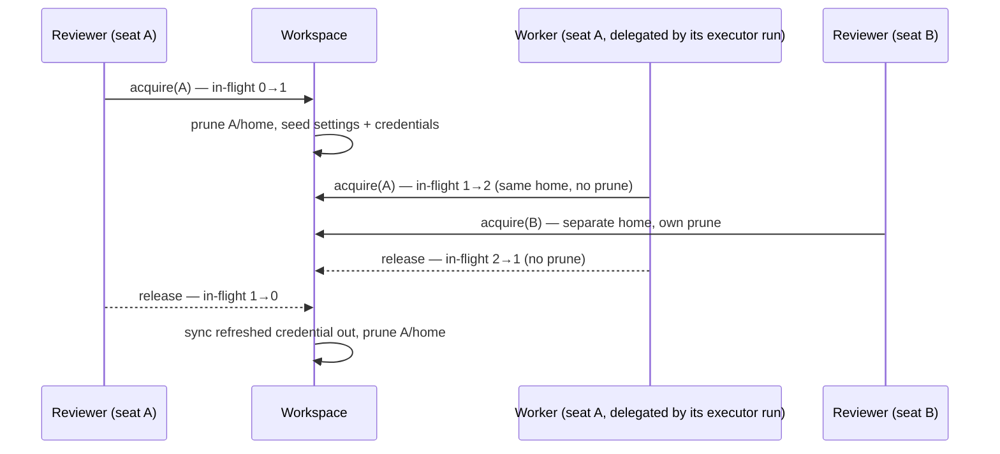
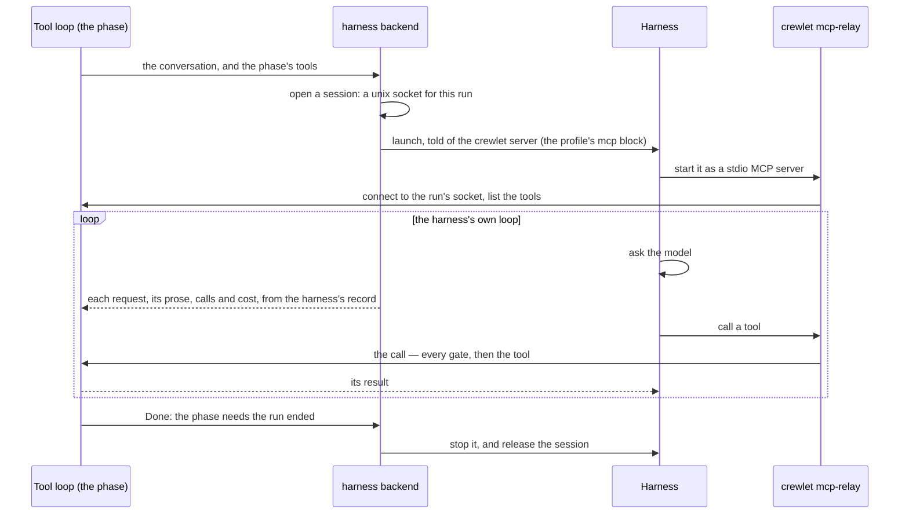

# LLM Backends

**Every model a seat runs on is reached through a harness** — Claude Code
for Anthropic's models, Codex for OpenAI's, OpenCode for open models on any
provider it speaks to (a local server included), and the rest of the
[supported harnesses](#supported-harnesses). The engine drives the vendor's own
command-line tool as a process: it hands the harness a conversation, serves it the
seat's tools as one MCP server the harness calls in its own loop, and reads back
what the harness's record shows of each model request — prose, calls and
cost. There is no other kind of `providers.llm` entry.

```yaml
providers:
  llm:
    default:
      model: sonnet              # in the harness's own grammar; claude-code is the default agent
```

```bash
# Signing in on a Claude subscription? Adopt the login this machine already has:
crewlet llm login default -from-host
# Otherwise log in (or mint a headless token) inside Crewlet's own dir:
crewlet llm login default -capture-token
crewlet llm doctor default                  # verify before the first turn
```

On an Anthropic API key instead, the same entry says so, and the key is read
from `ANTHROPIC_API_KEY` — the secret store first, then the environment:

```yaml
providers:
  llm:
    default:
      model: sonnet
      auth: { mode: api-key }
```

The harness holds the sign-in, so Crewlet never sees a password and never
re-implements a vendor's auth. Crewlet controls *where* the login lives, what each
seat's copy of the harness can see, and how its answer is read back.

> **The trade-off.** A harness is a *process*, not an HTTP endpoint. Each
> run pays a launch before its first byte (seconds, for a Node runtime), and
> a subscription's terms are generally written for interactive use. In return you
> get the vendor's own harness for every model it ships, the day it ships:
> its loop, tool calling and cache. A seat's phase runs in that loop, which calls
> the seat's tools over MCP; a cheap side call (a summary, a judge) is a launch of
> its own. See [Auxiliary work and latency](#auxiliary-work-and-latency).

---

## Why the harness is the only backend

Each vendor ships its own harness (request shape per model, how thinking carries
between rounds, what is cached, how a stream ends, which sign-in bills which
account) and moves it with every model release. An engine calling the HTTP APIs
itself would re-implement all of it per vendor and model, permanently a release
behind and wrong where a new model differs.

So Crewlet drives the harnesses. Claude Code reaches Anthropic's models on a
Claude plan *or* an Anthropic API key, Codex reaches OpenAI's on a ChatGPT plan or
an OpenAI key, and OpenCode reaches open models through OpenRouter, a hosted
provider or a server on your network. A vendor's wire-format change is its
harness's to follow; the engine's side is always a conversation in, an answer out.
Decision and the cost of the old HTTP backends:
[ADR-0045](https://github.com/crewlet/crewlet/blob/main/adr/0045-every-model-is-reached-through-its-vendors-cli.md).

The one vendor client the engine keeps is OpenAI's SDK, for
[`providers.embeddings`](../getting-started/configuration.md#providers): a
harness computes no embeddings.

### What driving a harness takes

Four problems must be solved before a harness can sit behind
[`llm.Provider`](overview.md#llm-provider); each has a section below.

| Problem | Why it bites | Where it's solved |
|---|---|---|
| **Shared memory** | A harness keeps sessions, history, todos, and project notes under one home. Seven seats on one login would read each other's transcripts. | [Isolation](#isolation-the-part-that-actually-matters) |
| **One model per entry** | A harness takes `--model`, so per-phase models mean several entries — which must not mean several logins. | [Per-phase models](#per-phase-models) |
| **A loop of its own** | The harness asks its model, calls tools and asks again by itself, and knows nothing of the seat's fence, budget or round cap. | [Tool calls](#tool-calls-on-this-host) |
| **Browser-only auth** | Subscription logins are OAuth (PKCE) with MFA — no password grant to script. | [Authentication](#authentication) |

---

## Picking a harness

Pick the harness by whose models you want, then the sign-in by how you pay:

| Models | `harness` | Signs in with | Runs a seat's executor |
|---|---|---|---|
| Anthropic's (Claude) | `claude-code` — the default | a Claude Pro / Max login, a headless `CLAUDE_CODE_OAUTH_TOKEN` minted from it, or an Anthropic API key (`auth.mode: api-key`) | yes |
| OpenAI's (GPT) | `codex` | a ChatGPT Plus / Pro login, or an OpenAI API key (`auth.mode: api-key`) | yes |
| Google's (Gemini) | `gemini-cli` | a Google account login (an individual's free Code Assist tier, Google AI Pro or Ultra, or an organization's Code Assist licence), a Gemini API key (`GEMINI_API_KEY`), or Vertex AI | yes; a person's notes, late calls and wakes reach its run only as it is about to finish ([Gemini CLI](code-sandbox.md#gemini-cli)) |
| Alibaba's (Qwen) | `qwen-code` | an OpenAI-compatible key (`OPENAI_API_KEY`), or a Qwen subscription login (not measured against Qwen's service) | yes; a note reaches its run between tool batches, never after the last ([Qwen Code's notes](code-sandbox.md#qwen-codes-notes)) |
| Open models: OpenRouter, a hosted provider, a local server | `opencode` | the model provider's key in `env`, under that provider's own variable, or a login of OpenCode's own | yes |
| Cursor's | `cursor-agent` | a Cursor login, or a Cursor API key in `CURSOR_API_KEY` (`auth.mode: api-key`) | yes, on Cursor Agent 2026.11.22-e9042b2 ([its runner](code-sandbox.md#cursor-agent)) |
| GitHub's (Copilot) | `copilot` | a fine-grained PAT with Copilot Requests in `COPILOT_GITHUB_TOKEN` (`auth.mode: api-key`), or a login of Copilot's own | yes |
| xAI's (Grok) | `grok` | an xAI API key (`XAI_API_KEY`, `auth.mode: api-key`), or a Grok login | yes — Grok Build 1.0.92 ([its runner](code-sandbox.md#grok-build)) |
| Meta's (Muse) | `muse-code` | a Muse Code login, or a metered `META_API_KEY` (`auth.mode: api-key`) | yes — Muse Code 1.4.25 ([its runner](code-sandbox.md#muse-code)) |
| Moonshot's (Kimi) | `kimi-code` | a Moonshot API key (`auth.mode: api-key`), or a Kimi Code login | yes, on Kimi Code 2.7.2 |
| Nous Portal or any provider's, through Hermes | `hermes` | the provider's key in `env`, under that provider's own variable, or a login of Hermes's own | yes, on Hermes Agent 0.23.3 ([its runner](code-sandbox.md#hermes-agent)) |
| Any provider's, through Pi | `pi` | the provider's key in `env`, under that provider's own variable, or a login of pi's own | yes, on Pi 1.6.0 ([its runner](code-sandbox.md#pi)) |

Every agent seat's executor is its harness's own run in a [sandbox](code-sandbox.md),
doing the seat's work and code work alike; this build has a harness runner for
`claude-code`, `codex`, `gemini-cli`, `qwen-code`, `opencode`, `cursor-agent`, `copilot`, `grok`, `muse-code`, `kimi-code`, `hermes` and `pi` only, each listed by its built-in profile's
`executor` block, which no `overrides` can set. Any other harness serves a seat's reviewer,
workers and side passes (`llm_review`, `llm_subagent`, `llm_auxiliary`,
`llm_judge`, `llm_triage`) — its own loop on this host, shell and editor denied, the seat's tools
its only working tools. A seat whose `llm` chain holds no entry on one of those
eleven is refused on the write ([Where the harness runs](#where-the-harness-runs)).

A seat can mix harnesses: executor on one entry, reviewer on another, auxiliary
work on a third — see [Per-phase models](#per-phase-models).

### Anthropic's models: Claude Code

```yaml
providers:
  llm:
    claude:                       # on your Claude plan
      model: opus                 # an alias or an id: sonnet, opus, claude-opus-5-5
    claude-key:                   # on an Anthropic API key
      model: sonnet
      auth:
        mode: api-key             # reads ANTHROPIC_API_KEY; or name one:
        # api_key: "${ANTHROPIC_KEY_FOR_CREWLET}"
```

Claude Code is the default `harness`. **On a plan**, the login is the harness's
OAuth sign-in, which `crewlet llm login` brokers into the entry's own directory or
adopts from your home with `-from-host`. Better, `-capture-token` mints a headless
`CLAUDE_CODE_OAUTH_TOKEN` into the secret store, which survives an ephemeral
container and needs no refresh — see [Authentication](#authentication).

**On an API key**, `auth.mode: api-key` puts one key into `ANTHROPIC_API_KEY` and
removes the plan's token variable, so the call bills the metered account, never the
plan. `auth.api_key` names the key as a `${VAR}`; left out, the entry reads
`ANTHROPIC_API_KEY` through the secret store then the environment, so a key already
exported or stored with `crewlet secrets set ANTHROPIC_API_KEY` needs no YAML
change. A `subscription` entry never forwards a key, whatever the engine's
environment holds, so a stray `ANTHROPIC_API_KEY` cannot bill the metered account
under a flat-rate plan.

`model` is what Claude Code's `--model` accepts: an alias following the vendor's
current model (`sonnet`, `opus`, `haiku`) or an exact id (`claude-opus-5-5`).
Thinking, effort and output limits are Claude Code's to decide; see
[What an entry does not set](#what-an-entry-does-not-set).

An executor run on a Claude Code entry takes a person's notes between its steps
through hooks the run is started with; that needs Claude Code 2.1.163 or later (an
older release starts without them and its notes wait for its review). Measured on
2.1.263 and 2.1.310; see [The executor's run in a
box](#the-executors-run-in-a-box).

### OpenAI's models: Codex

```yaml
providers:
  llm:
    gpt:                          # on your ChatGPT plan
      harness: codex
      model: gpt-5
    gpt-key:                      # on an OpenAI API key
      harness: codex
      model: gpt-5
      auth: { mode: api-key }     # reads CODEX_API_KEY
```

The ChatGPT login is `codex login`, which `crewlet llm login` brokers, or the
`~/.codex/auth.json` your Codex already holds, which `-from-host` adopts. Codex
mints no headless token, so a container rebuilt on every deploy carries its login
as a [credential bundle](#4-move-a-login-onto-another-host). On an API key,
`auth.mode: api-key` reads `CODEX_API_KEY`, not `OPENAI_API_KEY`: it is the
variable `codex exec` signs requests with (with only `OPENAI_API_KEY` set it sent
no `Authorization` header; measured on 0.171.0). A key kept under
`OPENAI_API_KEY` is named as `auth.api_key: "${OPENAI_API_KEY}"`.

Codex runs with its shell off and its own `--sandbox read-only`, so its one local
tool, `apply_patch`, writes nothing — see [Tool calls on
this host](#tool-calls-on-this-host). That is the phases on this host: a seat's
executor on a Codex entry is Codex's own fully permissioned run in a box ([The
executor's run in a box](#the-executors-run-in-a-box)).

### Open models, OpenRouter and local servers: OpenCode

OpenCode reads its model as `<provider>/<model>`, split at the first slash:

```yaml
providers:
  llm:
    open:
      harness: opencode
      model: openrouter/qwen/qwen3-coder     # the openrouter provider's qwen/qwen3-coder
      env:
        OPENROUTER_API_KEY: "${OPENROUTER_API_KEY}"
```

**OpenCode 2.3.2 only** — the `@opencode/cli` package, the one release supported;
1.x (`opencode-ai`) can run neither this profile nor a coding box. The key goes in `env` under the variable of
the provider the model names (`OPENROUTER_API_KEY`, `ANTHROPIC_API_KEY`,
`NVIDIA_API_KEY`, …), since OpenCode reads each provider's key from its own
variable — see [A provider key in
`env`](#6-a-provider-key-in-env-opencode-hermes-pi). `crewlet llm login` runs
OpenCode's own `auth login` for a provider it signs in to itself. A bare model
(`qwen3-coder`) names a provider and no model, which OpenCode refuses as "Invalid model
reference", so a write naming one is refused; `opencode models --standalone` lists
the spellings.

**A server on your own network** (vLLM, llama.cpp's server, Ollama, a gateway) is
a provider *declared* in OpenCode's configuration with its listen address. Under
this profile that configuration is the file the engine seeds into every call's own
directory (see [Tool calls on this
host](#tool-calls-on-this-host)), so the declaration rides an override of that
seed. `seed_files` is a list and replaces wholesale, so the override restates the
profile's own policy beside the provider:

```yaml
providers:
  llm:
    local:
      harness: opencode
      model: local/qwen3-coder               # the provider declared below, and its model
      overrides:
        seed_files:
          - path: .crewlet-config/opencode.json
            in: work
            content: '{"$schema":"https://opencode.ai/config.json","update":"disable","share":"disabled","snapshots":false,"compaction":{"background":false},"plugins":["-opencode.tools","-opencode.tool.skill"],"permissions":[{"action":"*","resource":"*","effect":"deny"},{"action":"webfetch","resource":"*","effect":"allow"},{"action":"websearch","resource":"*","effect":"allow"}],"providers":{"local":{"package":"@opencode/ai/providers/openai-compatible","name":"Local server","settings":{"baseURL":"http://127.0.0.1:8000/v1"},"models":{"qwen3-coder":{}}}}}'
```

The `providers` block is OpenCode 2's format: the package for the server's wire
(`@opencode/ai/providers/openai-compatible`, or `…/anthropic-compatible`), its
`baseURL` under `settings`, and the models it serves. A server that takes a key
names the **variable** it is read from (`"env": ["LOCAL_LLM_KEY"]`) and the
entry's `env` carries the value, never the file, which is neither `${VAR}`-resolved
nor redacted. A server with no key leaves the entry with no sign-in the engine can
see; `crewlet llm doctor` clears that once its smoke test is answered. The
declaration reaches the entry's own calls only; an
[executor run](#the-executors-run-in-a-box) writes OpenCode's configuration of its
own, so there the model must be one OpenCode knows by name.

An executor run on an OpenCode entry takes a person's notes at its next step
through a plugin the engine hands the run's server; measured on OpenCode 2.3.2
— see [The executor's run in a box](#the-executors-run-in-a-box).

### The other harnesses

Gemini CLI, Qwen Code, Cursor Agent, Copilot, Grok Build, Muse Code, Kimi Code,
Hermes Agent and Pi each run a seat's executor too ([Gemini
CLI](code-sandbox.md#gemini-cli), [Qwen Code](code-sandbox.md#qwen-code), [Cursor
Agent](code-sandbox.md#cursor-agent), [Copilot](code-sandbox.md#github-copilot-cli),
[Grok Build](code-sandbox.md#grok-build), [Muse Code](code-sandbox.md#muse-code),
[Kimi Code](code-sandbox.md#kimi-code), [Hermes Agent](code-sandbox.md#hermes-agent),
[Pi](code-sandbox.md#pi)) and serve the phases on this host through the same
profile. Each has a built-in profile: own login or key, own model grammar, own
way of being handed the seat's tools ([per
harness](#what-each-harness-does-with-the-seats-tools)). [Supported
harnesses](#supported-harnesses) says how each signs in; `custom` is a profile you
write entirely yourself. A Pi entry signs its executor in with its provider's key in
`env`, or with the login pi keeps.

**Qwen Code signs in with a key, or with a Qwen subscription login.** A key is its
OpenAI-compatible sign-in (`--auth-type openai`): key in `OPENAI_API_KEY`,
endpoint in `OPENAI_BASE_URL`. Other vendors' keys live under `OPENAI_API_KEY`
too, so a keyed `qwen-code` entry is `auth.mode: api-key` and names its key; the
engine never fills that variable from its own secret store or environment, and a
write leaving either out is refused:

```yaml
providers:
  llm:
    qwen:
      harness: qwen-code
      model: "${QWEN_MODEL}"                       # a model the endpoint serves, as it names it
      auth:
        mode: api-key
        api_key: "${DASHSCOPE_API_KEY}"            # put in the harness's OPENAI_API_KEY
      env:
        OPENAI_BASE_URL: https://dashscope-intl.aliyuncs.com/compatible-mode/v1
```

`OPENAI_BASE_URL` names DashScope's endpoint, a Coding Plan's or any other
OpenAI-compatible one; unset, the harness uses an endpoint of its own.

The login is Qwen Code 0.28's paid one, a Qwen Plus or Pro subscription
(`--auth-type qwen-subscription`), **not measured against Qwen's service**: the
engine takes it from Qwen Code's own documentation and bundle. Sign in with `qwen`
yourself on the engine host and adopt the login with `crewlet llm login <entry>
-from-host`; the entry is `auth.mode: subscription`. The login is
`~/.qwen/subscription_credentials.json`, copied into each seat's home and into a
box. Its endpoint is fixed in Qwen Code (`api.qwen.ai`):
no variable moves it. Free Qwen OAuth stays refused by the harness itself.

---

## Configuration reference

An entry is the harness's settings only: which harness, which model in its
grammar, where a seat's executor on it runs (`run_in`), where its login and
per-seat homes live, and how it signs in.

```yaml
providers:
  llm:
    default:
      harness: claude-code             # optional: claude-code (default) | codex | opencode
                                     #   | gemini-cli | qwen-code | cursor-agent | copilot
                                     #   | grok | muse-code | kimi-code | hermes | pi | custom
      model: sonnet                  # REQUIRED — passed to the harness's model flag in its own
                                     #   grammar (opencode: <provider>/<model>). A ${VAR}
                                     #   works; one that resolves to nothing is refused
                                     #   when the entry is built, naming the variable,
                                     #   rather than run on a model nobody chose
      effort: high                   # optional: reasoning effort in the harness's own
                                     #   levels; absent = the harness's default. See
                                     #   "Reasoning effort"
      run_in: ""                     # where a seat's executor runs on this entry (a harness
                                     #   with a runner only): direct | container. Empty
                                     #   = providers.sandbox.default_run_in — see "Where the
                                     #   harness runs"

      state_dir: /var/lib/crewlet/llm-harness/claude
      # Where the login and the per-seat homes live, each harness in a
      # subdirectory of its own (<state_dir>/<harness>). Empty uses
      # $CREWLET_LLM_HARNESS_HOME/<key>, falling back to ~/.crewlet/llm-harness/<key>.
      # Point it at a persistent volume when the engine runs in an
      # ephemeral container. A LITERAL PATH — unlike the credential fields
      # it is not ${VAR}-expanded, because it names where the engine keeps
      # files rather than a secret (the same reason the store path is a
      # Tier A field). Every harness child's output is captured into files
      # here too, so it must be a LOCAL filesystem that keeps a lock per
      # open file description, reserves room with the size kept, and
      # punches holes: ext4, xfs, btrfs, tmpfs or APFS. Each running call
      # takes 64 MiB of room as it starts, and up to 128 MiB — see "A
      # helper that outlives the harness".

      timeout_seconds: 600           # one stretch of a harness run on this host, wall clock (default 600);
                                     #   an executor run is not on this clock
      max_concurrent: 4              # live harness processes on this host (default 4); executor
                                     #   runs are not counted: each seat runs at most one

      env:                           # extra child environment, ${VAR}-resolved
        OPENROUTER_API_KEY: "${OPENROUTER_API_KEY}"

      auth:
        mode: subscription           # subscription (default) | api-key | inherit-env | env
        token: "${MY_OAUTH_TOKEN}"   # subscription only; else the profile's own token variable
        # api_key: "${MY_API_KEY}"   # api-key only — refused under any other mode;
                                     #   else the profile's own key variable
        credential_bundle: "${MY_BUNDLE}"  # else CREWLET_LLM_CLI_<KEY>_CREDENTIALS

      overrides: {}                  # any field under "Profile fields"
```

**The key is the entry's name, and a directory's and a variable's.** Seats select
the entry by it, the default `state_dir` is named for it, and its credential
bundle is read from `CREWLET_LLM_CLI_<KEY>_CREDENTIALS`. A key is lowercase
letters, digits, `.`, `_` and `-`, starting with a letter or digit, at most 63
characters (`^[a-z0-9][a-z0-9._-]{0,62}$`): a `/` would nest one entry's login in
another's, and `Fast` beside `fast` would be two entries on one bundle. **No two
keys may share a bundle variable**: it maps `.`, `_` and `-` alike, so `gpt-5`,
`gpt_5` and `gpt.5` would restore and export one login; keys after the first are
refused, naming the one they collide with. Both are admission rules, like the
credential rules below: a write is refused, and a revision being applied is warned
about.

**`model` is required.** A harness with no model runs the vendor's current default,
which moves and bills as a model nobody chose. A reference that resolves to
nothing is refused when the entry is built, naming the variable: unset, set to
empty or white space (an unset host variable passed through compose, an empty
stored secret), or one part of a composite like `${PROVIDER}/sonnet`. A missing
*credential* still builds: every call fails with the harness's own sign-in error,
which names it; a missing model has no such tell. The model is trimmed before the
harness is handed it.

**`timeout_seconds` caps one stretch of the harness's own work, wall clock**: from
its launch, or from when the last in-flight seat tool call returned, to its next
tool call or exit — process launch, model answers and the harness's own retries
and backoff. The seat's tools are not on the clock (each has its own deadline), so
a run driving a phase through many requests and calls is never cut for length, only
for a stretch with no progress the engine could see. A text function (a summary, a
judge) is one stretch from launch to exit. Ten minutes because a stretch is at
least one answer of a current model, thinking against a 128K-token output cap,
which runs that long at the tail; two minutes was measured cutting off the calls
doing the most work. The launch comes on top of the first stretch. On breach the
process *group* is terminated (helpers go too) and the call is reported as
`timeout`, which the seat's fallback chain carries to its next entry. `0` takes the
default; a negative value is refused. It bounds the **phases on this host** only
(reviewer, worker, onboarding pass, side pass): an executor run is its harness's
own detached run in a box, never stopped on a clock, its rounds capped only where
the seat or company sets a turn cap (`role.sandbox.max_turns`, else
`providers.sandbox.default_max_turns`).

**`max_concurrent: 4`** bounds the entry's **live harness processes** and keeps
peak memory near 1.5 GB: each harness is a full Node or Rust runtime at roughly
200–400 MB resident, and seats starting turns together could exhaust a small
host. A process holds its slot for its whole run, and a model call made from
*inside* one of its tool calls on the same entry (a delegated worker, a condensing
pass) borrows the run's slot when no free one comes first, since the run is idle
until the call answers and waiting on a slot only its caller can free would wait
for ever. Subscription plans throttle concurrency well below what an API key
allows, so a much higher number mostly buys rate-limit errors. A call waiting for a
slot gives up when its turn is cancelled. Raise it on a large host with an account
that permits it; it is per entry, so size entries together (see [Per-phase
models](#per-phase-models)). Like `timeout_seconds` it counts the phases on this
host only: an executor run is a process in its own box, not counted, and each seat
runs at most one at a time.

**`env`** is the one way to give the harness anything beyond `PATH`, locale, TLS
trust and proxy settings, because the child gets an
[allowlisted](#isolation-the-part-that-actually-matters) environment, not the
engine's. It is `${VAR}`-resolved when the entry is built and redacted on every
config read; a reference resolving to nothing is warned about
(`harness_env_unresolved`), not refused, since a harness whose optional variable is
unset still runs. The exception is a variable the profile declares a route
(`identity_env` and the `sign_in_env` switches): a value an unset reference leaves
no route (`https://${HOST}/v1` with `HOST` unset) refuses the entry when it is built,
naming the variable, while one that resolves wholly to nothing is simply unset. It reaches **every** invocation: each call on this host and a
seat's [executor run](#the-executors-run-in-a-box) in whichever cell its box is,
beneath the seat's own `role.sandbox.env` — so a gateway's base URL and token, or
a cloud provider's switch and region, serve the executor as every other phase.

**`auth.mode` defaults to `subscription`, not `inherit-env`**, so a stray
`ANTHROPIC_API_KEY` in the engine's environment cannot bill the metered account
under a flat-rate plan. The four modes:

| `auth.mode` | What reaches the harness |
|---|---|
| `subscription` (default) | its login — credential files in the entry's directory, or a database export — and a headless token in its `token_env` where `auth.token` or that variable resolves. Its `api_key_env` is removed. |
| `api-key` | one key in its `api_key_env`: `auth.api_key`, or that variable itself looked up through the secret store and then the environment (never for a [shared](#profile-fields) variable). Its `token_env` is removed, and no login is seeded: the call runs in the seat's [key home](#isolation-the-part-that-actually-matters). |
| `inherit-env` | whichever of the two variables the **engine's own** environment holds — the deliberate escape hatch for an unusual harness, and the only mode in which a host credential reaches the child. Where that is the key, the call runs in the key home, as under `api-key`; otherwise beside the login, as under `subscription`. |
| `env` | the entry's own `env` and nothing else: a cloud provider's switch and credentials, or a gateway's address and token ([route 7](#7-a-cloud-provider-or-gateway-authmode-env)). Its `token_env` and `api_key_env` are both removed, and no login is seeded: the call runs in the key home. |

**One key, never a list.** A harness holds one sign-in and rotates nothing, so an
entry has at most one token or one key; a second key is a second entry, placed
after the first in the seat's [fallback chain](#falling-back-between-entries).

**Every credential an entry configures has to reach the harness, or a write
keeping it is refused.** The engine puts a credential only into a variable the
profile names for it (`api_key_env` for a key, `token_env` for a headless token),
so each of these would run with the credential unused:

| Written | Refused because | Instead |
|---|---|---|
| `auth.mode: api-key` on a harness whose profile names no `api_key_env` (`hermes`, `pi`, `opencode`) | the key has no variable to go in | Leave `auth.mode` at `subscription` and set the key in `env` under its provider's own variable ([below](#6-a-provider-key-in-env-opencode-hermes-pi)). A build of the harness that reads a key variable on its own: name it with `overrides.api_key_env` |
| `auth.api_key` under `subscription`, `inherit-env` or `env` | only `api-key` mode reads it | set `auth.mode: api-key`, or drop it |
| `auth.token` on a harness whose profile names no `token_env` (every built-in profile but `claude-code`) | the harness mints no headless token | remove it |
| `auth.token` under `api-key`, `inherit-env` or `env` | `api-key` and `env` remove the token variable, and `inherit-env` forwards the engine's own | `auth.mode: subscription` |
| `auth.mode: env` with an `env` that sets none of the profile's `sign_in_env` (on an `env_sign_in` harness: no credential-named variable), or on a harness whose profile declares neither | the mode hands the harness no token, no key and no login, so nothing would sign it in | set the switch or the gateway token your cloud or gateway takes in `env` ([route 7](#7-a-cloud-provider-or-gateway-authmode-env)), or another mode |
| a name from the profile's `sign_in_env` in `env` under any mode but `env` (Claude Code's `CLAUDE_CODE_USE_BEDROCK`, `ANTHROPIC_AUTH_TOKEN`, ...; Copilot's `GITHUB_TOKEN`) | the mode hands the harness a plan token or a key beside it, which the harness ranks by rules of its own | `auth.mode: env` |
| `auth.mode: inherit-env` on a harness that names neither variable | nothing would be forwarded | `subscription`, with the key in `env` or a login |
| `auth.mode: subscription` — the default — on a harness that keeps no login and mints no token but reads a key (`qwen-code`) | `subscription` removes the key variable, so the entry would sign in to nothing | `auth.mode: api-key`, with the key as `auth.api_key` |
| `auth.mode: api-key` with no `auth.api_key` on a harness whose key variable is [shared](#profile-fields) (`qwen-code`'s `OPENAI_API_KEY`) | that variable holds other vendors' keys too, so the engine never reads it in the entry's place | name the key: `auth.api_key: "${DASHSCOPE_API_KEY}"` |
| `auth.mode: inherit-env` on a harness whose key variable is [shared](#profile-fields) | it would forward whichever vendor's key the engine's process holds under that name | `auth.mode: api-key`, naming the key as `auth.api_key` |
| the profile's `token_env` or `api_key_env` in `env` | `auth` owns those: whether a value there reaches the harness depends on `auth.mode` and on whether a credential resolves from the secret store or the engine's environment, which the document cannot show | `auth.token`, or `auth.api_key` with `auth.mode: api-key` |
| `overrides.token_env` or `overrides.api_key_env` that is not an environment variable name (letters, digits and underscores, not starting with a digit — `MY-TOKEN`, say) | no secret store, `${VAR}` or `crewlet llm login` can hold such a name, no shell exports one for `inherit-env` to forward, and a name carrying `=` sets a different variable | the variable your build of the harness reads, e.g. `MY_TOKEN` |
| a variable the engine sets to isolate the call in `env` (`HOME`, an XDG home, `TMPDIR`, the profile's relocation and isolation variables) | it would replace that isolation for every seat on the entry | drop it; the refusal names the profile field that moves it, where one does |

An `api-key` entry whose key resolves to nothing is not refused (the document
cannot see the secret store), but `crewlet llm doctor` reports "no sign-in",
naming `auth.api_key` and the variable it fell back to.

Each rule is checked against the profile with `overrides` merged in, and each
refusal names the field and the route to take. They are **admission** rules: every
write path (`crewlet validate`, a `PUT` or `PATCH` of the config, a setup write, a
revert) refuses a document breaking one, while a revision being *applied* that
breaks one is applied and warned about, because the entry still runs and refusing
it would take a node off the fleet's configuration during a rolling upgrade. A
profile that cannot drive its harness at all (an override typo, a missing
`binary`, no `model_args` carrying `{model}`) is refused at apply too, since no
node can build it.

**A model has to be one the harness can read, or a write naming it is refused.**
`opencode` splits its model at the first slash into `<provider>/<model>`, so a
model with nothing before or after the slash (`claude-sonnet-5`, `anthropic/`)
names no model, and every call, an executor run included, fails with its own
"Invalid model reference". Name the provider as the harness spells it:
`anthropic/claude-sonnet-5`, `openrouter/anthropic/claude-sonnet-5`
(`opencode models --standalone` lists them). It is judged on the value the harness
is handed (the model rendered through `model_args`, a joined `--model={model}` read
past its `=`); a `${VAR}` model is not judged, since its value is the secret
store's and the environment's. The grammar is a profile declaration,
`model_names_provider`, so when a harness release relaxes it there are two ways
past: `overrides.model_names_provider:
false`, or a `model_args` override that writes the provider into the flag itself
(`["--model", "anthropic/{model}"]`), which makes a bare model whole. This is an
**admission** rule too, but a revision being applied is warned about, not refused:
the grammar is a vendor fact that moves between releases, and a newer build or
peer may know it better.

**A profile's `passthrough_env` may not name a
[credential](#6-a-provider-key-in-env-opencode-hermes-pi)** (an admission rule).
Everything listed there is forwarded from the engine's environment *before*
`auth.mode` is consulted, so a key there would reach every seat whatever the mode
says — the metered-bill-on-a-flat-rate-plan failure the mode prevents. Use it for
non-secret configuration (`GOOGLE_CLOUD_PROJECT`, a region); a key belongs in
`api_key_env` or `token_env`, and `auth.mode: inherit-env` is the deliberate way to
let the host's value through.

**Nor may a profile's `env`**, for the same reason and one more: `overrides` is
neither `${VAR}`-resolved nor redacted, so a key there would sit in the stored
revision in plain text and come back on every config read. A credential the
harness needs goes in the entry's `env` (resolved and redacted) or through `auth`.
A profile's `env` may not name its `token_env` or `api_key_env` either: `auth` owns
those, and since the entry's `env` and `auth` are layered over the profile's,
whether a value there reached the harness would turn on the mode and the secret
store, not on the profile.

### Reasoning effort

`effort` sets how hard the entry's model reasons, in the harness's own words.
Absent, the engine passes nothing and the harness runs at its default. Set, it
reaches every run on the entry: the phases on this host (reviewer, workers,
onboarding, side passes, Ask Crewlet's questions, a model check) and an executor
run in a box.

Levels are each harness's own, not one vocabulary: Claude Code has no `none` or
`minimal`, Pi says `off` where Codex says `none`, and OpenCode's are the variants of
each model. A level is checked on every write against the entry's harness, and a
harness with no setting the engine can pass refuses the field rather than dropping
it. It is an admission rule like the model grammar: a write is refused, a revision
being applied is warned about.

| Harness | Levels | Passed as | Where the model decides |
|---|---|---|---|
| `claude-code` | `low` `medium` `high` `xhigh` `max` | `--effort` | Refused on the models Claude Code runs without effort (Claude 3, Opus 4 and 4.1, Sonnet 4 and 4.5, Haiku 4.5); Opus 4.5 takes up to `high`, Opus and Sonnet 4.6 skip `xhigh`. An alias takes every level, though on a cloud provider or gateway `haiku` can name Haiku 4.5, which runs without effort. |
| `codex` | `none` `minimal` `low` `medium` `high` `xhigh` `max` `ultra` `persistent` | `-c model_reasoning_effort` | The model's API refuses a level it lacks. |
| `opencode` | `none` `minimal` `low` `medium` `high` `xhigh` `max` | the model's variant, `provider/model#level` | Variants are each model's, from models.dev; a run on one the model lacks fails with OpenCode's "Variant unavailable". |
| `copilot` | `none` `minimal` `low` `medium` `high` `xhigh` `max` | `--reasoning-effort` | A model that refuses the effort fails the call, with the provider's message on stderr. |
| `grok` | `none` `minimal` `low` `medium` `high` `xhigh` `max` | `--reasoning-effort` | A name that is no level is refused; a level the model's menu lacks is ignored with a warning. |
| `muse-code` | `minimal` `low` `medium` `high` `xhigh` `max` | `--reasoning-effort` | Per model. |
| `hermes` | `none` `minimal` `low` `medium` `high` `xhigh` `max` `ultra` | `--reasoning` | Lowered to the nearest level the route takes. |
| `pi` | `off` `minimal` `low` `medium` `high` `xhigh` `max` | `--thinking` | Clamped to the model's levels. |
| `kimi-code` | `low` `medium` `high` `xhigh` `max` | `KIMI_MODEL_THINKING_EFFORT` | Sent as given on Kimi's own provider type, unchecked by the harness (whether Moonshot's service refuses a level its model lacks is not measured); an OpenAI-shaped provider is sent none. |
| `gemini-cli` | none | | Read only from its settings file, per model family. |
| `qwen-code` | none | | Read only from its settings file. |
| `cursor-agent` | none | | Part of the model id: name a variant `cursor-agent --list-models` prints, such as `gpt-5.5-high`, or, on a model Cursor lists with parameters, its bracket form, such as `claude-opus-4-8[effort=high]` (`cursor-agent --help`, 2026.11.22-e9042b2; which levels a model takes is Cursor's service's to say). |
| `custom` | none | | Declare `overrides.effort`. |

The levels are the profile's `effort` field (see [Profile fields](#profile-fields)),
read from each harness at the release its profile was written for. A release
adding a level is an override, not a Crewlet release:

```yaml
overrides:
  effort:
    args: ["--effort", "{effort}"]
    levels: [low, medium, high, xhigh, max, ultra]
```

---

## What an entry does not set

A harness driven headlessly takes a model and a prompt and reads the rest of its
behaviour from its own configuration, so neither an entry nor a call has a field
for it:

- **No sampling.** No phase sends a temperature; every call runs at what the
  harness sends at a terminal.
- **No effort and no thinking switch.** Thinking is the harness's configuration of
  the model, or the model you pick; change a model that spends its whole answer
  thinking with `model`.
- **No output cap.** A caller needing a short answer (the round-cap judge, a
  summary) asks in its prompt, the one channel every harness reads, and
  [token budgets](../getting-started/quickstart.md#token-budgets-optional) bound
  what a seat spends.
- **No endpoint.** Where a harness sends requests is its own setting; for OpenCode
  a provider declaration ([above](#open-models-openrouter-and-local-servers-opencode)).
- **No key rotation and no shared bench.** One sign-in per entry, and a spent plan
  sits the entry out on the node that heard it, not across the fleet (see
  [Falling back between entries](#falling-back-between-entries)).

To configure a harness differently from its defaults, use its own channels:
environment variables through `env`, flags through `overrides.complete_args`, and a
settings file through `overrides.seed_files`, written into the seat's home or the
call's directory before every call. Each is the vendor's configuration surface, so
check it against the version `crewlet llm doctor` reports.

---

## Per-phase models

Phase selection resolves by `providers.llm` **key**: `llm`, `llm_review`, `llm_subagent`, `llm_auxiliary`, `llm_judge` and `llm_triage` each name an entry, including list-form fallback chains, or a [fleet](llm-fleets.md) as `fleet:<key>`. The seat's code work is its executor's run, so it runs on `llm`. See [Turn Engine — per-phase LLM models](turn-engine.md#per-phase-llm-models).

The model goes on the harness's `--model`, so one entry is one model; per-phase models mean one entry per model:

```yaml
providers:
  llm:
    opus:
      model: opus
      state_dir: /var/lib/crewlet/llm-harness/claude
    sonnet:
      model: sonnet
      state_dir: /var/lib/crewlet/llm-harness/claude   # the same login as `opus`
    haiku:
      model: haiku
      state_dir: /var/lib/crewlet/llm-harness/claude
    claude-key:                                    # the plan's backstop
      model: opus
      auth: { mode: api-key }

roles:
  - name: Engineer
    llm: [opus, claude-key]         # the executor: the plan first, the key when it is spent
    llm_review: sonnet              # the reviewer, on a cheaper model
    llm_auxiliary: haiku            # see the latency note below
    llm_judge: haiku
    llm_triage: haiku               # a busy seat's wake triage
```

**Entries on the same `state_dir` share one login** (one `crewlet llm login`), one set of per-seat homes and one generation, so a call on one entry never wipes a live call on another. The default `state_dir` is per provider key so unrelated entries do not collide; entries that should share must say so.

**Sharing is per harness.** Each harness keeps its files in a subdirectory of the `state_dir` named for it (`<state_dir>/claude-code`, `<state_dir>/codex`, …), because harnesses disagree about which files are credentials and which are conversation memory. Entries share a login only when they drive the same harness (an entry that leaves `harness` out drives `claude-code`); entries on different harnesses share the directory and nothing in it, which lets an entry [move to another harness](#an-entry-moved-to-another-harness) without a restart.

**Keep the key entry's directory apart.** `claude-key` above takes the default `state_dir`, so its seats' homes hold no plan login; with one, which the harness bills is the vendor's precedence, not the entry's.

**Concurrency is per entry.** `max_concurrent` caps one entry's processes, so the four entries above at the default of 4 can run 16 harness processes at once. Size them together against the engine host's memory.

### An entry moved to another harness

Changing an entry's `harness` is an ordinary revision, applied live on every node: the key keeps its `state_dir`, the new harness opens its own login directory, signed out until you sign it in (`crewlet llm login
<key>`, or the harness's own sign-in adopted with `-from-host`), and moving back finds the old harness's login where it was left.

**A credential bundle does not move with it.** A bundle belongs to the harness it was exported from and names it, but is keyed by the entry (`CREWLET_LLM_CLI_<KEY>_CREDENTIALS`, or the secret `auth.credential_bundle` references), so after the move it still holds the old harness's login. A restore reads that name, not the files' names, which cannot tell harnesses apart: Codex, Cursor Agent, Grok, Hermes, Muse Code and Pi each keep a login in an `auth.json`. Wherever the new harness's credential directory is empty (every node you have not signed it in on, every container on a fresh volume), each boot and apply refuses the bundle and writes nothing, logged as `harness_bundle_restore_failed` with the harness the bundle names. `crewlet
llm list`, `status`, `export` and `doctor` say so too, as `crewlet llm import`
does for another harness's bundle, until it is replaced: sign the new harness in, then export its bundle in the old one's place (`crewlet llm export <key>
-secret-store`, or pipe `crewlet llm export <key>` into the secret `auth.credential_bundle` references). A deployment relying on the bundle runs the entry signed out until then.

### Auxiliary work and latency

`llm_auxiliary` serves the calls around a turn: the turn-start prefetch (the knowledge query, the relevance filter, a recalled turn's rewrite), condensing a tool result too large for the conversation, and every reflection and learning pass. `llm_judge` serves the onboarding pass's round-cap [extension judge](turn-engine.md#round-cap-extension-judge), the one pass the engine extends; the executor is its harness's own run, capped by its `max_turns`. `llm_triage` serves the [triage](turn-engine.md#per-phase-llm-models) of a wake that reaches a seat while its run works, from somebody other than the run's requester. Each call is one harness process, so each pays a launch, and each has a **fixed deadline** no entry setting widens:

| Calls | Deadline |
|---|---|
| The turn-start prefetch — the knowledge query and the relevance filter, each call; a recalled turn's rewrite, the whole render | 30 s |
| The extension judge | 30 s |
| A busy seat's wake triage (`llm_triage`, [ADR-0168](../../adr/0168-a-busy-seats-other-wakes-are-triaged-and-the-engine-gates-the-choice.md)), the whole decision | 90 s |
| Condensing a tool result or a payload, each piece | 60 s |
| Each reflection and learning pass — the persist decider, the counterparty profiler, skill synthesis, refinement and promotion, episode compaction | 60 s |

The entry's `timeout_seconds` caps the process; these cap the *call*; whichever ends first ends it. They are fixed because the prefetch is latency a person waits through, the judge runs on a phase already out of rounds, the triage holds the seat's router until it answers, and a hung learning pass holds up the company's reflection. A call cut off degrades rather than fails: the prefetch goes without what it would have added (a summary falls back to the raw recalled turns), the judge falls through to the rescue it was there to avoid, the triage leaves the wake for a turn of its own, the learning pass persists nothing. A slow auxiliary model quietly does less.

**Point `llm_auxiliary`, `llm_judge` and `llm_triage` at a fast, cheap model** (`haiku` on Claude Code, a small open model on OpenCode), not the seat's own: a frontier model thinking at length behind a Node launch is the shape most likely to be cut off at thirty seconds.

---

## Falling back between entries

A seat's `llm` (and every per-phase field) takes a **list**, tried in order for every call. The walk moves on for any failure another entry might not share:

- a spent plan or rate limit (`rate_limit`);
- a missing or expired login (`auth`);
- a `timeout`;
- a run that failed for no reason the profile recognises (`server`: an error or overload the harness relayed from its vendor, a crash, a run not seen to its end; see [a helper that outlives the harness](#a-helper-that-outlives-the-harness));
- output this build can no longer read (`profile_drift`), treated the same.

Only a `fatal` failure stops the walk: a call the engine itself cannot make. That is a prompt it cannot render, a file of the call's it cannot write, or a harness it cannot start on this host (binary missing or not executable; no output file or process, refused before any harness exists; a `state_dir` whose filesystem keeps no lock per open file or whose volume could not reserve room for the harness's output; a process whose identity the engine could not read as it started, ended at once). Those are yours to fix. Apart from that last case, a harness that started is never `fatal`, however it ended.

A call its caller **cancelled** (`canceled`) stops the walk too: a person pressed Stop, a seat's turn was stopped, a node began to drain. The harness is signalled and exits as if crashed (143 for a Node runtime), so the kind is read from the caller's context, never the exit status. It teaches nothing: no `provider_fallback` is logged, the next entry is not started, readiness is unchanged.

The natural chain is **one harness, two ways to pay**: the plan first, the key after it. Several sign-ins of one model are a [fleet](llm-fleets.md) instead, which spreads seats across them rather than spending the first one first.

```yaml
providers:
  llm:
    plan:
      model: sonnet
    key:
      model: sonnet
      auth: { mode: api-key }       # ANTHROPIC_API_KEY

roles:
  - name: Engineer
    llm: [plan, key]                # flat-rate first, metered as the backstop
```

A spent subscription window is recognised first by the harness's own **status**: Claude Code's result event carries `is_error: true` and `api_error_status: 429` beside the vendor's sentence ("You've hit your 5-hour limit · resets 4:30pm (America/Vancouver)"), and the profile matches those fields as structure (`limit_events`), where a model cannot write them. The vendor's wording is the second signal (`limit_markers`), for a report without the event. Either way the failure is `rate_limit`, and the seat moves to `key` for that call.

**The entry then sits out, on this node.** A spent window lasts hours, and without a sit-out every call of every seat on the entry would start a harness (seconds of a runtime holding one of the entry's few slots) only to hear the same sentence. Instead every call to the entry, including one already queued for a slot, fails at once as a rate limit saying `sitting out until …` with the harness's own sentence, until the window ends:

- at the reset instant the vendor named, where its profile can read one, and never more than **an hour** away, so a plan you raised or a login you renewed has the entry back within the hour even when the vendor's window runs for days. Claude Code names a time of day and zone, read as the next occurrence: "resets 2am" at 11 pm is three hours away, "resets 5am" at 4 pm is tomorrow's, thirteen hours away. One that passed less than five minutes ago is the window turning over as the report was read, and reads as no instant;
- otherwise after a window that grows with each probe the limit refuses again: **1, 2, 5, then 15 minutes**, back to the first step once the entry answers after the window it sat out (an answer from inside the window, or from a call already running when it began, says nothing about the limit). A probe costs at most the entry's `max_concurrent` process launches (the calls that take a slot once the window ends, before the first answers); every call queued behind them is refused as soon as one reports the plan still spent.

The window is kept on the wall clock, so a host that sleeps through its end wakes with the entry tried again.

**A seat whose whole chain is limited is parked, not retried.** When every entry of the chain a turn ran on refused for a rate limit, the engine holds the seat's inbox until the first entry is tried again (`seat_provider_parked`): the delivery keeps its head place and later messages wait behind it. Then the engine **probes** the chain with one short call outside any delivery, **one probe per set of seats parked on the same entries**. A limit that still holds re-arms the probe and touches no inbox; an answer lifts every park on the chain (`seat_provider_released`) and each seat's messages are delivered once, in order.

- A probe whose entries name a next try already past waits a minute (the shortest sit-out window) and logs `seat_provider_probe_retry_past`.
- Each park, renewal and release is published once per change. While the broker refuses, the engine keeps each seat's newest notice and retries on a backoff from one second to thirty, logging `seat_provider_park_notices_held` at the outage's start and `seat_provider_park_notices_published` when notices land. Parks hold whether or not the broker is up.
- A probe is a full harness run, so it costs the harness's smallest request (its fixed overhead; the one-word prompt does not shrink it). It is charged to the parked seat that sorts first and recorded as the background stage's `provider_probe` on the Spend screen. Held mail is never the probe, since every hand-back of a message spends one of its deliveries.
- Meanwhile the seat reads `stopped` with the reason `provider`, and the dashboard's Inbox draws one condition per kind of limit ("Claude Code subscription limit reached. Agents resume at 4:30 PM."), naming no entry. Which entries are spent and which carries a seat is on [**Settings › Models & Fleets**](#managing-models-from-the-dashboard): every member reads which models sit out and until when; an admin also reads the credential and the vendor sentence.
- A seat with an entry that still answers is never parked; it runs there. A chain whose head is limited and whose fallback failed for another reason is retried as any failed turn.
- An apply that changes the company's models releases every park, so redelivery asks the new entries. An entry still calling as the same account keeps its sit-out ([below](#a-limit-is-the-sign-ins)) and refuses before any harness starts, so a still-held limit re-parks the seat at the cost of one delivery and no process. A seat whose mail its executor holds has no delivery: the release re-fires the launch's held completion, which is refused on the carried limit before its turn runs and re-parks the seat.

A launch's completion, or a person's answer to its executor, that arrives while its first call's models are at a reported limit waits, and resumes once the park lifts or the first entry is tried again. The first call is the review for a completion (`llm_review`, else `llm`) and the relaunch for an answer (the members a launch can take). So a seat whose executor sits out while its reviewer answers has its finished run reviewed and delivered at once.

- **A completion is collected before it is refused**: its job is over, so its tokens are charged in the window it ran in and its box is paused. A limit its reviewer's chain already knows then refuses its resume, holds it on the collecting node and parks the seat. A plan spent inside one seat's run benches the entry for every seat on it, and each of their completions is collected, charged and parked, not left uncollected with its box awake. An answer has nothing to collect and waits at the admission.
- **A resumed segment that meets the limit itself parks the seat**, as a dispatch's turn does: a review whose chain is spent, or a send-back or answer whose relaunch finds every runner member sitting out.
- **A parked seat runs no resume** until its park is released, whichever chain the resume would take, so a completion sent back to spent runners waits for the probe rather than being collected, reviewed and relaunched each time the hour-long sit-out ends inside a longer vendor window.

The sit-out is the sign-in's, on the node that heard the sentence ([below](#a-limit-is-the-sign-ins)); other nodes learn from their own calls, once per window. A later sit-out never shortens an earlier one.

**An executor's run is heard too.** A seat's executor runs in a box, never as a call on this host, so the node that collects a run reads how it ended (answer, error, failure, the harness's terminal event: Claude Code's result line with `api_error_status`) against the same `limit_events` and `limit_markers` and sits the entry out before the turn launches again (`harness_run_limit_reported`).

- A reset named as a time of day is read against when the run's ending was first collected, so a resume held for hours past it reads it as over, not tomorrow's. A job collected again after a hold reads the same ending as the same report: it sits out nothing more once its window is over (`harness_run_limit_report_over`) and takes no backoff step, so the review the hold waited for reaches the model.
- A run that succeeded, ending after the entry's window, resets the backoff to the first step; one from before the window's end says nothing, and the window keeps the vendor's reset.
- A launch picks the first chain member not sitting out; one with every member sitting out parks the seat as a call's limited chain does.
- **An apply keeps it**: an entry rebuilt on the same account keeps its window, the vendor's reset and its backoff step; one whose credential changed starts clean ([below](#a-limit-is-the-sign-ins)).

**A login is never sat out.** An expired, missing or unentitled login is `auth`, which also moves the seat down its chain, but the very next call tries the entry again: `crewlet llm login` mends a login from another process, usually while seats are running, and a window would hold a signed-in seat on its fallback for nothing. Finding a login still missing costs a harness that exits at once, not a model call.

### A limit is the sign-in's

What a vendor says about a limit is said about an **account**, so the engine keeps it per sign-in, not per entry. An entry's sign-in identity is a keyed hash of its harness, its `auth.mode` and every credential its harness is handed (the token, the key, a gateway token or a cloud switch in its `env`) with where it reaches (the profile's `identity_env`: a cloud region and profile, a project, a gateway's address); for a login kept in files, it is a hash of that login's install record, which a login command, an import, a bundle restore or a device sign-in writes and a token refresh does not. The key comes from the node's keyring, so every node computes the same identity for one credential. Each node keeps one record per identity, and every entry reads its own:

- **Entries on one credential pause together.** A session or weekly limit is the whole plan's, so the first entry to hear it sits out every entry on the same account.
- **A model's own limit holds that model only.** "You've hit your Opus limit" (Claude Code's `seven_day_opus`) sits out the entries that hand the harness the same model argument; an entry on Sonnet on the same plan still answers. The argument is matched exactly: `sonnet` is not `claude-sonnet-5-5`, which learns at its first call.
- **A rotated credential starts clean.** A new token stored under the same `${VAR}` is a new identity with nothing to sit out, and so is a fresh `crewlet llm login`. An apply that changes anything else (a timeout, a seat, another entry's model) changes nothing here.
- **A keyring rotation starts every sit-out clean once**, since every identity moves with it. It also starts afresh, once, each carried session of a harness that does not resume on its launch's route, including while the rotation rolls out across the nodes, since an entry's identity as a session's entry is keyed by a key derived from the same keyring ([Code sandbox](code-sandbox.md#a-relaunch-continues-the-turns-session)).

**Which limit, and when it lifts, are read from the harness's fields first.** Claude Code writes a `rate_limit_event` on every run, naming the window limiting the plan (`five_hour` is a session, `seven_day` a week, `seven_day_opus` and `seven_day_sonnet` one model's), its status, the fraction used and its reset as an epoch; the last rejected one a run wrote dates the limit it reported (`limit_reports`). Where no event names it, the sentence does: its reset (`reset_unit: clock`) and its wording (`limit_windows`: "weekly limit" is a week). A limit nothing names is `unknown`.

**Every report is also a reading of the plan's windows.** Each run's reports, on this host and from an executor's box, leave the sign-in the newest reading of each window: its kind and length, its state (`ok`, `warning`, `reached`), the fraction used where the harness says it, its reset and when it was heard. Claude Code's subscription runs carry every window in `unifiedWindows` (internal in its CLI, so optional in the profile); an event without it is read by its own window alone. The engine makes no call of its own to learn a window: an API-key session writes no such fields, and neither does any other harness today, so their models report no window until a limit sits them out. The window rides on the refusal (`window`), so a person can be told "weekly". The structured path is Claude Code's alone for now: Codex writes no rate-limit event on `codex exec --json` (its `rate_limits` are only in a run's session file, which a call on this host never writes), so a Codex limit's reset comes from its sentence, and its window from the sentence's wording ("usage limit for" a model is that model's).

A reset named in words is read in one of three shapes, each optionally followed by its zone in parentheses:

- a time of day ("4:30pm", "16:30", "4:31 PM"): its next occurrence;
- a weekday and a time ("Mon 9am"): that day's next occurrence strictly after the report, so a weekly reset reported on a Monday at ten is next Monday's;
- a date and a time ("Nov 3rd, 2026 3:45 PM"): carries its own day.

**A time with no zone is read in the harness's own zone, which the engine sets.** Every harness the engine starts, on this host and in a box, is handed `TZ`: the engine's own `TZ` where it names a zone the system knows, else `UTC`. An entry's `env` may not set `TZ`: every write refuses it, naming the field. Set `TZ` in the engine's own environment to move every harness's zone.

**A refused sign-in is read from the harness's fields first too** (`auth_events`): a Claude Code run the harness reported failed that ends on `api_error_status: 401` or `403` (a login its account does not entitle to Claude Code), or is retried with `error: authentication_failed`, is an `auth` failure whatever its sentence says. It is never sat out; it is the sign-in's last failure, and the readiness verdict of every entry on the same account.

### What a sentinel may be

Both recognitions are `limit_markers` / `auth_markers` on the profile: a literal substring the vendor emits, plus (where it carries one) where the reset instant is and how to read it (`reset_separator` and `reset_unit`: `epoch`, `seconds`, or `clock` for a time of day followed by its zone in parentheses), so the sit-out is a datum, not a guess. A limit is also recognised, before any sentinel, by the harness's structured report (`limit_events`, below). Sentinels are matched against what the harness printed, which on a healthy call is **the model's own answer** (its prose and the arguments of every tool call), while a limit match throws the answer away, sits the entry out for every seat on the node and hands the seat to the next entry. So stdout is read on terms:

- In a run the harness **reported failed** (a non-zero exit, or its own failure flag, `error_paths`), a sentinel counts anywhere in it: the harness has said this was no answer, so what it printed is its account of why.
- In a run it did **not**, a sentinel counts only where it **opens** what was said: the first non-empty line begins with it. That is the vendor's report standing where the answer should be (Claude Code's `Usage limit reached · resets …`); an answer that merely mentions a limit, or a tool call carrying one in its arguments, is the answer it is.

Stderr is matched anywhere: the answer does not reach it. The anchoring is what makes the built-in profiles' generic sentinels safe to ship: Copilot's `rate limit` and `usage limit`, Cursor's `usage limit` and `quota` are not measured vendor sentences, and on a clean run count only as the opening of a report. Under `marker_scope: events` a sentinel is instead the failure *class*, compared whole with the harness's own failure event and nothing else (see [harness flags drift](#harness-flags-drift--and-thats-a-config-edit-not-a-release)). Every sit-out logs `harness_limit_reported` with where its sentinel matched (`report`, `failed-run`, `stderr` or `event`) and the line it matched, so a doubtful one can be traced to what the vendor said.

A sentinel has to be the vendor's *wording*: `crewlet validate` refuses a profile with one that contains no letters. A shipped profile once carried `sentinel: "429"`; a bare number matched as a substring is not a rate limit: it is a model quoting an HTTP status, a stack trace's line number, a token count or any ten-digit epoch, and would take a working subscription out of service.

A reworded vendor sentence never fires the sentinel: a spent plan reported as a failed run reaches the chain as `server` (the seat moves on but the entry never sits out, so every call starts a harness to hear the same sentence); one reported on a successful exit is taken for the model's answer. Both are fixed with `overrides.limit_markers`; see [harness flags drift](#harness-flags-drift--and-thats-a-config-edit-not-a-release) for the shape, and take the wording from the sentence your harness actually printed, which a `server` failure carries verbatim.

---

## Isolation: the part that actually matters

One provider instance serves every seat in the org. Each **call** gets
its own place to run:

```
<state_dir>/
└── <harness>/                          # one per harness: claude-code/, codex/, …
    ├── credentials/                  # the login — ONE per state_dir and harness
    ├── credentials.lock              # taken by every writer and reader of it
    ├── credentials.pending           # a write of the login, while one is in progress
    ├── credentials.pending.tmp       # that write's journal, before it lands
    ├── captures/                     # the output of a child no call owns, unlinked
    ├── seats/                        # where a call signed in with the login runs
    │   ├── sarah-chen/
    │   │   ├── cache/                # XDG_CACHE_HOME — warm, holds no conversation
    │   │   ├── home/                 # HOME + XDG config/data/state + vendor dirs
    │   │   └── work/<call-id>/       # cwd for one call, then deleted; its output
    │   │                             #   files are made here and unlinked before
    │   │                             #   the harness starts
    │   └── marcus-rivera/
    │       └── …
    └── key-seats/                    # where a call signed in with a key runs
        └── sarah-chen/
            └── <entry>/              # one per providers.llm entry
                └── …                 # the same layout, never holding the login
```

**Between seats.** Every seat gets its own `home`. `HOME`,
`XDG_CONFIG_HOME`, `XDG_DATA_HOME`, `XDG_STATE_HOME`, `TMPDIR` and the
vendor's relocation variable (`CLAUDE_CONFIG_DIR`, `CODEX_HOME`, …) point
inside it; a variable naming configuration a call must not share with the
seat's other calls (`OPENCODE_CONFIG_DIR`) points inside that call's working
directory. A vendor switch stopping configuration reads elsewhere
(`OPENCODE_CONFIG_PROJECT_DISABLE`, the profile's `isolation_env`) is set beside
them. A profile's `env` or `passthrough_env`, or an entry's `env`, naming any of
these variables is refused: it would replace the isolation silently.

**Between a login and a key.** A call that hands its harness a key — every call
under `auth.mode: api-key`, and one under `inherit-env` whose engine
environment holds the profile's `api_key_env` — runs in the seat's
`key-seats/` home of its own per seat and entry, never seeded with the login, nothing carried back to
`credentials/`. Reason: a harness may keep what a key signed it in to in its
login file (`cursor-agent` writes the `CURSOR_API_KEY` session and the key into
`auth.json` and prefers it to the variable), which in a login's home would be
carried back as the login of record and sign every subscription seat in with
the key. A key home's credential files are removed as each generation opens and
closes, and while one of its calls runs, the next call into the same home would
start on what it wrote down: per entry, a fallback entry's call never starts on
the key of the entry before it.

**Between turns.** Each profile declares its `volatile_paths` — sessions,
transcripts, history, todo state, and what a harness starts a call with from the
home that the profile does not write: instructions, skills, commands, agents,
hooks, shell start files and a model settings cache (`grok`'s). They are deleted whenever none of the seat's
calls is in flight: as its first call opens a generation and as its last closes
it ([Concurrency within a seat](#concurrency-within-a-seat)). This covers the
engine-host calls (reviewer, delegated workers, onboarding, side passes); a
kept session would be a second, invisible memory, making calls non-reproducible
and carrying one task's context into the next. Crewlet's memory is the
[agent diary](agent-learning.md), the episode store and, for a seat's executor,
its **sessions, kept per conversation**: taken out of the executor's box when
its run ends, sealed into the object store under the turn's row of the executor
log, and continued by the turn's relaunches and its conversation's next turn,
whose brief says which session it continues and how earlier turns ended
([Conversation Sessions](conversation-sessions.md)).

**The temporary directory is the engine's.** `TMPDIR` names `tmp` inside the
seat's home, so what a harness spools stays with its seat. `tmp` is pruned with
the volatile paths whatever the profile lists and made again, empty and `0700`,
for the next generation: a `TMPDIR` naming nothing fails a harness's first
temporary file.

**Between the seat and the host.** The child process gets an
**allowlisted** environment — `PATH`, locale, `TERM`, TLS trust, proxy
settings, plus what the profile and the entry's `env` declare — never the
process environment. Every child the engine starts gets this allowlist, a
[stdio MCP server](../guides/tools-and-mcp.md#what-a-stdio-servers-environment-is)
and a local sandbox's harness included. Inheriting would hand every seat the
session-cookie keyring, the Tier A token values, `SLACK_BOT_TOKEN` and the
collector credential in `OTEL_EXPORTER_OTLP_HEADERS`, and would bill an
exported metered `ANTHROPIC_API_KEY` to an entry signed in on a plan.

**Working directory.** Each call runs in a per-call scratch directory, created
empty and removed afterwards, holding only what the engine writes for it — the
`.git` marker below, the profile's `in: work` seed files, the system prompt file
— so a harness reading `AGENTS.md` / `CLAUDE.md` from `cwd` finds nothing from
anyone else.

**An empty directory is not enough for a harness that also walks *up* from
it.** The call directory is `<state_dir>/<harness>/seats/<seat>/work/<call>`,
and `state_dir` defaults to a directory under the engine user's home, so that
home, or a repository you pointed `state_dir` into, is an ancestor of every
call. Harnesses look for project files (`AGENTS.md`, `CLAUDE.md`, rules, skills,
hooks, configuration) from their working directory up to the nearest repository
root, and some run git there.

**So each call's directory is a project root of its own.** Before the harness
starts, the engine writes a `.git` *file* into the call's directory:

```
gitdir: .crewlet-not-a-repository
```

It names a git directory that never exists, so git reports "not a git
repository" and a walk stops where the call begins. A file naming a gitdir is
the shape every harness measured stops at: an empty `.git` *directory* is
ignored by git and by harnesses that ask git for the root (OpenCode, Qwen Code,
Copilot), and Kimi Code accepts a `.git` file only when its first line is
`gitdir:`. It keeps project files above the call out of codex, OpenCode, Kimi
Code, Qwen Code, Hermes, Copilot's instruction files and Gemini CLI's
`GEMINI.md`. A `seed_files` entry may not claim the path.

**Not every walk ends there, so each profile closes the rest itself.** Every
built-in profile was measured with the state directory inside a git checkout
holding the project files that harness reads; none reached a request (each
profile's comments in the shipped table record versions and measurement). A run
that offers the seat's tools offers them as the one MCP server `crewlet`, and no
other MCP server — the home's, a project's or a plugin's — starts beside it
([per harness](#what-each-harness-does-with-the-seats-tools)):

| `harness` | Tools offered | What keeps the call to its directory |
|---|---|---|
| `claude-code` | `WebFetch`, `WebSearch` (`--tools` names the tools that exist; `--allowedTools` lets them run) | `--setting-sources ""`, so no settings file adds hooks, permissions, MCP servers or plugins; `CLAUDE_CODE_DISABLE_CLAUDE_MDS` and `CLAUDE_CODE_DISABLE_AUTO_MEMORY` (`isolation_env`) keep the `CLAUDE.md` family and auto-memory out (the `.git` file does not stop that walk). `--strict-mcp-config` (only `--mcp-config`'s servers: none on a text function, the seat's on a run with tools), `--disable-slash-commands`, `--no-session-persistence`. `CLAUDE_CODE_DISABLE_NONESSENTIAL_TRAFFIC` stops every connection not the call's own; `CLAUDE_CODE_DISABLE_GIT_INSTRUCTIONS` drops the repository status. A machine-wide managed settings file (administrator-writable) still applies |
| `codex` | web search, and `apply_patch`, which `--sandbox read-only` keeps from writing anything | the walk stopped at the call's directory, by the `.git` file there and `project_root_markers=[]`; skills, rules and hooks off; connectors, plugins and memories set off (their effect not observable on an API-key run of 0.171.0); the shell, `view_image`, the goal, multi-agent and `request_user_input` tools off; `--ignore-user-config` (no `config.toml` or declared MCP server is read); `--ephemeral` on a text function, and `CODEX_SQLITE_HOME` in the call's own directory. A run with tools drops `--ephemeral`, since its session file is the record of its requests; the sessions directory is volatile |
| `gemini-cli` | `web_fetch`, `google_web_search` | A policy file in the seat's home denies every tool and allows the two web tools above the denial (a machine-wide policy under `/etc/gemini-cli/policies`, administrator-writable, outranks it). The first `.gemini/.env` or `.env` found walking up to `/` is loaded and the `.git` file does not stop it, so the call's directory holds one of each, only a comment. `GEMINI_CLI_TRUST_WORKSPACE=true` trusts the call's directory, which a headless run requires (untrusted, every call exited 55); usage statistics off. `--allowed-mcp-server-names crewlet` on every call, so no MCP server but the engine's starts, a home extension's included |
| `qwen-code` | `web_fetch` (`web_search` only where a DashScope search backend is configured) | `tools.core` allows the web tools and `permissions.deny` names every other tool 0.28.4 registers; memory extraction, chat recording, usage statistics, skills, hooks and the harness's retry rounds off. `--allowed-mcp-server-names crewlet` on every call, so no MCP server but the engine's starts, a home extension's included. The `.git` file does not stop its `.env` walk, so the call's directory holds its own `.qwen/.env` |
| `opencode` | `webfetch`, `websearch` | `OPENCODE_CONFIG_PROJECT_DISABLE` (`isolation_env`) switches off the project configuration walk, and `OPENCODE_CONFIG_DIR` points into the call's directory, where the policy is seeded — see [Tool calls on this host](#tool-calls-on-this-host). The managed configuration (`/etc/opencode` on Linux), administrator-writable, still applies |
| `cursor-agent` | `WebFetch` (a `.cursor/cli.json` in the call's directory denies shell, write and read) | `--trust`, without which print mode refuses the new directory ("Workspace Trust Required"), and `--exclude-workspace-context`. With the `.git` file no hook, `cli.json` or `mcp.json` above the call is read. **Its rule loader walks to `/`**, and nothing stops it: on 2026.11.22-e9042b2 every `AGENTS.md`, `CLAUDE.md`, `CLAUDE.local.md` and `.cursor/rules` file above the call reached the local-loop build's request, flag or not, with a `.git` file or directory, a repository or a home above, a `.cursorignore` or `--disable-project-configs` (measured). So a call with one above its directory is refused, naming the file (`ancestor_files`); `crewlet llm doctor` reports the same on its smoke line, and a node warns it (`harness_ancestor_files`) at boot and on every apply rather than refuse to start, as for an entry with no sign-in: put `state_dir` where none is above it |
| `copilot` | `web_fetch` (`--available-tools`, its URLs allowed by `--allow-all-urls`; the 1.0.114 bundle lists a `web_search` among its GitHub server's tools on a GitHub sign-in, not measured) | The `.git` file ends the walk for instruction files, hooks and repository settings. Custom-agent discovery walks past it to the enclosing repository's root; none reaches a request, since the task tool that lists them is unavailable. `--disable-client-telemetry`, and `COPILOT_AUTO_UPDATE=false` |
| `grok` | `web_search`, `web_fetch` (`--tools`, every other built-in in `--disallowed-tools`; `GROK_WEB_FETCH=1`, since the fetch ships off, and `--allow WebFetch`, without which a headless run's first fetch cancelled the run) | No `--trust`, so a headless run loads no project rules; nothing of the enclosing repository's `.git` reached the request. A call starts with nothing from its home that the profile does not write, but the login: the instruction files, rules, skills, commands, agents, workflows, bundled skills, hooks and `hooks-paths` under `.grok`, `.agents`, `.claude` and `.cursor`, the home's bash start files (1.0.92 runs `.bashrc` and the first of `.bash_profile`, `.bash_login` and `.profile` as every call starts) and `.grok/models_cache.json`, which a call takes the model's request settings from (and, edited by hand, its API base), are pruned every generation, and the home's `config.toml` turns the other vendors' skills, rules and instruction files off. Background workflows, the turn-summary request and cross-session memory off |
| `muse-code` | `web_search`, `web_fetch` (`run.toolset` in the seeded settings) | The run trusts its workspace (`--trust-workspace`, without which 1.4.25 starts no MCP server), and the workspace is the call's own directory: the `.git` file ends the harness's walk for project rules, skills, hooks and servers there. `--no-foreign-personal-context` keeps other harnesses' personal rules and skills (a `CLAUDE.md` under the home's `.claude`) out; `--disable-reminders` turns off the reminder requests that each re-sent the prompt |
| `kimi-code` | `FetchURL`, and `WebSearch` where a Moonshot search service is configured (the agent file's allowlist) | The `.git` file ends the `AGENTS.md` chain and keeps the project's skills out of the prompt's `# Skills` list, which names them without a `Skill` tool. Telemetry off |
| `hermes` | `web_search`, `web_extract` (`--toolsets web`) | The `.git` file ends its walk for `.hermes.md` and the `AGENTS.md` chain; it reads `CLAUDE.md` and `.cursorrules` from the call's directory alone. A seeded `config.yaml` turns off the coding brief a project marker within six levels above would switch on, the title request and memory |
| `pi` | none — its built-in set has no web tool (`--no-tools`) | `--no-context-files`, because its `AGENTS.md` / `CLAUDE.md` walk goes up to `/` and ignores `.git`; `--no-approve` pins project trust to none; `--no-extensions`, `--no-skills` and the other discovery switches |

`crewlet llm doctor`'s shell probe is the measurement on your host: it asks the
harness to run a command and believes only an answer it could not have guessed —
run it from the state directory you deploy with.

### Concurrency within a seat

Delegated [workers](turn-engine.md#workers) run in parallel and belong to the
*same* agent, so they share that seat's home. Pruning is keyed to the seat's
in-flight count crossing zero: the first concurrent call wipes and seeds, the
last to finish wipes again. Each call takes one of the entry's `max_concurrent`
slots while its harness lives, as does a seat's auxiliary command (an export, a
usage report), inside the slot of the call it brackets. One exception: a model
call made from *inside* a run's tool call on the same entry (the workers a
`delegate` call starts, a tool's condensing pass) borrows that run's slot when
the entry has none free, one borrower at a time, since the run's harness is idle
until the call answers.

A harness that runs its calls in a daemon it keeps per home, with the
environment of the call that started it (`home_daemon`: Hermes Agent's
gateway), runs **one call per home at a time**: a second call for the same seat
and home waits for the first to release it. The engine runs the harness's own
stop command as each call releases the home, and before a call opens one an
engine that ended mid-call left a daemon in, so every call starts a daemon of
its own and none outlives it. One call at a time is per home: a call signed in
with a key runs in a home of its seat and entry, so the seat's other entries'
calls still run beside it, while the calls a seat signs in with the login share
the seat's one login home and run in turn.



---

## Where the harness runs

**In every phase the harness drives its own loop.** It asks its model, calls the
seat's tools as the tools of one MCP server named `crewlet`, and asks again; no
tool rides a prompt and no call is read out of a model's prose
([ADR-0049](https://github.com/crewlet/crewlet/blob/main/adr/0049-a-phases-tools-reach-its-cli-as-one-mcp-server.md)).
Where the loop runs, what else it may touch and how long it lives are the
**phase's** to decide, never the entry's; there is no setting for it:

| | A seat's executor | Every other phase — the reviewer, a delegated worker, the onboarding pass, a side pass |
|---|---|---|
| Where it runs | a sandbox box: the launching entry's `run_in`, else `providers.sandbox.default_run_in` | a subprocess of this engine |
| The harness's shell and editor | **enabled** — the run is a fully permissioned harness | denied — the seat's tools are its only working tools |
| How it reaches the seat's tools | over HTTP, the [MCP bridge](#the-tool-bridge) | a stdio relay into a unix socket this process serves for the run alone ([below](#the-seats-tools-as-one-mcp-server)); no listener |
| Who decides each call | the bridge: grant, skill guard, fence, order and the run's end, per call; the rounds are the harness's alone | the phase's tool loop: grant, skill guard, fence, budget, round cap, terminator, a person's note ([every gate](#every-call-passes-the-phases-gates)) |
| Lifetime | **detached** — outlives the turn, resumes it later | the turn's own: the phase starts a run, ends it when needed, and starts the next |
| Needs | a sign-in *plus* a harness runner for the harness (`claude-code`, `codex`, `gemini-cli`, `qwen-code`, `opencode`, `cursor-agent`, `copilot`, `grok`, `muse-code`, `kimi-code`, `hermes` or `pi`), `providers.sandbox` and a bridge the box can reach | a sign-in on this host, and a tool route in the harness's profile (`mcp`) |

**The executor is the vendor's whole harness**: a real shell, editor and
checkout. **Every other phase is the turn's own**: every call passes the phase's
gates, rounds are capped, a person's note reaches it between runs, and no
sandbox is needed. The reviewer stays on this host and a separate model call: a
reviewer must not be the thing reviewed.

So one entry serves both: a seat whose `llm` names a `claude-code` entry runs
its executor as Claude Code in a box and its reviewer, workers and side passes
as Claude Code on this host. A harness with no harness runner serves the second
column alone — a launch passes over it — and a seat whose executor chain holds
no `claude-code`, `codex`, `gemini-cli`, `qwen-code`, `opencode`, `cursor-agent`, `copilot`, `grok`, `muse-code`, `kimi-code`, `hermes` or `pi` entry is refused on the write.

### The executor's run in a box

```yaml
providers:
  llm:
    executor:
      model: sonnet
      run_in: direct                 # direct | container; empty = providers.sandbox.default_run_in
```

`run_in` names a cell of [`providers.sandbox`](code-sandbox.md). It sits on the
**entry**, not the seat, because it is a property of this runtime: the entry
whose harness needs the host's own reach runs `direct`, the rest run in
`container`. To run one harness both ways, make two entries and point each seat
at the right one. Empty takes `providers.sandbox.default_run_in`. A
`run_in` on an entry whose harness has no runner is refused: nothing would read
it.

The cell is checked at validation: every runner member of every agent seat's
executor chain must resolve a cell the catalogue configures, an empty one needs
a default, and a company with agent seats and models but no `providers.sandbox`
is refused outright. The backend behind the cell is built for it, so
`run_in: container` needs `local.image`. Only entries some seat's executor
resolves to are checked and built; an unused entry is checked the day a seat
points at it. A seat naming no `llm` resolves the company-wide fallback (the
entry called `default`, else the first declared), so an entry can be reached
without any seat naming it — but a **human seat** never resolves one: it is
never spawned, runs no executor and reaches no entry.

**Fallback is per launch.** Each launch — the turn's first, every relaunch after
a reviewer's `self_iterate`, and every relaunch carrying a run on with a
person's answer — walks the seat's executor chain, from the configuration the
turn started under, for the first member whose harness has a runner and that is
not [sitting out](#falling-back-between-entries) a spent plan on this node. A
member with no runner is skipped; a chain holding one beside a runner is valid
but warned about, since the executor never falls back to it. A run that hits
its plan's limit mid-run is not relaunched on the next member (the run is the
harness's own, hours long), but its entry sits out on the node that collects it,
so the next launch skips it. Every runner member sitting out fails the launch as
a chain that ran out fails a call on this host: a `*chain.Error` carrying each
member's refusal, which reads as a
[limited chain](#falling-back-between-entries). On a dispatch the turn fails
(`llm_unavailable`, the seat's `last_error`, which is no stop) and the seat is
parked on its provider (`seat_provider_parked`), reading `stopped` with the
reason `provider` until a probe of the chain answers or the company's models
change. A resumed segment's relaunch (a reviewer's send-back, a person's answer)
that meets it parks the seat the same way, and its resume waits for the park's
release rather than for the first member's instant. A member the launch hands
off from is announced against the turn as `provider_fallback`, as a call's is.

**The run names the model exactly as the entry's other calls do.** An entry's
`model` is in its harness's own grammar, and every call the entry makes on this
host (reviewer, worker, auxiliary model, round-cap judge, fallback), like an
executor run, hands it to the harness as written (`${VAR}` resolved, through the
profile's `model_args`). For `opencode` the grammar is `<provider>/<model>`,
split at the first slash, so one value serves both:

```yaml
providers:
  llm:
    oc:
      harness: opencode
      model: anthropic/claude-sonnet-5     # or openrouter/anthropic/claude-sonnet-5
      run_in: container                    # or empty: providers.sandbox.default_run_in
      env:
        ANTHROPIC_API_KEY: "${ANTHROPIC_API_KEY}"   # the key of the provider the model names
```

The key of the provider the model names goes in `env`, and travels into the box
— see [A provider key in `env`](#6-a-provider-key-in-env-opencode-hermes-pi). A
`crewlet llm login` (OpenCode's own `opencode auth login`) signs that provider
in too: the login stays on the engine host, imported into the box's OpenCode
before the run as the document `auth export` prints, and exported back after.

The run is **detached**: the turn parks at launch, its state goes on a durable
row in the [coordination store](coordination.md), the completion poll collects
it, and the *same turn* resumes — possibly in another process on another node,
days later; see [Code Sandbox](code-sandbox.md#how-a-coding-task-runs).

**The run keeps its harness's session; a call on this host keeps none.** A call
here runs with session persistence off and its seat's volatile paths are deleted
between generations ([Isolation](#isolation-the-part-that-actually-matters)). An
executor's run keeps its harness's own session in its box — the conversation a
relaunch continues where it can, in that box or restored into another
([A relaunch continues the turn's session](code-sandbox.md#a-relaunch-continues-the-turns-session)),
and which the engine takes out of the box once the run is collected — so the
runner pins where it is kept: Claude Code's `CLAUDE_CONFIG_DIR` is the **box
home's** `.claude`, never a seat's home on this host (which `config_env` names
here, and which never reaches a box), and its project directory is one name
whatever the box's working directory. What a call here switches off stays off
there: auto memory (`CLAUDE_CODE_DISABLE_AUTO_MEMORY`, here an `isolation_env`,
in a box pinned by the run's wrapper), so no self-written notes ride a session
into a later run unseen. A box also pins the context Claude Code compacts at
(`CLAUDE_CODE_AUTO_COMPACT_WINDOW`), the window of the run's own model, which
neither a seat's environment nor an image moves
([What a continued launch costs](code-sandbox.md#what-a-continued-launch-costs)).
See [A Claude
Code run's session](code-sandbox.md#a-claude-code-runs-session) and [An
OpenCode run's session](code-sandbox.md#an-opencode-runs-session).

**The run is prompted in the two halves a phase on this host sends.** The seat's
system prompt — identity, policies, roster, memory — goes on the in-box
harness's **append channel**, after the harness's own system prompt, which stays
whole (its shell, editor and way of working are what the executor runs to use).
The brief — the prompt the harness runs — carries the turn's task, with earlier
rounds where a reviewer sent it back, or, for a relaunch continuing the turn's
session, what that session lacks. The seat's prompt opens with the constant
[harness note](#the-harness-note) a call on this host sends, less the sentence
telling a model to act only through the `crewlet` server's tools (in a box the
shell and editor are the point):

> You are running inside a command-line coding tool as one seat of a Crewlet
> company, and Crewlet — not a person at a terminal — reads what you report.
> The tool's own instructions describe the program you run in, not your role:
> who you are and what you do are the instructions that follow, and they win
> wherever the two disagree.

The run's other standing instructions — what the box provides, how to ask a
person, and the report it writes before it stops — follow on the same channel.
Claude Code takes the text with `--append-system-prompt-file` and OpenCode as an
`instructions` entry in the configuration the run writes, each from a private
file in the box, never from argv: see
[What a harness is told](code-sandbox.md#what-a-harness-is-told).

**A person's notes reach a Claude Code run between its steps.** The run is
started with `-p` and no prompt, reading its brief on standard input from a file
in the box (a brief carries every note the turn has read, and one argument is
capped at 128 KiB), and with `--settings` naming a file of two `mcp_tool` hooks
that call the bridge's unlisted `steer_take` tool after each batch of the main
agent's tool calls and as the run is about to finish (a note a hook is handed is
recorded read only once the job's session shows the hook took it), beside the
setting every run holds that keeps the box's retention sweep off the session the
engine carries. The wrapper first unsets `CLAUDE_CODE_SIMPLE` and
`CLAUDE_CODE_SAFE_MODE`, either of which switches those hooks off. Measured on
Claude Code 2.1.263 and 2.1.310; it needs 2.1.163 or later, and the run's script
starts an older release without the hooks and without telling it of notes. See
[Claude Code's hooks](code-sandbox.md#claude-codes-hooks) and [A Claude Code
run's session](code-sandbox.md#a-claude-code-runs-session).

**A person's notes reach an OpenCode run at its next step.** The run's
configuration names a plugin the engine writes into the box, which the run's
server loads: while the session works, it polls the bridge's notes route and
admits each note as a steer with `resume: false`, and OpenCode puts it before
the model at the session's next step (after a step's tool results, or after a
final step that called no tool) and reports it delivered, which the plugin
confirms to the engine. A note arriving once the session has settled is not
admitted and waits for the review; the run's result is its last message's text.
Measured on OpenCode 2.3.2. See
[OpenCode's notes plugin](code-sandbox.md#opencodes-notes-plugin).

A harness run on this host gets neither hooks nor a plugin: the engine's loop
puts a note before the next run it opens, so a phase here reads one only at run
boundaries.

**The engine's correctives do not reach the run.** The rounds are the harness's
own, so the engine's tool loop cannot see one end in prose or ask the model
again: a run whose model writes its report as text instead of calling
`submit_work` over the bridge comes back with no submission, and the phase is
rescued as `incomplete` straight away. On this host a phase that finishes by a
call — the reviewer by `submit_review`, a worker by `submit_result`, the
onboarding pass by `mark_onboarded` — follows the same ending with another run,
opened by a corrective naming its tool, up to twice (see
[Turn Engine](turn-engine.md#round-cap-extension-judge)). The executor's run has
instead the seat's system prompt, which tells it the run ends with that call.
Its rounds are uncapped unless the seat's `role.sandbox.max_turns`, else
`providers.sandbox.default_max_turns`, sets a turn cap, which becomes the
harness's own on every runner — Claude Code's `--max-turns`, Gemini CLI's and Qwen Code's `model.maxSessionTurns`, OpenCode's agent
`steps`, the extension's abort past the cap on Copilot ([its runner](code-sandbox.md#github-copilot-cli)), Grok Build's `--max-turns`, Muse Code's `--max-model-steps`, Kimi Code's steps a turn, Pi's extension, which aborts the turn past it — and a Codex run's note helper counts its
model responses and interrupts the turn at the cap.
#### The tool bridge

The seat's tools cannot be shipped into the box: most are MCP children
holding the **seat's** credentials, several are engine control, and a sandbox's
credentials must not be the company's. So the box gets the bridge: the engine's
own tools as one server named `crewlet`, and each MCP server the seat holds as a
server of its own under the name the company gives it, beside whatever servers
the seat's `role.sandbox.mcp.servers` runs in the box itself, which the bridge
does not serve ([MCP inside the sandbox](code-sandbox.md#mcp-inside-the-sandbox)).
Each call comes back out through the *same* `tools.Surface` a phase on this host
calls, so a tool denied there is denied here, and the skill guard, the recording
and the failure shape are the same. The name `crewlet` is **reserved**: an
`mcp_servers` entry may not use it, because the bridge is written into every
executor run's server list under it. Each route's server is the one a phase on
this host reaches through its relay (`internal/toolsession`), kept in step with
the seat's *live* tool set. The run holds every tool its seat does from launch
and no discovery pair: the harness keeps a large server's tools out of its
requests itself (Claude Code's tool search, OpenCode's Code Mode) and keeps
`crewlet` in front of its model, which is why the engine's own tools and the
seat's MCP servers are served apart ([The tool bridge](code-sandbox.md#the-tool-bridge--a-seats-own-tools-from-inside-a-box)).

**`CREWLET_MCP_BRIDGE_URL`** must be an absolute `http://` or `https://` URL
with a host a URL parser accepts (a name, or an address with no zone; an
unfilled `<host>` placeholder or a mistyped IPv4 address such as `10.0.0.300`
is refused), a port from 1 to 65535 if it names one, and no user information,
query or fragment. Anything else refuses the node's boot, naming the variable, rather than handing every box an endpoint its harness cannot dial.
Plain `http://` is accepted; its cost where the URL leaves the box's host is in
[Code sandbox § Security model](code-sandbox.md#security-model).

Each bridged call owes what a phase's call owes, less the rounds, the
terminator and the per-request budget, which belong to the loop the box's
harness runs and are settled when the run is collected and its turn resumes. (A
person's notes reach the run over the bridge too: by a tool no model is offered,
which Claude Code's hooks call, or by a notes route OpenCode's plugin polls; see
[Notes to a running
run](code-sandbox.md#notes-to-a-running-run).)

- **The seat's fence**, before and after the call. Once this node stops holding
  the seat, or a person asks the seat to stop, the call and every later call are
  refused.
- **The order calls arrived in**, fixed as each is admitted, so a response's
  simultaneous calls read the same call log a re-run would.
- **The run's context, never the request's.** A box that disconnects mid-call
  abandons only the answer, never a tool half-way through a write.
- **An answer started at once and kept going.** A progress notification on the
  call's own token as its tool starts, and another every 20 seconds until it
  returns: streamable HTTP writes nothing on a call's response until its first
  event, and Claude Code gives up on a call whose first response byte has not
  come within a minute where the server's entry sets no timeout, cancelling
  nothing while the call runs on (measured on 2.1.310). The box's MCP settings
  also tell its harness to wait as long as the bridge can take to answer, at
  which the harness cancels the call ([The tool
  bridge](code-sandbox.md#the-tool-bridge--a-seats-own-tools-from-inside-a-box)).
- **A panic contained.** A tool that panics is answered as failed and logged
  with its stack, and the run's tools are closed to it.
- **A run that is over refuses.** A call reaching a session after its run ended,
  or after a relaunch replaced it, is answered and not run.
- **A record a resume can read**: each call's order, start, duration and
  answering server (below).

The endpoint names the run's **job** (the launch the run's durable row records)
and the seat it acts as, in a token signed under the fleet's keyring and
expiring with the run; the session closes the moment the run ends, whatever
ended it. Where the box dials depends on its cell and the node:

- A **`direct`** box is a process tree on the launching node's host, so on any
  node that binds `api.port` it dials that node's own listener on loopback,
  derived from the socket it binds; nothing to set. A node without the `ingress`
  role serves the bridge there beside its probes, to its host's loopback alone,
  so a seat pool with no address of its own runs its seats too.
- Every other box (a **`container`** box, which cannot reach the
  host's loopback, or a `direct` box on a node that binds no such listener) dials
  **`CREWLET_MCP_BRIDGE_URL`**, set to a URL that box can reach.
- A launch whose box has no address to dial is **refused**, since a harness with
  none of the seat's tools cannot answer, touch a ticket or submit its work. The
  error names what to set: `api.port` on an `ingress` node that binds no listener
  for the route (`api.port: 0`), the variable for a cell it is missing for. Each
  such cell is also said once when a company is applied
  (`executor_bridge_unreachable`).
- With `api.public.port` set the bridge is served on that public listener and
  nowhere else, so a direct box dials it there and the variable names it.
- A loopback `CREWLET_MCP_BRIDGE_URL` serves a `container` box on the engine host
  too: the box is handed the runtime's name for the engine host in its place
  ([Local sandboxes](code-sandbox.md#local-sandboxes)), which on Linux needs the
  API to listen beyond loopback. Docker Desktop and Podman's machine on macOS and
  Windows deliver that name on the host's loopback, where a loopback bind hears
  it.
- Whatever name a call arrives under (a proxy's or tunnel's included), the bridge
  admits it on the token in its path.

> **In a fleet, that URL is the fleet's, the same on every node.** Any node that
> serves the API takes the call, reads the seat's lease (the token names the
> seat), and relays the whole exchange, event stream included, over the broker to
> the node holding the seat, where the live session (MCP children, skill guard,
> per-turn recording) is. So the URL can be a load balancer in front of every
> `ingress` node, and a seat on a node that serves no API runs its executor as
> well as one on a node that does. See [Code Sandbox](code-sandbox.md#the-tool-bridge--a-seats-own-tools-from-inside-a-box).

**A run outlives the node that launched it.** The token names the job, never a
process, so whichever node takes the seat over (the same node after a restart,
or a peer) re-opens the run's session as it recovers the seat, rebuilt from the
run's own row: the tools and skills it launched with, the skills the run loaded
over the bridge, its call log and what its bridged calls have cost. The box's
unchanged token reaches it through the same URL. A relaunch is a new job, and
the old box's token stops resolving. A session that cannot be re-opened logs
`bridge_not_reopened` and never fails the recovery.

The run ends by calling `submit_work` over the bridge, as a phase does, so the
outcome vocabulary and rescue path are shared. A run that stops without
submitting is rescued as `incomplete` and judged on its record; the engine never
reads a harness's closing prose as a delivery.

Every bridged call is appended to the run's durable row, bounded at 200 with
the **middle** dropped. That log is the whole record a resume has, since the
process collecting a run may not be the one that launched it.

Each append also carries what the run's bridged calls have cost the engine so
far (the auxiliary rewrites the seat's tools asked for, and the workers the
harness delegated to), because they happen after the launching part of the turn
ended and charged what it spent. The part of the turn that resumes from the run
pays them to the turn's [work item](../guides/worklet.md#spend-is-on-the-task),
beside the run's own tokens. Each call is recorded under the run it was made for
and that run's round (the bridge session is given both before its box exists),
so a call still in flight when the turn launches its next run (a delegated
worker outliving its harness) costs nothing on any run's record, where the next
run's resume would pay for it as its own. How such a call is listed:

- It is listed in its round's log, marked late, where the next run carries the
  round on (a loss's relaunch, a person's answer's, a replaced sign-in's, a
  refused session's), and dropped where the next run starts a new round ([A call
  that ends after its job's
  relaunch](code-sandbox.md#a-relaunch-continues-the-turns-session)).
- One its harness cancelled (Claude Code, OpenCode, Copilot, Grok Build, Kimi Code and Muse Code cancel a call at its
  server's timeout, which the box is handed as the bridge's own bound, and the
  model reads it as timed out) or hung up on (which the next progress notification
  finds) is listed as its run's own, marked as one nobody waited for. Its job is
  handed that while it works, and every continuation of its round is told
  whatever its save point, but one of a session that took it ([A relaunch
  continues the turn's
  session](code-sandbox.md#a-relaunch-continues-the-turns-session)). The same
  holds for one still running as its job's session on the bridge ended, which
  that end answered at once as still running ([The tool
  bridge](code-sandbox.md#the-tool-bridge--a-seats-own-tools-from-inside-a-box)).
- One the harness stopped waiting for while it still read the response, as Claude
  Code's own watchdogs can, is listed as any call ([A call its harness gave up
  on](code-sandbox.md#a-relaunch-continues-the-turns-session)).
- One the bridge answered still running before its harness's own ceiling (Kimi
  Code's 300 seconds, which no setting moves) is listed the same way, its job
  parked on it, and the run is carried on in its own session with the call and
  its result once collected, as a phase's next run is handed a call it answered
  "still running" ([A call longer than its harness
  waits](code-sandbox.md#the-tool-bridge--a-seats-own-tools-from-inside-a-box)).
  A call the harness sends again once its request was lost joins the one still
  running, rather than running twice.
- A call that finishes after its run was collected but before any next run is
  recorded on its own run and is not paid: the resume paid what the run's record
  held at collection, so the task can fall short of the turn's cost and never
  exceed it.

---

## The system prompt on this host

A harness takes a prompt, not a conversation, so the transcript is flattened
into one text, each message under a heading naming its author ([How the prompt
itself travels](#how-the-prompt-itself-travels)). This section is about the one
part that does **not** belong there.

Folded into that text, a system prompt arrives as **user content**, under a
vendor prompt that keeps saying what it is. So where a harness has its own
channel for a system prompt, the profile names it and the text travels there.
A profile declares each of the two kinds its harness has:

| Field | The harness's own system prompt | The engine's text |
|---|---|---|
| `system_prompt` | **replaced** | is the system prompt; whatever the vendor still adds around it (an identity line, the working directory) is the vendor's |
| `append_system_prompt` | **kept in force** | is added to it, after it, in place of its identity sentence, or in an addendum block, wherever the vendor puts it |

### Which channel a call takes

| Call | First | Then | Then |
|---|---|---|---|
| A seat's run — every harness run of a phase, the seat's tools served to it (an `llm.Request` with `Agent` set) | `append_system_prompt` | `system_prompt` | the transcript |
| Every other call: a side pass the engine runs on the seat's behalf — the turn-start prefetch, condensing a tool result, the reflection and learning passes, episode compaction, the round-cap judge | `system_prompt` | `append_system_prompt` | the transcript |

**A seat keeps the vendor's prompt**: it is written for an agent and moves with
every model the vendor ships, and the seat's prompt follows it. **A side pass
replaces it**: its system prompt is the whole instruction and its answer is
parsed, and a harness's guidance in front of it would cost a few thousand tokens
a call and push it toward prose.

Each falls back to the other where its own is not declared. A seat on a harness
that can only replace takes the replacement rather than the transcript, since the
vendor prompt it would keep is written for a harness at a terminal and the seat's
instructions would arrive as a user message under it. Only a harness with neither
channel leaves the text in the transcript. A call with no system prompt at all
takes a seat's route whatever its kind, because a channel whose file carries
policy is passed on every call ([below](#a-channel-with-a-shape)) and its
replacing form with no text is a system prompt of nothing; on Kimi Code an agent
file with no body, which the harness refuses ("Missing prompt body", exit 1).

`crewlet llm doctor` prints where each kind of call's prompt goes, as its
`system prompt` lines ([Operating it](#operating-it)), and sends its probes as a
seat's call, under the prompt a seat gets.

### The harness note

Where the harness's own prompt stays in force (the append channel, or no channel,
where the text rides the transcript under the vendor's prompt), the engine opens
its system prompt with one constant note:

> You are running inside a command-line coding tool as one seat of a Crewlet
> company, and Crewlet — not a person at a terminal — reads everything you
> write. The tool's own instructions describe the program you run in, not your
> role: who you are and what you do are the instructions that follow, and they
> win wherever the two disagree.

and, on a call that offers tools, one sentence more:

> Act through Crewlet's tools, the `crewlet` MCP server's — never through the
> coding tool's own file, shell or task tools.

The vendor's prompt says what the model is, and says it first. Claude Code
2.1.310 opens every request that appends with "You are Claude Code, Anthropic's
official harness for Claude", which no flag removes, then describes a user at a
terminal and its own file and shell tools. A seat whose prompt only implies its
identity loses to that: measured on 2.1.263, a PM seat asked who it was answered
that it was helping "through Claude Code". And a model told to prefer its editor
and shell reaches for tools this backend denies. So the engine says outright
which prompt is the role, and whose tools are the seat's.

The note is the same bytes on every call, so it is part of the vendor-cached
prefix, and it belongs to the provider rather than the seat's prompt builders: a
fallback chain can move a call from a harness that keeps its prompt to one that
replaces it, and every side pass shares the provider. A replaced prompt gets no
note (nothing is left to disagree with), and a request with no system prompt
gets none.

### Which harnesses actually have one

Checked against each harness as installed, at the versions named (its `--help`,
its bundle, and the request it sent through the engine's own code path), not
vendor documentation, which lags: several rows drafted from published references
were **corrected** by the binary. `hermes`'s docs list `--toolsets` under a
subcommand it also accepts at the top level; `pi`'s README lists eight built-in
tools where the Linux build registers four; `kimi-code`'s tool table lists a
`WebSearch` its binary only registers once a search service is configured, and
omits a whole `Goal` family it ships; Gemini CLI and Qwen Code read their prompt
from a file a *variable* names, a channel `--help` never shows.
`crewlet llm doctor` prints `written for` beside the version you have, and every field is a
[config edit away](#harness-flags-drift--and-thats-a-config-edit-not-a-release):

| `harness` | Measured on | `system_prompt` — replaces | `append_system_prompt` — keeps the harness's own | Per-call text ahead of the engine's |
|---|---|---|---|---|
| `claude-code` | 2.1.303, 2.1.310 | flag, file: `--system-prompt-file` | flag, file: `--append-system-prompt-file`, with `--exclude-dynamic-system-prompt-sections` | none, on either channel |
| `codex` | 0.171.0 | config key, file: `-c model_instructions_file={file}`, with the permissions and environment blocks switched off | discovered file, read always: `AGENTS.md` in the call's directory, after codex's own prompt | replace: none (the engine's text is the first prompt byte); append: codex's heading naming the call's directory |
| `gemini-cli` | 0.70.0 | variable, file: `GEMINI_SYSTEM_MD` | — none | none |
| `qwen-code` | 0.28.4 | variable, file: `QWEN_SYSTEM_MD` | variable, file: `QWEN_SYSTEM_IDENTITY_MD` — the engine's text in place of the vendor's opening identity sentence, the rest kept byte for byte | none |
| `opencode` | 2.3.2 | discovered file, selected: `.crewlet-config/agents/crewlet-seat.md`, run with `--agent crewlet-seat` | discovered file, read always: `.crewlet-config/AGENTS.md` | replace: none; append: an `Instructions from: <path>` line naming a file in the call's directory |
| `cursor-agent` | 2026.11.22-e9042b2 | — | — (Cursor's service assembles the system prompt, and the run request carries none). An executor run's are an always-applied rule in its working directory, in every request's first user message; a resumed chat would keep them as its session started, so a continued run hands its conversation back ([its runner](code-sandbox.md#cursor-agent)) | — |
| `copilot` | 1.0.114 | — none in prompt mode | discovered file, read always: `AGENTS.md` in the call's directory | its environment block, naming the call's directory |
| `grok` | 1.0.92 | flag, text on argv: `--system-prompt-override` | flag, text on argv: `--rules`, at the very end of the vendor's prompt | none |
| `muse-code` | 1.4.25 | — none per call | variable, file: `TBH_EVAL_APPEND_SYSTEM_PROMPT_FILE`, undocumented | none |
| `kimi-code` | 2.7.2 | flag, agent file: `--agent-file`, body `{system}` | flag, agent file: `--agent-file`, body `{system}` then `${base_prompt}` | none: the vendor's per-call text follows the engine's |
| `hermes` | 0.23.3 | — | — | — |
| `pi` | 1.6.0 | flag, file: `--system-prompt` | flag, file: `--append-system-prompt` | none; the working directory follows the engine's text, in the same block |

Where a harness has one channel, both kinds of call take it: `gemini-cli`
replaces its prompt for a seat too, `copilot` and `muse-code` keep theirs for a
side pass too, and `cursor-agent` and `hermes` carry the text in the transcript
for both.

**What a row says, where it is not obvious:**

- `codex` cuts `AGENTS.md` at 32 KiB by default, saying so in its stream (an
  `error` item "Loaded only 32768 of 240000 bytes from `…/AGENTS.md` … under the
  32768-byte project instruction budget"), so the profile sets
  `project_doc_max_bytes` to its largest value (a 240 KB seat prompt reached the
  model whole with it, on 0.171.0). Not `developer_instructions`, although it would sit
  higher: it is a string, so it reaches codex on argv, or in a `--profile` file a
  seat's concurrent calls share.
- `gemini-cli` has no channel that keeps its prompt: no flag, setting or variable
  adds to it, and a `GEMINI.md` arrives as user content.
- `copilot` has no flag, variable or file that replaces its prompt in prompt
  mode. Its `AGENTS.md` text lands inside the system prompt as a custom
  instruction block, after the vendor's identity, tool guidance and environment
  block; `--no-custom-instructions` would switch that file off, so the profile
  does not pass it.
- `muse-code`'s variable names a file the harness appends, after a blank line, at
  the very end of its instructions. It is in the binary's own startup list on
  every build measured and in none of the vendor's documentation, so a release may drop it
  without notice, and the seat's text would then reach the model nowhere, with no
  error. `overrides: {append_system_prompt: {env: ""}}` returns the text to the
  transcript under the vendor's prompt; check on a build other than 1.4.25. There
  is no replacing channel per call: `run.system_prompt` lives in the seat's
  settings file, which every concurrent call shares.
- `kimi-code`'s two channels write the same agent file under one name and
  frontmatter; only the body differs. The appending one puts the engine's text
  first and Kimi's default after, because the default carries the call's working
  directory, a listing of it and the `AGENTS.md` chain: placed first, every call's
  copy of a seat's prompt would follow bytes no other call sends.
- `hermes` has two candidates and takes neither. Its identity slot, `SOUL.md`,
  lives in the harness's home, which is the seat's. A
  `.hermes.md` in the call's directory lands in the system message, but the
  harness scans it as project content and **replaces all of it** with a
  `[BLOCKED: …]` line when anything matches one of its patterns, silently, exiting
  0, and ordinary company prose matches ("You must report weekly progress to the
  CEO" blocked the file in 0.23.3's own scanner). So the seat's text rides the
  transcript.
- `grok`'s two flags take the text itself, and a path in its place is sent as the
  text, so `grok` is the one profile whose channels put the system prompt on argv.
  (`hermes` carries it in a transcript that is on argv too; see [How the prompt
  itself travels](#how-the-prompt-itself-travels).)

**Some harnesses edit the text.** `gemini-cli` writes in its tool list, bundled
skills, sub-agents or a tool's name wherever the text says `${AvailableTools}`,
`${AgentSkills}`, `${SubAgents}` or `${<tool>_ToolName}`, and collapses three or
more newlines to two. `kimi-code` substitutes its template variables across the
whole body, the engine's text included, so a `${cwd}` in a seat's prompt reaches
the model as the call's directory. Neither has an escape. OpenCode interpolates
nothing: `{env:…}`, `{file:…}` and `@path` reach the model as written.

**The last column is what keeping a vendor's prompt can cost.** The system prompt
on its own channel is the large, byte-stable prefix of every request (within a
run, where the harness's loop re-sends it, and across runs and calls), cached by
the vendor's harness as any session's system prompt. The engine sets no cache
breakpoint of its own and reads back what the harness reports it read from and
wrote to the cache. Where per-call text comes ahead of the engine's, every call's
copy of a seat's prompt follows bytes no other call sends and is never a cached
prefix: OpenCode's `Instructions from:` line, Copilot's environment block, codex's
`AGENTS.md` heading. Codex, Kimi Code and Muse Code also key their prompt cache
per session, and every harness run here is a session of its own. The `opencode`
profile keeps its append channel anyway, because OpenCode's prompt is written for
the loop it runs; an operator who prefers a cached seat text drops it with
`overrides: {append_system_prompt: null}`, and seats then take the agent file a
side pass takes. Claude Code is the other way round:
`--exclude-dynamic-system-prompt-sections` rides its append channel so that the
working directory, environment and git status stay out of the system prompt by
the vendor's own switch rather than by today's placement.

### What a channel is

A channel is `{args, env, file}`, declared the same way for both kinds. Claude
Code's:

```yaml
system_prompt:
  args: ["--system-prompt-file", "{file}"]
append_system_prompt:
  args: ["--exclude-dynamic-system-prompt-sections", "--append-system-prompt-file", "{file}"]
```

**`args`** adds flags to the argv with one of two placeholders:

- `{file}` writes the text `0600` into the per-call working directory and
  substitutes its path. Prefer it always. The directory is created empty for one
  call and removed on release, so the file cannot outlive the call or reach the
  next.
- `{system}` substitutes the text itself into argv, for a harness with no file
  variant. A seat's system prompt carries the org chart, policies, the seat's
  backstory and roster, and its `## Personal memory` and `## Relevant knowledge`
  prefetches; on argv all of it is readable by every account on the machine
  through `/proc/<pid>/cmdline`, and bounded by `ARG_MAX` (256 KB on macOS, the
  limit `grok`'s channels live under).

**`env`** names an environment variable the harness reads a file's path from:
`GEMINI_SYSTEM_MD`, `QWEN_SYSTEM_MD`, `QWEN_SYSTEM_IDENTITY_MD`,
`TBH_EVAL_APPEND_SYSTEM_PROMPT_FILE`. It is a file by construction, so the text
never reaches argv, and it is the channel `--help` never shows.

**One carrier per channel.** A channel declares `args` or `env`, never both:
which copy a harness honours when handed the prompt twice is the vendor's
business. One `args` naming *both* `{file}` and `{system}` is refused too: the
renderer writes the private file and substitutes the text into argv on the same
pass, so `["--agent-file", "{file}", "--system-prompt", "{system}"]` produced a
`0600` file *and* put every byte of the seat's identity in
`/proc/<pid>/cmdline`. Overrides are where a hand-written argv appears, so that
is where the check matters.

#### A channel with a shape

**`file`** shapes the file a `{file}`, `env` or discovered channel writes:
`{name, template, discovered}`. Without it the file is the system prompt alone,
under a name no harness reads on its own.

Kimi Code's only per-call channel is `--agent-file`, which takes an *agent
definition*: YAML frontmatter naming the agent, describing it (required) and
listing its tools, with the **body** as the system prompt. A bare prompt does not
degrade: a file passed explicitly "must be valid, otherwise the harness reports
the error and exits". So the profile declares the frontmatter beside each channel,
and the appending one ends with the vendor's own default:

```yaml
system_prompt:
  args: ["--agent-file", "{file}"]
  file:
    name: crewlet-seat.md          # the file to write; some vendors key on the extension
    template: |                    # {system} is the engine's text
      ---
      name: crewlet-seat
      description: The Crewlet seat this run serves. Its own tools are the crewlet MCP server's.
      tools:
        - WebSearch
        - FetchURL
        - mcp__crewlet__*            # the seat's tools: an agent file names every tool the run may call
      ---
      {system}
append_system_prompt:
  args: ["--agent-file", "{file}"]
  file:
    name: crewlet-seat.md
    template: |                    # the same frontmatter, then Kimi's default after the text
      ---
      name: crewlet-seat
      description: The Crewlet seat this run serves. Its own tools are the crewlet MCP server's.
      tools:
        - WebSearch
        - FetchURL
        - mcp__crewlet__*
      ---
      {system}

      ${base_prompt}
```

**A channel whose file carries policy is passed on *every* call**, including a
request with no system prompt. On Kimi Code the frontmatter is also the only
per-call place its tools can be denied, so skipping it when there is nothing to
put in it would hand the vendor's default agent, and every tool it has, to
exactly those calls. A file that would hold the prompt alone is written only when
there is a prompt, because written empty it still says something: OpenCode puts an
`Instructions from:` line in front of an empty `AGENTS.md`.

`file` means something only on a channel that writes a file (`{file}`, `env`, or
a discovered file); on a `{system}` channel it is refused, because the text would
go to argv bare and the frontmatter would configure nothing. A template with no
`{system}` is refused too: every call would hand the harness the same fixed file
and no seat's identity. Both channels may name one file, as Kimi Code's do, since
a call takes one of them; a `seed_files` entry at that path is still refused.

#### A channel the harness finds

`discovered` says the harness **finds** the file by its location in the working
directory rather than being handed its path:

- **`selected`** — the harness finds it, and the channel's `args` then select it by
  name. OpenCode 2 discovers the agents in its configuration directory, at
  `agents/<name>.md`, and `--agent <name>` selects one.
- **`always`** — the harness reads it on every run it makes in that directory, with
  nothing on argv asking for it, so the file alone declares the channel:
  codex's and Copilot's `AGENTS.md` in the call's directory, and OpenCode's in
  its configuration directory.

The `opencode` profile points that configuration directory,
`OPENCODE_CONFIG_DIR`, at `.crewlet-config` inside the per-call working directory
(`work_config_env`), so both files are the call's own:

```yaml
work_config_env:
  OPENCODE_CONFIG_DIR: .crewlet-config         # relative to the per-call directory
system_prompt:                                 # a side pass: the body replaces OpenCode's prompt
  args: ["--agent", "crewlet-seat"]
  file:
    name: .crewlet-config/agents/crewlet-seat.md
    discovered: selected                       # found by its location: the argv carries no {file}
    template: |
      ---
      description: The Crewlet seat this run serves. Its own tools are the crewlet MCP server's.
      mode: primary
      ---
      {system}
append_system_prompt:                          # a seat: OpenCode's default agent reads it every run
  file:
    name: .crewlet-config/AGENTS.md
    discovered: always
```

Never both files on one call: an `AGENTS.md` beside the selected agent is
appended to that agent's prompt as well, so each call writes only its own
channel's file. It is per call rather than in the seat's home because a seat runs
calls concurrently in one home. Not `.opencode/agents/` in the working
directory, OpenCode's *project* location: reading project configuration lets
every ancestor of that directory configure the call (see [Tool calls on this
host](#tool-calls-on-this-host)).

A discovered file's `name` is the one that may carry a directory; it must stay
inside the per-call directory and name a *file* there: not the directory itself
(`.`, `x/..`), and not a path ending in a separator, which would write a file
where the harness looks for a directory of agents and fail every call. A
`selected` file needs `args` to select what was found, and neither kind takes
`{file}` or `{system}` in its `args`, or an `env`: that would be two channels for
one prompt, and `{system}` would put the whole system prompt on argv.

### Check the harness you actually have

`grok` is the trap: xAI's own harness (`x.ai/cli`,
[xai-org/grok-build](https://github.com/xai-org/grok-build)) and a same-named
community npm package both put a `grok` on PATH, and they are different programs;
the official one has the flags above, the npm one none of this profile's flags. If
`grok --version` prints a `0.0.x`, you have the other one. `kimi-code` is the same
trap: the unscoped `kimi-code` npm package is a Claude Code wrapper that installs
its own `kimi`, and MoonshotAI's is `@moonshot-ai/kimi-code`. A `kimi --version`
printing a `1.0.x` is the other one.

For a harness with no channel, or the day a vendor ships a new one,
`overrides.system_prompt` and `overrides.append_system_prompt` adopt it with no
engine release, and setting either to `null` drops it.

---

## How the prompt itself travels

The rendered prompt is the *largest* thing this backend hands a harness and,
after the system prompt, the most sensitive: the conversation so far, flattened
into one text, every tool result in it. A text function's is a labelled
transcript: `## user`, `## assistant`, `## tool result: name (call id)`, the
heading of a failed call's result saying so. A run that offers tools is handed a
**fenced** one instead, and no tool definitions: the seat's tools reach the
harness as its MCP server's ([Tool calls](#tool-calls-on-this-host)), never in a
prompt.

**A phase's first run is handed its opening conversation; every run after it is
a fresh process handed the whole of it**: the earlier runs' prose, every call
they made and every result, a person's note or a corrective that opens this run
last. A fallback member continuing a run another member began is handed what that
run did too, so the work is shown rather than redone. Each run is a harness
session of its own (none resumes a vendor-kept session), so what one run knew
reaches the next only through this text.

**The parts are fenced, because a result is whatever the tool returned** (a web
page, a message somebody wrote, a file). Under plain headings, a result with a
line reading `## user` would open a part the model reads as the person speaking.
So every part of a run's transcript opens with a line of the form
`=== <nonce> <part> ===`: `user`, `assistant`, `call to <tool> (call
<id>)`, `result of <tool> (call <id>)`, `, failed` on a failed call. The nonce is 64
random bits drawn for that one render (and drawn again in the vanishing case the
conversation already holds it), named in the preamble as appearing on those lines
and nowhere else. Nothing in a result can carry it, because it did not exist when
the result was written.

`prompt_mode` says which channel carries the prompt, and the three are not
equivalent:

| `prompt_mode` | How | Ceiling | On `/proc/<pid>/cmdline`? |
|---|---|---|---|
| `stdin` (default) | written to the child's stdin | none | no |
| `file` | written `0600` into the per-call working directory; `prompt_args` carries the **path** through `{file}` | none | no — only the path |
| `argv` | appended as the last argument (or as `prompt_args`' value) | `ARG_MAX` — ~2 MB on Linux, 256 KB on macOS | **yes, in full** |

Every built-in profile takes stdin but four: `grok` and `muse-code` take a file,
and `kimi-code` and `hermes` take argv.

`argv` is a last resort, taken only where a vendor offers nothing else
(`kimi-code` and `hermes`). A long transcript fails at `exec` rather than at the
model, and every account on the machine can read the conversation from the
process table while the call runs. On `hermes`, which has no system-prompt
channel, the seat's system prompt rides that transcript, so both halves of a turn
are visible there. `copilot`, `grok` and `pi` are not on the list: each also reads
its prompt from stdin or a file, and their profiles take that route. `copilot`
and `pi` read stdin to its end when no prompt is on argv, and `grok` takes
`--prompt-file`. Measured, `grok`'s request is the same either way, and `pi`'s is
the same less the transcript's trailing newline, which it trims.

**Both take the prompt as a FLAG'S VALUE rather than a positional argument**, so
the flag sits in `prompt_args` adjacent to the prompt: `--prompt` on `kimi-code`,
`-z` on `hermes`. Put one in `complete_args` and the next flag becomes the
prompt, which is how `copilot` and `grok` each once failed every call that named
a model: `-p` takes the prompt as its value on both, and in `complete_args` it
read the model flag as the prompt.

**`-p` does not mean the same thing on every harness.** It is print mode on
`claude-code`, `cursor-agent` and `pi`, the prompt's value on `copilot` and `grok`
(neither profile passes it), and on `hermes` it selects a **profile**, a different
Hermes instance entirely. Borrowing the reflex across profiles is how a seat ends
up running against a profile named after its own transcript.

`file` is the same trade this backend makes for the system prompt, in the same
directory, at the same mode. It needs a vendor flag that takes a path;
`muse-code` (`muse exec --prompt-file`) and `grok` (`--prompt-file`, a headless
single turn like `-p`) have one, and both profiles read

```yaml
prompt_mode: file
prompt_args: ["--prompt-file", "{file}"]
```

A `file` profile whose `prompt_args` contains no `{file}` is refused at load:
the harness would run with no prompt at all, which a vendor answers by opening an
interactive session or printing usage, neither of which looks like the
configuration error it is.

---

## Tool calls on this host

On this host (every phase but a seat's executor, whose run is in a box
([above](#the-executors-run-in-a-box))) a seat's phase runs as the harness's own
loop, with two kinds of tools: **the seat's** (every tool the phase's grant
offers, served by the engine as one MCP server named `crewlet`) and **its own**.
The seat's are the work; the harness's own are denied, all but the web. The
harness calls the seat's tools natively, the engine decides every call as it
arrives, nothing about a tool rides the prompt, and no call is read out of a
model's prose
([ADR-0049](https://github.com/crewlet/crewlet/blob/main/adr/0049-a-phases-tools-reach-its-cli-as-one-mcp-server.md)).



### The harness's own tools, denied

Every harness has its own tools (file edits, shell, web fetch). Crewlet does **not** use them on this host: they run in the harness's sandbox, invisible to the [tool registry](../guides/tools-and-mcp.md), the permission model and the event stream, and would fork the engine's tool surface in two.

So every profile **denies the harness's shell and file tools** wherever the vendor offers a way to:

- a command-line flag: Claude Code's `--tools` and `--disallowedTools`, Copilot's `--available-tools` and `--deny-tool`, grok's `--tools` and `--disallowed-tools`, Hermes's `--toolsets`, Pi's `--no-tools`, Codex's feature switches and read-only sandbox;
- a settings file the engine writes into the seat's home or the per-call working directory before every call: Gemini CLI's policy file, Qwen Code's `settings.json`, OpenCode's `opencode.json`, Cursor's `.cursor/cli.json`, Muse Code's `run.toolset`;
- Kimi Code's agent file.

The shell is the one that matters: the seat's home and environment are isolated, the filesystem is not, and a harness with a shell reads whatever the engine user can read. Every built-in profile ends with the web tools and nothing else ([which ones, per harness](#isolation-the-part-that-actually-matters)). A vendor with no such switch is declared `local_tools: vendor-default` with a note naming the missing switch, and `crewlet llm doctor` **measures** the stance rather than trusting it (see [Operating it](#operating-it)).

**Name the tools that exist, not only the ones to deny.** A deny list leaves on offer whatever it does not name. With file and shell tools denied, Claude Code 2.1.303 still offered fourteen tools (scheduling, worktrees, agent messaging, workflows) and ran a `CronCreate` the model asked for; Copilot 1.0.114 offered 21, refusing only once called; grok 1.0.92, on the deny list written for 1.0.70, a new `update_goal`; Gemini CLI its sub-agents, plan mode and skills; Qwen Code its worktree, agent and skill tools, and an `enter_worktree` ran without a prompt. So each of those profiles names the tools a call *has*: `--tools
WebFetch,WebSearch`, `--available-tools`, grok's `--tools`, a Gemini policy denying every tool and allowing the two web tools above the denial, Qwen Code's `tools.core`. A call to anything else is refused and runs nothing.

**Read how each vendor applies its allowlist.**

- grok's `--tools` drops the whole list on a name the build does not know, warning that "other tools stay available". So the profile names only the two web tools 1.0.92 knows and passes a deny list naming every other built-in by its 1.0.92 name. A denial wins over the allowlist and an unknown deny name is skipped with a warning while the rest apply, so the pair fails closed both ways: a renamed web tool leaves the deny list in force, and a new tool is outside the allowlist.
- Copilot's `--available-tools` fails closed: a name matching no tool adds nothing.
- Qwen Code's `tools.core` covers only the tools the vendor calls core, so the profile's `permissions.deny` names every other tool 0.28.4 registers.
- `kimi-code`: an unrecognised entry "is reported with a warning" and matches nothing, so a stale name costs one tool rather than lifting the restriction.

The flag's name says nothing about which way it fails.

**OpenCode 2 allows whatever no rule denies.** It takes an ordered rule list where the *last* match wins, so the 1.x profile's list of local tools to deny let 2.0's new tools through: `execute` (Code Mode, a JavaScript runtime with `fetch`) and the session and worktree tools. The profile denies every action first, then allows the two web tools:

```json
{"permissions": [
  {"action": "*",         "resource": "*", "effect": "deny"},
  {"action": "webfetch",  "resource": "*", "effect": "allow"},
  {"action": "websearch", "resource": "*", "effect": "allow"}
]}
```

`"plugins": ["-opencode.tools", "-opencode.tool.skill"]` turns off the built-in plugin adding `skill`, which 2.3.2 offers beside the web tools whatever the policy says and refuses on every call, so a call is offered the web tools alone (measured on 2.3.2), and the one adding OpenCode's session tools (the policy withholds them anyway), and a sentence at the end of the system prompt telling the model to call one through `execute`, a tool no call is offered. Measured on 2.3.2, that sentence leaves both channels' requests and nothing else in them changes. `"compaction": {"background": false}` stops 2.3.2 sending a step near its point a second request for a summary it keeps aside, which no usage read would count; with it, none goes out (measured on 2.3.2).

**Only if nothing else configures the call.** OpenCode also reads *project* configuration (`opencode.json`, and `.opencode/` agents, skills and plugins) from the working directory and every ancestor, and a project's permissions beat the global ones. Measured on 2.3.2: an `opencode.json` or `.opencode/opencode.json` above the state directory allowing everything, in 2.0's `permissions` shape or 1.x's `permission` map, widened the tools from `skill`, `webfetch` and `websearch` to thirteen, `shell`, `read`, `write`, `edit` and `execute` among them, and a plugin there loaded. So the profile sets `OPENCODE_CONFIG_PROJECT_DISABLE=1` on every command it runs and points `OPENCODE_CONFIG_DIR` at `.crewlet-config` inside the call's own directory (`work_config_env`), where the policy is seeded every call as `.crewlet-config/opencode.json` beside the seat's agent file. That variable *replaces* the global directory under the seat's home rather than adding to it (measured: a provider declared only there was not found), which is why the policy moved into the call and why a provider of your own is declared in that same seeded file ([above](#open-models-openrouter-and-local-servers-opencode)).

Measured on 2.3.2 under that environment with ancestor files planted (each shape in each location, beside an ancestor agent of the seat's own name, a plugin, skills, `AGENTS.md` and `CLAUDE.md`): the seat's agent is found and its body is the system message, the model is offered `webfetch` and `websearch` alone, no ancestor file reaches the request, no plugin loads.

A command with no call of its own (the credential store's `auth import`, `auth export`, `auth login`, `auth list`) runs with the walk off and no `OPENCODE_CONFIG_DIR`, so it reads no configuration. `auth import`, `auth export` and `auth list` were measured so under an ancestor holding a plugin and an allow-all `opencode.json`, loading no plugin; `auth login`, OpenCode's interactive picker, runs in the same environment but was not measured in it. The usage command (`api session.get`) runs as part of the call and reads the call's directory.

One configuration no variable switches off remains: OpenCode's machine-wide *managed* configuration (`/etc/opencode` on Linux, read from OpenCode 2's bundle, not measured), which only a host administrator can write. Where one exists it applies to every seat and no profile overrides it.

The switch is `OPENCODE_CONFIG_PROJECT_DISABLE` because OpenCode 2 reads `OPENCODE_CONFIG_PROJECT_DISABLE ?? OPENCODE_DISABLE_PROJECT_CONFIG` (its bundle), so any value of the newer name, an empty one included, overrules the older, and an empty value reads as off. It is part of the isolation (`isolation_env`), not an ordinary `env` setting, because the entry's `env` is layered over the profile's: set to `0` or nothing in the entry's `env`, it reopened the walk (measured: a shell, file writes and code execution offered, an ancestor agent named like the seat's replaced its system prompt, ancestor plugins ran). So an entry's `env` naming it is refused, as `HOME` is, and the older spelling is never read because the newer one is always set.

**A refusal and a removal are not the same guard.** `muse-code`: its `--disable-shell` and `--disable-write` flags take the shell and the writes off the surface but leave the rest of the harness's own tools offered (`read_file`, `search`, the subagent and work families, `read_skill`, measured on 1.4.25). What narrows the surface to the web tools is `run.toolset` in the seeded `settings.json`: an allowlist of exact tool names, validated against the harness's registry at startup, replacing the surface outright. The profile ships both: the allowlist is the denial, the flags cover a settings file that failed to apply.

`codex` shows the residual a removal can leave. Its profile switches the shell off (`features.shell_tool`; `features.unified_exec` is set beside it and changes nothing on its own) with `view_image`, the goal, multi-agent and `request_user_input` tools, and sets image generation off (its effect not observable on an API-key run of 0.171.0), so a shell call is answered "unsupported call" and runs nothing. That leaves web search and `apply_patch`, which has no switch: codex offers it whenever the model's catalogue entry names a patch format. `--sandbox read-only` makes it write nothing, but it still reads a file to check a patch, so a patch naming a file outside the call is answered with whether that file exists and holds the patch's lines, never its content. A filesystem permission profile reading only the call's directory would close that; it was measured and not adopted, because codex then reads even the call's `AGENTS.md` through its bubblewrap helper, and on a host where no user namespace can be created every call failed. That residual is why `local_tools: denied` is a claim `crewlet llm doctor` **measures** rather than one you take on trust, and why Ask Crewlet, which needs a harness left with no tool at all, refuses codex.

**The denial does not always live in a flag.** `kimi-code`'s tool policy is `[tools]` and `[[permission.rules]]` in `config.toml`, which is also where `kimi login` writes the OAuth reference and model catalogue, so it is a *credential* here and seeding a policy into it would destroy the login. What is left is the **agent file**, the same `--agent-file` that carries the system prompt: its frontmatter allowlist is the denial. That is why a channel whose file carries policy is passed on every call (see [A channel with a shape](#a-channel-with-a-shape)).

**An approval prompt is a wedge in a headless run.** A harness that stops to ask holds the seat's concurrency slot until `timeout_seconds` fires. Most profiles therefore remove the asking rather than the guard: OpenCode's seeded policy is all `allow` and `deny` (the tool that asks a person denied with the rest), and `muse-code` passes `--disable-approval`, its vendor's headless posture: approval prompts off, OS sandbox still on.

**`hermes` needs neither.** Its one-shot flag documents "approvals are auto-bypassed", so there is no prompt to wedge on and `--yolo` would only widen what a run may do. And `--toolsets`, a *top-level* flag (the vendor's prose lists it under `hermes chat`) whose help says "Applies to -z/--oneshot", **replaces** the enabled set for the invocation without consulting the config file. So the denial is `--toolsets web` on argv (`web_search` and `web_extract` only), not a seeded settings file. A flag is the better shape wherever offered: it fails at argument parsing when renamed, where a renamed settings *key* is ignored and the run quietly keeps every tool.

**Web is the one local tool that stays on.** A seat must not have less reach than the same harness at a terminal, and a fetch is a read that never gates a delivery. Where a vendor gates web tools behind an approval a headless run cannot answer, the profile allows them explicitly (`--allowedTools WebFetch WebSearch`, Copilot's `--allow-all-urls` for the URL permission its fetch asks, the `allow` rule in Gemini CLI's policy, without which a headless Gemini run had no `web_fetch` at all); where a vendor ships its fetch off, the profile switches it on (grok's `GROK_WEB_FETCH=1`); where its default search answers from an offline index, the profile switches it live (Codex's `web_search="live"`). What the harness reads on the web is not in the event stream: an accepted cost. A seat on a harness with no web tool reaches the web through the MCP servers you configure.

**The web can be turned off, and a helper's run always is.** Web stays on for every seat unless its entry sets `overrides: {web_tools: denied}`, which the seat's executor honours too ([each runner's way](code-sandbox.md)). A helper's run of an entry ([Ask Crewlet's](../getting-started/configuration.md#ask-crewlet)) is built with it denied whatever the entry says, so its model reads only what the engine's guard handed it while a seat on the same entry keeps its web. The profile's `web_denial` says what the harness runs with instead:

| Profile | How web is turned off | Measured |
|---|---|---|
| `claude-code` | `WebFetch` and `WebSearch` move from `--allowedTools` to `--disallowedTools` | refused on 2.1.310 |
| `codex` | `-c web_search="disabled"` in place of `"live"`; the read-only sandbox already cuts the shell's network | the request offers no `web_search` tool, on 0.171.0 |
| `opencode` | the seeded policy keeps its deny-all rule and drops the two allow rules | measured on 2.3.2 against a stub provider: no tool offered; not measured on a host signed in |
| `pi` | nothing changes: `--no-tools` already sends no tools | measured on 1.6.0 (no web tool exists) |
| `copilot` | `web_fetch` and `web_search` leave `--available-tools`, which then names `crewlet` alone (an empty one offers every tool), and no URL is allowed | refused on 1.0.114: "Tool 'web_fetch' does not exist", with every URL allowed |
| `kimi-code` | both channels' agent file lists `mcp__crewlet__*` alone, without `WebSearch` and `FetchURL` | refused on 2.7.2 |

Every other profile has no `web_denial`, says why in `web_tools_note`, and refuses `web_tools: denied`, so it cannot serve Ask Crewlet until one is measured and added (an operator may supply their own `web_denial` in `overrides` and owns that claim). `crewlet llm doctor` runs its web probe on a denied entry and on the helper's run of an assigned entry, and reports a fetch that succeeded as a problem, as it does a shell that ran on a profile denying local tools.

**Ask Crewlet needs no tool of its own, by construction.** Its tools are the person's own requests, served to its harness as the `crewlet` server like any phase's ([ADR-0049](https://github.com/crewlet/crewlet/blob/main/adr/0049-a-phases-tools-reach-its-cli-as-one-mcp-server.md)), and nothing else may be on offer. A deny list names the tools a release had: measured on Claude Code 2.1.310 with no login, the seats' deny list still left thirteen tools, Workflow, SendMessage and EnterWorktree among them. So a profile Ask Crewlet runs on declares `tools_off`: the argument runs that leave the harness with no built-in tool and no server but those its `mcp` block names, and the flags that would bring one back. A helper runs on an entry only when the argv its calls run (web denied) carries each run once and none of those flags, and its `mcp` allow list names the engine's tools alone, which an override cannot quietly undo:

| Profile | No tool by construction | Ask Crewlet |
|---|---|---|
| `claude-code` | `--tools ""` (an empty allow list) in the denied argv, `--strict-mcp-config` with no server but `crewlet`, and `mcp__crewlet__*` the only allowed tools | eligible, measured on 2.1.310 |
| `pi` | `--no-tools` sends no tool, `--no-extensions` loads none | eligible, measured on 1.6.0 |
| `codex` | none: its shell is switched off, but `apply_patch` has no switch, and its patch check answers whether a file outside the call holds given lines | refused |
| `opencode` | none the gate reads: the denial's deny-all offered no tool against a stub provider (measured on 2.3.2), but it is a seeded file, and `tools_off` checks the argv alone; the denial's run with tools (the crewlet tools allowed above the deny-all) is not yet measured to offer those alone | refused: needs a `tools_off` the gate can check against a seeded policy, and that measurement ([#1905](https://github.com/crewlet/crewlet/issues/1905)) |
| `kimi-code` | none expressible: its denied agent file lists only `mcp__crewlet__*` and offered no tool on 2.7.2, but `tools_off` judges an argv, and Kimi's allowlist rides a file | refused |

**`pi` is the one profile that denies every tool outright** (`--no-tools`), and honestly so: measured off its actual request, the baseline is `bash`, `edit`, `read` and `write`, with no web tool to keep, and `--no-tools` sends the tool array empty. The same flag on a harness that *has* a web tool would cut it silently, so a test refuses it for every other profile.

Both stances are profile fields, so an operator can override them: `overrides.local_tools`, `overrides.local_tools_note`, and `overrides.seed_files` (a list of `{path, in: home|work, content}`; lists replace wholesale). On an `opencode` entry the policy goes at `{path: .crewlet-config/opencode.json, in: work}`, the call's own configuration directory: under `OPENCODE_CONFIG_DIR` a file in the seat's home is read by nothing and the harness would run on its vendor defaults.

### The seat's tools, as one MCP server

For one harness run, the phase's tools are served as an MCP server named `crewlet` (`internal/toolsession`), kept in step with what the phase offers *now*: a tool activated mid-run is added and the harness is told the list changed. The profile's [`mcp` block](#profile-fields) tells the harness to start it as `crewlet mcp-relay <socket>`, on its argv, in a configuration file in the call's own working directory, or through its environment, never in a file in the seat's home (shared by every call of the seat), and to let its model call the server's tools without asking: a headless run has nobody to ask, and a tool its policy does not allow is refused. The allowlist names the server rather than each tool (`mcp__crewlet__*`, Copilot's `crewlet`), so a mid-run tool is on it too. The model sees the tools under the harness's spelling (`mcp__crewlet__search` on most, `crewlet_search` on OpenCode, `crewlet-search` on Copilot) and every call is matched back to the engine's name.

**The relay is a pipe.** [`crewlet mcp-relay`](../reference/cli.md#crewlet-mcp-relay) copies the harness's stdin to the run's unix socket and the socket back to stdout, and reads only the socket path on its command line: not the environment, which harnesses disagree about handing a server, and not a configuration file. It is no client of a node's API and carries no credential.

**The socket is in a directory only the engine's user can open.** Each engine process creates one at boot under the system's temporary directory (`TMPDIR`, `/tmp` by default): a fresh random name, mode `0700`, checked after creation (a directory, not a link, owned by the engine's user and open to nobody else) or the boot is refused. That directory alone admits a connection: the socket carries no token and its path is no secret. It separates the engine's user from other users on the host. It does **not** separate one seat from another, since every seat's harness runs as the engine's user; what keeps one seat's model off another's tools is each harness's tool confinement, which leaves it no shell ([above](#the-harnesss-own-tools-denied)). Each run gets its own socket, removed when the run ends, so a run outliving its end (a harness killed past its grace whose relay was in its own process group) finds its socket gone rather than the next run's calls.

**No listener for these phases.** Nothing binds a port, so a node with `api.port: 0` (a seats node accepting no connection) still gives its seats' phases on this host their tools. Only a seat's executor, in a box, reaches its tools over HTTP, through [the bridge](#the-tool-bridge).

**`TMPDIR` has a length limit.** A unix socket path is bounded (108 bytes on Linux, 104 on macOS, terminator included) and the session's socket lives under `TMPDIR`. One long enough to pass the bound fails the engine's boot with an error naming `TMPDIR`. On macOS the per-user `TMPDIR` is already about fifty characters; set a shorter one if the boot refuses it.

**Each tool is advertised with its hints.** A tool's MCP annotations travel with it because harnesses decide with them: Claude Code and Qwen Code make two calls at once only when both are to read-only tools, and Codex runs a read-only tool its approval policy would otherwise refuse. A tool with none is treated as an unknown write.

**A profile with no `mcp` block cannot be handed tools.** Its entry still answers a text function (a judge, classifier, summary), and a seat's phase on it is refused, naming `overrides.mcp`. Every built-in profile has one; `custom` starts without.

### Every call passes the phase's gates

The harness decides *when* to call; the phase decides *whether*. Every call reaches the tool loop's dispatcher, which holds it to each gate the phase holds, in arrival order. A gate that ends the phase ends the harness's run: the engine stops the harness and withholds every answer it would act on, so it makes no further billed request.

- **The grant and the skill guard** are the phase's tool surface. A call naming a tool the phase does not offer now is answered and runs nothing, as is a call made under another name than the model asked for: Hermes rewrites a name its list does not hold to a close one that it does, and runs that with the model's arguments.
- **The seat fence** before every run and before and after every call, because calls are what reach outside the engine. A node whose lease on the seat moved stops there.
- **The budget.** Each model request is charged as the harness's record shows it, before any call it asked for runs; a charge the counter refuses cuts the phase and none of that request's calls run. A full window is asked about only where the harness would ask its model again (once every call of a response is answered), never as a call is admitted, so the calls of the request that filled it still run, and a submission among them still finishes the phase.
- **The round cap.** A round is one model request. The last allowed round's calls run, their answers are withheld, and the run ends with the phase out of rounds (`exhausted_rounds`), where the [round-cap judge](turn-engine.md#round-cap-extension-judge) takes over. A window the last round filled is a phase out of rounds, not one the budget refused.
- **A call that ends or parks the phase runs alone**, a terminator (`submit_work`, `submit_review`, …) or a detached call (a proposal Ask Crewlet parks its turn on), after every other call of its response has run, so a delivery made beside a submission is recorded before the submission is judged. It waits only for calls the harness could be making beside it (the profile's `concurrency`), and at most two seconds.
- **A call too long to hold the harness for**, still running a tenth of the harness's tool timeout (at least five seconds) before it would fire, is answered "still running". The run ends, the call goes on, and the next run is handed its result. (A harness giving up on a call the engine still ran would send its model to make it again.)
- **A person's note** ends the run once the calls of the response it arrived during are answered, and the next run reads it as a **user message**, never inside a tool's result, which any tool's output could imitate (see [Steering a running turn](turn-engine.md#steering-a-running-turn)).
- **A tool activated mid-run** is offered at once on a harness that re-reads the list (`mcp.relists`), the activation's answer held (at most two seconds) until it has, so the request it lets the harness make already offers the tool. Otherwise the run ends after the activation and the next starts with the new list.
- **Arguments that did not parse** are answered with why, as a failed result the model can fix. The tool never runs on an empty object, nor on an object the harness made of what the model wrote where the harness's record shows the model wrote something else.
- **A panic** in a tool cuts the phase, logged with its stack.
- **A call is the phase's, not the connection's.** It runs under the phase's context, so a harness that gives up or dies cancels nothing a tool is half-way through writing; its result is recorded either way.
- **A run that is over takes no call.** Each run's session hands calls to that run alone, so a call reaching one after its harness was released is refused and never runs, for that run or any other.

Every refusal is a failed result the model reads, with its class on the record like any tool failure.

### Rounds, runs and the harness's record

The engine sees every call the harness makes to its server and nothing between: not the model's requests, prose or cost. Those are in the harness's own **record** (its output stream, or a session file it writes as it runs), which the profile's [`requests` block](#profile-fields) reads as it grows: each request's prose, calls, answering model, stop reason and cost. A request is told to the loop as soon as the record shows it saying something, so it is placed before its calls arrive; on a record showing a request's calls only once they have run (`late_calls`: Gemini CLI, OpenCode) each call is placed at once and joined to its request when the record catches up.

**A round is dated by its record.** Its duration runs from when the model had everything it needed to ask to when the record last showed the request, not to when the loop heard of it. A record closing a request only when the run ends (`late_calls`, a final request no later event follows) tells the loop after everything the run's end waited for, and that wait is not the model's time. The record's instant is held within the round's own span: never before the model began, never after the loop heard of the request.

**A call is joined to the request that asked for it** by the id the harness hands the server with the call, under the `_meta` key the profile names (`call_id_meta`: Claude Code's `claudecode/toolUseId`, Codex's `callId`, Muse Code's `idempotencyKey`), otherwise by name and arguments. Its id (the harness's where named) is `call_id` on the call's `tool_executions[]` row. A seat's executor in a box has each call over the tool bridge recorded under the id read by the same key, `call_id` on the run's [tool log](code-sandbox.md#what-a-runs-record-and-its-log-keep), from the built-in profile alone: an entry's `overrides` of `call_id_meta` change how its runs on the engine host are read, never its runs in a box.

**A harness whose record shows no requests is not refused.** Its whole run counts as one untimed round, charged when it ends. Every built-in profile reads a record; an override dropping `requests` falls back to this.

**Each harness run is on the record as one invocation**: `invocations[]` on the phase record and live frames, each with start and duration, the entry and model that served it, how it ended, its first and last round, whether its record showed requests, its tokens and how many of the seat's tools it called. A run ends one of four ways:

| `outcome` | What ended it |
|---|---|
| `end` | the model stopped: its last response called nothing, read as a round of prose always was, a finish or a [corrective](#when-the-harness-answers-with-nothing) |
| `cap` | the harness's own turn cap (the profile's `cap`): the phase out of rounds by another name, never a failure; that round's stop reason is `cap` |
| `stopped` | the engine: the phase finished, parked, paused for a note, handed a call to the next run, needed a re-list, ran out of rounds or was stopped |
| `failed` | the harness failed, or never started |

A failed run says why from its stderr and the harness's own failure events (`mcp.failure_events`) and nothing else: a run with tools prints every call's arguments and results, so its output is never quoted in an error or log line.

**Every run after a phase's first is a fresh process** handed the whole conversation ([fenced](#how-the-prompt-itself-travels)), with what the last run left (a call's result, a person's note, a corrective) at its end. A fallback member continuing another's run is handed what that run already did, and the chain stops walking once the phase is decided: a phase that finished, parked or was stopped is not handed to the next member.

**Spend is charged as the record shows it**: each request's counts as read while the run goes, and whatever the run spent beyond them when it ends, on **every** outcome (a failure, a timeout, a run the engine ended). Where nothing reports, it is estimated ([Token accounting](#token-accounting)).

**A refreshed login is carried out at each call.** A harness refreshes its OAuth login mid-run and a phase's run lives for minutes, so as each of the seat's tool calls starts, the engine carries a refreshed credential back to the shared login by the same compare-and-swap a closing generation uses ([Token refresh across seats](#token-refresh-across-seats)).

### What each harness does with the seat's tools

Measured per harness against the installed binary, through the engine's own code path, in a network namespace whose only peer was a stand-in for the vendor's API (each profile's comments record version and run); Cursor Agent is the exception, below.

| `harness` | Handed the server by | Record of its requests | Call joined by | A response's calls | Re-reads the list | Tool timeout | Own turn cap |
|---|---|---|---|---|---|---|---|
| `claude-code` | a file in the call's directory named by `--mcp-config`; `--strict-mcp-config` admits no other; `--allowedTools mcp__crewlet__*` | its `stream-json` output, with `--include-partial-messages` for true counts | `claudecode/toolUseId` | at once only when every one is to a read-only tool | yes | 600 s (the server's `timeout`) | `--max-turns`, where added: exit 1, `error_max_turns` |
| `codex` | `-c mcp_servers.crewlet.…` on argv: approval `approve`, not deferred behind its tool search; `--ignore-user-config` | its rollout file in the seat's home, told from a concurrent run's by the working directory its first line names | `callId` | at once (`supports_parallel_tool_calls`) | no | 600 s (`tool_timeout_sec`) | none |
| `gemini-cli` | the call's own `.gemini/settings.json`; `--allowed-mcp-server-names crewlet`, on every call; a home policy allowing it | its chat file in the seat's home, by session id; a response's calls from its second writing (0.70.0 writes its prose, then its calls scheduled, then run), so a request is read once the record moves past it | name and arguments | at once | yes | 600 s | `model.maxSessionTurns`, where set: exit 53 |
| `qwen-code` | a file named by `--mcp-config`; `--allowed-mcp-server-names crewlet`, on every call; `--allowed-tools mcp__crewlet` | its `stream-json` output | name and arguments | at once only when every one is to a read-only tool | no | 600 s | `--max-session-turns`, where added: exit 53 |
| `opencode` | `opencode serve` started first, the server in the call's own `opencode.jsonc` (`codemode: false`, `crewlet_*` allowed), polled until connected; the run is `run --server` | its JSON output, a step per request; calls only once they have run; the last step's counts from the server's session | name and arguments | at once | yes | 600 s (`timeout.execution`) | none it reports: its step limit exits 0 |
| `cursor-agent` | the call's own `.cursor/mcp.json` (the call's directory is its project root); `--approve-mcps`; `cli.json` allows `Mcp(crewlet:*)` | its `stream-json` output, **read from its bundle, not measured** | name and arguments | declared at once, **not measured** | declared no, **not measured** | 60 s, the SDK's, with no knob in print mode | none |
| `copilot` | `--additional-mcp-config` naming a file in the call's directory; `--available-tools crewlet`, `--allow-tool crewlet`; the home's own server list seeded empty | its session's events file in the seat's home, by the working directory it names | `com.github.copilot/toolCallId` | at once | yes | 600 s | none |
| `grok` | an agent file in the call's directory declaring the server (`--agent`); `--allow MCPTool(*)`; `--deny Read(**)`; the home's `config.toml` names no server and turns the other vendors' sources off; the model reaches the tools through `search_tool` and `use_tool` | its `streaming-json` output | name and arguments | at once | no | 6,000 s, fixed | `max_turns_reached`: exit 1 |
| `muse-code` | `-c mcpServers.crewlet=…` in a run that trusts its own directory, and `run.toolset` naming `mcp__crewlet__*` beside the web tools | its JSON output; counts only for the whole run, so each request is estimated as read and the total settles it | `idempotencyKey` | one at a time | no | 300 s, its own, with no knob | none: the round cap stops it |
| `kimi-code` | the call's own `.kimi-code/mcp.json` (`KIMI_CODE_TRUST_WORKSPACE=1`); the agent file lists `mcp__crewlet__*` | its wire log in the seat's home, by the working directory its `profile.bind` names | name and arguments | one at a time | no | 600 s (`toolTimeoutMs`) | none, unless `KIMI_LOOP_MAX_STEPS_PER_TURN` is set |
| `hermes` | the home's `config.yaml`, the run's relay and socket through its environment; `--toolsets web,crewlet` | a file in the call's directory a post-request hook appends each response to, under the names the model asked for | name and arguments | one at a time | no | 600 s (in that file) | none: the round cap stops it |
| `pi` | `-e builtin:mcp` and an extension in the call's directory registering the server; `--tools mcp__crewlet__*` | its session file in the call's directory | name and arguments | at once | yes, a request or two late | 600 s (the registration's `timeout`) | none |

**Where a harness departs from what the gates assume:**

- **Arguments a harness repairs or replaces.** Most harnesses check the model's arguments against the tool's schema before calling the server and answer the model themselves on a mismatch. Kimi Code refuses arguments that do not parse or are not an object, and its record keeps them as written.
  - Claude Code hands the server an array's elements as an object (`["a","b"]` arrives as `{"0":"a","1":"b"}`); its record keeps the array, so the engine answers that call as one whose arguments did not parse.
  - Qwen Code repairs malformed arguments (an unterminated object is closed) and records the repair, so the repaired call runs: there a tool's own validation is what stands between a model's typo and a write.
  - Muse Code instead answers the call with a result asking its model for it again, never calling it (a run repeating it ends after 17 requests with no answer, measured on 1.4.25); Hermes asks five times before it exits 2.
- **A name a harness rewrites.** Hermes runs a close listed tool in place of a name its list does not hold. The engine refuses such a call, because Hermes's record (the file its hook writes) carries the name the model asked for. Grok refuses an unqualified name itself.
- **No cap of its own.** Hermes has none a headless run can set, and Muse Code's (`--max-model-steps`) fails a run that reaches it, discarding its answer, so the profile passes none (measured against a stand-in: 1,137 requests in 95 seconds on Muse Code 1.4.25, 948 in two minutes on Hermes), so the phase's round cap ends a run that will not stop; OpenCode's step limit ends a run like an answer.
- **A short tool timeout.** Cursor Agent's sixty seconds is near enough a slow tool's time that the engine answers "still running" ahead of it more often than on any other harness; the next run is handed the result.
- **Cursor Agent is measured on its local-loop build.** Its model runs on Cursor's own service, which no stand-in answers, so 2026.11.22-e9042b2 was measured through Cursor's own build of the same client with its agent loop run locally: what it loads (the call's own server, run with no approval asked, and no server or hook above the call), the record's calls and counts, and a shell call refused by the call's permissions. The rules above the call's directory reached that build's model request whatever `--exclude-workspace-context` said; what the service leaves out, how it runs a response's calls and whether it re-reads the list are left to `crewlet llm doctor`'s smoke test on a real sign-in, which fails when the record never shows the call the harness made. **On a Cursor team account** the service hands the harness its team's required plugins, which may bring MCP servers and hooks, and `--approve-mcps` approves every server: a seat signed in to a team runs what that team configures, its text functions included, and no profile setting keeps it out. Sign the entry in to an account whose team configures nothing you would not hand a seat.
### Finding the answer in the harness's output

On a run that offers tools the answer comes from the harness's [record](#rounds-runs-and-the-harnesss-record): each request's prose, and the last request's is the run's answer. `mcp.output` names the format such a run prints where it differs from a text function's (Grok's `streaming-json`, Cursor Agent's `stream-json`). A text function (a side pass, a probe) reads `output` plus `text_paths` on the profile: `text` takes the whole of stdout, `json` reads one document and `jsonl` concatenates every event that carries a text path, in stream order. `text_paths` is a **list** so a vendor that moved the field between releases needs no override: the first path that resolves to a non-empty string wins, and an empty one falls through to the next.

**What streams.** A caller that watches an answer being written (the dashboard's live view of a round) gets text as the harness writes it. On a run with tools every record streams each request's prose: in fragments where a `delta` path reads them (Claude Code's `text_delta` events, Muse Code's `run.output.delta`), a piece at a time otherwise. A text function streams only from a harness that prints JSON lines: Claude Code, Codex, OpenCode, Qwen Code, Kimi Code and Muse Code. A `json` or `text` profile is read from the whole output, so its answer arrives at the end in one piece.

**A wrapped stream needs one more thing than paths.** Muse Code wraps every event in one shape and puts the kind in `payload_type`, so `payload.text` is a token fragment on a `run.output.delta`, a tool's output on a `tool.result`, and the assembled reply on `run.terminal.completed`. A path walk cannot tell them apart and would splice the tool output into the answer, then repeat the answer. `event_type_path` names where the kind lives and `text_events` says which kinds carry the reply:

```yaml
output: jsonl
event_type_path: ["payload_type"]
text_events: ["run.terminal.completed"]
text_paths: [["payload", "text"]]
```

`kimi-code` needs the same pair for another shape: its stdout is an OpenAI-style chat stream discriminated by `role`, so reading every line would splice the user's prompt and tool results into the reply.

```yaml
output: jsonl
event_type_path: ["role"]
text_events: ["assistant"]
text_paths: [["content"], ["content", "0", "text"]]
```

Both or neither: one without the other, or either on a profile that is not `jsonl`, is refused at load. They scope **text only**: usage and error paths are still read across the whole stream, and the last value wins. A profile that names an event filter also *streams* through it, so a `jsonl` profile taking its answer from one terminal event delivers it in a single delta at the end.

Four outcomes, two of them failures:

| What happened | What the engine does |
|---|---|
| A text path resolved to text | That text is the reply. |
| A text path resolved and every one was **empty** | The harness answered with nothing. **An answer, not a failure**: a completion with empty content and the round's real token usage (a model that spent its whole answer thinking). The [tool loop](agent-runtime.md) corrects it: see [When the harness answers with nothing](#when-the-harness-answers-with-nothing). |
| **No** text path resolved at all | The profile no longer matches the installed harness. A retryable `profile_drift` failure that names `text_paths`, points at `crewlet llm doctor`, and prints the **tail** of the output so you can write the override. |
| The harness printed **nothing at all** on a zero exit | A retryable `server` failure carrying whatever it wrote on stderr, the only clue there is. |

Four more come first, from how the engine read the output, each a retryable `server` failure naming the stream (see [a helper that outlives the harness](#a-helper-that-outlives-the-harness)):

| What happened | Why it is refused |
|---|---|
| A JSONL stdout **ends inside an event**: its last bytes begin an event and do not decode | The stream was cut, so no reading of it can be shown to be whole. A whole last event written without its line break is read as a line. |
| An answer passed **32 MiB** | The engine killed the harness at the bound; what was kept is not the answer. |
| A stream ran **32 MiB ahead** of the engine's reading of it | Nothing held the writer back, as a pipe would have, so the engine ended the run. |
| The volume under `state_dir` **could not keep the room** ahead of a stream | A write it then refused could cut the answer silently. |

Output that is not JSON is still an answer: a banner, a warning, or the vendor's own sentence about a spent plan is read as prose, which is what lets the [limit sentinels](#falling-back-between-entries) be recognised on a zero exit. Where no answer is located they are matched against the whole stdout, on the terms an answer is read on (the vendor's report opens it, or the run failed; [What a sentinel may be](#what-a-sentinel-may-be)), so a drifted profile still yields a real `rate_limit` where the vendor said one, and a sentinel buried in a field this build no longer reads is the drift it looks like.

**Why the last two outcomes are failures, not answers.** Raw stdout handed back would reach the conversation as the agent's sentence (an empty `result` in Claude Code's document became `{"duration_api_ms":11377,…,"result":"","type":"result"}`). The shape belongs in the error message. Both mean *this build cannot read the harness*, so the chain walking to another entry is right.

### When the harness answers with nothing

A model that spends its whole output budget on hidden reasoning exits 0, reports success, bills output tokens and leaves the answer field **empty**. That is a *model* outcome, so the backend hands it back as an answer of nothing rather than an outage:

- **The round is charged.** An empty answer costs tokens and reaches the budget.
- **The tool loop asks again.** A run whose model stopped with nothing, or, in a phase that finishes by a call, with prose and no call, is followed by another run opened by a corrective. In every phase that finishes by a call (the reviewer, onboarding, a worker) it is the finishing corrective naming the phase's submission, up to twice in a row on one allowance with a round that answered in prose: a round without the call ends the phase only into its rescue, so a second identical send is worth its round. A loop that does not finish by a call gets a single corrective naming what went wrong: a prose answer is a legitimate finish there, and there is no rescue for a second nudge to beat.
- **It is counted.** `empty_answer_rounds` on the phase record is the number of rounds that reached nobody. It shows in `crewlet llm doctor`, which names an empty answer as such rather than `it said: ""`.

If it repeats, change the entry's **`model`**. There is no per-call effort or thinking budget to turn down: a headless harness takes neither, and its own configuration of the model is the harness's (see [What an entry does not set](#what-an-entry-does-not-set)).

### A helper that outlives the harness

**A harness's output is never a pipe.** Every child the engine host starts for a harness (a call, its usage report, a serve lifecycle's server and readiness poll, the version probe, the login status, the credential store's import and exports, the device sign-in, the token-minting command) writes its standard output and error into files of its own. The exception is the vendor's own sign-in, logout and status that `crewlet llm login`, `crewlet llm logout` and `crewlet llm status` run at your terminal: their output is your terminal, which the engine reads none of, and piped (`crewlet llm status | less`) the pipe is yours. Each file is `0600` in the call's own directory (or `<state_dir>/<harness>/captures/` for a child no call owns), given 32 MiB of room on the volume, and unlinked before the harness starts, so nothing can open it by name, no later call can find it, and a crash leaves none. Why: Node writes to a pipe asynchronously on Linux and macOS and may leave a write "not written at all if `process.exit()` is called before an asynchronous write completes", while it writes to a file at once; on 2.3.2 a 1 MiB answer reached a pipe whole (measured), and nothing downstream could tell a cut one from it. A line reaches a file within milliseconds of a pipe, and the engine reads each file a tenth of a second at the latest after a line lands.

A child **handed or printing a credential** (a serve lifecycle's server, which prints the password it minted; the token-minting command; the credential store's import and exports, the doctor's host-login check among them) writes into a file in memory on Linux (`memfd_create`), so none of it reaches a disk. macOS has no such file, so there it is an unlinked file like the rest, whose bytes stay in the volume's freed blocks until reused.

**Two kinds of stream.** One is read as **one answer** at the end: a text function's stdout, an auxiliary command's. It is kept whole up to 32 MiB; past that the engine kills the harness's process group at once and refuses the call. The other is **read to its end**, every line handed on as it arrives: a run's JSONL record on stdout, every stderr, a server's stdout. Its first 32 MiB are kept for the end, and what the engine has read past them is given back to the volume (a hole punched), so a long record still reads whole. Such a stream ends the run only when it gets 32 MiB ahead of the engine's reading or its volume refuses the room ahead. **Room**: every file is given 32 MiB when its child starts, and a stream read to its end is kept 32 MiB ahead of the reading, because a Node harness drops what a full volume refuses and exits 0 with its answer's tail gone. So each running call takes 64 MiB as it starts and up to 128 MiB; a volume that cannot give it refuses the call as `fatal` before the harness starts, and one that cannot keep the room ahead ends the run as `server`, each naming `state_dir`.

**The end** is three things at once: the harness exited, nothing of its process group is alive, and nothing still holds either output file. It is waited for five seconds after the harness exits, or after the call ends if that came first. Then what still lives of the group is killed (a helper holding none of its output included), and each file is read up to the size it had at that instant and never again. Which stream was still held decides the call:

- **standard error held**: the answer on standard output is whole, so it stands; the cut costs only the harness's commentary, and `harness_output_held` is logged with `stream: stderr`.
- **standard output held**: what was read stops wherever the five seconds ran out, so it cannot be shown whole. The call fails as `server`: the chain carries it to the next entry, and the entry is not sat out. `harness_output_held` is logged with `stream: stdout`.

A harness whose wait fails another way after it started is `server` too, as is a helper that holds standard input with the prompt unread (ended five seconds after the harness exits). A harness that exits 0 when its deadline's signal arrives is a `timeout`.

**A helper that escaped the group** (started with `setsid`) is not killed: the engine signals process groups, and it left the recorded one. Its stream is held, `harness_output_held` says `escaped: true`, and its file goes to the entry's janitor, which empties it every tenth of a second until the helper lets go, so an escaped writer holds at most a tenth of a second of writes on the volume (`harness_capture_released`, with what it discarded, says when it let go).

The harness's process group is signalled after the harness exited only while it is still the group recorded at start: the engine reads the group's leader and start time from the kernel then, and asks again before each such signal, because once every member is gone the kernel may hand the group's id to another program. When the kernel's record cannot be read (a `/proc` mounted with `hidepid`), the end waits out its five seconds, the signal is withheld and `harness_group_signal_withheld` is logged. A harness whose identity cannot be read as it starts is ended at once and the call fails as `fatal`.

The log lines: `harness_output_bounded` (an answer past its bound), `harness_output_behind` (a stream that ran 32 MiB ahead of the reading), `harness_output_room` (a volume that refused the room ahead), `harness_output_held`, `harness_output_shrank` (a file something truncated under the reading, refused as `server`), `harness_group_signal_withheld` and `harness_capture_released`.

### Token accounting

**A run with tools is charged request by request**, as its [record](#rounds-runs-and-the-harnesss-record) shows each one's counts (the `requests` block's `usage` paths, read by the rules below), so a phase is gated on its budget while its harness works. When the run ends, on every outcome (failure, timeout and engine-stopped runs included), whatever it spent beyond what was charged is charged too: the harness's own total for the run where it reports one (Muse Code's record carries counts only for the whole run, so each request is estimated as read and the total settles them; an OpenCode run's stream can drop the final step's counts, and the server's session holds them), else an estimate. **Where exactly one request read no counts of its own** in a record that carries each request's, the remainder is that request's, so its round shows what it cost. Two or more split nothing honestly, and an estimate is never a request's: then the remainder is the run's alone.

A text function's `Completion.InputTokens` / `OutputTokens` come from the harness's own usage report where the profile can find one: on stdout (Claude Code, Codex, Gemini CLI, Qwen Code, Cursor Agent, Muse Code), in a usage file the harness writes (Copilot, Hermes), or from a command run after the call (OpenCode). Where it can't (Grok, Kimi Code and Pi report no readable counts on a text function) the counts are estimated at four characters per token over everything the engine handed the harness: the transcript **and** the system prompt on its channel, since charging the transcript alone would undercount every call. A vendor's own system prompt kept beside the engine's is never seen and not counted. [Budgets](../getting-started/quickstart.md#token-budgets-optional) must keep moving or a seat would run with no ceiling. `crewlet llm doctor` tells you which of the two you get.

**`InputTokens` is always the full prompt**, so a budget is charged correctly whatever the cache did; the two cache figures break that total down for cost reporting only. Vendors report it two ways, and the profile says which:

- **Apart from the cache** (Anthropic's arithmetic, and every harness that passes it through): `input_tokens` is the uncached remainder, so the engine adds the cache reads and writes reported beside it. The default.
- **With the cache inside it** (OpenAI's): `input_tokens` already holds the cached tokens. `usage.input_includes_cache: true` declares it, and the cache figures are then not added again; `codex`, whose `turn.completed` passes OpenAI's usage through, declares it, and so does `copilot`, whose usage report counts the cached reads and writes inside its input (1,000 input tokens, 600 of them read from the cache and 11 written to it). Read the other way, every cached token would be charged twice. Qwen Code's input count holds the cached part too, and its profile reads no cache figure.

Two figures are **added** rather than reported as themselves, because a vendor reports each apart from the count it belongs to and bills it with that count: `usage.reasoning` is added to the output, and `usage.tool_prompt` to the input (the prompt a model-side tool built, the page a URL-context fetch read or the results a search grounding returned, which Gemini reports as `toolUsePromptTokenCount` and bills as input). Declare `reasoning` only where a harness's output count *excludes* reasoning (OpenCode's session totals carry `output` as visible text alone); OpenAI's usage and every harness passing it through count it inside output already.

**A usage path may sum over every member.** A step spelled `*` stands for every member of the object or array at that point, and the count is the sum over the members that carry it. Gemini CLI reports counts per model (`stats.models.<model>.tokens`, one entry per model a call used, and its web tools ask a second model), so no fixed path could read them:

```yaml
usage:
  input:       [["stats", "models", "*", "tokens", "input"]]
  output:      [["stats", "models", "*", "tokens", "candidates"]]
  cache_read:  [["stats", "models", "*", "tokens", "cached"]]
  reasoning:   [["stats", "models", "*", "tokens", "thoughts"]]
  tool_prompt: [["stats", "models", "*", "tokens", "tool"]]
```

A member without the count adds nothing, and a path no member resolves is unread usage, estimated as any other. Only a usage path may take the step: an answer, a failure flag, an event's kind and a failure class are each one value, and which member's would be a guess.

**A harness can report its tokens honestly and still not put them in the answer.** Hermes's one-shot entry point `hermes -z` takes a single prompt and prints only the final response text, so no document exists for a usage path to walk and the figures ride `--usage-file`. `usage_file_args` carries that path through a `{usage_file}` placeholder; the file lands in the per-call working directory and is read back through the **same** `usage` paths every other profile uses:

```yaml
usage_file_args: ["--usage-file", "{usage_file}"]
usage:
  input:  [["input_tokens"]]
  output: [["output_tokens"]]
```

Copilot's is the same shape: its answer is plain text, and `--usage-output-file` writes the counts of the model that served the call (`providerModelMetrics.0.metrics.usage.inputTokens` and `outputTokens`), so a Copilot seat is charged real figures. Its input count already holds the cached tokens, so the cache figures it reads (`cacheReadTokens`, `cacheWriteTokens`) only break it down.

Three rules travel with it:

- **A report that never arrived** is not a call that cost nothing: the counts fall back to what stdout reported (for `hermes -z` nothing, so the estimate). The vendor writes the file "even when the run fails", so its absence means the run did not get that far, and failing a completion the model answered over a count would throw away paid work. That is the one fallback that logs nothing. A file that is there and cannot be read, or holds nothing, logs `harness_usage_file_unreadable`.
- **A report whose keys this profile cannot read** is **drift**, not a zero-token turn: it falls back the same way and logs `harness_usage_report_unreadable` with the reason (`the report is not one
JSON object`, or `usage.input and usage.output do not both resolve in it`),
the paths it looked in and what the counts came from instead, on a run the harness did not report failed. A failed call is charged nothing, and a vendor's report of one may hold no counts by design: Hermes 0.21.5 writes `input_tokens` and `output_tokens` as `null` for a refused key or a spent plan, and exits 2.
- **Both prompt counts come from the file or neither does**: a partial overlay would pair one source's input with another's output, and the sum is what a budget is charged. (The two cache figures are not part of that test: a provider that caches nothing reports neither, and zero is true.) So a profile setting `usage_file_args` must declare **both** `usage.input` and `usage.output`; declaring one means every call quietly falls back to an estimate while `crewlet llm doctor` reports the vendor's own figures.

**Or record them and only ask afterwards.** OpenCode 2's `run --format json` emits each step's counts in a `step_finish` event: over twenty runs on 2.3.2 (four steps of three calls and a final answer), standalone and through a server, every `step_start`, `tool_use` and `step_finish` arrived (measured). A release that dropped the final step's `step_finish`, read from stdout alone, would charge a call for nothing, or for all steps but the last. The session holds the whole total, so the profile names the call's session and asks about it once the call has ended:

```yaml
session_args: ["--session", "ses_{session}"]   # {session}: 32 hex characters minted per call
usage_args: ["api", "--standalone", "session.get", "--param", "sessionID=ses_{session}"]
usage:
  input:       [["data", "tokens", "input"]]
  output:      [["data", "tokens", "output"]]
  cache_read:  [["data", "tokens", "cache", "read"]]
  cache_write: [["data", "tokens", "cache", "write"]]
  reasoning:   [["data", "tokens", "reasoning"]]
```

`usage_args` is a command run after the call in the same home, working directory and environment, whose stdout is read through the `usage` paths as a usage file is, with the same three rules, plus one: it must name `{session}`, and `session_args` must give the call one, because a seat's home holds every call running in it at once and "the latest session" can be a sub-agent's. Either way the call keeps its answer, and the counts fall back to what stdout reported (for OpenCode, whose stdout carries no `data.tokens`, the estimate) with a warning: a command that exits non-zero, times out, overflows its output or exits 0 having printed nothing logs `harness_usage_report_failed`; one that printed a report this profile cannot read logs `harness_usage_report_unreadable`. `usage_args` and `usage_file_args` are refused together: one call, one report. The command, like an export or an import of a login, is held to 30 seconds and runs inside the slot of the call it brackets.

**Not every vendor's richer channel is worth taking.** `pi` has one, `--mode json`, which streams every session event with real counts, but this build uses print mode for a text function: a run with tools reads its session file request by request (a record with counts), and `--mode json` exits 0, silently, on a failed request. Its answer lives at `message.content[N].text`, an array of text, thinking and tool-call blocks whose index moves with whether the model reasoned, and a model that interleaves thinking with prose spreads one reply across several. Reading by index would be a guess about *which part of the output is the model's reply*, which this backend must never get wrong. A text function's counts are estimated instead, and the profile's comment carries the override that takes the stream if you want it.

---

## Authentication

There are three ways to pay for a model, and an entry signs in one of them:

- **A plan**: Claude Pro / Max, ChatGPT Plus / Pro, a Copilot or Cursor seat. The login is the vendor's browser OAuth with PKCE, often with SSO, MFA, or a one-time code. **There is no username/password grant to script**, and a headless browser typing into one would break on the vendor's next login-page change. Routes 0 to 4 below put the vendor's own login where the entry reads it.
- **A key**: an Anthropic or OpenAI API key, or the key of the provider an OpenCode model names. Routes 5 and 6.
- **A cloud account or a gateway**: Amazon Bedrock, Google Vertex AI or Microsoft Foundry billing Anthropic's models to your cloud, or a company gateway in front of them. Route 7.

### 0. Already logged in on this machine? Adopt it

```bash
crewlet llm login default -from-host
```

The usual starting point: you have been running `claude` on this box yourself. Crewlet **does not** use that login on its own: the child process gets its own `HOME`, so your `~/.claude` is invisible to it, the isolation the rest of this page depends on. `-from-host` copies the harness's credential files out of your home directory into Crewlet's, once, on request.

It is a *copy*, not a redirect: agents never write into your personal credential file. The cost is that both copies descend from one refresh token, and a vendor that rotates refresh tokens can log out whichever side refreshes second. Where the harness mints a headless token (option 2 below), that is the better answer and avoids the fork; `crewlet llm login -from-host` says so after it runs.

`-home PATH` reads from somewhere other than the engine user's own home, for a deployment where the engine runs as a different user than the one that logged the harness in.

`crewlet llm doctor` looks for a host login too, so "no sign-in" on a machine where the harness plainly works explains itself, for a `subscription` entry, the one it offers a host login and a token to ([how `doctor` judges a sign-in](#how-doctor-judges-a-sign-in)):

```
credentials   : none on disk
host login    : /home/you/.claude/.credentials.json (not adopted)
token env     : unset
sign-in       : none
problems:
  - no sign-in for "default": no credential files in
    /var/lib/crewlet/llm-harness/default/claude-code/credentials, and nothing in the
    environment the harness is given authenticates it — this machine has
    a login at /home/you/.claude/.credentials.json: adopt it with
    `crewlet llm login default -from-host`, or mint a headless
    CLAUDE_CODE_OAUTH_TOKEN with `-capture-token` (preferred: no
    shared refresh token)
```

How `doctor` decides what the `sign-in` line says is under [Operating it](#how-doctor-judges-a-sign-in).

### 1. Broker the vendor's own login (any harness)

```bash
crewlet llm login default
```

Runs the real `claude auth login` / `codex login` / `opencode auth login` attached to your terminal; follow its prompts as by hand. Crewlet controls only *where* the credential lands: the provider's isolated `credentials/` directory (`<state_dir>/<harness>/credentials`), separate from your personal harness login.

Each profile names its vendor's own one-shot **auth subcommand**, which prints its OAuth URL and returns once you have signed in. An in-session slash command would instead open an interactive session that asks you to sign in a second time and leaves you in a REPL. `crewlet llm login` returning you to your shell is the signal that it worked; `crewlet llm doctor <KEY>` confirms it.

**A login that leaves no login fails**, even when the harness exited 0: if nothing ends up where the entry reads its login (its credential files, or for OpenCode the document its export prints), `crewlet llm login` says the harness exited without leaving one and writes nothing, rather than printing `Login written to …` over an empty directory. Backing out of the vendor's sign-in is the usual cause; run the login again.

#### Codex signs in by device code

Codex's profile also declares its **device-code sign-in** (`device_login_args`: `codex login --device-auth -c
cli_auth_credentials_store=file`, pinned to the file store so a host whose Codex config selects the keyring cannot leave
`auth.json` empty), which the engine runs with **no terminal**. It runs in the entry's login home like the command above, reads what Codex prints on either stream with its colour stripped, and relays two things, once: the address to open (`https://auth.openai.com/codex/device`) and the one-time code to enter there. Nothing is pasted back through Crewlet: the person approves at OpenAI, Codex polls and writes its own `auth.json`, and the engine carries that file into `credentials/` as it carries any login, with a new [install record](#the-newest-login-wins). Exported to the secret store, that login replaces the older login every other node holds at its next apply.

The code lapses after the lifetime Codex prints (`expires in 15 minutes`), or 15 minutes where it prints none; the engine waits that long and 30 seconds more for the approval, then stops Codex and its process group and signs nothing in. A Codex that prints no code within a minute is stopped. How a session ended, with the harness's own line where it failed, is kept fleet-wide in a record of at most 16 KiB that every node reads: a longer line is cut to its head, marked as cut. A revision that removes the model ends its sign-in on the node running it and deletes its record; a login approved after the removal is not stored. The sign-in is refused for an entry whose calls read no login (`auth.mode: api-key` or `env`, or `inherit-env` with the key in the engine's environment), since nothing it stored would sign a call in.

**One `crewlet llm` command at a time per state directory and harness.** `login`, `status` and a vendor's own `logout` all run the harness in the same login home, rebuilt from the shared login for each command and emptied after it, so a second one started while the first runs (a `status` in another terminal while a login waits on its browser flow) is refused at once with a message saying so, rather than pruning the database the sign-in is about to store its login in. Entries that share a `state_dir` and drive one harness share one login home, so a command for one refuses a command for the other.

**`pi` is the one harness where the REPL *is* the login**: `pi auth login`, `pi auth check` and `pi auth logout` (1.5.1 and later) each need the provider's name and refuse to log in without a terminal, and `/login` in pi's session asks for it. So the broker starts pi's own interactive session (ephemeral, with `--no-session`, in the isolated credential directory) and you type `/login`, complete the browser flow, then `/exit`. Declaring no login would leave `crewlet llm login` nothing to run, and you to sign in by hand and adopt that login with `-from-host`.

**Not every harness has all three commands.** `kimi-code` has `kimi login` (a device-code flow) but no logout and no status subcommand; both are TUI slash commands a headless run cannot reach. `hermes` has `hermes auth` and `hermes status`, but `hermes auth logout` requires a provider name, which is yours to know. `opencode` has `auth logout`, but it removes *one* credential, picked in an interactive menu, from a database the profile rebuilds on every command anyway (below), so the profile declares none, and `crewlet llm logout` removes the exported login, which is every login the entry holds. `copilot` has `copilot login` and no logout command either (`/logout` is a slash command), so `crewlet llm logout` removes its login's files. A profile declares only the commands its vendor has, and `crewlet llm logout` / `status` say so plainly for the rest.

**A login the harness keeps in a database of its own travels as its export.** Most harnesses keep a login in a file, copied into each seat's home and back when a refresh rewrote it. OpenCode 2 keeps every login in the `credential` table of `opencode.db`, the same SQLite file that holds every session, and reads them nowhere else: a 1.x `auth.json` copied into a fresh home is ignored. Copying that file would carry one seat's conversations into every other seat, so the profile declares a `credential_store`:

```yaml
credential_store:
  export_args: ["auth", "export", "--standalone"]   # prints every login as one document
  import_args: ["auth", "import", "--standalone"]   # reads such a document on stdin
```

The document `auth export` prints is the login of record, kept as `<state_dir>/opencode/credentials/exported-credentials`. `crewlet llm login` runs OpenCode's own `auth login` in a home rebuilt from it and exports what it holds afterwards; each seat's generation starts from an **empty** database with the document imported into it, and ends by exporting the database and carrying the export back when OpenCode changed it, so a token OpenCode refreshed mid-call reaches every seat ([below](#token-refresh-across-seats)); the database is then pruned with the seat's sessions. An import always lands in an empty database because OpenCode skips a credential id it already holds rather than updating it. `-from-host` exports the login from your own home with your own OpenCode, bundles carry the document, and a [local coding box](code-sandbox.md) imports it before a run and exports it back after. On 2.3.2, an import followed by an export reproduced the document byte for byte, and an empty database exports `[]` (measured).

**A login replaces a shared login the harness cannot read.** If OpenCode refuses to import the document (a bundle exported by another 2.x build, whose shapes this one decodes strictly, is the usual cause), every seat's call fails as an authentication failure naming the three ways out. `crewlet llm login <KEY>` starts its sign-in from an empty database and writes what you sign in with over the unreadable document, saying so on your terminal (and as `harness_shared_login_refused` in the log); `-from-host` adopts a working login without importing the old one; `crewlet llm logout <KEY>` removes it. `status` keeps refusing, since it makes no login to put in the document's place.

**Only a login creates the shared login, and a logout outlasts everything else.** `crewlet llm login` (with `-capture-token` and `-username`), `-from-host`, `crewlet llm import` and a restored bundle create the shared login, and a bundle replaces one only when it is [the newer login](#the-newest-login-wins). A seat, `crewlet llm status` and a vendor's own logout only *refresh* the login they started from, writing back only over that very login, so a call or `status` running while `crewlet llm logout` ran cannot put the login back (credential file or document), and an export holding no login never replaces one.

`crewlet llm logout` also **records the logout** in the harness's share of the state directory (`<state_dir>/<harness>/logged-out`, beside `credentials/` rather than in it, so no bundle carries it). While that record stands the entry's configured [bundle](#4-move-a-login-onto-another-host) is not restored into the directory the logout emptied: not at the engine's next boot or apply, and not by `list`, `status`, `export` or `doctor`, each of which says so, naming the logout and how to sign in again (the engine as a `harness_bundle_withheld` warning). What ends it is a login **written into the credential directory**: `crewlet llm login` (brokered, or `-username`), `-from-host` or `import`, or a `-capture-token` whose sign-in also left a login file there. A headless token on its own (`-token-stdin`, or the token `-capture-token` mints) signs the entry in through its environment and writes nothing there, so the logout stands and the bundle stays out. The logout and the refusal name a token only for an entry that takes one: a token variable a store can hold, under `subscription` or, exported in the engine's environment, under `inherit-env`, never `api-key`, which removes it; with `-capture-token` only where the harness mints one. A **fresh** state directory holds no such record, so a container that comes up on an empty volume restores the bundle as usual: to retire a bundle for good, remove `auth.credential_bundle` or the `CREWLET_LLM_CLI_<KEY>_CREDENTIALS` secret it was exported to, which `logout` reminds you of when the entry has one, even when the harness's own logout fails, since the login is removed and the logout recorded either way.

`crewlet llm logout` also discards a login a failed export left in the login home for the next command ([below](#token-refresh-across-seats)), unless another command is using the login home at that moment (a login still in progress in another terminal): that one is left to finish, and its result is written when it does. Every write to the shared login replaces the file whole rather than rewriting it in place, so a seat starting its generation never reads half of one.
### 2. Capture a headless token (best where it exists)

```bash
crewlet llm login default -capture-token
```

Runs the vendor's token-minting command (`claude setup-token`) and puts the
result in the [encrypted secret store](secret-store.md) under the profile's
token variable: `CLAUDE_CODE_OAUTH_TOKEN` for Claude Code, the one built-in
profile whose harness mints one. Beside a running engine it is stored through
that engine, and a running fleet reads it at its next configuration apply (the
command says so, naming `POST /config/reload`); with the engine stopped the
command stores it in the fleet's store itself, which this node's engine reads at
start. **Prefer this whenever the harness offers it:** no credential files to
sync, no refresh-token rotation, and it survives an ephemeral container with no
persistent volume.

Minting is *interactive*: the harness opens the same browser sign-in as option
1, so its prompts and sign-in URL show on your terminal. The token never touches
stdout, which leaves `-print-token` free to pipe into your own secret manager.

Already have a token?

```bash
pass show anthropic/crewlet-oauth | crewlet llm login default -token-stdin
```

**A pasted token is your own subscription, on your own engine.** A token from
`claude setup-token` signs Claude Code in as the person who made it, on their
plan. Paste one only into a self-hosted engine you run for yourself or your own
team, on a subscription that permits that use; otherwise use an API key (option
5) or a cloud provider (option 7). The token lasts a year from when it is made;
the engine dates it from when it was stored (the token is opaque) and tells you
before it lapses.

The entry reads the token from `auth.token` where it names one, otherwise from
the profile's own variable (secret store first, then environment), so the token
`-capture-token` stores needs no YAML change.

**Only under `auth.mode: subscription`.** `api-key` removes the token variable
from the harness's environment, and `inherit-env` forwards it from the engine's
environment and never reads the secret store. For either mode `crewlet llm
login` refuses `-capture-token` and `-token-stdin` before it mints, reads or
stores anything, and names what the mode reads instead. An `inherit-env` entry
can still take a minted token: `-capture-token -print-token` writes it to
stdout, storing nothing, for you to export as `CLAUDE_CODE_OAUTH_TOKEN` in the
engine's environment.

**Only under a variable a store can hold.** An `overrides.token_env` that is
not an environment variable name is refused on every write of the document
([above](#configuration-reference)), but `crewlet llm` loads the document as a
run does, without the write-only rules. So `-capture-token` and `-token-stdin`
refuse such an entry themselves, in every mode and with `-print-token` too,
before anything is minted or read, naming the field. They likewise refuse a
harness whose profile names no token variable (every built-in one but
`claude-code`). Under `api-key` the refusal is that mode's own, naming the key it
reads (and the field where the name is outside the grammar). Without
`auth.mode: subscription`, which such an entry could read no token under
either, the refusal says so; an entry whose harness names no key variable (a
pairing every write refuses) is told the mode puts its key in no variable, and to
set `auth.mode: subscription` and sign the harness in with a login. Nothing
offers either command for such an entry (not `-from-host`'s closing advice,
`doctor`, the `-username` refusal or `logout`'s notice), and the variable is
never asked of a running node.

### 3. Username / password, where the harness genuinely has one

```bash
vault read -field=password secret/gateway |
  crewlet llm login default -username ops@example.com -password-stdin
```

Available for a profile that declares `stdin_login`: an operator's own wrapper,
or a self-hosted gateway harness. No built-in profile declares one, because no
shipped harness has one (the `opencode` profile's `auth login --username` is a
flag no release of either OpenCode major accepts). The password is read from
stdin or a declared environment variable, never from argv (visible in `ps`, lands
in shell history). A piped password is refused past 4 KiB, not counting the
pipe's line ending; the pipe is read no further than 4 KiB plus its longest line ending and one byte,
so one pointed at the wrong file is refused before the harness's login runs.

For a built-in profile the command says `stdin_login` is unset, naming only the
routes that entry has, chosen by its `auth.mode` first as
[`doctor`](#how-doctor-judges-a-sign-in) chooses them:

- `subscription`: a login (the harness's own where it has a login command,
  otherwise one made with the harness by hand and adopted with `-from-host`),
  and `-capture-token` where the harness mints a headless token.
- `inherit-env`: the variables the mode forwards, exported in the engine's
  environment; that login; and, where the harness mints a token,
  `-capture-token -print-token` to export what it prints, never a token stored
  with `-capture-token`.
- `api-key`: the key alone, never a login or a token.
- Where the harness names no variable for the mode (no key variable under
  `api-key`, neither variable under `inherit-env`; a pairing every write
  refuses), the mode hands the harness nothing: the entry is told so and to set
  `auth.mode: subscription` and sign the harness in with a login.

A `subscription` entry is told:

```
harness: this harness has no such login command: the "claude-code" harness
authenticates through the vendor's browser OAuth flow — there is no
username/password login to drive: run `crewlet llm login default`, or mint
a headless CLAUDE_CODE_OAUTH_TOKEN with `crewlet llm login default
-capture-token`. If your build of this harness does accept a credential,
declare it under providers.llm.default.overrides.stdin_login
```

If your harness *does* accept a credential, wire it yourself:

```yaml
providers:
  llm:
    gateway:
      harness: custom
      model: house-model
      overrides:
        binary: my-gateway-llm
        complete_args: ["complete"]
        model_args: ["--model", "{model}"]
        output: text                 # the whole of stdout is the answer
        stdin_login:
          args: ["login", "--user", "{username}"]
          stdin_template: "{password}\n"
```

### 4. Move a login onto another host

The engine may run in a container rebuilt on every deploy, or on several hosts.
Export the credential directory as one blob into the encrypted secret store:

```bash
crewlet llm export default -secret-store
```

An engine restores it when it builds a company to run (at boot, and at every
apply it publishes; a revision the apply refuses writes none), unless somebody
has [logged the entry
out](#1-broker-the-vendors-own-login-any-harness) there since its last login.
It goes into a `credentials/` directory holding no login, so a fresh container on
the same store comes up authenticated, and over a login installed **before** the
bundle's, so a re-login exported to the store reaches every node ([the newest
login wins](#the-newest-login-wins)). `crewlet llm
list`, `status`, `export` and `doctor` restore it first too, so they answer about
the login the engine would run with; `login`, `logout` and `import` do not, since
each replaces or removes that login. `crewlet validate` never does: checking a
document writes nothing onto the host.

The [secret store](secret-store.md) is the fleet's, so every node reads the same
bundle. One exported while this node's engine is stopped goes to that same store,
reached through the node's own broker or the external one (a cluster member's
goes through a running member named with `-api`). A running fleet reads one
written through a node at its next apply; the command says so.

A stored bundle is held to the [64 KiB every store keeps](secret-store.md#the-design)
once packed. A login is a few kilobytes, but a harness whose credentials
directory packs to more has its export refused before anything is written, and
the error names the alternatives: `crewlet llm export default` to stdout, kept in
your own secret manager and piped to `crewlet llm import` on each host, or a
login on each host.

Each node restores the bundle into its own directory:
`CREWLET_LLM_CLI_<KEY>_CREDENTIALS` by convention, or whatever variable the
entry's `auth.credential_bundle` names. Each node then holds its own copy of one
refresh token, so where the vendor rotates refresh tokens two nodes fork it
exactly as `-from-host` forks yours; a headless token (option 2) or a key (option
5) is better for a fleet. The blob is validated whole on the way in, before
anything is written (only the profile's own credential paths, files only, each
once, size-capped), because an archive is an execution surface if unpacked on
trust. It restores only into the harness it was exported from, which it names: a
bundle naming another harness, or none, is refused by the restore and by `import`
alike, even where its files carry names the harness keeps, so an entry [moved to
another harness](#an-entry-moved-to-another-harness) needs its bundle exported
again.

Only the credential files, and a harness's exported login document read as [one
login](#a-login-of-several-files-is-written-whole), travel (a bundle never packs
a write that stopped part way), beside a manifest naming the harness
(`crewlet-bundle.json`, `{"harness": "codex"}`; an entry that leaves `harness` out
exports as `claude-code`), which is never written into the credential directory.
Sessions, history and caches never go into a bundle.

#### The newest login wins

Every write that **installs** a login gives it an **install record**,
`credentials/.crewlet-login`, `{"id": <128 random bits>, "at": <RFC 3339>}`,
committed in the same step as the login's files: `crewlet llm login` (brokered,
`-capture-token` or `-username`, whenever the harness left a login file),
`-from-host`, `import`, the [device sign-in](#codex-signs-in-by-device-code) and a
restored bundle. `crewlet llm logout` removes it with the login. A refresh a seat
or a box carries back is the same login and leaves the record alone. The
record is no credential path: no seat's home, box or harness is ever handed it.

A bundle carries its login's record in its manifest, and the restore compares the
two:

- a directory holding **no login** takes the bundle, whatever it carries;
- a directory holding a login takes the bundle only when the bundle's record names
  a **different** login installed **later**. A login with no record (one a bundle
  without a record restored) counts as installed at the beginning of time, so any
  recorded bundle replaces it;
- a bundle **with no record** replaces nothing, so it restores only into a
  directory holding no login;
- the [logout's record](#1-broker-the-vendors-own-login-any-harness) outranks every
  bundle, the newest included.

So a login made on a node **after** the bundle was exported (`crewlet llm login`
there, or a device sign-in) is never overwritten by the older bundle, and a bundle
of the login a node already holds (restored, then refreshed) is never newer than
it, however stale its token. A restore writes the **bundle's** record rather than
a new one, so every node restoring one bundle holds one record for it, and a
second restore writes nothing. A restore that replaces a login replaces all of
it, keeping only the old files that are no login, and moves the operator epoch as
`-from-host` does, so a sign-in running on that node meanwhile is not read as a
refresh of it ([Token refresh across seats](#token-refresh-across-seats)). The
instants are each node's wall clock, so nodes whose clocks disagree by more than
the time between two logins can order them wrongly.

`crewlet llm import` never replaces a login, newer or not: it refuses one the
target already holds, as below. It writes the bundle's record, and a new one for a
bundle that carries none, since you installed it now.

**Between two hosts that share no database**, pipe it instead:

```bash
crewlet llm export default | ssh other-host crewlet llm import default
```

`import` reads the bundle from **stdin** (a credential on argv is visible in `ps`
and lands in shell history) and refuses to overwrite a login the target already
has, whatever its install record says. A host that has been running holds the
fresher refresh token, and restoring a blob over it is how a fleet logs itself
out; `crewlet llm logout <KEY>` first if you mean to replace it.

### 5. A metered API key

```yaml
providers:
  llm:
    claude-key:
      model: sonnet
      auth:
        mode: api-key
        api_key: "${ANTHROPIC_API_KEY}"    # optional: this is the variable it reads anyway
```

`auth.mode: api-key` puts one key into the variable the profile names for it
(`api_key_env`) and removes the profile's token variable, so the harness bills the
metered account and cannot fall back onto a plan: `ANTHROPIC_API_KEY` for Claude
Code, `CODEX_API_KEY` for Codex, and `CURSOR_API_KEY`, `COPILOT_GITHUB_TOKEN`,
`XAI_API_KEY`, `META_API_KEY`, `GEMINI_API_KEY` and `OPENAI_API_KEY` for Cursor
Agent, Copilot, Grok, Muse Code, Gemini CLI and Qwen Code ([Supported
harnesses](#supported-harnesses)). `auth.api_key` is a `${VAR}` naming the key;
left out, the entry looks up the profile's own variable (secret store first, then
environment), so nothing in the document changes for a key you exported or stored:

```bash
crewlet secrets set ANTHROPIC_API_KEY      # reads the value from stdin
crewlet llm doctor claude-key
```

A key named by `auth.api_key` that resolves to nothing stays nothing: the entry
never borrows the conventional variable, since an entry told to use one key that
quietly billed another would leave nothing on any surface to say so.
`crewlet llm doctor` reports the entry as having no sign-in, naming the variable.
A key travels into a [coding box](code-sandbox.md) in either cell, as a
headless token does.

**A shared variable is never read in an entry's place.** Qwen Code reads its key
from `OPENAI_API_KEY`, a name other keys (an OpenAI key kept for embeddings, or
for OpenAI itself) are also kept under, and sends it to whatever endpoint
`OPENAI_BASE_URL` names. Its profile declares the variable `api_key_env_shared`,
so the fallback above does not apply: a `qwen-code` entry names its key as
`auth.api_key`, a write that leaves it out is refused, and `doctor`'s remedy names
`auth.api_key` rather than the variable. `inherit-env`, which would forward
whatever the engine's process holds under that name, is refused on such a harness
for the same reason.

The key-holding entry is otherwise ordinary: the same harness, isolation (in the
seat's [key home](#isolation-the-part-that-actually-matters), which never holds
the login) and model grammar. One key per entry; to fall back from a plan onto a
key, or one key onto another, list the entries in order in the seat's `llm`
([Falling back between entries](#falling-back-between-entries)).

### 6. A provider key in `env` (opencode, hermes, pi)

`opencode`, `hermes` and `pi` each front many model providers and read each
provider's key from its own variable (`OPENROUTER_API_KEY`, `ANTHROPIC_API_KEY`,
`NVIDIA_API_KEY` and so on), so their profiles name no single `api_key_env`. Their
key goes in the entry's `env` as a `${VAR}`, with `auth.mode` left at
`subscription`:

```yaml
providers:
  llm:
    herm:
      harness: hermes
      model: anthropic/claude-sonnet-4
      env:
        OPENROUTER_API_KEY: "${OPENROUTER_API_KEY}"
```

Their profiles declare `env_sign_in`, which makes `doctor` and `crewlet llm list`
count a **credential-named** variable in `env` as a sign-in
(`sign-in : env sets OPENROUTER_API_KEY`) and report one whose `${VAR}` resolved
to nothing. A name is credential-named when one of its parts (the name cut at
every character that is not a letter or digit, compared ignoring case) is `KEY`,
`KEYS`, `APIKEY`, `ACCESSKEY`, `SECRETKEY`, `TOKEN`, `SECRET`, `PASSWORD`,
`PASSWD`, `CREDENTIAL`, `CREDENTIALS`, `AUTH`, `OAUTH` or `PAT`. So
`OPENROUTER_API_KEY` and `GH_TOKEN` are, and `HERMES_MAX_TOKENS` and
`OPENAI_BASE_URL` are not (a count of model tokens is configuration). The same
rule refuses a credential in a profile's `passthrough_env` or `env`
([above](#configuration-reference)). `doctor` counts the name, not whether the
provider accepts the key; the smoke test proves that, and for a model served by an
endpoint that takes no key, an answered smoke test clears the "no sign-in"
problem.

**On an `opencode` entry the key also goes into a coding box**, with the rest of
`env`. That is `opencode`'s alone: [a seat's executor
run](#the-executors-run-in-a-box) needs a harness runner for the entry's own
harness, and `hermes` and `pi` have none. An entry's model is written for its own
harness and its sign-in is that harness's, so a launch passes over a `hermes` or
`pi` member of a seat's chain; a seat whose chain holds no `claude-code`, `codex`
or `opencode` entry is [refused](code-sandbox.md#failure-modes). A key given in the
seat's `role.sandbox.env` is counted by the remote-box check as well, except the
seat's own credential for a tool: a line that hands a box CLI one of the agent's
integration credentials, such as doctl's
`DIGITALOCEAN_ACCESS_TOKEN: "${DIGITALOCEAN_TOKEN_SRE}"` or glab's
`GITLAB_TOKEN: "${GITLAB_TOKEN_SRE}"`, is never counted as a sign-in, although
`opencode` reads both names as provider keys. Such a line under a name the seat's
executor entry signs in by (an `opencode` entry on DigitalOcean's models with
`DIGITALOCEAN_ACCESS_TOKEN` in its `env`) is
[refused](code-sandbox.md#credentials-and-the-run-environment), since the harness
would make its model calls with the agent's tool credential. A harness that reads
its key from one variable of its own declares it as `api_key_env` rather than
`env_sign_in`, and the engine owns that variable: `kimi-code`'s key goes in
`KIMI_MODEL_API_KEY` beside its model in `KIMI_MODEL_NAME` (a model of the
harness's own, measured on 2.7.2), set from `auth.api_key` and `model`
under `auth.mode: api-key`, and refused in `env`.

### 7. A cloud provider or gateway (`auth.mode: env`)

Claude Code also reaches Anthropic's models through a cloud provider's own account
(Amazon Bedrock, Google Vertex AI, Microsoft Foundry) or a company gateway taking
a bearer token of its own. Each is a switch plus credentials in the harness's
environment, so the entry's `env` carries them and `auth.mode: env` says that
`env` is the entry's sign-in:

```yaml
providers:
  llm:
    bedrock:
      model: sonnet                       # an alias, or the cloud's own model id
      auth:
        mode: env
      env:
        CLAUDE_CODE_USE_BEDROCK: "1"
        AWS_REGION: us-east-1
        AWS_BEARER_TOKEN_BEDROCK: "${AWS_BEARER_TOKEN_BEDROCK}"   # or the AWS key pair
    vertex:
      model: sonnet
      auth:
        mode: env
      env:
        CLAUDE_CODE_USE_VERTEX: "1"
        CLOUD_ML_REGION: us-east5
        ANTHROPIC_VERTEX_PROJECT_ID: "${GCP_PROJECT_ID}"
    foundry:
      model: sonnet
      auth:
        mode: env
      env:
        CLAUDE_CODE_USE_FOUNDRY: "1"
        ANTHROPIC_FOUNDRY_RESOURCE: "${FOUNDRY_RESOURCE}"
        ANTHROPIC_FOUNDRY_API_KEY: "${FOUNDRY_API_KEY}"
    gateway:
      model: sonnet
      auth:
        mode: env
      env:
        ANTHROPIC_BASE_URL: https://llm-gateway.example.com
        ANTHROPIC_AUTH_TOKEN: "${GATEWAY_TOKEN}"
```

Every credential is a `${VAR}`, resolved through the secret store and then the
environment like the rest of `env`, and redacted on every config read.

**The entry's `env` is then its only sign-in.** The mode removes the profile's
token and key variables from the harness's environment, so the plan token every
`subscription` entry falls back to (`CLAUDE_CODE_OAUTH_TOKEN`) is no longer handed
to a cloud or gateway entry, on this host or in its
[box](#the-executors-run-in-a-box). No login is seeded: the call runs in the
seat's [key home](#isolation-the-part-that-actually-matters), as under `api-key`.
The credential bundle is read as under every mode.

**What signs the harness in is the profile's `sign_in_env`**
([Profile fields](#profile-fields)): for Claude Code `ANTHROPIC_AUTH_TOKEN` and
its platform switches (`CLAUDE_CODE_USE_BEDROCK`, `_VERTEX`, `_FOUNDRY`,
`_ANTHROPIC_AWS`, `_ANTHROPIC_GOOGLE_CLOUD`, `_MANTLE` and `_GATEWAY`); for Copilot `GH_TOKEN` and `GITHUB_TOKEN`. A write under `auth.mode: env` whose `env` sets none of
them is refused, as is one on a harness whose profile lists none; on an
`env_sign_in` harness (`opencode`, `hermes`, `pi`) the mode takes any
[credential-named](#6-a-provider-key-in-env-opencode-hermes-pi) variable in `env`
instead. `auth.token` and `auth.api_key` are refused under it, since neither would
reach the harness. Conversely, a `sign_in_env` name in the `env` of an entry under
any other mode is refused: that mode hands the harness a credential of its own (a
plan token or metered key), which the harness then ranks by its own rules.
`crewlet llm doctor` and `crewlet llm
list` report such an entry's sign-in as `env` (`sign-in : env sets
CLAUDE_CODE_USE_BEDROCK`).

A seat that signs Claude Code in itself through its `role.sandbox.env` is handed
none of the entry's sign-in in its [box](code-sandbox.md), and keeps the rest of
its `env` (the gateway's address, the region).

### A login of several files is written whole

Four harnesses keep one login in several files: `gemini-cli` (`oauth_creds.json` beside
`google_accounts.json`), `cursor-agent` (`cli-config.json` and `auth.json`),
`kimi-code` (its OAuth token beside the `config.toml` that names its provider) and
`hermes` (`.env`, `auth.json` and `shared/nous_auth.json`, a second copy of a Nous
Portal login that Hermes signs in from whenever it holds the later-issued pair).
The files are a login only while they come from the same sign-in, so Crewlet
writes the shared login **as one unit**. Every writer
(the bundle restore, `crewlet llm import`, `-from-host`, `logout`, a seat's or a
command's carry of a refreshed login, and a [local coding box](code-sandbox.md)'s
write-back) first records the whole new login in a journal beside the credential
directory (`credentials.pending`), then puts each file in place, then removes the
journal. Every reader (a seat's seed, `doctor`, `list`, `export`, a restore looking
for a login already there, a box's seed) takes the same lock
(`credentials.lock`) and finishes a journal it finds standing before it reads.

Each file, the journal included, is written as a staged copy and then renamed into
place. A writer stopped between the two (killed, out of memory, power lost) leaves
the staged copy, inside the credential directory under a name starting
`.crewlet-tmp-` or beside it as `credentials.pending.tmp`. The next reader or
writer removes both before touching the login, so a token is never left on disk
past the login it was part of, a logout's included.

So a writer killed between two files, or refused by the disk part way, leaves the
login it was replacing or the one it was writing, never half of each. A write whose
journal landed is the login of record from then on, so one that could not put every
file in place is reported as written, with a `harness_login_unapplied` warning
naming why (`local_sandbox_credential_unapplied` from a box's teardown), and the
next reader finishes it. A journal that cannot be finished (the disk still refusing
it) is never read as a login: `doctor` reports the credentials as unknown and why,
`crewlet llm list` shows `unknown`, and a seat is refused rather than seeded with
the file that landed. A journal this build cannot read is refused by everything
that touches the login, naming the file; removing it discards that write, after
which sign the entry in again.

**Any one file that holds a login is a login.** `hermes` keeps API keys in `.env`
and an OAuth pool in `auth.json` (a Nous login copied into `shared/nous_auth.json`
too), and an entry may use either alone; `gemini-cli`
signs in without `google_accounts.json`. A file the harness also keeps its own
state in holds a login only once one of the keys its profile's `login_keys` names is
in it, and travels to and from a home as those keys alone: without any of them it is
still read with the rest, but not reported, exported or logged out as a login.

**A write states the whole login.** `-from-host` adopts your login as it is: a file
your home does not hold is removed from the shared login rather than left beside
the adopted one from an older sign-in. `logout` writes the login less every file of
it that holds one (a write left standing is finished first and removed with the
rest, and one that cannot be finished is replaced whole), so a login that was never
put in place does not come back at the next seat's start.

### Token refresh across seats

OAuth access tokens expire in hours, and the harness refreshes them mid-run. Most
vendors rotate the *refresh* token too, so Crewlet carries a changed credential
file (or a changed export, for a harness keeping its login in its own database)
back to the shared directory when a seat's generation closes, and, while a run with
tools is going, as each tool call starts, since a run driving a whole phase can
outlive the token it started with. Otherwise the whole fleet would be logged out at
the next expiry.

**Changed means changed from what the home was seeded with**, never "different from
the shared login now". When a generation starts, Crewlet records a digest of every
credential file it copied into the home and of the document it imported; when it
closes, a home holding exactly that wrote nothing, whatever the shared directory
holds by then. Compared with the shared login instead, an idle seat's copy would
differ the moment another seat refreshed, and writing it back would put the refresh
token the vendor had just rotated away in front of every seat.

**And a refresh is a compare-and-swap.** A seat whose harness did refresh writes
only while the shared login is still exactly what that seat started from: every
file of it, and the absence of every file it did not hold. If anything else wrote
in between (another seat's refresh, your `crewlet llm
login` or `-from-host` while seats were mid-call, a `crewlet llm logout`), the newer
login is kept and the seat's is dropped, with a `harness_login_superseded` warning
naming the provider and the file (never what either holds) and how the shared login
moved (`changed` or `removed`). A copy whose account fields or named token name another
account than the shared login's (its profile's `identity_keys`) is no refresh of it
either: the shared login stays, and the warning says `other_account`. A file the harness also reads its own
settings from is seeded into a seat home on the engine host as its login's fields alone
(`login_keys`), and into a [local box](code-sandbox.md#local-sandboxes) whole, as a person's own
home holds it; a refresh carries back only a file's token fields (`refresh_keys`), so no
endpoint or setting a home changed travels back; a copy that does not read in its format carries
nothing, with the warning saying `unreadable`. The check and the write are one step
under a lock beside the credentials directory (`credentials.lock`), which the engine's seats,
every `crewlet llm` command (each a process of its own) and a [local coding
box](code-sandbox.md)'s teardown, writing back what its run refreshed, take alike.
`crewlet llm status` follows the same rule, so it can neither revert a refresh that
landed while it ran nor bring back a removed login.

**An exported login carries back only the logins it was handed.** For a harness
keeping its login in its own database (OpenCode), a seat's or a box's export
is written back holding each handed credential's refreshed tokens and expiry alone,
and only where it is still the same login: the same credential, OAuth method and
every field a refresh leaves alone, and, for an access token that is a JWT, the same
account in its subject claims (an API key never changes on a refresh, so a changed
one is not carried). A credential of any other shape carries nothing, and neither
does metadata, a credential the database gained, or an export that does not read as
one JSON array with each key once. A `crewlet llm login` takes the whole export.

The commands that *make* a login are the one exception: what your sign-in stored is
written whenever it differs from what the command started with, over whatever
landed while it ran (a seat's refresh during a minutes-long browser flow, or your
own `-from-host` in another terminal), because the later of two sign-ins is the one
you asked for. It is written as the **whole** login the sign-in left: a file the
harness left as the command found it goes back as it was, and a file the sign-in
never held is removed rather than kept beside your new token, so the result is
never one sign-in's token beside another's `config.toml`. A file the harness itself
removed during the sign-in is not removed, because no harness's removal reaches the
shared directory (a harness dropping a credential it could not use is no reason to
log the fleet out). It stays as the shared directory holds it for as long as that
is still the login the command started from: as the command found it, or as a seat
or a local coding box refreshed it meanwhile, which is the same login, newer. Once
one of *your* writes has replaced the login instead (a `-from-host` in another
terminal, or a `crewlet llm logout` followed by a `crewlet llm import`), its copy is
another sign-in's, so it is removed like a file the sign-in never held. A refreshed
copy and another sign-in's look alike, so they are told apart by a counter in the
state directory (`login-epoch`), which a refresh never moves and every
`-from-host`, `import` and `logout` moves before it writes the login. A
`-from-host` or an `import` that cannot move it writes nothing; a `logout` that
cannot still removes the login, and reports the failure.

**A refreshed login that cannot be carried out is kept, not pruned.** If the export
fails (a host too busy to finish inside its 30-second bound, a harness killed
mid-export), the home is left exactly as it is, with its generation recorded beside
it (`<state_dir>/<harness>/seats/<seat>/generation.json`). The next generation to
open in that harness's share of the state directory carries the login out before it
seeds anything: the seat's own next call, or **any other seat's** first call,
whichever comes first, so no seat starting meanwhile is seeded with the refresh
token the vendor just rotated away. A home a call is running in is never touched:
each generation holds a lock in its seat directory from its first call to its last,
which an engine in another process sees too. A seat whose export keeps failing is
retried by the other seats after a minute, doubling to half an hour, with a
`harness_carry_out_failed` warning each time (a `seats/` directory that cannot be
listed at all is a `harness_sweep_failed` warning, never read as nothing to carry
out). The seat's own next call tries every time, and a call that cannot carry its
own login out is refused with a retryable error naming the export (the fallback
chain moves on), rather than run on the stale database or discard it. The record is
on disk, so an engine that stopped mid-call is covered too: the next process's
first call into any seat finishes the generation first. If an export can never
succeed (a harness upgrade broke it), the refusal names the record: removing it
discards the kept login, and the seat's next call starts from the shared one.

The login home works the same way. A `crewlet llm login` whose export failed after
you finished the browser flow keeps the login there (`login-generation.json` beside
it), and the next `crewlet llm` command that runs the same harness on that state
directory carries it out first, over a refresh a seat made meanwhile (it is your
sign-in), but never over a login of record you replaced after it finished: a
`-from-host`, a `crewlet
llm import` or a `crewlet llm logout` since then wins (one that stopped before its
write landed included, since each moves `login-epoch` first), and the kept login is
dropped with `harness_login_superseded` (`shared=replaced`). It counts as finished
when its command, once the export has failed, reads `login-epoch` under the lock
those writes take, so a write part way through at that moment counts wholly before
or wholly after; where it cannot be read then, a write since the sign-in began wins
too. A bundle the engine restores at boot into the empty directory the failed login
left is not one of those, so your sign-in still lands over it. A `status` or a
vendor's own logout that cannot carry the kept login out is refused, naming the way
out: `crewlet llm login` itself replaces a kept login it cannot carry out and says
so on your terminal (`harness_login_discarded`), and `crewlet llm logout` discards
it before anything else.

Two seats refreshing at the same instant still race for the vendor's next token, as
two terminals running the vendor's harness would; the one that wrote first is kept.
A headless token (option 2) or a key (options 5 and 6) has no refresh file and
sidesteps all of this.

---

## Supported harnesses

| `harness` | Binary | Signs in with | Notes |
|---|---|---|---|
| `claude-code` | `claude` | Claude Pro / Max, or an Anthropic API key (`ANTHROPIC_API_KEY`, its `api_key_env`) | The default. `claude auth login` (and `auth status` / `auth logout`). `claude setup-token` gives a headless `CLAUDE_CODE_OAUTH_TOKEN`. A seat keeps Claude Code's own system prompt (`--append-system-prompt-file`), a side pass replaces it (`--system-prompt-file`). Web tools only (`--tools WebFetch,WebSearch`) beside the seat's server; `--setting-sources ""` and the two `CLAUDE.md` switches keep every settings and project file out. The reference tool route: its `stream-json` record shows every request (counts true with `--include-partial-messages`) and each call's id. Full usage incl. cache tokens. Runs a seat's executor. |
| `codex` | `codex` | ChatGPT Plus / Pro, or an OpenAI API key (`CODEX_API_KEY`) | `codex login`; no headless token. The key goes in `CODEX_API_KEY`, which `codex exec` signs requests with (`OPENAI_API_KEY` alone sent no `Authorization` header). A seat keeps codex's prompt and adds its text in an `AGENTS.md` in the call's directory; a side pass replaces it (`-c model_instructions_file`). Streams JSONL; shell off, `--sandbox read-only`, so its own tools are web search and an `apply_patch` that writes nothing. A run with tools reads its rollout file per request and does not re-read a changed tool list. Runs a seat's executor on 0.171.0, a newer release with fresh sessions only ([Codex](code-sandbox.md#codex)): a ChatGPT login, or `CODEX_API_KEY`. |
| `gemini-cli` | `gemini` | a Google account login (an individual's free Code Assist tier, Google AI Pro or Ultra, or an organization's Code Assist licence, as Gemini CLI 0.70.0's own authentication guide lists them), `GEMINI_API_KEY`, or Vertex AI under `auth.mode: env` (`GOOGLE_GENAI_USE_VERTEXAI: "true"`, its project and key in `env`); a login whose account Google gives no Code Assist tier is refused as `IneligibleTierError`, named as a refused sign-in | No login subcommand: sign in with `gemini` yourself and adopt that login with `-from-host`. Under `subscription` the profile sets `GOOGLE_GENAI_USE_GCA=true` (`subscription_env`) so the harness uses the copied login (without it every call exited 41, "Please set an Auth method"). One system-prompt channel, `GEMINI_SYSTEM_MD`, replacing the harness's prompt for a seat and a side pass alike. Web tools only, by a policy file; usage read per model and summed. `GOOGLE_CLOUD_PROJECT` passes through. Runs a seat's executor ([Code sandbox › Gemini CLI](code-sandbox.md#gemini-cli)), where its own prompt is kept and the seat's instructions added after it. |
| `qwen-code` | `qwen` | an OpenAI-compatible key (`OPENAI_API_KEY`), under `auth.mode: api-key`, or a Qwen subscription login (not measured against Qwen's service) | A keyed entry is `auth.mode: api-key` and names its key as `auth.api_key`; `OPENAI_API_KEY` is [shared](#5-a-metered-api-key), so the engine never reads it in the entry's place. A subscription login is adopted with `-from-host` and run with `--auth-type qwen-subscription` ([The other harnesses](#the-other-harnesses)). Signs in with `--auth-type openai`, the endpoint in `OPENAI_BASE_URL` in the entry's `env` ([example](#the-other-harnesses)). A seat's system prompt replaces the harness's opening identity sentence and keeps the rest (`QWEN_SYSTEM_IDENTITY_MD`); a side pass's replaces it whole (`QWEN_SYSTEM_MD`). Answer and usage from `--output-format stream-json`'s result event. Web tools only. Runs a seat's executor over ACP ([Code sandbox › Qwen Code](code-sandbox.md#qwen-code)), where its own prompt is kept and the seat's instructions replace its opening sentence. |
| `opencode` | `opencode` | a provider key in `env`, or a login of OpenCode's own | **OpenCode 2.3.2 only**: `@opencode/cli` (`opencode --version` prints `opencode v2.3.2`), the one release supported; 1.x (`opencode-ai`) runs neither the profile nor a coding box. Every command runs `--standalone`; without it a call uses OpenCode's background service where one runs, on a port shared by every home on the machine, keeping the credentials of whichever home started it (measured on 2.3.2). `opencode auth login` (only `auth list` for status, no logout; see [the login it keeps in its own database](#1-broker-the-vendors-own-login-any-harness)). A provider key goes in `env` under that provider's own variable, and `doctor` counts it ([A provider key in `env`](#6-a-provider-key-in-env-opencode-hermes-pi)). `model` is `<provider>/<model>` (`anthropic/claude-sonnet-5`, `openrouter/anthropic/claude-sonnet-5`); a bare id is refused on a write. Prompt on stdin; no project configuration from the working directory or its ancestors, only the call's own (see [Tool calls on this host](#tool-calls-on-this-host)); a seat's system prompt in that configuration's `AGENTS.md`, after OpenCode's own, a side pass's as an agent there, replacing it; failures read from the class in its own JSON `error` events only; tokens from the call's session. Runs a seat's executor. |
| `cursor-agent` | `cursor-agent` | Cursor seat, or `CURSOR_API_KEY` | `cursor-agent login` (and `logout`). The key is the headless alternative, via `auth.mode: api-key`. Runs `--trust` (print mode refuses the call's new directory without it: "Workspace Trust Required") and `--exclude-workspace-context`. Login kept per platform: `~/.cursor/auth.json` on macOS, `$XDG_CONFIG_HOME/cursor/auth.json` on Linux (the profile's `platforms` section). No system-prompt channel: Cursor's service assembles the prompt, so the seat's text rides the transcript. Its rule loader opens every `AGENTS.md`, `CLAUDE.md`, `CLAUDE.local.md` and `.cursor/rules` file from the call's directory up to `/`, so put `state_dir` outside any tree holding such files ([Isolation](#isolation-the-part-that-actually-matters)). Its tool route follows Cursor's documentation and bundle and is **mostly unmeasured**: `crewlet llm doctor`'s smoke test on a real sign-in is the check, and a team account's required plugins can bring servers no profile keeps out ([caveats](#what-each-harness-does-with-the-seats-tools)). It runs a seat's executor on 2026.11.22-e9042b2 ([its runner](code-sandbox.md#cursor-agent)). |
| `copilot` | `copilot` | GitHub Copilot seat, or a GitHub token (`COPILOT_GITHUB_TOKEN`) | Prompt on stdin. Authenticates with a GitHub token: `COPILOT_GITHUB_TOKEN` (first of the three variables it reads, ahead of `GH_TOKEN` and `GITHUB_TOKEN`) is its `api_key_env`, reached via `auth.mode: api-key` or `inherit-env`, never forwarded silently. All three outrank its login (measured on 1.0.114, an app installation token included), so `GH_TOKEN` and `GITHUB_TOKEN` are its `sign_in_env`: `auth.mode: env` takes a token under either, and an agent's GitHub token is never put in its executor's box under them ([An agent's own integration credentials](code-sandbox.md#an-agents-own-integration-credentials)). Its login is the system keychain's, or, where none answers and you agree at `crewlet llm login`, `copilotTokens` in `.copilot/config.json`; a keychain login does not reach a seat. No channel replaces its prompt, so every call keeps it, and the engine's text goes in an `AGENTS.md` in the call's directory. Web tools only (`--available-tools`); real token counts from `--usage-output-file`. |
| `grok` | `grok` | xAI, or `XAI_API_KEY` | **xAI's own harness** from [x.ai/cli](https://x.ai/cli), not the same-named npm package. Accepts `XAI_API_KEY` (named by its signed-out message) through `auth.mode: api-key`. Prompt in a file (`--prompt-file`); the system prompt on argv on both channels (neither flag takes a path): `--rules` for a seat, which keeps the harness's prompt, `--system-prompt-override` for a side pass. Web tools only: `--tools web_search,web_fetch` with every other built-in denied, `GROK_WEB_FETCH=1` and `--allow WebFetch`. A run with tools gets the server in an agent file, `--deny Read(**)` keeping file reads off, and is read from `--output-format streaming-json`; a text function's tokens are estimated. Runs a seat's executor ([Code sandbox › Grok Build](code-sandbox.md#grok-build)), where its own prompt is kept and the seat's instructions added after it. |
| `muse-code` | `muse` | Muse Code subscription (Everyday / High / Power Usage), or pay-as-you-go | `muse login` / `muse logout`; the browser sign-in stores `~/.config/muse/auth.json`, which `-from-host` adopts. **No status command.** No headless token: `META_API_KEY` is a *metered* Model API key, via `auth.mode: api-key`. Runs `muse exec --json --trust-workspace` in the call's own directory, denies tools through a seeded `run.toolset`, seeds `telemetry.enabled: false`, and puts the prompt in a **file**, not argv. Token counts once, for the whole run (`run.usage`). A seat's and a side pass's system prompt alike follow the harness's own instructions, through `TBH_EVAL_APPEND_SYSTEM_PROMPT_FILE`, an undocumented variable ([Which harnesses actually have one](#which-harnesses-actually-have-one)). Written for 1.4.25. **Runs a seat's executor** on 1.4.25 ([Muse Code](code-sandbox.md#muse-code)): `META_API_KEY`, or the login (`~/.config/muse/auth.json`), seeded into the box and read back after each run. A signed-in run or call mints an API key as it starts and writes it, with its base URL, into that file; what is carried back to the shared login keeps the key `muse login` stored (`refresh_keys`), so only a login command changes it. A subscription's allowance and its spent-plan wording were not measured (no Meta sign-in): a spent plan is read only off the run's own failure, by the markers below. |
| `kimi-code` | `kimi` | Kimi Code OAuth (Moonshot), or a Moonshot API key (`KIMI_MODEL_API_KEY`) | **MoonshotAI's own harness**, `@moonshot-ai/kimi-code`, not the unscoped `kimi-code` npm package, which wraps Claude Code behind a proxy and installs its own `kimi` (a `1.0.x` version is that one). `kimi login` runs a device-code flow; no logout or status subcommand. Under `auth.mode: api-key` the key goes in `KIMI_MODEL_API_KEY` and the entry's `model` in `KIMI_MODEL_NAME`, a model of the harness's own that refuses `--model` beside it; `KIMI_MODEL_BASE_URL` and `KIMI_MODEL_PROVIDER_TYPE` in `env` name another endpoint. Runs `--output-format stream-json`: the default `text` prefixes every line with `• ` and re-wraps it, so no profile can read an answer from it. Tools are denied in the **agent file** that also carries the system prompt (measured: 25 tools down to `FetchURL`, plus `WebSearch` where a Moonshot search service is configured). A seat's agent file puts its text ahead of Kimi's own prompt (`${base_prompt}`) and lists the seat's tools (`mcp__crewlet__*`); a side pass's replaces it. A text function's counts are estimated; a run with tools reads them from its wire log. Runs a seat's executor on 2.7.2, through `kimi web` ([its runner](code-sandbox.md#kimi-code)). |
| `hermes` | `hermes` | Nous Portal, or any of 30+ providers it fronts | `hermes auth` for the credential wizard, `hermes status` for state; `hermes auth logout` needs a provider name, so no logout is declared. Runs `hermes -z`, whose contract is the final response text only, so tokens come from `--usage-file`. Tools are denied with `--toolsets web` on argv, replacing the run's enabled set; `--toolsets web,crewlet` on a run with tools, whose server is declared in the home's `config.yaml` with the run's relay and socket in its environment. **`-p` selects a profile on this harness**, not a prompt. No system-prompt channel: the seat's text rides the transcript, under the vendor's prompt. A provider key (`OPENROUTER_API_KEY`, …) goes in `env`, and `doctor` counts it ([A provider key in `env`](#6-a-provider-key-in-env-opencode-hermes-pi)). Each `-z` turn runs in a gateway Hermes starts per home, so a seat's calls run one at a time and the gateway is stopped as each ends (`home_daemon`). Runs a seat's executor ([Hermes Agent](code-sandbox.md#hermes-agent)). |
| `pi` | `pi` | Claude Pro/Max, ChatGPT Plus/Pro, GitHub Copilot — whichever it is logged into | `@earendil-works/pi-coding-agent`. **No headless login**: `pi auth login` needs the provider's name and a terminal, so `crewlet llm login` starts its TUI in the credential directory and you type it there. `--no-tools` denies every tool, honest here because its built-in set has no web tool; a run with tools loads the seat's server as an extension and offers only its tools (`--tools mcp__crewlet__*`). Prompt on stdin; system prompt in a file on both channels: `--append-system-prompt` for a seat, which keeps pi's prompt, `--system-prompt` for a side pass. `--no-context-files`, because its `AGENTS.md` walk goes up to `/` past the `.git` marker. A text function's tokens are estimated, a run with tools reads them from its session file ([Token accounting](#token-accounting)). A provider key goes in `env` under that provider's own variable, and `doctor` counts it. Runs a seat's executor ([Pi](code-sandbox.md#pi)), on a key in `env` or its login. |
| `custom` | — | — | Ships nothing; declare everything under `overrides`. |

**The binary has to be on the engine host.** A harness is a process the engine
starts: the one it names must be installed where `crewlet run` runs, executable
by the engine's user, and on its `PATH` unless `overrides.binary` names a path.
The published container image ships none of them; see
[Installation](../getting-started/installation.md#a-harness).

### Harness flags drift — and that's a config edit, not a release

Every field of every profile is replaceable from YAML. When a vendor renames a
flag or changes its JSON shape, fix it in place:

```yaml
providers:
  llm:
    gpt:
      harness: codex
      model: gpt-5
      overrides:
        binary: /opt/homebrew/bin/codex
        complete_args: ["exec", "--json", "--skip-git-repo-check", "-"]
        text_paths: [["item", "text"], ["msg", "message"]]
```

Lists replace wholesale (position matters in an argv). Overrides are validated
against the profile model, so a typo is refused by `crewlet
validate` and by every API write of the configuration — `PUT` and `PATCH
/config`, a per-entity
write, a revert — not by an agent's first turn or every node's apply.
`crewlet llm doctor` prints the harness version the built-in profile was
written against next to yours.

A drift that only shows at *runtime* (flags work, JSON parses, the answer field
moved) names itself: the completion fails with the `text_paths` this profile
looked in and the output the harness produced. See
[Finding the answer in the harness's output](#finding-the-answer-in-the-harnesss-output).

**`limit_markers` and `auth_markers` drift the most quietly.** Every other
stale field fails visibly (a renamed flag is a non-zero exit `doctor` reports).
A sentinel is matched *verbatim* against the harness's prose, so a reworded one
never fires: a spent plan reported as a failed run reaches the
[fallback chain](#falling-back-between-entries) as `server` rather than
`rate_limit`. The seat still moves to its next entry, but the entry never sits
out, so every call of every seat on it starts a harness to be told the same
thing, and nothing says so until somebody hits their cap. If your harness's
wording differs from the built-in profile's, override it:

```yaml
providers:
  llm:
    default:
      model: sonnet
      overrides:
        limit_markers:
          - sentinel: "Usage limit reached"
        auth_markers:
          - sentinel: "Please run /login"
```

Take the sentinel from what your harness prints now. Where the harness reports
the failure as a structured event with a status code, match that instead; a
status survives the rewording a sentinel does not:

```yaml
        limit_events:
          - match:
              - {path: ["type"], equals: "result"}
              - {path: ["is_error"], equals: true}
              - {path: ["api_error_status"], equals: 429}
            said_path: ["result"]
            reset_separator: "resets "
            reset_unit: clock
```

**Say where it prints it; the model's own words are a haystack.** Sentinels are
matched against the extracted **answer** as well as stderr, because Claude Code
reports a spent plan on a *zero* exit with the vendor's sentence where the
answer should be; a stderr-only marker would never fire and the chain would
never move the seat on. In a run the harness did not report failed, a sentinel
in the answer counts only where it opens it ([What a sentinel may be](#what-a-sentinel-may-be)),
so a seat *asked* about rate limits ("our quota resets hourly") gets its answer
back rather than sitting a working entry out; a run the harness reports failed
is matched throughout.

A harness whose failures reach stderr only narrows that, and then nothing the
model writes classifies anything, failed run or not:

```yaml
marker_scope: stderr        # or answer-and-stderr (the default), or events
```

One profile narrows it, on a measurement: `pi` leaves stdout **empty** and writes `<status>: <the provider's JSON>` to stderr. Narrow it only where the vendor makes the answer an
impossible place for the report; a wrong narrowing silently stops recognising
spent plans. `hermes` stays on the default: measured on 0.23.3, a refused key
and a spent plan print on **stdout** with exit 2, and so does a start with no
credential at all, with exit 1.

**The third scope matches structure instead of text, for a failure that is an
event of its own.** OpenCode 2's `--format json` prints a refused key or a spent
plan as `{"type":"error",…,"error":{"type":"provider.quota",…}}` on stdout, and
that event can follow an answer the profile located, so the answer does not
hold it. `marker_scope: events` decodes every stdout line, keeps only the
harness's own failure events (those whose `event_type_path` value is one of
`marker_events`) and compares each sentinel by **equality** with the string at
`marker_path` in such an event:

```yaml
marker_scope: events
marker_events: ["error"]          # read through event_type_path
marker_path: ["error", "type"]    # the failure class; a sentinel must equal it
limit_markers:
  - sentinel: provider.quota
  - sentinel: provider.rate-limit
auth_markers:
  - sentinel: provider.auth
```

Those are the classes OpenCode 2.3.2 named for a provider answering 429 with a
quota body, 429 with a rate-limit body and 401 (measured). **Never a substring of stdout**:
OpenCode prints a tool call's arguments as the model's own raw JSON object, so
a model told by injected text in a page or message to put `"type":"provider.quota"`
into a `webfetch` call printed the sentinel exactly as the event spells it, on
a call that exited 0 with a correct answer, and a working sign-in was taken out
of service as spent (2.3.2 printed it so, measured). Whatever a model writes arrives inside
an event of another type, or nested where `marker_path` does not reach.
**Stderr is not searched** in this scope: OpenCode writes none of these
failures there (zero bytes, measured with `--print-logs=false`), so a byte
search there could only let something other than the harness's own event
classify a call. The scope is refused without a `jsonl` output, an
`event_type_path`, `marker_events` and `marker_path`; `marker_events` may not
name a `text_events` kind; a limit marker may not carry a `reset_separator`,
since the class is compared whole; and `marker_events` and `marker_path` are
refused beside any other scope. OpenCode retries a rate limit itself with no
setting to bound it (about 86 seconds, measured), so a transient one holds the
seat until then, or until `timeout_seconds`, before the sentinel can hand it on.

**Check where it prints it.** A sentinel only matches what the harness puts on
stdout or stderr, or a failure event the profile names. The `muse-code` profile
reads the reason of `muse exec`'s `run.terminal.failed` event by field
(`--json`), and Muse Code 1.4.25 also prints it on stderr after `run ended with
Failed:`. A reason printed nowhere a sentinel looks leaves a spent plan a bare
exit 1: a `server` failure that moves the seat on but never sits the entry out.

### Profile fields

Every field a profile has, and therefore every key `overrides` accepts.
A key not in this table is refused by name. Every mapping field
(`config_env`, `work_config_env`, `isolation_env`, `env`, `usage`,
`stdin_login`, `system_prompt`, `append_system_prompt` and their `file`,
`credential_store`, and `mcp`, `requests` and `cap` with every mapping inside
them) merges key by key; lists and single values replace wholesale, and `null`
removes a field.

A built-in profile may differ by platform. Its entry in the shipped table can
carry a `platforms` section, keyed `darwin` or `linux`, of fields merged over
it on that platform the same way, before your `overrides` are merged in — so
an override of a field the section sets wins on both. `cursor-agent` is the
one that needs it: its login is `~/.cursor/auth.json` on macOS and
`$XDG_CONFIG_HOME/cursor/auth.json` on Linux, where the engine points
`XDG_CONFIG_HOME` at the seat home's `.config`. `platforms` is not a key
`overrides` takes, since an entry's overrides already apply only to the host
it runs on.

| Field | What it is |
|---|---|
| `binary` | The executable, looked up on `PATH` unless it is a path. |
| `written_for` | The harness version the profile was written against, printed by `doctor` beside the one installed. |
| `version_args` | The argv of the version probe. |
| `complete_args` | The argv of one completion, before the model and the prompt. |
| `key_args` | Argv after `complete_args` on a call that signs in with a key (`api-key`, `env`, an `inherit-env` key), for a harness that picks its sign-in on argv: Qwen Code's `--auth-type openai`. Refused on a profile no key signs in. |
| `subscription_args` | The same on a call that signs in with a login: Qwen Code's `--auth-type qwen-subscription`. Refused on a profile that keeps no login and mints no token. |
| `model_args` | The model flag, with `{model}` substituted. Required in effect: every entry names a `model`, so a merged profile with no element carrying `{model}` — none at all, or a flag with a fixed value — is refused. |
| `prompt_mode` | How the prompt travels: `stdin` (default), `argv` or `file`. |
| `system_prompt` | `{args, env, file}`: the channel on which the engine's system prompt **replaces** the harness's own — taken by the auxiliary passes, and by a seat when the harness has no `append_system_prompt`. `args` carries `{file}` (preferred) or `{system}`; `env` names a variable the harness reads a file path from, exclusive with `args`; `file` is `{name, template, discovered}`: the file the channel writes and the text around `{system}`. `discovered: selected` is a file the harness finds by its location in the per-call directory (`name` may then carry a directory, and must name a file inside it) and `args` selects without `{file}` or `{system}`; `discovered: always` is one the harness reads on every run, which declares the channel by itself. See [The system prompt](#the-system-prompt-on-this-host). |
| `append_system_prompt` | The same shape, for the channel on which the harness's own system prompt stays in force and the engine's is **added** — taken by a seat's phases, and by an auxiliary pass when the harness has no `system_prompt`. With neither, the system prompt rides the transcript. |
| `prompt_args` | The flag introducing the prompt in `argv` mode, or carrying `{file}` in `file` mode. |
| `output` | How stdout is encoded: `json` (default), `jsonl` or `text`. A `jsonl` profile streams every call; a `json` one streams a call that asks to, through its `stream` variant. |
| `text_paths` | Where the answer is in a `json`/`jsonl` document. |
| `event_type_path` | Where a `jsonl` line names its event kind. |
| `text_events` | The event kinds whose text is the answer. |
| `error_paths` | A boolean the harness sets when it failed despite exiting zero. |
| `usage` | `{input, output, cache_read, cache_write, reasoning, tool_prompt, input_includes_cache}`: where the token counts are, each a list of paths tried in order. `reasoning` is added to output and `tool_prompt` to input, for a harness that reports them apart. `input_includes_cache: true` says the input count already holds the cache reads and writes, which are then not added to it. A step spelled `*` sums over every member of the object or array there — usage paths only ([Token accounting](#token-accounting)). |
| `usage_file_args` | The flag asking the harness to write its counts to a file, with `{usage_file}`. |
| `session_args` | The flag naming the call's session, with `{session}` — 32 hex characters minted per call. |
| `usage_args` | A command run after the call that prints its counts, with the same `{session}`; read through `usage`. Exclusive with `usage_file_args`. One that fails, or prints nothing, logs `harness_usage_report_failed`; one this profile cannot read logs `harness_usage_report_unreadable`; either way the counts are what stdout reported. |
| `config_env` | A vendor's own relocation variable, mapped to a directory under the seat home — relative, and staying inside it; never `HOME`, an XDG home or `TMPDIR`, which the engine sets. An override that moves a directory the built-in profile keeps paths under must move those paths with it (its login files, volatile paths and home seed files), each to the same place under the new directory — a move to the home itself or to a parent leaves them where the harness no longer reads them — or it is refused naming the ones left behind. |
| `work_config_env` | A vendor's relocation variable mapped to a directory under the per-call working directory, for configuration a call must not share with the seat's other calls. Set only for the call and its usage command; never `HOME`, an XDG home, `TMPDIR`, or a `config_env` variable. An override that moves the built-in profile's directory must move what it keeps there too (its work seed files and a discovered system prompt file), or is refused. |
| `isolation_env` | A vendor's own switch that keeps the harness from reading configuration outside its seat's home and its call's directory, with the value that turns that reading off — set on every command the profile runs, and refused in `env`, `passthrough_env` and the entry's `env`, each of which is layered over it. The name the harness reads first, never a fallback spelling of it. Never empty (a harness that reads `1` as on reads an empty value as off), never a credential, `HOME`, an XDG home, `TMPDIR` or a relocated variable. |
| `env` | Fixed child environment. Never a credential, never `token_env` or `api_key_env`, and never a variable the engine sets to isolate the call (`HOME`, the XDG homes, `TMPDIR`, a `config_env`, `work_config_env` or `isolation_env` variable). |
| `passthrough_env` | Engine variables forwarded to the child. Never a credential, and never an isolation variable. |
| `subscription_env` | Child environment set under `auth.mode: subscription` alone, over the entry's `env`: what tells a harness that picks its sign-in from its environment to use the login the seat's home holds (`gemini-cli`'s `GOOGLE_GENAI_USE_GCA`, which under `api-key` would overrule the key). Never a credential, `token_env`, `api_key_env`, an isolation variable or a variable `env` sets, and never empty; an entry under `subscription` whose `env` names one is refused. |
| `token_env` | The variable a headless subscription token goes in (`auth.token`, or this variable itself, under `auth.mode: subscription`). An environment variable name, and refused otherwise ([above](#configuration-reference)). |
| `api_key_env` | The variable a metered key goes in (`auth.api_key`, or this variable itself, under `auth.mode: api-key`). An environment variable name, and refused otherwise ([above](#configuration-reference)). |
| `api_key_model_env` | Where the harness reads its model when the key in `api_key_env` signs it in, for a harness whose key is part of a model of its own (`kimi-code`'s `KIMI_MODEL_NAME`). Under `auth.mode: api-key` the entry's `model` goes there and `model_args` is not passed; under any other mode it is removed. An entry's `env` may not set it, and `inherit-env`, which forwards only the key, is refused. Needs `api_key_env`. |
| `api_key_env_shared` | `api_key_env` is a generic name other vendors' keys are kept under too (`qwen-code`'s `OPENAI_API_KEY`): an `api-key` entry must name its key as `auth.api_key`, the variable is never read in its place from the secret store or the engine's environment, and `inherit-env`, which forwards the engine's own, is refused. |
| `model_names_provider` | The harness reads its model as `<provider>/<model>`, split at the first slash, so a `model` with nothing before or after that slash (as the harness is handed it, through `model_args`) is refused on a write. Declared by `opencode` only — measured from its source; `hermes` and `pi` document a `provider/id` model but are not known to refuse a bare one. |
| `effort` | How the harness takes an entry's reasoning `effort`, and which levels it takes: `args` (after the model's), `model_suffix` (added to the model, as OpenCode's `#variant`) or `env`, each carrying `{effort}`; `levels`, every level the harness accepts in its own spelling; and `models`, rules (`match`, a regular expression over the model argument, and the `levels` it narrows to; none means that model runs with no effort) for the models the harness restricts. See [Reasoning effort](#reasoning-effort). |
| `effort_note` | On a profile with no `effort`, why the harness has none the engine passes, said in the refusal of an entry's `effort`. |
| `env_sign_in` | The harness reads its model provider's key from its own environment, so a [credential-named](#6-a-provider-key-in-env-opencode-hermes-pi) variable in the entry's `env` signs it in. |
| `credential_paths` | The login files, relative to the seat home: each must name a file inside it (not the home itself, not a path ending in a separator), no two may share a file name, and none may be named `crewlet-bundle.json` (a bundle's manifest, naming the harness it was exported from) or, beside a `credential_store`, `exported-credentials` (the store's document): the shared directory and a bundle keep each file under its name. |
| `volatile_paths` | Sessions, transcripts and history, and what the harness would read from the home as instructions or hooks, deleted whenever none of the seat's calls is in flight — as its generation opens and as it closes. Each must stay inside the seat home; a directory is fine. The home's `tmp`, where `TMPDIR` points, is pruned with them whatever the list says. |
| `ancestor_files` | Names (files or directories) the harness reads from every directory above its call's working directory whatever its flags say: a call with one above it is refused, naming it, `crewlet llm doctor` reports it, and a node warns it at boot and on every apply (`harness_ancestor_files`). `cursor-agent` names `AGENTS.md`, `CLAUDE.md`, `CLAUDE.local.md` and `.cursor/rules` |
| `home_daemon` | `{pid_file, stop_args}`: a process the harness starts for a call and keeps in the background to serve the home's later calls with that call's environment (Hermes Agent's gateway). `pid_file` is the file it keeps in the seat home while it runs; `stop_args` the harness's own command that stops the home's daemon, a turn it still runs included (a call cut short leaves its turn running there), and exits 0 when there is none. Declared, a home runs one call at a time, and the engine runs `stop_args` whenever `pid_file` is there as a call releases the home and before a call opens it ([Concurrency within a seat](#concurrency-within-a-seat)). |
| `login_args` | The vendor's own interactive login, for `crewlet llm login`. |
| `capture_token_args` | The command that mints a headless token on stdout (`-capture-token`). |
| `status_args` | The command reporting who the harness is logged in as. |
| `logout_args` | The command revoking the login. |
| `stdin_login` | `{args, stdin_template, password_env}`: a real credential login, where the harness has one. |
| `credential_store` | `{export_args, import_args}`: a login the harness keeps in a database of its own, moved as the document its export prints (stdout) and its import reads (stdin). Both, and never `{file}`. |
| `limit_events` | The harness's own structured limit report, matched before any sentinel: `match` (conditions on the event, naming the `event_type_path` discriminator and at least one field beside it), `said_path` (the vendor's sentence), `reset_separator`/`reset_unit` (the reset in that sentence) and `in`. On stdout by default, `jsonl` output only; `in: record` reads it from the file `requests` names instead, on every run, a text function's included, but only where the harness itself failed the run (a process of the run can write that file), its `match` naming the record's event type and a field beside it (Kimi Code 2.7.2 says how a run ended only on its wire log's `turn.ended`). |
| `limit_markers` | Sentences recognising a spent plan; see above. Each may carry `reset_separator` and `reset_unit` (`epoch`, `seconds` or `clock`). |
| `auth_markers` | Sentences recognising an expired login. Each may carry `meaning`: `refused` (the default, the vendor turned the credential down) or `unread` (the harness did not use the credential it was handed, as Claude Code says "Not logged in" of a token with a space inside). Only the words a person is shown depend on it; the first marker that matches, in order, names the meaning. |
| `auth_events` | The harness's own structured report of a refused sign-in, read before every limit report and sentinel: `match` (conditions on the event, naming the `event_type_path` discriminator and at least one field beside it), `said_path` (the vendor's sentence) and `in`, as for `limit_events`. On stdout, `jsonl` output only. Claude Code's are its result event with `api_error_status: 401` or `403` and its `system` event of subtype `api_retry` with `error: authentication_failed`. |
| `limit_reports` | Events that say where the vendor's windows stand and date the limit a run reported, from the harness's own fields: `match` (naming the `event_type_path` discriminator), `state: {path, map}` (the vendor's words mapped to `ok`, `warning` or `reached`; an event whose state the map does not hold is no report), `window: {path, map}` (each vendor name mapped to `{window, hours, model}`: `session`, `weekly`, `model` or `unknown`, its length in hours, and the model family of a `model` window), `used` (the fraction used), `resets_at: {path, unit}` (`epoch`, `epoch_ms` or `rfc3339`), and optionally `windows: {path, state, used, resets_at}`, an object of every window keyed by the vendor's names. The last report of a run whose own window is `reached` dates its limit. `jsonl` output only. |
| `limit_windows` | `{contains, window}`: the window a vendor's sentence names (`weekly limit` is `weekly`), for a limit no `limit_reports` entry named one for. Compared case-sensitively against the sentence already taken as the vendor's report. |
| `sign_in_env` | The variables that sign the harness in when an entry's `env` sets one: a cloud provider's switch or a gateway's or account's token (Claude Code's `ANTHROPIC_AUTH_TOKEN` and its seven platform switches, `CLAUDE_CODE_USE_BEDROCK`, `_VERTEX`, `_FOUNDRY`, `_ANTHROPIC_AWS`, `_ANTHROPIC_GOOGLE_CLOUD`, `_MANTLE` and `_GATEWAY`; Copilot's `GH_TOKEN` and `GITHUB_TOKEN`). An agent's integration credential under one is withheld from its executor's box. [`auth.mode: env`](#7-a-cloud-provider-or-gateway-authmode-env) requires one. Never `token_env`, `api_key_env` or an isolation variable, and never beside `env_sign_in`. |
| `identity_env` | Variables, none of them a credential, whose values say which account or endpoint a call reaches (Claude Code's `AWS_REGION`, `AWS_PROFILE`, `ANTHROPIC_VERTEX_PROJECT_ID`, `CLOUD_ML_REGION`, `ANTHROPIC_FOUNDRY_RESOURCE` and the Bedrock, Vertex, Foundry and gateway base URLs). Folded into the entry's sign-in identity, so two entries in different regions, projects or gateways sit out their limits apart, and with `sign_in_env`'s switches the only variables of an entry's `env` its identity as a session's entry is built from ([Code sandbox](code-sandbox.md#a-relaunch-continues-the-turns-session)). An entry's value for one is the entry's route, which that identity takes cleaned: an address keeps its scheme, host, port and path (a gateway routed by its path stays apart), loses its userinfo, query, fragment, default port and one trailing slash, and has its dot segments resolved; a schemeless `host:port` (`OLLAMA_HOST`'s `127.0.0.1:11434`) keeps both, its host lower-cased; a plain name (letters, digits, `.`, `_`, `-`, `~`, `+`) and a file's path (beginning with `/` or `~`) are kept as they are, case included. Any other value, or a value or path segment shaped like a key (beginning `sk-`, `xai-`, `ghp_`, `AIza` and the like, then 32 or more key characters), is refused naming the variable and never its value: a literal when the config is validated, a `${VAR}` when the entry is built. A box's own routing is outside the identity. Never a credential the profile signs in by (`token_env`, `api_key_env`, a credential of `sign_in_env`, or under `env_sign_in` any credential-named variable), nor an isolation variable. |
| `token_prefix` | How the vendor's headless token begins (`sk-ant-oat01-`): what a stored token's hint shows, and what tells a key pasted where a token belongs from the token. Requires `token_env`. |
| `api_key_prefix` | How the vendor's API key begins (`sk-ant-api03-`, `sk-`), for the same two readings. Requires `api_key_env`, and may not overlap `token_prefix`. |
| `token_lifetime_days` | How long a headless token the harness mints lasts, as the vendor documents it (Claude Code: 365). A stored token's expiry is computed as when it was stored plus this, never read from the token, which is opaque. Zero is unknown. Requires `token_env`. |
| `device_login_args` | The vendor's device-code sign-in, which prints an address and a one-time code a person enters elsewhere, then waits for their approval (Codex's `login --device-auth`). Requires `device_code_patterns`. |
| `device_code_patterns` | `{url, code, lifetime}`: regular expressions, each with a capture group, that read the address, the code and the code's lifetime in minutes out of what `device_login_args` prints, with colour stripped. `url` and `code` are required. |
| `status_text_args` | The `status_args` command in words, for `crewlet llm status`, where `status_args` prints JSON for the engine to read. Absent, `crewlet llm status` shows what `status_args` prints. |
| `status_fields` | `{method, account}`: where in the JSON `status_args` prints the sign-in method and the account are, each a list of paths of which the first holding a string wins. Absent, a status reads the exit code alone (0 signed in, 1 signed out). |
| `model_aliases` | `{id, name, detail, model, version}`: model names the harness resolves itself (`opus`, `sonnet`, `haiku`), which no catalogue lists. `model` and `version` are what the alias resolves to on the vendor's own service for the builds `written_for` names (`claude-opus-5-5`, `5.5`), set together or not at all; the version must be the model id's own. When the vendor ships a model an alias moves to, re-read `models_docs` and update both. |
| `models_docs` | The vendor's own page of the models the harness takes; an `https` address. |
| `marker_scope` | Where markers match: `answer-and-stderr` (default), `stderr`, or `events` (the class in the harness's own failure events, compared by equality; `jsonl` only, and stderr is not searched). |
| `marker_events` | Under `marker_scope: events`, the event kinds (read through `event_type_path`) the harness reports a failure in. Refused beside any other scope. |
| `marker_path` | Under `marker_scope: events`, where in such an event the failure class is; a sentinel must equal it. Refused beside any other scope. |
| `login_keys` | By a credential file's name, the key paths (dotted, into a JSON object or a `.toml` file's tables; a variable's name in a `.env` file) that are its login, for a **mixed** file the harness also reads its own settings from: `copilot`'s `config.json` (`copilotTokens` and `authTokens`, which Copilot keeps the same token under, and `lastLoggedInUser` and `loggedInUsers`), `cursor-agent`'s `cli-config.json` (`authInfo`), `kimi-code`'s `config.toml` (`default_model`, `default_provider`, `models`, `providers`, `services`, `thinking`), `hermes`'s `.env` (each provider's API key variable, never a base URL or another setting). A seat home on the engine host is seeded with only these fields, whatever else the shared copy holds, and a box with the file whole, its settings with its login, as a person's own home holds it; a refresh is judged changed, and the shared login moved, on these fields alone; what a refresh carries back is the file's `refresh_keys`. Holding none of them such a file is not a login: `doctor` does not report it, a bundle does not carry it, a logout leaves it, and it does not keep a configured bundle from being restored. JSON is read as written (with its `//` lines set aside where `comment_lines` names the file), and a `.env` file as Hermes reads one (comments, an `export` prefix, quoted values); a mixed file that does not read in its format counts as a login and is not seeded, and a key named twice in one object is no reading. A file not named here is a login whole. Each name must be a `credential_paths` file name. |
| `comment_lines` | The JSON credential files the harness writes lines opening with `//` into (`copilot`'s `config.json`), read with those lines set aside. In any other JSON credential file such a line does not read, so nothing is carried from that copy. Each name must be a `credential_paths` file name. |
| `refresh_keys` | By a credential file's name, the key paths (`*` for every key of an object or index of an array there) a refresh carries back from a seat's call or a box's run: the file's tokens and their expiry (`claude-code`'s `claudeAiOauth.accessToken`, `refreshToken` and `expiresAt`; `grok`'s `*.key`, `*.refresh_token` and `*.expires_at`). Every other byte, an endpoint, a provider or client choice, a key a call minted (`muse-code`'s `api_key`), stays as the shared login holds it: only a field the shared copy already holds takes the copy's value, a string for a string or a number for a number, and the file is written in the shared copy's layout, never as the copy's bytes. A file not named here carries nothing back. A copy that does not read in its format carries nothing, and the shared login stays. A login command (`crewlet llm login`) takes the whole file. Each name must be a `credential_paths` file name. |
| `identity_keys` | By a credential file's name, the key paths (`*` stands for every key of the object there; a last `@subject` reads the value as a JWT and holds its subject claims, `sub` and any claim naming a user or account id) whose values say which login the file is, whose account at which provider: `codex`'s `auth.json` names its ChatGPT account at `tokens.account_id` and a stored key at `OPENAI_API_KEY`, `grok`'s `auth.json` each entry's `*.user_id`, `kimi-code`'s `config.toml` its `default_provider`, `providers` and `services`. A refresh a seat's call or a box's run carries back is written only where, in every file of the copy, changed or not, each holds what the shared login's does, absent from both included: a copy whose account fields or named token name another account, or that dropped a file holding them, is not written back, and the shared one stays. The token named is the ID token for `codex` and `gemini-cli`, the access token for `qwen-code`, `cursor-agent`, `grok`, `muse-code`, `kimi-code`, `hermes` and `pi`. The check does not bind the refresh token, or any token it does not name: a copy that keeps the named fields and token passes. Read as `login_keys` reads a file. A file naming no account (tokens and their expiry alone) has none. Each name must be a `credential_paths` file name. |
| `host_credential_paths` | Where the harness keeps its login in a person's own home, for `-from-host`: each names a file, under a file name `credential_paths` also has, because an adopted file is kept under its name and a seat is seeded only with those names. |
| `local_tools` | The profile's stance on the harness's own tools: `denied` or `vendor-default`. |
| `local_tools_note` | Why a `vendor-default` stance is one. |
| `web_tools` | The entry's stance on the harness's own web tools: `allowed` (the default, and every seat's), `denied` or `search`. `denied` runs the harness through `web_denial`, and is refused on a profile that has none; `search` is Ask Crewlet's search run through `web_search`, set by the engine and never by an entry. |
| `web_tools_note` | How the profile's web denial was measured, or why it has none. |
| `tools_off` | `{args, refuses, note}`: how the harness's run is left with no tool of its own, by construction. `args` are argument runs (`[["--tools", ""], ["--strict-mcp-config"]]`), each of which must appear adjacent and once in the argv; `refuses` are flags that bring a tool back in the call's own arguments; the `mcp` block's arguments are judged apart, and its `allow_args` may name only the engine's tools. Requires `local_tools: denied` and a `note` saying how it was measured. A helper runs only on an entry whose argv passes it. |
| `web_denial` | `{complete_args, seed_files, system_prompt, append_system_prompt, mcp: {complete_args, seed}}`: what the run uses instead when `web_tools` is `denied`. Each field set replaces the profile field of that name whole; a field left unset keeps it. `system_prompt` and `append_system_prompt` replace the channels, for a harness whose allowlist rides the system prompt's file (`kimi-code`). `mcp` does the same for a run with tools, whose `mcp` block runs an argv or writes settings of its own: a denial that replaces `complete_args` or `seed_files` must replace the mcp block's own counterpart too, or an entry that denies the web is refused, since that run would keep it. Overriding `complete_args`, `seed_files`, `system_prompt` or `append_system_prompt` beside `web_tools: denied` is refused where the denial replaces it: override the `web_denial` field instead. |
| `web_search` | `{complete_args, args, refuses, tool, format, note}`: Ask Crewlet's search run, the harness's own web search and no other tool, handed a query alone. `complete_args` replaces the profile's whole for that run; `args` are the runs it must carry once and `refuses` the flags it must not (checked when the profile loads); `tool` is the search tool its event stream names, and `format` (`claude-stream-json`) how the engine reads each search's title and URL from that stream, never from the model's prose. A profile without it offers no web search. Measured with the doctor's search probe; `note` names the release |
| `image_input` | `{args, format, note}`: how a call hands the model images beside its prompt, the way Ask Crewlet hands it a question's attachments. `args` switch the harness's headless run to its structured input on stdin (`["--input-format", "stream-json"]`), and `format` names what is written there: `claude-stream-json`, one user message whose content is the prompt's text and then a base64 block per image. Requires `prompt_mode: stdin` and a `note`. Its `args` are judged with the rest of the argv by `tools_off`, so they can bring no tool back. Absent, a call carrying images is refused and Ask Crewlet tells the person its model takes none. Claude Code declares it. |
| `seed_files` | `{path, in, content}` (`in` is `home` or `work`): settings files written before a call. `path` must name a file inside its scope, and never one another field needs: a login file, a system prompt file, a `config_env` or `work_config_env` directory, the call's `.git` project-root marker, or a directory above any of them. |
| `key_seed_files` | `{path, content}`: settings files written into a seat's **key** home alone — where its calls run when they sign in with a key — after `seed_files`, each over a `seed_files` entry at the same path. For a harness that picks its sign-in from settings before its environment, so no variable can tell it to use the key: Gemini CLI takes a `GOOGLE_GEMINI_BASE_URL` gateway as its gateway sign-in, and refuses it (exit 41), unless its settings name the key sign-in, which in a login home would send every subscription call to a key it does not have. The seat's home only. |
| `mcp` | How a run is handed the seat's tools as the one MCP server `crewlet` ([Tool calls](#the-seats-tools-as-one-mcp-server)); absent, a seat's phase on the entry is refused and text functions still run. `args` (added after the model and session arguments) and `allow_args` (the harness's allowlist for the server's tools — prefer a wildcard, since a tool activated mid-run is on no argv written before it); `seed` (`{path, in: work, content}`: files written into the call's own directory — never the seat's home, which every call of the seat shares, while the socket is the run's alone); `env` (set on a run with tools over every other layer — never a credential or an isolation variable); `tool_timeout_seconds` (required: how long the harness waits for one call before giving up on it — the value the route sets or the harness's own fixed one; a call still running near it is answered "still running" by the engine first); `relists` (the harness re-reads the list when told it changed; false ends the run after an activation); `concurrency` (required: which of a response's calls the harness makes without waiting — `at_once`, `read_only` or `in_turn`); `failure_events` (`{match, fields}`: the harness's own failure reports, and the fields of each a failed run's error shows — `jsonl` only); `complete_args`, `usage_args` and `output` (a run with tools' own argv, usage command and output format, where they differ from a text function's); and `lifecycle` — `run` (the default: one process, which starts the server itself) or `serve`, with `serve` `{args, ready: [{prefix, as}], poll: {args, items, match, starting}}`: the harness's own server started first, the values it prints when up (an address, a password it mints) available to the rest of the route as `{<as>}`, and polled until it lists the crewlet server as started (OpenCode). Every string may carry `{relay_command}`, `{relay_command_json}`, `{relay_args_json}`, `{relay_argv_json}`, `{socket}`, `{tool_timeout_seconds}`, `{tool_timeout_ms}` and `{work}`; one naming no relay command or no relay arguments is refused, and so is a placeholder the field does not substitute. |
| `requests` | How the harness's own record shows each model request of a run with tools ([Rounds, runs and the harness's record](#rounds-runs-and-the-harnesss-record)); absent, a run counts as one round. `source` (`stdout`, a `jsonl` stream; or `file`, tailed as the harness writes it, with `file` a glob relative to `in`, `home` or `work` — a glob under the seat's home names the run's file through `{session}` or says how its file is told apart: `owner`, `{match, path, equals}`, the value in the file's first line, or its first line matching `match`, equal to `{session}` or `{work}`); `events`, the rules every line is read by, each with a `match` and `opens`, `closes`, `whole`, `id`, `model`, `text`, `delta`, `call` (`{id, name, args, namespace}`), `blocks` (`{path, each: [{match, text \| call}]}`), `stop`, `usage` (the `usage` shape above) or `tools` (what the harness offered its model, which `doctor` reports); `stops`, mapping the record's stop reasons to `end` or `tool_use`; `call_id_meta`, the `_meta` key the harness sends its call id under, which a box's tool bridge reads each call's id by too, off the built-in profile alone; `host_prefix` or `host_namespace`, how the harness spells or files the server's tools, so its own are told apart; and `late_calls`, a record that shows a request's calls only once they have run. A `match` condition is `{path, equals}`, compared as JSON values, or `{path, prefix}`, a string starting with it. |
| `cap` | `{exit_code, match}`: how a run the harness's own turn cap ended is told from a failure — its exit status, and an event matching every condition, where both are set. Read on a run with tools, where it ends the run `cap` and the phase out of rounds; absent, the harness has none the profile can tell. |
| `failure_markers` | Sentinels the harness writes on stderr when its own confinement failed to load — a policy file it could not read — after which it would run on its vendor's defaults. Matched on every call as each stderr line arrives, and the run is stopped at once and fails: Gemini CLI reports `Policy file error` and carries on; Grok reports that a headless run cannot ask for an approval. Held to the shape of a vendor's words, as a limit marker is. |

---

## Managing models from the dashboard

**Settings › Models & Fleets** shows what each model does on every node and changes it. It reads
[`llm_entries`](../reference/api-endpoints.md#get-llmentries) and `llm_fleets`, and writes through the
[model routes](../reference/api-endpoints.md#llm-models-settings--models--fleets), each its own verb and
each recorded in the Audit log as a `model_acted` row (refused ones too). A device sign-in's end
(approved, failed, expired or cancelled) is one more row, attributed to whoever started it.

**One page, and a page per model.** Under the model alarms, four figures (the models, how many are
ready, an admin's week of tokens, and the fleets), then **Models**, every model's condition and
sign-in; **Fleets**, every LLM fleet with its members, their status and usage, its utilization
strategy and who it serves now; and **Who runs on which model**, Ask Crewlet, the Advisor and every
seat by name, each with its picker and its status. A seat opens to a row per job the engine resolves
for it (its executor, then `review`, `subagent`, `auxiliary`, `judge` and `triage`), each with its
own picker. Every picker lists **Fleets**, then **Models**, as the org editor's seat pickers do; a
fleet with no members is an ordinary choice, and a seat on one reads *No members yet* until a member
joins. A pick asks once, then writes: every job of a seat writes `llm` alone and clears the five
satellites, one job writes its own field, and a helper writes `assistant.model` or `advisor.model`.
With no model, under any alarm, one card names the harnesses a model can run on and who waits for
one, with Add model for an admin. A model is named by key and model ("sub-4 · Claude Opus 5.5"). A
model's page has its sign-in, sit-out, last test, seven-day usage and every place that runs on it.
Every member opens it; every change is an admin's.

**A fleet is created and edited in three steps**: Members (one model class; the first member sets
it, and the name follows it until typed), Utilization (Balanced, or Sequential with its order) and
Review. Creating a fleet moves no seat. Its Settings change its name, members and strategy; a
member is removed, with Undo, or a Sequential fleet's order dragged, each as one `llm-fleets`
write. Deleting a fleet moves whoever runs on it to another fleet or a model of its class, or to the
default fleet, which itself is never deleted.

**Adding and editing a model is one wizard**, which writes the model as one revision: name and
harness (both fixed once the model exists), sign-in, model and reasoning effort, where it runs a
seat's executor (only for a harness with a runner), limits, and a review of exactly what changes,
where the test call runs. Adding one offers to add it to the default fleet where it runs that
fleet's class (or the fleet has no member yet), in the revision that adds it. A company's first
model always joins it, and every seat job and both helpers on no fleet are set to the default fleet
rather than pinned to that model, so a second model of the class spreads them. **Finish and
save** is offered once nothing needed is missing; optional steps keep their defaults.

**Every built-in harness can be added**, with the sign-ins the engine runs for it: a key in the
harness's own variable (`api-key`), or for OpenCode, Hermes and Pi a provider's key in `env`; a
login made on the engine host with `crewlet llm login`, or for Gemini CLI and Grok one made with the
harness and adopted with `-from-host`; Claude Code's headless token and cloud providers; Codex's
device code. Qwen Code takes its key and its OpenAI-compatible endpoint. The effort control offers
only the levels the harness takes on the chosen model, or says why it has none
([Reasoning effort](#reasoning-effort)). A harness with no box runner says it runs a seat's turns on
the host; the web tools switch and Ask Crewlet are offered only where the engine allows them. A
`custom` harness is written in Configuration, since it needs its own profile. The wizard's knowledge
of each harness is held to its profile by
`internal/config.TestTheModelsScreenKnowsEveryHarnessAsItsProfileReads`.

A seat's field is written as one model or one fleet, never a chain: a fallback it named is dropped,
and the confirm names each one dropped. The jobs with a fixed deadline (the auxiliary work, the
round-cap judge and the wake triage, [Auxiliary work and latency](#auxiliary-work-and-latency))
mark a fast model in their pickers and never refuse another. A helper's model takes effect when a
node applies the revision, with no restart: Ask Crewlet and the Advisor read it from the revision the
node runs on every call, and the dashboard asks again when the node applies one.

**Status comes from every node's status record.** Each node publishes, per model: how it signs in
there, whether it sits out a vendor's limit and until when, last answer and last failure, seats
parked on it, its sign-in's limit windows as its calls last heard them and, for a harness login,
that login's state on disk. The page joins them. A model is `sitting_out` while any live node sits
it out, `no_sign_in` when nothing signs it in on the node answering, `rejected` after a refusal
newer than its last answer or past its credential's expiry, `expiring` within seven days of that
expiry, `untested` before anything said whether it works, and `ready` otherwise. A live node with no
[status record](coordination.md#its-status-record) counted is shown as one that did not say. Each
model's **Limits** draw one bar per window from the newest report across nodes: a warning from 80%
used, the window it sits out as reached until it is tried again, a reading older than half an hour
as stale; a model whose harness reports none says "None reported". The list draws each window on one
line; hovering or focusing it lists every window's use and exact reset (also each bar's accessible
name). The model's page writes the reset under each bar. Members read every condition; only an admin
reads the credential's name, hint, who stored it and when, the account a login names and the
vendor's own sentence.

**A credential is tested before it is stored.** Rotating a token or key types the new value once.
The engine hands it to the model's own harness, in a home of its own, for one one-turn call (the
shell and web probes read the entry, which a credential does not change), and seals it only if the
vendor signed it in (a `429` counts: it proves authentication). A refused value is never stored; the
model keeps its old credential. Once sealed, the revision that reads it is re-activated in the same
request, so every node reads it at the epoch the answer names
([ADR-0070](../../adr/0070-a-secret-write-re-activates-the-revision-that-reads-it.md)). The answer
says which models read the value, which sat out on the sign-in it replaced, and how many runs still
run on the old one until their segment ends. A pasted setup-token is the operator's own
subscription, for a self-hosted company; the wizard says so beside it.

**Retry and clear.** A model sitting out can be probed now (one call on the answering node; if it
answers, every node clears the sit-out) or cleared without a call, when the person knows the limit
is over: every chain parked on it probes again at once, and one still limited parks again with the
vendor's fresh word.

**Test** runs `crewlet llm doctor`'s checks on the answering node, line by line, with or without
real completions; a test of an existing model is a real call on its sign-in, remembered as any call
is. With real completions it takes up to three minutes, longer than a proxy should hold a request,
so it runs on that node's own time: the request is answered with the test running, and the page
reads how it ended from whichever node its next request reaches, through the test's record in the
coordination store. One test of a model runs at a time across the fleet; a person who asks while one
runs is shown it. A test whose node stops before it ends says so; test again.

**Host logins are read, never made.** A model signed in by a harness login shows that login's state
on each node (`signed_in`, `signed_out` or `unknown`, how and as whom where the harness says) and
the command that signs it in there, `crewlet llm login <key>`, which the operator runs on that node.
The check reruns the harness's own status command now; it never calls the network.

**Codex signs in with a device code.** The engine runs `codex login
--device-auth` on the node that took the request and relays only the address and the one-time code;
the person approves at OpenAI, nothing is pasted back, and the resulting login is sealed as the
model's credential bundle and re-activated, so every node restores it.

**Removing a model repoints what names it.** The remove flow lists every seat job and Ask Crewlet
target that runs on the model, asks where each moves (another model, or unset, which falls back as
an unset job does), shows where a job that named nothing lands now, and removes the model and every
repoint as one revision
([the route](../reference/api-endpoints.md#delete-configllm-providersid-remove-a-model-and-repoint-what-names-it)).
Its stored sign-in goes with it by default: the API key, subscription token or credential bundle
(a device sign-in's login included) it read, each deleted once the revision is written. A value
another model, an MCP server or an integration still reads stays, and the flow says so. Deleting
takes `secrets.write`, so a caller without it removes the model and leaves its values in
Settings › Secrets. A device sign-in still running for the model ends, and stores no login.

**Suggestions without a credential.** The model step lists each vendor's models from the public
[models.dev](https://models.dev) catalogue, the harness's aliases and the vendor's model page;
nothing typed on the page is sent anywhere to list them, and any model name is still accepted as
text. A node that cannot reach the catalogue offers the aliases, the page and free text. An alias
shows the version it resolves to today (Opus 5.5) where its harness profile records one and the
model signs in to the vendor's own service; on a cloud account, a gateway or an unchanged sign-in it
shows none.

**The model alarms** (`llm_credential_expiring` at 30 days, `llm_credential_expires_soon` at 7,
`llm_sign_in_refused`, `llm_limit`, and `llm_limit_waiting` once a seat has waited 15 minutes) are
the node's own evaluation, shown at the top of the page, on `/health` and in the alarm reference.
Each offers the gesture that fixes it: a credential's opens its sign-in, a limit's is **Retry now**.
A limit that holds seats also offers to move them, to a model that answers now (never one on the
same plan, whose session or weekly limit holds it too) or to a new one, with the wizard's *Use it
for* opened on those seats' categories.

## Operating it

```bash
crewlet llm list                      # providers, harness, model, sign-in
crewlet llm doctor                    # verify every providers.llm entry
crewlet llm doctor default -no-smoke  # skip the real completions
crewlet llm status default            # ask the harness who it's logged in as
crewlet llm logout default            # revoke locally + delete credentials
```

`status` answers in two parts. The first line is the harness's status command read as the engine
reads it: its exit is the answer (0 `signed in`, 1 `signed out`, anything else `unknown`, with the
first line the harness wrote on stderr), and where the command prints JSON, the profile's
`status_fields` add how it is signed in and as whom (`default: signed in (claude.ai) as ops@example.com`, read from `claude auth status`'s `authMethod` and `email` or `orgName`, the account cut
to 120 bytes). The harness's own words follow, from `status_text_args` where the profile has them
(`claude auth status --text`), else from `status_args`. The command exits non-zero unless the
reading is `signed in`. The check runs in the entry's login home within 10 seconds; a status command
reads the harness's own credential file and calls no network, so one that does not answer in time is
`unknown` rather than a wedged command.

`doctor` examines **every** entry, a fallback included, because the moment a plan is spent is the
worst moment to learn the key behind it is refused. An entry that does not build is reported beside
the others rather than aborting the run, and `doctor` exits non-zero when any entry has a problem,
so a deploy script can gate a node on it. For each entry it checks the binary is on `PATH`, runs its
version probe, reports how it is signed in, says whether token counts are real or estimated and
where a seat's and a side pass's system prompt go, then runs **three real completions**: a **smoke
test** on the seat's own tool route (a profile can look perfect and still not hand its harness the
seat's tools); a **shell probe**, which asks the harness to run `date +%s` with its own shell and
believes it only if the answer is within minutes of the engine's clock (a model can write a token it
was asked to echo, but cannot guess the epoch); and a **web probe**, which asks the harness to fetch
a public endpoint that reports its own clock and applies the same test:

```
provider      : default
harness       : claude-code
model         : sonnet
binary        : /usr/local/bin/claude
version       : 2.1.310 (Claude Code)
written for   : Claude Code CLI 2.1.x, measured on 2.1.303 and 2.1.310 (`claude --version`)
state dir     : /var/lib/crewlet/llm-harness/default
credentials   : present
token env     : set
sign-in       : credential files in /var/lib/crewlet/llm-harness/default/claude-code/credentials; headless token in CLAUDE_CODE_OAUTH_TOKEN
token usage   : reported by harness
system prompt : seats: added to the harness's own (append_system_prompt)
              : side passes: replaces the harness's own (system_prompt)
smoke test    : ok — called crewlet_smoke through the crewlet server; its calls are joined to its record by the id it sends in _meta claudecode/toolUseId; its model was offered WebFetch, WebSearch, mcp__crewlet__crewlet_smoke; 812 in / 34 out
local tools   : denied by profile; probe: refused
web           : allowed; ok: fetched https://www.cloudflare.com/cdn-cgi/trace
problems      : none
```

**The smoke test is the production route, end to end**: one tool, `crewlet_smoke`, served on a real
tool session as a phase's tools are. The profile's `mcp` block renders the harness's server
configuration; the harness starts this binary as the relay, lists the tool and, asked as a phase
asks (the instruction naming the tool, nothing forcing the call), calls it. It passes when the
session recorded the call and the harness's record showed the request that made it. Its line says
how the call was joined to that record (by the id the harness sends, or by name and arguments, or
that the record shows no requests and a run counts as one round) and **the exact set of tools the
harness offered its model**, where a confinement that stopped holding shows first. A model that
answered without calling the tool, and one that answered with nothing, are each named. On a profile
with no `mcp` block the smoke test fails naming `overrides.mcp`, after asking plainly whether the
harness is signed in.

The `web` line leads with the entry's stance. On an entry with `overrides: {web_tools: denied}`, and
on the helper's run of an entry a helper is assigned (reported after the entry's own, headed "as a
helper runs it"), the expectation is reversed: a refusal is healthy, and a fetch is a problem naming
the denial that did not take effect:

```
web           : denied by entry (WebFetch and WebSearch on --disallowedTools; measured refused on Claude Code 2.1.310); probe: refused
```

Where the profile declares `web_search` (Claude Code does), the `web` line also measures Ask
Crewlet's search-only run, on the entry's login and state: three more calls on that run's argv, its
search, which must answer at least one result from the profile's search tool, and the fetch and
shell probes, which it must refuse. A run that answers no result, fetches or runs a shell is a
problem on the same line naming `overrides.web_search` and the release its `note` was measured on. A
profile without `web_search` runs no search probe, and Ask Crewlet offers no search on it:

```
web           : allowed; ok: fetched https://www.cloudflare.com/cdn-cgi/trace; search run ok: 5 results, fetch and shell refused
```

On an `api-key` entry the `sign-in` line names the key instead
(`API key in ANTHROPIC_API_KEY (auth.mode api-key)`); on a Codex entry, whose harness mints no
headless token, `token env` says so.

The two **`system prompt`** lines say where each kind of call's system prompt goes
([Which channel a call takes](#which-channel-a-call-takes)), naming the profile field to override:
`added to the harness's own
(append_system_prompt)`, `replaces the harness's own (system_prompt)`, or `in the
transcript, under the harness's own (the profile declares no channel)`. The three probes are
sent as a seat's call, with a system prompt, so they run on the channel a seat's prompt takes; a
probe with none would run under the vendor's default and report a configuration no seat has.

On an entry some seat's executor launches on, the report carries an `executor` section; every line
checks something that fails at a seat's *first turn* and nowhere earlier:

```
executor      : seats: swe, qa
              : runner: "claude-code" is registered
              : tool bridge: this node's own listener, on loopback, where the node binds api.port (on every interface or on loopback); a node on api.port 0 dials CREWLET_MCP_BRIDGE_URL
```

The **seats** line is which agent seats' executor chains hold this entry, resolved as the launch
resolves them. The **runner** line is whether this build can drive that harness as a harness: there
are twelve runners, `claude-code`, `codex`, `gemini-cli`, `qwen-code`, `opencode`, `cursor-agent`, `copilot`, `grok`, `muse-code`, `kimi-code`, `hermes` and `pi`, and a member naming any other harness is skipped at
launch rather than faulted (it still serves that seat's text calls). The **tool bridge** line is
where the run's box dials the seat's tools, which turns on the entry's cell: a `direct` box dials
the node's own listener on loopback where the node binds `api.port`, whatever its roles, and
`CREWLET_MCP_BRIDGE_URL` on a node that binds none; a `container` box dials
`CREWLET_MCP_BRIDGE_URL` alone, and unset there every launch on the entry is refused, because a
harness with none of the seat's tools cannot answer anybody, touch a ticket or submit its work. The
doctor reads the value as the engine does, so one the engine refuses its boot on (not an absolute
`http://` or `https://` URL with a host) is a problem reported as `tool bridge: refused` with the
reason, never printed as a working bridge.

An entry no seat's executor launches on reports no executor section.

**The node's box URLs are read whatever its entries are**: both URLs a box dials back to the engine,
`CREWLET_MCP_BRIDGE_URL` and `CREWLET_SANDBOX_OTEL_RECEIVER_URL`, are read as `crewlet run` reads
them at boot. A value the engine refuses its boot on is reported first, as the node's, and fails the
run, because a node that does not boot runs no seat (a company no seat's executor launches on
included). The refusal names the variable and never repeats the value:

```
node          : this process's environment, as `crewlet run` reads it at boot
problems:
  - CREWLET_MCP_BRIDGE_URL is not an absolute URL: it does not start with a scheme and a host, and a box dials it as given; write it as https://host[:port][/path], with http or https as its scheme. The engine refuses to boot on this value, so no seat on this node runs: set it to a URL a sandbox can reach, or unset it
```

The full rules are in the [CLI
reference](../reference/cli.md#crewlet-llm).

**The measured lines are checks.** `binary`, `version`, `sign-in`, `token usage`, `smoke test`,
`local tools`, `web` and `executor` are each one check (`binary`, `version`, `sign-in`, `usage`,
`smoke`, `shell`, `web`, `executor`), kept as structure as well as text: whether it passed, what it
found (the line), and for a failure its kind and remedy (the problems it raised). The kind is a
failed call's (`auth`, `rate_limit`, `timeout`, `server`, `profile_drift`, `fatal`) where a probe's
call failed, and `config` where the entry or the harness's build is to change, so a client can tell
a credential to replace from a setting to fix. The problems list is the checks' problems in line
order. A skipped probe is no failure: the check that stopped it, a missing binary, carries the
problem once.

### How `doctor` judges a sign-in

The `sign-in` line names every route that authenticates the harness, read off the environment the
harness is actually given, after `auth.mode` has set and removed what it does, never off the
configuration beside it. So a token that `auth.mode: api-key` removes is not a sign-in, and
`crewlet llm list`'s `SIGN-IN` column is the first route the line names; both restore the entry's configured
bundle first, as the engine does, so the two cannot disagree. The routes, with their `SIGN-IN`
column names:

- credential files in the entry's directory: `credentials`
- a headless token: `token`
- an API key under `api-key`: `api key`
- a token or key forwarded under `inherit-env`: `inherited token` or `inherited key`
- a name from the profile's `sign_in_env` that `env` sets under
  [`auth.mode: env`](#7-a-cloud-provider-or-gateway-authmode-env): `env`
- a [credential-named](#6-a-provider-key-in-env-opencode-hermes-pi) variable in `env` on a harness
  that reads its key from its environment: `environment`

The column says `none` where nothing signs the harness in, and `unknown` where the shared login
could not be read.

`${VAR}` references and the conventional variables an entry falls back to are resolved in the
process running `crewlet llm`: the secret store first, then *that shell's* environment. The
variables `inherit-env` forwards come from that shell's environment alone, as the engine forwards
its own, never the store's; so run it with the engine's environment to get the engine's answer. The
store is the fleet's whether or not this node's engine runs; the engine decides only the way in.
Beside a running engine it is read through the engine's API, so every `crewlet llm` command runs
while the seats do. It reveals only what the entries it works on read: `login`, `status`, `logout`,
`export`, `import` and a `doctor` that names a key resolve and build that one entry, and `list` and
a bare `doctor` every entry. So signing in `plan` reveals `plan`'s token, key or bundle and the
`${VAR}`s its model and `env` name, and no other entry's credentials (not even `plan.fast`'s), nor
any vendor's: it lists the node's names, then asks for those the node holds, at most 64 to a
request. Each name asked is logged on the node, and a reveal takes `admin` and a person present, so
`CREWLET_API_TOKEN` holds one of Tier A's tokens for it ([CLI
reference](../reference/cli.md#where-a-command-reads-the-companys-values)). With the engine stopped
the command reaches the store itself, through a solo node's own broker on `stream.store_dir` or the
external broker a `stream.type: nats` node dials, and reads the same values, and only those, with
nothing logged on any node: it holds the node's Tier A, whose keyring and the broker's files or
credentials open every value without any API, so a log line would record nothing its holder could
not do unrecorded. It keeps the engine from starting until it is done, an interactive sign-in
included. A token it captures, or a bundle `export -secret-store` writes, is stored under the
`llm-login` source with the shell's user as author; through a running node the row records the
route's `api` and the credential the call authenticated with. A member of a cluster cannot reach the
store alone with its engine stopped, and a `seats` node holds no data, so on either `-api URL` names
a running node that does, through which the values are read and a captured token is stored.

When none of those authenticates the harness, `doctor` reports "no sign-in" as a problem, naming
first a route you configured whose `${VAR}` resolved to nothing, then the routes the entry's
`auth.mode` reads (the remedy `crewlet llm login` names too when it refuses a token the mode never
reads):

| `auth.mode` | Routes `doctor` names |
|---|---|
| `subscription` | a login: adopt this machine's with `-from-host` where it has one — or, preferred where the harness mints one, a headless token with `-capture-token` — else the harness's own `crewlet llm login <key>`, or, for a harness with no login command (`gemini-cli`, `grok`), a login made with the harness by hand and adopted. A harness that keeps no login at all (`qwen-code`) is named its key instead: `auth.mode: api-key`, with the key as `auth.api_key` |
| `api-key` | the key alone: `auth.api_key`, else — unless the variable is [shared](#5-a-metered-api-key) — the harness's key variable, stored with `crewlet secrets set` or exported in the engine's environment. Never a login (it would sit in every seat's home beside the key and leave which the harness bills to the vendor's precedence), never a token (the mode removes it) |
| `inherit-env` | the variables it forwards, exported in the engine's own environment (never the secret store, which it does not read) and, where that holds no key, a login, as under `subscription` but without `-capture-token`, whose token lands in the secret store |

A token or key variable the entry's `overrides` names outside the reference grammar
(`token_env: MY-TOKEN`, `api_key_env: "MY=KEY"`) is a problem of its own, naming
`providers.llm.<key>.overrides.token_env` or `.api_key_env`, and no route runs through it: no secret
store, `${VAR}` or shell export can hold such a name
([Configuration reference](#configuration-reference)). So `subscription` is not offered
`-capture-token`, `api-key` is told to name the variable its harness reads rather than store or
export a key, and `inherit-env` is told to export only a variable a shell can, or, where it forwards
no other, to name one.

One case is not a fault: a harness pointed at an endpoint that takes no key (an `opencode` entry
declaring a local server, or a `hermes` or `pi` entry aimed at one through `env`), or holding a key
in a configuration file of its own. The configuration cannot tell that from a missing key, so the
smoke test decides: when it is answered, the problem is dropped and the `sign-in` line says the
harness authenticates some way the engine does not hand it.

A profile that says `denied` while the shell ran is a problem naming the installed version, because
the vendor's switch is not taking effect; a `vendor-default` profile whose shell ran is a problem
stating the trust you are taking on; a web tool that could not fetch is a problem pointing at the
vendor's sandbox flags and the egress proxy the child environment was told about.

`doctor` spends three real completions per entry: a few thousand tokens of a plan's allowance, or
billed on a key. That is why `-no-smoke` exists for a scripted health check that runs often; it
skips all three and says so on each line.

---

## Limits and caveats

- **The harness runs on the engine host.** It must be installed there and executable by the engine
  process. It is not a remote service, and the container image ships no harness; see
  [Installation](../getting-started/installation.md#a-harness).
- **Latency.** Every harness run is a process launch before its first model call; a phase pays it
  once per run, a side call once per call. Point `llm_auxiliary`, `llm_judge` and `llm_triage` at a
  fast, cheap model; their deadlines are fixed ([Auxiliary work and latency](#auxiliary-work-and-latency)).
- **A seat's tools are separated from another user's, not from another seat's.** The session
  directory admits the engine's own user and every seat's harness runs as that user, so what keeps
  one seat's model off another's tools is its harness's tool confinement (no shell). A profile whose
  denial stopped holding is the gap, which is why `crewlet llm doctor` measures it ([The seat's
  tools, as one MCP server](#the-seats-tools-as-one-mcp-server)).
- **A short `TMPDIR` on macOS.** The tool sessions' sockets live under it; a path past the
  platform's socket limit refuses the boot naming `TMPDIR`.
- **Cursor Agent on a team account** runs what the team's required plugins configure, MCP servers
  and hooks included, and its tool route is mostly unmeasured
  ([per harness](#what-each-harness-does-with-the-seats-tools)).
- **A seat's executor needs more than a sign-in.** A harness with a harness runner (one of the ten
  below), a `providers.sandbox` catalogue to place the run in, and a bridge URL a box can dial.
  `crewlet llm doctor` checks all of it ([Operating it](#operating-it)).
- **Code work is the executor's run.** A seat's [code sandbox](code-sandbox.md) work is its
  executor's own run, on the entry the launch picks from its `llm` chain, running *that entry's own
  harness*, so only a `claude-code`, `codex`, `gemini-cli`, `qwen-code`, `opencode`, `cursor-agent`, `copilot`, `grok`, `muse-code`, `kimi-code`, `hermes` or `pi` entry can do it. What travels into the box is the entry's `env`
  (a gateway's address, a cloud provider's switch, `opencode`'s
  [provider key](#6-a-provider-key-in-env-opencode-hermes-pi)) and what signs the harness in: a
  headless token (`crewlet llm login <key> -capture-token`, and Claude Code in the box bills your
  plan), an `api-key` entry's key, what `inherit-env` forwards, or the login itself (credential
  files, or OpenCode's exported login). A box in either cell is
  [seeded with the login](code-sandbox.md#local-sandboxes) and, when it closes, writes back one its
  run refreshed, only while the shared login still holds what the box was seeded with, by the same
  compare-and-swap a seat's refresh takes. A seat's `llm` points at a `claude-code`, `codex`, `gemini-cli`, `qwen-code`, `opencode`, `cursor-agent`, `copilot`, `grok`, `muse-code`, `kimi-code`, `hermes` or `pi`
  entry; any other harness (`cursor-agent`) serves its reviewer,
  workers and side passes; see [Code Sandbox](code-sandbox.md#failure-modes).
- **No per-call sampling, effort or output cap.** Each is the harness's own configuration of its
  model ([What an entry does not set](#what-an-entry-does-not-set)).
- **Check the vendor's terms.** Subscription plans are generally written for interactive use by the
  subscriber; whether running a fleet of agents on one is permitted is your decision. Crewlet is on
  the right side of the line it *can* draw **by construction**: it runs the vendor's own unmodified
  harness, signed in by you, as a child process, never sees a password, never re-implements an auth
  flow and never presents itself to a vendor as that vendor's client. An API key carries no such
  question.

---

## See also

- [Overview — Provider Layer](overview.md#provider-layer)
- [Turn Engine — per-phase LLM models](turn-engine.md#per-phase-llm-models)
- [Secret Store](secret-store.md) — where tokens, keys and credential bundles live
- [Code Sandbox](code-sandbox.md) — where every agent seat's executor runs: the cells, a run's lifecycle, parking on a question and answering one
