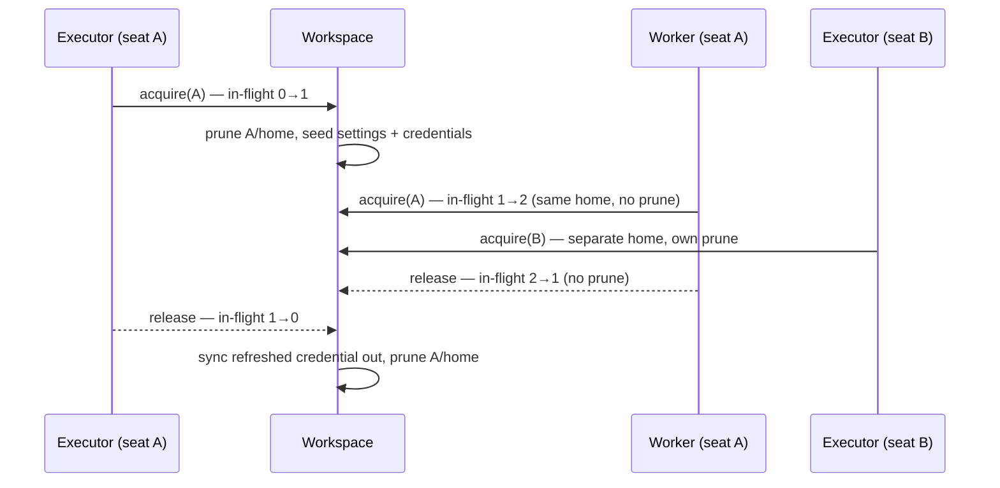

# LLM Backends

**Every model a seat runs on is reached through a coding CLI** — Claude Code
for Anthropic's models, Codex for OpenAI's, OpenCode for open models on any
provider it speaks to (a local server included), and the rest of the
[supported CLIs](#supported-clis). The engine drives the vendor's own
command-line tool as a process: it hands the CLI a conversation and the tools on
offer, and reads back an answer, its tool calls and its usage. There is no
other kind of `providers.llm` entry.

```yaml
providers:
  llm:
    default:
      model: sonnet              # in the CLI's own grammar; claude-code is the default agent
```

```bash
# Signing in on a Claude subscription? Adopt the login this machine already has:
crewlet llm login default -from-host
# Otherwise log in (or mint a headless token) inside Crewlet's own dir:
crewlet llm login default -capture-token
crewlet llm doctor default                  # verify before the first turn
```

On an Anthropic API key instead, the same entry says so, and the key is read
from `ANTHROPIC_API_KEY` — the secret store first, then the environment:

```yaml
providers:
  llm:
    default:
      model: sonnet
      auth: { mode: api-key }
```

The CLI holds the sign-in — your plan's OAuth login, or your key — so Crewlet
never sees a password and never re-implements a vendor's auth. What Crewlet
controls is *where* that login lives, what each seat's copy of the CLI can see,
and how its answer is read back.

> **The trade-off up front.** A CLI is a *process*, not an HTTP endpoint. Each
> call pays a launch before its first byte — seconds, for a Node runtime — its
> tool calls ride a JSON envelope in the prompt rather than a native
> tool-call channel, and a subscription's terms are generally written for
> interactive use. What it buys is the vendor's own harness for every model the
> vendor ships, the day it ships it. Size your cheap, frequent calls
> accordingly: see [Auxiliary work and latency](#auxiliary-work-and-latency).

---

## Why the CLI is the only backend

Each model vendor ships its own harness: the request shape each of its models
accepts, how a model's thinking is carried from one round to the next, what is
cached and where, how a stream ends, which sign-in bills which account. And it
moves that harness with every model it releases. An engine that called the
vendors' HTTP APIs itself had to re-implement all of it, per vendor and per
model — a second copy of work the vendors already do, permanently a release
behind theirs, and wrong in exactly the places a new model differs from the
last one.

So Crewlet does not compete with the vendors' harnesses; it drives them. Claude
Code reaches Anthropic's models on a Claude plan *or* an Anthropic API key, Codex
reaches OpenAI's on a ChatGPT plan or an OpenAI key, and OpenCode reaches open
models — through OpenRouter, a hosted provider or a server on your own network.
Whatever a vendor changes about its wire format is the vendor's CLI's to follow,
and the engine's side is the same for all of them: a conversation in, an answer
out. The decision is recorded, with what the HTTP backends cost while the engine
had them, in [ADR-0045](https://github.com/crewlet/crewlet/blob/main/adr/0045-every-model-is-reached-through-its-vendors-cli.md).

The one vendor client the engine keeps is OpenAI's SDK, for
[`providers.embeddings`](../getting-started/configuration.md#providers): a
coding CLI computes no embeddings.

### What driving a CLI takes

Four problems have to be solved before a coding CLI can sit behind
[`llm.Provider`](overview.md#llm-provider), and each one is a section
below.

| Problem | Why it bites | Where it's solved |
|---|---|---|
| **Shared memory** | A CLI keeps sessions, history, todos, and project notes under one home. Seven seats on one login would read each other's transcripts. | [Isolation](#isolation-the-part-that-actually-matters) |
| **One model per entry** | A CLI takes `--model`, so per-phase models mean several entries — which must not mean several logins. | [Per-phase models](#per-phase-models) |
| **No tool channel** | The tool loop needs `tool_calls` back. A CLI prints prose. | [Tool calls](#tool-calls-in-text-mode) |
| **Browser-only auth** | Subscription logins are OAuth (PKCE) with MFA — no password grant to script. | [Authentication](#authentication) |

---

## Picking a CLI

Pick the CLI by whose models you want, then the sign-in by how you pay for
them:

| Models | `agent` | Signs in with | Agent mode and code work |
|---|---|---|---|
| Anthropic's (Claude) | `claude-code` — the default | a Claude Pro / Max login, a headless `CLAUDE_CODE_OAUTH_TOKEN` minted from it, or an Anthropic API key (`auth.mode: api-key`) | yes |
| OpenAI's (GPT) | `codex` | a ChatGPT Plus / Pro login, or an OpenAI API key (`auth.mode: api-key`) | no — text mode only |
| Open models: OpenRouter, a hosted provider, a local server | `opencode` | the model provider's key in `env`, under that provider's own variable, or a login of OpenCode's own | yes |
| Gemini, Qwen, Cursor, Copilot, Grok, Muse, Kimi, Hermes, Pi | see [Supported CLIs](#supported-clis) | the vendor's own login, or a key | no — text mode only |

The last column is about two things a seat can ask of its CLI beyond answering:
running the executor itself ([agent mode](#agent-mode)), and authoring code in a
[sandbox](code-sandbox.md). Both run the CLI as a coding agent, and this build
has a coding-agent runner for two of them, `claude-code` and `opencode`. A seat
on any other CLI is a text model behind the engine's tool loop — which is every
seat's default — and its code work, if it has any, goes to an entry on one of
those two through `role.llm_sandbox`.

A seat can mix them: its executor on one entry, its reviewer on another, its
auxiliary work on a third, each a different CLI if you like — see
[Per-phase models](#per-phase-models).

### Anthropic's models: Claude Code

```yaml
providers:
  llm:
    claude:                       # on your Claude plan
      model: opus                 # an alias or an id: sonnet, opus, claude-opus-5-5
    claude-key:                   # on an Anthropic API key
      model: sonnet
      auth:
        mode: api-key             # reads ANTHROPIC_API_KEY; or name one:
        # api_key: "${ANTHROPIC_KEY_FOR_CREWLET}"
```

Claude Code is the default `agent`, so neither entry names it. **On a plan**,
the login is the CLI's own OAuth sign-in, which `crewlet llm login` brokers into
the entry's own directory or adopts from your home with `-from-host`; better
still where you can, `-capture-token` mints a headless `CLAUDE_CODE_OAUTH_TOKEN`
into the secret store, which survives an ephemeral container and needs no
refresh — see [Authentication](#authentication).

**On an API key**, `auth.mode: api-key` puts one key into the CLI's
`ANTHROPIC_API_KEY` and removes the plan's token variable, so the call bills the
metered account and never the plan. `auth.api_key` names the key as a `${VAR}`;
left out, the entry reads `ANTHROPIC_API_KEY` itself, through the secret store
and then the environment — so a key already exported, or stored with
`crewlet secrets set ANTHROPIC_API_KEY`, signs the entry in with no YAML change.
An entry in `subscription` mode never forwards a key, whatever the engine's own
environment holds: a subscription entry that silently picked up a
stray `ANTHROPIC_API_KEY` would bill the metered account while you believed you
were on a flat-rate plan.

`model` is what Claude Code's `--model` accepts — an alias that follows the
vendor's current model (`sonnet`, `opus`, `haiku`) or an exact id
(`claude-opus-5-5`). The model's thinking, its effort and its output limits are
Claude Code's to decide, as they are at a terminal; see
[What an entry does not set](#what-an-entry-does-not-set).

### OpenAI's models: Codex

```yaml
providers:
  llm:
    gpt:                          # on your ChatGPT plan
      agent: codex
      model: gpt-5
    gpt-key:                      # on an OpenAI API key
      agent: codex
      model: gpt-5
      auth: { mode: api-key }     # reads OPENAI_API_KEY
```

The ChatGPT login is `codex login`, which `crewlet llm login` brokers, or the
`~/.codex/auth.json` your own Codex already holds, which `-from-host` adopts.
Codex mints no headless token, so a container that is rebuilt on every deploy
carries its login as a [credential bundle](#4-move-a-login-onto-another-host).
On an API key, `auth.mode: api-key` reads `OPENAI_API_KEY` exactly as the Claude
Code entry reads Anthropic's.

Codex runs with its own `--sandbox read-only`, which contains its shell rather
than removing it — see [Tool calls in text mode](#tool-calls-in-text-mode) — and
it has no coding-agent runner, so a Codex entry is a text model: a seat on it
that writes code points `role.llm_sandbox` at a `claude-code` or `opencode`
entry.

### Open models, OpenRouter and local servers: OpenCode

OpenCode reaches models on any provider it speaks to, and reads its model as
`<provider>/<model>`, split at the first slash:

```yaml
providers:
  llm:
    open:
      agent: opencode
      model: openrouter/qwen/qwen3-coder     # the openrouter provider's qwen/qwen3-coder
      env:
        OPENROUTER_API_KEY: "${OPENROUTER_API_KEY}"
```

**OpenCode 2 only** — the `@opencode/cli` package; 1.x (`opencode-ai`) can run
neither this profile nor a coding box. Its key goes in `env` under the variable
of the provider the model names (`OPENROUTER_API_KEY`, `ANTHROPIC_API_KEY`,
`NVIDIA_API_KEY`, …), because OpenCode reads each provider's key from that
provider's own variable — see [A provider key in
`env`](#6-a-provider-key-in-env-opencode-hermes-pi). `crewlet llm login` runs
OpenCode's own `auth login` instead, for a provider it signs in to itself. A
bare model (`qwen3-coder`) names a provider and no model, which OpenCode refuses
as "Invalid model reference", so a write naming one is refused;
`opencode models --standalone` lists the spellings.

**A server on your own network** — vLLM, llama.cpp's server, Ollama, a gateway —
is reached as a provider *declared* in OpenCode's own configuration, with the
address it listens on. Under this profile that configuration is the file the engine
seeds into every call's own directory (see [Tool calls in text
mode](#tool-calls-in-text-mode)), so the declaration rides an override of that
seed. `seed_files` is a list and replaces wholesale, so the override restates the
profile's own policy beside the provider:

```yaml
providers:
  llm:
    local:
      agent: opencode
      model: local/qwen3-coder               # the provider declared below, and its model
      overrides:
        seed_files:
          - path: .crewlet-config/opencode.json
            in: work
            content: '{"$schema":"https://opencode.ai/config.json","update":"disable","share":"disabled","snapshots":false,"permissions":[{"action":"*","resource":"*","effect":"deny"},{"action":"webfetch","resource":"*","effect":"allow"},{"action":"websearch","resource":"*","effect":"allow"}],"providers":{"local":{"package":"@opencode/ai/providers/openai-compatible","name":"Local server","settings":{"baseURL":"http://127.0.0.1:8000/v1"},"models":{"qwen3-coder":{}}}}}'
```

The `providers` block is OpenCode 2's format: the package for the server's wire
(`@opencode/ai/providers/openai-compatible`, or `…/anthropic-compatible`), its
`baseURL` under `settings`, and the models it serves. A server that takes a key
names the **variable** it is read from (`"env": ["LOCAL_LLM_KEY"]`), and the
entry's `env` carries the value — never the file, which is configuration and is
neither `${VAR}`-resolved nor redacted. A server that takes no key leaves the
entry with no sign-in the engine can see, which `crewlet llm doctor` clears once
its smoke test is answered. The declaration reaches the entry's own calls; an
[agent-mode](#agent-mode) run or a coding box writes OpenCode's configuration of
its own, so there the model has to be one OpenCode knows by name.

### The other CLIs

Gemini CLI, Qwen Code, Cursor, Copilot, Grok, Muse Code, Kimi Code, Hermes and
Pi each have a built-in profile, and each is a text model here: its own login
or its own key, and its own model grammar. [Supported CLIs](#supported-clis)
says how each one signs in and what is particular about it, and `custom` is a
profile you write entirely yourself.

---

## Configuration reference

An entry is the CLI's own settings and nothing else: which CLI, which model in
that CLI's grammar, whether it runs as a text model or as the executor itself,
where its login and per-seat homes live, and how it signs in.

```yaml
providers:
  llm:
    default:
      agent: claude-code             # optional: claude-code (default) | codex | opencode
                                     #   | gemini-cli | qwen-code | cursor-agent | copilot
                                     #   | grok | muse-code | kimi-code | hermes | pi | custom
      model: sonnet                  # REQUIRED — passed to the CLI's model flag in its own
                                     #   grammar (opencode: <provider>/<model>). A ${VAR}
                                     #   works; one that resolves to nothing is refused
                                     #   when the entry is built, naming the variable,
                                     #   rather than run on a model nobody chose
      mode: text                     # text (default) | agent — see "Two modes"
      run_in: ""                     # agent mode only: direct | container | e2b

      state_dir: /var/lib/crewlet/llm-cli/claude
      # Where the login and the per-seat homes live, each CLI in a
      # subdirectory of its own (<state_dir>/<agent>). Empty uses
      # $CREWLET_LLM_CLI_HOME/<key>, falling back to ~/.crewlet/llm-cli/<key>.
      # Point it at a persistent volume when the engine runs in an
      # ephemeral container. A LITERAL PATH — unlike the credential fields
      # it is not ${VAR}-expanded, because it names where the engine keeps
      # files rather than a secret (the same reason the store path is a
      # Tier A field).

      timeout_seconds: 600           # one CLI invocation, wall clock (default 600)
      max_concurrent: 4              # CLI processes at once (default 4)

      env:                           # extra child environment, ${VAR}-resolved
        OPENROUTER_API_KEY: "${OPENROUTER_API_KEY}"

      auth:
        mode: subscription           # subscription (default) | api-key | inherit-env
        token: "${MY_OAUTH_TOKEN}"   # subscription only; else the profile's own token variable
        # api_key: "${MY_API_KEY}"   # api-key only — refused under any other mode;
                                     #   else the profile's own key variable
        credential_bundle: "${MY_BUNDLE}"  # else CREWLET_LLM_CLI_<KEY>_CREDENTIALS

      overrides: {}                  # any field under "Profile fields"
```

**`model` is required.** A CLI with no model named runs the vendor's current
default, which moves under you and bills as a model nobody chose. A reference
that resolves to nothing is refused when the entry is built for the same reason,
naming the variable: one nothing answers for, one set to an empty value or to
white space (a compose file passing an unset host variable through, an empty
stored secret), and one part of a composite like `${PROVIDER}/sonnet` alike. A
missing *credential* still builds: every call then fails with the CLI's own
sign-in error, which names it, and a missing model has no such tell. The model
is trimmed before the CLI is handed it.

**`timeout_seconds` caps one invocation, wall clock**: the process launch, the
model's whole answer and the CLI's own internal retries and backoff. Ten
minutes, because one answer of a current model — thinking against a
128K-token output cap — runs that long at the tail, and two minutes was measured
cutting off exactly the calls doing the most work; the launch comes on top. On
breach the process *group* is terminated (so the runtime's helpers go too) and
the call is reported as `timeout`, which the seat's fallback chain carries to its
next entry. A value of `0` takes the default; a negative one is refused.

**`max_concurrent: 4`** keeps peak memory near 1.5 GB: each CLI is a full Node
or Rust runtime at roughly 200–400 MB resident, and an unbounded fleet of seats
starting turns together can exhaust a small engine host. Subscription plans also
throttle concurrency well below what an API key allows, so a much higher number
mostly buys rate-limit errors. A call waiting for a slot gives up when its turn
is cancelled rather than launching a process nobody is waiting for. Raise it on
a large host with an account that permits it; it is per entry, so size entries
together (see [Per-phase models](#per-phase-models)).

**`env`** is the one way to give the CLI anything beyond `PATH`, locale, TLS
trust and proxy settings, because the child gets an
[allowlisted](#isolation-the-part-that-actually-matters) environment rather than
the engine's. It is `${VAR}`-resolved when the entry is built and redacted on
every config read; a reference that resolves to nothing is warned about
(`cli_agent_env_unresolved`) rather than refused, since a CLI whose optional
variable is unset still runs.

**`auth.mode` defaults to `subscription`, not `inherit-env`**, on purpose: an
entry that silently picked up a stray `ANTHROPIC_API_KEY` from the engine's
environment would bill the metered account while you believed you were on a
flat-rate plan. The three modes:

| `auth.mode` | What reaches the CLI |
|---|---|
| `subscription` (default) | its login — credential files in the entry's directory, or a database export — and a headless token in its `token_env` where `auth.token` or that variable resolves. Its `api_key_env` is removed. |
| `api-key` | one key in its `api_key_env`: `auth.api_key`, or that variable itself looked up through the secret store and then the environment. Its `token_env` is removed. |
| `inherit-env` | whichever of the two variables the **engine's own** environment holds — the deliberate escape hatch for an unusual CLI, and the only mode in which a host credential reaches the child. |

**One key, never a list.** A CLI holds one sign-in and rotates nothing, so an
entry has at most one token or one key; a second key is a second entry, placed
after the first in the seat's [fallback chain](#falling-back-between-entries).

**Every credential an entry configures has to reach the CLI, or a write
keeping it is refused.** The engine puts a credential only into a variable the
profile names for it — `api_key_env` for a key, `token_env` for a headless
token — so each of these would run with the credential unused:

| Written | Refused because | Instead |
|---|---|---|
| `auth.mode: api-key` on a CLI whose profile names no `api_key_env` (`hermes`, `pi`, `opencode`, `kimi-code`) | the key has no variable to go in | `hermes`, `pi`, `opencode`: leave `auth.mode` at `subscription` and set the key in `env` under its provider's own variable ([below](#6-a-provider-key-in-env-opencode-hermes-pi)). `kimi-code`: put the key in the credential directory's `config.toml` — `crewlet llm login`, or a [credential bundle](#4-move-a-login-onto-another-host). A build of the CLI that does read a key variable: name it with `overrides.api_key_env` |
| `auth.api_key` under `subscription` or `inherit-env` | only `api-key` mode reads it | set `auth.mode: api-key`, or drop it |
| `auth.token` on a CLI whose profile names no `token_env` (every built-in profile but `claude-code`) | the CLI mints no headless token | remove it |
| `auth.token` under `api-key` or `inherit-env` | `api-key` removes the token variable and `inherit-env` forwards the engine's own | `auth.mode: subscription` |
| `auth.mode: inherit-env` on a CLI that names neither variable | nothing would be forwarded | `subscription`, with the key in `env` or a login |
| the profile's `token_env` or `api_key_env` in `env` | `auth` owns those: whether a value there reaches the CLI depends on `auth.mode` and on whether a credential resolves from the secret store or the engine's environment, which the document cannot show | `auth.token`, or `auth.api_key` with `auth.mode: api-key` |
| `overrides.token_env` or `overrides.api_key_env` that is not an environment variable name (letters, digits and underscores, not starting with a digit — `MY-TOKEN`, say) | no secret store, `${VAR}` or `crewlet llm login` can hold a name outside that grammar, no shell exports one for `inherit-env` to forward, and a name carrying `=` sets a different variable in the CLI's environment | the variable your build of the CLI reads, e.g. `MY_TOKEN` |
| a variable the engine sets to isolate the call in `env` (`HOME`, an XDG home, `TMPDIR`, the profile's relocation and isolation variables) | it would replace that isolation for every seat on the entry | drop it; the refusal names the profile field that moves it, where one does |

An `api-key` entry whose key resolves to nothing is not refused — the document
cannot see the secret store — but `crewlet llm doctor` reports it as "no
sign-in", naming `auth.api_key` and the variable it fell back to.

Each rule is checked against the profile with `overrides` merged in, and each
refusal names the field and the route to take. They are **admission** rules:
every write path — `crewlet validate`, a `PUT` or `PATCH` of the config, a
setup write, a revert — refuses a document that breaks one, while a revision
being *applied* that breaks one is applied and warned about, because the
entry still runs (signed in by whatever the CLI does read) and refusing it
there would take a node off the fleet's configuration during a rolling
upgrade. A profile that cannot drive its CLI at all — an override typo, a
missing `binary`, no `model_args` carrying `{model}` — is different: no
node can build it, so it is refused at apply too.

**A model has to be one the CLI can read, or a write naming it is
refused.** `opencode` reads its model as `<provider>/<model>` and splits it
at the first slash, so a model with nothing before or after that slash —
`claude-sonnet-5`, `anthropic/` — names no model at all, and every call the
entry makes, an agent-mode run included, fails inside the CLI with its own
"Invalid model reference". Name the provider as the CLI spells it:
`anthropic/claude-sonnet-5`, `openrouter/anthropic/claude-sonnet-5`
(`opencode models --standalone` lists them). It is judged on the value the CLI is
handed — the model rendered through `model_args`, a joined
`--model={model}` read past its `=` — and a `${VAR}` model is not judged,
since its value is the secret store's and the environment's. The grammar is
a profile declaration, `model_names_provider`, so there are two ways past
it when a CLI release relaxes it: `overrides.model_names_provider:
false`, or a `model_args` override that writes the provider into the flag
itself (`["--model", "anthropic/{model}"]`), which makes a bare model whole.
This too is an **admission** rule, for its own reason: the entry builds and
the CLI starts, and the grammar is a vendor fact that moves between releases
— a newer build, or a newer peer, may know it better — so a revision being
applied is warned about rather than refused.

**A profile's `passthrough_env` may not name a
[credential](#6-a-provider-key-in-env-opencode-hermes-pi)** — an admission
rule like the ones above. Everything listed there is forwarded from
the engine's own environment *before* `auth.mode` is consulted, so a key
named there would reach every seat whatever the mode says — the same
metered-bill-on-a-flat-rate-plan failure the mode exists to prevent. Use
it for genuine non-secret configuration (`GOOGLE_CLOUD_PROJECT`, a
region); a CLI's key belongs in `api_key_env` or `token_env`, and
`auth.mode: inherit-env` is the deliberate way to let the host's value
through.

**Nor may a profile's `env`**, for the same reason and one more:
`overrides` is neither `${VAR}`-resolved nor redacted, so a key written
there would sit in the stored revision in plain text and come back on every
config read. A credential the CLI needs goes in the entry's `env`, which is
both, or through `auth`. A profile's `env` may not name its `token_env` or
`api_key_env` either, whatever they are called: `auth` owns those, and the
entry's `env` and `auth` are both layered over the profile's, so whether a value
there reached the CLI would turn on the mode and the secret store rather
than on anything the profile says.

---

## What an entry does not set

A coding CLI driven headlessly takes a model and a prompt, and reads everything
else about how its model behaves from its own configuration. So an entry has no
field for any of it, and neither does a call:

- **No sampling.** No temperature is sent by any phase; every call runs at what
  the CLI sends, which is what it sends at a terminal.
- **No effort and no thinking switch.** How hard a model thinks is the CLI's
  configuration of that model, or the model you pick. A model that habitually
  spends its whole answer thinking is changed with `model`.
- **No output cap.** A caller that needs a short answer — the round-cap judge,
  a summary — asks for one in its prompt, the one channel every CLI reads, and
  [token budgets](../getting-started/quickstart.md#token-budgets-optional) bound
  what a seat spends.
- **No endpoint.** Where a CLI sends its requests is the CLI's own setting —
  for OpenCode a provider declaration ([above](#open-models-openrouter-and-local-servers-opencode)).
- **No key rotation and no shared bench.** One sign-in per entry, and a spent
  plan sits the entry out on the node that heard it, not across the fleet (see
  [Falling back between entries](#falling-back-between-entries)).

Where you do want a CLI configured differently from its vendor's defaults, the
entry reaches each of the CLI's own channels: its environment variables through
`env`, its flags through `overrides.complete_args`, and a settings file through
`overrides.seed_files`, written into the seat's home or the call's directory
before every call. Each is the vendor's configuration surface rather than
Crewlet's, so check it against the version `crewlet llm doctor` reports.

---

## Per-phase models

Phase selection resolves by `providers.llm` **key**, so `llm`,
`llm_review`, `llm_subagent`, `llm_auxiliary`, `llm_judge` and `llm_sandbox`
each name an entry, including list-form fallback chains. See
[Turn Engine — per-phase LLM models](turn-engine.md#per-phase-llm-models).

The model goes on the CLI's `--model`, so one entry is one model, and per-phase
models mean one entry per model:

```yaml
providers:
  llm:
    opus:
      model: opus
      state_dir: /var/lib/crewlet/llm-cli/claude
    sonnet:
      model: sonnet
      state_dir: /var/lib/crewlet/llm-cli/claude   # the same login as `opus`
    haiku:
      model: haiku
      state_dir: /var/lib/crewlet/llm-cli/claude
    claude-key:                                    # the plan's backstop
      model: opus
      auth: { mode: api-key }

roles:
  - name: Engineer
    llm: [opus, claude-key]         # the executor: the plan first, the key when it is spent
    llm_review: sonnet              # the reviewer, on a cheaper model
    llm_auxiliary: haiku            # see the latency note below
    llm_judge: haiku
```

**Point them at the same `state_dir` and they share one login.** The three plan
entries above then use the credential directory a single `crewlet llm login`
wrote, instead of needing one login per entry — the default `state_dir` is per
provider key precisely so unrelated entries do *not* collide, which means
entries that should share must say so. They also share one set of per-seat
homes and one generation, so a call on one entry never wipes a live call on the
other.

**Sharing is per CLI.** Each CLI keeps its files in a subdirectory of the
`state_dir` named for it (`<state_dir>/claude-code`, `<state_dir>/codex`, …),
because two CLIs disagree about which files are credentials and which are
conversation memory. So entries on one `state_dir` share a login only when they
drive the same CLI — an entry that leaves `agent` out drives `claude-code` and
shares with one that names it — and entries on different CLIs share the
directory and nothing in it, which is what lets an entry [move to another
CLI](#an-entry-moved-to-another-cli) without a restart.

**Keep the key entry's directory apart.** `claude-key` above takes the default
`state_dir`, so its seats' homes are seeded with no plan login: with one, which
of the two the CLI bills is the vendor's precedence rather than anything the
entry says.

**Concurrency is per entry.** `max_concurrent` caps one entry's processes, so
the four entries above at the default of 4 can run 16 CLI processes at once.
Size them together against the engine host's memory.

### An entry moved to another CLI

Moving an entry to another CLI (changing its `agent`) is an ordinary revision,
applied live on every node: the key keeps its `state_dir`, the new CLI opens a
login directory of its own, signed out until you sign it in (`crewlet llm login
<key>`, or the CLI's own sign-in adopted with `-from-host`), and moving back
finds the old CLI's login where it was left.

**A credential bundle does not move with it.** A bundle belongs to the CLI it
was exported from, and names it, but it is keyed by the entry —
`CREWLET_LLM_CLI_<KEY>_CREDENTIALS`, or the secret `auth.credential_bundle`
references — so after the move it still holds the old CLI's login and names
the old CLI. A restore reads that name rather than the files' names, which
cannot tell two CLIs apart: Codex, Cursor Agent, Grok, Hermes, Muse Code and Pi
each keep a login in an `auth.json`, and Gemini CLI and Qwen Code in an
`oauth_creds.json`. Wherever the new CLI's credential directory is empty —
every node you have not signed it in on, and every container on a fresh
volume — each boot and apply refuses the bundle and writes nothing, logged as
`cli_agent_bundle_restore_failed` with the CLI the bundle names, and `crewlet
llm list`, `status`, `export` and `doctor` say so too, as `crewlet llm import`
does for a bundle of another CLI's, until it is replaced: sign the new CLI in,
then export its bundle in the old one's place (`crewlet llm export <key>
-secret-store`, or pipe `crewlet llm export <key>` into the secret
`auth.credential_bundle` references). A deployment that relies on the bundle
runs the entry signed out until then.

### Auxiliary work and latency

`llm_auxiliary` serves the calls around a turn: the turn-start prefetch (the
knowledge query, the relevance filter, a recalled turn's rewrite), the
condensing of a tool result too large for the conversation, and every
reflection and learning pass after it. `llm_judge` serves the round-cap
[extension judge](turn-engine.md#round-cap-extension-judge). Each of those calls
is one CLI process, so each pays a launch before its model starts — and each has
a **fixed deadline**, which no entry setting widens:

| Calls | Deadline |
|---|---|
| The turn-start prefetch — the knowledge query and the relevance filter, each call; a recalled turn's rewrite, the whole render | 30 s |
| The extension judge | 30 s |
| Condensing a tool result or a payload, each piece | 60 s |
| Each reflection and learning pass — the persist decider, the counterparty profiler, skill synthesis, refinement and promotion, episode compaction | 60 s |

The entry's `timeout_seconds` caps the process; these cap the *call*, and
whichever ends first ends it. They are fixed because each sits in front of
something: the prefetch is latency a person is waiting through before the
executor sees anything, the judge runs on a phase that has already run out of
rounds, and a learning pass that hangs holds up the company's reflection rather
than one turn's. A call cut off degrades rather than fails — the prefetch
goes without what the call would have added (a summary falls back to the raw
recalled turns), the judge falls through to the rescue it was there to avoid,
the learning pass persists nothing — so a slow auxiliary model does not stall
turns, it quietly does less.

**So point `llm_auxiliary` and `llm_judge` at a fast, cheap model** — `haiku` on
Claude Code, a small open model on OpenCode — rather than the seat's own. A
frontier model thinking at length behind a Node launch is the shape most likely
to be cut off at thirty seconds.

---

## Falling back between entries

A seat's `llm` (and every per-phase field) takes a **list**, tried in order for
every call, and the walk moves on whenever a failure is one another entry might
not share: a spent plan or a rate limit (`rate_limit`), a missing or expired
login (`auth`), a `timeout`, or a run that failed for no reason the profile
recognises (`server`) — an error or an overload the CLI relayed from its vendor,
a crash, output this build can no longer read, a run not seen to its end (see
[a helper that outlives the CLI](#a-helper-that-outlives-the-cli)). Only a
`fatal` failure stops it, and that is a call the engine itself cannot make: a
prompt it cannot render, a file of the call's it cannot write, a CLI it cannot
start on this host — the binary missing or not executable there, or no pipe or
process for it, refused before any CLI exists. Those are yours to fix, and
walking past one would only carry every call to the next entry, and its bill,
until somebody read why. A CLI that started is never `fatal`, however it ended.

The natural chain is **one CLI, two ways to pay**: the plan first, the key
after it.

```yaml
providers:
  llm:
    plan:
      model: sonnet
    key:
      model: sonnet
      auth: { mode: api-key }       # ANTHROPIC_API_KEY

roles:
  - name: Engineer
    llm: [plan, key]                # flat-rate first, metered as the backstop
```

A spent subscription window arrives as prose on a *successful* exit ("Usage
limit reached · continuing automatically"). Crewlet matches that wording — and,
where the CLI relays the API's own error instead, the
`"type":"rate_limit_error"` in it — and reports it as `rate_limit`, so the seat
moves to `key` for that call.

**And the entry then sits out, on this node.** A spent window lasts hours and a
seat makes a call per round, so without it every round of every seat on the
entry would start a CLI — seconds of a runtime holding one of the entry's few
slots — only to hear the same sentence and fall through anyway. Instead every
call to the entry fails at once as a rate limit — one already queued for a slot
as soon as it gets one — saying `sitting out until …` with the CLI's own
sentence, until the window ends:

- at the reset instant the CLI named, where its profile can read one, and never
  more than **an hour** away, so a plan you raised or a login you renewed has
  the entry back within the hour even when the vendor's window runs for days;
- otherwise after **one minute** — which is every shipped profile today: the
  current Claude Code prints no reset instant at all. A probe costs at most
  the entry's `max_concurrent` process launches a minute — the calls that take
  a slot once the window ends, before the first of them answers; every call
  queued behind them is refused as soon as one reports the plan still spent.
  Sitting out a plan that has already reset costs the fallback's spend for as
  long as it sits.

The sit-out is the entry's own, on the node that heard the sentence: every other
node learns the same thing from its own calls, once per window. A later sit-out
never shortens an earlier one.

**A login is never sat out.** An expired or missing login is `auth`, which also
moves the seat down its chain, but the very next call tries the entry again:
`crewlet llm login` mends a login from another process, usually while seats are
running, and a window would hold a signed-in seat on its fallback for nothing.
Finding out a login is still missing costs a CLI that exits at once rather than
a model call.

### What a sentinel may be

Both recognitions are `limit_markers` / `auth_markers` on the profile: a
literal substring the vendor emits, plus (where it carries one) the field
holding the reset instant, so the sit-out is a datum rather than a
guess. They are matched against what the CLI printed, and on a healthy call
that is **the model's own answer** — its prose and the arguments of every tool
call it makes — while a limit match throws the answer away, sits the entry out
for every seat on the node and hands the seat to the next entry in the chain.
So what the CLI said on stdout is read on terms:

- In a run the CLI **reported failed** — a non-zero exit, or its own failure
  flag (`error_paths`) — a sentinel counts anywhere in it. The CLI has said
  this was no answer, so what it printed is its account of why.
- In a run it did **not**, a sentinel counts only where it **opens** what was
  said: the first non-empty line begins with it. That is the vendor's report
  standing where the answer should be — Claude Code's
  `Usage limit reached · resets …` — and an answer that merely mentions a
  limit, or a tool call carrying one in its arguments, is the answer it is.

Stderr is matched anywhere: the answer does not reach it. The anchoring is what
makes the built-in profiles' generic sentinels safe to ship — Copilot's and
Grok's `rate limit`, Cursor's `quota` are not measured vendor sentences, and
on a clean run they count only as the opening of a report. Under
`marker_scope: events` a sentinel is instead the failure *class*, compared whole
with the CLI's own failure event and nothing else
(see [CLI flags drift](#cli-flags-drift--and-thats-a-config-edit-not-a-release)).
Every sit-out logs `cli_agent_limit_reported` with where its sentinel matched —
`report`, `failed-run`, `stderr` or `event` — and the line it matched, so one
you doubt can be traced to what the vendor said.

So a sentinel has to be the vendor's *wording*, and a profile is refused
at `crewlet validate` if one contains no letters. The rule exists because
a shipped profile carried `sentinel: "429"`, and three digits matched as
a substring is not a rate limit — it is a model quoting an HTTP status, a
stack trace's line number, a token count, or any ten-digit epoch. Every
one of those took a working subscription out of service.

The other way a sentinel stops working is quieter — the vendor reworded
it, so it simply never fires. A spent plan the CLI reports as a failed run
then reaches the chain as `server`: the seat still moves on, but the entry
never sits out, so every round of every seat on it starts a CLI to hear the
same sentence again. One it reports on a successful exit is taken for the
model's answer. Both are fixed the same way, with `overrides.limit_markers`; see
[CLI flags drift](#cli-flags-drift--and-thats-a-config-edit-not-a-release)
for the shape, and take the wording from the sentence your CLI actually
printed, which a `server` failure carries verbatim so that you can.

---

## Isolation: the part that actually matters

One provider instance serves every seat in the org. Each **call** gets
its own place to run:

```
<state_dir>/
└── <agent>/                          # one per CLI: claude-code/, codex/, …
    ├── credentials/                  # the login — ONE per state_dir and CLI
    ├── credentials.lock              # taken by every writer and reader of it
    ├── credentials.pending           # a write of the login, while one is in progress
    └── seats/
        ├── sarah-chen/
        │   ├── cache/                # XDG_CACHE_HOME — warm, holds no conversation
        │   ├── home/                 # HOME + XDG config/data/state + vendor dirs
        │   └── work/<call-id>/       # cwd for one call, then deleted
        └── marcus-rivera/
            └── …
```

**Between seats.** Every seat gets its own `home`. `HOME`,
`XDG_CONFIG_HOME`, `XDG_DATA_HOME`, `XDG_STATE_HOME`, `TMPDIR` and the
vendor's own relocation variable (`CLAUDE_CONFIG_DIR`, `CODEX_HOME`, …)
all point inside it — or, for a variable naming configuration a call must
not share with the seat's other calls (`OPENCODE_CONFIG_DIR`), inside that
call's own working directory — and a vendor's own switch that stops it
reading configuration from anywhere else (`OPENCODE_CONFIG_PROJECT_DISABLE`,
the profile's `isolation_env`) is set beside them. Nothing in a CLI's state
layout is reachable across that boundary, and nothing configured may move
it: a profile's `env` or `passthrough_env`, or an entry's `env`, naming
one of those variables is refused, because each is layered over the
isolation and would replace it without a word.

**Between turns.** Each profile declares its `volatile_paths` —
sessions, transcripts, history, todo state. They are deleted before and
after every call. Crewlet's memory model is the [agent
diary](agent-learning.md) and the episode store; a second, invisible
memory inside the CLI would make turns non-reproducible and would carry
one task's context into the next.

**Between the seat and the host.** The child process gets an
**allowlisted** environment — `PATH`, locale, `TERM`, TLS trust, proxy
settings, plus whatever the profile and the entry's `env` declare — never the
process environment. It is the one allowlist every child the engine starts is
handed, a [stdio MCP server](../guides/tools-and-mcp.md#what-a-stdio-servers-environment-is)
and a local sandbox's coding agent included, so the three cannot disagree about
what a child may see. Inheriting the engine's environment would hand every seat
the keyring every session cookie is signed under, the Tier A token values, the
org's `SLACK_BOT_TOKEN` and the collector credential in
`OTEL_EXPORTER_OTLP_HEADERS`. It would also silently bill a metered
`ANTHROPIC_API_KEY` that happened to be exported to an entry signed in on a
plan.

**Working directory.** Each call runs in an empty, per-call scratch
directory that is removed afterwards — so a CLI that reads `AGENTS.md` /
`CLAUDE.md` from `cwd`, or writes scratch files, finds nothing from
anyone else.

**An empty directory is not enough for a CLI that also walks *up* from
it.** The per-call directory is `<state_dir>/<agent>/seats/<seat>/work/<call>`, and
`state_dir` defaults to a directory under the engine user's home, so whatever
sits above it — that home, or a repository you pointed `state_dir` into —
is an ancestor of every call. OpenCode reads project configuration from every
ancestor (`opencode.json`, and `.opencode/` agents, skills and plugins), and a
project's permissions beat the seat's: measured on 2.0.32, an allow-all
`opencode.json` anywhere above the state directory handed every seat a shell,
file writes and code execution, and a plugin there ran its code in every call.
So the `opencode` profile switches that walk off and reads its configuration
from the call's own directory — see
[Tool calls in text mode](#tool-calls-in-text-mode). Whether another CLI
reads an ancestor's configuration is that vendor's behaviour, and the one way
to know on your host is `crewlet llm doctor`'s shell probe, which asks the CLI
to run a command and believes only an answer it could not have guessed — run
it from the state directory you deploy with.

### Concurrency within a seat

Delegated [workers](turn-engine.md#workers) run in parallel and belong to the
*same* agent, so they share that seat's home — sharing memory between an
agent and its own workers is harmless by definition. Pruning is keyed
to the seat's in-flight count crossing zero: the first concurrent call
wipes and seeds, the last one to finish wipes again. Parallelism inside a
seat is preserved; nothing crosses a seat or a turn. Every one of those calls
still takes one of the entry's `max_concurrent` slots, as does a seat's
auxiliary command (an export, a usage report), which runs inside the slot of
the call it brackets.



---

## Two modes: a text model, or the agent itself

An entry runs one of two ways, named on the entry with `mode`. There is
deliberately **no default beyond `text`** and no inference, because both are
defensible for the same CLI on the same seat.

| | `mode: text` (default) | `mode: agent` |
|---|---|---|
| Who drives the loop | Crewlet's own tool loop | the CLI's |
| The CLI's shell and editor | denied | **enabled** — that is the point |
| Crewlet's tools | ride the prompt envelope; the engine executes them | reach the run over the [MCP bridge](#the-tool-bridge) |
| Where it runs | a subprocess of this engine | a sandbox box (`run_in`) |
| Lifetime | one call, inside the phase | **detached** — outlives the turn, resumes it later |
| Needs | a sign-in on this host | a sign-in *plus* a coding-agent runner for the CLI (`claude-code` or `opencode`), `providers.sandbox` and a reachable bridge URL |

**Text mode is predictable**: the tool log is the engine's own, every
call goes through the permission model and redaction, and it needs no
sandbox. **Agent mode is the vendor's own harness**: a real
shell, a real editor and a real checkout, which is what makes it worth
having for code work.

Only the **executor** branches. Every other phase — the reviewer, a
delegated worker, the summariser, the round-cap judge — is a text call on
the same entry, and a seat pointing `llm` at an agent-mode entry keeps
all of them. The reviewer in particular stays native and stays a separate
model call: the point of a reviewer is that it is not the thing being
reviewed.

### Agent mode

```yaml
providers:
  llm:
    executor:
      model: sonnet
      mode: agent                    # text (default) | agent
      run_in: direct                 # direct | container | e2b
```

`run_in` names a cell of [`providers.sandbox`](code-sandbox.md), and it
sits on the **entry** rather than on the seat because it is a property of
this runtime: the CLI's login lives on the engine host, so
`direct` and `container` reach it directly while a remote cell needs the
headless token or a key instead. Want both? Make two entries and point each seat
at the one that is right for it — the same way you already choose between
two models. Empty takes `providers.sandbox.default_run_in`.

The cell is checked like a seat's, at validation rather than at the
seat's first turn: it must be one the catalogue configures, an empty one
needs a default to fall to, and agent mode in a company with no
`providers.sandbox` at all is refused outright. The backend behind the
cell is built for it, so `run_in: container` needs `local.image` exactly
as a seat's would. `self` is not accepted here — it is a *seat's* answer,
meaning "my code work rides my executor's run", and an agent-mode entry
**is** that run. Only entries some seat's executor actually resolves to
are checked and built for; an entry nobody runs on is checked the day a
seat points at it. A seat that names no `llm` resolves the company-wide
fallback (the entry called `default`, else the first declared), so an
agent-mode entry can be reached without any seat naming it — but a
**human seat** never resolves one at all: it is addressable and never
spawned, so it runs no executor and reaches no entry.

The credential guard that refuses a remote run nothing signs in, and names
the remedy the entry's `auth.mode` reads (see
[Code Sandbox](code-sandbox.md#failure-modes)), reads **this**
entry for an agent-mode run — the run *is* the executor — and the seat's
`llm_sandbox` only for `run_sandbox` work.

**The run names the model exactly as the entry's text calls do.** An
entry's `model` is written in its CLI's own grammar, and an agent-mode
run — like every text call the same entry makes for the reviewer, a
worker, the auxiliary model, the round-cap judge or a fallback — hands it
to the CLI as written (its `${VAR}` resolved, through the profile's
`model_args`). For `opencode` that grammar is `<provider>/<model>`, split
at the first slash, so one value serves both:

```yaml
providers:
  llm:
    oc:
      agent: opencode
      model: anthropic/claude-sonnet-5     # or openrouter/anthropic/claude-sonnet-5
      mode: agent
      run_in: e2b                          # or empty: providers.sandbox.default_run_in
      env:
        ANTHROPIC_API_KEY: "${ANTHROPIC_API_KEY}"   # the key of the provider the model names
```

The key of the provider the model names goes in `env`, and it
travels into a box in any cell, a remote one included, like a headless
token — see [A provider key in `env`](#6-a-provider-key-in-env-opencode-hermes-pi).
A `crewlet llm login` (OpenCode's own `opencode auth login`) signs that
provider in too, but only in a local cell (`run_in: direct` or
`container`): the login stays on the engine host — as the document
OpenCode's `auth export` prints, imported into the box's OpenCode before the
run and exported back over it after — and it never follows a run to a
remote box.

An agent-mode run is a **detached coding run** and reuses that machinery
whole: the executor phase suspends, the run's state goes on a durable row
in the [coordination store](coordination.md), the completion poll collects
it, and the *same turn* resumes — possibly in another process on another
node, days later. Nothing about that is new for agent mode; see
[Code Sandbox](code-sandbox.md#how-a-coding-task-runs).

**The engine's correctives do not reach an agent-mode run.** The rounds
are the CLI's own, so the engine's tool loop never sees one end in prose
and cannot ask the model again: a run whose model writes its report as
text instead of calling `submit_work` over the bridge comes back with no
submission, and the phase is rescued as `incomplete` straight away. In
text mode the same reply is a round the engine's loop re-prompts, naming
`submit_work`, up to twice (see [Turn Engine](turn-engine.md#round-cap-extension-judge)).
What an agent-mode run has instead is its brief, which tells it the run
ends with that call.

#### The tool bridge

The seat's tools cannot be shipped into the box: most are MCP children
holding the **seat's** credentials, several are engine control, and the
whole point of a sandbox is that its credentials are not the company's.
So the box gets exactly one MCP server — on the engine, named `crewlet` —
and every call comes back out through the *same* `tools.Surface` a native
loop would call. A tool denied natively is denied there; the skill guard,
the recording and the failure shape are the ones already tested. That
name is **reserved**: an `mcp_servers` entry may not use it, because the
bridge is written into every agent-mode box's server list under it and
would replace the entry there. The bridge advertises the seat's *live*
tool set — a tool the coding agent activates mid-run with `activate_tool`
is listed and callable on its next request, over the connection it already
holds — and every MCP session the box opened is closed the moment the run
ends, whatever ended it.

The endpoint is a per-run URL carrying a signed token that expires with
the run, and the session is closed the moment the run ends, whatever
ended it. Set **`CREWLET_MCP_BRIDGE_URL`** to a URL a sandbox can reach;
without it agent mode is **refused** at launch rather than started — a
coding agent with none of the seat's tools cannot answer anybody, cannot
touch a ticket and cannot submit its work. The URL has to reach a
listener, so the node also needs `api.port`: a node that binds none
(`api.port: 0`) refuses agent mode by naming `api.port`, rather than
handing a box an endpoint nothing answers. With `api.public.port` set the
bridge is served on that public listener and nowhere else, so the URL
names it.

> **In a fleet, that URL must address the node itself, not a load
> balancer in front of several.** A
> session is a live tool surface: the seat's MCP children, its skill
> guard, its per-turn recording, all objects in the process that claimed
> the seat. Signing shares *authentication* across a fleet; it does not
> and could not share the surface. Each node mints its endpoint from its
> own value, so a per-node-addressable one is correct and a shared one
> sends calls to peers that never held the session. Those answer 401
> forever, and the response deliberately cannot say why — but the log
> can, and does: `mcp_bridge_unresolved` names this setting when the
> token is one the fleet signed.

The run ends by calling `submit_work` over that bridge, exactly as a
native loop ends by calling it locally, so the outcome vocabulary and the
rescue path are shared. A run that stops without submitting is rescued as
`incomplete` and judged on its record — the engine never reads the prose
a CLI happened to end with as a delivery.

Every bridged call is appended to the run's own durable row, bounded at
200 with the **middle** dropped, because that log is the whole record a
resume has: the process collecting a run may not be the one that launched
it, and without it a restart mid-run would leave the reviewer judging a
turn whose entire tool log is gone.

Each append also carries what the run's bridged calls have cost the engine so
far — the auxiliary rewrites the seat's tools asked for and the workers the CLI
delegated to — because those calls happen after the part of the turn that
launched the run has ended and charged what it spent. The part of the turn that
resumes from the run pays them to the turn's [work
item](../guides/work-tracker.md#spend-is-on-the-task), beside the run's own
tokens. Each call is recorded under the run it was made for — the bridge
session is given the run's name before its box exists — so a call still in
flight when the turn launches its next run (a delegated worker outliving the
CLI that asked for it) is dropped rather than landing on the next run's record,
where that run's resume would pay for it as its own. A late call that finishes
after its run was collected but before any next run is recorded on its own run
and is not paid: the resume paid what the run's record held when it was
collected, so the task can fall short of the turn's cost and never exceed it.

#### Code work inside the run

A seat whose executor already holds a shell has no use for a second box
beside it — two filesystems, with the work in the one the turn cannot
see. So such a seat is never offered `run_sandbox`: the tool is not on
its surface, not in its catalogue and not one `activate_tool` reaches,
and no second box is provisioned.
[`role.sandbox.run_in: self`](code-sandbox.md#where-code-work-runs)
documents that code work rides the executor's own run; leaving `run_in`
empty, or naming no gate at all, behaves the same. `self` is refused on
any other runtime, and is not offerable as a company-wide default.

---

## The system prompt in text mode

A coding CLI takes a prompt, not a conversation, so the transcript is
flattened into one text: `## system`, `## user`, `## assistant`,
`## tool result: name (call id)`. Everything below is about the one
section that does **not** belong there.

Folded into that text, a system prompt arrives as **user content** — the
model is asked to treat an ordinary message as its standing instructions,
underneath a vendor default that keeps saying what it is. So where a CLI
has a channel of its own for it, the profile names it in
`system_prompt_args` and the text travels there instead. Claude Code's is
declared as:

```yaml
system_prompt_args: ["--system-prompt-file", "{file}"]
```

Two decisions in that one line, both measured against Claude Code 2.1.263
rather than assumed:

- **Replace, not append.** Asked "who are you?" as a PM seat, the same
  model answers *"I'm Agent PM at Nimbus, an AI assistant helping with
  software engineering tasks and project work through Claude Code"* with
  the default prompt in force, and *"I'm Agent PM at Nimbus, your AI
  assistant for project management and technical collaboration"* with it
  replaced. A coding-agent identity over the top of whatever seat is
  actually being served is not a cosmetic problem: it is the seat's
  standing instructions arguing with themselves. The default prose also
  costs ~3.5k input tokens on every round of every phase, describing
  tools this backend denies. Replacing it leaves the web tools working —
  a `WebFetch` probe still fetches, which is what `crewlet llm doctor`
  measures on every run.
- **The file variant, not the inline one.** A seat's system prompt
  carries the org chart, the company's policies, that seat's backstory
  and roster, and its `## Personal memory` and `## Relevant knowledge`
  prefetches. On argv all of that is readable by every account on the
  machine through `/proc/<pid>/cmdline`, and bounded by `ARG_MAX`
  (256 KB on macOS — the limit the `copilot` profile's argv prompt
  already lives under). The text is written `0600` into the per-call
  working directory, which is created empty for one call and removed on
  release, so it cannot outlive the call or reach the next one.

`{file}` substitutes that path; `{system}` substitutes the text straight
into argv, for a CLI that offers no file variant. A profile that declares
neither leaves the system prompt in the transcript, which is what a CLI
with no such flag can take.

The system prompt on its own channel is also what makes it cacheable: it is
the large, byte-stable prefix of every round, and the vendor's harness caches
it the way it caches any session's system prompt. The engine sets no cache
breakpoint of its own and reads back what the CLI reports it read from the cache
and wrote to it.

### Which CLIs actually have one

Checked by running each CLI's own `--help`, at the version named — not
from vendor documentation, which lags. That distinction is not academic:
every one of the three most recent rows was drafted from a vendor's published
reference and then **corrected** by the installed binary. `hermes`'s docs
list `--toolsets` under a subcommand it also accepts at the top level;
`pi`'s README lists eight built-in tools where the Linux build registers
four; `kimi-code`'s tool table lists a `WebSearch` its binary only registers
once a search service is configured, and omits a whole `Goal` family it
ships. `crewlet llm doctor` prints `written for` beside the version you
actually have, and every field is a
[config edit away](#cli-flags-drift--and-thats-a-config-edit-not-a-release):

| `agent` | version checked | flag | in the profile |
|---|---|---|---|
| `claude-code` | 2.1.263 | flag, file: `--system-prompt-file` (`--append-…-file` appends) | `system_prompt_args: ["--system-prompt-file", "{file}"]` |
| `gemini-cli` | 0.58.0 | **env var, file**: `GEMINI_SYSTEM_MD` — no flag exists | `system_prompt_env: GEMINI_SYSTEM_MD` |
| `qwen-code` | 0.23.0 | **both**: `QWEN_SYSTEM_MD` (file) *and* `--system-prompt` (string) | `system_prompt_env: QWEN_SYSTEM_MD` |
| `grok` | 1.0.13 | flag, string: `--system-prompt-override` (`--rules` appends) | `system_prompt_args: ["--system-prompt-override", "{system}"]` |
| `codex` | 0.153.4 | none, on `codex` or `codex exec` alike | — |
| `opencode` | 2.0.32 | **discovered file**: no flag and no variable, but an agent it discovers — `agents/<name>.md` in its configuration directory, which the profile points inside the per-call directory, its body replacing OpenCode's own prompt — which `--agent` selects | `system_prompt_args: ["--agent", "crewlet-seat"]` + `system_prompt_file` with `discovered: true` |
| `copilot` | 1.0.83 | none (`--no-custom-instructions` only disables its own) | — |
| `cursor-agent` | 2026.09.02 | none | — |
| `muse-code` | 1.0.3 | none (`AGENTS.md` / `CLAUDE.md` only, and only in a **trusted** workspace) | — |
| `kimi-code` | 0.42.x | flag, file: `--agent-file` — but an **agent definition**, not a bare prompt | `system_prompt_args: ["--agent-file", "{file}"]` + `system_prompt_file` |
| `hermes` | 0.21.2 | none (`SOUL.md` in its own home, which `--ignore-rules` switches off) | — |
| `pi` | 0.85.x | flag, string: `--system-prompt` (`--append-system-prompt` appends) | `system_prompt_args: ["--system-prompt", "{system}"]` |

**There are two channels, and `--help` only shows one of them.** A CLI may
take the prompt as an *argument* (`system_prompt_args`, with `{file}`
substituting a path and `{system}` the text itself) or from a *file named by
an environment variable* (`system_prompt_env`). Gemini CLI and its Qwen fork
have no flag at all and are configured entirely through the second — which is
why both were once recorded here as having no system-prompt channel, on the
strength of reading `--help`. A profile declares one or the other; naming
both is refused at load, because which copy a CLI honours when handed the
same prompt twice is the vendor's business.

**That exclusivity runs one level down as well.** A single
`system_prompt_args` naming *both* `{file}` and `{system}` is refused for a
sharper reason than ambiguity: the renderer writes the private file and
substitutes the text into argv on the same pass, so
`["--agent-file", "{file}", "--system-prompt", "{system}"]` produced a `0600`
file *and* put every byte of the seat's identity in `/proc/<pid>/cmdline`.
Overrides are where a hand-written argv actually appears, so that is where
the check matters.

**Prefer the file wherever both exist.** `{system}` puts the seat's system
prompt — the org chart, the policies, that seat's own memory — into argv,
where `/proc/<pid>/cmdline` makes it readable by every account on the
machine. `qwen-code` is the one CLI offering both, and this profile takes the
variable for exactly that reason. `grok` has only the string form, but its
*prompt* already travels on argv (`prompt_mode: argv`) so nothing changes
there; on a shared host, `overrides.system_prompt_args: []` puts the
prompt back in the transcript.

**A vendor's project file is not a system-prompt channel.** `muse-code`
reads `AGENTS.md` and `CLAUDE.md`, but only once a workspace has been
*trusted* — and Crewlet runs it in a per-call directory created empty and
never trusted, precisely so that no rule, skill or hook from a checkout the
engine does not control is admitted. Writing the seat's identity there
would mean trusting that directory, which trades the whole guard for a
channel the transcript already provides.

**Some channels take a FILE WITH A SHAPE, not a bare prompt.** Kimi Code's
only per-call prompt channel is `--agent-file`, which takes an *agent
definition*: YAML frontmatter naming the agent, describing it (required) and
listing its tools, with the **body** as the system prompt. Handed a bare
prompt it does not degrade — a file passed explicitly "must be valid,
otherwise the CLI reports the error and exits" — so the profile declares the
envelope alongside the channel:

```yaml
system_prompt_args: ["--agent-file", "{file}"]
system_prompt_file:
  name: crewlet-seat.md        # the file to write; some vendors key on the extension
  template: |                  # {system} is the seat's own prompt
    ---
    name: crewlet-seat
    description: The Crewlet seat this run serves.
    tools:
      - WebSearch
      - FetchURL
    ---
    {system}
```

**A channel can be found rather than handed.** OpenCode 2 takes no path at
all: it *discovers* the agents in its configuration directory, at
`agents/<name>.md`, and `--agent <name>` selects one. The profile points that
directory — `OPENCODE_CONFIG_DIR` — at `.crewlet-config` inside the per-call
working directory (`work_config_env`), so the file is the call's own, and its
argv only names the agent:

```yaml
work_config_env:
  OPENCODE_CONFIG_DIR: .crewlet-config         # relative to the per-call directory
system_prompt_args: ["--agent", "crewlet-seat"]
system_prompt_file:
  name: .crewlet-config/agents/crewlet-seat.md # where OpenCode looks, inside the per-call directory
  discovered: true                             # found by its location: the argv carries no {file}
  template: |
    ---
    description: The Crewlet seat this run serves.
    mode: primary
    ---
    {system}
```

Per call rather than in the seat's home, because a seat runs calls
concurrently in one home and each call's system prompt is its own. It used
to be `.opencode/agents/` in the working directory, OpenCode's *project*
location — and reading project configuration is what let every ancestor of
that directory configure the call (see
[Tool calls in text mode](#tool-calls-in-text-mode)).

A `discovered` file's `name` is the one that may carry a directory; it must
stay inside the per-call directory and name a *file* there — not the
directory itself (`.`, `x/..`), and not a path ending in a separator, which
would write a file where the CLI looks for a directory of agents and fail
every call. It needs `system_prompt_args` to select what was found, and
refuses `{file}` and `{system}` in them, since handing over the path or the
text as well would be two channels for one prompt — and `{system}` would put
the seat's whole system prompt on argv. Measured on 2.0.32, the agent's body
replaces OpenCode's own coding-agent prompt (OpenCode appends a short block
naming the model and the date) and is not interpolated: `{env:…}` and
`{file:…}` in a seat's prompt reach the model as written.

`system_prompt_file` only means something on a channel that writes a file
(`{file}`, a discovered file, or `system_prompt_env`); on a `{system}` channel it is refused,
because the text would go to argv bare and the envelope would configure
nothing. A template with no `{system}` is refused for the same kind of
reason: every call would hand the CLI the same fixed file and no seat's
identity.

**A profile with a template passes the channel on *every* call**, including a
request that carries no system prompt at all. That is not a detail: on the one
CLI that needs the envelope, the same frontmatter is also the only per-call
place its tools can be denied — so skipping it when there is nothing to put in
it would hand the vendor's default agent, and every tool it has, to exactly
the calls that exist to prove the tools are off (`crewlet llm doctor`'s two
isolation probes send no system prompt).

**Check the CLI you actually have.** `grok` is the trap: xAI's own CLI
(`x.ai/cli`, [xai-org/grok-build](https://github.com/xai-org/grok-build))
and a same-named community package on npm both put a `grok` on PATH, and
they are different programs — the official one has the flag, the npm one
has none of this profile's flags at all. If `grok --version` prints a
`0.0.x`, you have the other one.

**Qwen Code is where the Gemini fork has diverged.** It renamed its parent's
variable (`QWEN_SYSTEM_MD`, and this build reads neither the other's) and
added two flags its parent does not have, so "same shape as `gemini-cli`" no
longer holds here.

`kimi-code` is not the only trap of its kind either: the unscoped `kimi-code`
package on npm is a Claude Code wrapper that installs its own `kimi`, and
MoonshotAI's is `@moonshot-ai/kimi-code`. A `kimi --version` printing a
`1.0.x` is the other one.

For the six with no channel at all, `overrides.system_prompt_args` and
`overrides.system_prompt_env` are how you adopt one the day its vendor
ships it — no engine release needed.

---

## How the prompt itself travels

The rendered prompt is the *largest* thing this backend hands a CLI and,
after the system prompt, the most sensitive: the flattened transcript, the
tool catalogue, the conversation and every tool result in it. `prompt_mode`
says which channel carries it, and the three are not equivalent:

| `prompt_mode` | How | Ceiling | On `/proc/<pid>/cmdline`? |
|---|---|---|---|
| `stdin` (default) | written to the child's stdin | none | no |
| `file` | written `0600` into the per-call working directory; `prompt_args` carries the **path** through `{file}` | none | no — only the path |
| `argv` | appended as the last argument (or as `prompt_args`' value) | `ARG_MAX` — ~2 MB on Linux, 256 KB on macOS | **yes, in full** |

`argv` is a last resort, taken only where a vendor offers nothing else —
`copilot`, `grok`, `kimi-code`, `hermes` and `pi` today. It has both failure
modes: a long transcript fails at `exec` rather than at the model, and every
account on the machine can read the conversation out of the process table
while the call runs. On `pi` the *system* prompt is on argv too, since its
only file channel is a static per-home `SYSTEM.md`; that is the one entry
where both halves of a turn are visible in the process table, and
`overrides.system_prompt_args: []` puts the identity back in the
transcript if that matters on your host.

**Three of those five take the prompt as a FLAG'S VALUE rather than as a
positional argument**, so the flag sits in `prompt_args` and stays adjacent to
the prompt: `-p` on `grok`, `--prompt` on `kimi-code`, `-z` on `hermes`. Put
one in `complete_args` instead and the next flag becomes the prompt. `pi`
takes it positionally and uses `prompt_args: ["--"]` for a different reason —
it is the one vendor here that offers an end-of-options separator, so a
transcript beginning with a dash is a prompt rather than an unknown flag.

**`-p` does not mean the same thing on every CLI.** It is print mode on
`claude-code`, `cursor-agent`, `copilot` and `pi`, the prompt's value on
`grok` and `kimi-code`, and on `hermes` it selects a **profile** — a different
Hermes instance entirely. Borrowing the reflex from one profile to another is
how a seat ends up running against a profile named after its own transcript.

`file` is the same trade this backend already makes for the system prompt,
in the same directory, at the same mode, and for the same reasons. It needs
a vendor flag that takes a path; `muse-code` is the first built-in profile
whose CLI has one (`muse exec --prompt-file`), and its profile is

```yaml
prompt_mode: file
prompt_args: ["--prompt-file", "{file}"]
```

A `file` profile whose `prompt_args` contains no `{file}` is refused at
load: without it the CLI is run with no prompt at all, which a vendor
answers by opening an interactive session or printing usage — neither of
which looks like the configuration error it is.

---

## Tool calls in text mode

Every one of these CLIs has its own tools — file edits, shell, web
fetch. In **text mode** Crewlet does **not** use them: they run in the CLI's sandbox,
invisible to the [tool registry](../guides/tools-and-mcp.md), the
permission model, secret redaction, and the event stream. Routing agent
work through them would fork the engine's tool surface in two.

So every profile **denies the CLI's shell and file tools** wherever the
vendor offers a way to, and each says how: a flag on the command line
(Claude Code's `--disallowedTools`, Copilot's `--deny-tool`, grok's
`--disallowed-tools`, Codex's read-only sandbox) or a settings file the
engine writes into the seat's own home or the per-call working directory
before every call (Gemini's `settings.json`, OpenCode's `opencode.json`,
Cursor's `.cursor/cli.json`, Muse Code's `run.toolset`). The shell is the one that matters: the
seat's home and environment are isolated, but the filesystem is not, and
a CLI with a shell on the engine host reads whatever the engine user can
read. A vendor with no such switch is declared as
`local_tools: vendor-default` with a note saying which switch is missing
— and `crewlet llm doctor` **measures** the stance rather than trusting
it (see [Operating it](#operating-it)).

**A deny list, not an allow list, where a vendor offers both.** grok has
both and the profile takes `--disallowed-tools`, which reads backwards
until you look at how each is applied. Its allowlist is honoured only if
*every* entry resolves: one name the build does not recognise and the whole
filter is skipped with a warning, leaving every tool enabled. The deny list
always applies and only warns about the entry that matched nothing. So a
name this profile gets wrong costs one tool on a deny list and costs
everything on an allow list — and a vendor renaming a tool is exactly the
drift these profiles are built to expect.

**Unless the vendor allows whatever a list does not name.** OpenCode 2 takes
an ordered rule list in which the *last* match wins, and allows any tool no
rule denies — so a list of local tools to deny, which is what its 1.x profile
seeded, let 2.0's new tools straight through: `execute` (Code Mode, a
JavaScript runtime with `fetch`) and the session and worktree tools it
exposes. The profile denies every action first and then allows the two web
tools:

```json
{"permissions": [
  {"action": "*",         "resource": "*", "effect": "deny"},
  {"action": "webfetch",  "resource": "*", "effect": "allow"},
  {"action": "websearch", "resource": "*", "effect": "allow"}
]}
```

**And only if nothing else configures the call.** OpenCode also reads
*project* configuration — `opencode.json`, and `.opencode/` agents, skills and
plugins — from the working directory and every ancestor of it, and a
project's permissions beat the global ones. Measured on 2.0.32 with that
policy in the seat's home: an `opencode.json` or `.opencode/opencode.json`
above the state directory allowing everything — in 2.0's `permissions` shape
or 1.x's `permission` map, which 2.0 translates — widened the model's tools
from `webfetch` and `websearch` to `shell`, `read`, `write`, `edit` and
`execute`, and a plugin there was loaded and ran. So the profile sets
`OPENCODE_CONFIG_PROJECT_DISABLE=1` on every command it runs, and points
`OPENCODE_CONFIG_DIR` at `.crewlet-config` inside the call's own directory
(`work_config_env`), where the policy above is seeded on every call as
`.crewlet-config/opencode.json` beside the seat's agent file. That variable
*replaces* the global directory under the seat's home rather than adding to
it (measured: a provider declared only there was not found), which is why the
policy moved into the call — and why a provider of your own is declared in
that same seeded file ([above](#open-models-openrouter-and-local-servers-opencode)).
Measured on 2.0.32 under exactly that
environment, with those ancestor files planted — each shape in each location,
beside an ancestor agent of the seat's own name, a plugin, skills,
`AGENTS.md` and `CLAUDE.md`: the seat's agent is found and its body is the
system message, the model is offered exactly `webfetch` and `websearch`, no
ancestor file reaches the request, and no plugin loads. A command with no
call of its own — the credential store's `auth import` and `auth export`,
`auth login`, `auth list` — runs with the walk off and no
`OPENCODE_CONFIG_DIR`, so it reads no configuration at all. `auth import`,
`auth export` and `auth list` were measured working so, under an ancestor
holding a plugin and an allow-all `opencode.json`, and loading no plugin;
`auth login` is OpenCode's own interactive picker, runs in the same
environment, and was not measured in it. The usage command
(`api session.get`) runs as part of the call and reads the call's directory.
One configuration no variable switches off remains: OpenCode's machine-wide
*managed* configuration (`/etc/opencode` on Linux, read from the 2.0.32
bundle rather than measured), which only an
administrator of the host can write. On a host that has one it applies to
every seat, and nothing in a profile overrides it.

The switch is `OPENCODE_CONFIG_PROJECT_DISABLE` because that is the name
OpenCode 2 reads *first*: it reads
`OPENCODE_CONFIG_PROJECT_DISABLE ?? OPENCODE_DISABLE_PROJECT_CONFIG` (in the
2.0.0 bundle and the 2.0.32 one), so the older spelling is overruled by any
value of the newer one, an empty value included — and an empty value reads
as off. And it is part of the isolation (`isolation_env`) rather than an
ordinary `env` setting, because the entry's `env` is layered over the
profile's: written as an ordinary setting, `OPENCODE_CONFIG_PROJECT_DISABLE`
set to `0` or to nothing in the entry's `env` reopened the walk — measured, the
model was offered a shell, file writes and code execution, an ancestor agent
named like the seat's replaced its system prompt, and the ancestor's plugins
ran. So the entry's `env` naming it is refused, as `HOME` is, and the older
spelling is never read, because the newer one is always set.

**A refusal and a removal are not the same guard, and only one of them
is a denial.** `muse-code` is the profile that makes the difference
concrete. Its `--disable-shell` and `--disable-write` flags read like tool
denials and are not: measured against 1.0.3, `bash`, `bash_input`,
`write_file` and `edit_file` are still *advertised to the model*,
byte-identical to the baseline surface — the flags refuse the call when it
comes. A model that can see a shell will try to use it, and every such
attempt is a wasted round inside a CLI whose tool log the engine never
sees. What actually removes them is `run.toolset` in the seeded
`settings.json`: an allowlist of exact tool names, validated against the
CLI's own registry at startup, which replaces the surface outright. The
profile ships both — the allowlist because it is the denial, the flags
because a settings file that failed to apply should still refuse the call.
`codex` sits at the other end of the same distinction: its `--sandbox
read-only` contains the shell rather than removing it, and reads stay.
That residual is why `local_tools: denied` is a claim `crewlet llm doctor`
**measures** rather than one you take on trust.

**But an allow list is right where a stale name costs one tool.** grok's
rule is about grok's *implementation*, not about allow lists — and
`kimi-code` inverts it. There, an entry the CLI does not recognise "is
reported with a warning" and simply matches nothing, so a name that went
stale costs that one tool rather than lifting the restriction. Read how each
vendor applies the list before choosing the shape; the flag's name says
nothing about which way it fails.

**The denial does not always live in a flag.** `kimi-code`'s tool policy is
`[tools]` and `[[permission.rules]]` in `config.toml` — and `config.toml` is
where `kimi login` writes the OAuth reference and the model catalogue, so it
is a *credential* here and seeding a policy into it would destroy the login
it carries. What is left is the **agent file**, the same `--agent-file` that
carries the system prompt: its frontmatter allowlist is the denial. That is
the concrete reason a profile with a `system_prompt_file` passes its channel
on every call — see [Which CLIs actually have one](#which-clis-actually-have-one).

**An approval prompt is a wedge in a headless run.** A CLI that stops to
ask sits on the seat's concurrency slot until `timeout_seconds` fires,
because there is nobody to answer. Most profiles therefore remove the
asking rather than the guard: OpenCode's seeded policy is all `allow` and
`deny` — the tool that asks a person denied with the rest — and `muse-code` passes
`--disable-approval`, which is the posture its own vendor's headless
guidance asks for — approval prompts off, the OS sandbox still on.

**`hermes` needs neither, and reading its parser is what settled that.** Its
one-shot flag documents its own posture — "approvals are auto-bypassed" — so
there is no prompt to wedge on and `--yolo` would widen what a run may do for
nothing. And `--toolsets`, which the vendor's prose lists under `hermes chat`,
is a *top-level* flag whose own help says "Applies to -z/--oneshot": passing
it **replaces** the enabled set for the invocation and the config file is not
consulted. So the denial is `--toolsets web` on argv — `web_search` and
`web_extract` and nothing else — rather than a seeded settings file. That is
the better shape wherever a vendor offers it: a flag fails at argument
parsing when it is renamed, where a settings *key* a vendor renamed is
ignored and the run quietly keeps every tool.

**Web is the one local tool that stays on.** A seat must not have less reach
than the same CLI at a terminal, and a fetch is a read — it never gates a
delivery. Where a vendor gates its web tools
behind an approval a headless run cannot answer, the profile allows them
explicitly (`--allowedTools WebFetch WebSearch`, Copilot's
`--allow-tool`); where its default web search answers from an offline
index, the profile switches it live (Codex's `web_search="live"`). What
the CLI reads on the web is not in the engine's event stream — the cost
of an unrecorded read, accepted. A seat on a CLI with no web tool of its own
reaches the web the way it reaches everything external, through the MCP servers
you configure.

**`pi` is the one profile that denies every tool outright** (`--no-tools`),
and it is honest there for a reason no other vendor gives it: measured off
the request its CLI actually sent, the baseline is `bash`, `edit`, `read`
and `write` — there is no web tool in it to keep, and `--no-tools` sends the
tool array empty. Adopting the same flag on a CLI that *has* one would cut
the web silently, so a test refuses it for every other profile.

Both stances are profile fields, so an operator can override them like
any other — `overrides.local_tools`, `overrides.local_tools_note`,
and `overrides.seed_files` (a list of `{path, in: home|work, content}`;
lists replace wholesale). On an `opencode` entry the policy goes at
`{path: .crewlet-config/opencode.json, in: work}`, the call's own
configuration directory: under `OPENCODE_CONFIG_DIR` a file in the seat's
home is read by nothing, and the CLI would run on its vendor defaults.

Instead the CLI is used strictly as a text model, and the tool channel
rides in the prompt:

1. The phase's messages flatten into a labelled transcript.
2. The request's tool definitions (`llm.Request.Tools`) render as a JSON catalogue (name, description,
   JSON Schema).
3. A response contract asks for one fenced JSON block:

   ```json
   {
     "message": "Short note to the operator, or an empty string.",
     "tool_calls": [{ "name": "tool_name", "arguments": { "arg": "value" } }]
   }
   ```

4. The reply is parsed back into `Completion.content` +
   `Completion.ToolCalls`.

The parser is deliberately forgiving — it accepts the last fenced block,
a bare object, `arguments` as a JSON string, one call object written
without its list, `null` for no calls, and `message` / `content` /
`text` / `response` as synonyms. It is strict in the other direction: a
call list it can read no call from — strings for entries, nameless
objects, a string or a number where the list belongs — makes the reply
not an envelope at all, because reading it as one would report a model
that asked for no tools when it asked for some. When nothing parses, the whole reply
becomes assistant content with no tool calls, and in every phase that
has to end in a call the tool loop's corrective re-prompt takes over —
the finishing corrective naming the phase's submission. A request never
forces a call, so there is one contract and it is the permissive one —
"use an empty `tool_calls` list when no tool is needed" — on every phase
and on `crewlet llm doctor`'s smoke test alike, which therefore certifies
the shape a seat actually sends: the tool offered, the instruction naming
it, and nothing demanding the call. A malformed reply costs a round; it
never crashes a turn.

**A call with no tools gets no contract.** Auxiliary work
(summarisation, the relevance filter) sends a plain prompt and reads a
plain answer, with no envelope to get wrong.

### Finding the answer in the CLI's output

Before any of that, something has to decide *which part of what the CLI
printed is the model's reply*. That is `output` plus `text_paths` on the
profile: `text` takes the whole of stdout, `json` reads one document and
`jsonl` concatenates every event that carries a text path, in stream
order. `text_paths` is a **list** so a vendor that moved the field
between releases needs no override — the first path that resolves to a
non-empty string wins, and an empty one falls through to the next.

**Only a `jsonl` profile streams.** A caller that asks to watch an answer being
written — the dashboard's live view of a round — gets each event's text as it
arrives from a CLI that prints JSON lines (Codex, OpenCode, Kimi Code, Muse
Code). A `json` or `text` profile is read from the whole of what the CLI printed
— one document, a fenced block — so there is no faithful view of it in
progress, and its answer arrives at the end in one piece. Claude Code's is
`json`.

**An enveloped stream needs one more thing than paths.** Muse Code wraps
every event in a single envelope shape and puts the kind in
`payload_type`, so `payload.text` is a *token fragment* of the reply on a
`run.output.delta`, a *tool's output* on a `tool.result`, and the
assembled reply on `run.terminal.completed`. A path walk cannot tell the
three apart: it would splice the tool output into the answer and then
repeat the answer. `event_type_path` names where the kind lives and
`text_events` says which kinds carry the reply:

```yaml
output: jsonl
event_type_path: ["payload_type"]
text_events: ["run.terminal.completed"]
text_paths: [["payload", "text"]]
```

`kimi-code` needs the same pair for a different stream shape: its stdout is
an OpenAI-style chat stream discriminated by `role`, so a profile reading
every line would splice the user's own prompt and any tool result into the
reply.

```yaml
output: jsonl
event_type_path: ["role"]
text_events: ["assistant"]
text_paths: [["content"], ["content", "0", "text"]]
```

Both or neither — one without the other configures nothing and is refused
at load, as is either on a profile that is not `jsonl`. They scope **text
only**: usage and error paths are still read across the whole stream,
because a stream reports those wherever it likes and the last value wins.
A profile that names an event filter also *streams* through it, so a
`jsonl` profile taking its answer from one terminal event delivers that
answer in a single delta at the end rather than pushing a tool's output
through as though the model had said it.

Four outcomes, kept apart on purpose, because three of them used to be
one — and only two of them are failures:

| What happened | What the engine does |
|---|---|
| A text path resolved to text | That text is the reply. |
| A text path resolved and every one was **empty** | The CLI answered with nothing. **An answer, not a failure**: a completion with empty content and the round's real token usage attached — what a model that spent its whole answer thinking produced. The [tool loop](agent-runtime.md) corrects it — see [When the CLI answers with nothing](#when-the-cli-answers-with-nothing). |
| **No** text path resolved at all | The profile no longer matches the installed CLI. A retryable `server` failure that names `text_paths`, points at `crewlet llm doctor`, and prints the **tail** of what the CLI output so you can write the override. |
| The CLI printed **nothing at all** on a zero exit | Its own message, because neither of the two above can say anything true about output that does not exist. A retryable `server` failure carrying whatever it wrote on stderr, which is the only clue there is. |

Output that is not JSON at all is still an answer: a CLI that printed a
banner, a warning, or the vendor's own sentence about a spent plan is
read as prose rather than refused, which is what lets the
[limit sentinels](#falling-back-between-entries) be recognised on a
zero exit. Where no answer is located they are matched against the
CLI's whole stdout instead, on the terms an answer is read on — the
vendor's report opens it, or the run failed
([What a sentinel may be](#what-a-sentinel-may-be)) — so a drifted
profile still yields a real `rate_limit` where the vendor said one, and
a sentinel buried in a field this build no longer reads is the drift it
looks like.

**Why the last two are failures rather than answers.** They used to be
one case with the empty one, and the answer handed back was the CLI's raw
stdout — on the reasoning that an operator would then see the shape and
write an override. They would, but only after it had been *spoken as an
agent* first: an empty `result` on a Claude Code envelope meant the
seat's reply became
`{"duration_api_ms":11377,…,"result":"","type":"result"}`, the tool loop
appended that to the conversation and re-sent it every round, the
reviewer judged the turn on it, and the dashboard printed it as the
sentence the agent had said. The shape belongs in the error message,
where the only person who can act on it is the only one reading. Both
remaining failures are about *this build not being able to read the CLI*,
which is a fact about your machine — so the chain walking to another
entry is the right move.

### When the CLI answers with nothing

A model that spends its whole output budget on hidden reasoning exits 0,
reports success, bills hundreds of output tokens and leaves the answer
field **empty**. That is a *model* outcome, so the backend hands it back
as an answer of nothing rather than dressing it as an outage:

- **The round is charged.** An empty answer costs tokens, and it used to
  be the one outcome that spent them without ever reaching a budget.
- **The tool loop asks again.** In every phase that finishes by a call —
  the executor, the reviewer, onboarding, a worker — the round gets the
  finishing corrective naming the phase's submission, up to twice in a
  row on one allowance with a round that answered in prose: there, a
  round without the call ends the phase only into its rescue, so a
  second identical send is worth its round. A loop that does not finish
  by a call gets a single corrective naming what went wrong instead:
  there a prose answer is a legitimate finish, whatever the model writes
  next is the result, and there is no rescue for a second nudge to beat.
- **It is counted.** `empty_answer_rounds` on the phase record is the
  number of rounds that reached nobody. A seat whose model habitually
  answers nothing shows up there, and in `crewlet llm doctor`, which
  names an empty answer as such rather than reporting `it said: ""`.

If you see it repeatedly, the entry's **`model`** is the field to change. There
is no per-call effort or thinking budget to turn down: a headless coding CLI
takes neither, and its own configuration of the model is the CLI's (see
[What an entry does not set](#what-an-entry-does-not-set)).

### A helper that outlives the CLI

A CLI that exits while something it started still holds its output open — a
helper forked with the CLI's standard output or error inherited — is waited for
five seconds. Then whatever still holds it is ended with the CLI's process
group, as on a timeout, since closing the pipe under a Node runtime ends nothing,
and the stream is read as far as it got. Which stream decides the call:

- **standard error held**: the answer on standard output is whole, so it
  stands; the cut costs only the CLI's own commentary, and
  `cli_agent_output_held` is logged with `stream: stderr`.
- **standard output held**: what was read stops wherever the five seconds ran
  out, so no reading of it can be shown to be the whole answer. The call fails
  as `server`, as a clipped answer does: the chain carries it to the next entry,
  and the entry is not sat out. `cli_agent_output_held` is logged with
  `stream: stdout`.

A CLI whose wait fails another way after it started is `server` too. A helper
that holds standard input with the prompt unread is one such case, and it is
ended the same way. A CLI that exits 0 when its deadline's signal arrives is a
`timeout`.

### Token accounting

`Completion.InputTokens` / `output_tokens` come from the CLI's own
usage report where the profile can find one (Claude Code and Codex
report it; Gemini CLI's shape varies by version). Where it can't, the
counts are estimated at four characters per token — an approximation, but
[budgets](../getting-started/quickstart.md#token-budgets-optional) must
keep moving or a seat on this backend would run with no ceiling.
`crewlet llm doctor` tells you which of the two you are getting.
`InputTokens` is always the full prompt — the CLI's raw input plus the cache
reads and writes it reports beside it — so a budget is charged correctly
whatever the cache did, and the two cache figures break that total down for cost
reporting only.

**A CLI can report its tokens honestly and still not put them in the
answer.** Hermes's one-shot entry point is `hermes -z`, whose whole contract
is "single prompt in, final response text out, nothing else on stdout or
stderr" — so there is no envelope for a usage path to walk, and the figures
ride `--usage-file` instead. `usage_file_args` carries that path through a
`{usage_file}` placeholder; the file lands in the per-call working directory
and is read back through the **same** `usage` paths every other profile uses:

```yaml
usage_file_args: ["--usage-file", "{usage_file}"]
usage:
  input:  [["input_tokens"]]
  output: [["output_tokens"]]
```

Three rules travel with it. A report that never arrived is not a call that
cost nothing — the counts fall back to what stdout reported, which for
`hermes -z` is nothing, so the estimate — because the vendor writes the file
"even when the run fails", so its absence means the run did not get that far
and failing a completion the model answered over a count would throw away work
you paid for; that is the one fallback that logs nothing. A file that is there
and cannot be read, or holds nothing, logs `cli_agent_usage_file_unreadable`.
A report whose keys this profile cannot read is **drift**, not a zero-token
turn: it falls back the same way rather than charging zero, and logs
`cli_agent_usage_report_unreadable` with the reason (`the report is not one
JSON object`, or `usage.input and usage.output do not both resolve in it`),
the paths it looked in and what the counts came from instead. And both prompt counts come from the file or neither does: a
partial overlay would pair one source's input count with another's output
count, and the sum is what a budget is charged. (The two cache figures are
not part of that test — a provider that caches nothing reports neither, and
zero is the true answer there.) For the same reason a profile setting
`usage_file_args` must declare **both** `usage.input` and `usage.output`:
declaring one means every call quietly falls back to an estimate while
`crewlet llm doctor` reports the vendor's own figures, which is precisely
what that line exists to settle.

**Or record them and only ask afterwards.** OpenCode 2's `run --format json`
emits each step's counts in a `step_finish` event — and drops the *final*
step's: measured on 2.0.32, a text-only call printed no `step_finish` in six
runs of six, and a call that used a tool printed the tool step's counts and
not the answer's. Read from stdout, every call would be charged for nothing
or for its first step. The session the call ran in holds the whole total, so
the profile names the call's session and asks about it once the call has
ended:

```yaml
session_args: ["--session", "ses_{session}"]   # {session}: 32 hex characters minted per call
usage_args: ["api", "--standalone", "session.get", "--param", "sessionID=ses_{session}"]
usage:
  input:       [["data", "tokens", "input"]]
  output:      [["data", "tokens", "output"]]
  cache_read:  [["data", "tokens", "cache", "read"]]
  cache_write: [["data", "tokens", "cache", "write"]]
  reasoning:   [["data", "tokens", "reasoning"]]
```

`usage_args` is a command run after the call in the same home, working
directory and environment, whose stdout is read through the `usage` paths
exactly as a usage file is — with the same three rules, plus one: it must
name `{session}`, and `session_args` must give the call one, because a
seat's home holds every call running in it at once and "the latest session"
can be a sub-agent's. Either way the call keeps its answer, and the counts
fall back to what stdout reported — for OpenCode, whose stdout carries no
`data.tokens`, the estimate — with a warning naming which way it failed: a
command that exits non-zero, times out, overflows its output or exits 0 having
printed nothing logs `cli_agent_usage_report_failed`; one that printed a
report this profile cannot read logs `cli_agent_usage_report_unreadable`, as a
usage file does. `usage_args` and `usage_file_args` are refused together: one
call, one report. The command, like an export or an import of a login, is
held to 30 seconds — sixty times what it takes on an idle host — and runs
inside the slot of the call it brackets.

**`reasoning` is the one figure that is added, not reported as itself.**
Every provider bills a model's reasoning as output, and OpenCode's session
totals carry `output` as the visible text alone, with `reasoning` beside it;
the profile declares the path so the two are charged together. Declare it
only where a CLI's output count *excludes* reasoning — OpenAI's own usage,
and every CLI that passes it through, counts it inside output already.

**Not every vendor's richer channel is worth taking.** `pi` has one —
`--mode json` streams every session event and carries real counts — and this
build deliberately uses print mode instead. Its answer lives at
`message.content[N].text`, an array of text, thinking and tool-call blocks
whose index moves with whether the model reasoned, and a model that
interleaves thinking with prose spreads one reply across several of them.
Reading it by index would be a guess about *which part of the output is the
model's reply*, which is the one thing this backend must never get wrong. The
counts are estimated instead, and the profile's comment carries the override
that takes the stream if you want it.

---

## Authentication

There are two ways to pay for a model, and an entry signs in one of them:

- **A plan** — Claude Pro / Max, ChatGPT Plus / Pro, a Copilot or Cursor seat.
  The login is the vendor's browser OAuth with PKCE, often with SSO, MFA, or a
  one-time code. **There is no username/password grant to script**, and driving
  a headless browser to type into one would break on the vendor's next
  login-page change. Crewlet does not pretend otherwise: routes 0 to 4 below put
  the vendor's own login where the entry reads it.
- **A key** — an Anthropic or OpenAI API key, or the key of the provider an
  OpenCode model names. Routes 5 and 6.

### 0. Already logged in on this machine? Adopt it

```bash
crewlet llm login default -from-host
```

The usual starting point: you have been running `claude` on this box
yourself for months. Crewlet **does not** use that login on its own —
the child process is given its own `HOME`, so your `~/.claude` is
invisible to it, which is exactly the isolation the rest of this page
depends on. `-from-host` copies the CLI's credential files out of your
home directory into Crewlet's, once, on request.

It is a *copy*, not a redirect: agents never write into your personal
credential file, so a fleet refreshing a token mid-session is not a
surprise you get handed. The cost is that both copies then descend from
one refresh token, and a vendor that rotates refresh tokens can log out
whichever side refreshes second. Where the CLI mints a headless token
(option 2 below), that is the better answer and avoids the fork
entirely — `crewlet llm login -from-host` says so after it runs.

`-home PATH` reads from somewhere other than the engine user's own home,
for a deployment where the engine runs as a different user than the one
that logged the CLI in.

`crewlet llm doctor` looks for a host login too, so "no sign-in" on a
machine where the CLI plainly works explains itself — for a `subscription`
entry, which is the one it offers a host login and a token to ([how `doctor`
judges a sign-in](#how-doctor-judges-a-sign-in)):

```
credentials   : none on disk
host login    : /home/you/.claude/.credentials.json (not adopted)
token env     : unset
sign-in       : none
problems:
  - no sign-in for "default": no credential files in
    /var/lib/crewlet/llm-cli/default/claude-code/credentials, and nothing in the
    environment the CLI is given authenticates it — this machine has
    a login at /home/you/.claude/.credentials.json: adopt it with
    `crewlet llm login default -from-host`, or mint a headless
    CLAUDE_CODE_OAUTH_TOKEN with `-capture-token` (preferred: no
    shared refresh token)
```

How `doctor` decides what the `sign-in` line says is under [Operating
it](#how-doctor-judges-a-sign-in).

### 1. Broker the vendor's own login (any CLI)

```bash
crewlet llm login default
```

Runs the real `claude auth login` / `codex login` / `opencode auth login`
attached to your terminal — follow its prompts exactly as you would by
hand. The only thing Crewlet controls is *where* the credential lands:
in the provider's isolated `credentials/` directory
(`<state_dir>/<agent>/credentials`), separate from your personal CLI login on
the same machine.

Each profile names its vendor's own one-shot **auth subcommand**, which
prints its OAuth URL and returns once you have signed in. A profile that
named an in-session slash command instead would open an interactive
session rather than run a login: the session asks you to sign in itself,
then replays the slash command and asks a *second* time, and leaves you
in a REPL you have to interrupt — after a login that had already
succeeded. `crewlet llm login` returning you to your shell is the
signal that it worked; `crewlet llm doctor <KEY>` confirms it.

**A login that leaves no login fails**, even when the CLI exited 0: if
nothing ends up where the entry reads its login — its credential files, or
for OpenCode the document its export prints — `crewlet llm login` says the
CLI exited without leaving one and writes nothing, rather than printing
`Login written to …` over an empty directory. Backing out of the vendor's
sign-in is the usual way to get there; run the login again.

**One `crewlet llm` command at a time per state directory and CLI.** `login`,
`status` and a vendor's own `logout` all run the CLI in the same login home,
rebuilt from the shared login for each command and emptied after it, so a
second one started while the first is running — a `status` in another terminal
while a login waits on its browser flow — is refused at once with a message
saying so, rather than pruning the database the sign-in is about to store its
login in. Entries that share a `state_dir` and drive one CLI share one login
home, so a command for one refuses a command for the other.

**`pi` is the one CLI where the REPL *is* the login**, and its profile says
so rather than pretending otherwise: `/login` there is a slash command and
the vendor ships no login subcommand at all. So the broker starts pi's own
interactive session — ephemeral, with `--no-session`, in the isolated
credential directory — and you type `/login`, complete the browser flow, then
`/exit`. Declaring no login instead would leave `crewlet llm login` nothing
to run, and you to sign in with pi by hand and adopt that login with
`-from-host`.

**Not every CLI has all three commands.** `kimi-code` has `kimi login` (a
device-code flow) but no logout and no status subcommand — both are its
TUI's slash commands, which a headless run cannot reach. `hermes` has
`hermes auth` and `hermes status`, but `hermes auth logout` requires a
provider name, which is yours to know rather than the profile's to guess.
`opencode` has `auth logout`, but it removes *one* credential, picked in an
interactive menu, from a database the profile rebuilds on every command
anyway (below) — so the profile declares none, and `crewlet llm logout`
removes the exported login, which is every login the entry holds.
A profile declares only the commands its vendor actually has, and
`crewlet llm logout` / `status` say so plainly for the ones that do not.

**A login the CLI keeps in a database of its own travels as its export.**
Most CLIs keep a login in a file, which is copied into each seat's home and
copied back when a refresh rewrote it. OpenCode 2 keeps every login in the
`credential` table of `opencode.db` — the same SQLite file it keeps every
session in — and reads them nowhere else: a 1.x `auth.json` copied into a
fresh home is ignored. Copying that file would carry one seat's
conversations into every other seat, so the profile declares a
`credential_store` instead:

```yaml
credential_store:
  export_args: ["auth", "export", "--standalone"]   # prints every login as one document
  import_args: ["auth", "import", "--standalone"]   # reads such a document on stdin
```

The document `auth export` prints is the login of record, kept as
`<state_dir>/opencode/credentials/exported-credentials`. `crewlet llm login`
runs OpenCode's own `auth login` in a home rebuilt from it and exports what it holds afterwards;
each seat's generation starts from an **empty** database with the document
imported into it, and ends by exporting the database and carrying the export
back when OpenCode changed it — so a token OpenCode refreshed mid-call reaches
every seat ([below](#token-refresh-across-seats)) — and the database itself is
then pruned with the rest of the seat's sessions. An import always lands in an
empty database because OpenCode skips a credential id it already holds rather
than updating it.
`-from-host` exports the login from your own home with your own OpenCode,
bundles carry the document, and a [local coding box](code-sandbox.md)
imports it before a run and exports it back after. Measured on 2.0.32, an
import followed by an export reproduces the document byte for byte, and an
empty database exports `[]`.

**A login replaces a shared login the CLI cannot read.** If OpenCode refuses
to import the document — a bundle exported by another 2.x build, whose shapes
this one decodes strictly, is the usual way to get there — every seat's call
fails as an authentication failure naming the three ways out. `crewlet llm
login <KEY>` starts its sign-in from an empty database and writes what you sign
in with over the unreadable document, saying so on your terminal (and as
`cli_agent_shared_login_refused` in the log); `-from-host` adopts a working
login without importing the old one; `crewlet llm logout <KEY>` removes it.
`status` keeps refusing, since it makes no login to put in the document's
place.

**Only a login creates the shared login, and a logout outlasts everything
else.** `crewlet llm login` (with `-capture-token` and `-username`),
`-from-host`, `crewlet llm import` and a bundle restored into an empty
directory are what create the shared login. A seat, `crewlet llm status` and a
vendor's own logout only ever *refresh* the login they started from: each
writes back only over that very login, so a call or a `status` running while
`crewlet llm logout` ran cannot put the login back — for a credential file as
much as a document — and an export holding no login never replaces one.

`crewlet llm logout` also **records the logout** in the CLI's share of the
state directory (`<state_dir>/<agent>/logged-out`, beside `credentials/` rather
than in it, so no bundle carries it), and while that record stands the entry's configured
[bundle](#4-move-a-login-onto-another-host) is not restored into the directory
the logout emptied — not at the engine's next boot or apply, and not by
`list`, `status`, `export` or `doctor`, each of which says so, naming the
logout and how to sign in again (the engine as a `cli_agent_bundle_withheld`
warning). What ends it is a login **written into the credential directory**:
`crewlet llm login` (brokered, or `-username`), `-from-host` or `import` — or a
`-capture-token` whose sign-in also left a login file there. A headless token
on its own (`-token-stdin`, or the token `-capture-token` mints) signs the
entry in through its environment and writes nothing there, so the logout stands
and the bundle stays out. The logout and the refusal name a token only for an
entry that takes one: a token variable a store can hold, under `subscription`
or, exported in the engine's environment, under `inherit-env` — never
`api-key`, which removes it — with `-capture-token` only where the CLI mints
one. A **fresh** state directory holds no such record, so
a container that comes up on an empty volume restores the bundle as it always
did: to retire a bundle for good, remove `auth.credential_bundle` or the
`CREWLET_LLM_CLI_<KEY>_CREDENTIALS` secret it was exported to, which `logout`
reminds you of when the entry has one — even when the CLI's own logout fails,
since the login is removed and the logout recorded either way.

`crewlet llm logout` also discards a login a failed export left in the login
home for the next command
([below](#token-refresh-across-seats)) — unless another command is using the
login home at that moment, which is a login still in progress in another
terminal: that one is left to finish, and its result is written when it does.
Every write to the shared login replaces the file whole rather than rewriting
it in place, so a seat starting its generation never reads half of one.

### 2. Capture a headless token (best where it exists)

```bash
crewlet llm login default -capture-token
```

Runs the vendor's token-minting command (`claude setup-token`) and puts the
result in the [encrypted secret store](secret-store.md) under the profile's
token variable — `CLAUDE_CODE_OAUTH_TOKEN` for Claude Code, the one built-in
profile whose CLI mints one. Beside a running engine it is stored through that
engine, and a running fleet reads it at its next configuration apply, which the
command says, naming `POST /config/reload`; on a stopped node it lands in that
node's own table and reaches the fleet at the node's next start, unless the
fleet holds a value written later. **Prefer this whenever the CLI offers it:**
no credential files to sync, no refresh-token rotation, and it survives an
ephemeral container with no persistent volume.

Minting is *interactive* — the CLI opens the same browser sign-in as
option 1 — so its prompts and its sign-in URL are shown on your terminal
while the token itself is captured. The token never touches stdout, which
is what leaves `-print-token` free to pipe cleanly into your own secret
manager.

Already have a token from elsewhere?

```bash
pass show anthropic/crewlet-oauth | crewlet llm login default -token-stdin
```

The entry reads the token from `auth.token` where it names one, and otherwise
from the profile's own variable — through the secret store first, then the
environment — so the token `-capture-token` stores needs no YAML change.

**Only under `auth.mode: subscription`.** `api-key` removes the token variable
from the CLI's environment, and `inherit-env` forwards it from the engine's own
environment and never reads the secret store, so for either mode `crewlet llm
login` refuses `-capture-token` and `-token-stdin` before it mints, reads or
stores anything, and names what the mode reads instead. An `inherit-env` entry
can still take a minted token: `-capture-token -print-token` writes it to
stdout, storing nothing, for you to export as `CLAUDE_CODE_OAUTH_TOKEN` in the
engine's environment.

**Only under a variable a store can hold.** An `overrides.token_env` that is
not an environment variable name is refused on every write of the document
([above](#configuration-reference)), but `crewlet llm` loads the document as a
run does, without the rules only a write applies. So `-capture-token` and
`-token-stdin` refuse such an entry themselves, in every mode and with
`-print-token` too, before anything is minted or read, naming the field: a
token minted for it could be neither stored nor referenced. So do they for a
CLI whose profile names no token variable at all — every built-in one but
`claude-code` — which takes no headless token. Under `api-key` either refusal
is that mode's own, naming the key it reads, with the field beside it where
the name is outside the grammar, and without `auth.mode: subscription`, under
which such an entry could read no token either — except an entry whose CLI
names no key variable, a pairing every write refuses: it is told that the mode
puts its key in no variable, and to set `auth.mode: subscription` and sign the
CLI in with a login. Nothing offers either command for such an entry — not
`-from-host`'s closing advice, `doctor`, the `-username` refusal, `logout`'s
notice or a [remote coding run's refusal](code-sandbox.md#failure-modes) — and
the variable is never asked of a running node, nor named in the refusal a
stopped node gives where its own rows are not the company's whole store.

### 3. Username / password, where the CLI genuinely has one

```bash
vault read -field=password secret/gateway |
  crewlet llm login default -username ops@example.com -password-stdin
```

Available for a profile that declares `stdin_login` — an operator's own
wrapper, or a self-hosted gateway CLI. No built-in profile declares one,
because no shipped CLI has one: the `opencode` profile used to, with
`auth login --username`, a flag no release of either OpenCode major accepts. The password is read from stdin or a declared environment variable,
never from argv (which is visible in `ps` and lands in shell history). A piped
password is refused past 4 KiB, not counting the line ending the pipe adds,
and the pipe is read no further than that, its longest ending and one byte, so
one pointed at the wrong file is refused before the CLI's login runs rather
than read whole.

Every built-in profile leaves `stdin_login` unset, and the command says so
rather than failing obscurely, naming only the routes that entry has, chosen by
its `auth.mode` first as [`doctor`](#how-doctor-judges-a-sign-in) chooses them.
Under `subscription` those are a login — the CLI's own login where it has a
login command, and otherwise a login made with the CLI by hand and adopted with
`-from-host` — and `-capture-token` where the CLI mints a headless token. Under
`inherit-env` they are the variables the mode forwards, exported in the engine's
environment, that login, and, where the CLI mints a token, `-capture-token
-print-token` to export what it prints, never a token stored with
`-capture-token`. Under `api-key` they are the key alone, never a login or a
token. Where the CLI names no variable for the mode — no key variable under
`api-key`, neither variable under `inherit-env`, a pairing every write of the
configuration refuses — the mode hands the CLI nothing, and the entry is told
so and to set `auth.mode: subscription` and sign the CLI in with a login, in
place of the variables. A `subscription` entry is told:

```
cliagent: this CLI has no such login command: the "claude-code" CLI
authenticates through the vendor's browser OAuth flow — there is no
username/password login to drive: run `crewlet llm login default`, or mint
a headless CLAUDE_CODE_OAUTH_TOKEN with `crewlet llm login default
-capture-token`. If your build of this CLI does accept a credential,
declare it under providers.llm.default.overrides.stdin_login
```

If your CLI *does* accept a credential, wire it yourself — no Crewlet
change needed:

```yaml
providers:
  llm:
    gateway:
      agent: custom
      model: house-model
      overrides:
        binary: my-gateway-llm
        complete_args: ["complete"]
        model_args: ["--model", "{model}"]
        output: text                 # the whole of stdout is the answer
        stdin_login:
          args: ["login", "--user", "{username}"]
          stdin_template: "{password}\n"
```

### 4. Move a login onto another host

The engine may run in a container that is rebuilt on every deploy, or on
several hosts. Export the credential directory as one blob into the
encrypted secret store:

```bash
crewlet llm export default -secret-store
```

That engine restores it when it builds a company to run — at boot, and again
at every apply it publishes (a revision the apply refuses writes none) —
whenever its own `credentials/` directory is empty and nobody has [logged the
entry out](#1-broker-the-vendors-own-login-any-cli) since its last login, so a
fresh container on the same store comes up already authenticated. `crewlet llm
list`, `status`, `export` and `doctor` restore it first too, so they answer
about the login the engine would run with; `login`, `logout` and `import` do
not, since each replaces or removes that login. `crewlet validate` never does:
checking a document writes nothing onto the host.
The [secret store](secret-store.md) is the fleet's, so every node of the company
reads the same bundle, and a running fleet reads one written through a node at
its next apply — the command says so. With the engine stopped, `export` runs
only on a single node before its first start, where it lands in that node's own
table and reaches the fleet at that start: like `list`, `status` and `doctor`,
it restores the configured bundle before it reads the login, so on any other
stopped node it is refused, naming the running engine and `-api` ([CLI
reference](../reference/cli.md#where-a-command-reads-the-companys-values)).
A stored bundle is a stored value, held to the [64 KiB every store
keeps](secret-store.md#the-design) once packed: a login is a few kilobytes,
but a CLI whose credentials directory packs to more than that has its export
refused before anything is written, and the error names what carries
the bundle instead — `crewlet llm export default` to stdout, kept in your own
secret manager and piped to `crewlet llm import` on each host, or a login on
each host.
Each node restores the bundle
into its own empty directory: `CREWLET_LLM_CLI_<KEY>_CREDENTIALS` by convention,
or whatever variable the entry's `auth.credential_bundle` names. Each node then
holds its own copy of one refresh token, so where the vendor rotates refresh
tokens two nodes fork it exactly as `-from-host` forks yours — a headless token
(option 2) or a key (option 5) is the better answer for a fleet. The blob is
validated whole on the way back in, before anything is written — only the
profile's own credential paths, files only, each once, size-capped — because
an archive is an execution surface if it is unpacked on trust. And it restores
only into the CLI it was exported from, which it names: a bundle naming
another CLI, or none, is refused by the restore and by `import` alike, even
where its files carry names the CLI keeps, so an entry [moved to another
CLI](#an-entry-moved-to-another-cli) needs its bundle exported again.

Only the credential files — and a CLI's exported login document — travel,
read as [one login](#a-login-of-several-files-is-written-whole), so a bundle
never packs a write that stopped part way, beside a manifest naming the CLI
(`crewlet-bundle.json`, `{"agent": "codex"}`; an entry that leaves `agent` out
exports as `claude-code`), which is never written into the credential
directory. Sessions, history, and caches never go into a bundle.

**Between two hosts that share no database**, pipe it instead:

```bash
crewlet llm export default | ssh other-host crewlet llm import default
```

`import` reads the bundle from **stdin** — a credential on argv is visible in
`ps` and lands in shell history — and refuses to overwrite a login the target
already has. A host that has been running holds the fresher refresh token, and
restoring a boot-time blob over it is how a fleet logs itself out; `crewlet
llm logout <KEY>` first if you mean to replace it.

### 5. A metered API key

```yaml
providers:
  llm:
    claude-key:
      model: sonnet
      auth:
        mode: api-key
        api_key: "${ANTHROPIC_API_KEY}"    # optional: this is the variable it reads anyway
```

`auth.mode: api-key` puts one key into the variable the profile names for it
(`api_key_env`) and removes the profile's token variable, so the CLI bills the
metered account and cannot fall back onto a plan: `ANTHROPIC_API_KEY` for
Claude Code, `OPENAI_API_KEY` for Codex, `CURSOR_API_KEY`, `GITHUB_TOKEN`,
`XAI_API_KEY`, `META_API_KEY`, `GEMINI_API_KEY` and `DASHSCOPE_API_KEY` for the
CLIs that read one ([Supported CLIs](#supported-clis)). `auth.api_key` is a
`${VAR}` naming the key; left out, the entry looks up the profile's own variable
— the secret store first, then the environment — so nothing in the document has
to change for a key you exported or stored:

```bash
crewlet secrets set ANTHROPIC_API_KEY      # reads the value from stdin
crewlet llm doctor claude-key
```

A key named by `auth.api_key` that resolves to nothing stays nothing — the entry
never borrows the conventional variable in its place, since an entry told to
use one key that quietly billed another would leave nothing on any surface to
say so — and `crewlet llm doctor` reports the entry as having no sign-in, naming
the variable. A key travels into a [coding box](code-sandbox.md) in any cell, a
remote one included, the way a headless token does.

The key-holding entry is otherwise an ordinary entry: the same CLI, the same
isolation, the same model grammar. One key per entry; to fall back from a plan
onto a key, or from one key onto another, list the entries in order in the
seat's `llm` ([Falling back between entries](#falling-back-between-entries)).

### 6. A provider key in `env` (opencode, hermes, pi)

`opencode`, `hermes` and `pi` each front many model providers and read each
provider's key from its own variable — `OPENROUTER_API_KEY`,
`ANTHROPIC_API_KEY`, `NVIDIA_API_KEY` and so on — so their profiles name no
single `api_key_env`. Their key goes in the entry's `env` instead, as a
`${VAR}`, with `auth.mode` left at `subscription`:

```yaml
providers:
  llm:
    herm:
      agent: hermes
      model: anthropic/claude-sonnet-4
      env:
        OPENROUTER_API_KEY: "${OPENROUTER_API_KEY}"
```

Their profiles declare `env_sign_in`, which is what makes `doctor` and
`crewlet llm list` count a **credential-named** variable in `env` as a
sign-in (`sign-in : env sets OPENROUTER_API_KEY`) and report one whose
`${VAR}` resolved to nothing. A name is credential-named when one of its
parts — the name cut at every character that is not a letter or a digit,
compared ignoring case — is `KEY`, `KEYS`, `APIKEY`, `ACCESSKEY`,
`SECRETKEY`, `TOKEN`, `SECRET`, `PASSWORD`, `PASSWD`, `CREDENTIAL`,
`CREDENTIALS`, `AUTH`, `OAUTH` or `PAT`. So `OPENROUTER_API_KEY` and
`GH_TOKEN` are, and `HERMES_MAX_TOKENS` and `OPENAI_BASE_URL` are not: a
count of model tokens is configuration. It is the same rule that refuses a
credential in a profile's `passthrough_env` or `env`
([above](#configuration-reference)). `doctor` counts the name, not whether
the provider accepts the key: the smoke test is what proves that — and for a
model served by an endpoint that takes no key, an answered smoke test is what
clears the "no sign-in" problem.

**On an `opencode` entry the key also goes into a coding box**, the way a
headless token does, so it works in a remote cell; the rest of `env`
is not carried there. That is `opencode`'s alone: [agent mode](#agent-mode)
and code-sandbox work both need a coding-agent runner for the entry's own
CLI, and `hermes` and `pi` have none. An entry's model is written
for its own CLI and its sign-in is that CLI's, so a `run_sandbox` launch on
one needs that CLI as the seat's coding agent
(`role.sandbox.coding_agent: opencode`), and any other pairing is
[refused](code-sandbox.md#failure-modes). A `hermes` or `pi` seat that runs
code points `role.llm_sandbox` at a `claude-code` or `opencode` entry instead. A
key given in the seat's `role.sandbox.env` is counted by the remote-box check as
well. A CLI that does not read its key from the environment — `kimi-code` reads
its metered key only from `config.toml` in the credential directory — does not
declare `env_sign_in`, and a key in its `env` is not counted.

### A login of several files is written whole

Four CLIs keep one login in two files — `gemini-cli` (`oauth_creds.json` beside
`google_accounts.json`), `cursor-agent` (`cli-config.json` and `auth.json`),
`kimi-code` (its OAuth token beside the `config.toml` that names its provider)
and `hermes` (`.env` and `auth.json`) — and the two are a login only while they
come from the same sign-in. So Crewlet writes the shared login **as one unit**.
Every writer — the bundle restore, `crewlet llm import`, `-from-host`,
`logout`, a seat's or a command's carry of a refreshed login, and a [local
coding box](code-sandbox.md)'s write-back — first records the whole new login
in a journal beside the credential directory (`credentials.pending`), then puts
each file in place, then removes the journal. Every reader — a seat's seed,
`doctor`, `list`, `export`, a restore looking for a login already there, a
local box's seed — takes the same lock (`credentials.lock`) and finishes a
journal it finds standing before it reads.

So a writer killed between two files, or refused by the disk part way, leaves
the login it was replacing or the one it was writing, never half of each: the
next reader puts the new one in place. A write whose journal landed is the
login of record from that moment, so one that could not put every file in
place at once is reported as written, with a `cli_agent_login_unapplied`
warning naming why (`local_sandbox_credential_unapplied` from a box's
teardown), and the next reader finishes it. A journal that cannot be finished — the
disk still refusing it — is never read as a login: `doctor` reports the
credentials as unknown and why, `crewlet llm list` shows `unknown`, and a seat
is refused rather than seeded with the file that landed. A journal this build
cannot read is refused by everything that touches the login, naming the file;
removing it discards that write, after which sign the entry in again.

**Any one file is a login.** `hermes` keeps API keys in `.env` and an OAuth
pool in `auth.json`, and an entry may use either alone; `gemini-cli` signs in
without `google_accounts.json`. What makes one file a whole login rather than
half of two is that the directory is only ever written a login at a time.

**A write states the whole login.** `-from-host` adopts your login as it is: a
file your home does not hold is removed from the shared login rather than left
beside the adopted one from an older sign-in. `logout` writes the empty login,
discarding a write left standing rather than finishing it, so a login that was
never put in place does not come back at the next seat's start.

### Token refresh across seats

OAuth access tokens expire in hours, and the CLI refreshes them
mid-run. Most vendors rotate the *refresh* token at the same time, so
Crewlet carries a changed credential file — or a changed export, for a CLI
that keeps its login in its own database — back to the shared directory
when a seat's generation closes — otherwise the whole fleet would be
logged out at the next expiry.

**Changed means changed from what the home was seeded with**, never
"different from the shared login now". When a generation starts, Crewlet
records a digest of every credential file it copied into the home and of the
document it imported; when it closes, a home holding exactly that wrote
nothing, whatever the shared directory holds by then. Compared with the shared
login instead, an idle seat's copy would differ the moment another seat had
refreshed — and writing it back would put the refresh token the vendor had just
rotated away in front of every seat.

**And a refresh is a compare-and-swap.** A seat whose CLI did refresh writes
only while the shared login is still exactly what that seat started from —
every file of it, and the absence of every file it did not hold, so a refresh
of one file is never written beside another writer's newer copy of the other.
If anything else wrote in between — another seat's refresh, your `crewlet llm
login` or `-from-host` while seats were mid-call, a `crewlet llm logout` — the
newer login is kept and the seat's is dropped, with a `cli_agent_login_superseded`
warning naming the provider and the file (never what either holds) and how the
shared login moved (`changed` or `removed`). The check and the write are one
step under a lock beside the credentials directory (`credentials.lock`), which
the engine's seats, every `crewlet llm` command — each a process of its own —
and a [local coding box](code-sandbox.md)'s teardown, writing back what its run
refreshed, take alike. `crewlet llm status` follows the same rule, so it can
neither revert a refresh that landed while it ran nor bring back a removed
login. The commands that *make* a login are the one exception: what your
sign-in stored is written whenever it differs from what the command started
with, over whatever landed while it ran — a refresh a seat made during a
browser flow that took minutes, or even your own `-from-host` in another
terminal — because the later of two sign-ins is the one you asked for. It is
written as the **whole** login the sign-in left: a file the CLI left as the
command found it goes back as it was rather than staying as the other writer
left it, and a file the sign-in never held is removed rather than kept beside
your new token, so the result is not one sign-in's token beside another's
`config.toml`. A file the CLI itself removed during the sign-in is not
removed, because no CLI's removal reaches the shared directory — a CLI that
dropped a credential it could not use is no reason to log the fleet out of the
login it started from. It stays as the shared directory holds it for as long
as that is still the login the command started from: as the command found it,
or as a seat or a local coding box refreshed it while you signed in, which is
the same login, newer. Once one of *your* writes has replaced the login
instead — a `-from-host` in another terminal, or a `crewlet llm logout`
followed by a `crewlet llm import` — its copy is another sign-in's, so it is
removed like a file the sign-in never held, and what is left is the login your
sign-in left, without that file. A refreshed copy and another sign-in's look
alike — neither is the copy the command started from — so they are told apart
by a counter in the state directory (`login-epoch`), which a refresh never
moves and every `-from-host`, `import` and `logout` moves before it writes the
login. A `-from-host` or an `import` that cannot move it writes nothing; a
`logout` that cannot still removes the login, and reports the failure.

**A refreshed login that cannot be carried out is kept, not pruned.** If the
export fails — a host too busy to finish it inside its 30-second bound, a CLI
killed mid-export — the home is left exactly as it is, with its generation
recorded beside it (`<state_dir>/<agent>/seats/<seat>/generation.json`), and
the next generation to open in that CLI's share of the state directory carries
the login out before it seeds
anything: the seat's own next call, or **any other seat's** first call,
whichever comes first, so every seat starting meanwhile is not seeded with the
refresh token the vendor has just rotated away. A home a call is running in is
never touched — each generation holds a lock in its seat directory from its
first call to its last, which an engine in another process sees too — and a
seat whose export keeps failing is tried by the other seats again after a
minute, doubling to half an hour, with a `cli_agent_carry_out_failed` warning
each time (and a `seats/` directory that cannot be listed at all is a
`cli_agent_sweep_failed` warning, never read as nothing to carry out). The
seat's own next call tries every time, and a call that cannot
carry its own login out is refused with a retryable error naming the export
(the fallback chain moves on), rather than run on the stale database or
discard it. The record is on disk, so an engine that stopped mid-call is
covered too: the next process's first call into any seat finishes the
generation first. If an export can never succeed — a CLI upgrade that broke
it — the refusal names the record: removing it discards the kept login, and
the seat's next call starts from the shared one.

The login home works the same way. A `crewlet llm login` whose export failed
after you finished the browser flow keeps the login there
(`login-generation.json` beside it), and the next `crewlet llm` command that
runs the same CLI on that state directory carries it out before anything else —
over a refresh a seat made meanwhile, since it is your sign-in, but never over
a login of record you replaced after it finished: a `-from-host`, a `crewlet
llm import` or a `crewlet llm logout` since then wins — one that stopped before
its write landed included, since each moves `login-epoch` first — and the
kept login is dropped with `cli_agent_login_superseded` (`shared=replaced`).
It counts as finished when its command, once the export has failed, reads
`login-epoch` under the lock those writes take, so a write part way through at
that moment counts wholly before it or wholly after; where it cannot be read
then, a write since the sign-in began wins too. A
bundle the engine restores at boot into the empty directory the failed login
left is not one of those, so your sign-in still lands over it. A `status` or a vendor's
own logout that cannot carry the kept login out is refused, naming the way
out: `crewlet llm login` itself replaces a kept login it cannot carry out and
says so on your terminal (`cli_agent_login_discarded`), and `crewlet llm
logout` discards it before anything else.

Two seats refreshing at the same instant still race for the vendor's next
token, exactly as two terminals running the vendor's CLI would; the one that
wrote first is kept. A headless token (option 2) or a key (options 5 and 6) has
no refresh file and sidesteps all of this.

---

## Supported CLIs

| `agent` | Binary | Signs in with | Notes |
|---|---|---|---|
| `claude-code` | `claude` | Claude Pro / Max, or an Anthropic API key (`ANTHROPIC_API_KEY`, its `api_key_env`) | The default. `claude auth login` (and `auth status` / `auth logout`). `claude setup-token` gives a headless `CLAUDE_CODE_OAUTH_TOKEN`. Reports full usage incl. cache tokens. Agent mode and code work. |
| `codex` | `codex` | ChatGPT Plus / Pro, or an OpenAI API key (`OPENAI_API_KEY`) | `codex login`; no headless token. Streams JSONL events; runs `--sandbox read-only`. Text mode only. |
| `gemini-cli` | `gemini` | Google AI Pro / free tier, or `GEMINI_API_KEY` | First run starts the auth picker. `GOOGLE_CLOUD_PROJECT` passes through. |
| `qwen-code` | `qwen` | Qwen OAuth, or `DASHSCOPE_API_KEY` | Gemini CLI fork; same shape. |
| `opencode` | `opencode` | a provider key in `env`, or a login of OpenCode's own | **OpenCode 2 only** — `@opencode/cli` (`opencode --version` prints `opencode v2.…`); 1.x (`opencode-ai`) runs neither the profile nor a coding box. Every command runs `--standalone`, because without it OpenCode drives a background service on a port shared by every home on the machine, which keeps the credentials of whichever call started it. `opencode auth login` (no status beyond `auth list`, no logout — see [the login it keeps in its own database](#1-broker-the-vendors-own-login-any-cli)). A provider key goes in `env` under that provider's own variable, and `doctor` counts it — see [A provider key in `env`](#6-a-provider-key-in-env-opencode-hermes-pi). `model` is `<provider>/<model>` (`anthropic/claude-sonnet-5`, `openrouter/anthropic/claude-sonnet-5`); a bare id is refused on a write. Prompt on stdin; no project configuration from the working directory or any ancestor of it, only the call's own (see [Tool calls in text mode](#tool-calls-in-text-mode)); the system prompt as an agent in that configuration; failures read from the class in its own JSON `error` events and nowhere else; tokens from the call's session. Agent mode and code work. |
| `cursor-agent` | `cursor-agent` | Cursor seat, or `CURSOR_API_KEY` | `cursor-agent login`. The key is the headless alternative, reached through `auth.mode: api-key`. |
| `copilot` | `copilot` | GitHub Copilot seat | Prompt goes on argv, so very long transcripts are bounded by `ARG_MAX`. Authenticates with a GitHub token, so `GITHUB_TOKEN` is its `api_key_env` — reached via `auth.mode: api-key` or `inherit-env`, never forwarded silently. |
| `grok` | `grok` | xAI, or `XAI_API_KEY` | **xAI's own CLI** from [x.ai/cli](https://x.ai/cli), not the same-named npm package. Accepts `XAI_API_KEY` (the variable its own signed-out message names) through `auth.mode: api-key`. |
| `muse-code` | `muse` | Muse Code subscription (Everyday / High / Power Usage), or pay-as-you-go | `muse login` / `muse logout`; the browser sign-in stores `~/.config/muse/auth.json`, which `-from-host` adopts. **No status command** — this CLI has none. Mints no headless token: `META_API_KEY` is a *metered* Model API key, reached through `auth.mode: api-key`. Runs `muse exec --json`, denies its tools through a seeded `run.toolset`, and puts the prompt in a **file** rather than on argv. Reports no token counts anywhere on its stream, so they are estimated. |
| `kimi-code` | `kimi` | Kimi Code OAuth (Moonshot) | **MoonshotAI's own CLI**, `@moonshot-ai/kimi-code` — not the unscoped `kimi-code` package on npm, which wraps Claude Code behind a proxy and installs its own `kimi` (a `1.0.x` version is the other one). `kimi login` runs a device-code flow; there is no logout or status subcommand. Runs `--output-format stream-json`, because the default `text` output prefixes every line with `• ` and re-wraps it, which destroys the tool envelope. Its tools are denied in the **agent file** that also carries the system prompt — measured, that is 25 tools down to 1, and an 8.8 KB vendor system prompt replaced by the seat's own. Reports no token counts on its stream, so they are estimated. |
| `hermes` | `hermes` | Nous Portal, or any of 30+ providers it fronts | `hermes auth` for the credential wizard, `hermes status` for state; `hermes auth logout` needs a provider name, so no logout is declared. Runs `hermes -z`, whose contract is the final response text and nothing else — so the tokens come from `--usage-file` instead. Tools are denied with `--toolsets web` on argv, which replaces the run's enabled set; **`-p` selects a profile on this CLI**, not a prompt. A provider key (`OPENROUTER_API_KEY`, …) goes in `env`, and `doctor` counts it — see [A provider key in `env`](#6-a-provider-key-in-env-opencode-hermes-pi). |
| `pi` | `pi` | Claude Pro/Max, ChatGPT Plus/Pro, GitHub Copilot — whichever it is logged into | `@earendil-works/pi-coding-agent`. **No headless login**: `/login` is a slash command, so `crewlet llm login` starts its TUI in the credential directory and you type it there. Denies every tool with `--no-tools`, which is honest here because its built-in set ships no web tool at all. Prompt *and* system prompt both on argv. Tokens estimated — see [Token accounting](#token-accounting). A provider key goes in `env` under that provider's own variable, and `doctor` counts it. |
| `custom` | — | — | Ships nothing; declare everything under `overrides`. |

**The binary has to be on the engine host.** A CLI is a process the engine
starts, so the one it names must be installed where `crewlet run` runs and
executable by the engine's user, looked up on its `PATH` unless
`overrides.binary` names a path. The published container image ships none of
them — see [Installation](../getting-started/installation.md#a-coding-cli).

### CLI flags drift — and that's a config edit, not a release

Every field of every profile is replaceable from YAML. When a vendor
renames a flag or changes its JSON shape, fix it in place:

```yaml
providers:
  llm:
    gpt:
      agent: codex
      model: gpt-5
      overrides:
        binary: /opt/homebrew/bin/codex
        complete_args: ["exec", "--json", "--skip-git-repo-check", "-"]
        text_paths: [["item", "text"], ["msg", "message"]]
```

Lists replace wholesale (position matters in an argv). Overrides are
validated against the profile model, so a typo is refused by `crewlet
validate` and by every API write of the configuration — `PUT` and `PATCH
/config`, a per-entity write, a revert — rather than by an agent's first
turn or by every node's apply after the API had already activated it. `crewlet llm doctor` prints the CLI
version the built-in profile was written against next to the version you
actually have.

A drift that only shows up at *runtime* — the flags still work, the JSON
still parses, and the answer field moved — names itself: the completion
fails with the `text_paths` this profile looked in and the output the CLI
actually produced. See
[Finding the answer in the CLI's output](#finding-the-answer-in-the-clis-output).

**`limit_markers` and `auth_markers` drift the most quietly.** Every other
field fails visibly when it goes stale — a renamed flag is a non-zero exit
`doctor` reports on the spot. A sentinel is matched *verbatim* against the
CLI's own prose, so one the vendor has reworded simply never fires: a spent
plan the CLI reports as a failed run then reaches the
[fallback chain](#falling-back-between-entries) as `server` rather than
`rate_limit` — the seat still moves to its next entry, but the entry never sits
out, so every round of every seat on it starts a CLI to be told the same thing —
and nothing says so until somebody hits their cap. If your CLI's wording
differs from the built-in profile's, override it:

```yaml
providers:
  llm:
    default:
      model: sonnet
      overrides:
        limit_markers:
          - sentinel: "Usage limit reached"
        auth_markers:
          - sentinel: "Please run /login"
```

Take the sentinel from what your CLI actually prints, not from what it used
to print.

**And say where it prints it, because the model's own words are a haystack.**
Sentinels are matched against the extracted **answer** as well as stderr, and
they have to be: Claude Code reports a spent plan on a *zero* exit with the
vendor's sentence standing where the answer should be, so a marker confined to
stderr would never fire and the fallback chain would never carry the seat onto
its next entry. In a run the CLI did not report failed, a sentinel in the
answer counts only where it opens it ([What a sentinel may be](#what-a-sentinel-may-be)),
so a seat *asked* about rate limits — "our quota resets hourly" — gets its
answer back rather than sitting a working entry out; a run the CLI reports
failed is matched throughout.

A CLI whose failures reach stderr and nowhere else narrows that further, and
then nothing the model writes classifies anything, in a failed run or not:

```yaml
marker_scope: stderr        # or answer-and-stderr (the default), or events
```

Three profiles narrow it, each on a measurement rather than an assumption:
`kimi-code` puts its classification on stderr with the answer stream carrying
only `role: meta` lines, `pi` leaves stdout **empty** and writes
`<status>: <the provider's JSON>` to stderr, and `hermes` writes
`hermes -z: agent failed: …` there while `-z` guarantees stdout is the reply
and nothing else. Narrow it only where the vendor's behaviour makes the
answer an impossible place for the report — a profile that narrows it
wrongly stops recognising spent plans, which is silent until somebody hits
their cap.

**The third scope matches structure instead of text, for a failure that is
an event of its own.** OpenCode 2's `--format json` prints a refused key or a
spent plan as `{"type":"error",…,"error":{"type":"provider.quota",…}}` on
stdout — and that event can follow an answer the profile located, so the
answer does not hold it. `marker_scope: events` decodes every stdout line,
keeps only the CLI's own failure events — those whose `event_type_path` value
is one of `marker_events` — and compares each sentinel by **equality** with
the string at `marker_path` in such an event:

```yaml
marker_scope: events
marker_events: ["error"]          # read through event_type_path
marker_path: ["error", "type"]    # the failure class; a sentinel must equal it
limit_markers:
  - sentinel: provider.quota
  - sentinel: provider.rate-limit
auth_markers:
  - sentinel: provider.auth
```

Those are the classes 2.0.32 named for a provider answering 429 with a quota
body, 429 with a rate-limit body and 401. **Never a substring of stdout**,
which is what this scope first did, on the reasoning that a model's words
reach a JSON stream only as escaped strings. A tool call's do not: OpenCode
prints a call's arguments as the model's own raw JSON object, so a model that
put `"type":"provider.quota"` into a `webfetch` call — which text injected
into a page or a message a seat reads can ask it to — printed the sentinel
exactly as the CLI's event spells it, on a call that exited 0 with a correct
answer, and a working sign-in was taken out of service as spent (measured on
2.0.32). Whatever a model writes arrives inside an event of another type, or
nested where `marker_path` does not reach. **Stderr is not searched** in this
scope: OpenCode writes none of these failures there (zero bytes, measured with
`--print-logs=false`, for all three), so a byte search there could only let
something other than the CLI's own event classify a call. The scope is
refused without a `jsonl` output, an `event_type_path`, `marker_events` and
`marker_path`; `marker_events` may not name a `text_events` kind; a limit
marker may not carry a `reset_separator`, since the class is compared whole;
and `marker_events` and `marker_path` are refused beside any other scope,
which reads neither. (1.x's sentinels — "usage limit", "not authenticated" —
were printed by neither major, so a spent OpenCode plan was never recognised.)
OpenCode retries a rate limit itself, with no setting to bound it (about 86
seconds, measured), so a transient one holds the seat until then — or until
`timeout_seconds` — before the sentinel can hand it on.

**And check where it prints it.** A sentinel can only match what the CLI
puts on stdout or stderr, and one vendor puts the failure *nowhere a
plain run would show it*: `muse exec` writes the fixed string `run ended
with Failed` to stderr and carries the real reason only in its
`run.terminal.failed` event. That is why the `muse-code` profile runs
with `--json` even though the event stream buys it no token counts — the
answer would read fine without it, and a spent plan would arrive as a
bare exit 1 that no marker could classify: a `server` failure, which moves
the seat to its next entry but never sits this one out, and tells you
nothing but `run ended with Failed`.

### Profile fields

Every field a profile has, and therefore every key `overrides` accepts.
A key not in this table is refused by name. Every mapping field
(`config_env`, `work_config_env`, `isolation_env`, `env`, `usage`,
`stdin_login`, `system_prompt_file`, `credential_store`) merges key by key;
lists and single values replace wholesale.

| Field | What it is |
|---|---|
| `binary` | The executable, looked up on `PATH` unless it is a path. |
| `written_for` | The CLI version the profile was written against, printed by `doctor` beside the one installed. |
| `version_args` | The argv of the version probe. |
| `complete_args` | The argv of one completion, before the model and the prompt. |
| `model_args` | The model flag, with `{model}` substituted. Required in effect: every entry names a `model`, so a merged profile with no element carrying `{model}` — none at all, or a flag with a fixed value — is refused. |
| `prompt_mode` | How the prompt travels: `stdin` (default), `argv` or `file`. |
| `system_prompt_args` | The flag carrying the system prompt, with `{file}` (preferred) or `{system}`. Empty leaves it in the transcript. |
| `system_prompt_env` | A variable naming a file the CLI reads its system prompt from; exclusive with `system_prompt_args`. |
| `system_prompt_file` | `{name, template, discovered}`: the file a `{file}` channel writes, and the text around `{system}`. `discovered: true` is a file the CLI finds by its location in the per-call directory (`name` may then carry a directory, and must name a file inside it), selected by `system_prompt_args` without `{file}` or `{system}`. |
| `prompt_args` | The flag introducing the prompt in `argv` mode, or carrying `{file}` in `file` mode. |
| `output` | How stdout is encoded: `json` (default), `jsonl` or `text`. Only `jsonl` streams. |
| `text_paths` | Where the answer is in a `json`/`jsonl` document. |
| `event_type_path` | Where a `jsonl` line names its event kind. |
| `text_events` | The event kinds whose text is the answer. |
| `error_paths` | A boolean the CLI sets when it failed despite exiting zero. |
| `usage` | `{input, output, cache_read, cache_write, reasoning}`: where the token counts are. `reasoning` is added to output, for a CLI that reports it apart. |
| `usage_file_args` | The flag asking the CLI to write its counts to a file, with `{usage_file}`. |
| `session_args` | The flag naming the call's session, with `{session}` — 32 hex characters minted per call. |
| `usage_args` | A command run after the call that prints its counts, with the same `{session}`; read through `usage`. Exclusive with `usage_file_args`. One that fails, or prints nothing, logs `cli_agent_usage_report_failed`; one this profile cannot read logs `cli_agent_usage_report_unreadable`; either way the counts are what stdout reported. |
| `config_env` | A vendor's own relocation variable, mapped to a directory under the seat home — relative, and staying inside it; never `HOME`, an XDG home or `TMPDIR`, which the engine sets. An override that moves a directory the built-in profile keeps paths under must move those paths with it (its login files, volatile paths and home seed files), each to the same place under the new directory — a move to the home itself or to a parent leaves them where the CLI no longer reads them — or it is refused naming the ones left behind. |
| `work_config_env` | A vendor's relocation variable mapped to a directory under the per-call working directory, for configuration a call must not share with the seat's other calls. Set only for the call and its usage command; never `HOME`, an XDG home, `TMPDIR`, or a `config_env` variable. An override that moves the built-in profile's directory must move what it keeps there too (its work seed files and a discovered system prompt file), or is refused. |
| `isolation_env` | A vendor's own switch that keeps the CLI from reading configuration outside its seat's home and its call's directory, with the value that turns that reading off — set on every command the profile runs, and refused in `env`, `passthrough_env` and the entry's `env`, each of which is layered over it. The name the CLI reads first, never a fallback spelling of it. Never empty (a CLI that reads `1` as on reads an empty value as off), never a credential, `HOME`, an XDG home, `TMPDIR` or a relocated variable. |
| `env` | Fixed child environment. Never a credential, never `token_env` or `api_key_env`, and never a variable the engine sets to isolate the call (`HOME`, the XDG homes, `TMPDIR`, a `config_env`, `work_config_env` or `isolation_env` variable). |
| `passthrough_env` | Engine variables forwarded to the child. Never a credential, and never an isolation variable. |
| `token_env` | The variable a headless subscription token goes in (`auth.token`, or this variable itself, under `auth.mode: subscription`). An environment variable name, and refused otherwise ([above](#configuration-reference)). |
| `api_key_env` | The variable a metered key goes in (`auth.api_key`, or this variable itself, under `auth.mode: api-key`). An environment variable name, and refused otherwise ([above](#configuration-reference)). |
| `model_names_provider` | The CLI reads its model as `<provider>/<model>`, split at the first slash, so a `model` with nothing before or after that slash (as the CLI is handed it, through `model_args`) is refused on a write. Declared by `opencode` only — measured from its source; `hermes` and `pi` document a `provider/id` model but are not known to refuse a bare one. |
| `env_sign_in` | The CLI reads its model provider's key from its own environment, so a [credential-named](#6-a-provider-key-in-env-opencode-hermes-pi) variable in the entry's `env` signs it in. |
| `credential_paths` | The login files, relative to the seat home: each must name a file inside it (not the home itself, not a path ending in a separator), no two may share a file name, and none may be named `crewlet-bundle.json` (a bundle's manifest, naming the CLI it was exported from) or, beside a `credential_store`, `exported-credentials` (the store's document): the shared directory and a bundle keep each file under its name. |
| `volatile_paths` | Sessions, transcripts and history, deleted before and after every call. Each must stay inside the seat home; a directory is fine. |
| `login_args` | The vendor's own interactive login, for `crewlet llm login`. |
| `capture_token_args` | The command that mints a headless token on stdout (`-capture-token`). |
| `status_args` | The command reporting who the CLI is logged in as. |
| `logout_args` | The command revoking the login. |
| `stdin_login` | `{args, stdin_template, password_env}`: a real credential login, where the CLI has one. |
| `credential_store` | `{export_args, import_args}`: a login the CLI keeps in a database of its own, moved as the document its export prints (stdout) and its import reads (stdin). Both, and never `{file}`. |
| `limit_markers` | Sentences recognising a spent plan — see above. |
| `auth_markers` | Sentences recognising an expired login. |
| `marker_scope` | Where markers match: `answer-and-stderr` (default), `stderr`, or `events` (the class in the CLI's own failure events, compared by equality; `jsonl` only, and stderr is not searched). |
| `marker_events` | Under `marker_scope: events`, the event kinds (read through `event_type_path`) the CLI reports a failure in. Refused beside any other scope. |
| `marker_path` | Under `marker_scope: events`, where in such an event the failure class is; a sentinel must equal it. Refused beside any other scope. |
| `host_credential_paths` | Where the CLI keeps its login in a person's own home, for `-from-host`: each names a file, under a file name `credential_paths` also has, because an adopted file is kept under its name and a seat is seeded only with those names. |
| `local_tools` | The profile's stance on the CLI's own tools: `denied` or `vendor-default`. |
| `local_tools_note` | Why a `vendor-default` stance is one. |
| `seed_files` | `{path, in, content}` (`in` is `home` or `work`): settings files written before a call. `path` must name a file inside its scope, and never one another field needs: a login file, the system prompt file, a `config_env` or `work_config_env` directory, or a directory above any of them. |

---

## Operating it

```bash
crewlet llm list                      # providers, agent, model, sign-in
crewlet llm doctor                    # verify every providers.llm entry
crewlet llm doctor default -no-smoke  # skip the real completions
crewlet llm status default            # ask the CLI who it's logged in as
crewlet llm logout default            # revoke locally + delete credentials
```

`doctor` is the command that matters, and it examines **every** entry — a
fallback entry included, because the moment a plan is spent is the worst
moment to learn that the key behind it is refused on every call. An entry that
does not build at all is reported beside the others rather than aborting the
run, and `doctor` exits non-zero when any entry has a problem, so a deploy
script can gate a node on it. For each entry it checks the binary is on `PATH`,
runs its version probe, reports how it is signed in, says whether
token counts will be real or estimated — and then runs **three real
completions**: a smoke test with a real tool, because a profile can look
perfect and still not produce a parseable tool call; a **shell probe**,
which asks the CLI to run `date +%s` with its own shell and believes it
only if the answer is within minutes of the engine's clock (a model can
write a token it was asked to echo, but it cannot guess the current
epoch); and a **web probe**, which asks the CLI to fetch a public
endpoint that reports its own clock and applies the same test:

```
provider      : default
cli agent     : claude-code
mode          : text (a model behind the engine's tool loop)
model         : sonnet
binary        : /usr/local/bin/claude
version       : 2.1.263 (Claude Code)
written for   : Claude Code CLI 2.1.x (`claude --version`)
state dir     : /var/lib/crewlet/llm-cli/default
credentials   : present
token env     : set
sign-in       : credential files in /var/lib/crewlet/llm-cli/default/claude-code/credentials; headless token in CLAUDE_CODE_OAUTH_TOKEN
token usage   : reported by CLI
smoke test    : ok — 812 in / 34 out
local tools   : denied by profile — probe: refused
web           : ok — fetched https://www.cloudflare.com/cdn-cgi/trace
problems      : none
```

On an `api-key` entry the `sign-in` line names the key instead —
`API key in ANTHROPIC_API_KEY (auth.mode api-key)` — and on a Codex entry,
whose CLI mints no headless token, `token env` says so.

On an **agent-mode** entry the report carries two more lines, and both
check something that fails at a seat's *first turn* and nowhere earlier:

```
mode          : agent (the CLI runs the executor)
agent runtime : runner: "claude-code" is registered
              : tool bridge: https://engine.example.com
```

The **runner** line is whether this build can actually drive that CLI as
a coding agent. Agent mode reuses the coding-agent runners rather than
growing a second way to invoke the same binary, and there are two of
them — `claude-code` and `opencode`. An entry naming any other CLI in
agent mode validates cleanly, appears in the schema and reports a
configured provider, then refuses the moment a seat has work. The
**tool bridge** line is `CREWLET_MCP_BRIDGE_URL`: without it every
agent-mode launch is refused, because a coding agent with none of the
seat's tools cannot answer anybody, touch a ticket or submit its work.

A text-mode entry reports neither, rather than reporting that it would
not work in a mode it is not in. The full rules are in the [CLI
reference](../reference/cli.md#crewlet-llm).

### How `doctor` judges a sign-in

The `sign-in` line names every route that authenticates the CLI, read off
the environment the CLI is actually given, after `auth.mode` has set and
removed what it does — never off the configuration beside it. So a token
that `auth.mode: api-key` removes is not a sign-in, and `crewlet llm list`'s
`SIGN-IN` column is the first route the line names — both restore the entry's
configured bundle first, as the engine does — so the two commands cannot
disagree. The routes are credential files in the entry's directory,
a headless token, an API key under `api-key`, a token or key forwarded under
`inherit-env`, and a [credential-named](#6-a-provider-key-in-env-opencode-hermes-pi)
variable in `env` on a CLI that reads its key from its environment.

`${VAR}` references and the conventional variables an entry falls back to are
resolved in the process running `crewlet llm` — the secret store first, then
*that shell's* environment — and the variables `inherit-env` forwards come from
that shell's environment alone, as the engine forwards its own and never the
store's; so run it with the engine's environment to get the engine's answer.
Beside a running engine the store is the fleet's and is read through the
engine's API, so every `crewlet llm` command runs while the seats do. It
reveals only what the entries it works on read — `login`, `status`, `logout`,
`export`, `import` and a `doctor` that names a key resolve and build that one
entry, and `list` and a bare `doctor` every entry — so signing in `plan`
reveals `plan`'s token, key or bundle and the `${VAR}`s its model and `env`
name, and no other entry's credentials, not even an entry keyed `plan.fast`,
nor any vendor's: it lists the node's names, then asks for those the node holds,
at most 64 to a request. Each name asked is logged on the node, and a reveal takes `admin`
and a person present, so `CREWLET_API_TOKEN` holds one of Tier A's tokens for
it ([CLI
reference](../reference/cli.md#where-a-command-reads-the-companys-values)).
With the engine stopped, `list`, `status`, `export` and `doctor` read this
node's own rows only on a single node before its first start, when those are
the company's whole store; on any other stopped node — once it has run, on a
cluster member, on an external broker's client — they are refused, naming the
running engine and `-api`, because each restores the configured bundle before
it answers, and restoring the one a node's leftover rows or this shell hold
while the fleet holds another is an act on the fleet's login. `login`, `logout`
and `import` run there. A `seats` node holds no data, so there `-api URL` names
a node that does, which the values are read through and a captured token is
stored in.

When none of those authenticates the CLI, `doctor` reports "no sign-in" as a
problem, naming first a route you configured whose `${VAR}` resolved to
nothing, and then the routes the entry's `auth.mode` reads — the remedy a
[remote coding run's refusal](code-sandbox.md#failure-modes) gives too, and the
one `crewlet llm login` names when it refuses a token the mode never reads:

| `auth.mode` | Routes `doctor` names |
|---|---|
| `subscription` | a login: adopt this machine's with `-from-host` where it has one — or, preferred where the CLI mints one, a headless token with `-capture-token` — else the CLI's own `crewlet llm login <key>`, or, for a CLI with no login command (`gemini-cli`, `qwen-code`, `grok`), a login made with the CLI by hand and adopted |
| `api-key` | the key alone: `auth.api_key`, else the CLI's key variable, stored with `crewlet secrets set` or exported in the engine's environment. Never a login, which would sit in every seat's home beside the key and leave which of the two the CLI bills to the vendor's precedence, and never a token, which the mode removes |
| `inherit-env` | the variables it forwards, exported in the engine's own environment — never the secret store, which it does not read — and a login, as under `subscription` but without `-capture-token`, whose token lands in the secret store |

A token or key variable the entry's `overrides` names outside the reference
grammar — `token_env: MY-TOKEN`, `api_key_env: "MY=KEY"` — is a problem of its
own, naming `providers.llm.<key>.overrides.token_env` or `.api_key_env`, and
no route runs through it: no secret store, `${VAR}` or shell export can hold
such a name ([Configuration reference](#configuration-reference)). So
`subscription` is not offered `-capture-token`, `api-key` is told to name the
variable its CLI reads rather than to store or export a key, and `inherit-env`
is told to export only a variable a shell can — or, where it forwards no
other, to name one.

One case is not a fault: a CLI pointed at an
endpoint that takes no key (an `opencode` entry declaring a local server, or a
`hermes` or `pi` entry aimed at one through `env`), or one holding a key in a
configuration file of its own. The configuration cannot tell that from a
missing key, so the smoke test decides: when it is answered, the problem is
dropped and the `sign-in` line says the CLI authenticates some way the engine
does not hand it.

A profile that says `denied` while the shell ran is a problem naming the
installed version, because the vendor's switch is not taking effect on
it; a `vendor-default` profile whose shell ran is a problem stating the
trust you are taking on; a web tool that could not fetch is a problem
pointing at the vendor's sandbox flags and the egress proxy the child
environment was told about.

One caveat worth stating plainly: `doctor` spends three real completions
per entry. On a plan that is a few thousand tokens of its allowance, and on a
key it is billed, which is why `-no-smoke` exists for a scripted health check
that runs often — it skips all three and says so on each line.

---

## Limits and caveats

- **The CLI runs on the engine host.** It must be installed there, and
  the engine process must be able to execute it. This is not a remote
  service, and the container image ships no CLI — see
  [Installation](../getting-started/installation.md#a-coding-cli).
- **Latency.** Every call is a process launch plus a model call, and the
  tool envelope rides the prompt. Point `llm_auxiliary` and `llm_judge` at a
  fast, cheap model; their deadlines are fixed — see
  [Auxiliary work and latency](#auxiliary-work-and-latency).
- **Agent mode needs more than a sign-in.** A CLI with a coding-agent
  runner (`claude-code` or `opencode`), a `providers.sandbox` catalogue to
  place the run in, and a bridge URL a box can dial. `crewlet llm doctor`
  checks all of it — see [Operating it](#operating-it).
- **Code work needs one more decision.** A seat's [code
  sandbox](code-sandbox.md) work runs on the entry its `llm_sandbox` resolves
  to, and runs *that entry's own CLI* as its coding agent, so only a
  `claude-code` or `opencode` entry can do it (an `opencode` entry takes
  `role.sandbox.coding_agent: opencode`). On any backend including remote
  E2B, what travels into the box is the environment that signs the CLI in:
  a headless token (`crewlet llm login <key> -capture-token`, and Claude
  Code in the box bills your plan), an `api-key` entry's key, what
  `inherit-env` forwards, and `opencode`'s
  [`env` key](#6-a-provider-key-in-env-opencode-hermes-pi). The
  login itself — credential files, or OpenCode's exported login — never
  travels to a remote box: it carries a refresh token whose rotation is
  shared fleet state. So a `claude-code` entry with no headless token or key,
  or an `opencode` entry signed in only by `crewlet llm login`, needs a
  [local cell](code-sandbox.md#local-sandboxes) (`providers.sandbox.local`
  plus `run_in: direct` or `container`), which is seeded with the login and,
  when the box closes, writes back one its run refreshed — only while the
  shared login still holds what the box was seeded with, by the same
  compare-and-swap a seat's refresh takes. A seat on any other CLI — Codex,
  Gemini CLI, Kimi Code, `hermes`, `pi` — points `role.llm_sandbox` at a
  `claude-code` or `opencode` entry; see
  [Code Sandbox](code-sandbox.md#failure-modes).
- **No per-call sampling, effort or output cap.** Each is the CLI's own
  configuration of its model — see
  [What an entry does not set](#what-an-entry-does-not-set).
- **Check the vendor's terms.** Subscription plans are generally written
  for interactive use by the subscriber. Running a fleet of agents on
  one may not be permitted by your plan — that is a decision for you,
  not something Crewlet can decide for you. Crewlet is on the right side of
  the line it *can* draw **by construction**: it runs the vendor's own
  unmodified CLI, signed in by you, as a child process — it never sees a
  password, never re-implements an auth flow and never presents itself to a
  vendor as that vendor's client. An API key carries no such question.

---

## See also

- [Overview — Provider Layer](overview.md#provider-layer)
- [Turn Engine — per-phase LLM models](turn-engine.md#per-phase-llm-models)
- [Secret Store](secret-store.md) — where tokens, keys and credential bundles live
- [Code Sandbox](code-sandbox.md) — the *other* place Crewlet runs a coding agent
