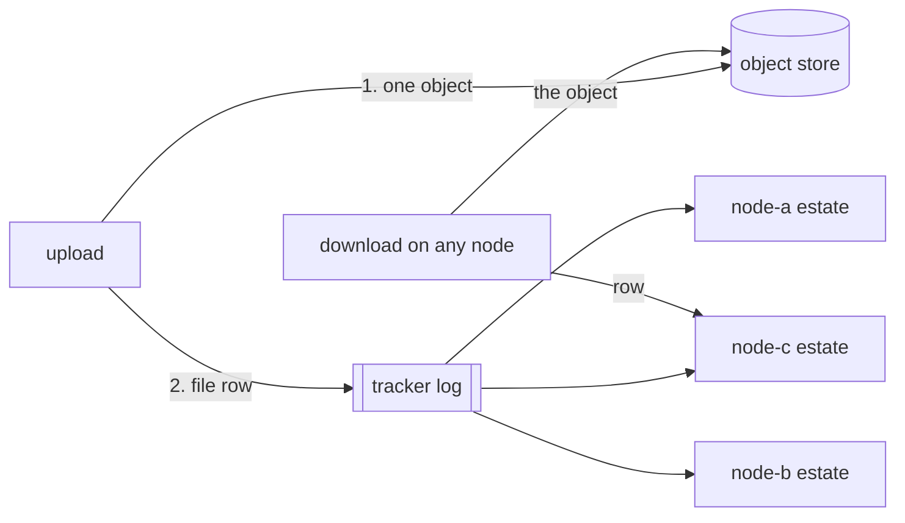

# Object Store

Where a company's **files** live, and why they are kept apart from everything
else a fleet holds.

Everything else the engine keeps durably — a task, a page, the history of both
— is held **whole** on every data node: each one applies the same ordered log
into its own identical copy (see [Scaling Out](scaling.md)). That is the right
shape for rows a seat reads on every turn. It is the wrong one for a
spreadsheet somebody uploaded, because files grow without bound and are read
rarely, so a copy of each in every data node's database is a cost nothing
reads back.

So a file is split in two:

- **What the company has to agree on** — that the file exists, its path, its
  type, its version, who wrote it, its size and SHA-256, and the key of the
  object holding its bytes — is a row in the replicated estate, written
  through the tracker's log like any other change.
- **The bytes** are **one object** in **one store the whole fleet shares**: by
  default a bucket on the fleet's own broker, replicated across its members
  like every stream, or an S3-compatible bucket.



Today the store holds [a project's files](../guides/work-tracker.md#a-projects-files)
and the pack bytes of the company's [git repositories](code-host.md) — one
object per push, named by its `code_packs` row, a required reference like a
file's — every file of every [artifact](artifacts.md) version and asset, and
every file of the company's adopted brand.
It is built for more than that (chat attachments and anything else a row can
name by key) and every consumer follows the same rule: the estate names the
object, and the store keeps its bytes.

---

## One object per upload

Every upload is stored as **one object under a key minted for that upload**,
and a key is never used again. The key is a UUIDv7 — random bits, plus the
instant it was minted — written by the node that receives the bytes,
immediately before it streams them into the store. It is never derived from
the content, the request or the person, so two uploads of the same bytes are
two objects, and a retry of one upload is a second object rather than the
first one again.

That one rule is what the rest of this page leans on:

- **A row names the object it was written with, and nothing else ever names
  it.** No later write can re-use an object somebody else stored, so the
  collector deleting an object nothing names has no writer to race (see
  [Why a deletion needs no lock](#why-a-deletion-needs-no-lock)).
- **The row checks the bytes, not the name.** The key says nothing about what
  the object holds, so the file's row carries the SHA-256 and the size of its
  whole content, computed while the upload streamed, and every read is held
  to both.
- **There is no dedupe.** The same bytes written twice are stored twice, and
  so is a file that is moved: a move is a write at the new path and a removal
  of the old one, and the write uploads the bytes again. A seat writing a file
  whose content is exactly what the file already holds is told so and writes
  nothing. The older copy is deleted by the collector's next hourly pass once
  nothing names it and it was uploaded more than a day ago, so a copy older
  than a day goes within the hour of being replaced or removed. The day is the
  grace an upload gets before the row naming it lands, not a window in which a
  replaced version can be recovered from the store.

---

## Where the objects live

`store.objects` in the [bootstrap config](../getting-started/configuration.md)
names the backend. It is **Tier A** — an endpoint, a bucket and the
credentials to reach it are the operator's, like the stream — and **every node
carries it**, a node without `data` included: an upload or a download on a
stateless node goes to the store directly, exactly as on a data node.

Every object the engine stores is named `files/<key>` — under the prefix, on
S3 — so a store shared with anything else keeps the engine's objects in a
corner of their own.

### The fleet's own bucket — `nats`, the default

```yaml
store:
  objects:
    backend: nats   # or leave the block out
```

The objects go into a JetStream **object store** bucket, `crewlet_files`, on
the same broker every log already runs on, in NATS's own object store format —
so `nats object ls crewlet_files` and `nats object get` read it (on an embedded
fleet through a member's loopback client listener, with the
[operator key](../guides/deployment.md#reaching-an-embedded-fleets-broker-with-the-nats-tool)). It is backed
by an ordinary stream (`OBJ_crewlet_files`), created at boot at
**`stream.replicas`** copies — so the company's files survive exactly what its
logs survive, on the same members:

- **The data nodes are the broker's members**, and they keep the copies. A
  three-node fleet at `stream.replicas: 3` holds every object three times, one
  on each; a member that fails is caught up by the broker as every other
  stream is, and there is no repair, map or membership for the engine to run
  beside it.
- **An object is a run of 128 KiB messages**, closed by one message naming
  them; an upload holds one message's worth of memory at a time.
- **A node's uploads share one window of messages out.** Every upload a
  node makes — a person's file, a push's bundle, a seat's file — rides the
  connection its leases and events ride, so the messages they have sent and
  the broker has not yet acknowledged are counted for the connection, not
  for each upload. Across a leaf's link, or to an external cluster, the
  window **follows the node's lease**: it is as many messages as a link at
  the floor of thirty seconds a mebibyte carries in one heartbeat of the
  lease the node holds (the lease TTL in force over three), so a lease
  renewal queued behind the node's uploads still lands within one heartbeat
  and the node does not lose its seats to its own uploads. At the default
  45-second lease that is four messages — half a mebibyte, fifteen seconds
  at the floor; a lease under 22.5 seconds gets one, and one of three
  minutes or more the sixteen a data node gets. A shorter lease costs
  throughput on a fast link: through a leaf on loopback, a window of one
  carried a lone 16 MiB upload at 47–83 MB/s and eight at once at 56–78
  together, against 120–139 and 130–135 with four — about half — and on a
  link with a longer round trip the share lost is larger. A lease under **11.25 seconds** has a
  heartbeat shorter than even one 128 KiB message takes at the floor, so a
  renewal behind it lands with less than a heartbeat to spare — and under
  5.6 seconds, after the lease. `crewlet validate` warns of such a
  `coordination.lease_ttl_seconds` on a node whose uploads cross a link,
  and on a member that serves leaves. On a data node's own client, where
  no link lies between the upload and the stream, the window is sixteen.
  An upload waits its turn for a place behind the others, first come
  first served.
- **A put is paced by the broker's acknowledgements.** An upload ends only
  once the broker has acknowledged nothing for a minute while some of its
  messages are out — or, waiting for a place, nothing of the node's at all;
  a put waiting on the person's own slow upload is not waiting on the
  broker. No message waits behind more than the window, so across a link at
  the floor each is acknowledged within a heartbeat of the node's lease —
  fifteen seconds at the default — a leaf's compressed link, which delivers
  what it flushed as one block, included.
  An upload crossing a slow link is never failed for being slow — the floor
  of thirty seconds a mebibyte included — where the client library's own put
  failed any message the broker had not acknowledged five seconds after it
  was sent. A put that fails takes back what it stored, so no listing finds
  it; pieces a very slow link delivers after that are swept by the collector
  a day later.
- **A node without `data` reaches the bucket across its leaf link**, with the
  rest of the fleet's JetStream API — it holds nothing.
- **The bucket is created once and never rewritten.** A node looks the bucket
  up at boot and creates it only when it is not there; a node that finds it
  binds it as it is, whichever node made it. A bucket kept at fewer copies
  than this node's `stream.replicas` stops the node from starting, naming the
  setting, rather than taking uploads it would prove fewer copies of. Every
  node used to write the bucket's configuration on every boot, and on a fleet
  booting together that write was never answered for fifteen seconds. A
  lookup and create still running after ten seconds says so, once, as
  `natsobj_bucket_slow` — see [Deployment](../guides/deployment.md#a-clustered-node-is-given-longer-to-create-them).
- **A read the broker loses its reader under carries on.** A download, a
  listing and a page's walk each read through a consumer the broker keeps for
  them, and a broker that loses it part way — reaped under a slow reader, or
  gone in a leader change — gets a new one, made from the last message read,
  so every byte and every name still arrives exactly once. It is made about
  **thirty seconds** after the loss, once two of the broker's fifteen-second
  heartbeats have gone missing — and no sooner, because a read on a slow link
  hears nothing at all while its next half mebibyte is crossing: a leaf's
  link is compressed, and what the member sends at once arrives as one block,
  which at the slowest rate the store accepts takes fifteen seconds. A
  heartbeat shorter than that replaced such a read's consumer before anything
  arrived, again and again, until the read failed having delivered nothing.
- **On a clustered fleet a read can lose its first request.** The broker can
  answer the creation of a read's consumer before the read's own member has
  learned where to send its requests, and a request sent in that gap is
  dropped. Measured on a three-member fleet, from one download in 1,500 to one
  in 25 met it, as the machine's load rose. A read that has heard nothing a
  second after it began
  asks its consumer whether the request ever arrived, and makes the consumer
  again if it did not — so it costs that download about a second, where
  waiting for the heartbeats would have cost thirty. A read waiting on any
  later message also looks again after a quiet second, because the NATS
  client now and then decides not to send its next request (measured on one
  member, one download in ten to twenty thousand); looking again sends it,
  and that costs a second too.
- **A read on a member still catching up reads what the leader holds.** The
  broker places a read's consumer on any member holding a copy, one just
  back from a restart and still catching up included, and that member says a
  file ends where its copy ends. So a download that ends short of the file's
  size, a page's walk that ends short of its offset and a read that finds
  nothing at all ask the stream's leader whether more follows, and go on from
  a consumer made again — at once the first time, a second apart after that,
  failing once the read has been behind for a minute — rather than hand back
  part of a file, which reads as damaged. A listing reads the leader's newest
  entry first, and one that ends short of it fails, to be run again, rather
  than leave out the files the member had not caught up on: the collector
  would otherwise have taken a finished upload's pieces for an unfinished
  upload and, a day later, abandoned them. A healthy read asks the leader
  nothing extra; a listing asks once.
- **A delete marker another client left is no object.** The engine deletes by
  purging, but `nats object rm` — or any other client of the format — leaves a
  marker under the name. The engine reads the name as holding nothing, and
  the collector lists it and clears it like any other object no row names.
- **Quorum is the broker's.** Every message of an object is a replicated
  stream append, so it needs a majority of the stream's replicas, as a tracker
  write does: a three-member fleet keeps writing files with one member down,
  and a two-member fleet at two replicas cannot write with either down. What
  an object holds is read from the stream's **leader**, so a file uploaded on
  one node is readable on the next the moment its upload answered. Nothing
  about files changes what a fleet of a given size survives — it is the same
  arithmetic as its logs (see [Scaling Out](scaling.md)).
- **A backup carries it as a stream.** The stream snapshot every backup takes
  includes `OBJ_crewlet_files` — snapshotted after every other stream, so it
  holds every object a record of those snapshots names — and no object is
  copied on its own; a restore brings the bucket back with every other stream.

What it costs is that **every member holding a copy holds every object**: the
bucket is one stream on one replica set. For the three or five data nodes a
fleet runs that is what any placement would have done anyway. A company whose
files outgrow one member's disk, or that would rather its files lived in
storage it already runs, takes the S3 backend.

**S3 is the production store for a company that hosts code.** Every push to a
[repository the engine hosts](code-host.md) is one object, and nothing removes
a repository's packs but the repository's own purge, so its repositories grow
as long as the company works in them — on `nats`, on every member's disk
beside the logs, and against the bucket's reservation (below), so a bucket at
its reservation refuses a push as it refuses any other upload. And a git node bringing its
[cache](code-host.md#the-cache-on-a-git-node) of a repository up from nothing
reads every one of those objects, one a push and sixteen at once.

#### Its byte reservation

The bucket is created with a **byte reservation**, which the broker grants in
full when it creates the stream, beside the state logs' own. The reservation
is what keeps the company's files out of the rest of the broker: the state
logs reserve their ceilings, and every seat's mailbox and every coordination
bucket (the leases, ledgers and budget counters the fleet runs on) share what
is left. A bucket allowed to grow into that remainder would, once full, refuse
a lease heartbeat, which stops the fleet; a bucket at its reservation refuses
**uploads, and only uploads**. The collector does not bound the bucket: it
deletes what no row names, never the files a company keeps.

```yaml
store:
  objects:
    backend: nats
    nats_max_bytes: 107374182400   # 100 GiB; unset derives a share of the broker
```

- **Unset, it is derived** from the broker's limit (`stream.store_max_bytes`,
  or the share of its volume the embedded broker takes): the smaller of a
  quarter of the limit, and what the limit leaves once the state logs' five
  eighths (or the log ceilings you set, where they are larger) and a 1 GiB
  floor for the coordination remainder are taken out. It is never below 1 GiB, the
  smallest value the field accepts. Where the broker states no limit (or its
  budget cannot be read), three quarters of the stream volume's free space
  stands in for it: the cap a NATS server running its defaults gives itself,
  which this node cannot read, so the bucket and the logs are never sized
  past what such a server can grant. The bucket is created before the state
  logs are sized, so the logs size themselves from what the broker has left,
  or from that stand-in less the bucket's reservation where the broker states
  no limit.
- **A broker needs room for it.** On a host whose broker can reserve only a
  few gibibytes, the bucket's gibibyte is on top of the state logs' floors;
  give such a host more disk, or set `stream.store_max_bytes` and
  `store.objects.nats_max_bytes` together.
- **A bucket that exists keeps the reservation it was created with**, as a
  state log keeps its ceiling: the setting sizes a bucket that does not exist
  yet. A node configured with another figure says so as
  `natsobj_bucket_ceiling_kept`. Change an existing bucket's reservation with
  `nats stream update OBJ_crewlet_files --max-bytes=<bytes>`, within what the
  broker can grant — on an embedded fleet through a member's loopback client
  listener with the [operator key](../guides/deployment.md#reaching-an-embedded-fleets-broker-with-the-nats-tool).
- **A bucket with no ceiling is bounded by the figure you write, or refused.**
  Every bucket an engine built before the reservation created holds none, as
  does one made by hand or by another tool. A node configured with
  `store.objects.nats_max_bytes` gives such a bucket that reservation at boot
  and logs `natsobj_bucket_bounded`; it is the one way to bound the bucket on
  an embedded broker that opens no client listener — a solo member's, or one
  serving only leaves — which nothing outside the engine reaches (a clustered
  member admits the operator key on its loopback client listener). A node
  whose figure is derived does not start, and names both that setting and the
  `nats stream update` that bounds the bucket from outside.
- **A full bucket refuses the upload**, and what made it says so as a refusal
  of its own naming the room an operator makes — move the files to a bucket,
  raise the reservation on an external broker (an embedded one keeps the
  reservation it was created with), or let the collector remove what nothing
  names — never as
  a failure to try again, since every upload is refused the same until room is
  made: a push is refused `store_full` ([what git
  prints](code-host.md#what-git-prints-and-what-it-means)), and so is a
  project file's write — through a tool, which the [act
  transport](../reference/api-endpoints.md#operatoract--the-dashboards-write-surface) answers
  `507`, and through [its upload route](../reference/api-endpoints.md#project-files),
  `507` too — and an artifact's file, on its transfer or its publish (`507`,
  [Artifacts](artifacts.md)), which gives back what the publish staged. The
  [`objects_bucket_near_ceiling`](#alarms) alarm fires once less than a fifth
  of the reservation is left, and the `crewlet.objects.bucket.bytes` and
  `crewlet.objects.bucket.max_bytes` gauges (from the node holding the
  collector's duty) draw it over time. [Move the files to a
  bucket](#moving-the-files-to-a-bucket), or, on an external broker, raise the
  reservation.
- **Size the members' disks for the files as well as the logs.** Every member
  keeps a copy of the whole reservation's worth of objects. Past about 100 GiB
  of files at three copies, replacing a member re-replicates the whole bucket
  over the routes the logs use for long enough to matter; take `s3` before
  then.

### An S3 bucket — `s3`

```yaml
store:
  objects:
    backend: s3
    s3:
      endpoint: https://s3.eu-west-1.amazonaws.com   # empty: Amazon's own for the region
      region: eu-west-1                              # required; R2: auto, MinIO: us-east-1
      bucket: acme-files
      prefix: crewlet/                               # optional; see "One bucket, several companies"
      path_style: false                              # true for MinIO and most self-hosted gateways
      access_key_id: ${S3_ACCESS_KEY_ID}             # both, or neither for the SDK's own chain
      secret_access_key: ${S3_SECRET_ACCESS_KEY}
```

Each object is one S3 object, `<prefix>files/<key>`. Any S3-compatible store
works — Amazon S3, Cloudflare R2, MinIO, Ceph's gateway, GCS through its
interoperability endpoint. The bucket keeps whatever copies its provider
promises, and its size is the provider's problem rather than any node's disk —
up to the point the provider has no room left, when a write is refused as full
(below).

- **An upload of up to 8 MiB is one `PutObject`; a larger one is a multipart
  upload** of equal 8 MiB parts, up to four of them in flight at once while the
  next is read, so a bucket a round trip away costs a large upload a round trip
  per four parts rather than one per part — measured, a 128 MiB file went up at
  150–230 MB/s with the bucket 20–50 ms away, where one part at a time
  managed 80–120. An upload holds at most four parts (32 MiB) in memory
  whatever the file's size, and every upload past its first part draws on one
  allowance the node's uploads and reads share (96 MiB), so a fifth large
  upload at once goes a part at a time rather than waiting for memory. An upload that fails
  part of the way through stops at once — a part the bucket refuses ends the
  read of the file and the other parts on their way — and is aborted, once
  every part it sent has answered; one a process was killed in the middle of
  is aborted by the [collector](#unfinished-uploads) a day later. With parts
  in flight together sharing the node's link to the bucket, each part is
  given the time its share of that link takes at the slowest rate the store
  accepts, so a large upload is held to that rate as a whole, as it was when
  its parts went one at a time.
- **A read of more than 8 MiB is read in 8 MiB ranges too, handed out in
  order, and as many at once as its reader keeps up with — up to four**, so
  a provider that limits what one connection carries (about 80–90 MB/s from
  S3) does not limit a large download, a backup's copy of a large file or a
  git node's sync of a large push. Each range is asked for a little before
  it is needed, so a bucket's first byte is paid once a read rather than
  once a range. Measured against a bucket that sent each connection at most
  80 MB/s, a 128 MiB file read at 335–353 MB/s, at 284–310 with the bucket
  20 ms away and at 219–246 at 50 ms, against 78–80 MB/s for one stream; with
  every byte checked against its SHA-256 on the way out it read at 178–244
  MB/s, which is about how fast the CPU it ran on hashes. A file of 8 MiB or
  less is still one request.
- **A read takes memory only as fast as its reader uses it.** Its ranges are
  read into buffers from the same allowance the uploads' extra parts draw on:
  one to begin with, another only while the reader is waiting on the bucket,
  and one given back once a range sits landed with the reader still behind
  it. A download to somebody on a slow link therefore holds one 8 MiB buffer
  however long it runs, instead of four that every other transfer on the node
  could have used — measured, a 128 MiB upload beside three such downloads
  ran at 407–472 MB/s, where downloads holding four buffers each had left it
  one part at a time at 166–192. That allowance (96 MiB), plus each upload's
  own first part, bounds a node's memory for transfers however uploads and
  downloads mix. A read that finds no buffer free reads its ranges one after
  another rather than waiting, each one's request already on its way. Every
  range after the first must still carry the first one's `ETag`, so a file
  whose object is overwritten while it is read fails the read rather than
  handing out pieces of two objects — which needs a provider that answers an
  `ETag`, as S3 and every compatible store do; and a range that fails ends
  the ranges after it at once.
- **Credentials** are `${VAR}` references resolved at boot, or neither, which
  takes the SDK's default chain: the environment (`AWS_ACCESS_KEY_ID`…), a
  shared profile, a web identity token or the instance's role.
- **The identity needs six permissions**, every one of them confined to the
  prefix: `s3:PutObject` (a single upload, and every step of one in parts),
  `s3:GetObject`, `s3:DeleteObject` (a deletion, and the collector's batches
  of them), `s3:ListBucket` limited to the prefix (the collector's listing and
  the audit's listings of ranges), and `s3:ListBucketMultipartUploads` and
  `s3:AbortMultipartUpload` (finding and aborting unfinished uploads). None of
  them needs a right over the bucket itself. Without the last two, uploads
  still work and the collector reports what it could not sweep as
  `sweep_error`.
- **A private CA** is read from `AWS_CA_BUNDLE`, added to the system roots for
  the bucket's requests only.
- **Reach the bucket over `https`.** Over plain `http` the S3 signature covers
  the request body, so the node hashes every uploaded byte a second time —
  measured, uploads ran a third slower on a CPU without SHA instructions, and
  up to a fifth slower on one with them.
- **The bucket is checked at boot, under the prefix.** A node stores, deletes
  and re-puts one object under `<prefix>probe/` (see [The boot
  probe](#the-boot-probe-and-direct-uploads)). A node that cannot store and
  delete that object does not start: one that started anyway would accept an
  upload it could not store.
- **Every request goes out from the node that serves the upload or the
  download**, a stateless node included, so every node needs to reach the
  endpoint.
- **Every request carries a deadline of its own**, so a bucket that stops
  answering fails the request rather than holding it: thirty seconds for one
  that moves no body, the same plus thirty seconds a mebibyte for one that
  carries bytes up, and five minutes for completing an upload made in parts —
  and **a write the bucket stops taking ends a minute after it last moved**,
  whatever its deadline: a minute after the bucket last took a byte of it,
  acknowledged one, or sent one of its answer. The node counts that at its own
  socket, so a write crossing a slow link — the floor of thirty seconds a
  mebibyte included — is never ended for being slow. A request whose attempt
  was ended that way is not asked again: a person's upload is answered `503`,
  and a push's commands `unavailable`, a minute after the bucket last moved
  it, give or take the five seconds between two looks at the socket — a
  minute and a half for an upload in parts whose unfinished upload the bucket
  will not let it abandon either — where a part used to wait sixteen and a
  half minutes. A read is bounded by the reader's own deadline (see
  [Writing and reading](#writing-and-reading)). The node speaks HTTP/1.1 to
  the bucket, the protocol S3's API is defined over, so each request has a
  connection of its own to watch.
- **A bucket its provider has no room in refuses the upload as full**, as the
  fleet's own bucket at its [reservation](#its-byte-reservation) does. Amazon
  S3 holds whatever it is sent, but a self-hosted gateway refuses a write for
  want of room — MinIO at its drives' free-space floor (`507
  XMinioStorageFull`) or past a bucket quota (`400
  XMinioAdminBucketQuotaExceeded`), Ceph's gateway out of space (`507
  InsufficientCapacity`) or past a quota (`403 QuotaExceeded`), any gateway's
  `507` — on a `PutObject`, a part or an upload's completion, and refuses the
  same write the same way until room is made. So it is sent once, never asked
  again, the unfinished upload is abandoned, and it is answered with the same
  refusal the full NATS bucket gets — a push `store_full`, a project file's
  write and an artifact's file `507` — naming the provider's room: free space
  on the storage the provider keeps the bucket on, raise the quota it holds the
  bucket to, or let the collector remove what nothing names. Never a failure to
  try again, which sent a client, or a script honouring a `Retry-After`, to
  upload the same bytes into a bucket that refused them.
- **A throttle slows the node down rather than failing its requests.** One
  client on each node carries every upload, download, git sync, collection and
  backup copy, and the moment the bucket answers one of them with a throttle —
  S3's `503 SlowDown`, MinIO's `SlowDownRead` or `SlowDownWrite`, or any `429`
  — that client lets the bucket hold only seven tenths of the most requests the
  node has had out at once since it was last slowed, the rest waiting their
  turn in the order they came, and one more each round the bucket answers; it
  stops holding anything back once the bucket has gone a minute without a
  throttle. It is the node's width that is cut rather than what happens to be
  out when the throttle comes back, so a throttle answered to one lone request
  between two git syncs holds the next sync back no more than one answered at
  its start; only a node throttled at the check it makes when it starts, before
  it has sent anything else, starts from one request at a time. S3 Express's
  session request — what a directory bucket's requests are signed with — is
  never held back, so a node whose requests wait their turn never waits for
  credentials behind itself. A 503 that names a fault of
  the gateway's own — MinIO answering an object it cannot rebuild from its
  drives — is no throttle and slows nothing else; a 503 to a `HEAD` is read as
  one whatever the gateway meant, since its answer has no body to say. A
  request the bucket throttles is asked again, after a random wait of up to
  twenty seconds, until its deadline above — never for a number of attempts,
  which `AWS_MAX_ATTEMPTS` does not change. A request the bucket answers with
  nothing but failures — a server error that is no throttle, or no answer at
  all — is asked again the same way until a bound of its own, drawn as the
  failures begin, somewhere between forty seconds and a minute after the
  first; its last attempt is sent at that bound, and then it is given up: its
  caller is told how long the bucket failed every attempt and what it last
  answered. Each request draws its own bound so that the writes a bucket
  outage catches open, on every node, do not all ask again in the same
  instant at the minute, onto a bucket that may just be recovering; the price
  is that a failure ending in the minute's last twenty seconds is ridden
  through only by the requests whose bound lies past it. A failing request
  makes nine attempts at the median and twelve at the 95th percentile at
  S3's 100 ms first byte. A person's upload or download the bucket keeps
  failing is answered `503` within that minute — an upload made in parts up
  to thirty seconds later, once its unfinished upload is abandoned — where a
  part of a large upload used to wait sixteen and a half minutes and a
  download the stall limit's minute. A throttle between two failures starts
  the span again, since a bucket asking the node to slow down is up. One its
  deadline ends says so and names the bucket's last answer. A refusal that
  asking again cannot change — a key the bucket refuses, a bucket that is not
  there, a certificate the node does not trust — fails at once, the check at
  boot included; a bucket that does not answer at all holds that check for
  its thirty seconds.

  Measured against the S3 fake 100 ms away, every request answered
  `500 InternalError`, eight or four runs of each at once: an 8 MiB upload
  given up at 43.3 to 58.1 s after 8 to 12 attempts, where its deadline was
  4 min 30 s; a 20 MiB upload in parts whose second part the bucket kept
  failing answered at 71.9 to 84.0 s — the part given up 41.4 to 53.5 s in
  after 9 to 12 attempts, then thirty seconds abandoning the upload — where
  the part's own deadline was 16 min 30 s; one whose completion the bucket
  kept failing answered at 77.8 to 87.3 s, where it waited 5 min 30 s; a
  20 MiB download ended at 46.9 to 59.6 s, where the stall limit ended it at
  60 s. A failure of thirty seconds was ridden through (an upload answered at
  35.7 and 40.4 s), as is any failure shorter than forty; one of fifty-five
  seconds was ridden through by one upload in eight, of 8 MiB and of 100 KiB
  alike — the requests whose bound fell past it. These figures are the
  fake's.

  Measured against the same fake, the bucket stopping at once: an 8 MiB
  upload answered at 65.0 s, where its deadline was 4 min 30 s; a 16 MiB
  upload in parts at 65.2 s, or at 95.1 s when the bucket would not let it
  abandon the upload either, where a part's deadline was 16 min 30 s; a
  completion the bucket never answered at 60.4 s, and one whose answer it
  began and never finished at 65.4 s, where either waited 5 min. A 3 MiB
  upload across a link at the floor landed, at 91.6 s. A bucket that read the
  first 4 MiB of each 8 MiB part at once and the rest at the floor ended a
  16 MiB upload at 80.3 s with each part read at a floor of its own, and at
  85.3 s with the two sharing one, where it would have landed at about two
  and four minutes: past its fast start its software was reading slower than
  its kernel had taken the bytes, which no sender can tell from a bucket that
  stopped — and a proxy that buffers an upload before passing it on hides a
  slow bucket behind it the same way. One that read only the first 2 MiB of
  an 8 MiB upload at once kept less than a minute of it unread and was not
  ended: it landed at 185.8 s. These figures are the fake's.
- **What the client counts.** Every attempt the node sends its bucket is
  counted by S3 operation and what the bucket made of it
  (`crewlet.objects.s3.attempts`), and every request by how many attempts it
  took and how it ended (`crewlet.objects.s3.request.attempts`); the gate's
  limit and its queue are gauges (`crewlet.objects.s3.gate.limit`, zero when
  nothing holds the node back, and `.gate.waiting`). An operation's retries
  are its attempts less its requests that made one — a request ended before
  its first attempt is counted `unsent`. Throttles rising is the fleet over
  the bucket's rate for its prefix — more git nodes syncing at once than it
  takes, or a bucket shared with other traffic; failures rising is the
  bucket's own fault; requests given up are a bucket that failed every
  attempt of a request for most of a minute. See the
  [metrics reference](../reference/metrics.md).
- **The prefix is optional**, and with or without one the engine touches only
  names under its own `files/` corner: another application's objects in the
  same bucket are never listed as the engine's, judged or deleted.

#### One bucket, several companies

A prefix keeps two companies' keys from colliding in one bucket, **and that is
all it does**. Each company's nodes hold a credential, and a credential that
reaches the whole bucket reads, overwrites and deletes every other company's
files as readily as its own. So a bucket is shared between companies only
where each company's credential is **scoped to its own prefix**: an IAM
policy whose object actions name `arn:aws:s3:::<bucket>/<prefix>*` and whose
`s3:ListBucket` carries an `s3:prefix` condition, or the same path in a MinIO
or SeaweedFS policy. Such a credential has no right over the bucket itself,
which is why the boot check is a probe under the prefix rather than a
`HeadBucket`. One bucket per company remains the simpler isolation, and the
one to prefer.

#### The boot probe and direct uploads

At boot a node runs one probe under `<prefix>probe/<key>`, beside `files/` so
the collector never mistakes it for a file:

1. It **stores and deletes** the probe object through the same requests every
   upload makes. A credential that cannot do both fails the boot.
2. It makes a **presigned put whose `x-amz-checksum-sha256` does not match its
   body**, and expects the provider to refuse it `BadDigest`.
3. It makes the **matching put**, under `If-None-Match: *`, and expects it
   stored.
4. It makes **the same put again**, and expects `412 Precondition Failed`.
5. It deletes the probe object, however the probe ended.

A provider that did all of it offers **direct uploads**: an upload can be
handed to the client as a presigned PUT bound to its exact length, its media
type, its SHA-256 and `If-None-Match: *`, so the client sends the bytes to the
bucket itself and cannot store any other bytes, or a second copy over the
first. The engine still mints every key, and still reads what was stored back,
verified against the declared SHA-256, before any row names it. A provider
that skipped any step, or accepts the headers and ignores them, offers none,
and every upload streams through the engine as before: nothing fails. Which it
is shows on [`/health`](../reference/api-endpoints.md#the-health-envelope) as
`objects.direct_upload`, `available` or `unavailable (<reason>)`; the default
`nats` backend is always `unavailable`, because only the fleet reaches the
broker.

Where step 2 passed, the engine's own single-part puts also carry
`x-amz-checksum-sha256` (as a header, never the SDK's trailing checksum, which
providers other than Amazon refuse), so the provider checks every such upload
on arrival and keeps its SHA-256, which the audit then compares.

### One store per fleet

The first node to boot records the store it was configured with in the
coordination store — `nats`, or `s3:<endpoint>/<bucket>/<prefix>` — and every
node after it compares its own: **a node configured with another store refuses
to boot**, naming both. Two nodes writing to two stores would each list files
whose bytes the other cannot read, and each one's collector would see the other
store's objects as nothing at all. Credentials are not part of the record — two
nodes may reach one bucket with different keys.

Moving a company from the fleet's own bucket to an S3 bucket is a migration,
not a config change: see [Moving the files to a
bucket](#moving-the-files-to-a-bucket).

Any other move — from one S3 store to another: another endpoint, bucket or
prefix — is made with the fleet stopped: copy every object across, delete the
`backend` record from the `crewlet_objects` coordination bucket, and boot every
node with the new block. **The fleet stops first** because an upload stores its object before
it writes the row naming it: an object uploaded after a copy taken while the
fleet still ran is named by a row and absent from the new store, and its file
cannot be read. The copy is of the old store's whole `files/` corner, never of
a backup's `objects/`, which holds only the objects a backup's restore point
names — [live](#live-retired-and-derived-references) rows of its copy and the
records it replays — and none a retired row still keeps for a reader catching
up, or a derived row names. The collector's last report stays in the same
bucket and describes the old store, so the first node to take the collector's
duty [sets it aside](#collection-and-audit) and collects and then audits the
new store straight away — and that audit is the check that every file's object
came across.

Deleting the record reaches the broker from outside the engine, so a move in
place needs a broker that listens: an external NATS cluster (`stream.type: nats`). The embedded broker
listens on no socket and the engine has no command that deletes the record —
but a restore is the one moment the record need not be put back at all. So on
the embedded topology the one way to move is a restore: take a backup, then
restore it into the new store as
[Backups](../guides/backup.md#restoring-into-a-new-bucket) describes, leaving
the record out. That moves a company from one S3 store to another — another
endpoint, bucket or prefix — and no further: a backup carries the objects as
files only from `s3` (on `nats` they ride the `OBJ_crewlet_files` snapshot),
and nothing but a broker that listens puts files into a `nats` store. And like
every restore it brings the company back as it stood when the backup was
taken: what the fleet did after it is not moved.

### Moving the files to a bucket

`crewlet objects migrate --to s3` moves the company's files from the fleet's
NATS bucket to an S3-compatible one, through a running data node, in two
passes:

1. **Write the target file.** Copy a node's Tier A file and give it the
   bucket's `store.objects` block (`backend: s3`, with `${VAR}` references for
   the credentials). It is the file every node will run with afterwards, and
   it is read on the engine's host, so it goes there.
2. **Copy on a live fleet**, as often as you like:

   ```sh
   crewlet objects migrate -to s3 -target /etc/crewlet/crewlet.s3.yaml
   ```

   The node probes the bucket, then reads every object a file names from the
   fleet's store, checked against the file's row, and writes it to the bucket
   under the same key, checking the bucket holds it at its size (and SHA-256,
   where the provider keeps one). It copies every object a
   [derived](#live-retired-and-derived-references) row names the same way —
   one the engine could build again, but only by reading again everything it
   was built from, on every node of the moved fleet — so the fleet runs on the
   bucket with what it had, rather than rebuilding it. An object the bucket
   already holds is skipped, so a pass that stopped is resumed by running it
   again, and later passes copy only what was uploaded since. Nothing about
   the fleet changes.
3. **Restart every node in maintenance mode**, `crewlet run -mode maintenance`,
   so that no node writes a record naming a new file while the last pass runs.
4. **Run the final pass:**

   ```sh
   crewlet objects migrate -to s3 -target /etc/crewlet/crewlet.s3.yaml -final
   ```

   It refuses unless the node is in maintenance mode, no node is still
   admitted to publish, and the node has applied the company's records to the
   end. It copies what is left, **seals** the NATS bucket (read, and never
   written again, so a node not yet restarted cannot store a file where no node
   will look for it), and moves the fleet's record of its store to the bucket.
5. **Give every node the bucket's `store.objects` block and restart it** with
   `crewlet run`. A node still naming the NATS bucket refuses to start.
6. **Delete the old bucket** once the fleet runs on the new one
   (`nats stream rm OBJ_crewlet_files` — on an embedded fleet through a
   member's client listener with the [operator key](../guides/deployment.md#reaching-an-embedded-fleets-broker-with-the-nats-tool)), after your next
   backup.

A file the fleet's own store could not give back (missing, or damaged) is
named by both passes and not copied: no copy can bring it back, and
[`objects_missing`](#alarms) already counts it. Restore it from a
[backup](../guides/backup.md) or upload it again. A derived object the store
could not give back is only counted, apart from the files, and holds nothing
up: nothing is lost without it, and the engine builds it again on the bucket.
An object a [retired](#live-retired-and-derived-references) row keeps is not
copied at all: every node restarts onto the bucket, so no reader is left that
could still want it.

---

## Writing and reading

**An upload stores its object before it writes the row** that names it. A
file that is listed is therefore always a file whose bytes are in the store,
and an upload cut off halfway leaves only an object nothing names, which the
collector removes a day later. Before any of the body is read, an upload whose
declared length is already over 1 GiB, or whose project does not exist or is
archived, is refused. While it streams, the node counts and hashes every byte,
and the 1 GiB limit ends the upload the moment the body passes it — leaving
nothing behind in the store. **A body ends only where the client ended it**:
one cut short — a connection that closed mid-body included — is refused, never
recorded as the part of the file that arrived.

**A row must be written within twelve hours of its key being minted.** The
write is refused (`409 upload_expired` over REST) when the upload took longer
than that — far more than the slowest upload the API accepts (1 GiB at thirty
seconds a mebibyte is eight and a half hours). That bound is what lets the
collector delete without a lock. **A refused write deletes nothing**: the same
write may already have landed through another node, so its object is left for
the collector, which removes it a day later if nothing names it.

**A download streams** and never holds the file in memory. Every byte is
counted and hashed on its way out, and **the last bytes are held back until
the whole file has checked out** against its row's size and SHA-256: a stored
object whose content is not what the row records is never handed over whole.
Over HTTP that is a download that ends short of its `Content-Length`; a
corruption found before the response began is a `500 content_corrupt`.

A read is bounded twice: by a deadline that grows with the file's size — a
minute, plus thirty seconds a mebibyte on each of the two legs its bytes
cross, from the store to the node and from the node to whoever is reading —
and by a **stall** limit, which ends a read whose store has handed over
nothing for a minute — before its first byte as well as between two. A write
has the same minute: one the store has taken no more of and not answered for
a minute is ended, on either backend. A store that stops answering part way
through a download or an upload therefore cuts it within a minute rather than
holding it for hours, and so does one that keeps failing the request a
download begins with: a file the store cannot begin to hand over in a minute
is a failed read, not a wait as long as its whole budget.

**A seat reads a file a page at a time** (`read_project_file`). A page is
checked for its length only — a part of a file cannot be held to the whole
file's hash. On S3 a page is one ranged request. On `nats` there is no ranged
read of an object, so a page deep into a large file first walks the headers of
every 128 KiB message before it — a few dozen bytes each rather than the bytes
themselves, but still work that grows with the page's offset. A seat reads
pages near the start of a file far more often than pages a gibibyte in.
Measured, a 64 KiB page at a random offset of a 128 MiB file took 32–36 ms on
`nats`; on `s3` the node's side of the one request took about half a
millisecond, before the provider's own first-byte latency.

### Artifact uploads are reserved before they move

An artifact's files reach the store in three steps, and the first moves no
bytes at all:

1. **The intent.** The client declares every file it means to send (path,
   size, SHA-256). The engine decides everything it can without the bytes:
   whether the caller may publish, the paths and types, the per-file and
   per-publish limits, which files the artifact **already holds** (those are
   carried, below, and never sent), and whether the bytes the company's
   artifacts already name, plus every reservation still outstanding, plus
   these new bytes, fit `artifacts.limits.company_bytes`. It mints one key per
   new file and records a **reservation** in the coordination store that lasts
   until the collector could have deleted those objects. One principal may hold
   `artifacts.limits.pending_bytes` reserved, a company four times that; past
   it the intent is refused `429 uploads_outstanding`, naming when the oldest
   reservation expires.
2. **The transfer.** On `nats` every file streams through the engine. On `s3`,
   when the boot probe proved the bucket honours them, the intent instead hands
   a browser or the CLI a presigned `PUT` for each file, bound to its exact
   length, its served type, its SHA-256 as a signed checksum and
   `if-none-match: *`, so the bytes go straight to the bucket and a second put
   to the same key is refused. An agent's sandbox is never handed one: the
   engine reads the box and streams the files itself. Either way the engine
   minted the key; a client never names one.
3. **Finalize.** Before the version is recorded, the engine reads **every new
   object back** through the verifying reader. A file whose bytes are not what
   was declared is refused `422 upload_mismatch`, one that never arrived `409
   upload_missing`, and a key older than twelve hours is refused as it is for
   every write. The reservation is released for every object the recorded
   version names.

So bytes that no row names never exceed the reservation budget, and the row's
SHA-256 is always the digest of the stored bytes, established by the engine,
whichever way they travelled. The decision is
[ADR-0036](https://github.com/crewlet/crewlet/blob/main/adr/0036-bytes-are-reserved-before-they-move.md).

### An unchanged file is carried, never copied

A publish names every file by its SHA-256, and a file **the same artifact
already holds** is carried: the new version's row names the existing object,
and no bytes move. A carry is the one way a key comes to be named by a record
other than the write that uploaded it, and three rules keep the collector's
lock-free deletion sound:

- the applier performs a carry only by finding the artifact's own live
  reference to that object **in its own apply transaction**; finding none, it
  skips the record identically on every node, and the publisher is told `409
  carried_object_gone`, naming the files to send again;
- every record that adds or removes an artifact's object reference is ordered
  on that artifact's own subject, so no carry can race a removal;
- **no carry crosses an artifact**, so a publish cannot learn whether any other
  artifact holds a file with a given digest. A library two artifacts both use
  is stored twice.

---

## Collection and audit

An object is never deleted when its file is: the delete is a row, and the
object is garbage from then on. Instead one data node at a time — the
`object-collector` fleet duty — runs two passes against the store, both
judged against the replicated estate the data node holds:

- **Collection, hourly.** It pins the estate (a barrier on the log of every
  domain that declares a table naming objects — the tracker's, the code log
  and the artifacts log — so it reads every row committed when it began),
  lists the store, and deletes every object **stored more than a day ago,
  whose key was minted more than a day ago, that no row —
  [live, retired or derived](#live-retired-and-derived-references) — names**.
  The collector reads the rows of every domain that declares a table naming
  objects, whichever of the engine's own backends the company runs: every
  data node applies every domain's log, so a company that moved its tracker
  off native, or runs none of the engine's own backends, still holds its
  project files' rows, and their objects are still audited and kept. It
  deletes while the listing goes on: on S3, each batch of up
  to 500 objects it judged in one `DeleteObjects` request, one batch at a
  time; on `nats`, or on a gateway that refuses that request, each object on
  its own, up to sixteen at a time — [How far it scales](#how-far-it-scales)
  says why those bounds. The day is the grace an upload in flight is given
  between storing its object and writing its row. Only a name under the
  engine's `files/` corner is the collector's: anything else in the bucket, or
  under the prefix, is never counted, judged or deleted. A collection that
  cannot read the whole estate — this node holds a record it could not apply
  — **stops deleting**: a row it could not read may name any object, and the
  report says what it deleted before it stopped and why it stopped.
- **Audit, daily.** It asks the store about every object a **live** row names,
  up to thirty-two questions at a time, reading the rows a page at a time in
  key order. On S3 a question is a **listing of a range**: the rows next in key
  order span a range of the bucket's keys, and one listing of it answers what a
  HEAD of each object would. A listing request answers a thousand keys, and the
  range holds the objects no live row names between those rows as well — a
  replaced file's, a retired or derived row's, an upload not yet named — so
  the audit measures how many each range it lists holds, and cuts the next to
  fill nine hundred keys: nine hundred rows where the bucket keeps nothing
  between them, and fewer the more it keeps, its first range listed before it
  cuts a second. The hundred keys left over are room for a range fuller than
  the ones before it, so a range fits one request, and an audit costs a
  request per nine hundred keys among the live rows'; only an object a listing
  passes over is then asked about by name. On `nats`, whose listing keeps no
  order — and on an S3 Express directory bucket, which lists in none — the
  audit reads the
  store's **whole listing a window at a time**: each listing keeps the hundred
  thousand smallest keys after the last window's (about thirteen MiB on the
  node running the duty), and the rows whose keys fall in that window are
  judged from it, so a store of N objects is listed once per hundred thousand
  of them. A name the listing hands on holding nothing — on `nats`, metadata
  that does not decode, or a name only a delete marker holds — is asked about
  by name, and so is everything after a listing that **fails**, which turns
  the rest of that audit to a question an object. An
  object the store answers it does not hold is **missing**; one it holds at
  another size, or under another SHA-256 where the store answers one (`nats`
  keeps one; S3 answers one only for an object asked about by name, uploaded
  in one request to a provider the boot probe proved checks checksums), or as
  no object it can read at all (on `nats`,
  metadata that does not decode, which the store answers definitely rather
  than as a failure) is **damaged**; and one the store **fails** to answer
  about — its client asking again until the question's deadline — is
  **unanswered**. Anything but an answer that it holds the object whole, or
  holds it wrong, is asked about once more before it is called anything: at
  the end of the pass, or, once a
  hundred thousand others are waiting for theirs, at once. Each is a file that
  cannot be counted on to download, and raises [`objects_missing`](#alarms)
  naming the first hundred such files by name, as `PROJECT/path`, with what
  was found of each.

  **One object is never the audit's failure.** An object the store fails to
  answer about on both looks — an S3-compatible gateway answering one object
  with a server error every time, say — is reported **unanswered** and the
  audit runs to its end, once the store answers a question after it. What
  fails an audit is the store failing: thirty-two questions in a row with
  none answered between, or — when the audit's last questions are failures —
  one more question about an object it had answered for failing too. A store
  that went away mid-audit is retried ten minutes later, and none of the
  questions it failed is taken for a finding. On S3 a **listing that fails** —
  its deadline passing with the bucket still throttling or failing it — is set
  aside with the range it was for, and that range is listed **once more** at
  the end of the pass rather than asked about object by object: only what that
  listing passes over is then asked about by name,
  and a range whose second listing fails too is unanswered, file by file.

A node whose copy of the tracker, of the code log or of the artifacts log is
out of service does not hold the duty at all — its passes would read the rows
that name the files (a project's files, a push's pack, an artifact's files)
through a read that copy refuses — and gives the duty back if it holds it, so
a node whose copies serve takes it at its next minute's turn
([singleton duties](seat-ownership.md#singleton-duties)).

A pass that fails is tried again ten minutes later. The duty records each pass
in the coordination store, so every node's [`/fleet`](../reference/api-endpoints.md#get-fleet)
and `crewlet objects status` show the same report, naming the node that ran it,
and a node taking the duty over picks up the schedule and the last audit's
findings where the last holder left them, rather than running both passes
again or forgetting what was missing. It runs no pass until it has read that
report: one the coordination store does not give up is asked for again at the
duty's next turn, a minute later, rather than taken for a fleet with nothing
recorded — which would write the last audit's findings out of the report. An
audit that fails, or is stopped part way, never hides what the last one to run
to its end found. A report names the store its passes ran on, and one of
**another store** — left behind when the fleet
[moved its files](#one-store-per-fleet) — is no report of this one: the node
taking the duty collects and then audits the new store as its first two passes
rather than picking up the old store's schedule and findings, and `/fleet` and
`crewlet objects status` show no report yet (`not_yet`) until the first of
those passes records one, rather than the old store's under its name.

**A pass keeps the duty while it runs.** The duty's lease is renewed four
times a lease — every 45 seconds — through the pass, so an audit of a few
million objects stays on the node running it however long it takes. A pass is
stopped the moment a renewal answers that another node holds the duty, and
once no renewal has confirmed it for two and a quarter minutes — the duty's
three-minute lease less one renewal, the longest no other node can have taken
it — so a single renewal the coordination store refuses, or holds on to while
its leader moves, costs it nothing: no renewal waits longer than 45 seconds for
an answer, so the next is always asked in time. A stopped pass records
nothing: the node that holds the duty records its own.

### Live, retired and derived references

Every table whose rows name objects declares which of three kinds its rows
are:

- **Live** — the object is part of something the company holds, such as a
  file's bytes. The collector keeps it, the audit checks it, a backup carries
  it — and every object a record its restore replays names, since those
  records write live rows too — and
  [moving the files to a bucket](#moving-the-files-to-a-bucket) copies it.
- **Retired** — the object has been replaced and nothing new will read it,
  but a reader that has not caught up may still be fetching it. A retired row
  keeps the object from the collector until the part of the engine that wrote
  it deletes the row once its grace has passed; the collector then deletes the
  object at its next pass, as it does any object no row names. The audit never
  asks after it — a replaced object the store lost is not a file anybody can
  miss — and a backup never copies, counts or asks after it: on `s3` it stays
  out of the backup's `objects/`, and on `nats` its bytes ride the bucket's
  stream snapshot, as everything the bucket holds does, uncounted and
  unchecked. A move to a bucket leaves it behind: every node restarts onto the
  bucket, so no reader that has not caught up is left.
- **Derived** — the object is one the engine can build again from what live
  rows name, so losing it costs a rebuild and no data. A derived row keeps the
  object from the collector for as long as the row stands, as a live row
  does, and owes it no grace: whatever reads the object goes on without it
  when it is gone, so the part of the engine that wrote the row may delete it
  the moment it replaces what the object holds, and the collector deletes the
  object at its next pass. The audit never asks after it — a derived object
  the store lost raises no [`objects_missing`](#alarms), since nobody has to
  restore anything — and a backup never copies, counts or asks after it,
  exactly as a retired one's: on `s3` it stays out of the backup's `objects/`,
  and on `nats` its bytes ride the bucket's stream snapshot uncounted and
  unchecked. A restore brings the rows back without the objects they name,
  and the engine builds those again. A move to a bucket **does** copy it, as
  it copies a live one: a backup is taken again and again and restored
  rarely, so carrying the object would cost its bytes at every backup to
  spare a rebuild after a restore, while a move is made once, and an object it
  left behind would be built again on every node of the moved fleet, at a
  cost that grows with everything it was built from. One the old store cannot
  give back is counted and left behind, and never holds the move up, as it
  never raises an alarm.

| Kind | Kept from the collector | Audited | Carried by a backup | Copied by a move to a bucket |
|---|---|---|---|---|
| Live | yes | yes | yes | yes |
| Retired | until its row's grace has passed | no | no | no |
| Derived | for as long as its row stands | no | no | yes |

A project's files are live rows, and a file never retires one: a replaced
file's bytes go at the first hourly pass once nothing names them and they were
uploaded more than a day ago (see
[One object per upload](#one-object-per-upload)). So is the log a failed
[check](code-host.md#checks) kept — at most its last 64 MiB, named by its
`code_check_logs` row — since nothing builds it again once its run is gone:
its row goes with its check's, 30 days after the check ended (up to a day
more in a repository whose checks stopped ending, [How long a check is
kept](code-host.md#how-long-a-check-is-kept)) or with its repository's purge,
and the collector's next pass takes its bytes.

The first retired rows are the [code host's](code-host.md): when a compaction
merges a repository's small packs into a larger one, each pack it replaced
moves to `code_packs_retired` and keeps its object for **a day** — longer
than the longest read a clone of the largest pack a row can name is allowed
(21 hours 21 minutes) by two hours and thirty-nine minutes, more than the two
hours the clocks of the node sweeping and the broker that stamped the
retirement may disagree by while no node raises
[`clock_skew`](../reference/alarms.md) — so a git node still serving the old
pack list, or a clone that began on it, finishes its read.
The `code-retention` duty then removes the rows past their day — by a record
on the code log for each repository holding some, which every data node
applies — and the collector's next pass deletes their objects. A deleted
repository's purge takes its retired rows with the rest.

An [expunge](code-host.md#expunge) retires packs the same way, and these
are the ones whose bytes somebody may want gone: the packs holding what no
ref reached, a secret force-pushed away among them. Its begin leaves them
**dropping** — still `code_packs` rows, so still live references: kept,
audited, and carried by a backup taken then — and its commit moves them to
`code_packs_retired`, where they keep their objects for the same day, for a
clone already reading one, before the duty's sweep removes the rows and the
collector's next pass deletes the bytes. So a purged object leaves the store
a day and at most about an hour and a quarter after its purge commits, and
the purge's answer says so. Two copies outlive that: every backup taken
before the commit — on `nats`, every backup taken before the collector
deleted the bytes, since the bucket's stream snapshot carries every object
the bucket holds, retired ones included ([A purge and the backups before
it](../guides/backup.md#a-purge-and-the-backups-before-it)) — and, on a
[versioned bucket](#choosing-a-backend), the noncurrent version the deletion
leaves, for as long as the bucket's lifecycle rule keeps one. The decision is
[ADR-0051](https://github.com/crewlet/crewlet/blob/main/adr/0051-a-retired-reference-keeps-its-object-for-a-grace.md),
and the compaction's own rules — what a merge keeps, and why a retired pack
outlives its longest read — are
[ADR-0060](https://github.com/crewlet/crewlet/blob/main/adr/0060-a-compaction-merges-packs-without-judging-reachability.md),
and the expunge's — what it keeps, and why it drops in two records — are
[ADR-0069](https://github.com/crewlet/crewlet/blob/main/adr/0069-an-expunge-drops-only-what-no-ref-or-in-flight-row-reached-within-its-grace-in-two-records.md).

The first derived rows are the code host's too: `code_layer_parts`, the
stored bytes of each repository's **published layers** — a multi-pack-index
layer, its bitmap and the commit-graph layer over the same packs, written once
for the fleet rather than by every git node over the repository's whole
history. Any git node can build a layer again from the repository's packs,
which are live rows, so a lost part costs a rebuild and nothing else: it
raises no `objects_missing`, and a backup leaves the parts out. A layer's bytes
are cut into parts of at most **1 GiB**, every part of a layer uploaded at
once, so each is named on the log well inside the twelve hours a write may
take; a repository's chain holds at most **32** layers of at most **16** parts
each, and a publication that replaces a layer removes its rows at once.

### Unfinished uploads

An upload that died part of the way through — a node killed mid-upload, or a
delete interrupted between its two halves — leaves bytes **no name reaches**:
on S3 a multipart upload nobody completed or aborted, which the provider bills
for; on `nats` the messages of an object no closing message names. No listing
of the store's names shows them, and each can be a gibibyte. So every
collection also asks the store for them and abandons each begun more than a
day ago — every upload still in flight is unfinished too, and none takes that
long — unless it was being stored under somebody else's name. The count is
`abandoned` in the report; a store that refuses the question (an S3 identity
without `s3:ListBucketMultipartUploads` or `s3:AbortMultipartUpload`) is
reported as `sweep_error` and does not fail the collection.

### Why a deletion needs no lock

The collector's danger is deleting an object at the moment a write comes to
name it. With one object per upload, the only write that can ever name an
object is the one that uploaded it — so the question is only whether that
write can land **after** the collector judged the object unnamed. Two rules
close it:

- **A write may name a key minted at most twelve hours before it is
  decided**, by the deciding node's clock, and is refused otherwise.
- **The collector deletes only an object whose key was minted, and which was
  stored, more than a day ago**, by its own clock, and that a complete,
  pinned estate does not name.

An object the collector deletes is past the twelve hours by a margin of twelve
more, so no write that could still land can name it. The rule holds as long as
the clocks of the node deciding a write and the node running the collector
disagree by less than that margin, and the engine watches that they do: every
data node reads the fleet's clock — the median of the data nodes' clocks — off
the coordination store's position register, and raises
[`clock_skew`](../reference/alarms.md) once its own clock, or the clock of the
broker member leading the register, stands more than an hour from it, so while
none does, two of them disagree by two hours at most (see
[Every machine's clock](../guides/deployment.md#every-machines-clock) for
keeping them in time). There is no lock, no second look and no
coordination round trip, and two collectors running at once are safe —
deleting an object that is already gone is not an error. An artifact's
[carried files](#an-unchanged-file-is-carried-never-copied) keep the rule: a
carry names only an object the same artifact still names, checked where the
carry is applied. The decision is
[ADR-0027](https://github.com/crewlet/crewlet/blob/main/adr/0027-a-deletion-from-the-shared-store-needs-no-lock.md).

---

## Alarms

| Alarm | Fires when |
|---|---|
| `objects_bucket_near_ceiling` | the fleet's NATS bucket holds more than four fifths of its byte reservation, as the node holding the collector's duty last read it: once it is full every upload is refused. Raise the reservation, or move the files to a bucket |
| `objects_missing` | the collector's last audit to run to its end found files whose object the store does not hold, holds at the wrong size, under the wrong digest or as nothing it can read, or would not answer for twice while it answered for the rest — on the node holding the collector's duty, since one node's audit of a shared store is the fleet's |
| `clock_skew` | a clock stands more than an hour from the fleet's — the median of the data nodes' clocks, as each node's position heartbeat reads them off the position register: on the node whose own clock moved, naming it, and on every node when the clock of the broker member leading the register did. The collector's grace and a retired pack's both rest on every clock keeping within that hour ([Why a deletion needs no lock](#why-a-deletion-needs-no-lock)) |

A missing or damaged object is a store that lost or changed bytes it
acknowledged, and an unanswered one a store that will not serve them: check
the store's own health (the `OBJ_crewlet_files` stream on the data nodes, or
the bucket's) and restore the files the report names from a
[backup](../guides/backup.md), or upload them again.

---

## Running it

### Choosing a backend

Keep **`nats`** unless a reason below applies. It needs nothing the engine does
not already run, survives what the logs survive, and is backed up with them.

Take **`s3`** when:

- the files will outgrow a data node's disk — every member keeps every object;
- the company already keeps its data in a bucket it backs up, versions or
  replicates across regions on its own terms;
- the fleet's broker is an external NATS cluster whose operators would rather
  not hold files;
- nodes without `data` will move large files — such a node reaches the
  broker's bucket across its leaf link, where whole reads measured about half
  a member's rate;
- seats will read pages deep into large files — on `nats` a page costs a walk
  to its offset, on `s3` one ranged request wherever it is;
- the fleet is clustered and reads many small files — on `nats` every read
  makes a consumer, which a cluster decides on together, and one read in a
  few hundred waits a second for a request the cluster dropped; on `s3` a
  read is one request;
- the company will keep well past a million files — on `nats` the daily
  audit lists the whole bucket once per hundred thousand of them, so its
  cost grows with the square of the count ([How far it
  scales](#how-far-it-scales)); on `s3` it lists each key once.

**To try `s3` on one machine**, the repository's `docker-compose.yml` carries
a SeaweedFS service behind the `s3` profile: `docker compose --profile s3 up
-d --wait`, create a bucket on it (`aws --endpoint-url http://127.0.0.1:8333
s3 mb s3://crewlet-files`), and name it in `store.objects` with
`endpoint: http://127.0.0.1:8333`, `region: us-east-1` and `path_style: true`.
It runs with no identities, so it accepts any key pair and listens on the
loopback address only; a store other people reach needs identities, and one
key per company scoped to that company's prefix.

**A versioned bucket keeps every object the collector deletes**, as a
noncurrent version, for as long as the bucket's own rules say — and every
upload is an object of its own, so a file rewritten daily leaves a noncurrent
copy of itself every day. Give a versioned bucket a lifecycle rule that expires
noncurrent versions (S3's `NoncurrentVersionExpiration`, or your provider's
equivalent) after however long you want deleted files recoverable, or its size
grows for the life of the company.

**An S3-compatible gateway must date what it lists.** The collector judges an
object's age by the `LastModified` its bucket listing carries and an unfinished
upload's by its `Initiated`, and a gateway that leaves either out has the
engine leave that entry alone rather than read it as older than every grace —
which would abandon an upload still in flight. Such a pass reports what it
left alone in its `error` (an object) or `sweep_error` (an upload) on
`crewlet objects status`. Uploads left that way are billed until the bucket
aborts them itself, so give such a bucket a lifecycle rule for incomplete
multipart uploads (S3's `AbortIncompleteMultipartUpload`).

### Taking a data node away

There is nothing to drain for the files. On `nats` a member that leaves is a
broker member leaving, handled as for every stream (see
[Fleet](../guides/fleet.md)); on `s3` no node holds an object at all.

### Watching it

`crewlet objects status` prints the store, the node that ran the last passes,
and what each found; `--json` prints the fleet answer's `objects` block. The
dashboard draws the same under **Settings › File storage**.

---

## How far it scales

- **`nats`: the copies follow the broker.** The bucket lives on the stream's
  replica set, so its capacity is the smallest member's disk and its write
  throughput is the stream's — every upload of a 1 GiB file at three copies is
  three gibibytes across the broker's routes. Adding data nodes adds broker
  members; it does not add space for files.
- **`s3`: the bucket's.** Capacity and throughput are the provider's; each node
  pays only the requests its own uploads and downloads make.
- **A verified byte costs a hash on the node.** Every upload and every
  download is SHA-256'd by the node that serves it, so one stream runs no
  faster than that node hashes — measured at 1.3 GB/s on a CPU with SHA
  instructions and 324–353 MB/s on one without — whichever backend holds the
  bytes.
- **The collector lists the whole store.** A listing streams rather than
  holding the inventory in memory, and judges it 500 keys to a query against
  an index on the file row's object column, once an hour, on one node. The
  audit reads the live rows a page at a time, every table's merged into one
  key order, and asks the store about them outside every read, so it never
  holds a read of the estate open across the store's round trips; a retired
  or derived row costs it nothing, and costs a backup on `s3` no request.
- **On `nats` an audit lists the whole store once per hundred thousand
  objects**, the window it holds in memory at 127 bytes a key. Each listing
  names every object, so the audit names N × ⌈N / 100,000⌉ of them: at the
  broker's measured 63,000–94,000 names a second a million objects are ten
  listings and two to three minutes, and two million twenty listings and seven
  to eleven minutes — where asking each object by name, 15,000–19,000 a second
  with 32 out on a member's own client, would take one minute and two. What
  the listing saves at every size is requests: its consumer pulls five
  hundred names a request from whichever replica the broker places it on, so
  two million objects are eighty thousand pulls rather than two million reads
  from the stream's leader. A larger window would list fewer times for 127
  bytes a key more; the cost grows with the square of the store past a
  window, so a company far past a million files on `nats` is better served
  by `s3`, whose listing keeps an order. On an S3 Express directory bucket,
  which lists in no order either, two million objects are forty thousand
  listing requests in about twenty minutes, against two million HEADs in
  twenty-three or twenty-four (an in-process fake held 20 ms away).
- **An audit on S3 costs a listing request per nine hundred keys.** Its
  ranges tile the bucket's `files/` keys, so the audit lists that corner once,
  and a HEAD only for an object a listing passed over: two million objects
  live rows name are about 2,200 `ListObjectsV2` requests a day where the
  bucket keeps little else among them, where a HEAD of each was two million.
  Every other object among their keys — a replaced file's, a retired or a
  derived row's — costs the same as one of theirs, since the audit measures
  how many each range it lists holds and cuts the next to fill nine hundred
  keys, the fewest requests those keys allow: an index kept over a
  repository's packs as one object for every one to eight of them adds up to
  as many requests again as the packs' own. A range cut at nine hundred live
  rows whatever lay between them, as one once was, overflowed into a second
  request once one key in nine between them was no live row's; in a model of
  the S3 listing, a bucket with an object beside every fifth live row cost
  0.00222 requests a row that way, and 0.00135 cut by the density. Among the
  last day's keys, which hold every upload not yet named and every version of
  a file rewritten that day, the ranges the audit cut before it reached them
  may take two requests, and those are a day of uploads rather than the whole
  store. The S3 backend's benchmark listed 31,400–33,000 names a second from a
  bucket 20 ms away and 15,600–16,900 from one 50 ms away, one listing at a
  time, so those requests are one to two minutes of listing.
- **The collector asks the store in parallel, and no harder.** The audit keeps
  up to 32 questions out to the store at once — a listing of a range on S3, a
  stat of an object a listing did not show, or of every object once a listing
  of a store that keeps no order has failed — so it asks 32
  divided by the store's mean latency a second, over the engine's own warm
  connections, and inside the 5,500 reads a second AWS documents for a prefix
  unless a question averages under 6 ms. Asked by HEAD, a bucket 20 ms away
  answered 1,380–1,450 a second with 32 out in the S3 backend's benchmark, and
  one 50 ms away about 610, where one at a time answers 47 and 19: two million
  objects are 23–24 minutes and 55 rather than twelve hours and twenty-nine. A
  collection on S3 deletes each batch of up to 500 objects it judged in **one
  `DeleteObjects` request**, one batch at a time — a million objects nobody
  names are two thousand requests rather than a million. AWS states a prefix's
  3,500 writes a second in requests without saying how a batch's keys count,
  so a batch is taken to spend one write a key, and one batch out reaches a
  quarter of them only if it is answered in under 0.57 s, which leaves the
  rest to the company's uploads. On a gateway that refuses the verb — Google
  Cloud Storage's has none — the collection deletes each object on its own
  instead, up to 16 out, a quarter of the prefix's writes only if a deletion
  averages under 18 ms. On `nats` a question by name is a
  read from the bucket stream's leader and a deletion three requests to it,
  two of them replicated writes; the backend's own benchmark answered
  15,000–19,000 questions a second with 32 out on a member's own client,
  against 4,800–8,600 one at a time, and 5,600–23,400 against 2,100–2,800 from
  a follower at three replicas — about two minutes for two million objects on
  a member, where one at a time took four to seven. The S3 figures are against
  an in-process fake held that far away; no real bucket has been measured.
  Every bound is on requests in flight rather than a tuned rate: a store that
  slows down is asked more slowly, and one that is failing stops the pass with
  at most that many requests out — a collection at its first failed deletion,
  an audit at the thirty-second failed question in a row.
- **The estate is still whole on every data node.** Only file bytes leave it.
  Every row — a file's included — is on every data node.

## What it does not do

- **It does not place the estate.** Tasks, pages and every other row are still
  whole on every data node; only what a row names by key is in the store.
- **It does not version bytes on its own.** A new version of a file is a new
  upload, a new object and a new row naming it; the previous version's object
  is collected at the first hourly pass after no row names it, once it is more
  than a day old.
- **It does not dedupe.** Identical bytes uploaded twice are two objects — see
  [One object per upload](#one-object-per-upload).
- **It is not for artefacts larger than 1 GiB.** Those belong in a store built
  for them, with a link in the project.

The decision is
[ADR-0026](https://github.com/crewlet/crewlet/blob/main/adr/0026-the-estate-names-an-object-and-a-store-keeps-its-bytes.md)
— the estate names an object, and a store the fleet shares keeps its bytes.
