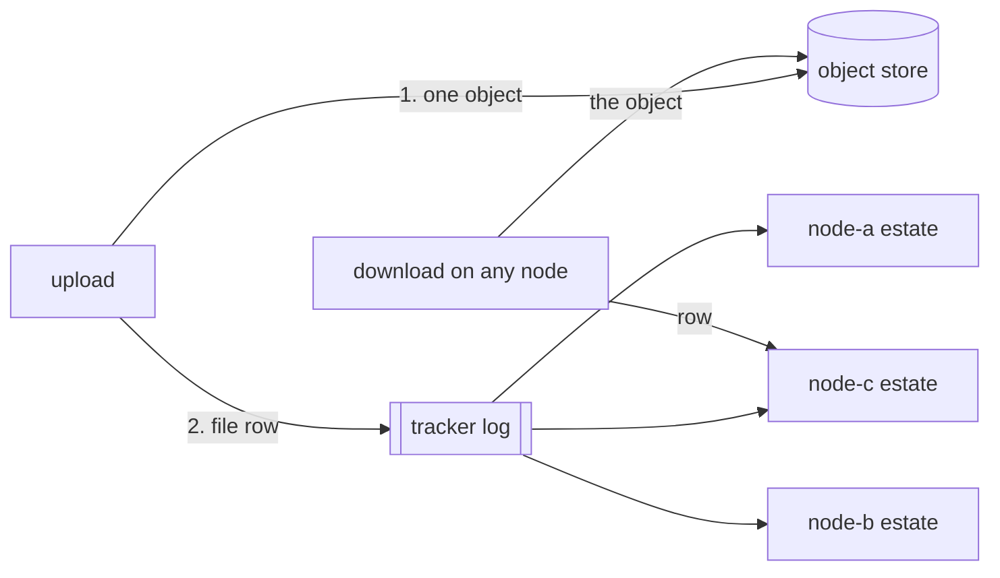

# Object Store

Where a company's **files** live, and why they are kept apart from everything
else a fleet holds.

Everything else the engine keeps durably (a task, a page, their history) is held **whole** on every data node: each applies the same ordered log into its own identical copy (see [Scaling Out](scaling.md)). That suits rows a seat reads every turn. It is wrong for an uploaded spreadsheet: files grow without bound and are read rarely, so a copy in every node's database is a cost nothing reads back.

So a file is split in two:

- **What the company has to agree on** (that the file exists, its path, type, version, writer, size, SHA-256, and the key of the object holding its bytes) is a row in the replicated estate, written through the tracker's log like any other change.
- **The bytes** are **one object** in **one store the whole fleet shares**: by default a bucket on the fleet's own broker, replicated across its members like every stream, or an S3-compatible bucket.



Today the store holds [a project's files](../guides/worklet.md#a-projects-files),
the pack bytes of the company's [git repositories](gitlet.md) (one object per push, named by its `code_packs` row, a required reference like a file's), every file of every [artifact](artifacts.md) version and asset, every file of the company's adopted brand, the files an
[Ask Crewlet](../guides/assistant.md#retention-and-erasure) conversation keeps (attached images, each sealed under the fleet keyring before storing, so the bucket holds none in the clear), and each seat's executor sessions: the harness's own transcript of a turn, sealed the same way and named by the turn's row of the `executor` log, so a later turn on the same conversation, in any box on any node, continues it
([ADR-0073](https://github.com/crewlet/crewlet/blob/main/adr/0073-a-seats-executor-session-is-a-sealed-object-its-turns-row-names.md)).
Every consumer follows one rule: the estate names the object, and the store keeps its bytes.

---

## One object per upload

Every upload is **one object under a key minted for that upload**, never reused. The key is a UUIDv7 written by the node that receives the bytes, just before it streams them into the store. It is never derived from the content, request or person, so two uploads of the same bytes are two objects, and a retry is a second object.

What the rest of this page leans on:

- **A row names the object it was written with, and nothing else ever names it.** No later write can reuse an object, so the collector deleting an unnamed object has no writer to race (see [Why a deletion needs no lock](#why-a-deletion-needs-no-lock)).
- **The row checks the bytes, not the name.** The file's row carries the SHA-256 and size of its whole content, computed while the upload streamed. A read of the whole object (a download, a backup, a copy into an artifact) is held to both. A page of one, such as a seat's `read_project_file`, is held to the length the size implies, since part of an object cannot be held to the whole's hash (see [Writing and reading](#writing-and-reading)).
- **There is no dedupe.** The same bytes written twice are stored twice, and so is a moved file (a write at the new path plus a removal of the old). A seat writing a file whose content already equals what it holds is told so and writes nothing. The collector's next hourly pass deletes an older copy once nothing names it and it was uploaded more than a day ago, so such a copy goes within the hour of being replaced or removed. The day is the grace an upload gets before its row lands, not a window to recover a replaced version.

---

## Where the objects live

`store.objects` in the [bootstrap config](../getting-started/configuration.md)
names the backend. It is **Tier A** (endpoint, bucket and credentials are the operator's, like the stream) and **every node carries it**, a node without `data` included: an upload or download on a stateless node goes to the store directly, as on a data node.

Every object is named `files/<key>` (under the prefix, on S3), so a store shared with anything else keeps the engine's objects in a corner of their own.

### The fleet's own bucket — `nats`, the default

```yaml
store:
  objects:
    backend: nats   # or leave the block out
```

Objects go into a JetStream **object store** bucket, `crewlet_files`, on the broker every log already runs on, in NATS's own object store format, so `nats object ls crewlet_files` and `nats object get` read it (on an embedded fleet through a member's loopback client listener, with the
[operator key](../guides/deployment.md#reaching-an-embedded-fleets-broker-with-the-nats-tool)). It is backed by an ordinary stream (`OBJ_crewlet_files`), created at boot at **`stream.replicas`** copies, so files survive exactly what the logs survive, on the same members:

- **The data nodes are the broker's members** and keep the copies. A three-node fleet at `stream.replicas: 3` holds every object three times; a failed member is caught up by the broker as for every other stream, with no repair, map or membership for the engine to run.
- **An object is a run of 128 KiB messages**, closed by one message naming them; an upload holds one message's worth of memory at a time.
- **Across a link, a node's transfers share one window, both ways.** A node across a leaf's link, or dialling an external cluster, sends its uploads, downloads, listings, memory replays and memory publishes over one link, beside every lease renewal. Each request is held to a five-second term, so all transfers on the link share **one window**, both directions together: what the floor of thirty seconds a mebibyte carries in four seconds, 139,810 bytes, one 128 KiB piece of a file either way. An upload's piece or a memory row holds its place until the broker acknowledges it, a download's until the piece arrives, a listing's batch of names and a replay's batch of rows until they are in, first come first served; a transfer waiting its turn is never failed for waiting. A download across a link asks for its pieces one at a time. A request sent behind all of them still has the second its own round trip needs, at every lease TTL ([ADR-0161](../../adr/0161-a-link-carries-one-window-both-ways-sized-to-a-requests-term.md)). The window is not sized by the link's measured rate: after a drop to the floor every request would wait past its term while a larger window drained. The cost is throughput on a fast link, one piece a round trip between the node's transfers (a lone download through a leaf across 100 ms at 100 Mbit/s ran at 1.04 MB/s, against 2.3 with four pieces in hand; a download and an upload at once ran at 0.55 each); uploads alone are unchanged. Every node across a link pays it: one without `data`, an operator's seat pod among them, and every node on an external broker. On a data node's own client, with no link between upload and stream, uploads share a window of sixteen pieces and a download holds four in hand.
- **A put is paced by the broker's acknowledgements.** An upload ends only once the broker has acknowledged nothing for a minute while some of its messages are out; across a link, a minute in which the link itself carried nothing at the floor, since an acknowledgement queued behind an event of megabytes is held, not lost. A put waiting its turn in the window, or on the person's own slow upload, is not waiting on the broker. No message waits behind more than the window, so at the floor each one's bytes cross within four seconds of being sent (a leaf's compressed link, which delivers what it flushed as one block, included) and its acknowledgement follows a round trip later. An upload crossing a slow link is never failed for being slow, the floor of thirty seconds a mebibyte included. A put that fails takes back what it stored, so no listing finds it; pieces a very slow link delivers after that are swept by the collector a day later.
- **A node without `data` reaches the bucket across its leaf link**, with the rest of the fleet's JetStream API; it holds nothing.
- **The bucket is created once and never rewritten.** A node looks it up at boot, creates it only when absent, and binds it as it is, whichever node made it. A bucket kept at fewer copies than this node's `stream.replicas` stops the node from starting, naming the setting, rather than taking uploads it would prove fewer copies of. A lookup and create still running after ten seconds says so, once, as `natsobj_bucket_slow`; see [Deployment](../guides/deployment.md#a-clustered-node-is-given-longer-to-create-them).
- **A read the broker loses its reader under carries on.** A download, a listing and a page's walk each read through a consumer the broker keeps; one lost part way (reaped under a slow reader, or gone in a leader change) is replaced by a new one made from the last message read, so every byte and name still arrives exactly once. It is made about **thirty seconds** after the loss, once two of the broker's fifteen-second heartbeats are missing, and no sooner: a read on a slow link hears nothing while its next half mebibyte crosses (a leaf's compressed link delivers what the member sent as one block, fifteen seconds at the slowest accepted rate), and a shorter heartbeat would replace the consumer again and again until the read failed having delivered nothing. Across a link a read asks for one piece at a time, so the heartbeat is one piece's crossing at the floor, 3.75 seconds, and the consumer is made again once two go missing **while the link carries nothing**. On a moving link the heartbeats are behind other traffic, not lost, and the read waits: it remakes the consumer only once the link has brought the node one 8 MiB message and a window since the read last heard a word, and fails once a minute passes with no piece and the link still.
- **On a clustered fleet a read can lose its first request.** The broker can answer a consumer's creation before the read's own member has learned where to send requests, and a request in that gap is dropped (one download in 1,500 to one in 25, rising with load). A read that has heard nothing a second after it began asks its consumer whether the request arrived, and remakes it if not, costing about a second rather than thirty. A read waiting on any later message also looks again after a quiet second, because the NATS client now and then decides not to send its next request (one download in ten to twenty thousand on one member); that costs a second too.
- **A read on a member still catching up reads what the leader holds.** The broker may place a consumer on any member holding a copy, one just back from a restart included, and that member says a file ends where its copy ends. So a download that ends short of the file's size, a page's walk that ends short of its offset and a read that finds nothing ask the stream's leader whether more follows, and go on from a remade consumer (at once the first time, a second apart after that, failing once the read has been behind for a minute), rather than hand back part of a file, which reads as damaged. A listing reads the leader's newest entry first, and one that ends short of it fails, to be run again, rather than omit files the member had not caught up on: the collector would otherwise take a finished upload's pieces for an unfinished upload and abandon them a day later. A healthy read asks the leader nothing extra; a listing asks twice, for that entry and for the bucket's size.
- **A listing is given the time its start takes.** Before the broker hands over the first entry it reads each block of the bucket holding a file's newest entry, about the whole bucket, from disk (it lets go of what it read two minutes later). So a listing gets five seconds plus a tenth of a second per MiB the bucket holds to start, about a minute for 580 MB, rather than the NATS client's five seconds, which a 580 MB bucket outgrew at 13.6 seconds on a nearly full disk, failing the hourly collection. A listing never started fails once that time has passed, saying how long it waited, and the collection is retried ten minutes later. On a single data node the broker holds the bucket's uploads and downloads while it reads, so they wait too.
- **A delete marker another client left is no object.** The engine deletes by purging, but `nats object rm` or any other client of the format leaves a marker under the name. The engine reads the name as holding nothing, and the collector lists and clears it like any other object no row names.
- **Quorum is the broker's.** Every message of an object is a replicated stream append needing a majority of the stream's replicas, as a tracker write does: a three-member fleet keeps writing files with one member down; a two-member fleet at two replicas cannot write with either down. Objects are read from the stream's **leader**, so a file uploaded on one node is readable on the next the moment its upload answered. Files change nothing about what a fleet of a given size survives (see [Scaling Out](scaling.md)).
- **A backup carries it as a stream.** The backup's stream snapshot includes `OBJ_crewlet_files`, snapshotted after every other stream so it holds every object a record of those snapshots names; no object is copied on its own, and a restore brings the bucket back with every other stream.

The cost: **every member holding a copy holds every object**, since the bucket is one stream on one replica set. For the three or five data nodes a fleet runs that is what any placement would do. A company whose files outgrow one member's disk, or that would rather keep them in storage it already runs, takes the S3 backend.

**S3 is the production store for a company that hosts code.** Every push to a
[repository the engine hosts](gitlet.md) is one object, and a repository's bytes grow with what its refs reach: a compaction merges packs and keeps every object, and only an [expunge](gitlet.md#expunge) drops anything: what neither a ref, nor a ref's old tip force-pushed away or
deleted within `gitlet.PruneGrace` (two weeks), nor a row of work in flight reaches, 
weekly, once more than a quarter of the repository's live bytes and at least 64 MiB is unreachable, or at once on a person's purge, which keeps no grace; a deleted repository's own purge removes the rest. So repositories grow as long as the company works in them: on `nats`, on every member's disk beside the logs and against the bucket's reservation (below), so a bucket at its reservation refuses a push as any other upload. And a Gitlet node bringing its
[cache](gitlet.md#the-cache-on-a-gitlet-node) of a repository up from nothing reads every one of those objects, one a push and sixteen at once.

#### Its byte reservation

The bucket is created with a **byte reservation**, granted in full when the broker creates the stream, beside the state logs' own. It keeps files out of the rest of the broker: the state logs reserve their ceilings, and every seat's mailbox and every coordination bucket (leases, ledgers, budget counters) share the remainder. A bucket allowed to grow into that remainder would, once full, refuse a lease heartbeat, which stops the fleet; a bucket at its reservation refuses **uploads, and only uploads**. A person uploading is told there is no room and an administrator must make some, as a `503` with no `Retry-After` (no wait clears it), and an agent's file and artifact tools are told not to retry. An upload the store simply did not take (a request out of time, a broker or provider that didn't answer) is a `503` under an election's wait instead, and tools are told to retry shortly. The object store classes every unfinished put once, so a project file's upload, an artifact's, an image attached to a question for [Ask Crewlet](../guides/assistant.md) and both kinds of tool answer alike. The collector does not bound the bucket: it deletes what no row names, never the files a company keeps.

```yaml
store:
  objects:
    backend: nats
    nats_max_bytes: 107374182400   # 100 GiB; unset derives a share of the broker
```

- **Unset, it is derived** from the broker's limit (`stream.store_max_bytes`, or the share of its volume the embedded broker takes): the smaller of a quarter of the limit, and what the limit leaves after the state logs' five eighths (or the log ceilings you set, where larger) and a 1 GiB floor for the coordination remainder. It is never below 1 GiB, the smallest value the field accepts. Where the broker states no limit (or its budget cannot be read), three quarters of the stream volume's free space stands in: the cap a NATS server running its defaults gives itself, which this node cannot read, so bucket and logs are never sized past what such a server can grant. The bucket is created before the state logs are sized, so the logs size themselves from what the broker has left, or from that stand-in less the bucket's reservation.
- **A broker needs room for it.** On a host whose broker can reserve only a few gibibytes, the bucket's gibibyte is on top of the state logs' floors; give it more disk, or set `stream.store_max_bytes` and `store.objects.nats_max_bytes` together.
- **Raise an existing bucket's reservation by raising the setting** and restarting a data node, on every broker, a single embedded node included. At boot, once its state logs hold their reservations, a data node whose `store.objects.nats_max_bytes` exceeds the bucket's reservation raises the bucket to it, changing nothing else, and logs `objects_bucket_raised`. It does so only where the broker can grant the difference and still keep 1 GiB unreserved for the coordination records, read from the broker's room as the node sees it: the embedded broker's own limit (`stream.store_max_bytes`, or its share of the volume), a clustered member's own room, or an external broker's account limit. Otherwise it keeps the reservation, logs `objects_bucket_raise_refused` with the most it can raise it to, and raises the
  [`objects_bucket_raise_refused`](#alarms) alarm until its next boot; give the broker more room or lower the figure, and restart it.
  - **Only a data node raises it**, one at a time: data nodes take a coordination lease for the raise and read the bucket again under it, so nodes configured with different figures end at the largest, whatever their boot order. A node without `data` never raises it.
  - **A smaller figure never lowers it.** A data node configured below the reservation logs `objects_bucket_not_lowered` and keeps it.
  - **An external broker whose account states no limit is not raised**, since the node cannot hold the raise to what the coordination records need. Raise it there with `nats stream update OBJ_crewlet_files --max-bytes=<bytes>`, within what the broker can grant; on an embedded fleet the same command reaches a member's loopback client listener with the
    [operator key](../guides/deployment.md#reaching-an-embedded-fleets-broker-with-the-nats-tool).
- **A bucket with no ceiling is bounded by the figure you write, or refused.** Buckets made before the reservation existed, by hand or by another tool, hold none. A node configured with `store.objects.nats_max_bytes` gives such a bucket that reservation at boot and logs `natsobj_bucket_bounded`; it is the one way to bound the bucket on an embedded broker that opens no client listener (a solo member's, or one serving only leaves), which nothing outside the engine reaches (a clustered member admits the operator key on its loopback client listener). A node whose figure is derived does not start, and names both that setting and the `nats stream update` that bounds the bucket from outside.
- **A full bucket refuses the upload**, as a refusal of its own naming the room an operator makes (raise `store.objects.nats_max_bytes` and restart a data node, move the files to a bucket, or let the collector remove what nothing names), never a failure to retry, since every upload is refused the same until room is made: a push is refused `store_full` ([what git
  prints](gitlet.md#what-git-prints-and-what-it-means)), and so is a project file's write, through a tool (the [act
  transport](../reference/api-endpoints.md#operatoract--the-dashboards-write-surface) answers `507`) and through [its upload route](../reference/api-endpoints.md#project-files) (`507` too), and an artifact's file, on its transfer or its publish (`507`, [Artifacts](artifacts.md)), which gives back what the publish staged. The
  [`objects_bucket_near_ceiling`](#alarms) alarm fires once less than a fifth of the reservation is left, and the `crewlet.objects.bucket.bytes` and `crewlet.objects.bucket.max_bytes` gauges (from the node holding the collector's duty) draw it over time. Raise the reservation, or [move the
  files to a bucket](#moving-the-files-to-a-bucket).
- **Size the members' disks for the files as well as the logs.** Every member keeps a copy of the whole reservation's worth of objects. Past about 100 GiB of files at three copies, replacing a member re-replicates the whole bucket over the logs' routes for long enough to matter; take `s3` before then.

### An S3 bucket — `s3`

```yaml
store:
  objects:
    backend: s3
    s3:
      endpoint: https://s3.eu-west-1.amazonaws.com   # empty: Amazon's own for the region
      region: eu-west-1                              # required; R2: auto, MinIO: us-east-1
      bucket: acme-files
      prefix: crewlet/                               # optional; see "One bucket, several companies"
      path_style: false                              # true for MinIO and most self-hosted gateways
      access_key_id: ${S3_ACCESS_KEY_ID}             # both, or neither for the SDK's own chain
      secret_access_key: ${S3_SECRET_ACCESS_KEY}
```

Each object is one S3 object, `<prefix>files/<key>`. Any S3-compatible store works: Amazon S3, Cloudflare R2, MinIO, Ceph's gateway, GCS through its interoperability endpoint. The `endpoint` is an `http` or `https` URL: a host name, an IPv4 address or an IPv6 one in brackets, whose zone is an interface's name or number (`https://[fe80::1%25eth0]:9000`), and at most one port, 1 to 65535. `crewlet validate` and every node's start refuse any other (no host, a query, a port of 0 or past 65535, a zone holding a `]`, a `%` or a space), naming what is wrong, because no request could reach a bucket there. The bucket keeps whatever copies its provider promises, and its size is the provider's problem rather than any node's disk, until the provider has no room left and a write is refused as full (below).

- **An upload of up to 8 MiB is one `PutObject`; a larger one is a multipart upload** of equal 8 MiB parts, up to four in flight at once while the next is read, so a distant bucket costs a round trip per four parts rather than per part. An upload holds at most four parts (32 MiB) in memory whatever the file's size, and every upload past its first part draws on one allowance the node's uploads and reads share (96 MiB), so a fifth large upload at once goes a part at a time rather than waiting for memory. An upload that fails part way stops at once (a part the bucket refuses ends the read of the file and the other parts) and is aborted once every part it sent has answered; one a process was killed in the middle of is aborted by the [collector](#unfinished-uploads) a day later. With parts sharing the node's link, each part is given the time its share of the link takes at the slowest rate the store accepts, so a large upload is held to that rate as a whole.
- **A read of more than 8 MiB is read in 8 MiB ranges too, handed out in order, as many at once as its reader keeps up with, up to four**, so a provider limiting one connection (about 80–90 MB/s from S3) does not limit a large download, a backup's copy of a large file or a Gitlet node's sync of a large push. Each range is asked for a little before it is needed, so a bucket's first byte is paid once a read rather than once a range. Against a bucket sending each connection at most 80 MB/s, a 128 MiB file read at 335–353 MB/s (219–246 with the bucket 50 ms away), against 78–80 for one stream. A file of 8 MiB or less is still one request.
- **A read takes memory only as fast as its reader uses it.** Its ranges are read into buffers from the same allowance the uploads' extra parts draw on: one to begin with, another only while the reader is waiting on the bucket, and one given back once a range sits landed with the reader still behind it. A download to somebody on a slow link therefore holds one 8 MiB buffer however long it runs, instead of four that other transfers could use. That allowance (96 MiB), plus each upload's own first part, bounds a node's memory for transfers however they mix. A read that finds no buffer free reads its ranges one after another rather than waiting, each request already on its way. Every range after the first must carry the first one's `ETag`, so a file whose object is overwritten while read fails the read rather than hand out pieces of two objects; this needs a provider that answers an `ETag`, as S3 and every compatible store do. A range that fails ends the ranges after it at once.
- **Credentials** are `${VAR}` references resolved at boot, or neither, which takes the SDK's default chain: the environment (`AWS_ACCESS_KEY_ID`…), a shared profile, a web identity token or the instance's role.
- **The identity needs six permissions**, each confined to the prefix: `s3:PutObject` (a single upload, and every step of one in parts), `s3:GetObject`, `s3:DeleteObject` (a deletion, and the collector's batches), `s3:ListBucket` limited to the prefix (the collector's listing and the audit's listings of ranges), and `s3:ListBucketMultipartUploads` and `s3:AbortMultipartUpload` (finding and aborting unfinished uploads). None needs a right over the bucket itself. Without the last two, uploads still work and the collector reports what it could not sweep as `sweep_error`.
- **A private CA** is read from `AWS_CA_BUNDLE`, added to the system roots for the bucket's requests only.
- **Reach the bucket over `https`.** Over plain `http` the S3 signature covers the request body, so the node hashes every uploaded byte a second time: uploads ran a third slower on a CPU without SHA instructions, up to a fifth slower with them.
- **The bucket is checked at boot, under the prefix.** A node stores, deletes and re-puts one object under `<prefix>probe/` (see [The boot
  probe](#the-boot-probe-and-direct-uploads)). A node that cannot store and delete it does not start: one that started anyway would accept an upload it could not store.
- **Every request goes out from the node that serves the upload or the download**, a stateless node included, so every node needs to reach the endpoint.
- **Every request carries a deadline of its own**, so a bucket that stops answering fails the request rather than holding it: thirty seconds for one that moves no body, the same plus thirty seconds a mebibyte for one carrying bytes up, and five minutes for completing a multipart upload. **A write the bucket stops taking ends a minute after it last moved**, whatever its deadline: a minute after the bucket last took a byte of it, acknowledged one, or sent one of its answer, counted at the node's own socket, so a write crossing a slow link (the floor of thirty seconds a mebibyte included) is never ended for being slow. A request ended that way is not asked again: a person's upload is answered `503`, and a push's commands `unavailable`, a minute after the bucket last moved it, give or take the five seconds between two looks at the socket (a minute and a half for an upload in parts whose unfinished upload the bucket will not let it abandon either). A read is bounded by the reader's own deadline (see [Writing and reading](#writing-and-reading)). The node speaks HTTP/1.1 to the bucket, the protocol S3's API is defined over, so each request has a connection of its own to watch.
- **A bucket its provider has no room in refuses the upload as full**, as the fleet's own bucket at its [reservation](#its-byte-reservation) does. Amazon S3 holds whatever it is sent, but a self-hosted gateway refuses a write for want of room: MinIO at its drives' free-space floor (`507
  XMinioStorageFull`) or past a bucket quota (`400
  XMinioAdminBucketQuotaExceeded`), Ceph's gateway out of space (`507
  InsufficientCapacity`) or past a quota (`403 QuotaExceeded`), any gateway's `507`, on a `PutObject`, a part or an upload's completion, and refuses the same write the same way until room is made. So it is sent once, never asked again, the unfinished upload is abandoned, and it is answered with the refusal the full NATS bucket gets (a push `store_full`, a project file's write and an artifact's file `507`) naming the provider's room: free space on the storage under the bucket, the quota it holds the bucket to, or letting the collector remove what nothing names. Never a failure to retry, which would send a client, or a script honouring a `Retry-After`, to upload the same bytes into a bucket that refused them.
- **A throttle slows the node down rather than failing its requests.** One client on each node carries every upload, download, git sync, collection and backup copy. When the bucket answers one with a throttle (S3's `503 SlowDown`, MinIO's `SlowDownRead` or `SlowDownWrite`, or any `429`), that client lets the bucket hold only seven tenths of the most requests the node has had out at once since it was last slowed, the rest waiting their turn in order, and one more each round the bucket answers; it stops holding back once the bucket has gone a minute without a throttle. It is the node's width that is cut, not what happens to be out when the throttle returns, so a throttle answered to one lone request between two git syncs holds the next sync back no more than one answered at its start; only a node throttled at the check it makes when it starts, before sending anything else, starts from one request at a time. S3 Express's session request (what a directory bucket's requests are signed with) is never held back, so a node whose requests wait never waits for credentials behind itself. A 503 naming a fault of the gateway's own (MinIO answering an object it cannot rebuild from its drives) is no throttle and slows nothing else; a 503 to a `HEAD` is read as one whatever the gateway meant, since its answer has no body to say. A throttled request is asked again, after a random wait of up to twenty seconds, until its deadline above, never for a number of attempts, which `AWS_MAX_ATTEMPTS` does not change. A request the bucket answers with nothing but failures (a server error that is no throttle, or no answer) is asked again the same way until a bound of its own, drawn as the failures begin, between forty seconds and a minute after the first; its last attempt is sent at that bound, then it is given up, and its caller is told how long the bucket failed every attempt and what it last answered. Each request draws its own bound so that the writes an outage catches open, on every node, do not all ask again in the same instant onto a bucket that may just be recovering; the price is that a failure ending in the minute's last twenty seconds is ridden through only by requests whose bound lies past it. A person's upload or download the bucket keeps failing is answered `503` within that minute (an upload in parts up to thirty seconds later, once its unfinished upload is abandoned). A throttle between two failures starts the span again, since a bucket asking the node to slow down is up. A request its deadline ends says so and names the bucket's last answer. A refusal asking again cannot change (a key the bucket refuses, a bucket that is not there, a certificate the node does not trust, an address no connection can be made to: a port of 0 or past 65535, or one the dialer cannot parse, the proxy's included) fails at once, the check at boot included; a bucket that does not answer at all holds that check for its thirty seconds. A connection refused on any other port, an unreachable network and a name the resolver could not answer yet are asked again, since the bucket's server or the network may come back.

  Against an S3 fake 100 ms away answering every request `500 InternalError`, an 8 MiB upload was given up at 43.3 to 58.1 s after 8 to 12 attempts (deadline 4 min 30 s), a part of an upload in parts at 41.4 to 53.5 s after 9 to 12 attempts (deadline 16 min 30 s), a failing completion at 77.8 to 87.3 s (otherwise 5 min 30 s), and a 20 MiB download at 46.9 to 59.6 s (stall limit 60 s). A failure of thirty seconds was ridden through, as is any shorter than forty; one of fifty-five seconds by one upload in eight. With the bucket stopping at once, an 8 MiB upload answered at 65.0 s (deadline 4 min 30 s), a 16 MiB upload in parts at 65.2 s (95.1 s when it would not let it abandon the upload either), a completion never answered at 60.4 s and one never finished at 65.4 s (otherwise 5 min); a 3 MiB upload across a link at the floor landed, at 91.6 s. A bucket that read the first 4 MiB of each 8 MiB part at once and the rest at the floor ended a 16 MiB upload at 80.3 s (each part with a floor of its own) or 85.3 s (the two sharing one): past its fast start its software read slower than its kernel took the bytes, which no sender can tell from a stopped bucket, and a proxy that buffers an upload hides a slow bucket the same way. One that read only the first 2 MiB of an 8 MiB upload at once kept less than a minute of it unread and was not ended: it landed at 185.8 s. These figures are the fake's.
- **What the client counts.** Every attempt to the bucket is counted by S3 operation and outcome (`crewlet.objects.s3.attempts`), and every request by attempts taken and how it ended (`crewlet.objects.s3.request.attempts`); the gate's limit and queue are gauges (`crewlet.objects.s3.gate.limit`, zero when nothing holds the node back, and `.gate.waiting`). An operation's retries are its attempts less its requests that made one; a request ended before its first attempt is counted `unsent`. Throttles rising is the fleet over the bucket's rate for its prefix (more Gitlet nodes syncing at once than it takes, or a bucket shared with other traffic); failures rising is the bucket's own fault; requests given up are a bucket that failed every attempt of a request for most of a minute. See the
  [metrics reference](../reference/metrics.md).
- **The prefix is optional**, and with or without one the engine touches only names under its own `files/` corner: another application's objects in the same bucket are never listed as the engine's, judged or deleted.
#### One bucket, several companies

A prefix only keeps companies' keys from colliding. A credential reaching the whole bucket reads, overwrites and deletes every company's files. Share a bucket only where each company's credential is **scoped to its own prefix**: an IAM policy whose object actions name `arn:aws:s3:::<bucket>/<prefix>*` and whose `s3:ListBucket` carries an `s3:prefix` condition, or the same in a MinIO or SeaweedFS policy. Such a credential has no right over the bucket itself, so the boot check is a probe under the prefix, not a `HeadBucket`. One bucket per company is simpler and preferred.

#### The boot probe and direct uploads

At boot a node runs one probe under `<prefix>probe/<key>`, beside `files/` so the collector never mistakes it for a file:

1. It **stores and deletes** the probe object through the requests every upload makes. A credential that cannot do both fails the boot.
2. It makes a **presigned put whose `x-amz-checksum-sha256` does not match its body**, and expects the provider to refuse it `BadDigest`.
3. It makes the **matching put**, under `If-None-Match: *`, and expects it stored.
4. It makes **the same put again**, and expects `412 Precondition Failed`.
5. It deletes the probe object, however the probe ended.

A provider that did all of it offers **direct uploads**: the client gets a presigned PUT bound to its exact length, media type, SHA-256 and `If-None-Match: *`, so it sends bytes to the bucket itself and cannot store other bytes or a second copy. The engine still mints every key and reads back what was stored, verified against the declared SHA-256, before any row names it. A provider that skipped a step, or ignores the headers, offers none, and uploads stream through the engine: nothing fails. [`/health`](../reference/api-endpoints.md#the-health-envelope) shows it as `objects.direct_upload`, `available` or `unavailable (<reason>)`; the default `nats` backend is always `unavailable`, because only the fleet reaches the broker.

Where step 2 passed, the engine's own single-part puts also carry `x-amz-checksum-sha256` (a header, never the SDK's trailing checksum, which non-Amazon providers refuse), so the provider checks each upload and keeps its SHA-256, which the audit compares.

### One store per fleet

The first node to boot records its store in the coordination store (`nats`, or `s3:<endpoint>/<bucket>/<prefix>`, a small value every node reads, which is why the endpoint, the bucket and the prefix are held to 2048, 255 and 1024 characters); every later node compares, and **a node configured with another store refuses to boot**, naming both. Credentials are not recorded: nodes may reach one bucket with different keys.

Moving from the fleet's own bucket to S3 is a migration: see [Moving the files to a bucket](#moving-the-files-to-a-bucket).

Any other move (another S3 endpoint, bucket or prefix) is made with the fleet stopped: copy every object, delete the `backend` record from the `crewlet_objects` coordination bucket, and boot every node with the new block. **The fleet stops first** because an upload stores its object before writing its row: an object uploaded after a copy taken on a running fleet is named by a row but absent from the new store. Copy the old store's whole `files/` corner, never a backup's `objects/`, which holds only what its restore point names ([live](#live-retired-and-derived-references) rows and the records it replays), no retired or derived objects. The collector's last report describes the old store, so the first node to take the duty [sets it aside](#collection-and-audit) and collects, then audits, the new store; that audit checks every file's object came across.

Deleting the record needs a broker that listens: an external NATS cluster (`stream.type: nats`). The embedded broker listens on no socket and no engine command deletes the record, but a restore need not put it back. So on the embedded topology the one way to move is a restore: take a backup, restore it into the new store as [Backups](../guides/backup.md#restoring-into-a-new-bucket) describes, leaving the record out. That moves between S3 stores and no further: a backup carries objects as files only from `s3` (on `nats` they ride the `OBJ_crewlet_files` snapshot), and only a listening broker puts files into a `nats` store. Like every restore it returns the company as it stood at the backup; what the fleet did after is not moved.

### Moving the files to a bucket

`crewlet objects migrate --to s3` moves the company's files from the fleet's NATS bucket to an S3-compatible one, through a running data node, in two passes:

1. **Write the target file.** Copy a node's Tier A file and give it the bucket's `store.objects` block (`backend: s3`, `${VAR}` references for credentials). Every node runs with it afterwards; it is read on the engine's host, so it goes there.
2. **Copy on a live fleet**, as often as you like:

   ```sh
   crewlet objects migrate -to s3 -target /etc/crewlet/crewlet.s3.yaml
   ```

   The node probes the bucket, reads every object a file names from the fleet's store (checked against the file's row), writes it under the same key, and checks the bucket holds it at its size (and SHA-256, where the provider keeps one). It copies every object a [derived](#live-retired-and-derived-references) row names the same way, so the moved fleet keeps them instead of rebuilding from source on every node. An object the bucket holds is skipped, so a stopped pass resumes by running again and later passes copy only what is new. Nothing about the fleet changes.
3. **Restart every node in maintenance mode**, `crewlet run -mode maintenance`, so no node writes a record naming a new file during the last pass.
4. **Run the final pass:**

   ```sh
   crewlet objects migrate -to s3 -target /etc/crewlet/crewlet.s3.yaml -final
   ```

   It refuses unless the node is in maintenance mode, no node is still admitted to publish, the node has applied the company's records to the end, and it can see every row that may name a file (see [What a build cannot see](#what-a-build-cannot-see)); it copies the objects this build's tables name, and the store it leaves is yours to delete. It copies what is left, **seals** the NATS bucket (read, never written again, so a node not yet restarted cannot store a file where none will look), and moves the fleet's record of its store to the bucket.
5. **Give every node the bucket's `store.objects` block and restart it** with `crewlet run`. A node still naming the NATS bucket refuses to start.
6. **Delete the old bucket** once the fleet runs on the new one (`nats stream rm OBJ_crewlet_files`; on an embedded fleet through a member's client listener with the [operator key](../guides/deployment.md#reaching-an-embedded-fleets-broker-with-the-nats-tool)), after your next backup.

A file the fleet's store could not give back (missing or damaged) is named by both passes and not copied; [`objects_missing`](#alarms) already counts it. Restore it from a [backup](../guides/backup.md) or upload it again. A derived object the store could not give back is only counted, apart from files, and holds nothing up: the engine rebuilds it on the bucket. An object a [retired](#live-retired-and-derived-references) row keeps is not copied: every node restarts onto the bucket, so no reader could want it.

---

## Writing and reading

**An upload stores its object before it writes the row** naming it, so a listed file always has its bytes in the store, and an upload cut off halfway leaves only an unnamed object, which the collector removes a day later. Before the body is read, an upload whose declared length is over 1 GiB, or whose project does not exist or is archived, is refused. While it streams, the node counts and hashes every byte, and the 1 GiB limit ends the upload the moment the body passes it, leaving nothing in the store. **A body ends only where the client ended it**: one cut short (a closed connection included) is refused, never recorded as the part that arrived.

**A row must be written within twelve hours of its key being minted.** Otherwise the write is refused (`409 upload_expired` over REST); the slowest upload the API accepts takes eight and a half hours (1 GiB at thirty seconds a mebibyte). That bound lets the collector delete without a lock. **A refused write deletes nothing**: the same write may already have landed through another node, so its object is left for the collector, which removes it a day later if nothing names it.

**A download streams**, never holding the file in memory. Every byte is counted and hashed on its way out, and **the last bytes are held back until the whole file has checked out** against its row's size and SHA-256, so a corrupt object is never handed over whole. Over HTTP that is a download ending short of its `Content-Length`; corruption found before the response began is a `500 content_corrupt`.

A read is bounded by a deadline that grows with the file's size (a minute, plus thirty seconds a mebibyte on each of two legs: store to node, node to reader), and by a **stall** limit that ends a read whose store has handed over nothing for a minute, before the first byte as well as between two. A write has the same minute: one the store has taken no more of and not answered for a minute is ended, on either backend. So a store that stops answering mid-transfer, or keeps failing the request a download begins with, cuts it within a minute, not hours.

**A seat reads a file a page at a time** (`read_project_file`). A page is checked for its length only, since a part cannot be held to the whole file's hash. On S3 a page is one ranged request. On `nats` there is no ranged read, so a page deep into a large file first walks the headers of every 128 KiB message before it: a few dozen bytes each, but work that grows with the offset (seats mostly read near the start). Measured, a 64 KiB page at a random offset of a 128 MiB file took 32-36 ms on `nats`; on `s3` the node's side took about half a millisecond, before the provider's first-byte latency.

### Artifact uploads are reserved before they move

An artifact's files reach the store in three steps, and the first moves no bytes:

1. **The intent.** The client declares every file (path, size, SHA-256). The engine decides what it can without the bytes: whether the caller may publish, paths and types, per-file and per-publish limits, which files the artifact **already holds** (carried, below, never sent), and whether the bytes the company's artifacts name, plus outstanding reservations, plus these, fit `artifacts.limits.company_bytes`. It mints one key per new file and records a **reservation** in the coordination store, lasting until the collector could have deleted those objects. One principal may hold `artifacts.limits.pending_bytes` reserved, a company four times that; past it the intent is refused `429 uploads_outstanding`, naming when the oldest reservation expires.
2. **The transfer.** On `nats` every file streams through the engine. On `s3`, when the boot probe proved the bucket honours them, the intent hands a browser or the harness a presigned `PUT` per file, bound to its exact length, served type, SHA-256 as a signed checksum and `if-none-match: *`, so bytes go straight to the bucket and a second put to the key is refused. An agent's sandbox is never handed one: the engine reads the box and streams the files itself. The engine always mints the key.
3. **Finalize.** Before the version is recorded, the engine reads **every new object back** through the verifying reader. A file whose bytes are not what was declared is refused `422 upload_mismatch`, one that never arrived `409 upload_missing`, and a key older than twelve hours is refused as for every write. The reservation is released for every object the recorded version names.

So unnamed bytes never exceed the reservation budget, and a row's SHA-256 is always the digest of the stored bytes, established by the engine however they travelled. The decision is [ADR-0036](https://github.com/crewlet/crewlet/blob/main/adr/0036-bytes-are-reserved-before-they-move.md).

### An unchanged file is carried, never copied

A publish names every file by SHA-256; a file **the same artifact already holds** is carried: the new version's row names the existing object and no bytes move. A carry is the one way a key is named by a record other than its uploading write, and three rules keep the collector's lock-free deletion sound:

- the applier performs a carry only by finding the artifact's own live reference to that object **in its own apply transaction**; finding none, it skips the record identically on every data node, and the publisher is told `409 carried_object_gone`, naming the files to send again;
- every record that adds or removes an artifact's object reference is ordered on that artifact's own subject, so no carry can race a removal;
- **no carry crosses an artifact**, so a publish cannot learn whether another artifact holds a digest. A library two artifacts both use is stored twice.

---

## Collection and audit

Deleting a file deletes only its row; the object is garbage from then on. One data node at a time (the `object-collector` fleet duty) runs two passes against the store, judged against the replicated estate it holds:

- **Collection, hourly.** It pins the estate (a barrier on the log of every domain declaring a table that names objects: the tracker's, the artifacts log, Ask Crewlet's, the executor log, the code log), lists the store, and deletes every object **stored more than a day ago, whose key was minted more than a day ago, that no row ([live, retired or derived](#live-retired-and-derived-references)) names**. It reads every such domain whichever of the engine's own backends the company runs, since every data node applies every domain's log. It deletes while listing: on S3, batches of up to 500 judged objects in one `DeleteObjects` request, one batch at a time; on `nats`, or a gateway refusing that request, each object on its own, up to sixteen at a time ([How far it scales](#how-far-it-scales)). The day is the grace an in-flight upload gets between storing its object and writing its row. Only a name under the engine's `files/` corner is the collector's; anything else in the bucket or under the prefix is never counted, judged or deleted. A collection that cannot read the whole estate (this node holds a record it could not apply) **stops deleting**, since an unread row may name any object; the report says what it deleted and why it stopped.
- **Audit, daily.** It asks the store about every object a **live** row names, up to thirty-two questions at a time, reading rows a page at a time in key order.
  - On S3 a question is a **listing of a range**: the next rows in key order span a range of keys, and one listing answers what a HEAD of each would. A listing answers a thousand keys but the range also holds objects no live row names (a replaced file's, a retired or derived row's, an upload not yet named), so the audit measures how many each listed range holds and cuts the next to fill nine hundred keys (fewer rows the more it keeps between them; its first range is listed before it cuts a second). The hundred keys left over give room for a fuller range, so a range fits one request and an audit costs a request per nine hundred keys among the live rows'. Only an object a listing passes over is asked about by name.
  - On `nats`, whose listing keeps no order, and on an S3 Express directory bucket, which lists in none, it reads the **whole listing a window at a time**: each listing keeps the hundred thousand smallest keys after the last window's (about thirteen MiB on the duty's node), and rows in that window are judged from it, so N objects are listed once per hundred thousand. A name the listing hands on holding nothing (on `nats`, metadata that does not decode, or a name only a delete marker holds) is asked about by name, and so is everything after a listing that **fails**.
  - **Missing**: the store answers it does not hold the object. **Damaged**: it holds it at another size, or under another SHA-256 where the store answers one (`nats` keeps one; S3 answers one only for an object asked about by name, uploaded in one request to a provider the boot probe proved checks checksums), or as no object it can read (on `nats`, undecodable metadata, answered definitely, not as a failure). **Unanswered**: the store **fails** to answer, its client asking again until the question's deadline. Anything but "holds it whole" or "holds it wrong" is asked once more before being called anything: at the end of the pass, or at once when a hundred thousand others are waiting. Each is a file that cannot be counted on to download, and raises [`objects_missing`](#alarms) naming the first hundred, as `PROJECT/path`, with what was found.

  **One object is never the audit's failure.** An object the store fails on both looks (a gateway erroring on one object every time, say) is reported **unanswered** and the audit runs to its end, once the store answers a question after it. What fails an audit is the store failing: thirty-two questions in a row with none answered between, or, when the last questions are failures, one more question about an object it had answered failing too. A store that went away mid-audit is retried ten minutes later, and none of the questions it failed is taken for a finding. On S3 a **listing that fails** (deadline passing while the bucket throttles or fails) is set aside with its range and listed **once more** at the end of the pass instead of asked about object by object: only what that listing passes over is asked by name, and a range whose second listing fails too is unanswered, file by file.

A node whose copy of the tracker, the code log or the artifacts log is out of service does not hold the duty (its passes would read the file-naming rows through a read that copy refuses) and gives it back if held; a node whose copies serve takes it at its next minute's turn ([singleton duties](seat-ownership.md#singleton-duties)).

A failed pass is retried ten minutes later. A collection that does not complete, because the store failed it or it stopped judging, logs a `WARN` line, `objects_collected`, with why; a failed audit logs `objects_audited` at `WARN`. The duty records each pass in the coordination store, so every node's [`/fleet`](../reference/api-endpoints.md#get-fleet) and `crewlet objects status` show the same report, naming the node that ran it, and a node taking over keeps the schedule and the last audit's findings. It runs no pass until it has read that report: one the coordination store does not give up is asked for again at the duty's next turn, a minute later, rather than taken as nothing recorded, which would write the last findings out. An audit that fails or stops part way never hides what the last completed one found. A report names the store its passes ran on; one of **another store**, left behind when the fleet [moved its files](#one-store-per-fleet), is no report of this one: the node taking the duty collects then audits the new store as its first two passes, and `/fleet` and `crewlet objects status` show `not_yet` until the first records one.

**A pass keeps the duty while it runs.** The lease is renewed four times a lease, every 45 seconds, so a multi-million-object audit stays on its node however long it takes. A pass stops the moment a renewal answers that another node holds the duty, and once no renewal has confirmed it for two and a quarter minutes (the three-minute lease less one renewal, the longest no other node can have taken it). A single renewal the coordination store refuses or holds on to costs nothing: none waits longer than 45 seconds, so the next is always asked in time. A stopped pass records nothing; the holder records its own.

### Live, retired and derived references

Every table whose rows name objects declares one of three kinds:

- **Live**: the object is part of something the company holds, such as a file's bytes. The collector keeps it, the audit checks it, a backup carries it (and every object a record its restore replays names, since those records write live rows too), and [moving the files to a bucket](#moving-the-files-to-a-bucket) copies it.
- **Retired**: the object has been replaced and nothing new reads it, but a reader that has not caught up may still be fetching it. A retired row keeps the object from the collector until the part of the engine that wrote it deletes the row once its grace has passed; the collector then deletes the object at its next pass. The audit never asks after it, and a backup never copies, counts or asks after it: on `s3` it stays out of the backup's `objects/`; on `nats` its bytes ride the bucket's stream snapshot, uncounted and unchecked. A move to a bucket leaves it behind: every node restarts onto the bucket, so no lagging reader is left.
- **Derived**: the engine can build the object again from what live rows name, so losing it costs a rebuild, no data. A derived row keeps the object from the collector while the row stands and owes it no grace: readers go on without it when it is gone, so the writer may delete it the moment it replaces what the object holds, and the collector deletes it at its next pass. The audit never asks after it (a lost derived object raises no [`objects_missing`](#alarms)), and a backup treats it as a retired one's. A restore brings the rows back without their objects, and the engine rebuilds them. A move to a bucket **does** copy it, as it copies a live one: backups are taken often and restored rarely, so carrying it would cost its bytes at every backup to spare a rebuild after a restore, while a move is made once, and an object it left behind would be rebuilt on every node, at a cost growing with everything it was built from. One the old store cannot give back is counted and left behind, never holds the move up, and never raises an alarm.

| Kind | Kept from the collector | Audited | Carried by a backup | Copied by a move to a bucket |
|---|---|---|---|---|
| Live | yes | yes | yes | yes |
| Retired | until its row's grace has passed | no | no | no |
| Derived | for as long as its row stands | no | no | yes |

A project's files are live rows, and a file never retires one: a replaced file's bytes go at the first hourly pass once nothing names them and they were uploaded more than a day ago (see [One object per upload](#one-object-per-upload)). So is the log a failed [check](gitlet.md#checks) kept (at most its last 64 MiB, named by its `code_check_logs` row), since nothing rebuilds it once its run is gone: its row goes with its check's, 30 days after the check ended (up to a day more in a repository whose checks stopped ending, [How long a check is kept](gitlet.md#how-long-a-check-is-kept)) or with its repository's purge, and the collector's next pass takes its bytes.

A seat's executor session is live too. Its `executor_sessions` row names it, and nothing rebuilds the harness's transcript once the run that wrote it is gone, so the object is kept, audited and carried by a backup until a release, a retention delete or the seat's removal takes the name off the row ([ADR-0073](https://github.com/crewlet/crewlet/blob/main/adr/0073-a-seats-executor-session-is-a-sealed-object-its-turns-row-names.md)). So is each large payload a session keeps apart (an image, a whole PDF it read), one object however many of the seat's sessions hold it: an `executor_session_media` row of each turn whose session holds it names it, and the rows go with their turn's session, so the object goes once no session that holds it is kept. A lost session raises [`objects_missing`](#alarms) like any live object; that the conversation's next turn starts fresh is the launch's tolerance of the loss, not a reason to stop accounting for it.

The first retired rows are [Gitlet's](gitlet.md): when a compaction merges a repository's small packs into a larger one, each replaced pack moves to `code_packs_retired` and keeps its object for **a day**: 2 hours 39 minutes more than the longest read a clone of the largest pack a row can name is allowed (21 hours 21 minutes), and more than the two hours the clocks of the sweeping node and the broker that stamped the retirement may disagree by while no node raises [`clock_skew`](../reference/alarms.md). So a Gitlet node still serving the old pack list, or a clone that began on it, finishes its read. The `code-retention` duty then removes the rows past their day (by a record on the code log per repository holding some, which every data node applies), and the collector's next pass deletes their objects. A deleted repository's purge takes its retired rows too.

An [expunge](gitlet.md#expunge) retires packs the same way; these are the packs whose bytes somebody may want gone: those holding what no ref reached, a secret force-pushed away among them. Its begin leaves them **dropping**: still `code_packs` rows, so still live (kept, audited, carried by a backup taken then). Its commit moves them to `code_packs_retired`, where they keep their objects for the same day, for a clone already reading one, before the duty's sweep removes the rows and the next collector pass deletes the bytes. So a purged object leaves the store a day and at most about an hour and a quarter after its purge commits, and the purge's answer says so. Two copies outlive that: every backup taken before the commit (on `nats`, before the collector deleted the bytes, since the stream snapshot carries every object the bucket holds, retired included; [A purge and the backups before it](../guides/backup.md#a-purge-and-the-backups-before-it)) and, on a [versioned bucket](#choosing-a-backend), the noncurrent version the deletion leaves, for as long as the bucket's lifecycle rule keeps one. Decisions: [ADR-0081](https://github.com/crewlet/crewlet/blob/main/adr/0081-a-retired-reference-keeps-its-object-for-a-grace.md); the compaction's rules (what a merge keeps, why a retired pack outlives its longest read) [ADR-0090](https://github.com/crewlet/crewlet/blob/main/adr/0090-a-compaction-merges-packs-without-judging-reachability.md); the expunge's (what it keeps, why it drops in two records) [ADR-0099](https://github.com/crewlet/crewlet/blob/main/adr/0099-an-expunge-drops-only-what-no-ref-or-in-flight-row-reached-within-its-grace-in-two-records.md).

The first derived rows are Gitlet's too: `code_layer_parts`, the stored bytes of each repository's **published layers** (a multi-pack-index layer, its bitmap and the commit-graph layer over the same packs), written once for the fleet rather than by every Gitlet node over the whole history. Any Gitlet node can rebuild a layer from the repository's packs (live rows), so a lost part costs a rebuild only: no `objects_missing`, and a backup leaves the parts out. A layer's bytes are cut into parts of at most **1 GiB**, all uploaded at once so each is named on the log well inside the twelve hours a write may take; a repository's chain holds at most **32** layers of at most **16** parts each, and a publication that replaces a layer removes its rows at once.

### Unfinished uploads

An upload that died part way (a node killed mid-upload, or a delete interrupted between its two halves) leaves bytes **no name reaches**: on S3 a multipart upload nobody completed or aborted, which the provider bills for; on `nats` the messages of an object no closing message names. No name listing shows them, and each can be a gibibyte. So every collection also asks the store for them and abandons each begun more than a day ago (in-flight uploads are unfinished too, and none takes that long), unless it was being stored under somebody else's name. The report's `abandoned` is the count; a store that refuses the question (an S3 identity without `s3:ListBucketMultipartUploads` or `s3:AbortMultipartUpload`) is reported as `sweep_error` and does not fail the collection.

### Why a deletion needs no lock

The danger is deleting an object as a write comes to name it. With one object per upload, only the uploading write can name an object, so the question is whether it can land **after** the collector judged the object unnamed. Two rules close it:

- **A write may name a key minted at most twelve hours before it is decided**, by the deciding node's clock, and is refused otherwise.
- **The collector deletes only an object whose key was minted, and which was stored, more than a day ago**, by its own clock, and that a complete, pinned estate does not name.

A deleted object is past the twelve hours by twelve more, so no write that could still land can name it. This holds while the deciding node's and the collector's clocks disagree by less than that margin, and the engine watches: every data node reads the fleet's clock (the median of the data nodes' clocks) off the coordination store's position register, and raises [`clock_skew`](../reference/alarms.md) once its own clock, or that of the broker member leading the register, stands more than an hour from it, so while none does, two disagree by two hours at most (see [Every machine's clock](../guides/deployment.md#every-machines-clock)). There is no lock, second look or coordination round trip, and two collectors at once are safe: deleting an already-gone object is not an error. An artifact's [carried files](#an-unchanged-file-is-carried-never-copied) keep the rule: a carry names only an object the same artifact still names, checked where it is applied. The decision is [ADR-0027](https://github.com/crewlet/crewlet/blob/main/adr/0027-a-deletion-from-the-shared-store-needs-no-lock.md).

### What a build cannot see

A collection reads the tables **its own build** declares, and a newer build can add a domain whose rows name objects. So before judging anything it asks whether an unreadable row may name a file, and **deletes nothing while one may**, reporting why on the pass:

- **A data node the fleet counts runs a state log this build does not**: a newer build, part way through a rolling upgrade. Counted as the log trim counts a log's readers: a merely offline node holds collection back, an operator-evicted one does not. Collection resumes once every data node runs a build that knows every log, so a rollout finishing within the day's grace costs nothing.
- **This node's own copy of the estate was migrated by a newer build**: the node was rolled back. The migration runner steps over a version this build does not carry, so the node boots but cannot read the tables that version made, and its own row names only the logs it runs now; on a one-data-node fleet its copy is the only witness. Collection resumes when a build carrying those versions runs on it again, or after you restore a [backup](../guides/backup.md) this build took.

An answer the node cannot get (coordination store unreachable, its copy of the estate not open) is a failed pass, retried, never one that went ahead. A final pass of [`crewlet objects migrate`](#moving-the-files-to-a-bucket) asks the same question and refuses on the same answer.

---

## Alarms

| Alarm | Fires when |
|---|---|
| `objects_bucket_near_ceiling` | the fleet's NATS bucket holds more than four fifths of its byte reservation, as the collector-duty node last read it: once full every upload is refused. Raise `store.objects.nats_max_bytes` and restart a data node, or move the files to a bucket |
| `objects_bucket_raise_refused` | a data node's boot found `store.objects.nats_max_bytes` above the bucket's reservation and did not raise the bucket, because the broker could not grant the difference and still keep 1 GiB for the coordination records, or states no limit the node can read. The detail says which, and the most it can raise it to |
| `objects_missing` | the collector's last completed audit found files whose object the store does not hold, holds at the wrong size, under the wrong digest or as nothing it can read, or would not answer for twice while it answered for the rest; raised on the collector-duty node, since one node's audit of a shared store is the fleet's |
| `clock_skew` | a clock stands more than an hour from the fleet's (the median of the data nodes' clocks, read off the position register by each node's position heartbeat): on the node whose own clock moved, naming it, and on every node when the clock of the broker member leading the register did. The collector's grace and a retired pack's both rest on every clock keeping within that hour ([Why a deletion needs no lock](#why-a-deletion-needs-no-lock)) |

Once the bucket is full every upload is refused, a seat's session and the company's files alike. A company of twenty seats or more can fill the default bucket with sessions and saves alone: move it to an S3 bucket ([Moving the files to a bucket](#moving-the-files-to-a-bucket)) rather than raise the reservation again.

A missing or damaged object is a store that lost or changed bytes it acknowledged, an unanswered one a store that will not serve them: check the store's health (the `OBJ_crewlet_files` stream on the data nodes, or the bucket's) and restore the files the report names from a [backup](../guides/backup.md), or upload them again.

---

## Running it

### Choosing a backend

Keep **`nats`** unless a reason below applies. It needs nothing the engine does
not already run, survives what the logs survive, and is backed up with them.

Take **`s3`** when:

- the files will outgrow a data node's disk: every member keeps every object;
- the company already keeps its data in a bucket it backs up, versions or
  replicates on its own terms;
- the fleet's broker is an external NATS cluster whose operators would rather
  not hold files;
- nodes without `data` will move large files: such a node reaches the
  broker's bucket across its leaf link, where whole reads ran at about half
  a member's rate;
- seats will read pages deep into large files: on `nats` a page costs a walk
  to its offset, on `s3` one ranged request;
- the fleet is clustered and reads many small files: on `nats` every read
  makes a consumer, which a cluster decides on together, and one read in a
  few hundred waits a second for a request the cluster dropped; on `s3` a
  read is one request;
- the company has twenty seats or more: a seat's executor sessions plus the
  saves of its running ones it replaced reach up to twice its
  [`max_bytes_per_seat`](conversation-sessions.md#configuration), so at the
  64 MiB default five seats take a quarter of the 2.6 GiB bucket the smallest
  data volume crewlet-operator admits gives, and twenty fill it;
- the company will keep well past a million files: on `nats` the daily
  audit lists the whole bucket once per hundred thousand of them, so its
  cost grows with the square of the count ([How far it
  scales](#how-far-it-scales)); on `s3` it lists each key once.

**To try `s3` on one machine**, the repository's `docker-compose.yml` carries
a SeaweedFS service behind the `s3` profile: `docker compose --profile s3 up
-d --wait`, create a bucket on it (`aws --endpoint-url http://127.0.0.1:8333
s3 mb s3://crewlet-files`), and name it in `store.objects` with
`endpoint: http://127.0.0.1:8333`, `region: us-east-1` and `path_style: true`.
It runs with no identities, so it accepts any key pair and listens on loopback
only; a store other people reach needs identities, and one key per company
scoped to that company's prefix.

**A versioned bucket keeps every object the collector deletes**, as a
noncurrent version, for as long as the bucket's rules say, and every upload is
an object of its own, so a file rewritten daily leaves a noncurrent copy daily.
Give it a lifecycle rule that expires noncurrent versions (S3's
`NoncurrentVersionExpiration`, or your provider's equivalent) after however
long you want deleted files recoverable, or it grows for the life of the
company.

**An S3-compatible gateway must date what it lists.** The collector judges an
object's age by the `LastModified` its listing carries and an unfinished
upload's by its `Initiated`; where a gateway omits either, the engine leaves
that entry alone rather than read it as older than every grace, which would
abandon an upload still in flight. Such a pass reports what it left alone in
its `error` (an object) or `sweep_error` (an upload) on
`crewlet objects status`. Uploads left that way are billed until the bucket
aborts them, so give such a bucket a lifecycle rule for incomplete multipart
uploads (S3's `AbortIncompleteMultipartUpload`).

### Taking a data node away

There is nothing to drain for the files. On `nats` a member that leaves is a
broker member leaving, handled as for every stream (see
[Fleet](../guides/fleet.md)); on `s3` no node holds an object.

### Watching it

`crewlet objects status` prints the store, the node that ran the last passes,
and what each found; `--json` prints the fleet answer's `objects` block. The
dashboard draws the same under **Settings › File storage**.

---

## How far it scales

- **`nats`: the copies follow the broker.** The bucket lives on the stream's
  replica set, so capacity is the smallest member's disk and write throughput
  is the stream's: a 1 GiB upload at three copies is three gibibytes across
  the broker's routes. Adding data nodes adds broker members, not space for
  files.
- **`s3`: the bucket's.** Capacity and throughput are the provider's; each node
  pays only the requests its own uploads and downloads make.
- **A verified byte costs a hash on the node.** The serving node SHA-256s every
  upload and download, so one stream runs no faster than it hashes (1.3 GB/s
  with SHA instructions, 324–353 MB/s without), whichever backend holds the
  bytes.
- **The collector lists the whole store**, once an hour, on one node. A
  listing streams, and is judged 500 keys to a query against an index on the
  file row's object column. The audit reads live rows a page at a time in one
  merged key order and asks the store outside every read, so it never holds an
  estate read open across round trips; a retired or derived row costs it
  nothing, and a backup on `s3` no request.
- **On `nats` every listing starts by reading the bucket from disk**: the
  collection and its sweep each list once an hour, an audit once per hundred
  thousand objects. A listing is given a tenth of a second a MiB ([the fleet's
  own bucket](#the-fleets-own-bucket--nats-the-default)); on a single data node
  uploads and downloads wait while it reads.
- **On `nats` an audit lists the whole store once per hundred thousand
  objects**, the window it holds in memory at 127 bytes a key, so it names
  N × ⌈N / 100,000⌉ objects. At the broker's 63,000–94,000 names a second, a
  million objects are ten listings and two to three minutes, two million twenty
  listings and seven to eleven minutes; asking each by name (15,000–19,000 a
  second with 32 out on a member's own client) would take one and two. The
  listing saves requests: five hundred names a pull from whichever replica
  holds it, so two million objects are eighty thousand pulls, not two million
  leader reads. A larger window lists less for 127 bytes a key more; the cost
  squares past a window, so a company far past a million files on `nats` is
  better served by `s3`, whose listing keeps an order. An S3 Express directory
  bucket lists in no order either: two million objects are forty thousand
  listing requests in about twenty minutes, against two million HEADs in 23–24
  (in-process fake 20 ms away).
- **An audit on S3 costs a listing request per nine hundred keys.** Its ranges
  tile the bucket's `files/` keys, so it lists that corner once and HEADs only
  an object a listing passed over: two million live-row objects are about
  2,200 `ListObjectsV2` requests a day where the bucket holds little else,
  against two million HEADs. Any other object among their keys (a replaced
  file's, a retired or derived row's) costs the same as a live one, because the
  audit measures each range's density and cuts the next to fill nine hundred
  keys; an index over a repository's packs, one object per one to eight packs,
  adds as many requests again as the packs. Cutting by live rows alone
  overflowed into a second request (0.00222 requests a row against 0.00135 by
  density, with an object beside every fifth live row). Among the last day's
  keys (uploads not yet named, versions of files rewritten that day) ranges
  may take two requests, but those are a day of uploads. The S3 backend's
  benchmark listed 31,400–33,000 names a second from a bucket 20 ms away and
  15,600–16,900 from 50 ms, one listing at a time: one to two minutes.
- **The collector asks the store in parallel, and no harder.** The audit keeps
  up to 32 questions out at once (a range listing on S3; a stat of an object a
  listing did not show, or of every object once a listing of an unordered store
  has failed), so it asks 32 divided by mean latency a second over warm
  connections, inside AWS's documented 5,500 reads a second per prefix unless a
  question averages under 6 ms. By HEAD, a bucket 20 ms away answered
  1,380–1,450 a second with 32 out and one 50 ms away about 610, against 47 and
  19 one at a time: two million objects take 23–24 minutes and 55, not twelve
  hours and twenty-nine.
  - **S3 deletes** each batch of up to 500 judged objects in **one
    `DeleteObjects` request**, one batch at a time: a million unnamed objects
    are two thousand requests. AWS's 3,500 writes a second per prefix does not
    say how a batch's keys count, so a batch is taken to spend one write a key;
    one batch out reaches a quarter of them only if answered in under 0.57 s,
    leaving the rest to uploads. A gateway that refuses the verb (Google Cloud
    Storage has none) gets one deletion per object, up to 16 out, a quarter of
    the prefix's writes only if a deletion averages under 18 ms.
  - **`nats`**: a question by name is a read from the bucket stream's leader,
    a deletion three requests to it, two of them replicated writes. The
    benchmark answered 15,000–19,000 questions a second with 32 out on a
    member's own client against 4,800–8,600 one at a time, and 5,600–23,400
    against 2,100–2,800 from a follower at three replicas: about two minutes
    for two million objects on a member, against four to seven.
  - The S3 figures are against an in-process fake held that far away; no real
    bucket has been measured.
  - Every bound is on requests in flight, not a tuned rate: a slowing store is
    asked more slowly, and a failing one stops the pass with at most that many
    out: a collection at its first failed deletion, an audit at the
    thirty-second failed question in a row.
- **The estate is still whole on every data node.** Only file bytes leave it;
  every row, a file's included, is on every data node.

## What it does not do

- **It does not place the estate.** Tasks, pages and every other row are still
  whole on every data node; only what a row names by key is in the store.
- **It does not version bytes on its own.** A new version of a file is a new
  upload, a new object and a new row naming it; the previous version's object
  is collected at the first hourly pass after no row names it, once it is more
  than a day old.
- **It does not dedupe.** Identical bytes uploaded twice are two objects; see
  [One object per upload](#one-object-per-upload).
- **It is not for artefacts larger than 1 GiB.** Those belong in a store built
  for them, with a link in the project.

The decision is
[ADR-0026](https://github.com/crewlet/crewlet/blob/main/adr/0026-the-estate-names-an-object-and-a-store-keeps-its-bytes.md):
the estate names an object, and a store the fleet shares keeps its bytes.
