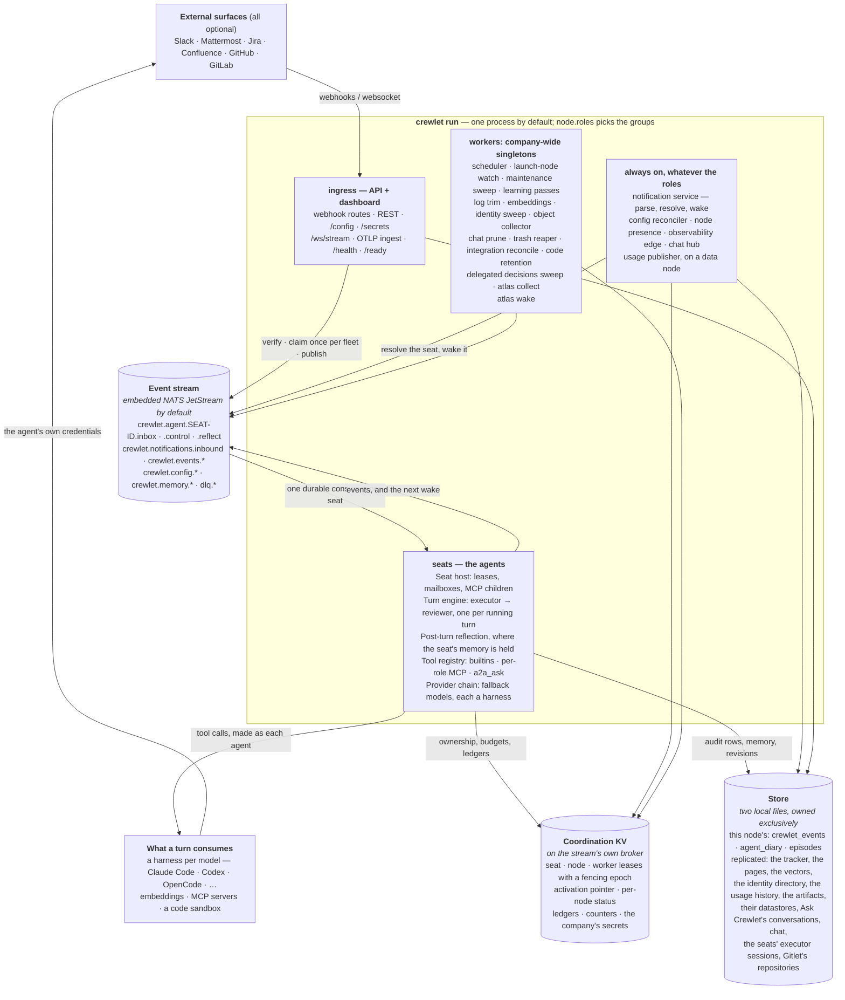

# Overview

Crewlet is a source-available engine for orchestrating hierarchically organized AI agent companies. It provides the runtime, event system, seat ownership, and knowledge and memory infrastructure needed to operate a network of AI agents modeled after a real corporate structure. Task state lives in a work-item tracker, the engine's own by default or an external one the engine deliberately mirrors none of (see [The Tracker](task-engine.md)).

Crewlet ships as **an engine plus a thin operational surface**: a REST API and a web dashboard, served in the engine's own process by every `ingress` node given an API port, provide configuration, webhooks and observability. Anything else (custom UIs, metrics exporters, automations) is built *outside* the process: the engine loads no plugins, and its outside surfaces are the REST API, the `/ws/stream` socket, OTLP, and [MCP](../guides/tools-and-mcp.md#extending-the-engine) for anything an agent should call.

---

## Vision

A founder designs a company structure, defines its mission, and deploys AI agents within it. Each agent is a role with its own backstory, skills and responsibilities, collaborating through the hierarchy. The framework models the structures of real companies:

- **Organizational hierarchy**: departments, teams and roles; seats are held by AI agents or [human teammates](humans-in-the-org.md)
- **Communication**: channels, direct messages and external tools (Slack or self-hosted [Mattermost](../integrations/mattermost.md), the work-item tracker, the code host)
- **Task management**: Worklet, the engine's own tracker, by default (items, threads, hand-offs, a board, an MCP surface), or an external PM tool it deliberately mirrors none of (Jira, GitHub/GitLab issues); see [The Tracker](task-engine.md)
- **Code hosting**: agents read, review and track code via GitHub or GitLab MCP tools, and author code in their own checkout, as their executor's run in the [code sandbox](code-sandbox.md). A company can also host its repositories in Gitlet, the engine's own git host (`code.backend: gitlet`). Repositories are declared in configuration or made by a seat's tools, and kept as replicated rows with each push's bytes in the object store. Seats read them on the server and change them in their own names: a branch through an engine-built commit landed as a push, a repository or a change through one record on the code log and no push. A seat's coding box clones and pushes over git as one more git user, with its run's own credential, each push recorded under the run that made it; see [Gitlet](gitlet.md)
- **Knowledge**: a shared knowledge base behind one seam, either Doclet, the engine's own pages (keyword over a BM25 index this node holds, semantic over embeddings the fleet derives once, or both fused by reciprocal rank fusion; `hybrid` is the default), or a live Confluence search; plus a per-agent private diary (vector similarity computed by the database, with hybrid vector ∪ recency candidate selection)
- **Decision-making**: structured DACI framework with clear authority

---

## The Org Chart Is the Execution Graph

The org hierarchy is the primary orchestration structure. Knowledge, permissions, communication and downward delegation are scoped by a seat's position in the tree: the chart a founder draws **is** the graph the engine executes.

| Dimension | How Crewlet models it |
|---|---|
| **Mental model** | A corporate org chart: departments, teams, named seats |
| **Hierarchy** | A native tree: identity, downward delegation, manager-handoff target and scoping derive from it |
| **Communication** | Event-driven pub/sub with org-scoped channels |
| **Knowledge** | A knowledge base (Doclet, or a vendor's searched live) plus a per-agent private diary |
| **Decision model** | DACI (Driver / Approver / Contributor / Informed) |
| **Lifetime** | A long-running, persistent company |
| **Config style** | A YAML org chart, versioned in the store and edited live |
| **Extensibility** | Out of process: MCP servers for anything an agent calls; the REST API, `/ws/stream` and OTLP for anything built around the engine. No plugins |

The hierarchy is informational and delegation-routing, with no special upward escalation. A stuck agent hands off to its manager with the same colleague-surface tools a human would use (a chat mention, a work-item comment, A2A); the manager's handle comes from the agent's identity prompt. Engine-detected failures (stall, max-iter, unhandled exception, LLM unavailable) surface via structured logs and the seat's `last_error` on the dashboard (a model at its usage limit shows as seat state `stopped`/`provider`); see [Turn Engine](turn-engine.md) and [The Tracker](task-engine.md).

---

## Design Principles

- **Event-driven**: agents are reactive; events trigger agent work, which produces events
- **Concurrent by default**: a seat's turn, its MCP children and the node's own duties run in parallel; every shared structure is checked under the race detector
- **Provider-agnostic**: pluggable LLM, storage, tracker, knowledge and embedding backends, each behind a small contract; external tools via MCP. Only the LLM and a place for its runs are required: tracker, knowledge base and chat ship with the engine, and a [code sandbox](code-sandbox.md) cell of `local: {}` with `default_run_in: direct` is the engine host itself. So one signed-in Claude Code, Codex, Gemini CLI, Qwen Code, OpenCode, Cursor Agent, Copilot, Grok Build, Muse Code, Kimi Code, Hermes Agent or Pi plus that cell runs a company, with nothing to sign up for ([Choosing Your Stack](../getting-started/choosing-your-stack.md#code-sandbox-where-every-executor-runs))
- **Config-driven**: a company is a YAML document, validated against a schema generated from the types the engine runs on
- **Extension-oriented**: anything beyond running the company is built outside the process
- **Observable**: structured logging, OpenTelemetry tracing and an event store the dashboard reads, from day one

---

## High-Level Architecture



**[Architecture](architecture.md)** draws the engine at six zoom levels: what sits outside the boundary, what runs inside one node, a trigger's hop-by-hop path across a fleet, what a turn does, where every table and bucket lives, and what changes with a second node.

**Infrastructure**: none to operate. The stream is a NATS JetStream server the process embeds; the store is two local files it creates. Outgrowing one node moves only the stream: the embedded servers join one cluster, or every node dials one external NATS (see [Running a Fleet](../guides/fleet.md)). The client code is the same either way, and the store stays each node's own files. Tracing is OpenTelemetry.

**One node type**: `crewlet run` is the node; `node.roles` picks what it does from `data` (hold the company's durable state), `gitlet` (serve the company's git repositories, where it hosts them), `ingress` (serve the HTTP API and webhooks), `seats` (run agents) and `workers` (the company-wide singleton duties). The default is all five: the whole stack in one process. API nodes of their own are the same command with `-roles data,ingress` (serves the API, claims no seats), so both topologies are one code path. An agent host can hold no data: `-roles seats` on a scratch store, joined as a leaf, small and disposable, its seats reading and writing through a node that holds the data ([ADR-0025](https://github.com/crewlet/crewlet/blob/main/adr/0025-a-node-without-data-reaches-the-estate-through-one-that-holds-it.md)).

**One node is enough, and more is supported.** Agents are stateful seats, not interchangeable workers, so a lease decides which node runs which seat ([Seat ownership](seat-ownership.md)). Scale up (a bigger host, a higher `node.max_concurrent`) before out; one node is the design's degenerate case, not a lesser path. Run a fleet when a node's failure is unacceptable downtime, when traffic must terminate apart from the agents, or when some seats must run somewhere specific ([Running a Fleet](../guides/fleet.md); the model is [Scaling Out](scaling.md)).

---

## Technology Stack

| Component | Technology | Rationale |
|---|---|---|
| Language | Go 1.27+ | One self-contained binary, real parallelism, a standard library covering most of this table |
| Distribution | A single `CGO_ENABLED=0` binary | Nothing to install alongside. Linux and macOS on amd64 and arm64, bounded by the platforms the store driver embeds its database engine for. Linux binaries need glibc: that engine is loaded with `dlopen`, which no pure-Go build avoids |
| Event stream | Embedded NATS JetStream | Persistent pub/sub inside the process, no broker to operate. An external NATS cluster takes the same slot for a fleet, on the same client code. A seat's mailbox is a durable consumer created with nothing attached: an ordinary API call (~1.7 ms) |
| Store | Turso | Two local files this process owns exclusively (this node's own estate and the replicated one); pure Go, SQLite file format, and the vector functions recall is written against |
| Vector search | The store's vector distance functions | The per-agent diary and episodic store, in the same file. The arithmetic is the database's; the Go driver reaches no ANN index yet, so recall is a scan behind the per-agent index |
| Event store | A table in that file | LLM-invocation observability and event dashboards, written inline by a publish listener |
| Coordination | TTL leases with a fencing epoch | Seat ownership and the fleet's shared counters, in a KV on the stream's own NATS broker, never the store file. External broker: the queue's connection. Embedded: a second connection to the same server. Holds ride a lease connection of their own on both. Each is watched; any closing for good stops the node |
| Config | YAML → typed structs → generated JSON Schema | One definition drives validation, the editors' schema and the docs |
| Tracing | OpenTelemetry | W3C Trace Context, automatic propagation, OTLP export to Jaeger/Tempo |
| LLM backends | Harnesses — Claude Code, Codex, OpenCode and the rest | Each vendor's own harness, driven as a process: request shape, thinking, caching and sign-in stay the vendor's to keep current, so the engine calls no model vendor's HTTP API |
| Embeddings client | The official OpenAI SDK | Any OpenAI-compatible embeddings endpoint, through `base_url` |
| Structured logging | `log/slog` | Standard library, machine-parsable, one component-bound logger per subsystem |
| Testing | `testing` | Standard library, no assertion framework; one shared conformance suite per multi-backend contract |

---

## Provider Layer

External dependencies sit behind small Go interfaces, each declared by its consumer, so a backend is swappable and a test runs against a fake.

### LLM Provider

**Every model is reached through a harness.** A `providers.llm` entry names one (Claude Code for Anthropic's models, on a subscription or API key; Codex for OpenAI's; OpenCode for open models on any provider it speaks to, a local server included; and the rest of the [supported harnesses](llm-backends.md#supported-harnesses)) and the engine drives it as a process (`internal/providers/llm/harness`). The engine has no HTTP client to a model vendor, by decision: each vendor moves its harness (request shape, thinking carried between rounds, caching, stream ends, which sign-in bills which account) with every model it releases, and re-implementing that was a permanently trailing copy. The engine hands the harness the conversation and, for a seat at work, the phase's tools as one MCP server the harness calls in its own loop, and reads back what it reports.

`llm.Provider` (`internal/providers/llm`) has two methods, `Complete(ctx, Request)` and `Model()`.
- `Complete` is one model call (for a seat at work, one run of the harness's own loop) with the messages and, for a phase offering tools, an `llm.ToolHost`: the phase's live tool surface, which the backend serves to its harness as one MCP server for the run, and through which it reports what the harness's record shows of each model request and its cost. Tool calls happen during the call, through the host, which decides and records each, so a `Completion` has none. Tools are offered, never forced: there is no tool choice.
- `Model()` is the entry's configured model id, for log lines and config display.
- A request carries nothing else: no temperature, output cap or effort, because a headless harness takes none per call (each reads its model's behaviour from its own configuration). A caller wanting a short answer says so in its prompt.
- There is no streaming method: a caller setting `Request.OnDelta` asks the backend to stream; it calls `OnDelta` as text arrives and still returns the whole `Completion`. A harness whose answer is read from all it printed delivers it at the end.
- An entry's `timeout_seconds` (600 by default) caps one stretch of the harness's own work, wall clock (launch, model answers and its retries, from its start or the end of the tool call it last waited on to its next call or exit), so the seat's tools are never on that clock. `max_concurrent` (4) caps how many of the entry's processes are alive at once on this host. Both bound phases on this host, not an executor run, whose rounds are capped only by its seat's or company's turn cap. A process holds its slot for its whole run; a model call made inside one of its tool calls on the same entry borrows that slot.
- `Completion.Model` is the model that served the call, and the per-model token breakdown is built from it, not from `Model()`, because a fallback chain shared by concurrent callers has no single answer for a no-argument method. `Completion.ProviderKey` is the `providers.llm` entry that answered, filled in by a chain from the serving member, since a backend is never told its key.

A provider does not retry and classifies a failure only as a coarse `llm.ErrorKind` (`rate_limit`, `auth`, `timeout`, `server`, `profile_drift`, or fatal). The harness backend classifies from what the harness said:
- **`rate_limit`**: a spent plan or rate limit, recognised by the harness's own status first (Claude Code's result event with `api_error_status: 429`), else by the vendor's own sentence. The entry then **sits out** on this node: every call fails at once as a rate limit until the reset the vendor named (its next occurrence, never more than an hour away) or, with none named, for 1, 2, 5, then 15 minutes, a step longer each time a probe meets the limit again and back to the first once the entry answers ([how long an entry sits out](llm-backends.md#falling-back-between-entries)). A seat so moves to its next model without starting a process to hear the same sentence.
- **`auth`**: an expired, missing or unentitled login. Never sat out, because `crewlet llm login` mends it and the next call must find it.
- **`server`**: a run the harness reports failed for any other reason (an error or overload relayed from its vendor, a crash), or a run not seen to its end. Not sat out, since nothing says it lasts.
- **`profile_drift`**: output this build can no longer read, a mismatch rather than the vendor's failure; the chain treats it like `server`.

Falling back belongs to the seat's chain (`internal/providers/llm/chain`), which tries members in order and stops only at a fatal error: a call the engine itself cannot make (a prompt it cannot render, a harness it cannot start on this host, such as a missing binary refused before any harness exists), which the operator must fix and no next member can carry. A harness that started is never fatal, however it ended.

A seat's entries can be different harnesses, so roles can use different vendors and models (executives on Claude, junior agents on a cheaper model). Wherever a harness runs it drives its own loop and calls the seat's tools as one MCP server, `crewlet`. A seat's executor is its harness's own run, detached in a sandbox box with its shell and editor on, reaching the tools over the MCP bridge. Every other phase runs on this engine's host with its own shell and editor denied, reaching the tools through a relay into a unix socket this process serves for the run, every call decided by the phase's gates: the grant, the fence, the budget, the round cap, a person's note ([ADR-0049](https://github.com/crewlet/crewlet/blob/main/adr/0049-a-phases-tools-reach-its-cli-as-one-mcp-server.md)). A local process also brings per-seat filesystem isolation (a harness keeps sessions, history and project memory under one home, and one entry serves every seat), a loop the engine must hold to the phase's rules, and its own sign-in story, all in [LLM Backends](llm-backends.md).

**Prompt caching is the harness's, and it does not make a long prompt free.** The system prompt goes on the harness's own system channel where its profile has one (beside the harness's prompt for a seat's runs, in place of it for a side pass; [which channel a call takes](llm-backends.md#which-channel-a-call-takes)). The vendor's harness caches it as it does any session's; the engine sets no breakpoint and reads back what the harness reports it read from and wrote to the cache. A cache reuses only the system prompt, only while its bytes hold, and not even that on a harness that puts per-call text ahead of the engine's ([which harnesses do](llm-backends.md#which-harnesses-actually-have-one)). A run on this host is a harness process handed the system prompt and then one user text, the conversation so far ([how the prompt travels](llm-backends.md#how-the-prompt-itself-travels)); the harness's loop re-sends that prefix with every request, and a phase needing another run hands a fresh process all of it again. Tools reach the harness as its MCP server's, never in a prompt. Within a turn the system prompt holds on every request of the [tool loop](agent-runtime.md#the-llm--tool-proxy), since every prompt builder is a pure function of turn-start inputs and what a phase adds rides the conversation. Across turns it breaks, because the prefetch blocks (thread, memory, knowledge, similar prior work, counterparty) are resolved per turn inside it. The token budget charges cached input in full, so every byte of a prompt is paid on every request; the per-phase prompts therefore state only what the model and its harness cannot know, each rule once (see [Turn Engine](turn-engine.md)).

`Completion.InputTokens` always reports the **full** prompt-token count whatever the cache state, so the token budget stays correct: the backend sums the harness's raw input tokens with the cache reads and writes it reports beside them (or, where the profile declares the harness's input count already holds them, `usage.input_includes_cache` as OpenAI's usage does, takes it as is) and adds the prompt a model-side tool built, which a harness may report apart from its input. `Completion.CacheRead` and `Completion.CacheWrite` break the total down for cost reporting only. A run with tools is charged request by request as the harness's record shows each, plus what it spent beyond that when it ends, on every outcome. Each harness run is an `llm.run` trace span, and its rounds' model and tokens are on the phase record. A harness reporting no usage is charged an estimate, four characters a token over everything the engine handed it, system prompt included, which `crewlet llm doctor` says of it ([token accounting](llm-backends.md#token-accounting)).

### Embedding Provider

`embeddings.Embedder` (`internal/providers/embeddings`) embeds one text (`Embed(ctx, text)`), reports its vectors' space (the configured `Width()` and the `Model()`) and the model's `Limits()`: bytes per input, and inputs and bytes per request, resolved from what the model's vendor documents (or what the operator states for an unknown model). `embeddings.BatchEmbedder` adds `EmbedBatch`, which sends a batch in as many requests as those limits need. An input past the bound is refused before sending; the caller decides what a longer text becomes (the knowledge corpus embeds its opening; a turn's ask is split into pieces whose vectors are pooled into one, `embeddings.EmbedWhole`). A failure is classified as refused (will be refused again unchanged), transient, or a configuration fault; nothing retries. For a turn starting it means "no similarity search", never a failed turn, and the corpus duty asks again on its next tick.

Uses: the [agent-learning subsystem](agent-learning.md) for vector retrieval over the agent's private `agent_diary` (the vector half of the `## Personal memory` prefetch's hybrid candidate selection) and `episodes` (the `## Similar prior work` prefetch and the `query_episodes` builtin), and the [knowledge system](knowledge-system.md#semantic-search-two-stages-the-first-one-indexed-no-new-dependency) for the semantic half of a Doclet or Worklet search: the company's pages and work items are embedded once by a fleet-singleton duty and applied on every data node, so the bill is paid once however many nodes run. A Confluence knowledge base is searched live and embeds nothing. The built-in provider is **OpenAI**, through its official SDK (the one model-vendor client the engine keeps, since a harness computes no embeddings), working with any OpenAI-compatible endpoint via `base_url`. Configured under `providers.embeddings` in YAML.

### Database

**Two** local files, each a Turso database over the SQLite file format, built from its own forward-only migration sequence: this node's own estate, opened at start (`store.OpenNode`), and the **replicated estate**, opened on that node's handle (`OpenReplicated`). Every node with the `data` role holds the whole replicated estate from boot, in its own file beside the node's (`crewlet-replicated.db`, or wherever `store.replicated_path` puts it); a node without `data` holds none. Two files because a snapshot copies ONE: a node too far behind to replay the log installs a peer's replicated file wholesale, which must not carry the donor's audit log or its agents' memory. No transaction spans the two, no read joins across them and nothing attaches one to another, which a static walk enforces (see [Architecture § Where state lives](architecture.md#5-where-state-lives)). Mainline SQLite is not a driver: it has no vector functions, so recall silently degraded to nothing. **The engine owns every file exclusively**; a second process on the same path is corruption, which is why everything the company must agree on *now* lives in the coordination KV. The load-bearing tables of the node's own estate:

- **`agent_diary`** (embedding column): each agent's private observation log; the read-side counterpart of `reflect_and_persist`. Rows are embedded on write; the read path is hybrid candidate selection (vector top-50 ∪ recency top-50, deduped by row id) handed to an aux-LLM relevance filter. Shared knowledge is a separate read: on Doclet it is the company's pages as the replicated estate holds them (the pages log, applied on every data node), indexed for BM25 search in each data node's own estate; on Confluence it is a live query with no local copy (see [knowledge system](knowledge-system.md)).
- **`episodes`** (embedding column): one row per completed turn; raw and LLM-compacted aggregates share the table.
- **`synthesized_skills` / `synthesized_skill_versions`** — auto-drafted skills the agent can load via `use_skill`, with refinement history.
- **`counterparty_profiles`** — per-(observer, subject) profiles built from observed interactions.
- **`agent_onboarding_markers`** — `mark_onboarded` bookkeeping (one row per agent, UPSERT-keyed).

Alongside sit the durable runtime tables a turn leaves behind (`crewlet_events`, `scheduled_runs`) and the config plane's `company_config` payloads. The full migration list is in `internal/store/schema/`.

Not here, deliberately: the completion ledger, delivery dedupe, notification valve, token counter, activation pointer, each node's apply status and the company's [secrets](secret-store.md). Each answers a question the whole **company** must agree on, so they live in the fleet's [coordination store](coordination.md), not any one node's file. Everything else is YAML config, in-memory state, or an external tool.

---

## Package Structure

```
adr/                      # Architecture decision records — a decision that
                          #   binds more than one package, with the gate that
                          #   anchors each one to its authority
cmd/crewlet/              # The one binary: run, validate, schema, migrate,
                          #   budgets, backup, retention, worklet, objects,
                          #   gitlet, fleet, feeds, seats, artifacts, chatlet,
                          #   secrets, config, iam, llm, search, assistant,
                          #   and the six integration CLIs —
                          #   gitlab/github/jira/slack
                          #   `provision`, confluence `import|resync`,
                          #   mattermost `provision|doctor`
internal/
├── engine/               # The wiring: which concrete thing satisfies which seam
├── config/               # The two config tiers → typed structs → JSON Schema
├── org/                  # Organization model (hierarchy, roles, seat identity)
├── agent/                # The agent runtime, one package per hard part:
│                         #   turn/ (the two-stage loop), toolloop/ (the
│                         #   model↔tool round-trip),
│                         #   inbox/ (what wakes a seat, and what must not
│                         #   wake it twice), ledger/ (the prior-work ledger
│                         #   and its budgets), structured/ (how a phase
│                         #   gives a typed answer), prefetch/, prompts/,
│                         #   skills/, skillsync/ (keeps every node's
│                         #   skill registry current), builtin/,
│                         #   subagent/ (workers), steer/ (a person's note
│                         #   to a running turn)
├── queue/                # The EventQueue contract + the jetstream backend
│                         #   and the in-memory twin, both certified by one
│                         #   suite
├── coord/                # TTL leases with a fencing epoch + the shared KV
├── iam/ authz/           # Who is acting (principals, grants, the name
│                         #   grammars) and the one function that decides
│                         #   whether they may — values only, no store
├── statelog/             # The durable-state framework: one ordered stream per
│                         #   domain is the write-ahead log, N identical SQL
│                         #   copies are the state, and the checkpoint commits
│                         #   in the same transaction as the rows
├── worklet/              # Worklet, the engine's own work tracker, statelog's
│                         #   first domain: records, subjects, ranks, custom fields
├── doclet/               # Doclet, the engine's own knowledge base, statelog's
│                         #   third domain: containers, pages, revisions, comments
├── iamdomain/            # The identity estate — statelog's fourth domain:
│                         #   people, logins, credentials, invitations and
│                         #   sessions, uniqueness arbitrated on one subject
├── usage/                # Each data node's day, replicated — statelog's
│                         #   fifth domain: spend, turns and reads that
│                         #   outlive the node that recorded them
├── chatlet/              # Chatlet, the engine's own chat, statelog's ninth
│                         #   domain: rooms, threads, messages and reactions,
│                         #   a message sequenced on its room's subject
├── executordomain/       # Each seat's executor sessions, statelog's tenth
│                         #   domain: a row per turn naming the sealed object
│                         #   its harness's session is kept in
├── gitlet/               # Gitlet — statelog's eleventh domain:
│                         #   a repository's settings, refs and packs as rows,
│                         #   one subject a repository, the committer that
│                         #   group-commits its pushes, the activation fence
│                         #   and the paced purge. gitproc/ is the one git subprocess
│                         #   wrapper — a built environment, an allowlisted
│                         #   configuration, slot lanes, process groups and
│                         #   deadlines — and gitproc/gittest/ the client git
│                         #   every test drives. cache/ is the node's
│                         #   disposable bare repositories, derived from rows.
│                         #   query/ answers a repository's content by object
│                         #   id — trees, files' lines, diffs, comparisons —
│                         #   over that cache, in half its read lane.
│                         #   gitletfault/ names the fault points of the push
│                         #   and sync paths, in the order a push reaches them.
│                         #   host/ is smart HTTP for persons and for
│                         #   coding boxes, each box admitted by its run's
│                         #   row: the receive
│                         #   pipeline in a scratch, the hook relay, and `ok`
│                         #   told only from a push's applied row — and the
│                         #   engine-built commit a seat's or a person's
│                         #   tool asks for, built over the trees it
│                         #   touches and landed as that same push. gitlettest/
│                         #   is the one suite every Gitlet topology
│                         #   passes — Run on one data node (SoloNode), and
│                         #   RunFleet on the three-member fleet gitletcluster/
│                         #   stands up, routing through the estate router
├── eventfan/             # The fleet's turn-level history, read from every
│                         #   data node at query time, with coverage on every
│                         #   answer
├── search/               # Both halves of knowledge search — the BM25 index
│                         #   and the two-stage semantic retrieval — plus the
│                         #   embedding domain, the fleet's bucket fan-out,
│                         #   chat's own keyword index and the index of
│                         #   Gitlet changes' words
├── textindex/            # The analyzer and the BM25 arithmetic, as pure
│                         #   functions: Turso has no fts5
├── changefeed/           # How a committed record becomes a WAKE, derived by
│                         #   something that outlives the writer, over a
│                         #   consumer it opens again whenever it fails
├── seat/                 # Which seats this node runs, and the watchdog
├── store/                # The two local files: this node's own estate, and
│                         #   the replicated one a state log's applier writes
├── flock/                # The one exclusive cross-process lock on a file,
│                         #   released by the kernel however its holder
│                         #   exits — what keeps a second process off the
│                         #   store's file, the broker's stream directory, a
│                         #   harness's shared login and a Gitlet node's
│                         #   cache directory
├── estate/               # The replicated estate ROUTED: one router on every
│                         #   node, answering in-process where this node's
│                         #   copy of the operation's domain serves and
│                         #   asking a data node otherwise
├── objstore/             # The object store: one object per upload, under a
│                         #   key minted for it and never reused, in one store
│                         #   the fleet shares — natsobj/ (the default) or
│                         #   s3obj/ — plus collect/ (the collector) and
│                         #   references/ (the tables that name an object)
├── events/               # The envelope and the typed-payload registry
├── a2a/                  # Agent-to-agent channels (one ask, one answer)
├── schedule/             # Role/unit cron-style recurring work
├── learning/             # What a seat remembers, and memsync/ — the changelog
│                         #   that carries it when a seat moves node
├── knowledge/            # The backend-neutral knowledge-search seam
├── providers/            # llm/ (+ chain, and harness: the harnesses), embeddings/
├── sandbox/              # Every agent seat's executor run, detached in a box
├── mcp/                  # MCP client and child-process supervision
├── tools/                # The registry, and the per-phase tool surfaces
├── notify/               # The backend-neutral notification spine
├── mattermost/ slack/    # The eleven third-party apps: client, parser,
│   jira/ confluence/     #   transport, prompt, provisioning reconcile — each
│   gitlab/ github/       #   contributing only what is genuinely its own,
│   datadog/ atlassian/   #   which is why Jira has no transport and why
│   cloudflare/ expo/     #   Datadog routes on a monitor's TAGS: an alert is
│   scaleway/             #   addressed to nobody
├── integration/          # The app-neutral reconcile spine: the finding
│                         #   vocabulary every pass reports in, the cadence
│                         #   derived from who has to act, the fleet singleton
│                         #   that runs it, and integrationtest/ — the one
│                         #   suite every reconciler passes
├── setup/                # What an integration NEEDS before it works, in one
│                         #   vocabulary every app and the dashboard share,
│                         #   plus the guard every writer at a surface takes
├── configplane/          # The activation pointer's cadence and postures
├── node/                 # The node's own identity, presence and drain
├── provision/            # The shared provisioning grammar and its sinks
├── backup/               # A verified copy of both estates, taken from inside
│                         #   the engine — the only place either is reachable
├── maintenance/          # The retention sweep, behind one singleton duty
├── tokens/               # Token accounting shared by the meter and the API
├── hostbox/ procgroup/   # Running somebody else's process on the engine host —
│                         #   the one environment allowlist every child gets —
│                         #   and process-tree teardown
├── whsec/                # Webhook signing secrets: the format, minting and the HMAC key
├── jsprovision/          # How long a replicated JetStream create gets, and
│                         #   what "the cluster is still forming" looks like:
│                         #   one policy for the streams, the consumers and the
│                         #   coordination buckets, branching on whether this
│                         #   node's broker has peers
├── jsapi/                # Which JetStream API a connection speaks: the
│                         #   embedded fleet's one domain, which a leaf node
│                         #   reaches across its link, or an external
│                         #   cluster's account
├── jsinflight/           # A compare-and-set the leader answers "another write
│                         #   is still in flight" is waited out until the
│                         #   leader decides it, never read as a lost race
├── httpx/ textcut/        # The shared HTTP transport and the one
│                         #   public-address rule; rune-safe shortening
├── plainjson/            # JSON read as text: `<`, `>` and `&` as themselves,
│                         #   for every record and answer a person or a model
│                         #   reads
├── toolname/             # The engine's own tool names that a package below
│                         #   their owner must spell, declared once and held
│                         #   by a walk of every string literal in the tree
├── keyset/               # A row's place in an order as the arms the rows
│                         #   after or before it are read through — one seek
│                         #   of the order's index each — so a later page
│                         #   and a task's neighbours cost what the first
│                         #   page does
├── api/                  # REST + dashboard: webhooks/, stream/, queries/,
│                         #   livestate/, configapi/, setupapi/, secretsapi/,
│                         #   auth/, httpjson/, paced/ (the per-mebibyte pace
│                         #   a client's connection is held to, both ways),
│                         #   mcpbridge/, operator/ (ONE operator catalogue:
│                         #   MCP at /operator/mcp, the dashboard's
│                         #   /operator/act, and the audit row every call
│                         #   that is not a read leaves), and pagepolicy/:
│                         #   the security headers every response carries
├── observe/              # The observability edge (store row + live push)
├── tracing/              # OpenTelemetry: one provider, W3C propagation, and
│                         #   the bridge to the envelope's trace fields
├── fleetsecrets/         # The company's credential store: this package owns
│                         #   the key, coordination owns the bytes
├── runtoken/             # The signed, self-describing credential a per-run
│                         #   endpoint carries in its own URL path
├── secrets/              # The keyring and the sealed envelope: config encryption
│                         #   at rest and the secret store's values (the ${VAR}
│                         #   resolver is config.Resolver)
├── skipgate/ solo/       # The suite's own gates: a skip is not a pass, and
│                         #   which packages need the runner to themselves
├── docsgate/             # Every markdown link, anchor and docs index entry
│                         #   resolves (test-only)
├── clientsource/         # Holds a declaration the dashboard makes against the
│                         #   engine's own, found by name and read by syntax;
│                         #   every one lives in dashboard/src/contract/
├── sourcetree/           # What is this repository's tree: the module root,
│                         #   a walk that never reads a nested checkout, and
│                         #   what a gate may skip unread — plus decltype/, a
│                         #   value's type read from the declarations it
│                         #   reaches, for the gates that judge by type
├── e2e/                  # The end-to-end company, and the dashboard replay
├── period/               # The company calendar: the day, ISO week and month a
│                         #   moment falls in, named by a label every node
│                         #   computes alike
└── version/ logging/ redact/ envref/ envfile/ workkey/ backoff/  # small shared
                          #   grammars

dashboard/                # The dashboard's SOURCE — React + TypeScript, built
                          #   by Vite. Its output is committed to
                          #   static/dashboard, so `go build ./...` needs no
                          #   Node. See reference/dashboard-design.md
static/dashboard/         # That build output, embedded in the binary — a
                          #   store mirroring the server projection, one
                          #   websocket as the only read channel (writes
                          #   are REST, as the signed-in person), a hash
                          #   router, one file per screen
```

Every package states its rationale in its package doc, so `go doc ./internal/coord` is the authority on coordination, not this page.
