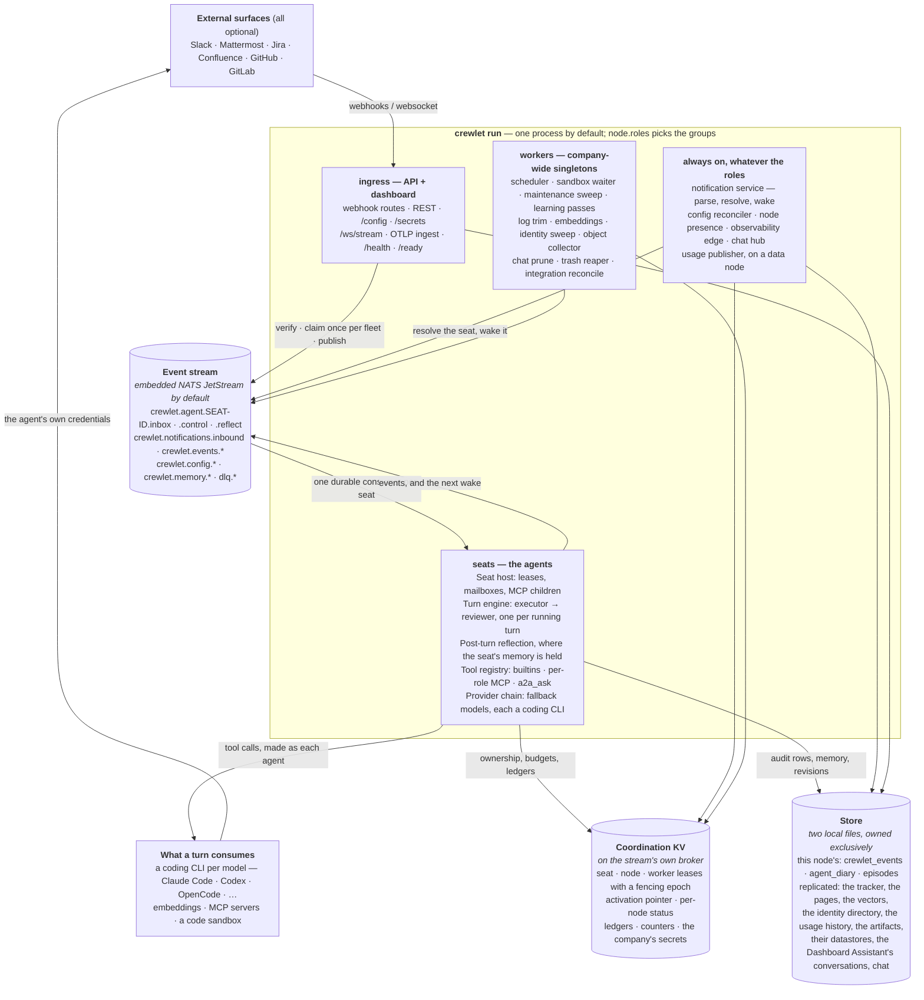

# Overview

Crewlet is an open-source engine for orchestrating hierarchically organized AI agent companies. It provides the runtime, event system, seat ownership, and knowledge and memory infrastructure needed to operate a network of AI agents modeled after a real corporate structure. Task state lives in a work-item tracker, the engine's own by default or an external one the engine deliberately mirrors none of (see [The Tracker](task-engine.md)).

Crewlet ships as **an engine plus a thin operational surface**: the engine does the work, and a REST API + a web dashboard (served inside the engine's own process, by every `ingress` node given an API port) provide configuration, webhooks, and observability. Anything beyond that (custom UIs, metrics exporters, bespoke automations) is built *outside* the process: the engine loads no plugins, and its surfaces to the outside are the REST API, the `/ws/stream` socket, OTLP, and [MCP](../guides/tools-and-mcp.md#extending-the-engine) for anything an agent should be able to call.

---

## Vision

Crewlet enables a founder to design a company structure, define its mission, and deploy a network of AI agents that operate within that structure. Each agent acts as a role within the company — with its own backstory, skills, and responsibilities — collaborating with other agents through the organizational hierarchy.

The framework models the same structures found in real companies:

- **Organizational hierarchy** — departments, teams, and individual roles; seats are held by AI agents or [human teammates](humans-in-the-org.md)
- **Communication** — channels, direct messages, and external tools (Slack or self-hosted [Mattermost](../integrations/mattermost.md), the work-item tracker, the code host)
- **Task management**: Worklet, the engine's own work tracker, by default (items, threads, hand-offs, a board and an MCP surface), or an external PM tool it deliberately mirrors none of (Jira, GitHub/GitLab issues); see [The Tracker](task-engine.md)
- **Code hosting** — agents read, review, and track code via GitHub or GitLab MCP tools, and author code through the [code sandbox](code-sandbox.md)
- **Knowledge**: a shared knowledge base behind one seam, either Doclet, the engine's own pages (keyword over a BM25 index this node holds, semantic over embeddings the fleet derives once, or the two fused by reciprocal rank fusion, `hybrid` being the default), or a live Confluence search, plus a per-agent private diary (vector similarity computed by the database, with hybrid vector ∪ recency candidate selection)
- **Decision-making** — structured DACI framework with clear authority

---

## The Org Chart Is the Execution Graph

Crewlet treats the organizational hierarchy as its primary orchestration structure. Knowledge, permissions, communication, and downward delegation are all scoped by a seat's position in the tree — the chart a founder draws **is** the graph the engine executes.

| Dimension | How Crewlet models it |
|---|---|
| **Mental model** | A corporate org chart — departments, teams, and named seats |
| **Hierarchy** | A native tree: identity, downward delegation, manager-handoff target, and scoping all derive from it |
| **Communication** | Event-driven pub/sub with org-scoped channels |
| **Knowledge** | A knowledge base (Doclet, the engine's own, or a vendor's searched live) plus a per-agent private diary |
| **Decision model** | The DACI framework (Driver / Approver / Contributor / Informed) |
| **Lifetime** | A long-running, persistent company |
| **Config style** | A YAML org chart, versioned in the store and edited live |
| **Extensibility** | Out of process: MCP servers for anything an agent calls, and the REST API, the `/ws/stream` socket and OTLP for anything built around the engine. The binary loads no plugins |

The hierarchy is informational + delegation-routing, not a special upward escalation mechanism. When an agent is stuck, it hands off to its manager using the same colleague-surface tools (a chat mention, a work-item comment, A2A) that a human teammate would use; the manager's handle comes from the agent's identity prompt. Engine-detected failures (stall, max-iter, unhandled exception, LLM unavailable) surface to the operator via structured logs and the seat's `last_error` on the dashboard (a model at its usage limit as the seat state `stopped`/`provider`); see [Turn Engine](turn-engine.md) and [The Tracker](task-engine.md).

---

## Design Principles

- **Event-driven** — agents are reactive; events trigger agent work, agent work produces events
- **Concurrent by default** — a seat's turn, its MCP children and the node's own duties run in parallel, and every shared structure is checked under the race detector
- **Provider-agnostic**: pluggable LLM, storage, tracker, knowledge and embedding backends, each behind a small contract; external tools via MCP. Only the LLM is required: the tracker, the knowledge base and chat ship with the engine, so a company with one signed-in coding CLI and nothing else runs
- **Config-driven** — a company is a YAML document, validated against a schema generated from the same types the engine runs on
- **Extension-oriented**: anything beyond running the company is built outside the process, not added to the core
- **Observable**: structured logging, OpenTelemetry tracing, and an event store the dashboard reads, from day one

---

## High-Level Architecture



That is the whole engine at a glance; **[Architecture](architecture.md)** draws
it at six zoom levels — what sits outside the boundary, what runs inside one
node, the hop-by-hop path a trigger takes across a fleet, what a turn does,
where every table and bucket lives, and what changes when a second node
appears.

**Infrastructure**: none to operate. The stream is a NATS JetStream server the process embeds, and the store is two local files it creates. Outgrowing one node moves only the stream: the embedded servers join one cluster, or every node dials one external NATS (see [Running a Fleet](../guides/fleet.md)). It is the same client code either way — embedded versus external is a connection choice, not a second backend — and the store stays each node's own files. OpenTelemetry for distributed tracing.

**One node type**: `crewlet run` is the node, and what it does is a config value: `node.roles` picks from `data` (hold the company's durable state), `ingress` (serve the HTTP API and its webhooks), `seats` (run agents), and `workers` (the company-wide singleton duties). The default is all four: one process holding the company's records, serving the API and the dashboard and running every agent, which is the whole stack. Giving the API nodes of its own is the same command with `-roles data,ingress`: an engine that serves the API and claims no seats, so both topologies are the same code path rather than two wirings that have to be kept in step. And an agent host can hold **no data at all** — `-roles seats` on a scratch store, joined to the fleet as a leaf — which keeps it small and disposable while its seats read and write through a node that holds the data ([ADR-0025](https://github.com/crewlet/crewlet/blob/main/adr/0025-a-node-without-data-reaches-the-estate-through-one-that-holds-it.md)).

**One node is enough, and more than one is supported.** Agents are stateful seats, not interchangeable workers, so which node runs which seat is decided by a lease — see [Seat ownership](seat-ownership.md). Scale up (a bigger host, a higher `node.max_concurrent`) before scaling out: a single engine handles many concurrent turns, and one node is the design's degenerate case rather than a lesser path. Run a fleet when a node's failure is not acceptable downtime, when traffic has to terminate separately from the agents, or when some seats must run somewhere specific — [Running a Fleet](../guides/fleet.md) covers all three, and [Scaling Out](scaling.md) is the model underneath them.

---

## Technology Stack

| Component | Technology | Rationale |
|---|---|---|
| Language | Go 1.27+ | One self-contained binary, real parallelism, a standard library that covers most of this table |
| Distribution | A single `CGO_ENABLED=0` binary | Nothing to install alongside it. The matrix is linux and macOS on amd64 and arm64 — bounded by the platforms the store driver embeds its database engine for, not by the compiler. The linux binaries need glibc: that engine is loaded with `dlopen`, which no pure-Go build avoids |
| Event stream | Embedded NATS JetStream | Persistent pub/sub *inside the process* — a company runs with no broker to operate. An external NATS cluster takes the same slot for a fleet, on the same client code. A seat's mailbox is a durable consumer created with nothing attached, which here is an ordinary API call (~1.7 ms) rather than an admin endpoint |
| Store | Turso | Two local files this process owns exclusively — this node's own estate and the replicated one beside it; pure Go, SQLite file format, and the vector functions the learning subsystem's recall is written against |
| Vector search | The store's vector distance functions | The per-agent diary and the episodic store, in the same file as everything else. The *arithmetic* is the database's; there is no ANN index reachable from the Go driver yet, so recall is a scan behind the per-agent index |
| Event store | A table in that file | LLM-invocation observability and the event dashboards, written inline by a publish listener |
| Coordination | TTL leases with a fencing epoch | Seat ownership and the fleet's shared counters, in a KV on the stream's own NATS broker — never the store file. On an external broker it rides the queue's connection; on the embedded one it has a second connection to the same server, and both are watched, so either one closing for good stops the node rather than leaving it half-connected |
| Config | YAML → typed structs → generated JSON Schema | One definition drives validation, the schema editors read, and the docs |
| Tracing | OpenTelemetry | W3C Trace Context, automatic propagation, OTLP export to Jaeger/Tempo |
| LLM backends | Coding CLIs — Claude Code, Codex, OpenCode and the rest | Each vendor's own harness, driven as a process: the request shape, the thinking, the caching and the sign-in are the vendor's to keep current, so the engine calls no model vendor's HTTP API |
| Embeddings client | The official OpenAI SDK | Any OpenAI-compatible embeddings endpoint, through `base_url` |
| Structured logging | `log/slog` | Standard library, machine-parsable, one component-bound logger per subsystem |
| Testing | `testing` | Standard library, no assertion framework; one shared conformance suite per multi-backend contract |

---

## Provider Layer

External dependencies sit behind small Go interfaces, each declared by the package that consumes it, so a backend is swappable and a test runs against a fake rather than a real API.

### LLM Provider

**Every model is reached through a coding CLI.** A `providers.llm` entry names one — Claude Code for Anthropic's models, on a subscription or an API key; Codex for OpenAI's; OpenCode for open models on any provider it speaks to, a local server included; and the rest of the [supported CLIs](llm-backends.md#supported-clis) — and the engine drives it as a process (`internal/providers/llm/cliagent`). There is no HTTP client to a model vendor in the engine, and that is the decision rather than a gap. Each vendor ships its own harness — the request shape each model accepts, how its thinking is carried from one round to the next, what is cached and where, how a stream ends, which sign-in bills which account — and moves it with every model it releases. Re-implementing that per vendor and per model was a second, permanently trailing copy of work the vendors already do in the CLIs they maintain, so the engine hands the call to the CLI — the conversation, and for a seat at work the phase's tools as one MCP server the CLI calls in its own loop — and reads back what it reports.

`llm.Provider` (`internal/providers/llm`) has two methods: `Complete(ctx, Request)` and `Model()`. `Complete` is one model call — for a seat at work, one run of its CLI's own loop — with the messages and, for a phase that offers tools, an `llm.ToolHost`: the phase's live tool surface, which the backend serves to its CLI as one MCP server for the length of the run, and through which it reports what the CLI's own record shows of each model request and what it cost. The CLI calls the tools natively, so there are no tool calls in a `Completion`: they happened during the call, through the host, which decided and recorded each one. Tools are offered, never forced: there is no tool choice to set, so the model decides. `Model()` is the entry's configured model id for log lines and config display. A request carries nothing else: no temperature, no output cap and no effort, because a coding CLI driven headlessly takes none of them per call — each reads its model's behaviour from its own configuration — and a caller that needs a short answer says so in its prompt, the one channel every CLI reads. There is no separate streaming method: a caller that sets `Request.OnDelta` asks the backend to stream, and the backend calls it as text arrives while still returning the whole `Completion`; a CLI streams as its record shows the model's text, and one whose answer is read from the whole of what it printed delivers it at the end. An entry's `timeout_seconds` (600 by default) caps one stretch of the CLI's own work, wall clock — its launch, its model's answers and its own retries, from its start or from the end of the tool call it last waited on to its next call or its exit — so the seat's tools are never on that clock; and `max_concurrent` (4) caps how many of the entry's processes are alive at once, a process holding its slot for its whole run, while a model call made inside one of its tool calls on the same entry borrows the run's slot rather than waiting for one. The model that actually served a call is `Completion.Model`, and the per-model token breakdown is built from that field rather than from `Model()`, because a fallback chain shared by concurrent callers has no single answer a method with no arguments could return. `Completion.ProviderKey` is the same fact in the operator's vocabulary — which `providers.llm` entry answered — and a chain fills it in from the member that served, since a backend is never told the key it was configured under.

A provider does not retry and does not decide what a failure means beyond a coarse `llm.ErrorKind` (`rate_limit`, `auth`, `timeout`, `server`, or fatal). The CLI backend classifies from what the CLI said: a spent plan or a rate limit, recognised by the vendor's own verbatim sentence, is `rate_limit`, and the entry then **sits out** on this node — every call fails at once as a rate limit until the reset instant the CLI named (an hour at most) or, where it named none, for a minute — so a seat moves to its next model without starting a process to hear the same sentence again; an expired or missing login is `auth`, and is never sat out, because `crewlet llm login` mends it and the very next call must find it. A run the CLI reports failed for any other reason — an error or an overload it relayed from its vendor, a crash — is `server`, as is a run not seen to its end, and is not sat out, since nothing says it lasts. Falling back to the next model belongs to the seat's chain (`internal/providers/llm/chain`), which tries its members in order and stops only at a fatal error: a call the engine itself cannot make, such as a prompt it cannot render or a CLI it cannot start on this host (a binary missing there, refused before any CLI exists), which is the operator's to fix rather than an outage the next member can carry the seat through. A CLI that started is never fatal, however it ended.

A seat's entries can be different CLIs, so different roles can use different vendors and models (for example, executives on Claude and junior agents on a smaller, cheaper model), and an entry can run in one of two modes. In both the CLI drives its own loop and calls the seat's tools as the tools of one MCP server, `crewlet`: in `host`, on this engine's host, its own shell and editor denied, reaching the tools through a relay into a unix socket this process serves for the run, every call decided by the phase's gates — the grant, the fence, the budget, the round cap, a person's note ([ADR-0049](https://github.com/crewlet/crewlet/blob/main/adr/0049-a-phases-tools-reach-its-cli-as-one-mcp-server.md)); in `box`, the seat's executor detached in a sandbox box with its shell and editor on, the tools reached over the MCP bridge. Driving a local process brings what an HTTP client never needed — per-seat filesystem isolation (a coding CLI keeps sessions, history and project memory under one home, and one entry serves every seat), a loop of the CLI's own the engine has to hold to the phase's rules, and its own sign-in story — all covered in [LLM Backends](llm-backends.md).

**Prompt caching is the CLI's, and it does not make a long prompt free.** The system prompt goes on the CLI's own system channel wherever its profile has one — beside the CLI's own prompt for a seat's runs, in place of it for a side pass ([which channel a call takes](llm-backends.md#which-channel-a-call-takes)) — the vendor's harness caches it the way it caches any session's, and the engine sets no breakpoint of its own: it reads back what the CLI reports it read from the cache and wrote to it. What a cache can reuse is the system prompt alone, and only while its bytes hold — and not even that on a CLI that puts per-call text ahead of the engine's ([which CLIs do](llm-backends.md#which-clis-actually-have-one)). A host-mode run is a CLI process handed that system prompt and then one user text, the conversation so far ([how the prompt itself travels](llm-backends.md#how-the-prompt-itself-travels)), and the CLI's own loop re-sends that prefix with every request it makes; a phase that needs another run hands a fresh process the whole of it again. The seat's tools reach the CLI as its MCP server's, never in a prompt. Within a turn the system prompt holds on every request of the [tool loop](agent-runtime.md#the-llm--tool-proxy), because every prompt builder is a pure function of turn-start inputs and what a phase adds rides the conversation; across turns even that breaks, because the prefetch blocks (the thread, memory, knowledge, similar prior work, the counterparty) are resolved per turn inside the system prompt. And the token budget charges cached input in full (below), so every byte of a prompt is paid on every request, which is why the per-phase prompts state only what the model and its harness cannot know, each rule once (see [Turn Engine](turn-engine.md)).

`Completion.InputTokens` always reports the **full** prompt-token count regardless of cache state, so the token budget stays correct: the backend sums the CLI's raw input tokens with the cache reads and writes it reports beside them — or, where the profile declares that the CLI's input count already holds them (`usage.input_includes_cache`, as OpenAI's usage does), takes that count as it is — and adds the prompt a model-side tool built, which a CLI may report apart from its input. `Completion.CacheRead` and `Completion.CacheWrite` break that total down for cost reporting only. A run with tools is charged request by request as the CLI's record shows each one, and what it spent beyond that when it ends, on every outcome; each CLI run is an `llm.run` trace span of its own, and its rounds' model and tokens are on the phase record. A CLI that reports no usage at all is charged an estimate, four characters a token over everything the engine handed it, its system prompt included, which `crewlet llm doctor` says of it ([token accounting](llm-backends.md#token-accounting)).

### Embedding Provider

`embeddings.Embedder` (`internal/providers/embeddings`) embeds one text (`Embed(ctx, text)`) and reports the space its vectors are in (the configured `Width()` and the `Model()` they come from) and the model's `Limits()`: how many bytes one input may hold, and how many inputs and bytes one request may carry, resolved from what the model's vendor documents (or what the operator states for a model this build does not know). `embeddings.BatchEmbedder` adds `EmbedBatch`, which sends a batch in as many requests as those limits need. An input past the bound is refused before anything is sent, and a caller decides what a longer text becomes: the knowledge corpus embeds its opening, a turn's ask is split into pieces whose vectors are pooled into one (`embeddings.EmbedWhole`). A failure is classified as refused (this request will be refused again unchanged), transient, or a configuration fault, and nothing in the provider retries: for a turn starting it means "no similarity search", never a failed turn, and the corpus duty asks again on its next tick. It is used by the [agent-learning subsystem](agent-learning.md) for vector-based retrieval over the agent's private `agent_diary` (the vector half of the `## Personal memory` prefetch's hybrid candidate selection) and `episodes` (the `## Similar prior work` prefetch and the `query_episodes` builtin), **and** by the [knowledge system](knowledge-system.md#semantic-search-two-stages-the-first-one-indexed-no-new-dependency) for the semantic half of a Doclet or Worklet search: the company's own pages and work items are embedded once by a fleet-singleton duty and applied on every data node, so the bill is paid once however many nodes run. A Confluence knowledge base is searched live and embeds nothing. Built-in provider: **OpenAI**, through its official SDK (the one model vendor's client the engine keeps, since a coding CLI computes no embeddings), which works with any OpenAI-compatible endpoint via `base_url`. Configured under `providers.embeddings` in YAML.

### Database

**Two** local files, each a Turso database over the SQLite file format built from its own forward-only migration sequence: this node's own estate, opened when the node starts (`store.OpenNode`), and the **replicated estate**, opened on that node's handle (`OpenReplicated`). Every node with the `data` role holds the whole of it from boot for as long as it runs, in its own file beside the node's (`crewlet-replicated.db`, or wherever `store.replicated_path` puts it); a node without `data` holds none. Two rather than one because a snapshot is a copy of ONE of them: a node too far behind to replay the log installs a peer's replicated file wholesale, and that file must not carry the donor's audit log or its agents' memory. No transaction spans the two, no read joins across them and nothing attaches one to another, which a static walk enforces (see [Architecture § Where state lives](architecture.md#5-where-state-lives)). There was a second certified driver (mainline SQLite) as an escape hatch, and it is retired: it could not serve a database with rows in it, because it has no vector functions and recall degraded to nothing without saying so. **The engine owns every file exclusively** — a second process pointed at the same path is corruption waiting for a schedule to collide, which is why everything the company has to agree on *now* lives in the coordination KV instead. The load-bearing tables of the node's own estate:

- **`agent_diary`** (embedding column): each agent's private observation log; the read-side counterpart of `reflect_and_persist`. Rows are embedded on write; the read path is hybrid candidate selection (vector top-50 ∪ recency top-50, deduped by row id) handed to an aux-LLM relevance filter. Shared knowledge is a separate read: on Doclet it is the company's pages as the replicated estate holds them (the pages log, applied on every data node), indexed for BM25 search in each data node's own estate; on Confluence it is a live query with no local copy at all (see [knowledge system](knowledge-system.md)).
- **`episodes`** (embedding column): one row per completed turn; raw and LLM-compacted aggregates share the same table.
- **`synthesized_skills` / `synthesized_skill_versions`** — auto-drafted skills the agent can load via `use_skill`, with refinement history.
- **`counterparty_profiles`** — per-(observer, subject) profiles built up from observed interactions.
- **`agent_onboarding_markers`** — `mark_onboarded` bookkeeping (one row per agent, UPSERT-keyed).
- **`conversation_sessions`** — the [conversation ledger](conversation-sessions.md): one row per completed turn, keyed on the seat and the conversation it served, rendered back into that conversation's next turn. Deduped on the work key, trimmed on write, swept on a retention horizon.

Alongside them sit the durable runtime tables a turn leaves behind — `crewlet_events`, `scheduled_runs` — and the config plane's `company_config` payloads. The full migration list is in `internal/store/schema/`.

What is *not* here is as deliberate: the completion ledger, the delivery dedupe, the notification valve, the token counter, the activation pointer, each node's apply status and the company's [secrets](secret-store.md) all answer a question the whole **company** has to agree on, so they live in the fleet's [coordination store](coordination.md) rather than in any one node's file.

Everything else is YAML config, in-memory state, or an external tool.

---

## Package Structure

```
adr/                      # Architecture decision records — a decision that
                          #   binds more than one package, with the gate that
                          #   anchors each one to its authority
cmd/crewlet/              # The one binary: run, validate, schema, migrate,
                          #   budgets, backup, retention, worklet, objects,
                          #   fleet, seats, artifacts, chatlet, secrets, config,
                          #   iam, llm, search, assistant, and the six
                          #   integration CLIs — gitlab/github/jira/slack
                          #   `provision`, confluence `import|resync`,
                          #   mattermost `provision|doctor`
internal/
├── engine/               # The wiring: which concrete thing satisfies which seam
├── config/               # The two config tiers → typed structs → JSON Schema
├── org/                  # Organization model (hierarchy, roles, seat identity)
├── agent/                # The agent runtime, one package per hard part:
│                         #   turn/ (the two-stage loop), toolloop/ (the
│                         #   model↔tool round-trip and its suspend),
│                         #   inbox/ (what wakes a seat, and what must not
│                         #   wake it twice), ledger/ (iteration, conversation
│                         #   and budget ledgers), structured/ (how a phase
│                         #   gives a typed answer), prefetch/, prompts/,
│                         #   skills/, skillsync/ (keeps every node's
│                         #   skill registry current), builtin/,
│                         #   subagent/ (workers), steer/ (a person's note
│                         #   to a running turn)
├── queue/                # The EventQueue contract + the jetstream backend
│                         #   and the in-memory twin, both certified by one
│                         #   suite
├── coord/                # TTL leases with a fencing epoch + the shared KV
├── iam/ authz/           # Who is acting (principals, grants, the name
│                         #   grammars) and the one function that decides
│                         #   whether they may — values only, no store
├── statelog/             # The durable-state framework: one ordered stream per
│                         #   domain is the write-ahead log, N identical SQL
│                         #   copies are the state, and the checkpoint commits
│                         #   in the same transaction as the rows
├── worklet/              # Worklet, the engine's own work tracker, statelog's
│                         #   first domain: records, subjects, ranks, custom fields
├── doclet/               # Doclet, the engine's own knowledge base, statelog's
│                         #   third domain: containers, pages, revisions, comments
├── iamdomain/            # The identity estate — statelog's fourth domain:
│                         #   people, logins, credentials, invitations and
│                         #   sessions, uniqueness arbitrated on one subject
├── usage/                # Each data node's day, replicated — statelog's
│                         #   fifth domain: spend, turns and reads that
│                         #   outlive the node that recorded them
├── chatlet/              # Chatlet, the engine's own chat, statelog's ninth
│                         #   domain: rooms, threads, messages and reactions,
│                         #   a message additive on its room's subject
├── eventfan/             # The fleet's turn-level history, read from every
│                         #   data node at query time, with coverage on every
│                         #   answer
├── search/               # Both halves of knowledge search — the BM25 index
│                         #   and the two-stage semantic retrieval — plus the
│                         #   embedding domain, the fleet's bucket fan-out and
│                         #   chat's own keyword index
├── textindex/            # The analyzer and the BM25 arithmetic, as pure
│                         #   functions: Turso has no fts5
├── changefeed/           # How a committed record becomes a WAKE, derived by
│                         #   something that outlives the writer
├── seat/                 # Which seats this node runs, and the watchdog
├── store/                # The two local files: this node's own estate, and
│                         #   the replicated one a state log's applier writes
├── estate/               # The replicated estate ROUTED: one router on every
│                         #   node, answering in-process where this node's
│                         #   copy serves and asking a data node otherwise
├── objstore/             # The object store: one object per upload, under a
│                         #   key minted for it and never reused, in one store
│                         #   the fleet shares — natsobj/ (the default) or
│                         #   s3obj/ — plus collect/ (the collector) and
│                         #   references/ (the tables that name an object)
├── events/               # The envelope and the typed-payload registry
├── a2a/                  # Agent-to-agent channels (one ask, one answer)
├── schedule/             # Role/unit cron-style recurring work
├── learning/             # What a seat remembers, and memsync/ — the changelog
│                         #   that carries it when a seat moves node
├── knowledge/            # The backend-neutral knowledge-search seam
├── providers/            # llm/ (+ chain, and cliagent: the coding CLIs), embeddings/
├── sandbox/              # Code work as a suspended Execute phase
├── mcp/                  # MCP client and child-process supervision
├── tools/                # The registry, and the per-phase tool surfaces
├── notify/               # The backend-neutral notification spine
├── mattermost/ slack/    # The eight third-party apps: client, parser,
│   jira/ confluence/     #   transport, prompt, provisioning reconcile — each
│   gitlab/ github/       #   contributing only what is genuinely its own,
│   datadog/ atlassian/   #   which is why Jira has no transport and why
│                         #   Datadog routes on a monitor's TAGS: an alert is
│                         #   addressed to nobody
├── integration/          # The app-neutral reconcile spine: the finding
│                         #   vocabulary every pass reports in, the cadence
│                         #   derived from who has to act, the fleet singleton
│                         #   that runs it, and integrationtest/ — the one
│                         #   suite every reconciler passes
├── setup/                # What an integration NEEDS before it works, in one
│                         #   vocabulary every app and the dashboard share,
│                         #   plus the guard every writer at a surface takes
├── configplane/          # The activation pointer's cadence and postures
├── node/                 # The node's own identity, presence and drain
├── provision/            # The shared provisioning grammar and its sinks
├── backup/               # A verified copy of both estates, taken from inside
│                         #   the engine — the only place either is reachable
├── maintenance/          # The retention sweep, behind one singleton duty
├── tokens/               # Token accounting shared by the meter and the API
├── hostbox/ procgroup/   # Running somebody else's process on the engine host —
│                         #   the one environment allowlist every child gets —
│                         #   and process-tree teardown
├── whsec/                # Webhook signing secrets: the format, minting and the HMAC key
├── jsprovision/          # How long a replicated JetStream create gets, and
│                         #   what "the cluster is still forming" looks like:
│                         #   one policy for the streams, the consumers and the
│                         #   coordination buckets, branching on whether this
│                         #   node's broker has peers
├── jsapi/                # Which JetStream API a connection speaks: the
│                         #   embedded fleet's one domain, which a leaf node
│                         #   reaches across its link, or an external
│                         #   cluster's account
├── jsinflight/           # A compare-and-set the leader answers "another write
│                         #   is still in flight" is waited out until the
│                         #   leader decides it, never read as a lost race
├── httpx/ textcut/       # The shared HTTP transport; rune-safe shortening
├── plainjson/            # JSON read as text: `<`, `>` and `&` as themselves,
│                         #   for every record and answer a person or a model
│                         #   reads
├── api/                  # REST + dashboard: webhooks/, stream/, queries/,
│                         #   livestate/, configapi/, setupapi/, secretsapi/,
│                         #   auth/, httpjson/, mcpbridge/, operator/ (ONE
│                         #   operator catalogue: MCP at /operator/mcp, the
│                         #   dashboard's /operator/act, and the audit row
│                         #   every call that is not a read leaves), and
│                         #   pagepolicy/: the security headers every
│                         #   response carries
├── observe/              # The observability edge (store row + live push)
├── tracing/              # OpenTelemetry: one provider, W3C propagation, and
│                         #   the bridge to the envelope's trace fields
├── fleetsecrets/         # The company's credential store: this package owns
│                         #   the key, coordination owns the bytes
├── runtoken/             # The signed, self-describing credential a per-run
│                         #   endpoint carries in its own URL path
├── secrets/              # The keyring and the sealed envelope: config encryption
│                         #   at rest and the secret store's values (the ${VAR}
│                         #   resolver is config.Resolver)
├── skipgate/ solo/       # The suite's own gates: a skip is not a pass, and
│                         #   which packages need the runner to themselves
├── docsgate/             # Every markdown link, anchor and docs index entry
│                         #   resolves (test-only)
├── clientsource/         # Holds a declaration the dashboard makes against the
│                         #   engine's own, found by name and read by syntax;
│                         #   every one lives in dashboard/src/contract/
├── sourcetree/           # What is this repository's tree: the module root,
│                         #   a walk that never reads a nested checkout, and
│                         #   what a gate may skip unread
├── e2e/                  # The end-to-end company, and the dashboard replay
├── period/               # The company calendar: the day, ISO week and month a
│                         #   moment falls in, named by a label every node
│                         #   computes alike
└── version/ logging/ redact/ envref/ envfile/ workkey/ backoff/  # small shared
                          #   grammars

dashboard/                # The dashboard's SOURCE — React + TypeScript, built
                          #   by Vite. Its output is committed to
                          #   static/dashboard, so `go build ./...` needs no
                          #   Node. See reference/dashboard-design.md
static/dashboard/         # That build output, embedded in the binary — a
                          #   store mirroring the server projection, one
                          #   websocket as the only read channel (writes
                          #   are REST, as the signed-in person), a hash
                          #   router, one file per screen
```

Every package states its own rationale in its package doc, so `go doc ./internal/coord` is the authority on coordination rather than this page.
