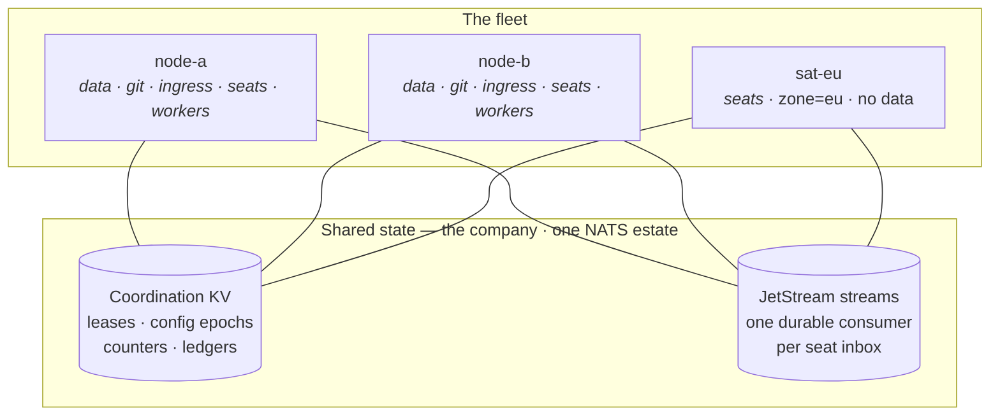
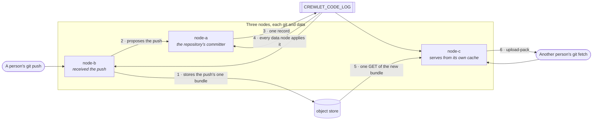
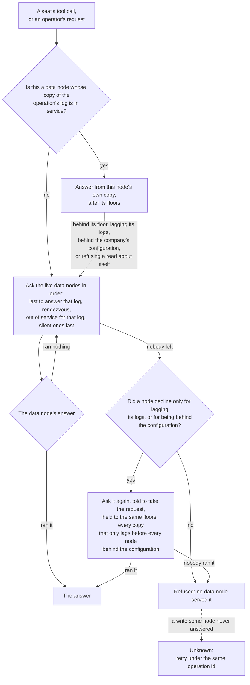

# Scaling Out

**One node is the whole company, and more than one is supported.** A single
`crewlet run` holds every seat, serves the API, and runs every company-wide
duty. A fleet runs the same code down the same paths, with leases held by more
than one process.

**Scale up before you scale out.** Agent handlers are goroutines, so a single
engine's ceiling is LLM provider rate limits and host memory. A fleet buys
availability, traffic separation, and placement, not throughput.
[Running a Fleet](../guides/fleet.md) is the operator guide; this page is the
model underneath it.

---

## What a node is

A node is one process that has declared what it will do. Its seats, duties and
config revision are discovered at runtime from shared state, never configured
per node.

```yaml
# Tier A, per node
node:
  id: "${CREWLET_NODE_ID}"           # distinct and stable, per process
  roles: [data, gitlet, ingress, seats, workers]   # the default; omit the key
  labels: {zone: eu}                 # optional, matched by role.placement
  max_concurrent: 32                 # turn segments this process runs at once; a run in its box holds none
```
| Role | What it does |
|---|---|
| `data` | Holds the company's durable state on its own disk: a full copy of the replicated estate, and the event log. `workers`' duties and `ingress`'s retention, capacity, eviction and backup surfaces read this node's own copy directly, so both require it (the API's tracker, knowledge-base and chat routes go through the [estate router](#how-a-request-reaches-the-estate) instead). It does not decide the node's broker — its `stream` block does ([broker kinds](../guides/fleet.md#the-broker-members-and-leaves)) — but a data node on a leaf is refused, so every data node is a broker member holding a share of its replicas and a vote in its quorums. A node without it is [stateless](#a-node-that-holds-no-data) |
| `gitlet` | Serves the company's git repositories where it sets [`code.backend: gitlet`](gitlet.md), from a [cache](gitlet.md#the-cache-on-a-gitlet-node) on its own disk — see [Gitlet nodes](#gitlet-nodes). Requires `ingress`, whose listener git is served on |
| `ingress` | Serves the HTTP API — every integration's webhooks, the dashboard, the REST and WebSocket read surface, and the tool bridge every seat's executor reaches its tools through from its box, which relays each call to the node holding the run's seat — served where the node is given `CREWLET_MCP_BRIDGE_URL`, or, for its own `direct` boxes alone, where it runs `seats` too ([Running a Fleet](../guides/fleet.md#what-a-fleet-needs)) |
| `seats` | Claims seat leases, spawns the agents, consumes their inboxes, runs turns, and answers their executor runs' tool calls: a `container` box is relayed to it from an `ingress` node through the fleet's `CREWLET_MCP_BRIDGE_URL`, and a `direct` box dials its own node's listener on loopback — on a node without `ingress`, `api.port`, served to that host alone |
| `workers` | The company-wide [singleton duties](seat-ownership.md#singleton-duties): the scheduler tick, the launch-node watch, the maintenance sweep (retention, removed-seat mailbox retirement, and forgetting the chat read state and Home board of a human seat the company no longer has), the integration reconcile loop, the atlas collect duty, the atlas wake duty, the learning passes (skill clustering, curation, episode compaction, promotion), the state logs' trim, the embedding duty, the identity sweep, the object store's collector, the trash reaper, Chatlet's message horizon, the code-retention duty and the delegated decisions sweep. These read their work list from the **org**, never from the node's own seats: a `workers` node runs no seats at all, so a duty that iterated the local seats would cover nothing. Creating every seat's mailbox is not among them: every node converges those, at start, on each apply and on its own seat sweep; see [What a mailbox costs](#what-a-mailbox-costs) for why running it everywhere is affordable |



The shared box is *logical*. In the default fleet shape each node embeds a member of one NATS cluster and the streams replicate between them (`stream.cluster.*`, `stream.replicas: 3`); `stream.type: nats` is the same picture with the estate in a cluster somebody else runs. One estate either way, carrying both slots ([what the fleet shares](#what-the-fleet-shares)).

**Every data node is a full replica.** A node with the `data` role that runs Worklet and Doclet holds the whole corpus (every task, page, comment and turn ever recorded) in its own database, applied from the same ordered log as every other data node's. There is no cache tier, no thin replica, and no node that holds part of it.

### A node that holds no data

A node without `data` keeps a scratch store (deleted at every boot, no replicated estate), joins an embedded fleet as a **leaf** of the members' broker (no JetStream, no replica, no vote), and runs `seats` only.

- Its seats' tools read and write the tracker, knowledge base and chat through a data node over the broker: the same router a data node's own seats use, which answers from the node's own copy where it has one. The node's own writes travel as a floor so whichever data node answers has applied them.
- The identity directory is read the same way, floored on the identity log: the seat bindings its inbound routing withholds a suspended person's seat by, and the login a lead's tools resolve to a seat.
- The executor log (the session each seat's box left, which the seat's next launch continues) is written and read through a data node too, the writes as the engine's own (see [below](#how-a-request-reaches-the-estate)).
- What it publishes about its turns is kept in exactly one data node's event log ([custody](../guides/deployment.md#custody-the-rows-of-a-node-without-data)).
- It joins no **fleet-wide consumer group** whose handler needs data (the custody group and each domain's wake feed), because a group any node may attach hands a message to whichever member takes it first, and a stateless member would answer from nothing. It takes its share of the one that does not, inbound notifications. One table, held against the code in both directions, says which each group is (`internal/engine/groups.go`).
- It is never counted as a copy: the trim, the eviction gate and the search fan-out read the role off the presence lease; the capacity handshake reads the role AND the broker kind (a broker member counts whatever its roles, and a presence that does not say counts as one; see [who has to acknowledge](../guides/retention.md#who-has-to-acknowledge)).

Use it for a small, disposable agent host: [Running a Fleet](../guides/fleet.md#nodes-that-hold-no-data) and [ADR-0025](https://github.com/crewlet/crewlet/blob/main/adr/0025-a-node-without-data-reaches-the-estate-through-one-that-holds-it.md).

### Gitlet nodes

A node with the `gitlet` role serves the company's repositories from its own cache. Gitlet nodes scale **reads**: each keeps its own copy of every repository it is asked for, synced from the code log's rows and the object store, so the node that received a clone or fetch answers it, and a burst of clones of one repository costs that node one sync. Nothing ties a person to one Gitlet node: every answer that names a ref is read at the code log's head, so a push answered `ok` on one node is what every other node advertises next ([A push, end to end](gitlet.md#a-push-end-to-end)).

**Pushes** do not scale with Gitlet nodes: a repository's one [committer](#how-a-request-reaches-the-estate), a data node, decides its pushes whichever Gitlet node received them, so they meet in one place and commit a batch at a time. Repositories spread across the data nodes, and a data node that leaves hands each of its repositories to that repository's runner-up.



Figures below were measured on one machine at a time, not all the same one (four vCPUs of a 2.1 GHz Xeon, or two or four E-cores of an Intel Core Ultra 7 265U): read a figure beside the machine its own paragraph gives, never across paragraphs. Where a paragraph names no machine, git or object store, the measured section it comes from does: the `internal/gitlet`, `internal/gitlet/host`, `internal/gitlet/cache`, `internal/gitlet/compact` and `internal/gitlet/gitletcluster` package docs carry every arm and what each ran on.

**What a committer and the code log commit.** Measured on three data nodes of one cluster sharing one machine's cores and disk (three fsyncs a record queue on one device; copies cross loopback):
- A lone push is a record's round trip: 10.5–11.1 ms median, 86–89 a second; about 1 ms more through another node's router.
- Sixty-four pushes at once to one repository: 2 050–2 090 a second proposed at the committer itself (group commit makes two records); 1 270–1 390 a second through another node's router (median 38–41 ms, p99 94–97 ms). That second path is every push whose Gitlet node is not its repository's committer, so in a fleet spreading `/git/` evenly it is the burst figure to size by.
- Pushes to different repositories share no record, so a company spreading pushes across many repositories is bounded by the code log's **record rate**: 201–225 records a second (sixty-four pushes at once over sixty-four repositories, each proposed through one node's router). Neither group commit nor another data node raises it: one log has one leader.
- Every data node applies each record on the write lane every domain shares, floor about 2 000 rows a second ([Replication](../guides/replication.md#the-burst-degradation-priced)); a small push is about four rows.

Where requests land decides how many caches a repository costs. If every node serves git and a balancer spreads `/git/` evenly, every repository warms on every node: one cold sync each, one download per push the repository ever took, plus each node's disk and background indexing. A fleet that never wrote `node.roles` is that fleet: every node has every role, `gitlet` included, once its company sets `code.backend: gitlet`. Routing `/git/<name>` by repository keeps each warm on one or two nodes, and a push's own sync adopts the pack its node received rather than downloading other nodes' packs. It is a cost decision, never a correctness one ([Deployment](../guides/deployment.md#gitlet)).

**A read of a repository's content goes to its home.** A server-side read by object id (a tree's listing, a file's lines, a diff) is asked of the repository's home first (the first of its rendezvous order over the live Gitlet nodes), then its runner-up ([The home Gitlet node](gitlet.md#the-home-gitlet-node)). One repository's reads meet on one node's cache wherever they come from, with no balancer to configure.
- One node a walk at a time starts a download of a repository it has no copy of: the home, or its runner-up where the home says no copy is coming there (behind the company's configuration for a seat, or failing on its own). A dead home, or one stuck behind a revision, costs the fleet one download per repository read meanwhile, by the runner-up, not one on every Gitlet node a read reached, nor a repository unreadable until the home recovers.
- Those reads' own git holds at most half a node's read lane (short checks of what a read names queue like any short read), so the other half stays the one a person's push scans in ([Server-side reads](gitlet.md#server-side-reads)).
- One repository's seat reads are served by the Gitlet nodes holding a copy, bounded by their shares: a home at its share sends the rest on rather than starting another copy, because the share is the node's, spent by every repository it serves, and a fleet busy everywhere would answer every such read with a download ([The home Gitlet node](gitlet.md#the-home-gitlet-node)).

**What a request on a cold node costs.** A request on a node holding no copy of its repository (just joined, or evicted by its budget) waits for a cold sync before its first byte, since git's protocol has nothing to send earlier, and a balancer's idle timeout sees all of it. Measured end to end on the node pin, git 2.56.0, two E-cores of a Core Ultra 7 265U, against an S3-shaped fake answering every request 100 ms after it arrives: the first clone of a repository of two hundred pushes begins with a 1.4–2.4 s sync, of two thousand a 13.5–17.6 s one. A cold sync is network work, not CPU: each push's object carries the index its receiving node's git wrote, so the node downloads, verifies and renames, and runs no `index-pack`.

**A download is served where it lands**, like a fetch: a file's bytes or a commit's ZIP, from the node's own copy, in a transfer slot. A large ZIP is the one transfer that takes a core for its whole run, so a node makes at most one for every four cores (two at least) at once, one for each principal, and a ZIP whose output is at most 64 MiB takes no place. A commit past 4 GiB of files, a million entries or 64 MiB of paths is refused before a byte is sent. Route `/git/` by repository and a ZIP's sync is warm ([Downloading a file or a commit](gitlet.md#downloading-a-file-or-a-commit)).

**A node coming up with many repositories** asked of it (joining or restarted) reads at most eight of them whole at once from the data nodes ([many repositories at once](gitlet.md#the-cache-on-a-gitlet-node)). Every page of such a read is one read on a data node: one of the 64 answers its lane gives the whole fleet's reads at once (a seat's tracker read, a page write, the check every git request is admitted by), and one of the connections its database scans each on, eight on the smallest data node (where the Gitlet node holds the data itself, its own database's). So a joining node asks no more than the smallest scans at once, and the fleet's reads do not wait behind its pages; a request that waits a whole read attempt there, fifteen seconds, takes the data node for gone. Its later repositories wait their turn inside their requests' own time, and a sync after a push never waits for one of the eight.

Against a model of an eight-core data node, each page as long as a full page of refs takes to scan:
- A node restarted over the cache it kept (nothing to download) came up with 500 repositories in about four seconds, the data node's own rate, no faster at any higher limit; the fleet's other reads waited about 0.1 s (p99).
- Four nodes joining together read their 2 000 repositories in about 16 seconds whatever the limit; other reads waited about 0.8 s at eight, 1 s at sixteen, 15 s with no limit.
- In those 16 seconds a node downloads five to nine packs per repository from S3, so for repositories of more history the downloads, not the reads, set a join's length.

The object store sees the same multiplication. A Gitlet node reads at most 32 bundles at once (sixteen for one repository) and S3 answers each in about 100 to 200 ms, so a node syncing repositories it has never served reads about 150 to 290 small ones a second (75 to 150 for one repository; git 2.56.0, fake answering 100 and 200 ms late, two cores of a Core Ultra 7 265U; the GETs alone bound it). Every bundle is named under the one `files/` prefix, so about 19 to 37 Gitlet nodes cold-syncing at once at their full 32 (twice as many syncing one repository each) reach the 5 500 reads a second S3 serves one prefix (a fresh fleet, or a repository imported then fetched through every node), past which it answers `SlowDown` until it has partitioned the prefix. Each node's client then slows every request to the bucket rather than failing it ([the object store](object-store.md#an-s3-bucket--s3)): syncs slow and nothing they hold is wrong; routing by repository again bounds it. Fewer packs shorten a cold sync, which is why a repository's maintainer merges them ([Compaction](gitlet.md#compaction)): the fifty or so of a compacted repository come up in under a second, the 2 048 a repository holds at the most ([Limits](gitlet.md#limits)) in about 14 to 27 seconds, and the 10 000 of a history nothing merged (one pack a push) in about 70 to 130 seconds.

**A Gitlet node is sized by its memory before its disk.** Every git process over a whole repository holds memory in proportion to its objects. Measured over a source repository's history, the bitmap on the node pin, git 2.56.0, and a clone on git 2.43: writing the bitmap of its background index takes about 600 bytes an object, and a clone beside it about 240 more — about 840 an object. At about three million objects a gigabyte of packs, that is about 2.5 GB of memory per gigabyte on disk; memory follows objects, not bytes, so large binaries need far less. [The cache's Memory paragraph](gitlet.md#the-cache-on-a-gitlet-node) has every figure and what the node keeps back for the store, broker and engine. A repository whose bitmap the node's memory cannot hold is still served, without one (each clone walks its history), and raises [`code_maintenance_refused`](../reference/alarms.md). A single repository of 50 to 100 GB of history is past what a Gitlet node is sized for.

**One Gitlet node writes a repository's bitmap for the fleet.** A repository's [maintainer](gitlet.md#who-maintains-a-repository) (the first Gitlet node of its order whose advertised background budget holds the work; its home on a fleet of alike nodes) MERGES its packs ([Compaction](gitlet.md#compaction)) and PUBLISHES its bitmapped index as layers every other Gitlet node installs ([When a repository is published](gitlet.md#when-a-repository-is-published)). Maintenance is placed by the largest charge any of its steps is admitted at: for its publication, its bitmap at 600 bytes an object of the whole repository and a clone's 240 beside it, 840 bytes an object; for a merge of every object, 790 bytes an object beside the build's delta window — six of the largest blob `code.limits.max_blob_bytes` admits, 300 MiB by default — which is the larger under some six million objects. So a repository of N objects needs ONE Gitlet node whose background budget holds the larger of 840 × N bytes and 790 × N bytes plus that window for it to be served with a bitmap anywhere, for the whole fleet; every other Gitlet node installs the layers in a few MiB of memory and serves through them ([Sizing Gitlet nodes](../guides/deployment.md#sizing-gitlet-nodes)). That is the charge of a ROOT; every publication after a repository's first is a layer over a base, whose bitmap holds a fraction of a root's and is charged 350 bytes an object rather than 600, so routine publications of a node's largest repositories leave its budget room for the rest of its work.

Measured on the node pin over a gigabyte source history of three million objects, from the in-memory store (one run each, two E-cores of a Core Ultra 7 265U):
- A Gitlet node writing the whole bitmap itself: 13.5 s, 812 MiB.
- The maintainer's root publication, once for the fleet: 812 MiB for layer and bitmap (13.8 s), 262 MiB for the commit-graph layer (13.5 s).
- A node installing it synced cold (64 packs and the layer's one part) in 1.4 s, its own code allocating 7.4 MiB beside the bytes fetched, and counted every object through the bitmap 6 ms after its answer.
- The large reference model's 12 GB monorepo, some 36 million objects, is charged about 30 GB for publication. What git holds writing it is an EXTRAPOLATION, never measured (the line through the 100 MB and 1 GB bitmaps puts it near 9 GB): the 12 GB arm needs a 64 GB machine and the 5 GB arm, which would anchor it nearer, more memory than these runs had.

A merge is held to the same budget — about 550 bytes an object it merges, 240 more an object merged for a transfer's room beside them and six times `code.limits.max_blob_bytes` for its delta search, as measured: by what it merges, never by the repository's size, which would refuse a large repository's every merge and its pushes. It is refused where the budget cannot hold it (`code_cache_compaction_refused`). Each build gives its slot and memory back before it uploads, and uploads everything it built at once: a merge's up to sixteen outputs, a publication's up to sixteen parts and sixteen outputs. On an `s3` store that is an 8 MiB first part each, 384 MiB on a maintainer running both, 256 MiB of them one publication's, out of what the node keeps back for serving and the store, never its background budget. On the broker's own bucket a layer's parts count against the bucket's byte reservation like any object ([Its byte reservation](object-store.md#its-byte-reservation)).

**Between publications, the tail is walked.** Packs pushed since a repository's last publication sit outside its layers, and every clone walks their objects without a bitmap. A publication is due once that tail holds 64 packs, a sixty-fourth of the repository's objects, or 90 909 objects — a second of walk at the slowest a walk is held to, about 21 MiB of a clone's memory — whichever comes first. The maintainer publishes a repository at most every 10 minutes or every ten times its last publication's build, whichever is longer, counting a failed build, from when it began. A maintainer publishes one repository at a time, so it keeps up with about ten large repositories at that duty cycle; past that, each waits for the others and its tail grows, the signal to give a second Gitlet node the memory for them (the repositories then spread over both, each in its own order). A maintainer also holds every repository it maintains in its cache: give it the cache budget to keep them, or each publication begins with a whole download.

**And by the bytes and CPU it serves, not by its requests.** Measured on the node pin, git 2.56.0, two E-cores of a Core Ultra 7 265U, over a tree of 10 000 files in two hundred pushes, a 31.5 MB pack.
- Warm, over the in-memory store, from a node holding the repository's own bitmap: a full clone costs 0.64 s of the node's git CPU; a shallow, blobless clone of one commit of the directories a sparse checkout's cone names, 0.27–0.29 s.
- Warm, from the repository's published layers (written over the maintainer's repack of the same pushes): the full clone costs 0.07 s and is sent a fifth fewer bytes; the narrow one 0.06 s.
- Cold, against the S3-shaped fake (100 ms a request, 80 MB/s a connection), on a node that has not yet indexed the repository: a full clone walks and delta-searches the whole history, 2.8 s of CPU; the narrow clone 0.29–0.30 s, moving 3.4 MB rather than the whole pack.
- At ten times the tree (100 000 files in two thousand pushes, a 334 MB pack), same cold setup: about ten times as much, 27 s of CPU for the full clone and 2.6 s for the narrow one.
- Identical clones share nothing: thirty-two at once cost thirty-two clones of CPU. A warm fetch of one new commit, over the in-memory store, is 6–8 ms.

So size a Gitlet node's cores by the clones and fetches it serves, and point CI at a blobless clone with a cone wherever a tree is large (shallow too, where the job reads no history):

```sh
git clone --depth=1 --filter=blob:none --sparse https://crewlet.example.com/git/web.git
git -C web sparse-checkout set services/api
```

A blobless clone needs protocol v2, git's default since 2.28, and is served the filters a bitmap answers: `blob:none`, `blob:limit=<n>`, `tree:0`, `object:type=<type>` and a `combine:` of them; `sparse:oid` and `tree:<n>` past 0 are refused ([the filters served](gitlet.md#a-push-end-to-end)).

**A Gitlet node's disk.** Its cache holds the repositories it serves whole (the sum of their `SIZE` in [`crewlet gitlet status`](../reference/cli.md#crewlet-gitlet-status), each at most `code.limits.repo_max_bytes`), kept under `gitlet.cache_max_bytes` by evicting the least recently used, and only once the budget is reached: a repository nobody fetched over a weekend is still there on Monday and is brought forward by a delta, and one a request is reading is never evicted. Unset, the budget is derived from the cache's volume at every boot (half of what a shared volume leaves it, seven eighths of a volume of its own; [`gitlet`](configuration.md#gitlet)), so give the cache a volume of its own. The object store holds one object a push until the maintainer merges its packs into a few ([Compaction](gitlet.md#compaction)); the packs a merge replaces keep their objects a day, then the collector deletes them.

**What a compaction costs every other Gitlet node.** Each output of a merge is downloaded once by every Gitlet node holding the repository but the builder (which links its own), and git's geometric roll merges a history again each time it doubles, until its packs are full. So over a repository's life a Gitlet node downloads, and writes to disk, at most about (1 + log₂(0.9 GB ÷ the mean push's pack)) times the bytes pushed to the repositories it holds: about 16 times at pushes of 20 KB, fewer the more pushes a merge takes at once.

Measured (`BenchmarkCompact`, git 2.56.0, in-memory store, two E-cores of a Core Ultra 7 265U, requests and bytes counted):
- A quiet repository (1 200 pushes of 24 KB, one a minute, merged sixteen at a time): the other Gitlet node downloaded 4.7 times what was pushed; the builder uploaded 3.7 times it.
- Twenty minutes of a busy one (6 000 pushes at three hundred a minute): 3.4 and 2.4 times. Both are still far from full packs; a longer history is merged more times, up to the multiple above.
- On S3 inside the bucket's region bytes are not billed, requests are: a merge is one PUT an output and one GET of it on every other Gitlet node holding the repository. That is 64 PUTs and 449 GETs a thousand pushes on a fleet of eight Gitlet nodes for the quiet repository, 3 and 23 for the busy one, beside the 7 000 GETs of the pushes' own packs.

An object store that bills egress (another provider's, or a bucket in another region) bills those bytes too, once per Gitlet node but the builder, so size a node's download and disk-write rates, and that bill, by the multiple above.

**What the index of pushes costs a Gitlet node.** Beside each copy a node keeps the index of which push introduced each commit ([Which push landed a commit](gitlet.md#which-push-landed-a-commit)): about 64 bytes a commit introduced, about 190 bytes for a push of three, inside the cache's budget — some 3.5 GB for a monorepo's 18 million pushes in 181 days, 8.6 GB for the 45 million of a company pushing 250 000 a day, indexed whole.
- Every sync folds the pushes it applied before it answers, 0.84 ms a push; the node merges what the folds write behind the serving, eight runs at a time: about one merge per seven pushes synced one by one, fewer in bursts.
- A read maps the runs of the copy's index; a node holds at most a quarter of the host's `vm.max_map_count` mapped at once (16 382 at the default 65 530), however many copies its seats read. The most recently read copies stay mapped; reading more copies maps the others again.
- History before a node's first full read of a repository is read back only by its home, only once a seat has asked, a page of the data node's push rows at a time (four cores of a Core Ultra 7 265U: about 7 500 pushes and 4 MB, about 150 ms a page). After each page the backfill waits twice that time for each Gitlet node the fleet has to a data node, rounded up.
- So that monorepo's 2 400 pages take about 18 minutes at one Gitlet node to each data node, and about 77 minutes at sixteen over three data nodes (each page waits twelve times its own time). Worst case, one cold node that is home of every repository it caches, all asked about, reading 181 days of 250 000 pushes a day: about 6 000 pages and 24 GB over the router, about 45 minutes at one Gitlet node to each data node, beside its cold syncs.
- Choosing each step costs microseconds however many repositories the node holds (2.5 µs among 10 000 with a step due for every one, after a restart; 0.7 µs where one has), so the pages' pace is all those 45 minutes are, and a request finding its copy never waits on the choice.
- These are figures, not promises: until a node's index is complete, an answer about an older commit says which range it does not hold rather than naming a push.

**What the memo of answers costs a Gitlet node.** Beside each copy a node keeps every page its seats' server-side reads cut ([The memo](gitlet.md#the-memo)), at most a sixteenth of the cache's budget across all copies (some 450 000 pages of 56 KiB at 400 GB), trimmed before any repository is evicted, so fifteen sixteenths stay the repositories.
- A memo page is answered with no git run, in 21 to 90 µs measured; a page cut costs at least one git process, 4.6 to 262 ms warm and up to the read's ten seconds. A miss cuts every page after the one asked too, so a seat paging a large listing, long file or wide diff pays for one git run, not one a page.
- Its MEMORY is nothing an answer: each copy's cohorts, 16 bytes a cohort and some seventeen at most a copy, so 10 000 copies hold under 3 MB however many answers they keep (an index of every answer would hold some 680 MB at a 400 GB budget's worst case of one-disk-block answers, 3 GB at 1.75 TB).
- A trim drops the least recently used sixteenth in one rename a copy that holds it, whatever it holds (about 0.7 s of the janitor's at 10 000 copies, measured), and is due again only after a sixteenth more is kept.

**What code search costs a Gitlet node.** A repository searched by index keeps a trigram index of its default branch's tip on the first two Gitlet nodes of its order ([Code search](gitlet.md#code-search)), and a search of many repositories is one question every Gitlet node answers its share of. Measured on two E-cores of a Core Ultra 7 265U, over a tip of 120 000 files — 1.96 GiB of real source, this repository's own tree in rotated copies:

| | Measured |
|---|---|
| Building the index | 75 seconds of one core a gigabyte of source, the first time; a later tip reads only its new blobs |
| The index on disk | 0.146 bytes a byte of source: 0.29 GiB for those 120 000 files, about 0.45 of a copy holding its tip and no history (the source deflated as a pack holds it is 0.327 bytes a byte) |
| A build's memory | 107 MiB at its peak, in segments of 512 MiB of source (each segment's postings and writing, and every merge), plus the tip's listing, 31 MiB for those files; every segment written is read back through a mapping of its file, never held |
| A search | 16 ms at the median and 432 ms at the 99th percentile, its lookups and the confirmation of its candidates' lines up to its 500 hits |

- A node's indexes take at most a third of its cache's budget (what a cache full of indexed copies with no history holds of them, 31%); past that they are dropped, least recently used first, before any repository is evicted, since a dropped index is rebuilt from the blobs the copy already holds.
- Segments are merged as each is written, each kept more than twice the next, so an index keeps a handful (two for that tip) and each blob is written a logarithmic number of times.
- Every search a node is answering reads, together, at most all but one of the units of its share of git work for seats' reads (one where the node has only one), so a seat's read of a file, a log or a diff always finds a unit no search can hold, however many company-wide searches run.
- A search costs its node a lookup of a few lists and a read of the candidates' lines, never a walk of the tree. The repositories it names are divided among the Gitlet nodes holding their indexes, each searching its share at once, so adding Gitlet nodes divides a company-wide search's reading rather than repeating it.
- Its REQUEST is not divided: one signed question every Gitlet node hears, carrying the whole table of which node answers for which repository (a line for every repository named), so each node, nodes assigned nothing included, receives, verifies and reads the whole table before finding its part. What a search costs the broker and the nodes' reading of requests grows with the Gitlet nodes times the repositories it names.

**What every data node holds for Gitlet.** Every data node holds the whole estate, and Gitlet's rows with it.

Per-push rows:
- A seat's push of one commit leaves a push row of about 680 bytes where its code tools built it (naming the seat and the turn, work item and model behind it), about 755 from its coding box (naming the executor and harness besides), and about 623 for a person's push (naming the token it came through), kept 181 days.
- Its pack's row is about 588 bytes, kept while the pack is live. A repository's maintainer looks every minute and merges its small packs once sixteen have gathered (a busy repository's at every look, the minute's pushes taking it past them; [Compaction](gitlet.md#compaction)). So a repository holds at most fifty live pack rows plus a minute's pushes whatever its age, and a row more for each 0.9 GB its history fills: one pushed now and then sits near the sixteen, one pushed three hundred times a minute held 304 at the most, measured (some 29 KB at fifty and 179 KB at 304).
- The row of a pack a merge took is kept one more day, as a retired row of about 608 bytes. A merge of a repository holding fifty or fewer takes sixteen packs or more into one, so once the packs a repository's pushes add are what its merges take, a push leaves at most sixteen retired rows for every fifteen pushes: 1.05 a push measured at one push a minute, about one where pushes are fast enough that a minute's merge takes hundreds.
- A forced update or a deletion leaves a row more, naming the object it left, kept 14 days, longer while the repository's pushes fill their records with such updates ([ref drops](gitlet.md#retention-and-history)).
- A seat that has pushed holds two rows more at the most however much it pushes: its pushes on its two newest company days, each a row of about 30 bytes and its key's entry, the older kept for a node whose clock has not reached midnight yet ([A seat's push](gitlet.md#a-seats-push)).

The push rows are deliberately given no extra index (a per-seat one for the one-day question, a log-order one, a per-executor one for [what a run pushed](code-sandbox.md#what-a-run-pushed-is-reported-for-it)): each would add some 40 to 100 bytes a push on every data node for 181 days, 1.8 to 4.5 GB at 250 000 pushes a day, for a question the rows' one index already answers.

The code log, which keeps only the trim's window of records, takes 1 667 bytes for a seat's coding box's push in a record of its own (1 528 where the engine builds it for a tool) and about 1 080 for each of a burst group commit holds together, the merges of the packs those pushes add 43 to 108 bytes a push more — the more a merge takes at once, the less — and the sweeps that remove the rows a merge retired, a day later, up to 44 more: a record of about 700 bytes for each repository a quarter-hourly pass finds a row past its day in, which is 44 bytes a push where each merge's rows are swept apart and a fraction of a byte where a busy repository's sweep takes the rows of thousands of pushes at once.

The table prices every push as a seat's coding box's push, the most a seat's push takes of the rows and the code log, since which of a company's seats push from boxes and which through tools is no figure the reference company has. The reference company's 3 000 pushes a day are all its seats' (a hundred seats pushing thirty times a day while its people fetch); a larger company's are its thousands of seats'. Priced as a tool's push, the push rows were 369 MB and 30.8 GB.

| Pushes a day | Push rows at the 181-day horizon | Retired pack rows, at most | On the code log, over the default seven days |
|---|---|---|---|
| 3 000 — a hundred seats pushing thirty times a day | about 543 000, 410 MB | about 3 200, 2.0 MB | about 38 MB |
| 250 000 — a company of thousands of seats | about 45 million, 34.2 GB | about 269 000, 164 MB | 1.9 to 3.1 GB |

Live pack rows are not a column, because they follow the repositories, not the pushes: some 29 KB a repository at fifty, 29 MB per thousand, and a minute's pushes more on a busy one. Gitlet's rows stop growing once the push history reaches its horizon; while nothing merged a repository's packs, its pack rows grew by about 644 MB a year at 3 000 pushes a day and 53.6 GB at 250 000, for as long as the repositories lived.

These rows come on top of what the tracker, knowledge base and rest of the estate hold: [the storage forecast](../guides/retention.md#the-storage-forecast) counts them on a line of their own for a company that hosts code, and every data node's snapshot volume holds about 4.2 times them, as it does the rest of its estate. The code log's column is its push, compaction and sweep records alone. Each linearizable read a git client makes (an advertisement, a push's sync, a fetch's ls-refs) appends a 176-byte barrier beside them, and the changes those pushes revise append their opens, reviews, comments, merges and every revision's facts and mergeability, several times the push records' bytes. That is why the log's ceiling is derived from the mutation log's rather than from its pushes alone, and why a company whose seats open changes sets it from the reference company's day before its streams exist and, once they do, moves it to the ratio the two logs' `bytes_per_day` show ([how the ceilings are sized](../guides/replication.md#how-the-byte-ceilings-are-sized), [what the code log's reservation costs](../guides/replication.md#what-the-code-logs-reservation-costs)). The push records fit the ceiling a first boot derives from 50 GiB free or more ([the code log's reservation](../guides/replication.md#what-the-code-logs-reservation-costs)), and a push's bytes are never on the log: they are the object store's.

**What this release does not scale yet**, stated as the product's shape:
- A compaction of a repository drops its multi-pack index and that index's bitmap on every Gitlet node (the commit-graph is kept, since a merge drops no commit), and the background indexing writes them again at its own pace, so a clone between the two counts its objects by walking ([Compaction](gitlet.md#compaction)).
- A seat pushes through its code tools, each change one push the engine builds ([Engine-built commits](gitlet.md#engine-built-commits)), and from its coding box ([Coding boxes](gitlet.md#coding-boxes)), never from a git client of its own. The rates in the table are what Gitlet is built for, where this release's pushes are people's, their CI's, those tools' and their boxes'.
### How a request reaches the estate

The replicated estate is one estate, and every data node holds the whole of it.
Every node, with `data` or without, reaches it through one **router**, and a
seat's tools behave the same on either kind. So do the operator's surfaces (the
API's tracker, knowledge-base and chat routes, spend and activity reads, a
project's file rows, the operator's own MCP): a data node whose copy of the
tracker, knowledge base or usage log is out of service answers its operator from
a peer's copy, as it answers its seats. A peer's answer to a long window of
usage arrives in pages of about 2 MiB, each cut only between two records; a data
node answering from its own copy reads the window whole, in one transaction.



- **This node first, where it is a data node.** It answers its own seats from
  its own copy, in-process, unless its copy of that operation's log is **out of
  service**: wrong rather than behind (an applier stopped, the node evicted, its
  rows below the log). Then only that log's calls go to other data nodes; its
  other logs keep answering here and it keeps every seat
  ([ADR-0079](https://github.com/crewlet/crewlet/blob/main/adr/0079-a-domains-fault-takes-only-its-own-copy-out-of-service.md)).
- **Otherwise the data nodes, in order**: the node that last answered an
  operation on that log (each log has its own, since each has its own applier),
  then a rendezvous order keyed on the asking node's id. A node that said in the
  last thirty seconds its copy of that log is out of service is asked after the
  rest; one silent in the last thirty seconds is asked last. The rendezvous
  order spreads askers' first nodes and failovers evenly over the data nodes the
  fleet's presence names, however named (`node-0` … `node-4`, a StatefulSet's
  ordinals). An asker keeps asking its last answerer until that node goes silent
  or says its copy is out of service, so the spread is where askers *start*: a
  data node that joins is asked only by askers with no such node yet or whose
  node went silent, and after a rolling restart each restarted node's askers
  stay on the node they failed over to.
- **A push to a repository the engine hosts is the one exception**: it is asked
  of the repository's **committer**, the first live data node in a rendezvous
  order keyed on the repository (every node computes it alike), whichever node
  received it; a data node's own copy is asked only at its place in that order.
  All of a repository's pushes meet at one committer, which batches a burst into
  a few records instead of two committers losing rounds to each other.
  *Live* is each node's own view of fleet presence: a joining node is in every
  order within about a second of its claim, and a fleet started at once agrees
  on every committer within about a second of the last claim. A push inside that
  second may be committed by its receiver, which the broker's compare-and-set
  keeps correct and which costs that push the group commit. A committer that is
  silent, stopping or runs nothing hands the push, with the same push id, to the
  repository's runner-up; out-of-service and silent nodes are asked after the
  rest, as for any operation. Nobody's last answer moves a push elsewhere.
  - A committer answers inside the minute the asking node gives it: a push still
    queued when a batch and its answer would no longer fit, or one that arrives
    with too little of the minute left (spent waiting to be taken, for the node
    to catch up with the asker's writes, or under a shorter caller deadline), is
    answered `busy` and the client runs `git push` again. So the asker never
    hands a push to the runner-up while the first committer is deciding it, and
    a committer behind what the receiving node showed the client catches up
    before deciding rather than refusing the push as stale.
  - Pushes use a channel of their own, as wide as one repository's whole queue
    (1 024 pushes and the batch ahead), so waiting pushes never hold up reads,
    other writes or a git fetch's repository lookup; a burst past one
    repository's queue is answered `busy`.
  - The node also refuses `busy` once the pushes it holds across all its
    repositories weigh sixty-four records (about 64 MiB), bounding bursts of
    very large pushes (an import's thousand-ref chunks) on every committer.
- **A node that ran nothing is passed over, whatever the operation**: one whose
  copy of the operation's log is out of service (`out_of_service`), whose copy
  lags that log or is behind the company's configuration (each asked again
  last), that is behind the caller's floor, or whose build does not declare a key
  the request holds, which it refuses unrun
  ([below](#a-build-reads-what-it-is-asked-whole-or-runs-none-of-it)).
  - Behind the configuration means the control plane confirmed the node `shed`
    or `stuck`, never merely mid-rollout; see
    [Control Plane](control-plane.md#where-the-gate-sits). It lasts until the
    node's apply succeeds or a person acts, so the node answers `behind_config`
    and the asker remembers it for thirty seconds: it skips the node, asking it
    once, told to take the request, only when no other data node runs the
    operation, and asks a repository's runner-up for its pushes. One refusal per
    node every thirty seconds, not one per request. A copy that only lags is
    asked before a node behind the configuration, because its answer is held to
    the current configuration, whether or not the asker has heard the refusal,
    so every asker sends a repository's pushes to the same node.
  - So is a node that refuses a *read* for a reason about itself: its applier did
    not *reach*, in time, the record before the barrier a linearizable read
    appended (`behind`; reaching a position is committing every record up to it
    that writes a row and decoding every barrier among them, whichever node
    appended it; a barrier's own commit writes no row, so no read waits for it),
    or it stalled, holds a record it cannot decode, was evicted, or lost its
    broker or quorum. The next data node is asked; the refusal is the answer only
    where none does better.
  - Four refusals hold for every node alike and are answered at once by the
    first node that gives them: the log is full (`log_full`); the broker refused
    to store the barrier on the log every node appends to (`broker_refused`: a
    sealed stream, a store with no resources left); the one member a log is
    stored on did not complete the barrier's write in time (`broker_stalled`:
    every node's barrier waits on that member's disk); the fleet is in a
    capacity window (`maintenance`).
  - The next node is handed what the read already paid for (the barrier, the
    position it waited its read budget for), so a walk past every data node
    appends one barrier and waits one read budget.
  - What may be repeated once a node *may* have run a write is the operation's
    own rule. Moving on under the same operation id: a tracker write, a
    knowledge-base or chat write carrying its caller's key (a seat's always
    does), a chat erase or prune under its own operation. A knowledge-base or
    chat write with no key that went unanswered is reported unknown and never
    sent twice. A write one data node answered *unvouched* (its ledger cannot
    say whether the operation landed) is asked of the next under the same id
    before the caller is told the outcome is unknown.
- **The executor log is written by the engine alone.** Its writes are the
  engine's own record of what a seat's box did (a session captured, a turn
  ended, a session past its retention, a removed seat's taken away, a turn's
  first read of its conversation); no tool, person or operator surface can make
  one, and a build gate fails on any surface's code that reaches the writer.
  Each carries the operation id the log derives for that capture or end and
  moves on under it like a tracker write. Its reads are ordinary at the level
  the caller asks: a turn's dispatch reads the conversation it continues at
  `linearizable`, because a seat that moved to this node holds no floor for the
  end its last turn published through another one
  ([Read Consistency](../guides/consistency.md#which-logs-can-be-read-at-linearizable)).
- **Every request and every answer is signed.** A data node runs a write as the
  actor the request names and answers a chat read for the viewer it names, so
  an unsigned request would be an instruction anything the broker admits could
  write: admission vouches for a connection, never a request. Each request
  envelope and reply carries a MAC under the fleet keyring every node holds, in
  a key domain of its own (`estate`), so nothing lifted off the state logs
  verifies here
  ([ADR-0031](https://github.com/crewlet/crewlet/blob/main/adr/0031-every-state-log-record-is-signed.md)).
  A request signed under a key the answering node does not hold **did not run**,
  so the router asks the next data node; one whose MAC fails under a key it
  holds is refused and logged, since no data node will accept it. A custody
  batch is outside the rule: it carries events a data node keeps, not an
  instruction. The rule is not the estate's alone: every request one node asks
  another to carry out is signed and bound the same way, by one implementation
  (a broker member removing a voter, the node running a turn taking a person's
  note, the node a `direct` or `container` box is on reading it back for a seat's
  holder elsewhere, the node holding a box's session running a relayed tool
  call, the node running an Ask Crewlet turn replaying or stopping it), and so is
  the live relay a data node with an out-of-service copy hears a sound peer's
  appliers through, because it reaches dashboards as chat messages and datastore
  documents. A node takes each request once and refuses its replay until the
  request's deadline has passed. It keeps the id of every request whose replay
  would write (an estate write, a broker removal, an Ask Crewlet stop) in its
  own file until then, committed before the request runs, so a replay after a
  restart is refused too, and a write whose id the file refuses runs nothing
  there. A read's id is kept in memory. A note and a
  relayed tool call need no file: each is taken only by the process it names
  (the turn's desk, the holder's incarnation), and a restarted one runs neither.
- **Nobody answering is an answer that says so**, with what each data node said,
  never an empty list, which would say the company has none of what was asked
  for. A write that went **unanswered** is different: a node may have run it, so
  the caller is told the outcome is unknown and the same operation id is the
  retry, not that no data node served it, which claims nothing ran and invites a
  second write under a fresh id. A knowledge search nobody answered is the one
  exception that does not fail, being best effort: it answers no hits, serves no
  mode and covers none of the corpus, rendered as "could not be searched" rather
  than "nothing matched".

A read waits up to fifteen seconds on one data node before the next is asked, a
write up to a minute (or the caller's own deadline); none is ever longer than
the caller's deadline. The request carries that wait, and the data node counts
it from the request's arrival on its own clock, so a node whose clock stands
ahead of the asker's still has all of it; it takes the request only until the
asker's deadline by its own clock, so one ahead by more than the wait refuses
it ([Every machine's clock](../guides/deployment.md#every-machines-clock)).
Every request carries the asking node's own writes as a floor, so the
answering node has applied them or says it is behind; see
[Read Consistency](../guides/consistency.md#reading-your-own-write-back). It says
so **while the asker is still listening**: every wait a data node makes before
answering (for that floor, for the barrier a `linearizable` read appends and the
position it established, for a write's own record) ends a second before the
asker stops waiting, so a merely-behind node is heard saying so and only a node
that says nothing is asked last as silent.

The knowledge index is the one place the *work* is divided, and only the work:
every indexed document carries a
[search shard](knowledge-system.md#every-document-carries-a-bucket), and above
10 000 documents a fleet splits those 64 buckets between its live data nodes so
each scans a range. Every data node still **holds** every document; what is
divided is CPU, so a data node that does not answer costs the result a slice of
relevance, not a slice of the company, and the answer says so. A node without
`data` takes no range: it asks a data node, which divides the scan. See
[Search](../guides/search.md).

That trade keeps the read path simple: a data node answers from its own complete
tables, and the one routing decision is the router's above. It costs storage:
the corpus is held once per data node, so the storage forecast scales with the
data nodes, not the fleet; see [Retention](../guides/retention.md).

**Files are the exception, and the only one.** Their content grows without
bound, so it is in no data node's database: each upload is one object in **one
store the whole fleet shares**, which every node reaches directly. On the
default `nats` backend that store is a bucket on the fleet's own broker, so
copies follow `stream.replicas` on the broker's members with the logs' quorum
arithmetic (three members at three replicas keep writing files with one down;
two members at two replicas cannot write with either down), every member holding
a copy holds every object, and adding data nodes adds no space for files. On
`s3` no node holds an object: capacity and copies are the bucket's. The row that
names a file is an ordinary replicated row, so listing a project's files is
local; only reading the bytes goes to the store. See
[Object Store](object-store.md#how-far-it-scales).

**The node id must be distinct and stable across restarts.** It comes from the
deployment (`CREWLET_NODE_ID`, or `node.id` in the Tier A file) and is never
generated, because a fresh value per boot orphans whatever the previous
incarnation registered. Two nodes sharing an id miscount the fleet and each
compute too small a share of the seats. On a clustered embedded stream it is
also the member's NATS server name, and JetStream places stream replicas **by
server name**: a node back under a new one is a new peer, its old replicas
orphaned and the stream short of quorum, waiting for a server that never
returns. An unset id is `node-0` on *every* node, which is the shared-id failure
plus another symptom: NATS refuses a route from a member whose name it already
knows.

A role is subtracted from **this node, not from the company**, so a fleet can be
assembled node by node into a shape where a whole job is done by nobody while no
single node's config is wrong. The engine checks the assembled shape against
live node presence and logs `fleet_role_unmanned` when a role has nobody doing
it. See [the fleet guide](../guides/fleet.md#node-roles).

### A build reads what it is asked whole, or runs none of it

A rolling upgrade mixes builds. What an operation takes (its arguments, and the
actor a write runs as) crosses under one rule built on the standard library
(`encoding/json`'s `omitzero` on every field, and the rule its
`DisallowUnknownFields` sets):

- **A key goes on the wire only where it carries a value.** The asking node
  leaves every field at its zero off the request, at every depth, so a field a
  later build adds reaches a data node only in a request that sets it; any other
  request is served by either build as before, since a field's zero means what a
  build without the field does. A pointer at a value its type calls zero (the
  zero instant, a log position that names nothing) crosses as no value, so no
  field's meaning rests on one: a cleared date is a flag of its own
  (`clear_due`), a query bound is a value whose zero means unset, and a value no
  write may hold, such as a task due at the zero instant, is refused where the
  request is asked.
- **A key the serving build does not declare refuses the request.** A data node
  refuses every member its build's types do not declare, at every depth (a
  list's elements, a struct's promoted fields; a map's keys and a raw JSON
  document are data, never declarations), before waiting for a floor or running
  anything, and answers that it ran nothing, naming the operation, each key and
  itself. Running without them would land the write as something its writer
  never asked for, silently, on every node. A read carrying a newer argument is
  refused the same way, never answered with the argument ignored.

The asker treats that answer as any from a node that ran nothing: it asks the
next data node (one of the asker's build serves it) and does not ask the
refusing node first next time. An operation whose node is chosen by a key (a
push, by its repository's committer; a git read, by the repository's home) asks
the refusing node last for thirty seconds, only for requests that carry what it
refused; the node serves every other request as before. A repository's home that
refused a git request hands the copy it would have filled to its runner-up. When
no data node serves the request, the caller is told no data node served it and
what would: a data node of the asking node's build, so finish the upgrade. A
write a node may have run is still an unknown outcome, never a refusal.

- **The engine's record of how a turn ended stays owed.** It is asked again
  under its one operation, the seat's mail waits on it as on any owed end, until
  a data node of the writer's build records it. A session's capture stays
  unresolved the same way.
- **A tool, the API and the operator's surfaces answer
  `fleet_builds_differ`**, which no wait clears until an administrator finishes
  the upgrade: "This node and the company's other nodes run different versions
  of Crewlet".
- **A coding run's collection opens no change.** The change a run asked to open
  is opened when collected; refused this way, it is not asked again, since the
  collection holds the run's seat until the turn resumes. The run comes back
  with commits pushed and its change not opened, its report saying so, and the
  seat opens it again with `code_open_change`
  ([A run's changes](code-sandbox.md#a-runs-changes)).
- **The data node that refused logs `estate_request_refused`** at `WARN`, once
  per refused request, with `disposition=unknown_keys`, the operation, the node
  that asked and the keys.

A data node answering its own seats from its own copy reads nothing off the
wire, so none of this applies there. The rest of a request (floors, deadline,
what an earlier node already paid for) is the routers' own protocol, which every
build reads as always: a later build adds only what an earlier one may ignore.

**And an answer a caller carries on is read whole.** A newer data node's answer
can hold a key an older build does not declare. Most answers are only shown, and
dropping a field loses nothing. Some are carried into another request and cross
under the same rule: the data node leaves a field at its zero off them, and the
asker reads them whole or refuses them with `fleet_builds_differ`:

| What is carried | Into |
|---|---|
| An artifact version's files, which a publish keeps | the next version |
| A saved view's prior, which a save hands back | the save, decided against it |
| A container's views `list_work_views` hands a model | `save_work_view`, which replaces a view whole by an id it lists |
| The catalogue `get_work_catalogue` hands a model | `write_work_catalogue`, which replaces the types and fields whole |
| A project's field declarations `describe_project` hands a model | `write_project`'s `fields`, which replaces them whole |
| A datastore's collections `read_artifact_data` hands a model | `set_artifact_schema`, which replaces them whole |
| A list's parameters, expanded into a query | the read that lists the work items |
| A page of a repository's snapshot | the next page, asked by its cursor, as a Gitlet node syncs |
| A page of a repository's merge queue work, which its home Gitlet node reads | each landing, removal, close and settle the home asks of an entry as it read it |

Where the same answer is also only shown (an artifact version a page serves, a
container's views, the catalogue, a project or datastore on a screen), the
carried read is a read of its own and the shown one is read as before. Neither a
write that replaces a whole list nor a view's save is decided against the
version its caller read (a save's prior is the view's owner and container, not
its fields), so a newer field another node sets after an older node read the
list or view is replaced away by that node's write, as by any other writer's
([#893](https://github.com/crewlet/crewlet/issues/893)).

**Upgrade the data nodes first.** A newer data node reads every older node's
request whole, so none refuses a request. The cost: once a newer node writes a
newer field, a node not yet upgraded is refused the answers in the table above
and answers `fleet_builds_differ` for the request it would have carried them
into; an older Gitlet node cannot sync such a repository, and the merge queues
of repositories it is home to wait, losing nothing, until it is upgraded. Upgraded
the other way round, a seats-only node's request that sets a field its data
nodes do not declare waits (refused, never run short) until one runs the newer
build. See
[Draining and rolling upgrades](../guides/fleet.md#draining-and-rolling-upgrades).

---

## What had to be true for this to work

Running two engines against one company is not a matter of adding a lock. The
couplings that made it unsafe fall into five kinds, and **only one of them is
what a lock fixes**:

| | The coupling | What resolves it |
|---|---|---|
| **1** | **Control plane** — config activation, secret rotation, identity maps were delivered over a competing-consumer subscription, so exactly one replica applied a revision and the rest ran the previous company forever | An append-only activation epoch every node polls — see [Control Plane](control-plane.md) |
| **2** | **Process-bound resources** — a seat's stdio MCP servers are child processes of the engine holding its credentials, so "any node can serve any seat" is false unless placement decides tools *and* routing together | Seat leases: claiming a seat is what spawns its MCP children — see [Seat Ownership](seat-ownership.md) |
| **3** | **Per-seat exclusion** — two nodes attached to one seat's durable consumer split its traffic, running one agent's conversation as two interleaved turn streams that neither can see | A TTL lease with an epoch fencing token. **This is the class a lock fixes**, and it is one of five |
| **4** | **Shared mutable counters** — budgets, concurrency and webhook dedupe were per-process, so an org cap of 500 k tokens silently became N × 500 k | Shared storage, not exclusion — see [what the fleet shares](#what-the-fleet-shares) below |
| **5** | **Boot walks with external side effects** — schema migration, sandbox recovery, skill clustering all ran unconditionally at boot, where "abandoned by a dead engine" is a valid inference only when there is exactly one engine | Singleton duty leases, an advisory lock on `migrate()`, and per-seat recovery inside the acquire hook |

Only class 3 is what a mutex addresses; the other four are why "take a lock and
run N replicas" fails and the answer is a node model.

---

## What the fleet shares

Everything true for the *company* rather than a process lives in the
coordination slot, a fleet-shared key/value store distinct from the node's own
database. A fleet is discovered from these slots, not configured, so adding a
node is starting a process and removing one is stopping it.

| Slot | Answers | Documented in |
|---|---|---|
| `leases` | Which node runs which seat, which node holds which duty, and which nodes are alive at all | [Seat Ownership](seat-ownership.md#the-lease) |
| `config` · `status` | Which company revision is current, and which nodes have reached it | [Control Plane](control-plane.md) |
| `ledger` | Has this trigger already been worked — read before a turn, written after one | [The completion ledger](seat-ownership.md#the-completion-ledger) |
| `claims` | Has this inbound delivery been seen (the dedupe, once a per-process map, that GitHub and GitLab lacked) | [Event System](event-system.md) |
| `rate` | The notification valve | [Event System](event-system.md) |
| `budgets` | Org and per-seat spend against the cap. Caps stay config-derived in memory; only *usage* is shared | [Deployment § Token budgets](../guides/deployment.md#token-budgets) |
| `objects` | Which store the company's files are in (recorded by the first node, so a node configured with another refuses to boot), and what the object store's collector and the trash reaper last did | [Object Store](object-store.md#one-store-per-fleet) |

The full list, what each retention is sized from, and what stays node-local are
in [Coordination](coordination.md).

The stream carries the other half: one durable consumer per seat inbox, plus one
for its priority lane, attached only by the node holding the seat's lease. That
consumer **is** the mailbox: it holds an unowned seat's mail until somebody
claims it, created with no inactivity threshold so nothing reaps it between
owners. It must exist *before* anything publishes: the agent and notification
streams keep a message only while some durable consumer that has not acked it
exists, so a subject no consumer covers drops what is published to it. Hence
every wake goes through the node's wake queue and is refused rather than
published while its mailbox is not confirmed. See
[a seat's mailbox](event-system.md#a-seats-mailbox-exists-before-the-seat-is-running)
and [the fleet guide](../guides/fleet.md#what-a-fleet-needs).

**Both halves live on one broker**, so reaching the leases is reaching the mail:
the coordination KV is JetStream KV on the stream's own NATS servers. A node
holds two connections to an external cluster (the coordination store rides the
queue's, its holds a lease connection) and three to the embedded one, where the
coordination store, the seat-memory replay and the backup's stream copies share
a second connection so none sits on the read loop every mailbox consumes
through, and its holds ride a third. Connections fail independently, and a node
with live leases but a dead inbox connection would be alive to peers and deaf
to its work, so each is watched and the client closing one for good stops the
node, and a node holds leases only while its data path answers
([Seat Ownership](seat-ownership.md#the-node-whose-broker-is-gone-and-why-it-leaves-too)).
"Reachable" can disagree with itself for no longer than a reconnect.

**The state logs share one byte budget on that broker.** Each state log's stream
reserves its whole byte ceiling at creation, so the logs are sized together:
`StreamBudgetShare`, five eighths of what the broker can grant, divided over
every domain this build registers (`internal/engine/statelogceilings.go`), not
the ones a node's roles apply, because every node creates every log's stream and
a stream keeps the ceiling its creator gave it. The other three eighths are for
what reserves nothing: every seat's mailbox, every coordination bucket and the
snapshot a joining node reads. A log allowed the whole broker would leave a
company that cannot claim a seat. See
[Replication § How the byte ceilings are sized](../guides/replication.md#how-the-byte-ceilings-are-sized).

### What stays per-process, deliberately

- **`max_concurrent`.** Tier A's `node.max_concurrent` (default 32) gates every
  agent turn, per node, so an org's ceiling is N × the configured value. Size it
  per node, not per company; it is the one knob a fleet changes the meaning of.
  (A `providers.llm` entry's own `max_concurrent` is a different knob: it caps
  that entry's harness processes, also per node.)
- **A spent plan's sit-out.** An entry whose harness reported a spent plan or a
  rate limit sits out on the node that heard it, until the reset the vendor
  named (never more than an hour away) or, where none, for 1, 2, 5, then 15
  minutes, stepping up with each probe the limit refuses. Other nodes are not
  told: each learns from its own calls once per window, at most `max_concurrent`
  of them (a call queued behind those is refused once one reports), cheaper than
  a coordination read before every model call.
- **A seat's MCP subprocesses.** Children of the node that claimed the seat;
  they die with the release.
- **The tool-skill registry.** It warms a local cache, so every node runs its
  own skill sync (boot walk, periodic walk, a read of each changed page); a node
  that skipped it would have agents with no tool skills. What IS shared is the
  news that a page changed: a webhook reaches one node, which broadcasts
  `tool_skill_page_changed` so every other node re-reads the page (see
  [Keeping every node current](tool-skills.md#keeping-every-node-current)). The
  test for whether periodic work is a
  [singleton duty](seat-ownership.md#singleton-duties): shared state, or a local
  cache?
- **The dashboard's live-state projection.** Each ingress node builds its own
  from the event stream, so any node answers without a fan-out.
- **The store's connection pool.** One file per node, one process, so the pool
  is per node. Its default is derived from the machine; see
  [The admission semaphore, and the connection it cannot take](#the-admission-semaphore-and-the-connection-it-cannot-take)
  below.

---

## The admission semaphore, and the connection it cannot take

Two bounds sit between a room full of dashboards and this node's store, and
they are deliberately different mechanisms.

### The socket's admission semaphore

One **socket** may have **four queries running at once**
(`stream.MaxInFlightQueries`). Queries run on their own goroutines so a store
scan cannot stall the live feed, and the bound is a token pool taken **on the
read loop's own goroutine**: a burst past it pauses the reader rather than
piling up as blocked goroutines.

**Four per socket is the number the pool below is sized from.** The reader floor
is eight, "two full dashboards at four queries each", and a dashboard is a tab,
so the semaphore and the floor are one decision stated twice; change both
together. A person with three tabs offers twelve concurrent queries, which is
accepted: past the pool, a query waits in its queue, and the one read that must
never wait behind such a burst, resolving who is acting, runs on the connection
the store reserves for it (below).

### The store's reserved connection

A node's store pool is bounded, and **every reader on the node draws from it**:
the dashboard's queries, the coverage probes, a seat's tool reads, the health
body. Left unset, `store.max_open_conns` resolves to

```
max(8, GOMAXPROCS) readers  +  1 reserved  +  one per pinned writer
```

where the pinned writers are the state-log appliers on the replicated estate
(see [Replication](../guides/replication.md)). The derivation and what the flat
`4` it replaced cost are in
[Deployment § The connection pool](../guides/deployment.md#the-connection-pool-and-the-one-connection-ordinary-work-cannot-take).

**The reserved connection needs a mechanism.** Adding one to the bound buys
nothing alone: a free connection goes to whoever asks first, so a spare nobody
holds is taken by the first burst. So the store **draws that connection at open
and holds it** for the life of the handle, as a
[pinned writer](../guides/replication.md) does, and only work marked as
**identity work** (resolving who is acting, before a route, a query or a tool
call can decide anything) ever runs on it. Identity reads serialise on that one
connection, which is enough because an identity read is a keyed lookup, not a
scan.

It stops this failure:

1. A socket storm arrives: N tabs, four concurrent queries each, every
   one of them a scan.
2. They take every connection.
3. The identity lookup that would let those very requests be decided waits
   among all of them for a connection, which goes to a waiter drawn at random.
4. The queue feeds itself — the reads that are waiting are the ones identity
   has to clear.

**Why held and not gated.** A semaphore in front of the pool would bound
ordinary work *below* the pool's own limit, so `database/sql` would never reach
that limit, its wait counter would stop climbing, and the `pool_starved` alarm,
whose entire input is that counter, would go quiet for good. Holding a
connection moves no queue: ordinary work waits where it did and the alarm still
sees it.

A handle opened with an explicit `max_open_conns` owns its arithmetic: the
reserve comes out of the number given, and at `1` nothing is held back, because
a handle with no connection left is a deadlock. A backup's own handle and an
adoption's are that case, and an identity read on such a handle queues with
everybody else.

The knob to watch is the `pool_starved` alarm; see
[Alarms](../reference/alarms.md). It means reads are queuing before they start:
raise the pool rather than spend a reserve.

---
## Where the constants come from

The seat-handover constants follow what the shipped backend, **NATS JetStream**, does (embedded or dialled as an external cluster, same client code: `internal/queue/jetstream`, each number reasoned at its definition). The ONE conformance suite every backend runs (`internal/queue/queuetest`) asserts the **behaviour** behind each number, never timing: a durable consumer retains mail with nothing attached, re-attaching replays it in order, a successor receives what its predecessor never acked, one client's detach leaves its peers attached. A slower broker passes; a broker that stops behaving this way fails.

| What a handover rests on | What the backend does |
|---|---|
| Creating a seat's mailbox | A durable consumer created with **nothing attached**, at `DeliverAll`: **1.7 ms**, a plain client call, so every node can create every seat's mailbox at boot. It is also a **proposal through the metadata Raft group**, so a node asks before it creates: see [What a mailbox costs](#what-a-mailbox-costs) |
| Handing a seat over cleanly | The loser NAKs its unfinished partition (a `Defer`); the successor sees it in **about a millisecond** |
| Losing a node with no handoff | Nothing NAKs, so those deliveries wait out the ack window, **30 minutes**, before redelivery |
| Prefetch a consumer can hold | **None.** Pull consumers fetch one message, or one drain's worth, when ready to run it |
| Delivery budget | **25**, then the dead-letter stream. A handoff spends one, because a NAK counts as a delivery |

What each decides:

- **One durable consumer per seat, attached by the lease holder, is sound.** The cursor belongs to the *consumer*, not the connection, so a change of owner replays nothing and loses nothing: what the loser never acked is what the successor is handed. A consumer per node would replay the whole subject on every handoff or lose what arrived while a seat was unowned.
- **A chat broadcast's fan-out is bounded by a constant and by the seats it reaches, not by a node's turn budget.** `@channel` wakes at most **32** agents, as many as one message may name (a name and `@channel` are the same wake). An agent has no passive read, so every wake is the seat's own executor in a [box](code-sandbox.md), whose first request carries the harness's whole harness even where the seat decides the message was not for it. `max_concurrent` does not bound those runs (a wake holds a slot only while it launches and while its run is collected and reviewed); the cap does, with each seat running one at a time. One broadcast therefore starts at most 32 boxes, which a host running `direct` boxes is sized for as [one run per seat at work](../guides/deployment.md#when-the-host-runs-out-of-memory). The channel says when it truncated. See [Chatlet § Who gets woken](chatlet.md#who-gets-woken).
- **The broker imposes no floor on the lease TTL**; the **45-second TTL** is set by heartbeat reliability. Mailbox creation (~1.7 ms) and clean handoff (~1 ms) make a successor productive at once. 45 s is three **15-second** heartbeat intervals: it tolerates two consecutive missed renewals (GC pause, store blip, scheduling hiccup) with a full interval left, plus headroom for clock skew between machines. Shorter drops a healthy node's seats on ordinary jitter, each costing a real MCP respawn; longer leaves a dead node's seats dark, since nothing can claim them until the TTL runs out.
- **The claim-rate limit is not about attaching** (free at a millisecond). A takeover's real cost is spawning the seat's MCP children, which the limiter is sized against: four claims per five-second sweep (twenty seats in ~25 s, never more than four subprocess trees forked in one tick), against two releases, since giving a seat up interrupts a live agent while claiming one only starts it. That pace assumes memory that hydrates in a moment: a hydration has no total and holds its sweep as long as its bytes take, so a large memory over a slow link stretches it ([What waits for a long hydration](seat-ownership.md#a-seats-memory-follows-it)).
- **A wedged-but-alive node holds only what it already fetched.** With no prefetch, a stopped loop holds at most the batch in its hands. It also stops asking unprompted: admission reads the *freshness* of this node's last renew, so within one heartbeat interval the next delivery here is deferred, which NAKs it back and quiesces the consumer. Not covered: the delivery a wedged handler sits on. Nothing NAKs it, the ack clock is server-side and per message, and ending the process does not shorten it, so that batch returns to the successor when the 30-minute window expires. The successor serves everything published after it claims the seat normally. The [event-loop watchdog](seat-ownership.md#the-wedged-node-and-why-it-leaves) **ends the process** for blunter reasons than releasing mail: a wedged node neither works nor dies. It keeps its MCP children, credentials and any turn already past the ownership check (a turn's external side effects, a chat post or work-item comment, are beyond an epoch fence) while still answering a liveness probe, so nothing restarts it. In a fleet its leases lapse and peers absorb the seats, losing only that node's capacity; on a single node the seats stay dark until a person notices. Nothing can be signalled out of that state, since the signal handler is the stuck code; `os.Exit(75)` is the only unilateral move, and the distinct exit code makes a supervisor's restart log say what happened. Correctness against zombies comes from epoch fencing, not from waiting for a timeout.

---

## What a mailbox costs

Creating a mailbox is cheap in wall-clock time but **not** free in the cluster. A durable consumer is a replicated object: the create goes to the metadata Raft group and is ordered there, whether or not the consumer already exists. What matters is how many creates a node sends.

A node therefore **asks before it creates**: it reads the broker's subscription listing over the seat-inbox subject space (one read), diffs it against the company's seats, and creates only what is missing. Measured on the embedded broker, over a company whose mailboxes all exist:

| | One apply over a 10-seat company whose mailboxes exist | Hiring one seat into that company |
|---|---|---|
| **Before** — one create per seat, unconditionally | **10** consumer proposals | **10**: the new seat's, plus nine for existing mailboxes |
| **After** — one listing, then creates for the difference | **0** consumer proposals | **1**: the new seat's mailbox only |

Both columns are **per node**. Every node ensures every seat, so a fleet of three used to pay the metadata group `seats × nodes` writes on every boot and configuration change. A hire now costs one proposal per node that reaches the create before a peer's has landed, at most one each (against `seats` each before) and in practice one in total: nodes apply a revision on their own reconcile ticks, so by the time the second node lists, the first's mailbox exists.

A converged node spends **nothing** per [seat sweep](seat-ownership.md#the-unowned-seat) in steady state: with every seat in its set and the set younger than a lease, the pass makes no broker call. The listing returns on a boot, a revision that adds a seat, a failed create, or when the set is older than the **seat lease TTL**, the interval at which a node re-asks rather than trusting itself. That last case makes convergence survive a recreated stream: the consumers are gone, nothing announces it, and a node trusting its own memory would leave every seat silently dropping its mail.

---

## What the design does not promise

Each is a real window, not a theoretical one:

- **Exactly-once external side effects do not exist**, in this or any design calling non-transactional external APIs at-least-once. The [completion ledger](seat-ownership.md#the-completion-ledger) and the per-round fence *bound* the duplicate window; they cannot close it. A node dying mid-turn may repeat a Slack post, the same window a single engine has on force-stop and broker redelivery.
- **A wedged-alive zombie can act for up to one LLM round plus one heartbeat interval** after losing its lease. Fencing bounds the damage to that window; it does not prevent it.
- **One seat-scoped write still duplicates, deliberately:** a differently-worded `agent_diary` entry (identical content already collapses on write). Nothing can key a reworded memory to its twin; that needs the duplicate *turn* not to happen, the completion ledger's job. `episodes` and the counterparty interaction count collapse against the reader that matters, the node running the seat. Memory replication carries both nodes' rows onto the changelog, and the node that next replays the seat imports the first and skips the second on the same index, so the collapse follows the seat. Onboarding was already exclusive. See [Keying a write on the work](seat-ownership.md#keying-a-write-on-the-work) and [A seat's memory follows it](seat-ownership.md#a-seats-memory-follows-it).
- **Per-company singletons remain singletons.** They sit behind leases so any node can host them, but the scheduler tick, the curator, clustering, the launch-node watch and the object store's collector are each one logical instance at a time; a fleet does not parallelise them. Boxes are the exception: every node polls the boxes on its own host, under no duty.
- **Chatlet does not reach a person who is not looking at it.** The engine never sends anything as itself (no email, push, SMS), so a mention on `chat.backend: chatlet` becomes an unread count and a mention feed, regardless of node count. See [Chatlet § What is not here](chatlet.md#what-is-not-here).
- **A rolling upgrade across a protocol bump has a visible outage window**, and a rollback across one needs a full drain. See [Mixed-version fleets](seat-ownership.md#mixed-version-fleets).
- **A log's ceiling is changed on a fleet of at most 16 member and data nodes.** A capacity window names every node that could hold its request, and every data node's boot reads the window at the read term, so its record is held to a small value that sixteen participants fill; on a larger fleet the verb opens no window and says how many take part. A node id gone for good (a fleet scaled down, a host rebuilt under a new id) is retired once and counts no more. See [Who has to acknowledge](../guides/retention.md#who-has-to-acknowledge).

---

## See also

- [Running a Fleet](../guides/fleet.md) — the operator guide: node roles, seat placement, draining and rolling upgrades
- [Running One Agent Somewhere Else](../guides/satellite-nodes.md) — the satellite shape, walked end to end
- [Seat Ownership](seat-ownership.md) — leases, epoch fencing, admission, the completion ledger, singleton duties
- [Control Plane](control-plane.md) — how a config revision reaches every node, and the posture a lagging one takes
- [Deployment](../guides/deployment.md) — processes, database, broker settings, probes
- [Gitlet](gitlet.md) — a repository as rows on the code log, its committer, and the cache a Gitlet node keeps of it
