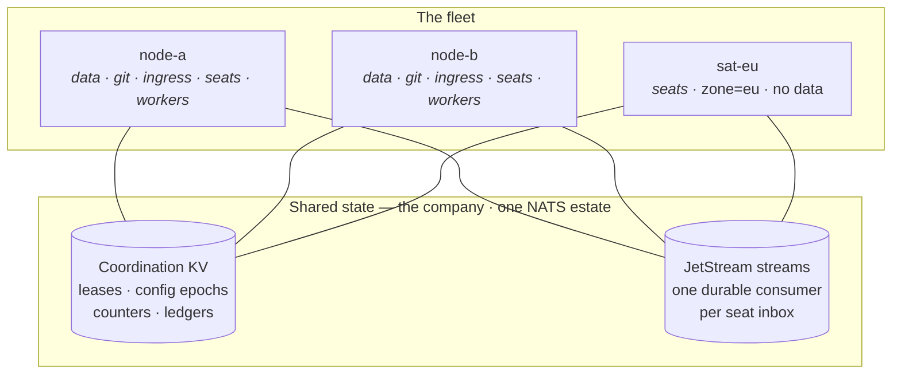
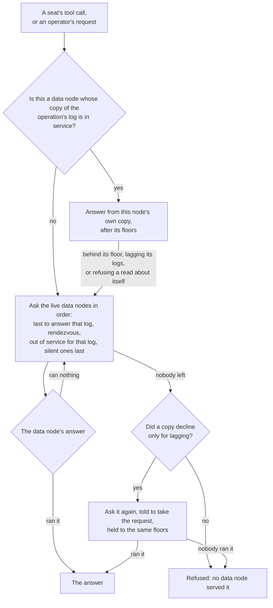

# Scaling Out

**One node is the whole company, and more than one is supported.** A single
`crewlet run` holds every seat, serves the API, and runs every company-wide
duty. That is the design's degenerate case, not a lesser path — a fleet takes
exactly the same code down exactly the same paths, with the leases held by more
than one process.

So the standing advice is **scale up before you scale out**. Agent handlers are
goroutines, so a single engine's practical ceiling is LLM provider rate
limits and host memory, not process count. A fleet buys availability, traffic
separation, and placement — not throughput. [Running a Fleet](../guides/fleet.md)
is the operator guide; this page is the model underneath it.

---

## What a node is

A node is one process that has declared what it is willing to do. Everything
else about it — which seats it runs, which duties it holds, which config
revision it is on — is discovered at runtime from shared state, never
configured per node.

```yaml
# Tier A, per node
node:
  id: "${CREWLET_NODE_ID}"           # distinct and stable, per process
  roles: [data, git, ingress, seats, workers]   # the default; omit the key
  labels: {zone: eu}                 # optional, matched by role.placement
  max_concurrent: 32                 # agent turns this process runs at once
```

| Role | What it does |
|---|---|
| `data` | Holds the company's durable state on its own disk: a full copy of the replicated estate, and the event log. `workers`' duties and `ingress`'s retention, capacity, eviction and backup surfaces read this node's own copy directly, so both require it (the API's tracker and knowledge-base routes go through the [estate router](#how-a-request-reaches-the-estate) instead). It does not decide the node's broker — its `stream` block does ([broker kinds](../guides/fleet.md#the-broker-members-and-leaves)) — but a data node on a leaf is refused, so every data node is a broker member holding a share of its replicas and a vote in its quorums. A node without it is [stateless](#a-node-that-holds-no-data) |
| `git` | Serves the company's git repositories where it sets [`code.native`](code-host.md), from a [cache](code-host.md#the-cache-on-a-git-node) on its own disk — see [Git nodes](#git-nodes). Requires `ingress`, whose listener git is served on |
| `ingress` | Serves the HTTP API — every integration's webhooks, the dashboard, the REST and WebSocket read surface |
| `seats` | Claims seat leases, spawns the agents, consumes their inboxes, runs turns, and serves their agent-mode tool bridge when `CREWLET_MCP_BRIDGE_URL` is set |
| `workers` | The company-wide [singleton duties](seat-ownership.md#singleton-duties): the scheduler tick, the sandbox waiter, the maintenance sweep (retention and removed-seat mailbox retirement), the integration reconcile loop, and the learning passes (skill clustering, curation, episode compaction, promotion). These read their work list from the **org**, never from the node's own seats: a `workers` node runs no seats at all, so a duty that iterated the local seats would cover nothing. Creating every seat's mailbox is not among them: every node does that at start and on each apply |



That shared box is a *logical* one. In the default fleet shape it lives inside
the nodes themselves — each embeds a member of one NATS cluster and the streams
replicate between them (`stream.cluster.*`, `stream.replicas: 3`) — and
`stream.type: nats` is the same picture with the estate moved out to a cluster
somebody else runs. One estate either way, carrying both slots — see
[what the fleet shares](#what-the-fleet-shares).

**Every data node is a full replica.** A node with the `data` role that runs
the native tracker holds the whole corpus — every task, page, comment and turn
the company has ever recorded — in its own database, applied from the same
ordered log as every other data node's. There is no cache tier, no thin
replica, and no way to run a node that holds part of it.

### A node that holds no data

The other shape is a node that holds **none** of it. A node without `data`
keeps a scratch store (deleted at every boot, with no replicated estate at
all), joins an embedded fleet as a **leaf** of the members' broker — no
JetStream, no replica, no vote — and runs `seats` only. Its seats' tools read
and write the tracker and the knowledge base through a data node over the
broker — the same router a data node's own seats go through, which answers
from the node's own copy where it has one — carrying the node's own writes as a
floor so whichever data node answers has applied them, and what it publishes about its turns is kept in
exactly one data node's event log ([custody](../guides/deployment.md#custody-the-rows-of-a-node-without-data)).
It joins no **fleet-wide consumer group** whose handler needs data — the
custody group and each domain's wake feed — and takes its share of the one
that does not, inbound notifications: a group any node
may attach hands a message to whichever member takes it first, so a stateless
member of a group that reads the estate would answer its share of the messages
from nothing. Every such group says which it is in one table the build holds
against the code in both directions (`internal/engine/groups.go`).
It is never counted as a copy: the trim, the eviction
gate and the search fan-out read the role off the presence lease, and the
capacity handshake reads the role AND the broker kind beside it — a broker
member counts whatever its roles, and a presence that does not say counts as
one (see [who has to acknowledge](../guides/retention.md#who-has-to-acknowledge)).
This is the shape for an agent host you want small and
disposable — see [Running a Fleet](../guides/fleet.md#nodes-that-hold-no-data)
and [ADR-0025](https://github.com/crewlet/crewlet/blob/main/adr/0025-a-node-without-data-reaches-the-estate-through-one-that-holds-it.md).

### Git nodes

A node with the `git` role serves the company's repositories from a cache of
its own, and git nodes scale **reads**: each keeps its own copy of every
repository it is asked for, synced from the code log's rows and the object
store, so a clone or a fetch is answered by the node that received it, and a
burst of clones of one repository costs that node one sync however many there
are. Each node holds its cache to its own byte budget (`git.cache_max_bytes`,
or a share of its volume — [`git`](configuration.md#git)), and every node that
serves a repository caches it whole, so a node's disk is sized for the
repositories it serves rather than the company's total.

**Pushes** do not scale with git nodes: a push to one repository is decided by
that repository's one [committer](#how-a-request-reaches-the-estate), a data
node, whichever git node received it — so a repository's pushes meet in one
place and are committed a batch at a time, and the repositories spread across
the data nodes.

Where requests land decides how many caches a repository costs. A fleet whose
every node serves git, with a balancer spreading `/git/` evenly, warms every
repository on every node — one cold sync each, one download for every push the
repository ever took, and each node's disk and background indexing for it. A
fleet that never wrote `node.roles` is that fleet: every node has every role,
`git` included, the moment its company sets `code.native`. Routing
`/git/<name>` by repository keeps each warm on one or two nodes instead; it is
a cost decision, never a correctness one
([Deployment](../guides/deployment.md#the-code-host)).

The object store sees the same multiplication. A git node reads at most 32
bundles at once — sixteen for any one repository — and S3 answers each in
about 100 to 200 ms, so a node syncing repositories it has never served reads
about 150 to 290 small ones a second (about 75 to 150 for one repository,
measured against a fake answering that late). Every bundle is named under the
one `files/` prefix, so about 19 to 37 git nodes cold-syncing at once at their
full 32 — twice as many syncing one repository each — reach the 5 500 reads a
second S3 serves one prefix (a fresh fleet, or a repository imported and then
fetched through every node), past which it answers `SlowDown` until it has
partitioned the prefix. Each node's client then slows every request it sends
to the bucket rather than failing it
([the object store](object-store.md#an-s3-bucket--s3)), so those syncs slow
down and nothing they hold is wrong, and routing by repository is again what
bounds it. What shortens a cold sync is fewer packs: at one a push, a
repository of 10 000 pushes comes up in about 70 to 130 seconds.

### How a request reaches the estate

The replicated estate is one estate, and every data node holds the whole of it.
Every node, with `data` or without, still reaches it through one **router**,
and a seat's tools behave the same on either kind of node. So do the operator's surfaces: the API's tracker and
knowledge-base routes, its spend and activity reads, a project's file rows and
the operator's own MCP go through the same router, so a data node whose copy of
the tracker, the knowledge base or the usage log is out of service answers its
operator from a peer's copy, exactly as it answers its seats. A peer's answer to
a long window of usage arrives in pages of about 2 MiB, each cut only between
two records, so a screen over ninety days is never one message; a data node
answering from its own copy reads the window whole, in one transaction, since
no message carries that answer.



- **This node first, where it is a data node.** A data node answers its own
  seats' calls from its own copy, in-process, and asks nobody — unless its
  copy of that operation's log is **out of service**: wrong rather than behind
  (an applier stopped, the node evicted, its rows below the log), in which case
  only that log's calls go to the other data nodes — its other logs' copies
  keep answering here — and it keeps every seat
  ([ADR-0031](https://github.com/crewlet/crewlet/blob/main/adr/0031-a-domains-fault-takes-only-its-own-copy-out-of-service.md)).
- **Otherwise the data nodes, in order**: the node that last answered an
  operation on that log, then a rendezvous order keyed on the asking node's own
  id — with a node that said in the last thirty seconds that its copy of that
  log is out of service asked after the rest, and a node that went silent in
  the last thirty seconds asked last. Each log has its own last answerer,
  because each has its own applier and a node can serve one log and not
  another: one answerer for every log made an asker between a node whose
  tracker copy was out and one whose knowledge base was swap between them on
  every call, paying a round trip that ran nothing each time. The rendezvous order picks an
  asker's first data node and every node it fails over to, spread evenly
  across the data nodes the fleet's presence names however those nodes are
  named (`node-0` … `node-4`, a StatefulSet's ordinals), so the askers of a
  node that goes silent scatter over the others rather than all landing on
  one. It does not decide where an asker stays: an asker keeps asking the node
  that last answered that log until that node goes silent or says its copy of
  the log is out of service. So the spread is where
  askers *start*, not where they settle — a data node that joins is asked only
  by askers with no such node yet or whose node went silent, and after a
  rolling restart each restarted node's askers stay on the node they failed
  over to.
- **A push to a repository the engine hosts is the one exception**: it is
  asked of that repository's **committer** — the first live data node in a
  rendezvous order keyed on the repository rather than on the asking node,
  which every node computes alike — whichever node received it, and a data
  node's own copy is asked only at its place in that order. A repository's
  pushes are decided against its one record of refs, so they all meet at one
  committer, which puts a burst of them into a few records instead of two
  committers each losing rounds to the other; the repositories spread across
  the data nodes. A committer that is silent, stopping or otherwise runs
  nothing hands the push, with the same push id, to that repository's
  runner-up, and a node that said in the last thirty seconds that its copy is
  out of service, or went silent, is asked after the rest as for any other
  operation. Nobody's last answer moves a push anywhere else. A committer
  answers inside the minute the asking node gives it: a push still queued
  when a whole batch and its answer would no longer fit — or one that reaches
  the committer with too little of that minute left, spent waiting for the
  node to take it, for the node to catch up with the asking node's own writes,
  or under a caller's shorter deadline — is answered `busy` rather than
  decided late — the client runs `git push` again — so an asker never hands a
  push to the runner-up while the first committer is still deciding it, and a
  committer behind what the receiving node showed the client catches up
  before it decides rather than refusing the push as stale. A data node takes
  pushes on a channel of their own, as wide as one repository's whole queue
  (1 024 pushes and the batch ahead of them), because a push holds its place
  there until its batch is decided: pushes waiting out a slow batch never hold
  up the node's reads, its other writes or a git fetch's lookup of a
  repository, and a burst to one repository is answered `busy` by the
  committer past its queue rather than left waiting unseen for a place. The
  node also refuses a push `busy` once the pushes it holds across all its
  repositories weigh sixty-four records — about 64 MiB — so a burst of very
  large pushes (an import's thousand-ref chunks) to many repositories at once
  is bounded on every committer.
- **A node that ran nothing is passed over, whatever the operation**: one whose
  copy of the operation's log is out of service (`out_of_service`), whose copy
  of it lags that log (asked again last), or that is behind the caller's floor.
  So is one that refuses a *read* for a reason about itself — its applier did
  not reach the barrier a linearizable read appended in time (`behind`), it
  stalled, it holds a record it cannot decode, it was evicted, or it lost its
  broker or its quorum: the next data node is asked, and the refusal is the
  answer only where none does better. The two refusals that hold for every
  node alike — the log is full (`log_full`), the fleet is in a capacity window
  (`maintenance`) — are answered at once, from the first node that gives them.
  Asking the next node costs a question and nothing more: it is handed what
  the read already paid for — the barrier the first node appended, the
  position it waited its whole read budget for — so a walk past every data
  node appends one barrier and waits one read budget, however many there are.
  What may be repeated once
  a node *may* have run a write is the operation's own rule: a tracker write
  moves on under the same operation id, a knowledge-base write that went
  unanswered is reported as unknown and never sent twice, and a tracker write
  one data node answered *unvouched* — its ledger cannot say whether the
  operation landed — is asked of the next under the same id before the caller is
  told the outcome is unknown.
- **Nobody answering is an answer that says so**, with what each data node said
  — never an empty list, which would say the company has none of what was asked
  for. A knowledge search nobody answered is the one exception that does not
  fail, because a search is best effort: it answers no hits, serves no mode
  and covers none of the corpus, which every surface renders as "could not be
  searched" rather than "nothing matched".

A read waits up to ten seconds on one data node before the next is asked, a
write up to a minute (or the caller's own deadline); none is ever longer than
the caller's deadline. Every request carries the asking node's own writes as a
floor, so whichever data node answers has applied them or says it is behind —
see [Read Consistency](../guides/consistency.md#reading-your-own-write-back).
And it says so **while the asking node is still listening**: every wait a data
node makes before it answers another node — for that floor, for the barrier a
`linearizable` read appends and the position it established, for a write's own
record — ends a second before the asker stops waiting, so a node that is merely
behind is heard saying so, and only a node that says nothing at all is asked
last as a silent one.

The knowledge index is the one place the *work* is divided, and only the work:
every indexed document carries a
[search shard](knowledge-system.md#every-document-carries-a-bucket), and above
10 000 documents a fleet splits those 64 buckets between its live nodes so each
scans a range rather than the whole corpus. Every node still **holds** every
document — what is divided is CPU, so a node that does not answer costs the
result a slice of relevance rather than a slice of the company, and the answer
says so. See [Search](../guides/search.md).

That is a deliberate trade and it is the reason the read path is simple: every
answer can be served locally, a search scans one node's complete tables, and
there is no routing decision to get wrong. What it costs is that the corpus is
held once per data node, so the storage forecast scales with the data nodes
rather than with the fleet — see [Retention](../guides/retention.md).

**Files are the exception, and the only one.** The content of a company's files
grows without bound, so it is not in any data node's database: each upload is
one object kept in **one store the whole fleet shares**, which every node reaches
directly. On the default `nats` backend that store is a bucket on the fleet's
own broker, so the files' copies follow `stream.replicas` on the broker's
members with the same quorum arithmetic as the logs — three members at three
replicas keep writing files with one down, two members at two replicas cannot
write with either down — and every member holding a copy holds every object,
so adding data nodes does not add space for files. On `s3` no node holds an
object at all: capacity and copies are the bucket's. The row that names a file is
still an ordinary replicated row, so listing a project's files is as local as
any other read; only reading the bytes goes to the store. See
[Object Store](object-store.md#how-far-it-scales).

**The node id must be distinct and stable across restarts.** It comes from the
deployment (`CREWLET_NODE_ID`, or `node.id` in the Tier A file) rather than
being generated, because a fresh value per boot orphans whatever the previous
incarnation registered under the old one. Two nodes sharing an id miscount the
fleet and each compute too small a share of the seats. On a clustered embedded
stream it is also this member's NATS server name, and JetStream places stream
replicas **by server name**: a node that comes back under a new one is a new
peer, its old replicas orphaned on a member that no longer exists, and the
stream left short of quorum waiting for a server that will never return. It is
never generated for you either: an unset id is `node-0` on *every* node, which
is the two-nodes-sharing-an-id failure with an extra symptom — NATS refuses a
route from a member whose name it already knows.

A role is subtracted from **this node, not from the company**, so a fleet can be
assembled node by node into a shape where a whole job is done by nobody while no
single node's config is wrong. The engine checks the assembled shape against
live node presence and logs `fleet_role_unmanned` when a role has nobody doing
it. See [the fleet guide](../guides/fleet.md#node-roles).

---

## What had to be true for this to work

Running two engines against one company is not a matter of adding a lock. The
couplings that made it unsafe fall into five kinds, and **only one of them is
what a lock fixes**:

| | The coupling | What resolves it |
|---|---|---|
| **1** | **Control plane** — config activation, secret rotation, identity maps were delivered over a competing-consumer subscription, so exactly one replica applied a revision and the rest ran the previous company forever | An append-only activation epoch every node polls — see [Control Plane](control-plane.md) |
| **2** | **Process-bound resources** — a seat's stdio MCP servers are child processes of the engine holding its credentials. A seat's tools live where its subprocesses live, so "any node can serve any seat" is false unless placement decides tools *and* routing together | Seat leases: claiming a seat is what spawns its MCP children — see [Seat Ownership](seat-ownership.md) |
| **3** | **Per-seat exclusion** — two nodes attached to one seat's durable consumer split its traffic, running one agent's conversation as two interleaved turn streams that neither can see | A TTL lease with an epoch fencing token. **This is the class a lock fixes**, and it is one of five |
| **4** | **Shared mutable counters** — budgets, concurrency, webhook dedupe, credential cooldowns were per-process, so an org cap of 500 k tokens silently became N × 500 k | Shared storage, not exclusion — see [what the fleet shares](#what-the-fleet-shares) below |
| **5** | **Boot walks with external side effects** — schema migration, sandbox recovery, skill clustering all ran unconditionally at boot, where "abandoned by a dead engine" is a valid inference only when there is exactly one engine | Singleton duty leases, an advisory lock on `migrate()`, and per-seat recovery inside the acquire hook |

Class 3 is the one everybody expects and the only one a mutex addresses. The
other four are why "just take a lock and run N replicas" does not work, and why
the answer is a node model rather than a lock.

---

## What the fleet shares

Everything that must be true for the *company* rather than for a process lives
in the coordination slot — a fleet-shared key/value store, distinct from the
node's own database. A fleet is not configured; it is discovered from these
slots, which is why adding a node is starting a process and removing one is
stopping it.

| Slot | Answers | Documented in |
|---|---|---|
| `leases` | Which node runs which seat, which node holds which duty, and which nodes are alive at all | [Seat Ownership](seat-ownership.md#the-lease) |
| `config` · `status` | Which company revision is current, and which nodes have reached it | [Control Plane](control-plane.md) |
| `ledger` | Has this trigger already been worked — read before a turn, written after one | [The completion ledger](seat-ownership.md#the-completion-ledger) |
| `claims` | Has this inbound delivery been seen — the dedupe that used to be a per-process map, and that GitHub and GitLab did not have at all | [Event System](event-system.md) |
| `cooldowns` | Which provider key is cooling after a 429. Per-process monotonic values are not even *comparable* across nodes | [Deployment](../guides/deployment.md) |
| `rate` | The notification valve | [Event System](event-system.md) |
| `budgets` | Org and per-seat spend against the cap. Caps stay config-derived in memory; only *usage* is shared | [Deployment § Token budgets](../guides/deployment.md#token-budgets) |
| `objects` | Which store the company's files are in — recorded by the first node, so a node configured with another refuses to boot — and what the object store's collector last found | [Object Store](object-store.md#one-store-per-fleet) |

The full list, what each retention is sized from, and what deliberately stays
node-local are in [Coordination](coordination.md).

The stream carries the other half: one durable consumer per seat inbox,
attached only by the node holding that seat's lease. That consumer **is** the
mailbox — it holds an unowned seat's mail until somebody claims it, and it is
created with no inactivity threshold precisely so nothing reaps it while a seat
is between owners. It also has to exist *before* anything publishes: the agent
and notification streams keep a message only while some durable consumer that
has not acked it exists, so a subject no consumer covers drops what is
published to it. See [a seat's mailbox](event-system.md#a-seats-mailbox-exists-before-the-seat-is-running)
and [the fleet guide](../guides/fleet.md#what-a-fleet-needs).

**Both halves ride one connection**, deliberately. The coordination KV is
JetStream KV on the stream's own NATS connection rather than an estate of its
own: two connections to one broker fail independently, so a node could hold
live leases over a connection that still works while the one carrying its inbox
has dropped — alive to its peers, deaf to its work. One connection makes
"reachable" a single fact about a node rather than two that can disagree.

### What stays per-process, deliberately

- **`max_concurrent`.** Tier A's `node.max_concurrent` (default 32) is the gate
  every agent turn passes through, and it is per node — so an org's ceiling is
  N × the configured value. Size it per node, not per company. This is the one
  knob a fleet genuinely changes the meaning of. (A cli-agent provider's own
  `max_concurrent`, under `providers.llm.<name>.cli`, is a different knob: it
  caps that provider's subprocesses.)
- **A seat's MCP subprocesses.** They are children of the node that claimed the
  seat, and they die with the release.
- **The tool-skill registry.** It warms a local cache rather than producing
  shared state, so every node runs its own skill sync: the boot walk, the
  periodic walk, and a read of each changed page. A node that skipped it would
  have agents with no tool skills at all. What IS shared is the news that a page
  changed: a webhook reaches one node, which broadcasts
  `tool_skill_page_changed` so every other node re-reads the page (see
  [Keeping every node current](tool-skills.md#keeping-every-node-current)). The
  test for whether periodic work is a
  [singleton duty](seat-ownership.md#singleton-duties) is exactly this: shared
  state, or a local cache?
- **The dashboard's live-state projection.** Each ingress node builds its own
  from the event stream, so any node can answer without a fan-out.

---

## Where the constants come from

The seat-handover constants are set by what the shipped backend actually does,
and the shipped backend is **NATS JetStream** — embedded in each node or dialled
as an external cluster, the same client code either way
(`internal/queue/jetstream`, where each number carries its reasoning at its
definition). The behaviours they rest on are held by the ONE conformance suite
every backend runs (`internal/queue/queuetest`), and it is worth being exact
about how: it asserts the **behaviour** each number describes — that a durable
consumer retains mail with nothing attached, that re-attaching replays it in
order, that a successor receives what its predecessor never acked, that one
client's detach leaves its peers attached — and it asserts no timing. A broker
that got slower would not fail the build; a broker that stopped behaving this
way would.

| What a handover rests on | What the backend does |
|---|---|
| Creating a seat's mailbox | A durable consumer created with **nothing attached**, at `DeliverAll` — **1.7 ms**, a plain client call, which is what makes it affordable for every node to create every seat's mailbox at boot |
| Handing a seat over cleanly | The loser NAKs its unfinished partition (a `Defer`); the successor sees it in **about a millisecond** |
| Losing a node with no handoff | Nothing NAKs, so those deliveries wait out the ack window — **30 minutes** — before they are redelivered |
| Prefetch a consumer can hold | **None.** Pull consumers fetch one message, or one drain's worth, when they are ready to run it |
| Delivery budget | **25**, then the dead-letter stream. A handoff spends one of them, because a NAK counts as a delivery |

What each one decides:

- **One durable consumer per seat, attached by whoever holds the lease, is
  sound.** The cursor belongs to the *consumer*, not to the connection that was
  reading it, so a change of owner replays nothing and loses nothing: what the
  loser never acked is exactly what the successor is handed. A consumer per node
  instead would either replay the whole subject on every handoff or lose
  whatever arrived while a seat was unowned. The suite asserts it rather than
  taking the broker's word for it.
- **The broker imposes no floor on the lease TTL** — so the **45-second TTL**
  is not a number any broker measurement sets. Creating a mailbox costs
  ~1.7 ms and a clean handoff returns the mail in about a millisecond, so a
  successor is productive essentially immediately. What
  bounds the TTL is heartbeat reliability: 45 s is three **15-second** heartbeat
  intervals, which tolerates two consecutive missed renewals — a GC pause, a
  store blip, a scheduling hiccup — with a full interval left to recover in,
  plus headroom for the skew between two machines' opinions of the time. Shorter
  drops a healthy node's seats on ordinary jitter, and every spurious handoff
  costs a real MCP respawn; longer is time a dead node's seats sit dark, because
  nothing can claim them until the TTL runs out.
- **The claim-rate limit is not about attaching.** At a millisecond, attaching
  is free. The real cost of a takeover is spawning that seat's MCP children,
  which is what the limiter is sized against: four claims per five-second sweep
  — twenty seats absorbed in ~25 s, and never more than four subprocess trees
  forked in one tick — against two releases, since giving a seat up interrupts a
  live agent while claiming one only starts it.
- **A wedged-but-alive node holds only what it already fetched.** There is no
  prefetch to hold hostage: a pull consumer asks for work when it is ready to
  run it, so a loop that has stopped turning is holding at most the batch in its
  hands. It also stops asking without being told to — admission reads the
  *freshness* of this node's last renew, so within one heartbeat interval the
  next delivery here is deferred, which NAKs it straight back and quiesces the
  consumer. What that does **not** cover is the delivery a wedged handler is
  still sitting on: nothing NAKs it, the ack clock is server-side and per
  message, and ending the process does not shorten it — that batch returns to
  the successor when the 30-minute window expires, not when the corpse falls
  over. The successor serves everything published after it claims the seat
  normally; it is the already-fetched batch that waits. So the
  [event-loop watchdog](seat-ownership.md#the-wedged-node-and-why-it-leaves)
  **ends the process** for blunter reasons than releasing mail: a wedged node
  neither works nor dies. It keeps its MCP children, its credentials and any
  turn already past the ownership check — and a turn's external side effects, a
  chat post or a work-item comment, are not something an epoch fence can reach —
  while still answering a liveness probe, so nothing restarts it. In a fleet
  its leases lapse and peers absorb the seats, so what is lost is that node's
  capacity; on a single node there is no peer, and the seats stay dark until a
  person notices. Nothing can be signalled out of that state either, because
  the code that would handle the signal is the code that is stuck;
  `os.Exit(75)` is the only unilateral move, and the distinct exit code is what
  makes a supervisor's restart log say what happened. It is also
  why correctness against zombies comes from epoch fencing rather than from
  waiting for anything to time out.

---

## What the design does not promise

Stated plainly, because each of these is a real window rather than a
theoretical one:

- **Exactly-once external side effects do not exist.** Not here and not in any
  design that calls non-transactional external APIs at-least-once. The
  [completion ledger](seat-ownership.md#the-completion-ledger) and the per-round
  fence *bound* the duplicate window; they cannot close it. A node dying
  mid-turn may repeat a Slack post — the same window a single engine has on
  force-stop and broker redelivery, now named.
- **A wedged-alive zombie can act for up to one LLM round plus one heartbeat
  interval** after losing its lease. Fencing bounds the damage to that window;
  it does not prevent the window.
- **One seat-scoped write still duplicates, deliberately.** A
  differently-worded `agent_diary` entry (identical content already
  collapses on write). Nothing can key a reworded
  memory to its twin — that needs the duplicate *turn* not to happen, which
  is the completion ledger's job. `episodes` and the counterparty interaction
  count are collapsed against the reader that matters — the node running the
  seat, which is the only one that reads them. Memory replication carries both
  nodes' rows onto the changelog, and the node that next replays the seat
  imports the first and skips the second on the same index, so the collapse
  follows the seat rather than staying behind on one node; and
  onboarding was already exclusive. See
  [Keying a write on the work](seat-ownership.md#keying-a-write-on-the-work)
  and [A seat's memory follows it](seat-ownership.md#a-seats-memory-follows-it).
- **Per-company singletons remain singletons.** They sit behind leases so any
  node can host them, but the scheduler tick, the curator, clustering, the
  sandbox waiter and the object store's collector are each one logical
  instance at a time. A fleet does not parallelise them.
- **A rolling upgrade across a protocol bump has a visible outage window**, and
  a rollback across one needs a full drain. See
  [Mixed-version fleets](seat-ownership.md#mixed-version-fleets).

---

## See also

- [Running a Fleet](../guides/fleet.md) — the operator guide: node roles, seat placement, draining and rolling upgrades
- [Running One Agent Somewhere Else](../guides/satellite-nodes.md) — the satellite shape, walked end to end
- [Seat Ownership](seat-ownership.md) — leases, epoch fencing, admission, the completion ledger, singleton duties
- [Control Plane](control-plane.md) — how a config revision reaches every node, and the posture a lagging one takes
- [Deployment](../guides/deployment.md) — processes, database, broker settings, probes
