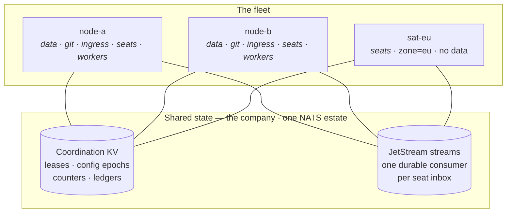
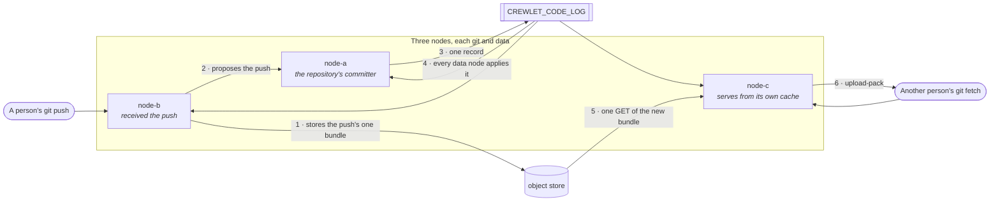
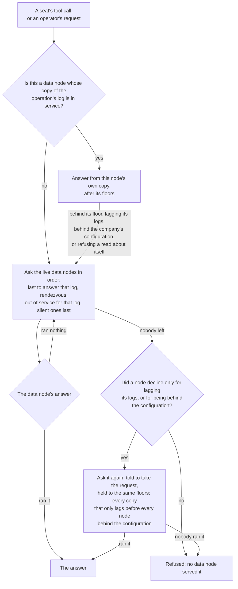

# Scaling Out

**One node is the whole company, and more than one is supported.** A single
`crewlet run` holds every seat, serves the API, and runs every company-wide
duty. That is the design's degenerate case, not a lesser path — a fleet takes
exactly the same code down exactly the same paths, with the leases held by more
than one process.

So the standing advice is **scale up before you scale out**. Agent handlers are
goroutines, so a single engine's practical ceiling is LLM provider rate
limits and host memory, not process count. A fleet buys availability, traffic
separation, and placement — not throughput. [Running a Fleet](../guides/fleet.md)
is the operator guide; this page is the model underneath it.

---

## What a node is

A node is one process that has declared what it is willing to do. Everything
else about it — which seats it runs, which duties it holds, which config
revision it is on — is discovered at runtime from shared state, never
configured per node.

```yaml
# Tier A, per node
node:
  id: "${CREWLET_NODE_ID}"           # distinct and stable, per process
  roles: [data, git, ingress, seats, workers]   # the default; omit the key
  labels: {zone: eu}                 # optional, matched by role.placement
  max_concurrent: 32                 # agent turns this process runs at once
```

| Role | What it does |
|---|---|
| `data` | Holds the company's durable state on its own disk: a full copy of the replicated estate, and the event log. `workers`' duties and `ingress`'s retention, capacity, eviction and backup surfaces read this node's own copy directly, so both require it (the API's tracker and knowledge-base routes go through the [estate router](#how-a-request-reaches-the-estate) instead). It does not decide the node's broker — its `stream` block does ([broker kinds](../guides/fleet.md#the-broker-members-and-leaves)) — but a data node on a leaf is refused, so every data node is a broker member holding a share of its replicas and a vote in its quorums. A node without it is [stateless](#a-node-that-holds-no-data) |
| `git` | Serves the company's git repositories where it sets [`code.native`](code-host.md), from a [cache](code-host.md#the-cache-on-a-git-node) on its own disk — see [Git nodes](#git-nodes). Requires `ingress`, whose listener git is served on |
| `ingress` | Serves the HTTP API — every integration's webhooks, the dashboard, the REST and WebSocket read surface |
| `seats` | Claims seat leases, spawns the agents, consumes their inboxes, runs turns, and serves their agent-mode tool bridge when `CREWLET_MCP_BRIDGE_URL` is set |
| `workers` | The company-wide [singleton duties](seat-ownership.md#singleton-duties): the scheduler tick, the sandbox waiter, the maintenance sweep (retention and removed-seat mailbox retirement), the integration reconcile loop, the learning passes (skill clustering, curation, episode compaction, promotion), the state logs' trim, the embedding duty and the identity sweep. These read their work list from the **org**, never from the node's own seats: a `workers` node runs no seats at all, so a duty that iterated the local seats would cover nothing. Creating every seat's mailbox is not among them: every node converges those, at start, on each apply and on its own seat sweep — see [What a mailbox costs](#what-a-mailbox-costs) for why running it everywhere is affordable |



That shared box is a *logical* one. In the default fleet shape it lives inside
the nodes themselves — each embeds a member of one NATS cluster and the streams
replicate between them (`stream.cluster.*`, `stream.replicas: 3`) — and
`stream.type: nats` is the same picture with the estate moved out to a cluster
somebody else runs. One estate either way, carrying both slots — see
[what the fleet shares](#what-the-fleet-shares).

**Every data node is a full replica.** A node with the `data` role that runs
the native tracker holds the whole corpus — every task, page, comment and turn
the company has ever recorded — in its own database, applied from the same
ordered log as every other data node's. There is no cache tier, no thin
replica, and no way to run a node that holds part of it.

### A node that holds no data

The other shape is a node that holds **none** of it. A node without `data`
keeps a scratch store (deleted at every boot, with no replicated estate at
all), joins an embedded fleet as a **leaf** of the members' broker — no
JetStream, no replica, no vote — and runs `seats` only. Its seats' tools read
and write the tracker and the knowledge base through a data node over the
broker — the same router a data node's own seats go through, which answers
from the node's own copy where it has one — carrying the node's own writes as a
floor so whichever data node answers has applied them. The identity
directory is read the same way: the seat bindings its inbound routing withholds
a suspended person's seat by, and the login a lead's tools resolve to a
person's seat, are answered by a data node, floored on the identity log. What
it publishes about its turns is kept in
exactly one data node's event log ([custody](../guides/deployment.md#custody-the-rows-of-a-node-without-data)).
It joins no **fleet-wide consumer group** whose handler needs data — the
custody group and each domain's wake feed — and takes its share of the one
that does not, inbound notifications: a group any node
may attach hands a message to whichever member takes it first, so a stateless
member of a group that reads the estate would answer its share of the messages
from nothing. Every such group says which it is in one table the build holds
against the code in both directions (`internal/engine/groups.go`).
It is never counted as a copy: the trim, the eviction
gate and the search fan-out read the role off the presence lease, and the
capacity handshake reads the role AND the broker kind beside it — a broker
member counts whatever its roles, and a presence that does not say counts as
one (see [who has to acknowledge](../guides/retention.md#who-has-to-acknowledge)).
This is the shape for an agent host you want small and
disposable — see [Running a Fleet](../guides/fleet.md#nodes-that-hold-no-data)
and [ADR-0025](https://github.com/crewlet/crewlet/blob/main/adr/0025-a-node-without-data-reaches-the-estate-through-one-that-holds-it.md).

### Git nodes

A node with the `git` role serves the company's repositories from a cache of
its own, and git nodes scale **reads**: each keeps its own copy of every
repository it is asked for, synced from the code log's rows and the object
store, so a clone or a fetch is answered by the node that received it, and a
burst of clones of one repository costs that node one sync however many there
are. Nothing ties a person to one git node: every answer that names a ref is
read at the code log's head, so a push answered `ok` on one node is what every
other node advertises next
([A push, end to end](code-host.md#a-push-end-to-end)).

**Pushes** do not scale with git nodes: a push to one repository is decided by
that repository's one [committer](#how-a-request-reaches-the-estate), a data
node, whichever git node received it — so a repository's pushes meet in one
place and are committed a batch at a time, the repositories spread across the
data nodes, and a data node that leaves hands each of its repositories to that
repository's runner-up.



The figures below were measured on one machine at a time — four vCPUs of a
2.1 GHz Xeon unless a paragraph names another — and each paragraph names the
git and the object store it was measured with;
the measured sections of the `internal/code`, `internal/code/host`,
`internal/code/cache` and `internal/code/codecluster` package docs carry every
arm.

**What a committer and the code log commit.** Measured on three data nodes of
one cluster sharing that machine's cores and its one disk — so a record's three
fsyncs queue on one device, where three machines each sync their own, and its
copies cross loopback rather than a network — a lone push is a record's round
trip: 10.5–11.1 ms at the median, 86–89 a second, and about a millisecond more
when it reaches its committer through another node. Sixty-four pushes at once
to one repository are 2 050–2 090 a second proposed at the committer itself,
because group commit puts them in two records, and 1 270–1 390 a second
proposed through another node's router (a push's median 38–41 ms, its p99
94–97 ms, sixty-four proposals crossing the wire at once). That second path is
every push whose git node is not its repository's committer, so in a fleet
that spreads `/git/` evenly it is the burst figure to size by. Pushes to
different repositories share no record, so what bounds a company whose pushes
spread across many repositories is the code log's **record rate** — 201–225
records a second for sixty-four pushes at once over sixty-four repositories,
each proposed through one node's router to whichever node commits it — and
neither group commit nor another data node raises it: one log has one leader.
Each record is then applied by every data node on the write lane every domain
shares, whose published floor is about 2 000 rows a second
([Replication](../guides/replication.md#the-bulk-apply-degradation-priced));
a small push is about four rows.

Where requests land decides how many caches a repository costs. A fleet whose
every node serves git, with a balancer spreading `/git/` evenly, warms every
repository on every node — one cold sync each, one download for every push the
repository ever took, and each node's disk and background indexing for it. A
fleet that never wrote `node.roles` is that fleet: every node has every role,
`git` included, the moment its company sets `code.native`. Routing
`/git/<name>` by repository keeps each warm on one or two nodes instead, a
node's cache a share of the company's repositories rather than all of them,
and a push's own sync adopting the pack its node received rather than
downloading the packs other nodes did; it is a cost decision, never a
correctness one ([Deployment](../guides/deployment.md#the-code-host)).

**A read of a repository's content goes to its home.** A server-side read by
object id — a tree's listing, a file's lines, a diff — is asked of the git
nodes rather than of whichever node asks it: the repository's home first, the
first of its rendezvous order over the live git nodes, then its runner-up
([The home git node](code-host.md#the-home-git-node)). So the reads of one
repository meet on one git node's cache wherever they come from, with no
balancer to configure, and one node a walk at a time starts a download of a
repository it holds no copy of — the home, or its runner-up where the home
says no copy is coming there (behind the company's configuration for a seat,
or failing on its own): a home's death, or a home stuck behind a revision,
costs the fleet one download of each repository read meanwhile, by its
runner-up, rather than one on every git node a read reached — or a repository
nobody can read until the home recovers. On each git node those reads' own
git holds at most half its read lane — the short checks of what a read names
wait in the lane's queue like any short read — so the other half stays the
one a person's push scans in ([Server-side reads](code-host.md#server-side-reads)).
And one repository's seat reads are served by the git nodes that hold a copy
of it, which bounds them by those nodes' shares: a home at its share sends the
rest on to them rather than starting another copy, because the share is the
node's, spent by every repository it serves, and a fleet busy everywhere would
answer every such read with a download
([The home git node](code-host.md#the-home-git-node)).

**What a request on a cold node costs.** A request on a node that holds no copy
of its repository — one that just joined, or whose budget evicted it — waits for
a cold sync before its first byte, since git's protocol has nothing to send
earlier: measured end to end, the git nodes on the node pin, git 2.56.0, on
two E-cores of a Core Ultra 7 265U, against an S3-shaped fake answering every
request 100 ms after it arrives, the first clone of a repository of two
hundred pushes begins with a 1.4–2.4 s sync and of two thousand with a
13.5–17.6 s one, and a balancer's idle timeout sees all of it. A cold sync is
network work, not CPU: each push's object carries the index its receiving
node's git wrote, so the node downloads, verifies and renames, and runs no
`index-pack`.

**A node coming up with many repositories** asked of it — joining, or
restarted — reads at most eight of them whole at once from the data nodes
([many repositories at once](code-host.md#the-cache-on-a-git-node)). Every
page of such a read is one read on a data node: one of the 64 answers its lane
gives the whole fleet's reads at once — a seat's tracker read, a page write,
the check every git request is admitted by — and one of the connections its
database scans each of those reads on, eight on the smallest data node (where
the git node holds the data itself, its own database's); so a node coming up
asks no more of a data node than the smallest scans at once, rather than every
page while the fleet's reads wait behind its pages — and a request that waits
a whole read attempt there, ten seconds, takes the data node for gone. Its
later repositories wait their turn inside their requests' own time, and a sync
after a push never waits for one of the eight. Against a model of a data node
of eight cores, every page as long as a full page of refs takes to scan, a
node restarted over the cache it kept — which downloads nothing, so the reads
are all of its bring-up — came up with 500 repositories in about four seconds,
the data node's own rate, and in no less with any higher limit, while the
fleet's other reads waited about a tenth of a second (p99); four nodes joining
together read their 2 000 repositories in about 16 seconds whatever the limit,
the other reads waiting about 0.8 seconds at eight, a second at sixteen and 15
seconds with no limit. In those 16 seconds a node downloads five to nine packs
for each of its repositories from S3, so for repositories of more history the
downloads, not the reads, set how long a join takes.

The object store sees the same multiplication. A git node reads at most 32
bundles at once — sixteen for any one repository — and S3 answers each in
about 100 to 200 ms, so a node syncing repositories it has never served reads
about 150 to 290 small ones a second (about 75 to 150 for one repository,
measured on git 2.56.0 against a fake answering 100 and 200 ms late, on two
cores of a Core Ultra 7 265U — the GETs alone bound it, not the machine).
Every bundle is named under the one `files/` prefix, so
about 19 to 37 git nodes cold-syncing at once at their full 32 — twice as many
syncing one repository each — reach the 5 500 reads a second S3 serves one
prefix (a fresh fleet, or a repository imported and then fetched through every
node), past which it answers `SlowDown` until it has partitioned the prefix.
Each node's client then slows every request it sends to the bucket rather than
failing it ([the object store](object-store.md#an-s3-bucket--s3)), so those syncs slow
down and nothing they hold is wrong, and routing by repository is again what
bounds it. What shortens a cold sync is fewer packs, which is why a
repository's maintainer merges them ([Compaction](code-host.md#compaction)): the
fifty or so a compacted repository holds come up in under a second, the
2 048 a repository holds at the most ([Limits](code-host.md#limits)) in about
14 to 27 seconds, and the 10 000 of a history nothing merged — one pack a
push — in about 70 to 130 seconds.

**A git node is sized by its memory before its disk.** Every git process a
node runs over a whole repository holds memory in proportion to the
repository's objects, measured over a source repository's history — the
bitmap on the node pin, git 2.56.0, and a clone on git 2.43:
writing the bitmap of its background index takes about 600 bytes an object,
and a clone beside it about 240 more — about 840 an object. At about three
million objects a gigabyte of a source repository's packs, that is about 2.5 GB
of memory for each gigabyte of packs on disk; memory follows the objects rather
than the bytes, so a repository of large binaries, far fewer objects to the
gigabyte, needs far less. [The cache's Memory paragraph](code-host.md#the-cache-on-a-git-node)
has every figure, and what the node keeps back for the store, the broker and
the engine. A repository whose bitmap the node's memory cannot hold is still
served — without one, so each of its clones walks its history — and raises
[`code_maintenance_refused`](../reference/alarms.md). A single repository of
50 to 100 GB of history is past what a git node is sized for.

**One git node writes a repository's bitmap for the fleet.** A repository's
[maintainer](code-host.md#who-maintains-a-repository) — the first git node of
its order whose advertised background budget holds the work, its home on a
fleet of alike nodes — MERGES its packs ([Compaction](code-host.md#compaction))
and PUBLISHES its bitmapped index as layers every other git node installs
([When a repository is published](code-host.md#when-a-repository-is-published)).
A repository's maintenance is placed by the largest charge any of its steps
is admitted at: for its publication, its bitmap at 600 bytes an object of the
whole repository and a clone's 240 beside it, 840 bytes an object; for a merge
of every object, 790 bytes an object beside the build's delta window — six of
the largest blob `code.limits.max_blob_bytes` admits, 300 MiB by default —
which is the larger under some six million objects. So a repository of N
objects needs ONE git node whose background budget holds the larger of
840 × N bytes and 790 × N bytes plus that window for it to be served with a
bitmap anywhere, for the whole fleet, and every other git node installs the
layers in a few MiB of memory and serves through them
([Sizing git nodes](../guides/deployment.md#sizing-git-nodes)).
Measured on the node pin over a source repository's history of a gigabyte,
three million objects, from the in-memory store (one run of each, on two
cores): a git node writing the whole bitmap of its own took 13.5 seconds and
812 MiB; the maintainer's root publication of it held the same 812 MiB for
its layer and bitmap (13.8 seconds) and 262 MiB for its commit-graph layer
(13.5 seconds), once for the fleet; and a git node installing what it
published synced the repository cold — its 64 packs and the layer's one
part — in 1.4 seconds, its own code allocating 7.4 MiB beside the bytes it
fetched, and counted every object through the bitmap 6 ms after its answer.
The large reference model's 12 GB monorepo, some 36 million objects, is
charged about 30 GB for its publication; what git holds writing it is an
EXTRAPOLATION, never measured — the line through the bitmaps of 100 MB and
the gigabyte puts it near 9 GB — because the 12 GB arm needs a machine of
64 GB and the 5 GB arm, which would anchor the line nearer, more memory than
these figures ran with. A merge is
held to the same budget — about 550 bytes an object it merges, 240 more an
object merged for a transfer's room beside them and six times
`code.limits.max_blob_bytes` for its delta search, as measured: by what it
merges, never by the repository's size, which would refuse a large
repository's every merge and with them its pushes — and refused where the
budget cannot hold it (`code_cache_compaction_refused`). Each build gives its
slot and its memory back before it uploads, and uploads everything it built at
once: a merge's up to sixteen outputs, a publication's up to sixteen parts and
sixteen outputs — on an `s3` store an 8 MiB first part each, 384 MiB on a
maintainer running both, 256 MiB of them one publication's — out of what the
node keeps back for serving and the store, never its background budget. On the
broker's own bucket a layer's parts count against the bucket's byte
reservation like any object ([Its byte
reservation](object-store.md#its-byte-reservation)).

**Between publications, the tail is walked.** The packs pushed since a
repository's last publication sit outside its layers, and every clone walks
their objects without a bitmap. A publication is due once that tail holds
64 packs, a sixty-fourth of the repository's objects, or 90 909 objects — a
second of walk at the slowest a walk is held to, and about 21 MiB of a clone's
memory — whichever comes first, and the maintainer publishes a repository at
most every 10 minutes or every ten times its last publication's build,
whichever is longer — counting a build that failed as well, from when it
began. A maintainer publishes one repository at a time, so it
keeps up with about ten large repositories at that duty cycle; past that, each
waits for the others and its tail grows meanwhile, the signal to give a second
git node the memory for them — the repositories then spread over both, each in
its own order. A maintainer also holds every repository it maintains in its
cache: give it the cache budget to keep them, or each of its publications
begins with a whole download.

**And by the bytes and CPU it serves, not by its requests.** Measured on the
node pin, git 2.56.0, on two E-cores of a Core Ultra 7 265U, over a tree of
10 000 files in two hundred pushes, a 31.5 MB pack: from a node holding the
repository's own bitmap, a full clone costs 0.64 s of the node's git CPU, and a
shallow clone of one commit, blobless, of the directories a sparse checkout's
cone names 0.27–0.29 s; from the repository's published layers, written over
the maintainer's repack of the same pushes, the full clone costs 0.07 s and
is sent a fifth fewer bytes, and the narrow one 0.06 s. On a node that has not
yet indexed the repository a full clone walks and delta-searches the whole
history, 2.8 s of CPU, against 0.29–0.30 s for the narrow clone, which moves
3.4 MB rather than the whole pack. Measured again at ten times the tree —
100 000 files in two thousand pushes, a 334 MB pack — on a node that has not
indexed it, the two cold clones cost about ten times as much: 27 s of CPU for
the full one and 2.6 s for the narrow one.
Identical clones share nothing: thirty-two at once cost the node thirty-two
clones of CPU. A warm fetch of one new commit is 6–8 ms of it. So size a git
node's cores by the clones and fetches it serves, and point CI at a blobless
clone with a cone wherever a tree is large — shallow too, where the job reads
no history:

```sh
git clone --depth=1 --filter=blob:none --sparse https://crewlet.example.com/git/web.git
git -C web sparse-checkout set services/api
```

A blobless clone needs protocol v2, git's default since 2.28, and is served
the filters a bitmap answers — `blob:none`, `blob:limit=<n>`, `tree:0`,
`object:type=<type>` and a `combine:` of them; `sparse:oid` and `tree:<n>` past
0 are refused ([the filters served](code-host.md#a-push-end-to-end)).

**A git node's disk.** Its cache holds the repositories it serves whole — the
sum of their `SIZE` in
[`crewlet code status`](../reference/cli.md#crewlet-code-status), each at most
`code.limits.repo_max_bytes` — kept under `git.cache_max_bytes` by evicting the
least recently used, and only once the budget is reached: a repository nobody
fetched over a weekend is still there on Monday and is brought forward by a
delta, and one a request is reading is never evicted. Unset, the budget is
derived from the cache's volume at every boot — half of what a shared volume
leaves it, seven eighths of a volume of its own ([`git`](configuration.md#git))
— so give the cache a volume of its own. The object store holds one object a
push until the repository's maintainer merges its packs into a few
([Compaction](code-host.md#compaction)); the packs a merge replaces keep their
objects a day, then the collector deletes them.

**What a compaction costs every other git node.** Each output of a merge is
downloaded once by every git node holding the repository but the one that
built it, which links its own, and git's geometric roll merges a history again
each time it doubles, until its packs are full. So over a repository's life a
git node downloads, and writes to its disk, at most about (1 + log₂(0.9 GB ÷
the mean push's pack)) times the bytes pushed to the repositories it holds:
about 16 times at pushes of 20 KB, and fewer the more pushes a merge takes at
once. Measured (`BenchmarkCompact`, git 2.56.0 over the in-memory store,
requests and bytes counted), a quiet repository — 1 200 pushes of 24 KB, one
a minute, merged sixteen at a time — had the other git node download 4.7
times what was pushed, the git node that built the merges having uploaded
3.7 times it, and twenty minutes of a busy one — 6 000 pushes at three
hundred a minute — 3.4 and 2.4 times, both still far from full packs: a
longer history is merged more times, up to the multiple above. On S3 inside the
bucket's region the bytes are not billed and the requests are: a merge is one
PUT an output and one GET of it on every other git node holding the
repository — 64 PUTs and 449 GETs a thousand pushes on a fleet of eight git
nodes for the quiet repository, 3 and 23 for the busy one, beside the 7 000
GETs of the pushes' own packs. An object store that bills its egress —
another provider's, or a bucket in another region — bills those bytes too,
once for every git node but the builder, so size a git node's download and
disk-write rates, and that bill, by the multiple above.

**What the index of pushes costs a git node.** Beside each copy a git node
keeps the index of which push introduced each commit
([Which push landed a commit](code-host.md#which-push-landed-a-commit)): about
64 bytes a commit introduced, about 190 bytes for a push of three, inside the
cache's budget — some 3.5 GB for a monorepo's 18 million pushes in 181 days,
and 8.6 GB for the 45 million of a company pushing 250 000 a day, indexed
whole. Every sync folds the pushes it applied before it answers, 0.84 ms for a
push, and the node merges what the folds write behind the serving, eight runs
at a time: about one merge for every seven pushes synced one by one, fewer
where they arrive in bursts. A read maps the runs of the copy's index into
memory, and a node holds at most a quarter of the host's `vm.max_map_count` of
them mapped at once (16 382 at the default 65 530), however many copies its
seats read: the runs of the copies read most recently stay mapped for their
next read, and a node reading more copies than that maps the others again as
each is read. A repository's history before a node's first full read of it is
read back only by its home, and only once a seat has asked about it, a page of
the data node's push rows at a time — measured on four cores of a Core Ultra 7
265U, pages of about 7 500 pushes and 4 MB, about 150 ms each — and after each
page the backfill waits twice that page's time for each git node the fleet has
to a data node, rounded up. So that monorepo's 2 400 pages are read back in
about 18 minutes on a fleet of one git node to each data node, and in about 77
minutes at sixteen git nodes over three data nodes, where each page waits
twelve times its own time; the worst case is one cold git node that is the home
of every repository it caches, every one of them asked about, reading the whole
181 days of a company pushing 250 000 a day: about 6 000 pages and 24 GB over
the router, about 45 minutes at one git node to each data node, beside that
node's cold syncs of the same repositories. Choosing each of those steps costs
the node microseconds however many repositories it holds — 2.5 µs among 10 000
with a step due for every one of them, after a restart, and 0.7 µs where one
has — so the pages' own pace is all those 45 minutes are, and a request finding
its copy never waits on the choice. These are figures, not promises: until a
node's index is complete, an answer about an older commit says which range it
does not hold rather than naming a push.

**What the memo of answers costs a git node.** Beside each copy a git node
keeps every page its seats' server-side reads cut ([The memo](code-host.md#the-memo)),
at most a sixteenth of the cache's budget across every copy it holds — some
450 000 pages of 56 KiB at a 400 GB budget — and it is trimmed to that before
any repository is evicted, so fifteen sixteenths of the budget stay the
repositories it exists for. A page from the memo is answered with no git run
— in 21 to 90 µs, measured — where the page cut costs at least one git
process, 4.6 to 262 ms warm and up to the read's ten seconds; and the read that
misses cuts every page after the one asked too, so a seat paging through a
large listing, a long file or a wide diff pays for one git run, not one a
page. What the memo holds of a git node's MEMORY is nothing an answer: each
copy's cohorts of answers and what each holds, 16 bytes a cohort and some
seventeen at the most a copy, so 10 000 copies hold under 3 MB however many
answers their memos keep — where an index of every answer would have held
some 680 MB at a 400 GB budget's worst case, answers of one disk block each,
and 3 GB at 1.75 TB. A trim drops the sixteenth of the memo used least
recently in one rename a copy that holds it, whatever it holds — about 0.7 s of
the janitor's at 10 000 copies, measured — and is due again only once a
sixteenth more has been kept.

**What every data node holds for the code host.** Every data node holds the
whole estate, and the code host's rows with it. A seat's push of one commit
leaves a push row of about 680 bytes where its code tools built it, naming the
seat and the turn, work item and model behind it, and of about 755 from its
coding box, which names the coding run and the coding agent besides (a
person's push, naming the token it came through, leaves one of about 623),
kept 181 days, and its pack's row of about 588,
kept while the pack is live: a repository's maintainer looks at it every minute and
merges its small packs once sixteen have gathered — a busy repository's at
every look, the minute's pushes taking it past them
([Compaction](code-host.md#compaction)) — so a repository holds at most fifty
live pack rows plus a minute's pushes whatever its age, and a row more for each
0.9 GB its history fills: one pushed now and then sits near the sixteen, and
one pushed three hundred times a minute held 304 at the most, measured — some
29 KB at fifty and 179 KB at 304. The row of a pack a merge took is kept one
more day, as a retired row of about 608 bytes. A merge of a repository
holding fifty or fewer takes sixteen packs or more into one, so once the
packs a repository's pushes add are what its merges take, a push leaves at
most sixteen retired rows for every fifteen pushes — 1.05 a push measured for
a repository pushed once a minute, and about one where it is pushed to fast
enough that a minute's merge takes hundreds. A forced update or a deletion
leaves a row more, naming the
object it left, kept 14 days, and longer while the
repository's pushes fill their records with such updates
([ref drops](code-host.md#retention-and-history)). A seat that has pushed
holds two rows more at the most however much it pushes — its pushes on its two
newest company days, each a row of about 30 bytes and its key's entry, the
older kept for a node whose clock has not reached midnight yet
([A seat's push](code-host.md#a-seats-push)) — where an index of the push
rows for that one-day question would have kept an entry of some 40 bytes for
every seat's push for its 181 days, about 1.8 GB at 250 000 pushes a day.
That is one of three indexes the push rows are not given, each an entry every
push would keep on every data node for its 181 days to answer a question the
rows' one index already answers: that one; a second index of the push rows in
log order, where their one index was reordered instead (a second, measured,
would have added about a quarter to the 395 bytes a push's row weighed then);
and an index of each coding run's pushes, where the report of [what a run
pushed](code-sandbox.md#what-a-run-pushed-is-reported-for-it) scans its
repositories' pushes since its launch instead — some 40 to 100 bytes a push
each, 1.8 to 4.5 GB each at 250 000 pushes a day. The
code log, which keeps only the trim's window of records, takes 1 555 bytes
for a seat's coding box's push in a record of its own (1 481 where the engine
builds it for a tool) and about 970 for each of a burst group commit holds
together, the merges of the packs those pushes add
43 to 108 bytes a push more — the more a merge takes at once, the less —
and the sweeps that remove the rows a merge retired, a day later, up to 44
more: a record of about 700 bytes for each repository a quarter-hourly pass
finds a row past its day in, which is 44 bytes a push where each merge's rows
are swept apart and a fraction of a byte where a busy repository's sweep takes
the rows of thousands of pushes at once. The table prices every push as a seat's:
the reference company's 3 000 pushes a day are all its seats', a hundred
seats pushing thirty times a day while its people fetch, and a larger
company's are its thousands of seats' — each as a coding box's push, the most
a seat's push takes of the rows and of the code log, since which of a
company's seats push from their boxes and which through their tools is no
figure the reference company has. Priced as a tool's push, as the table was
before a box's push was measured, the push rows were 369 MB and 30.8 GB. So:

| Pushes a day | Push rows at the 181-day horizon | Retired pack rows, at most | On the code log, over the default seven days |
|---|---|---|---|
| 3 000 — a hundred seats pushing thirty times a day | about 543 000, 410 MB | about 3 200, 2.0 MB | about 36 MB |
| 250 000 — a company of thousands of seats | about 45 million, 34.2 GB | about 269 000, 164 MB | 1.8 to 3.0 GB |

The live pack rows are not a column, because they follow the repositories and
not the pushes: some 29 KB a repository at fifty, 29 MB for every thousand,
and a minute's pushes more on a busy one. So the code
host's rows stop growing once the push history reaches its horizon — where,
while nothing merged a repository's packs, its pack rows grew by about 644 MB
a year at 3 000 pushes a day and 53.6 GB at 250 000, for as long as the
repositories lived.

These rows come on top of what the tracker, the knowledge base and the rest of
the estate hold: [the storage forecast](../guides/retention.md#the-storage-forecast)
counts them on a line of their own for a company that hosts code, and every
data node's snapshot volume holds about 4.2 times them, as it does the rest of
its estate. The code log's column is its push, compaction and sweep records
alone; each linearizable read a git client makes — an advertisement, a push's
sync, a fetch's ls-refs — appends a 176-byte barrier beside them, which is why the
log's ceiling is derived at two thirds of the mutation log's rather than from
its pushes alone
([how the ceilings are sized](../guides/replication.md#how-the-byte-ceilings-are-sized)).
The push records fit the ceiling a first boot derives from 50 GiB free or more
([the code log's reservation](../guides/replication.md#what-the-code-logs-reservation-costs)),
and a push's bytes are never on the log — they are the object store's.

**What this release does not scale yet**, stated as the product's shape: a
compaction of a repository drops its multi-pack index and that index's bitmap
on every git node — the commit-graph is kept, since a merge drops no commit —
and the background indexing writes them again at its own pace, so a clone
between the two counts its objects by walking
([Compaction](code-host.md#compaction)) — and a seat pushes through its code tools, each change one push the
engine builds ([Engine-built commits](code-host.md#engine-built-commits)), and from its coding box
([Coding boxes](code-host.md#coding-boxes)), never from a git client of its own: the rates in the table are what the
code host is built for, where this release's pushes are people's, their CI's, those tools' and their boxes'.

### How a request reaches the estate

The replicated estate is one estate, and every data node holds the whole of it.
Every node, with `data` or without, still reaches it through one **router**,
and a seat's tools behave the same on either kind of node. So do the operator's surfaces: the API's tracker and
knowledge-base routes, its spend and activity reads, a project's file rows and
the operator's own MCP go through the same router, so a data node whose copy of
the tracker, the knowledge base or the usage log is out of service answers its
operator from a peer's copy, exactly as it answers its seats. A peer's answer to
a long window of usage arrives in pages of about 2 MiB, each cut only between
two records, so a screen over ninety days is never one message; a data node
answering from its own copy reads the window whole, in one transaction, since
no message carries that answer.



- **This node first, where it is a data node.** A data node answers its own
  seats' calls from its own copy, in-process, and asks nobody — unless its
  copy of that operation's log is **out of service**: wrong rather than behind
  (an applier stopped, the node evicted, its rows below the log), in which case
  only that log's calls go to the other data nodes — its other logs' copies
  keep answering here — and it keeps every seat
  ([ADR-0049](https://github.com/crewlet/crewlet/blob/main/adr/0049-a-domains-fault-takes-only-its-own-copy-out-of-service.md)).
- **Otherwise the data nodes, in order**: the node that last answered an
  operation on that log, then a rendezvous order keyed on the asking node's own
  id — with a node that said in the last thirty seconds that its copy of that
  log is out of service asked after the rest, and a node that went silent in
  the last thirty seconds asked last. Each log has its own last answerer,
  because each has its own applier and a node can serve one log and not
  another: one answerer for every log made an asker between a node whose
  tracker copy was out and one whose knowledge base was swap between them on
  every call, paying a round trip that ran nothing each time. The rendezvous order picks an
  asker's first data node and every node it fails over to, spread evenly
  across the data nodes the fleet's presence names however those nodes are
  named (`node-0` … `node-4`, a StatefulSet's ordinals), so the askers of a
  node that goes silent scatter over the others rather than all landing on
  one. It does not decide where an asker stays: an asker keeps asking the node
  that last answered that log until that node goes silent or says its copy of
  the log is out of service. So the spread is where
  askers *start*, not where they settle — a data node that joins is asked only
  by askers with no such node yet or whose node went silent, and after a
  rolling restart each restarted node's askers stay on the node they failed
  over to.
- **A push to a repository the engine hosts is the one exception**: it is
  asked of that repository's **committer** — the first live data node in a
  rendezvous order keyed on the repository rather than on the asking node,
  which every node computes alike — whichever node received it, and a data
  node's own copy is asked only at its place in that order. A repository's
  pushes are decided against its one record of refs, so they all meet at one
  committer, which puts a burst of them into a few records instead of two
  committers each losing rounds to the other; the repositories spread across
  the data nodes. *Live* is as each node's own view of the fleet's presence
  names the data nodes, and the view hears a presence claim or release as it
  lands, so a node that joins is in every order within about a second of its
  claim and a fleet started all at once agrees on every committer within
  about a second of the last claim; a push inside that second may be
  committed by its receiver, which the broker's compare-and-set keeps correct
  and which costs that push the group commit. A committer that is silent,
  stopping or otherwise runs nothing hands the push, with the same push id, to
  that repository's runner-up, and a node that said in the last thirty seconds
  that its copy is out of service, or went silent, is asked after the rest as
  for any other
  operation. Nobody's last answer moves a push anywhere else. A committer
  answers inside the minute the asking node gives it: a push still queued
  when a whole batch and its answer would no longer fit — or one that reaches
  the committer with too little of that minute left, spent waiting for the
  node to take it, for the node to catch up with the asking node's own writes,
  or under a caller's shorter deadline — is answered `busy` rather than
  decided late — the client runs `git push` again — so an asker never hands a
  push to the runner-up while the first committer is still deciding it, and a
  committer behind what the receiving node showed the client catches up
  before it decides rather than refusing the push as stale. A data node takes
  pushes on a channel of their own, as wide as one repository's whole queue
  (1 024 pushes and the batch ahead of them), because a push holds its place
  there until its batch is decided: pushes waiting out a slow batch never hold
  up the node's reads, its other writes or a git fetch's lookup of a
  repository, and a burst to one repository is answered `busy` by the
  committer past its queue rather than left waiting unseen for a place. The
  node also refuses a push `busy` once the pushes it holds across all its
  repositories weigh sixty-four records — about 64 MiB — so a burst of very
  large pushes (an import's thousand-ref chunks) to many repositories at once
  is bounded on every committer.
- **A node that ran nothing is passed over, whatever the operation**: one whose
  copy of the operation's log is out of service (`out_of_service`), whose copy
  of it lags that log or that is behind the company's configuration (each
  asked again last — behind the configuration is a node the control plane
  has confirmed `shed` or `stuck`, never one merely mid-rollout, whose chart,
  units and limits are the revision the fleet replaced; see
  [Control Plane](control-plane.md#where-the-gate-sits)), or that is behind
  the caller's floor. Being behind the configuration lasts — until the node's
  apply succeeds, or a person acts — so it answers `behind_config` and the
  asking node remembers that for thirty seconds: meanwhile it skips the node,
  asking it once, told to take the request, only when no other data node
  runs the operation, and asks a repository's runner-up for its pushes. An
  asker spends one refusal on such a node every thirty seconds rather than
  one on every request. Where both kinds are left, a copy that only lags is
  asked before a node behind the configuration, because its answer is held
  to the current configuration — in that order whether or not the asking
  node has heard the refusal yet, so every asker sends a repository's pushes
  to the same node.
  So is one that refuses a *read* for a reason about itself — its applier did
  not *reach*, in time, the record before the barrier a linearizable read
  appended (`behind`), where reaching a position is committing every record up
  to it that writes a row and decoding every barrier among them, whichever node
  appended it: a barrier's own commit writes no row, so no read waits for it,
  and what a node is behind on is a row it has not committed or a record it
  has not been handed yet. Or it stalled, it holds a record it cannot decode,
  it was evicted, or it lost its broker or its quorum: the next data node is
  asked, and the refusal is the answer only where none does better. The three
  refusals that hold for every node alike — the log is full (`log_full`), the
  broker refused to store the barrier on the log every node appends to
  (`broker_refused`: a sealed stream, a store with no resources left), the
  fleet is in a capacity window (`maintenance`) — are answered at once, from
  the first node that gives them. Asking the next node costs a question and
  nothing more: it is handed what the read already paid for — the barrier the
  first node appended, the position it waited its whole read budget for — so a
  walk past every data node appends one barrier and waits one read budget,
  however many there are.
  What may be repeated once
  a node *may* have run a write is the operation's own rule: a tracker write
  moves on under the same operation id, a knowledge-base write that went
  unanswered is reported as unknown and never sent twice, and a tracker write
  one data node answered *unvouched* — its ledger cannot say whether the
  operation landed — is asked of the next under the same id before the caller is
  told the outcome is unknown.
- **Every request and every answer is signed.** A data node runs a write as
  the actor the request names, so the request is an instruction, and an
  unsigned one would be an instruction anything the broker admits could write:
  its admission vouches for a connection, never a request. Each request envelope and each reply carries a MAC under the
  fleet keyring every node already holds, in a key domain of its own
  (`estate`), so nothing lifted off the state logs verifies here — the same
  rule every state-log record is held to
  ([ADR-0031](https://github.com/crewlet/crewlet/blob/main/adr/0031-every-state-log-record-is-signed.md)).
  A request signed under a key the answering node does not hold **did not
  run**, so the router asks the next data node; one whose MAC fails under a
  key it holds is refused and logged, because no data node will ever accept
  it. A custody batch is outside the rule: it carries events a data node
  keeps, not an instruction it acts on. The rule is not the estate's alone:
  every request one node asks another to carry out — a broker member removing
  a voter, the node running a turn taking a person's note — is signed and
  bound the same way, by one implementation.
- **Nobody answering is an answer that says so**, with what each data node said
  — never an empty list, which would say the company has none of what was asked
  for. A knowledge search nobody answered is the one exception that does not
  fail, because a search is best effort: it answers no hits, serves no mode
  and covers none of the corpus, which every surface renders as "could not be
  searched" rather than "nothing matched".

A read waits up to ten seconds on one data node before the next is asked, a
write up to a minute (or the caller's own deadline); none is ever longer than
the caller's deadline. Every request carries the asking node's own writes as a
floor, so whichever data node answers has applied them or says it is behind —
see [Read Consistency](../guides/consistency.md#reading-your-own-write-back).
And it says so **while the asking node is still listening**: every wait a data
node makes before it answers another node — for that floor, for the barrier a
`linearizable` read appends and the position it established, for a write's own
record — ends a second before the asker stops waiting, so a node that is merely
behind is heard saying so, and only a node that says nothing at all is asked
last as a silent one.

The knowledge index is the one place the *work* is divided, and only the work:
every indexed document carries a
[search shard](knowledge-system.md#every-document-carries-a-bucket), and above
10 000 documents a fleet splits those 64 buckets between its live nodes so each
scans a range rather than the whole corpus. Every node still **holds** every
document — what is divided is CPU, so a node that does not answer costs the
result a slice of relevance rather than a slice of the company, and the answer
says so. See [Search](../guides/search.md).

That is a deliberate trade and it is the reason the read path is simple: every
answer can be served locally, a search scans one node's complete tables, and
there is no routing decision to get wrong. What it costs is that the corpus is
held once per data node, so the storage forecast scales with the data nodes
rather than with the fleet — see [Retention](../guides/retention.md).

**Files are the exception, and the only one.** The content of a company's files
grows without bound, so it is not in any data node's database: each upload is
one object kept in **one store the whole fleet shares**, which every node reaches
directly. On the default `nats` backend that store is a bucket on the fleet's
own broker, so the files' copies follow `stream.replicas` on the broker's
members with the same quorum arithmetic as the logs — three members at three
replicas keep writing files with one down, two members at two replicas cannot
write with either down — and every member holding a copy holds every object,
so adding data nodes does not add space for files. On `s3` no node holds an
object at all: capacity and copies are the bucket's. The row that names a file is
still an ordinary replicated row, so listing a project's files is as local as
any other read; only reading the bytes goes to the store. See
[Object Store](object-store.md#how-far-it-scales).

**The node id must be distinct and stable across restarts.** It comes from the
deployment (`CREWLET_NODE_ID`, or `node.id` in the Tier A file) rather than
being generated, because a fresh value per boot orphans whatever the previous
incarnation registered under the old one. Two nodes sharing an id miscount the
fleet and each compute too small a share of the seats. On a clustered embedded
stream it is also this member's NATS server name, and JetStream places stream
replicas **by server name**: a node that comes back under a new one is a new
peer, its old replicas orphaned on a member that no longer exists, and the
stream left short of quorum waiting for a server that will never return. It is
never generated for you either: an unset id is `node-0` on *every* node, which
is the two-nodes-sharing-an-id failure with an extra symptom — NATS refuses a
route from a member whose name it already knows.

A role is subtracted from **this node, not from the company**, so a fleet can be
assembled node by node into a shape where a whole job is done by nobody while no
single node's config is wrong. The engine checks the assembled shape against
live node presence and logs `fleet_role_unmanned` when a role has nobody doing
it. See [the fleet guide](../guides/fleet.md#node-roles).

---

## What had to be true for this to work

Running two engines against one company is not a matter of adding a lock. The
couplings that made it unsafe fall into five kinds, and **only one of them is
what a lock fixes**:

| | The coupling | What resolves it |
|---|---|---|
| **1** | **Control plane** — config activation, secret rotation, identity maps were delivered over a competing-consumer subscription, so exactly one replica applied a revision and the rest ran the previous company forever | An append-only activation epoch every node polls — see [Control Plane](control-plane.md) |
| **2** | **Process-bound resources** — a seat's stdio MCP servers are child processes of the engine holding its credentials. A seat's tools live where its subprocesses live, so "any node can serve any seat" is false unless placement decides tools *and* routing together | Seat leases: claiming a seat is what spawns its MCP children — see [Seat Ownership](seat-ownership.md) |
| **3** | **Per-seat exclusion** — two nodes attached to one seat's durable consumer split its traffic, running one agent's conversation as two interleaved turn streams that neither can see | A TTL lease with an epoch fencing token. **This is the class a lock fixes**, and it is one of five |
| **4** | **Shared mutable counters** — budgets, concurrency and webhook dedupe were per-process, so an org cap of 500 k tokens silently became N × 500 k | Shared storage, not exclusion — see [what the fleet shares](#what-the-fleet-shares) below |
| **5** | **Boot walks with external side effects** — schema migration, sandbox recovery, skill clustering all ran unconditionally at boot, where "abandoned by a dead engine" is a valid inference only when there is exactly one engine | Singleton duty leases, an advisory lock on `migrate()`, and per-seat recovery inside the acquire hook |

Class 3 is the one everybody expects and the only one a mutex addresses. The
other four are why "just take a lock and run N replicas" does not work, and why
the answer is a node model rather than a lock.

---

## What the fleet shares

Everything that must be true for the *company* rather than for a process lives
in the coordination slot — a fleet-shared key/value store, distinct from the
node's own database. A fleet is not configured; it is discovered from these
slots, which is why adding a node is starting a process and removing one is
stopping it.

| Slot | Answers | Documented in |
|---|---|---|
| `leases` | Which node runs which seat, which node holds which duty, and which nodes are alive at all | [Seat Ownership](seat-ownership.md#the-lease) |
| `config` · `status` | Which company revision is current, and which nodes have reached it | [Control Plane](control-plane.md) |
| `ledger` | Has this trigger already been worked — read before a turn, written after one | [The completion ledger](seat-ownership.md#the-completion-ledger) |
| `claims` | Has this inbound delivery been seen — the dedupe that used to be a per-process map, and that GitHub and GitLab did not have at all | [Event System](event-system.md) |
| `rate` | The notification valve | [Event System](event-system.md) |
| `budgets` | Org and per-seat spend against the cap. Caps stay config-derived in memory; only *usage* is shared | [Deployment § Token budgets](../guides/deployment.md#token-budgets) |
| `objects` | Which store the company's files are in (recorded by the first node, so a node configured with another refuses to boot), and what the object store's collector and the trash reaper last did | [Object Store](object-store.md#one-store-per-fleet) |

The full list, what each retention is sized from, and what deliberately stays
node-local are in [Coordination](coordination.md).

The stream carries the other half: one durable consumer per seat inbox,
attached only by the node holding that seat's lease. That consumer **is** the
mailbox — it holds an unowned seat's mail until somebody claims it, and it is
created with no inactivity threshold precisely so nothing reaps it while a seat
is between owners. It also has to exist *before* anything publishes: the agent
and notification streams keep a message only while some durable consumer that
has not acked it exists, so a subject no consumer covers drops what is
published to it. See [a seat's mailbox](event-system.md#a-seats-mailbox-exists-before-the-seat-is-running)
and [the fleet guide](../guides/fleet.md#what-a-fleet-needs).

**Both halves live on one broker**, deliberately. The coordination KV is
JetStream KV on the stream's own NATS servers rather than an estate of its own,
so reaching the leases is reaching the mail. A node's *connections* to that
broker are one on an external cluster — the coordination store rides the
queue's — and two on the embedded one, where the coordination store, the
seat-memory replay and the backup's stream copies share a second connection so
that none of them sits on the read loop every mailbox consumes through. Two
connections fail independently, and a node holding live leases over one while
the one carrying its inbox has gone would be alive to its peers and deaf to its
work — so both are watched, and the client closing either one for good stops
the node. "Reachable" can disagree with itself for no longer than a reconnect.

**The state logs share one byte budget on that broker.** Each state log's
stream reserves its whole byte ceiling when it is created, so the logs are
sized together: `StreamBudgetShare` — five eighths — of what the broker can
grant, divided over every domain this build registers
(`internal/engine/statelogceilings.go`) rather than over the ones a node's
roles apply, because every node creates every log's stream and a stream keeps
the ceiling its creator gave it. The other three eighths are for what reserves
nothing: every seat's mailbox, every coordination bucket and the snapshot a
joining node reads. A log allowed the whole broker would starve the estate it is part
of, and the failure would not be a full log but a company that cannot claim a
seat. See
[Replication § How the byte ceilings are sized](../guides/replication.md#how-the-byte-ceilings-are-sized).

### What stays per-process, deliberately

- **`max_concurrent`.** Tier A's `node.max_concurrent` (default 32) is the gate
  every agent turn passes through, and it is per node — so an org's ceiling is
  N × the configured value. Size it per node, not per company. This is the one
  knob a fleet genuinely changes the meaning of. (A `providers.llm` entry's own
  `max_concurrent` is a different knob: it caps that entry's CLI processes,
  also per node.)
- **A spent plan's sit-out.** An entry whose CLI reported a spent plan or a rate
  limit sits out on the node that heard it, until the reset the CLI named (an
  hour at most) or for a minute where it named none. Nothing tells the other
  nodes: each learns the same thing from its own calls once per window — at
  most `max_concurrent` of them, since a call queued behind those is refused
  once one reports — which is cheaper than a coordination read in front of
  every model call.
- **A seat's MCP subprocesses.** They are children of the node that claimed the
  seat, and they die with the release.
- **The tool-skill registry.** It warms a local cache rather than producing
  shared state, so every node runs its own skill sync: the boot walk, the
  periodic walk, and a read of each changed page. A node that skipped it would
  have agents with no tool skills at all. What IS shared is the news that a page
  changed: a webhook reaches one node, which broadcasts
  `tool_skill_page_changed` so every other node re-reads the page (see
  [Keeping every node current](tool-skills.md#keeping-every-node-current)). The
  test for whether periodic work is a
  [singleton duty](seat-ownership.md#singleton-duties) is exactly this: shared
  state, or a local cache?
- **The dashboard's live-state projection.** Each ingress node builds its own
  from the event stream, so any node can answer without a fan-out.
- **The store's connection pool.** One file per node, opened by one process, so
  the pool is a per-node resource and nothing about it is shared. Its default
  is derived from the machine rather than fixed — see
  [The admission semaphore, and the connection it cannot take](#the-admission-semaphore-and-the-connection-it-cannot-take)
  below.

---

## The admission semaphore, and the connection it cannot take

Two bounds sit between a room full of dashboards and this node's store, and
they are deliberately different mechanisms.

### The socket's admission semaphore

One **socket** may have **four queries running at once**
(`stream.MaxInFlightQueries`). Queries run on their own goroutines so a store
scan cannot stall the live feed, and the bound is a token pool taken **on the
read loop's own goroutine**: a burst past it pauses the reader rather than
piling up as blocked goroutines, so the backpressure is where it can be seen.

**Four per socket is the number the pool below is sized from.** The reader
floor is eight, derived as "two full dashboards at four queries each", and a
dashboard is a tab — so the semaphore and the floor are one decision stated
twice, and changing either means changing both. A person with three tabs open
offers twelve concurrent queries, and that is accepted rather than engineered
away: past the pool, a query waits in the pool's own queue, and the one read
that must never wait behind such a burst — resolving who is acting — runs on
the connection the store reserves for it (below). The allowance used to be per
**principal**, one budget shared and reference-counted across every socket a
person held; it bought a bound the reserved connection already gives where it
matters, and cost a person's second tab a wait on their first.

### The store's reserved connection

A node's store pool is bounded, and **every reader on the node draws from it**:
the dashboard's queries, the coverage probes, a seat's tool reads, the health
body. Left unset, `store.max_open_conns` resolves to

```
max(8, GOMAXPROCS) readers  +  1 reserved  +  one per pinned writer
```

where the pinned writers are the state-log appliers on the replicated estate
(see [Replication](../guides/replication.md)). The derivation and what the flat
`4` it replaced cost are in
[Deployment § The connection pool](../guides/deployment.md#the-connection-pool-and-the-one-connection-ordinary-work-cannot-take).

**The reserved connection is the part that needs a mechanism.** Adding one to
the bound buys nothing on its own: a free connection goes to whoever asks for
one first, so a spare one nobody holds is taken by the first burst that wants
it. So the store **draws that connection at open and holds it** for the life
of the handle — the same move a
[pinned writer](../guides/replication.md) makes, one layer over — and only
work marked as **identity work** (resolving who is acting, before a route, a
query or a tool call can decide anything) ever runs on it. Identity reads
serialise on that one connection, which is exactly what "one connection's
worth" means, and it is enough because an identity read is a keyed lookup
rather than a scan.

The failure it stops has the same shape as the one the pinned writers exist to
break:

1. A socket storm arrives: N tabs, four concurrent queries each, every
   one of them a scan.
2. They take every connection.
3. The identity lookup that would let those very requests be decided waits
   among all of them for a connection, which goes to a waiter drawn at random.
4. The queue feeds itself — the reads that are waiting are the ones identity
   has to clear.

**Why held and not gated.** A semaphore in front of the pool would do the same
job and break something else: it would bound ordinary work *below* the pool's
own limit, so `database/sql` would never reach that limit, its wait counter
would stop climbing, and the `pool_starved` alarm — whose entire input is that
counter — would go quiet for good. Holding a connection moves no queue at all.
Ordinary work still waits exactly where it waited before, and the alarm still
sees it.

A handle opened with an explicit `max_open_conns` owns its own arithmetic: the
reserve comes out of the number given, and at `1` nothing is held back at all,
because a handle with no connection left is a deadlock rather than a tight fit.
A backup's own handle and an adoption's are both that case, and an identity
read on such a handle queues with everybody else — which is where it was before
the reserve existed.

The knob to watch is the `pool_starved` alarm — see
[Alarms](../reference/alarms.md). It means reads are queuing before they start,
which is a pool to raise rather than a reserve to spend.

---

## Where the constants come from

The seat-handover constants are set by what the shipped backend actually does,
and the shipped backend is **NATS JetStream** — embedded in each node or dialled
as an external cluster, the same client code either way
(`internal/queue/jetstream`, where each number carries its reasoning at its
definition). The behaviours they rest on are held by the ONE conformance suite
every backend runs (`internal/queue/queuetest`), and it is worth being exact
about how: it asserts the **behaviour** each number describes — that a durable
consumer retains mail with nothing attached, that re-attaching replays it in
order, that a successor receives what its predecessor never acked, that one
client's detach leaves its peers attached — and it asserts no timing. A broker
that got slower would not fail the build; a broker that stopped behaving this
way would.

| What a handover rests on | What the backend does |
|---|---|
| Creating a seat's mailbox | A durable consumer created with **nothing attached**, at `DeliverAll` — **1.7 ms**, a plain client call, which is what makes it affordable for every node to create every seat's mailbox at boot. It is also a **proposal through the metadata Raft group**, which is why a node asks before it creates: see [What a mailbox costs](#what-a-mailbox-costs) |
| Handing a seat over cleanly | The loser NAKs its unfinished partition (a `Defer`); the successor sees it in **about a millisecond** |
| Losing a node with no handoff | Nothing NAKs, so those deliveries wait out the ack window — **30 minutes** — before they are redelivered |
| Prefetch a consumer can hold | **None.** Pull consumers fetch one message, or one drain's worth, when they are ready to run it |
| Delivery budget | **25**, then the dead-letter stream. A handoff spends one of them, because a NAK counts as a delivery |

What each one decides:

- **One durable consumer per seat, attached by whoever holds the lease, is
  sound.** The cursor belongs to the *consumer*, not to the connection that was
  reading it, so a change of owner replays nothing and loses nothing: what the
  loser never acked is exactly what the successor is handed. A consumer per node
  instead would either replay the whole subject on every handoff or lose
  whatever arrived while a seat was unowned. The suite asserts it rather than
  taking the broker's word for it.
- **The broker imposes no floor on the lease TTL** — so the **45-second TTL**
  is not a number any broker measurement sets. Creating a mailbox costs
  ~1.7 ms and a clean handoff returns the mail in about a millisecond, so a
  successor is productive essentially immediately. What
  bounds the TTL is heartbeat reliability: 45 s is three **15-second** heartbeat
  intervals, which tolerates two consecutive missed renewals — a GC pause, a
  store blip, a scheduling hiccup — with a full interval left to recover in,
  plus headroom for the skew between two machines' opinions of the time. Shorter
  drops a healthy node's seats on ordinary jitter, and every spurious handoff
  costs a real MCP respawn; longer is time a dead node's seats sit dark, because
  nothing can claim them until the TTL runs out.
- **The claim-rate limit is not about attaching.** At a millisecond, attaching
  is free. The real cost of a takeover is spawning that seat's MCP children,
  which is what the limiter is sized against: four claims per five-second sweep
  — twenty seats absorbed in ~25 s, and never more than four subprocess trees
  forked in one tick — against two releases, since giving a seat up interrupts a
  live agent while claiming one only starts it.
- **A wedged-but-alive node holds only what it already fetched.** There is no
  prefetch to hold hostage: a pull consumer asks for work when it is ready to
  run it, so a loop that has stopped turning is holding at most the batch in its
  hands. It also stops asking without being told to — admission reads the
  *freshness* of this node's last renew, so within one heartbeat interval the
  next delivery here is deferred, which NAKs it straight back and quiesces the
  consumer. What that does **not** cover is the delivery a wedged handler is
  still sitting on: nothing NAKs it, the ack clock is server-side and per
  message, and ending the process does not shorten it — that batch returns to
  the successor when the 30-minute window expires, not when the corpse falls
  over. The successor serves everything published after it claims the seat
  normally; it is the already-fetched batch that waits. So the
  [event-loop watchdog](seat-ownership.md#the-wedged-node-and-why-it-leaves)
  **ends the process** for blunter reasons than releasing mail: a wedged node
  neither works nor dies. It keeps its MCP children, its credentials and any
  turn already past the ownership check — and a turn's external side effects, a
  chat post or a work-item comment, are not something an epoch fence can reach —
  while still answering a liveness probe, so nothing restarts it. In a fleet
  its leases lapse and peers absorb the seats, so what is lost is that node's
  capacity; on a single node there is no peer, and the seats stay dark until a
  person notices. Nothing can be signalled out of that state either, because
  the code that would handle the signal is the code that is stuck;
  `os.Exit(75)` is the only unilateral move, and the distinct exit code is what
  makes a supervisor's restart log say what happened. It is also
  why correctness against zombies comes from epoch fencing rather than from
  waiting for anything to time out.

---

## What a mailbox costs

Creating a seat's mailbox is cheap in wall-clock time and is **not** free in
the cluster. A durable consumer is a replicated object: the create goes to the
broker's metadata Raft group and is ordered there, whether or not the consumer
it names is already present. So the question is not how fast one is, it is how
many a node sends.

A node therefore **asks before it creates**. It reads the broker's own
subscription listing over the seat-inbox subject space — one listing, a read —
diffs it against the company's seats, and creates only what is missing. The
measurement, on the embedded broker, over a company whose mailboxes all exist:

| | One apply over a 10-seat company whose mailboxes exist | Hiring one seat into that company |
|---|---|---|
| **Before** — one create per seat, unconditionally | **10** consumer proposals | **10**: the new seat's, plus nine for mailboxes that were already there |
| **After** — one listing, then creates for the difference | **0** consumer proposals | **1**: the new seat's mailbox, and nothing else |

Both columns are **per node**, and that is the multiplier that made the old
shape expensive: every node ensures every seat, so a fleet of three paid the
metadata group `seats × nodes` writes on every boot and every configuration
change. A hire now costs the fleet one proposal per node that reaches the
create before a peer's has landed — at most one each, against `seats` each
before, and in practice one in total, because nodes apply a revision on their
own reconcile ticks rather than together: by the time the second node lists,
the first node's mailbox is there and it writes nothing.

What a converged node spends per [seat sweep](seat-ownership.md#the-unowned-seat)
in the steady state is **nothing**: with every seat in its set and the set
younger than a lease, the pass makes no broker call at all. The listing comes
back when there is something to look up — a boot, a revision that adds a seat,
a create that failed — or when the set is older than the **seat lease TTL**,
which is the interval at which a node re-asks rather than trusting itself.
That last one is what makes the convergence survive a recreated stream: the
consumers are gone, nothing announces it, and a node reading its own memory
would leave every seat silently dropping its mail.

---

## What the design does not promise

Stated plainly, because each of these is a real window rather than a
theoretical one:

- **Exactly-once external side effects do not exist.** Not here and not in any
  design that calls non-transactional external APIs at-least-once. The
  [completion ledger](seat-ownership.md#the-completion-ledger) and the per-round
  fence *bound* the duplicate window; they cannot close it. A node dying
  mid-turn may repeat a Slack post — the same window a single engine has on
  force-stop and broker redelivery, now named.
- **A wedged-alive zombie can act for up to one LLM round plus one heartbeat
  interval** after losing its lease. Fencing bounds the damage to that window;
  it does not prevent the window.
- **One seat-scoped write still duplicates, deliberately.** A
  differently-worded `agent_diary` entry (identical content already
  collapses on write). Nothing can key a reworded
  memory to its twin — that needs the duplicate *turn* not to happen, which
  is the completion ledger's job. `episodes` and the counterparty interaction
  count are collapsed against the reader that matters — the node running the
  seat, which is the only one that reads them. Memory replication carries both
  nodes' rows onto the changelog, and the node that next replays the seat
  imports the first and skips the second on the same index, so the collapse
  follows the seat rather than staying behind on one node; and
  onboarding was already exclusive. See
  [Keying a write on the work](seat-ownership.md#keying-a-write-on-the-work)
  and [A seat's memory follows it](seat-ownership.md#a-seats-memory-follows-it).
- **Per-company singletons remain singletons.** They sit behind leases so any
  node can host them, but the scheduler tick, the curator, clustering, the
  sandbox waiter and the object store's collector are each one logical
  instance at a time. A fleet does not parallelise them.
- **A rolling upgrade across a protocol bump has a visible outage window**, and
  a rollback across one needs a full drain. See
  [Mixed-version fleets](seat-ownership.md#mixed-version-fleets).

---

## See also

- [Running a Fleet](../guides/fleet.md) — the operator guide: node roles, seat placement, draining and rolling upgrades
- [Running One Agent Somewhere Else](../guides/satellite-nodes.md) — the satellite shape, walked end to end
- [Seat Ownership](seat-ownership.md) — leases, epoch fencing, admission, the completion ledger, singleton duties
- [Control Plane](control-plane.md) — how a config revision reaches every node, and the posture a lagging one takes
- [Deployment](../guides/deployment.md) — processes, database, broker settings, probes
- [Code Host](code-host.md) — a repository as rows on the code log, its committer, and the cache a git node keeps of it
