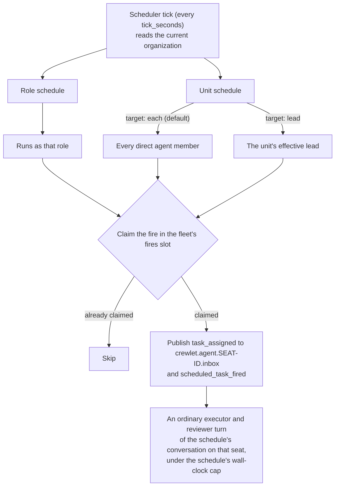

# Scheduling

The **Scheduler** (`internal/schedule`) lets an agent — or a whole unit —
own **recurring work** without an external cron emitting webhooks into
the engine. A QA Engineer can run a smoke-test pipeline every morning, a
team can hold an async standup at 9:30, a Knowledge-Base agent can audit
Confluence weekly — all declared in the YAML org config.

Schedules are a first-class part of the org model: they hang off a
**role** (a `roles:` entry's `schedules`) or a **unit** (a `units:` entry's
`schedules`), share one [`Schedule`](#the-schedule-model) model
(`org.Schedule`), and change live with the rest of the organization when a
config revision is applied.

---

## How it works

A single loop ticks on a short interval (default 10s). Each tick:

1. Enumerates every `Schedule` across the **current** organization (all
   roles and all units, read fresh each tick, so an applied revision takes
   effect on the next tick with nothing to rewire).
2. Works out which schedules are **due** since the previous tick.
3. Resolves the **runner(s)** for each due fire.
4. Claims the fire in the fleet's `fires` slot (at-most-once) and
   publishes a `TaskAssigned` to each runner's inbox topic
   (`crewlet.agent.{seat-id}.inbox`), stamped with the schedule's
   conversation.

Because it reuses the existing `TaskAssigned` event, the agent runtime
path is **unchanged** — a scheduled turn runs executor → reviewer like
any other, and the **full learning loop** (episodes, diary, reflection)
runs on it. Periodic work is *more* worth learning from, not less. And a
schedule is a **conversation of each seat that runs it**: each fire's turn
continues the session the schedule's last fire left on that seat, and is told
how the earlier fires ended
([Each fire continues the last fire's session](#each-fire-continues-the-last-fires-session)).



---

## The `Schedule` model

```yaml
schedules:
  - name: morning-smoke        # unique within the role/unit; part of the idempotency
                               #   key and of the schedule's conversation
    cron: "0 9 * * 1-5"        # standard 5-field cron (see below)
    timezone: Europe/Amsterdam # IANA tz; falls back to the company's `timezone`
    task: "Run the smoke-test pipeline and triage failures"
    target: each               # unit schedules only — each | lead
    enabled: true              # set false to keep it in config without firing
    timeout_seconds: 1800      # hard wall-clock cap on the turn, its run included
                               #   (default 1800 s — twice a slow ritual's box, run
                               #   and review, so reaching it means stuck)
    catchup: true              # fire one recent missed tick on restart (see Catchup)
```

| Field | Default | Meaning |
|-------|---------|---------|
| `name` | — (required) | Identifier, unique within the role/unit. Renaming lets a same-minute fire re-run once, and **starts the schedule's conversation afresh**: the renamed schedule's next fire continues nothing its fires under the old name left ([Each fire continues the last fire's session](#each-fire-continues-the-last-fires-session)). At most 400 bytes as that conversation's key spells it — escaped as a URL path segment is, so a space, a slash and most punctuation take three bytes each and a letter outside ASCII six or more. It is also what a fire is **labelled** by — the feed's line and the turn's label read `swe was assigned scheduled work morning-smoke` — so every fire of one schedule reads alike, and is [recalled](agent-learning.md#4-episodes-and-query_episodes-search-own-past) alike; the fire's own run id stays in the event's detail. |
| `cron` | — (required) | 5-field cron expression, evaluated in `timezone`. |
| `task` | — (required) | The task prompt handed to the runner agent. |
| `timezone` | the company's [`timezone`](#which-clock-a-schedule-fires-on) | IANA timezone the cron is evaluated in. |
| `target` | `each` | **Unit schedules only.** Who runs it (see [Delivery](#delivery-who-runs-it)). Ignored for role schedules. [Human seats](humans-in-the-org.md) never run schedules: `each` fans out to direct agent roles only, an enabled `lead` schedule under a (possibly inherited) human lead is a config error, and human seats cannot define role schedules. |
| `enabled` | `true` | `false` keeps the schedule in config but never fires it. An enabled schedule nothing can run — `each` on a unit with no direct agent member, `lead` under a person, or a schedule on a human seat — is refused in the company document, a member made a person's seat included. A `lead` schedule on a unit nothing leads is admitted and skipped by the scheduler, which logs `schedule_no_runners` whenever it is due. |
| `timeout_seconds` | `1800` | Hard wall-clock cap on the scheduled turn, its executor's run included. See [Hard wall-clock timeout](#hard-wall-clock-timeout). |
| `catchup` | `true` | Whether to fire a recent missed tick on (re)start. |

Config load (and so `crewlet validate`) checks each schedule's shape: a
non-empty `name` and `task`, a `name` of at most 400 bytes once escaped, a
`cron` with exactly five fields, a `timezone` that loads and is not `Local` or
`localtime`, a non-negative `timeout_seconds`, a `target` of `each` or `lead`,
and names unique within the owning role or unit. A written document is also
held to the cron **grammar** — the same parser the scheduler evaluates it
with — so an expression with five fields and an invalid value (`61 * * * *`,
`0 9 * * MON-FRY`) is refused at that schedule's `cron`, naming the field
and the value. The grammar is an
[admission rule](configuration.md#what-a-stored-revision-is-held-to): a
revision being applied that carries one (a newer peer's, admitted under other
rules) still applies, its node logs `org_admission_warning`, and that one
schedule is skipped on every tick with `schedule_parse_failed` naming it while
the rest of the company runs.

The name's bound is measured **escaped** because every fire is filed under the
schedule's conversation key on its runner seat's
[executor log](conversation-sessions.md#where-a-session-lives), which spells
the name that way, and the log refuses a key longer than 512 bytes rather than
cut one — a cut key would merge two conversations. The key spends at most 79
bytes before the name (the `schedule/` prefix, the scope, a unit's key of at
most 64 bytes or a seat's 36-byte agent id, and two separators), so 400 leaves
the log's bound room to spare. It admits any name of at most 133 bytes,
whatever it holds; any name of up to 400 bytes that escapes nothing — ASCII
letters and digits, `-`, `.`, `_` and `~`, and the `:`, `@`, `&`, `=`, `+` and
`$` a path segment keeps as they are — and so every Kubernetes object name (at
most 253 bytes of lowercase letters, digits, `-` and `.`). A longer name that
escapes is refused: forty-five Japanese characters are 135 bytes, and 405
escaped.

### Which clock a schedule fires on

A schedule that names no `timezone` fires on the **company's clock** — the
top-level [`timezone`](../getting-started/configuration.md#the-companys-clock)
of the company document, UTC when absent — which is the same clock every
"today", due band and overdue mark in the tracker is cut on. So a
`0 9 * * 1-5` standup on a Berlin company fires at 09:00 in Berlin, on the day
the board calls today. There is no scheduler-wide default zone: one would be a
second company clock, and a standup that fired at 09:00 on one clock while the
board cut its days on another disagreed with it about which day that 09:00 was
on.

A schedule's own `timezone` is that one piece of work's wall clock — the
Tokyo team's 09:30 standup on a Berlin company — and nothing else is cut on
it. `Local` and `localtime` are refused for both: each is whatever zone the
host reading it is set to, and the scheduler is a [singleton
duty](seat-ownership.md#singleton-duties) that moves between hosts, so the
standup would move with it.

The company's clock is read at **every tick**, like the org is, so an apply
that changes `timezone` moves the next tick's fires without re-arming the
loop.

### Cron syntax

Standard five fields — `minute hour day-of-month month day-of-week` —
with `*`, ranges (`1-5`), steps (`*/15`, `0-30/10`), lists (`9,17`), and
three-letter month / day names (`JAN`, `MON`). Day-of-week accepts `0-7`
where both `0` and `7` are Sunday. **Vixie semantics:** when *both*
day-of-month and day-of-week are restricted, a day matches if **either**
matches.

```
"30 9 * * 1-5"   09:30, Monday–Friday
"0 9,17 * * *"   09:00 and 17:00 every day
"*/15 * * * *"   every 15 minutes
"0 14 * * 5"     14:00 every Friday
"0 2 1 * *"      02:00 on the 1st of each month
```

---

## Role vs unit schedules

```yaml
units:
  - name: Backend
    id: backend                          # the unit's key; `name` above is display
    type: team
    lead: backend-lead                   # the lead seat's handle
    channel: backend                     # a channel NAME, not an id or `#backend`
    schedules:
      # target defaults to `each` → every direct member posts their own update
      - name: daily-standup
        cron: "30 9 * * 1-5"
        timezone: Europe/Amsterdam
        task: "Post your standup: shipped yesterday / on today / blockers."
      # opt-in lead-coordinated variant (gather + summarize)
      - name: weekly-report
        cron: "0 16 * * 5"
        timezone: Europe/Amsterdam
        target: lead
        task: "Collect the week's progress from your reports and post a summary to the team channel."
    roles:
      - name: Backend Lead
      - name: Backend Dev
        schedules:                       # role-scoped — runs as this role
          - name: morning-smoke
            cron: "0 9 * * 1-5"
            task: "Run the smoke-test pipeline and triage failures"
```

A **role** schedule always runs as that role (its `target` is ignored). A
**unit** schedule resolves its runner(s) from `target`.

Runners are resolved from the **org**, never from the agents running in
the ticking process. A fire is addressed to the runner seat's inbox and
consumed by whichever node owns that seat — which is rarely the node
whose tick won the ledger claim. The seat's agent id comes from
`org.Organization.AgentIDFor`, the same UUIDv5 over (company name, handle)
every node derives, so the `TaskAssigned` a scheduler publishes names
exactly the identity the turn will run under.

> **Schedules are not inherited.** Unlike `lead` and `channel`, a
> schedule on a department does **not** cascade to child units — that
> would silently multiply a standup across every squad. Declare schedules
> explicitly on each unit that should run them.

### Delivery: who runs it

| `target` | Runner(s) | Use it for |
|----------|-----------|------------|
| `each` (**default**) | every **direct** role of the unit | async standups, "everyone files their own status" |
| `lead` | the unit's effective lead (`org.Organization.EffectiveLead`) | gather-and-post standups, weekly reports, "review overnight Jira for the team" |

These are the only two unit-schedule targets. There is intentionally no
"specific role" target: a static role pin is exactly what a **role
schedule** is, so to run a recurring task as one person, put a schedule
on that role. `lead` is kept because it's *dynamic* — it follows whoever
leads the unit (including inherited leads), so the schedule survives a
leadership change untouched. Its session does not move with it: a session is
the seat's that kept it, so a new lead's first fire starts the schedule's
conversation afresh on that seat
([Each fire continues the last fire's session](#each-fire-continues-the-last-fires-session)).

`each` fans out **one independent task per member** — each with its own
dedup identity and its own conversation on that member's seat — so a slow or
failing member never blocks the others, and no member continues another's
session. `each` resolves **direct** roles only, never descendant units.

A standup is just a scheduled task: the runner does any fan-in with the
colleague tools it already has (`a2a_ask`, Slack reads, the roster). There
is no dedicated "standup" primitive — the same shape covers retros, sprint
kickoffs, demo-prep, on-call handoffs, and [manager 1:1s](one-on-ones.md)
(an `each` schedule where each report opens a private A2A review with its
manager).

---

## Guarantees

### At-most-once

Every fire is claimed in the [coordination store](coordination.md)'s
`fires` slot before publishing — a first-writer-wins key per dispatch
identity, so a restart, a slow tick, a re-evaluated minute, **or the
scheduler duty moving to another node** can never fire the same run
twice.

```
scope_type · scope_id · schedule_name · fire_label · target_handle
```

The claim is shared rather than node-local because the scheduler is a
[singleton duty](seat-ownership.md#singleton-duties) and therefore
*moves*: a lease lapse, a drain or a rolling upgrade hands the tick to a
peer, and a peer reading its own database would find an empty ledger and
let its catchup pass re-fire everything the previous holder claimed.

`fire_label` is the schedule's **local wall-clock** stamp
(`YYYYmmddTHHMM` in its timezone), not the UTC instant — so the dedup is
DST-correct (see [DST & cron edge cases](#dst--cron-edge-cases)). The
identity is five separate components, and the key they are rendered into
escapes each one, so a delimiter inside a unit or schedule name cannot
make two different fires claim one key. The first four name the **minute**
and lead the key, with the runner after them, so every claim on one minute
sits under one prefix: that is how the catchup pass asks whether anybody
holds a minute at all ([Missed-tick catchup](#missed-tick-catchup)).

`scope_id` is the scope's **identity**, not the name you wrote: a seat's
agent id for a role schedule, a unit's key for a unit one. Neither moves
when somebody relabels a team, so two teams that happen to share a display
name can no longer share a fire, which while the key was that name meant one
team's standup claimed the other's minute and the other never ran. Every
surface that shows a scope shows `scope_name` beside it: the handle, or the
unit's key, resolved through the company the node is running.

The claim **fails closed**: a coordination store that cannot be read
yields no dispatch and the tick is retried on the next one. That is the
opposite polarity to the [completion ledger](seat-ownership.md#the-completion-ledger),
deliberately — that one asks "has this work been done", whose safe answer
is to re-run, while this one asks "may I start", whose safe answer is to
wait.

`scheduled_runs` (the node's own table) stays as **this node's audit
record** of what it dispatched, which the retention sweep purges after a
week. The node derives every fire in it into the replicated usage history
([Observability](#observability)), which is what the dashboard reads. It is the same split the token counter made
when it moved to the shared `budgets` slot:
what the fleet has to agree on is "may I start", and whether anybody started a
given minute. Its
`outcome` is `fired`, `skipped_catchup` or `skipped_paused`, and the schedule's
history reports a fired run its seat did not run as `skipped_superseded`
(see *Fires that wait in a seat's inbox* below); the downstream turn result
(done, failed or timed out) lives in the normal turn telemetry
(`agent_turn_completed`, and `turn.guard_breach` when a guard fired) under
the same trace, because every fire starts a trace of its own and the turn
restores it.

> The at-most-once guarantee lives in the coordination store, not in the
> node's file: a node whose `scheduled_runs` table cannot be read still
> schedules correctly, and what it loses is the history of its own fires in
> the dashboard.

### Missed-tick catchup

Catchup is evaluated only on the **first tick after (re)start**. If the
engine was down across a scheduled fire, the **single most-recent** missed
fire is run if it falls inside the catchup window — *half the schedule's
period, clamped to `[catchup_min_seconds, catchup_max_seconds]`* (default
120s–7200s). Older misses are never backfilled; a missed fire outside the
window is recorded as `skipped_catchup` for audit. Set `catchup: false` on
a schedule to opt out entirely.

The most recent fire is usually one the engine ran before it went down, so
it is recorded as missed only when **nobody holds its minute** in the
coordination store's `fires` slot:

- A fire claimed for any runner, as `fired` or as `skipped_paused`, ran or was
  held back on purpose, and the restart records nothing for it.
- A minute an earlier restart already recorded as `skipped_catchup` is not
  recorded, or logged, a second time.
- A fire older than the `fires` slot's retention (a week) is neither run nor
  recorded: the fleet no longer remembers whether it ran, so a monthly
  schedule restarted a fortnight after its fire says nothing about that fire.

The skip names no runner, so it never takes the claim a runner's fire for the
same minute needs. The question is asked of the fleet rather than of the
node's own `scheduled_runs`, because the node holding the scheduler duty after
it moves has none of its predecessor's rows.

### Fires that wait in a seat's inbox

A fire is sent to its runner's inbox as soon as it comes due, and a seat that
cannot work right then (parked on a provider's usage limit, on its budget, or
held by one of its executors) keeps its inbox held, so the fire waits there.
A schedule that keeps firing meanwhile queues one fire per tick behind the
same hold.

Every fire of one schedule carries one inbox partition, the schedule's
conversation (below), so the fires that waited reach the seat together, and
the seat runs **only the latest** of them. That run's brief says how many
earlier fires it stands for and when they were due, so the seat does the duty
once, as of now. Each earlier fire is
recorded as `scheduled_fire_superseded` under its own trace, and the
schedule's history shows it as `skipped_superseded` beside the run that took
its place. The seat's node publishes that record in its own day of the
replicated usage history, and the history joins it to the fire by trace, so
the fire reads as skipped whichever node ran the scheduler and however many
days the seat waited.

A person's pause is different: a paused seat's fires are not sent at all
(below), so nothing waits for the resume.

### Each fire continues the last fire's session

A schedule is a **conversation of each seat that runs it**. The scheduler
stamps every fire with the schedule's conversation key —
`schedule/<scope>/<scope id>/<name>`, where the scope is `role` or `unit`, the
scope id is the seat's agent id or the unit's key, and each part is escaped as
a URL path segment — as both its inbox partition and its
[conversation identity](event-system.md#inbox-batching--coalescing). A seat's
executor sessions are kept per seat and conversation
([Conversation Sessions](conversation-sessions.md)), so one seat's fires of one
schedule are one conversation of that seat, and the schedule's next fire there
is that conversation's next turn:

- its dispatch reads the session the schedule's last fire left on the seat —
  the conversation's head, of the ended fires whose session is still kept the
  one that read the conversation last — and its first launch continues that
  session in a box of its own, led by
  `## A new fire of this schedule begins here`;
- every brief of the fire carries `## How this schedule's earlier fires ended`
  above `## Task` — how each earlier fire ended, its reviewer's last word, what
  landed, what blocked it — so a fire that starts fresh is still told how the
  earlier ones went;
- once a fire that kept a session of its own ends, the earlier fires its brief
  told are gone from the log, as a conversation's turns are
  ([Read once, frozen, held](conversation-sessions.md#read-once-frozen-held)).

So a health check reads what the last one found and a standup what the last one
said, in the session that found and said it.

**What keeps the line, and what starts it afresh.** The key is the schedule's
identity and nothing else. An edit to its `task`, `cron`, `timezone`,
`timeout_seconds`, `enabled` or `catchup` keeps the conversation, and so does
a schedule deleted and declared again under the same name on the same role or
unit while the retention still holds its last session. A new key starts
afresh, its next fire continuing nothing:

- a schedule renamed;
- a schedule moved between a role and a unit;
- a role schedule of a company whose `name` changed, since a seat's agent id is
  derived from it. The rename orphans what a seat keeps under that id — its
  diary and its onboarding markers
  ([The one thing to get right](../getting-started/ai-authoring.md#the-one-thing-to-get-right-before-you-run))
  — but no other conversation's session: a seat's sessions are kept under its
  handle, so its threads, issues, pull requests and unit schedules go on
  continuing theirs.

A session is also the seat's that kept it, so a seat that starts running a
schedule — a new lead of a `lead` schedule's unit, a new member of an `each`
one, a seat a changed `target` reaches — starts the schedule's conversation on
its own seat, and continues it from then on.

**Kept for `retention_days`.** A fire's row lives
`turn_engine.conversation_session.retention_days` (30 by default) past its last
record unless the next fire took it up first, so **a schedule whose fires are
further apart than `retention_days` never continues**: its last session is
gone before its next fire comes, and every fire starts fresh. A monthly
schedule fires 28 to 31 days apart, which the default does not always cover;
set `retention_days` to 32 to keep its line, which keeps every seat's sessions
that much longer, within each seat's byte budget
([Configuration](conversation-sessions.md#configuration)).

**What it costs.** A continued fire sends the schedule's session, its whole
context, before it reads its brief, and every request of its run carries that
context again: mostly read from the prompt cache, and every token of it counted
against the seat's windows. The harness's compaction bounds it: Claude Code
compacts at its model's window less its own headroom, and OpenCode near its
model's own window. So a fire of *n* Claude Code requests on a 1 000 000-token
model is charged up to about *n* × 967 000 input tokens before its output,
where a fire started fresh begins at its harness's own prompt and its brief: an
hourly check whose session has reached that point and whose run makes ten
requests is charged about 9.7 million input tokens a fire, some 232 million a
day. The fire's first launch is held to that context, as any continued launch
is, and waits for a window with room for it
([Budgets and Spend](../guides/budgets-and-spend.md#budget-windows)). There is
**no per-schedule switch**: a schedule is a conversation like any other, the
seat's and the company's ceilings and that launch floor bound what its fires
spend, and `turn_engine.conversation_session.enabled: false` starts every fire
fresh, as it does every conversation's next turn.

**Fires that waited together run once**, as above: the latest, a turn of the
schedule's conversation, which reads the schedule's last session once for every
fire it stands for.

**Nobody can reply into it.** Every fire of a schedule carries its key and
nothing a person writes does, so a fire is never taken as the answer to the
question the schedule's last fire parked on, and a fire's run that parks on a
question is answered by its turn
([Answering a parked run](code-sandbox.md#answering-a-parked-run)), never in
chat.

**A fire parked on a question holds nothing up.** A run that parks on a
person's question frees its seat, and no fire is its answer, so the schedule's
next fires run beside it, each continuing the session the one before it left.
When the parked fire is answered or stopped and ends after them, it does not
take the line over: a conversation's head is the turn that read it last
([Read once, frozen, held](conversation-sessions.md#read-once-frozen-held)), so
the next fire continues the session the last of those fires left, is told how
the parked one ended, and its end absorbs the parked fire's session with the
rest. The person's answer is in that session alone, so the fire that continues
the line does not read it; what the parked fire did with it is told in its
ending. Under budget pressure the seat's session budget, which releases the
oldest end first, can release the last of those fires' session before the
parked fire's; the next fire then continues, of the sessions the schedule
still keeps, the one that read it last — the parked fire's, answer and all —
and is told how the last of those fires ended
([Code Sandbox](code-sandbox.md#a-conversations-next-turn-continues-its-last-turns-session)).
And the schedule never waits for the answer: it fires whatever its last run is
doing, as a failing or timed-out run never blocks its next tick
([Hard wall-clock timeout](#hard-wall-clock-timeout)).

### Fires that wait for a seat's mailbox

A fire is claimed only once its runner seat's mailbox (its inbox and its
priority lane) is confirmed, because the claim is spent the moment it is
written and a seat's inbox drops what is published while no mailbox covers it.
A fire whose seat's mailbox cannot be confirmed (the broker refused to make it)
is not claimed, and the tick keeps its window open, the same way a shedding
tick does: the next tick evaluates the window again, the fires already claimed
are left alone, and the waiting fire is claimed and sent once the mailbox is
confirmed. Fires of one schedule that waited this way reach the seat together
and run once, as above. The window is held for at most `catchup_max_seconds`
(two hours by default); a fire still waiting past it is recorded `skipped_catchup` under
its runner, so it is never lost without a row saying so.

### A paused seat's fires are skipped

A fire that comes due while a person has its runner seat
[paused](agent-runtime.md#pausing-a-seat) is **claimed and recorded
`skipped_paused`**, and not sent. It is not queued behind the pause: the
seat's inbox is held while it is paused, and a fire waiting there would run
whenever somebody resumed it — a standup days late, one for every day of the
pause. Claimed under the fire's own identity (its runner included), so a peer's
tick of the same minute, or this node's after the resume, does not send it
after all; a resumed seat picks up at its next fire.

Each node reads the pauses from its own watched copy of the coordination
record, so the answer follows the duty wherever it moves. A node that has not
read the pauses yet (the seconds after a boot) dispatches the fire, the
opposite polarity from the duty's own unknown: a paused seat's inbox holds a
fire rather than running it, while a fire skipped on a read that failed is a
standup lost for a seat nobody paused.

### Hard wall-clock timeout

Each scheduled turn carries `timeout_seconds` (default 1800, half an hour —
see *Half an hour, for a ritual* below), on the fire's own `task_assigned`
payload. The turn engine checks it **between rounds**: a turn past the cap
starts no further executor and reviewer round and ends `failed`, with a
`turn.guard_breach` event of kind `scheduled_timeout` and
`error_kind: scheduled_timeout` on its `agent_turn_completed` event, so a
runaway loop can't monopolise the runner. A failing or timed-out run never
blocks the next tick.

**Between rounds, never mid-phase.** A phase that is running may already have
fired side effects — a post, a comment, a status change — and abandoning it
there would leave one half-written with nothing recording that it happened.
That is the same reason a [drain](turn-engine.md) lets a running turn finish.
So the cap refuses to start the next round rather than interrupting the
current one, and a single round that outruns the cap is bounded by the phase
timeouts beneath it. Round one always runs: a cap that refused before any work
started would report a turn as timed out having done nothing, which is a
misconfiguration rather than a slow turn.

**The cap spans the whole turn, its executor's run included.** An agent
seat's executor is its harness's own [run in a box](code-sandbox.md), and
the turn parks while the run works, so a turn is several segments — the
launch, then one per collection — and a reviewer that sends the work back
launches the run again. The cap is an instant, measured from when the fire's
turn began and carried on the park, so every later segment is held to the
same one: the round a segment collects always runs, and none after it starts
once the instant has passed. The run itself is the part that can outlast the
cap by hours, so the instant is written on its row too
([`PendingRun.Deadline`](code-sandbox.md)): the completion poll ends a run
still working past it as if it had finished, logging
`sandbox_run_past_deadline`, and the collection that follows
[ends its job](code-sandbox.md#each-launchs-session-kept) as a person's stop
does — its harness told to stop and its session packed as its own end packs
it — reads what it did up to then and resumes its turn to judge it, rather
than cutting it off with its work unrecorded.

**Half an hour, for a ritual.** The clock runs from the moment the fire's turn
begins, so everything up to the end of the run is on it: the turn-start
prefetch (each auxiliary call held to thirty seconds), a seat's first-turn
[onboarding pass](turn-engine.md#first-turn-onboarding), the box's start (a
container's within the two minutes its runtime is given, a cold image pull
included) and the seat's
[setup](code-sandbox.md#setup-steps--provisioning-the-box) applied, then the
run itself — for a standup, reading what it needs, posting once and
submitting: some five to ten of its harness's own rounds, ten minutes at the slow
end — and the reviewer. A slow ritual that is not stuck takes about a quarter
of an hour. Half an hour is twice that, so a reviewer's send-back still fits
and a turn that reaches the cap is stuck rather than slow. It stops there
because a longer cap is not free: a seat takes no other work while its run
works, so the messages sent to a seat whose ritual is wedged wait until the
cap ends it. Give a schedule whose runs routinely need longer — each one that
does logs `sandbox_run_past_deadline` — a `timeout_seconds` of its own.

**A schedule that fires every few minutes.** The cap is also what frees a
seat before its next fire, which half an hour does for a daily or weekly
ritual by hours and does not for a schedule that fires more often than that.
The scheduler fires on time whatever the seat is doing; a fire that comes due
while the turn before it still holds the seat waits on the seat's inbox, and
once that turn ends the fires that waited run as one turn, the latest, the
rest recorded `skipped_superseded`
([Fires that wait in a seat's inbox](#fires-that-wait-in-a-seats-inbox)). So
such a schedule runs late whenever one of its turns outlasts its period, and
runs fewer turns than it fires for as long as they keep doing so: fire it less
often, or give it a `timeout_seconds` comfortably below its period, which
cuts a turn that runs long before the next fire is due — the reviewer still
judges what its run did by then.

---

## Configuration

System-level knobs live under a top-level `scheduling:` block:

```yaml
scheduling:
  enabled: true              # master switch
  tick_seconds: 10           # scheduler poll interval
  jitter_seconds: 0          # max per-schedule deterministic spread (see below)
  catchup_min_seconds: 120   # lower clamp on the catchup window (at least 1)
  catchup_max_seconds: 7200  # upper clamp on the catchup window
  work_pickup:
    enabled: true            # hand an idle agent seat its next ready item
    cooldown_seconds: 600    # least time between two pickups of one seat, 60..1800
```

There is no zone here: a schedule that names none fires on the company's
clock (see [Which clock a schedule fires on](#which-clock-a-schedule-fires-on)).

Nor is there a switch for whether a fire continues the last fire's session:
that is `turn_engine.conversation_session`'s, for every conversation of the
company alike — `enabled` keeps and continues sessions, and `retention_days`
is how long a schedule's last session waits for its next fire
([Conversation Sessions](conversation-sessions.md#configuration);
[Each fire continues the last fire's session](#each-fire-continues-the-last-fires-session)).

The scheduler **auto-enables** when `enabled` is not `false` and the org
actually declares at least one schedule (see [When the loop runs](#when-the-loop-runs)):
orgs with no schedules never spin up the tick loop.

### Thundering herd (jitter)

When many schedules share a popular minute (everyone writes
`0 9 * * *`), they all become due at once. Each node's turn concurrency
gate (`node.max_concurrent`) already queues the burst, so this is a
smoothing concern, not a correctness one. Set `scheduling.jitter_seconds` to a non-zero value to
spread firing: each schedule gets a **deterministic** offset in
`[0, jitter_seconds]` derived from its scope + name, so the 9am wave is
fanned out across that window. The canonical fire minute still forms the
idempotency key, so dedup is unaffected. Default `0` fires exactly on the
minute.

---

## The work pickup

A schedule fires on a clock. The **work pickup** is the engine's own
cadence for the work an agent seat already holds: when a seat is idle and
holds assigned work that is ready, the node holding it hands it its next item
([ADR-0112](../../adr/0112-an-idle-seat-is-handed-its-next-ready-item-once-per-item-version.md)).
It exists because every other wake comes from a change. An assignment wakes
its assignee once, and a turn that did not start the work (the seat was busy,
it answered a chat message first, it said it would come back to the item) was
the last word anybody said about that item.

- **Idle** is decided by the node that holds the seat, once a minute: no turn
  of the seat dispatching, no executor run holding it or waiting on a person's
  answer with its box still paused (within the role's `pause_ttl_seconds`; a
  run past its pause still takes its answer when it comes, but no longer keeps
  the seat from its ready work), nothing waiting in its inbox, not paused, not parked on a token
  budget or a provider limit, no budget window or provider limit that would
  refuse its next launch, and the node neither shedding nor draining. All of
  that must hold on two passes in a row, so the writes of the turn that just
  ended are on the node's copy first: a seat is handed its next item within
  about two minutes of going idle. The same pass ends a parked run nobody can
  continue any more: one whose Worklet item was finished or removed while it
  waited (`executor_failed`, reason `item_finished`) and one whose saved state
  no live build reads (`state_retired`); its question is withdrawn and a reply
  on it goes back to the seat.
- **Ready** is Worklet's: assigned to the seat, `in_progress` or `todo`,
  waiting on no open blocker, past its start date, and not held on a question
  the seat itself asked on the item that nobody has answered. Work in review
  is ready on the same terms for the seat that holds it when somebody else
  moved it into review (or filed it there): a seat handed a review takes it up,
  and the pickup names who asked for it. A seat never reviews what it submitted
  itself: its own item in review is ready for it only while nobody reviews it
  (no question of its own is open on the item), and the pickup says so, so it
  acts on the review it was given or names a reviewer ([ADR-0124](../../adr/0124-a-question-and-a-review-say-whom-they-wait-on.md)).
  One wait is ready before its date: an agent's wait whose reason names a
  person (by `@handle`, or by the name the org chart gives them) that the agent
  who set it has not asked on the item. A wait on a person is an ask, so the
  pickup hands such an item to its holder before the date, naming the person,
  however and whenever the wait was written, and hands it once more when the
  date comes ([ADR-0122](../../adr/0122-a-pickup-is-answered-with-a-typed-outcome-and-a-wait-on-a-person-is-an-ask.md)).
  And one wait on a blocker is ready: a **dead wait**, an item whose every open
  blocker is a pull request nothing is moving (below).
- **Next** is work the seat already started first, then the reviews it holds,
  then its own items in review nobody reviews, then its waits on a person
  nobody asked, then its dead waits, then its priority list in the order its
  lead set, then the rest by priority and due date, the order `my_work` lists
  them in.
- **Once per item version.** A pickup is made once per seat, item, last change
  to the item that would have woken the seat, status and, for started work, the
  seat's own last progress on it other than a comment. That change is the
  newest notice the seat was told of the item that started a turn, so the
  pickup and the wake decide by one rule: another agent's comment that asks
  nothing, or a watcher added, tells the seat and hands it nothing again. The fleet's completion ledger
  remembers it for seven days whichever node holds the seat, and a fleet claim
  keeps two nodes from both sending it during a move. A seat that answers an
  item with a typed answer that takes it out of its ready work (a question, what
  blocks it, a wait, another assignee) is not handed it again until a change
  that would wake it lands, or the date it set the item aside until comes. Started work the seat makes
  progress on (a field it changes, never a write of the value already there)
  is handed back when it is idle again, at most once per cooldown (the next
  ready item is handed over meanwhile), and a turn that changed nothing does
  not bring it back.
- **Words hold an item for a day, not for good.** An item still ready for the
  seat, left with a comment that it still waits, with an edit of its content
  that leaves it ready, or with nothing at all, comes back to it once a day: a
  day after it went quiet (the latest of the change that last woke the seat,
  the date it waited until and the seat's own last write on it, whatever that
  write was), the pickup is new work and is handed once more, saying so. A
  recheck is never handed within a day of the end of the item's last pickup,
  so an item quiet for days before it was first handed does not come back
  within the hour. A day is the stand-up rhythm a team rechecks a stalled item
  at, and it is not configurable. An item answered in words before this rule
  comes back by it too ([ADR-0122](../../adr/0122-a-pickup-is-answered-with-a-typed-outcome-and-a-wait-on-a-person-is-an-ask.md)).
- **A wait nothing moves comes back, once per head.** A typed wait on a pull
  request (`waiting_on` its URL) holds the item until the pull request merges
  or closes ([ADR-0121](../../adr/0121-a-pull-request-a-task-waits-on-reaches-it-as-the-engines-record.md)),
  which never happens where nobody reviews or merges it. So the poll of open
  pull requests also reads whether anything moves each one: a reviewer or a
  team asked for, a review submitted on its current head by anybody but its
  author, a merge armed on GitHub, or an `ask_to_merge` call held for it. Where
  nothing does, and the item has waited at least 15 minutes, the engine records
  a dead wait on the item at that head
  ([Worklet](../guides/worklet.md#dependencies-and-the-set-valued-arguments)). An item whose every open
  blocker is a dead wait is ready for its holder, unless a reviewer holds it in
  review (somebody else moved it there) or its holder's own question on it is
  open; its holder's own item in review with nobody reviewing it is ready too.
  The pickup names the pull request, its head and who opened it, and says the
  next step: move the item to review naming its `reviewer` (and ask for their
  review on the pull request), ask the reviewer on the item with `ask`, or ask
  to merge it with `ask_to_merge`. It is handed **once per head**: its key is
  the heads nothing moves and nothing else, so another change on the item, a
  day's wait or the seat's own edits hand it no second time, and a new head
  that nothing moves either hands it once more. It is never rechecked daily.
  The completion ledger remembers a pickup for seven days, so a head nothing
  has moved for a week comes back once more then. A pull request the engine
  cannot read records nothing, so it wakes nobody
  ([ADR-0128](../../adr/0128-a-wait-nothing-moves-is-handed-back-once-per-head.md)).
- **Past the first page.** Ready work is read twenty items at a time, so item
  twenty-one onwards is handed over once the first twenty were, and a seat
  whose whole ready set was handed over already is not asked about again until
  the set changes. Each status is read to its first 200 items.
- **Declines are spaced, work is not.** A fleet claim on the seat spaces a
  pickup by `cooldown_seconds` only when it passes over an item the seat was
  handed and left unchanged, so a seat that declines one item after another is
  offered the next at most once per cooldown, and a seat that finishes an item
  is handed the next at once.
- **Worked for whom the item is for.** The turn is held to the apps of the
  writer of the item's last assignment by somebody else, else of whoever
  filed it, and a credential to the apps it wrote under, exactly as the turn
  its assignment woke ([ADR-0109](../../adr/0109-a-turn-somebody-woke-is-held-to-the-apps-they-use.md)).
  An assignment is any change that moved the item's assignee, whatever else
  the same write changed: handing an item over and setting it to `todo` in
  one update is an assignment by whoever made it. Naming the assignee the
  item already has moves nothing and is none. A seat the organisation no
  longer holds is worked for as a stranger, and a write an older build
  recorded carries no apps. An agent's assignment or filing made in a turn
  somebody woke is worked for that somebody, as the turn it woke was: the
  history row keeps whom it was written for (`working_for`). Work the seat
  filed for itself is its own, unless it filed it in a turn for somebody;
  and its own take of an item counts only when it was made for somebody, so
  a take-back made on its own initiative still works for whoever assigned
  the item before.

The wake is a `work_pickup` naming the item, its status and why it was
chosen, stamped with the instant of the change its key names and filed under
the item's own conversation so the turn continues the item's session.

**A pickup's turn is delivered only by a typed answer on its item**, and its
brief names the five: change the item's own fields (start it, finish it, move
it to review, edit its content); ask whoever must answer or decide first, with
`comment_on_work_item` and `ask`, which puts the question in their Inbox;
record the item or pull request that blocks it (`waiting_on`); set it aside
until a real date with why (`wait_until` and `wait_reason`); or reassign it.
A comment alone is not an answer: the engine cannot tell when the condition
such words name is met, so nothing would hand the item back when it is. The
engine reads the answer off the tracker's own record, the seat's rows on the
item since the turn began, never off the model's account, so a merge queue's
close of the item, made as the seat after its turn enqueued the change, answers
it too; and a submission, a round or a reviewer's `done` over words alone is
sent back naming the five
([ADR-0122](../../adr/0122-a-pickup-is-answered-with-a-typed-outcome-and-a-wait-on-a-person-is-an-ask.md)).
An item that leaves the seat while the turn runs, put in the trash, finished,
or handed to another seat or to nobody by somebody else, owes it nothing: the
turn ends as it is, and its `turn_completed` record says how the item was left
(`pickup_answer`: `typed`, `removed`, `finished`, `reassigned`, `unanswered`,
or `unread` where the read failed and the turn fell back to the delivery every
turn owes). A run lost or stopped before its turn ends is held to the same
reading: its delivery on the executor log stands only where the item was
answered typed or left the seat. A pickup answered typed, a question put with
`ask` included, counts as work moved in the advisor's turn ledger, so
`work.pickup_still_waiting` counts only the pickups nothing typed answered. A
dead wait handed back is counted under a wake of its own,
`work_item:dead_wait`, beside `work_item:pickup`, so the spend screen shows how
often items came back because nobody moved their pull requests, and the advisor
counts it among the pickups.
An item set aside until a date is handed once when the date comes. A company
on a vendor tracker, or with no model, gets no pickups.

`crewlet.work.pickups{outcome}` counts what each pickup decided for an idle
seat (`woken`, `nothing_ready`, `all_offered`, `cooldown`, `claimed`,
`unknown`), and every pickup logs `work_pickup_woken` with the seat, the item
and why; a pickup that could not be sent logs `work_pickup_skipped` at warn.
The poll logs `dead_wait_recorded` and `dead_wait_ended` for each item it marks,
and `dead_wait_asks_unread` at warn, once, while the held merge asks cannot be
read (no wait is judged then).

---

## When the loop runs

The engine arms the tick loop when four things hold, and re-checks all four
on **every config apply**:

1. `scheduling.enabled` is not `false`,
2. this node reaches the fleet's coordination store and the stream: the
   at-most-once claim lives in the coordination store, because a scheduler
   with a process-local claim looks identical to a correct one until there
   are two nodes, and then every company gets two standups. The node's own
   store is **not** a condition; without one the node only loses the
   history of its own fires,
3. the company actually declares at least one role or unit schedule,
4. the company configures at least one model provider under `providers.llm`.
   A company with none is valid, but its seats hold every delivery on their
   inboxes until a provider exists
   ([A Company With No Model Provider](configuration.md#a-company-with-no-model-provider)),
   so a loop firing through that wait would stack every missed standup
   behind the hold and run the whole backlog when the provider arrived. Each
   node logs `schedules_waiting_for_a_model` instead.

Because these conditions are re-evaluated live, adding the **first** schedule
to a running company, or the first provider to a company that has schedules,
arms the loop on that apply, and removing the last one disarms it and releases
its fleet duty; neither needs a restart. A freshly armed loop starts with the
missed-tick catchup described above, so a company whose provider arrives late
catches up at most its most recent missed fire, never the whole wait. The tick
*knobs* (`tick_seconds`, the catchup clamps) are read when the loop is armed,
so changing those lands at the next arm, like the retention sweep's horizons.

Whether this node has the loop armed is visible on the engine as
`Engine.SchedulerRunning`, and the `scheduler_armed` / `scheduler_disarmed`
log lines say when it changed. An armed loop fires only on the node that
holds the `scheduler` fleet duty.

---

## Observability

- **Dashboard.** **Company › Schedules** (`#/company/schedules`) lists every
  configured schedule (name, scope (a role's seat by its handle, or a unit by
  its key, each labelled with its name), cron with what it means in words,
  task, whom it wakes, when it next fires and how it last went) and the
  company's recent fires below it, both sortable. One schedule's own page
  (`#/company/schedules/{scope_type}/{scope_id}/{name}`) adds its whole
  definition, the fires after the next worked out in the schedule's own zone,
  and its own fires (the `schedule_runs` query, fifty to a page), because the
  company-wide list is only its newest fifty. The list is backed by
  `GET /schedules`, which serves `schedules` (the resolved schedule list with
  next-run times, projected from the current organization on each request)
  and `recent_runs` (the company's 50 most recent fires). The next-fire times
  tick as you watch: every relative time in the product reads one shared
  clock rather than being baked at render.
- **The history is the replicated usage domain's**
  ([ADR-0020](../../adr/0020-a-nodes-own-day-is-a-compacted-domain.md)), not
  the ledger of whichever node answers. Each data node derives the fires its
  scheduler recorded, and the fires its seats did not run, into its own usage
  day, and every data node applies every node's days, so the history is the
  whole fleet's, outlives a node that leaves and is kept 181 days. Each fire
  carries the tick it stands for (`scheduled_at`, `fire_label`) and what
  became of it: `fired`, `skipped_catchup`, `skipped_paused`, or
  `skipped_superseded` for a fire its seat did not run because a later fire
  ran in its place (see *Fires that wait in a seat's inbox*). A node publishes
  its day every 15 seconds while it moves, so a fire reaches the history
  within about that long of being sent; the screen asks again every 30
  seconds.
- **A seat's sessions.** Each fire's turn is a row of its runner seat's
  [Sessions](conversation-sessions.md#reading-it) (the Memory section of the
  seat's Activity tab, and `GET /agents/{id}/sessions`) under the schedule's conversation key,
  which the dashboard prints decoded (`schedule/unit/eng/weekly report`), and
  an ended fire's row says whether the schedule's next fire would continue it
  (`continued_by: next_fire`). The fire's turn telemetry and its episode carry
  the same key (`conversation_key`), so a schedule's turns on a seat can be
  asked for by it. A fire that starts fresh where a session was there to
  continue logs why, as `executor_session_not_continued`, and one whose
  dispatch could not read the schedule's last session logs
  `executor_conversation_unread`.
- **`ScheduledTaskFired`** event (`crewlet.events.scheduled_task_fired`) is
  emitted per dispatch with `scope_type`, `scope_id`, `scope_name`,
  `schedule_name`, `target_handle`, and `scheduled_at` — surfaced in the
  dashboard / event store.
- The coordination store's `fires` slot is the at-most-once claim; the
  node's `scheduled_runs` table is its own record of what it dispatched, kept
  a week, which its usage day is derived from.
- Structured logs: `scheduler_armed`, `scheduler_disarmed`,
  `schedules_waiting_for_a_model`, `schedule_fired`, `schedule_catchup_skipped`, `schedule_no_runners`,
  `schedule_parse_failed`, `schedule_claim_failed` and
  `schedule_publish_failed` (a claimed fire whose publish failed is not
  retried, because the broker may already hold it).

---

## DST & cron edge cases

- **Fall-back (clocks repeat an hour):** a wall-clock cron time in the
  repeated hour maps to two UTC instants, but both share one local
  fire-label, so the run **fires once**, not twice. (The claim identity
  uses the local wall-clock minute, not the UTC instant.)
- **Spring-forward (clocks skip an hour):** a cron time in the skipped
  hour has no instant that day, so it **does not run** that day — and
  nothing was "missed" from the window's view, so there's no
  `skipped_catchup` row. If a daily run is critical, use `timezone: UTC`,
  or keep it out of the skipped hour — which is **not the same hour
  everywhere**: it is 01:00–02:00 in `Europe/London`, 02:00–03:00 across
  most of the rest of the EU and in the US, and something else again in
  zones that shift by other amounts or on other dates. Check the hour for
  the zone you actually set rather than assuming 02:00; a `30 1 * * *`
  schedule on `Europe/London` is in the gap and silently skips one day a
  year.
- **Day-of-week ranges don't wrap:** `sat-sun` is rejected as a
  descending range (Sunday is `0`). Write `6-7`, `sat,sun`, or `0,6`
  for weekends.
- **Catchup window** is a bounded heuristic (half the period, clamped to
  `[catchup_min, catchup_max]`); for irregular cadences (e.g. `0 9 * * 1,5`)
  it's an approximation of the inter-fire interval, not an exact value.

## Out of scope

- **Multi-platform delivery.** The runner already owns its outbound
  surfaces (Slack channel, Jira project), so delivery routing is the
  agent's job, not the scheduler's.
- **Script-only monitors.** A cheap monitor runs as a low-budget role; the
  scheduler always dispatches to an agent turn.
