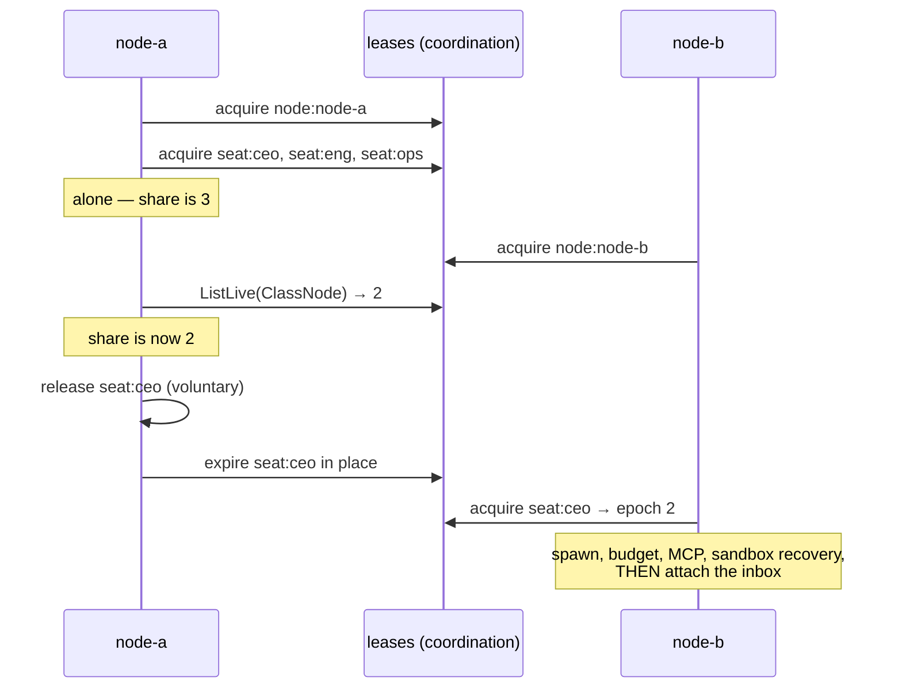

# Seat Ownership

A **seat** is a role in the org chart, addressed by its handle and identified by the id derived from it. **Seat ownership** is how a fleet of Crewlet nodes decides which node runs which seat, and how it guarantees no two run the same one.

A handle is what a founder types, what a `manages:` entry points at and what a screen shows. It is immutable: a document that changes one removes the seat and creates another ([ADR-0013](https://github.com/crewlet/crewlet/blob/main/adr/0013-a-seats-identity-is-derived.md)). The id is a UUIDv5 over the company name and the handle; the seat's lease, mailbox and memory changelog are named by it.

The rule the design serves: **a seat is not a thing you can half-own.** A node either holds a seat's lease, runs its agent, consumes its inbox and answers its sandbox completions, or does none of those.

---

## The problem

Every seat has a durable inbox topic, `crewlet.agent.{seat-id}.inbox`, consumed under a **durable subscription** named `agent-{seat-id}`, a competing-consumer group: each message goes to exactly one attached member.

If two nodes both attach, the broker splits the seat's traffic and one conversation runs as two interleaved turn streams on two processes. Turn exclusion is in-process state, so neither node sees the collision and nothing raises. Attachment must be exclusive and provably so across processes: that is what a lease is for.

---

## The lease

Ownership is a lease in the fleet's coordination store (`internal/coord`): a record with a TTL and a monotonic `epoch`. On a fleet (`coordination.type: embedded-kv`) the record lives in the `crewlet_leases` KV bucket, whose age limit is the lease TTL, and the epoch counter in the untimed `crewlet_epochs` bucket. A single node runs the in-memory twin of the same contract for its leases, and mints its epochs from the same untimed bucket, because the tokens are written into records that outlive its process (see [Coordination](coordination.md#the-leases-follow-coordinationtype-the-shared-state-does-not)).

```
seat:{seat-id}   owner=node-a:9f3c1e70   epoch=7   acquired_at=…   expires_at=…   preferred=node-a
```

- **The owner is a process incarnation, not a machine.** `{node_id}:{random}`, minted fresh at boot. A live lease is renewable by its own owner string, so two processes sharing an identity would both hold the seat at the same epoch, and the default node id is the shared constant `node-0`. The *stable* node id goes in `preferred`.
- **The epoch is a fencing token, monotonic for the resource's lifetime.** It is kept apart from the lease record, in a bucket with no age limit: a KV deletes a key on expiry, so a counter on the lease would restart at 1 and give the next owner a token its predecessor still uses.
- **A lapsed lease cannot be renewed, only re-acquired**, and re-acquiring bumps the epoch even for the same owner, because its in-flight work was unprotected during the gap and must be fenced against its own past self.
- **A claim that fails part way leaves nothing held.** On a fleet a new tenure is three writes: the lease record in a *claiming* state, the counter, then the token into the record. A claim that fails after the first (counter's bucket between leaders, a lost answer, a caller that gave up) gives its record straight back, so its owner or a peer can claim at once. The give-back takes only the record that call wrote, never a sibling claim's or a committed tenure; a counter the failed claim advanced is a harmless gap. Only a claim that dies, or whose store refuses the give-back too, leaves its record to lapse on the TTL, as a dead owner's lease does.

`acquired_at` is the coordination store's own timestamp on the write that won the lease, stamped when the epoch is minted and carried unchanged by every renewal, so it moves exactly when the epoch does. "node-2 · since 08:02" in the **Since** column of Settings › Nodes means the seat has not moved since 08:02. It is on the store's clock for the reason `expires_at` is, and nothing decides ownership by it: the fence is the epoch.

**A renewal is one round trip, and a pass sends them together.** The store keeps the record it last wrote of each lease it holds and the revision the broker gave that write, and renews with one write at that revision, which lands only while the record is still exactly that write ([Coordination](coordination.md#a-renewal-of-its-own-write-is-one-round-trip)). The heartbeat sends a pass's renewals together, up to 64 at once, with the presence's claim beside them: a pass over N seats is ⌈N/64⌉ round trips (100 seats at a 100 ms round trip in 0.2 s). Sequential two-trip renewals would let twenty seats at 100 ms fill the 4-second renew period of the [15-second floor TTL](coordination.md#the-lease-ttl-bounds-seats-and-presence-only), and seventy-five outrun the TTL. On the slowest link the engine allows, at the [object store's floor](object-store.md#the-fleets-own-bucket--nats-the-default) and a 0.6 s satellite round trip, the link sets the pace, carrying about 36 renewals at once. Each renewal is stamped at the instant it was sent, and answers are applied one at a time in order, so what a pass decides about a seat never depends on which answer came first.

**Renewals take a path of their own.** A node's claims, renewals and releases ride its **lease connection**, which nothing else rides (on a satellite, a second leaf link on the same port), so no upload, event or record it sends queues one where the path to the fleet shares fairly between connections; every listing and watch of the fleet's leases stays on its other connection ([Coordination](coordination.md#backends)). And it takes or keeps a seat only while its data path answers, since a seat it cannot serve should move ([below](#the-node-whose-broker-is-gone-and-why-it-leaves-too)).

## Placement

Placement is deliberately dumb, and lives in `internal/seat`:

- Every node holds a `node:{id}` presence lease, renewed on the same heartbeat as its seats. Counting the live ones is how a node learns the fleet size; seat ownership cannot give it, since a fleet where nobody has claimed anything would read as zero nodes and every node would take every seat.
- A node claims up to `ceil(seats / live nodes)`, its **fair share**, and never more than `seat.ClaimLimitPerSweep` (4) per pass, because each takeover costs an MCP spawn. It tries the placement groups with the fewest matching nodes first, and within a group the seats whose `preferred` hint names it.
- With [`role.placement`](../guides/fleet.md#placement) the share is computed **per placement group** (the seats sharing one placement) as `ceil(group size / live nodes placing seats that match it)`, and bounds **its own group only**: room in one group is never room in another. Otherwise a satellite labelled for one pinned seat could spend its total on unpinned seats and leave the pinned seat, which nobody else may run, unserved with nothing reported. Fewest-matching-nodes first means a claim-limited pass is spent on the seats with the fewest other homes.
- A node holding **more** than its share of a group hands the excess back, at most `seat.ReleaseLimitPerSweep` (2) per pass, even when its total is within capacity, because the surplus is room an eligible peer is waiting for. Without the give-back, a node that booted alone holds every seat and scaling out does nothing until something dies. It gives back the least constrained groups first, so a pinned seat is the last to go.
- A pass runs every `seat.SweepInterval` (5 s), and **at once when a config apply changes the seats themselves**: a role added or removed, a seat's placement moved, or a node's first company. It runs at the end of the apply, once everything a seat's acquisition reads is current, and at most one such pass per interval comes early, so a node never runs more than two passes' claims in one interval.
- **And at once when the node's claim gate opens.** A node claims no new seat while it is [behind](#a-copy-that-is-behind-and-a-copy-that-is-wrong), and learns it has caught up only by asking, which a pass does. The engine watches what can open the gate: each log whose health gates admission coming level with its log, and the node's view of the fleet listing for the first time. When one happens after a pass the gate refused, or as the refusal is recorded, it asks the gate again and, the moment it admits, asks for one pass. An asked pass the gate refused that gave nothing back changed nothing, so it does not count against the one early pass an interval allows. A node holding no data is admitted on a data node's word, which it can only learn by asking, so it is asked again on its pass every interval.
- A **draining** node claims nothing, including in a pass already under way when the drain began: each claim checks again, under the seat's own lock, and a lease taken while the drain began is handed straight back before anything is attached to it. A seat whose acquire hook is still running when the drain begins is [cut](#establishing-a-seat-and-giving-it-back) rather than waited for, and a drain begun before the seat host starts holds through its first pass.
- A seat whose teardown could not be proven (below) keeps its lease and counts against capacity wherever it sits, even in no group because the node may no longer run its role. It is charged **first**, and the remaining capacity goes to the node's groups most constrained first, each up to its share: one number per group, which claiming and giving back both read. With a single total, a node holding an unpinned seat and a stuck one would read "full" while its pinned group had room, claim nothing, and shed nothing. Charged first, the stuck seat squeezes the unpinned group, the unpinned seat goes to a peer, and the pinned seat is claimed.
- A node that cannot serve its seats' work at all gives every seat back (`unserviceable`, below) and marks its presence row withdrawn (`seats_withdrawn`) until that clears. Its lease stays live, so without the mark peers would go on counting it in every share and leave its part of each group free for a node that will never claim it.

The share is a ceiling, so a group's shares over the nodes that match it sum to at least its size, and a node at its share has no room to re-claim what it just released: rebalancing converges rather than oscillating. Every group some live node *placing seats* matches (running seats, not withdrawn) is covered. A group no such node matches is the only one the shares cannot cover, and it is what `seats_unplaceable` reports, read off the same arithmetic the claims are bounded by. Two states leave a share unclaimed for a while without that warning, each with its own signal: a node not ready to claim yet (*behind*, below) still counts, because it keeps serving what it holds and takes its share once level; and a node whose teardown keeps failing holds its share down by the stuck seats, and alarms until the teardown succeeds or the process restarts.



## Establishing a seat, and giving it back

The acquire hook (`node.Node.OnAcquire`, preparing the seat through `Engine.prepareSeat`) establishes the seat in a known state and attaches the inbox consumer **last**: the per-role MCP children, the seat's memory hydrated from the changelog, its reflection subscription, its sandbox control subscription and the recovery of an interrupted executor, *then* the inbox. A seat that receives work before its MCP children are up runs its first turn with an empty tool surface. If a node's [code sandbox](code-sandbox.md) arrives with an apply after it already holds seats, that apply gives every held seat its control subscription and run recovery then, under the same per-seat lock acquisition and release take. A seat that cannot be prepared is handed back voluntarily (`unprepared`), and its next acquisition runs the whole hook.

The release hook is the mirror: the seat's children die with its lease, because the credentials in one *are* that seat's identity, and a child left running would let this node keep acting as an agent a peer now serves. Between the two, every apply reconciles the children with the seat's configuration: a credential sealed or rotated since the claim restarts the child it reaches, and one held back because its credential did not resolve yet is started once it does. A child whose start failed is retried with a doubling delay, only while the seat's lease is still provably this node's (`seat.Host.Provable`: held, and renewed within one TTL); a release cancels any start in flight and disarms the retry before it stops the bridge. See [Tools & MCP](../guides/tools-and-mcp.md#shared-vs-per-role-servers).

**The lease is renewed while the hook runs, the boot's included.** A hook can outlast a lease TTL (MCP children to spawn, a memory to hydrate, an executor to recover), so the seat enters the held set before the hook starts and the heartbeat renews its lease throughout, while it admits no turn. `seat.Host.Start` runs the heartbeat before its first placement pass, the one pass where every seat is new; otherwise a hook outlasting the TTL would let the lease lapse under a half-built seat for a peer to claim, and the [watchdog](#the-wedged-node-and-why-it-leaves) would read the pass as a wedged heartbeat and end the process past the TTL.

**A lost lease or a drain cuts a seat still being taken.** The hook has no total bound and runs under the seat's own lock, which every acquisition and release takes. So whatever must end a seat being taken does not wait for the lock: it **cuts** the hook by ending the context it runs on, and the claim that took the seat gives it back once the hook returns, as never established (`acquire_failed`), whatever the hook returned. A cut seat is not treated as held meanwhile (`seat.Host.Held`, `HeldSeats` and `Provable` leave it out, and the heartbeat no longer renews it). What counts the leases the node holds in the store still counts it until its give-back, because the lease is still there: the room a placement pass claims against, the count advertised to peers, and the epoch a write for the seat is fenced with. Three things cut:

- **A lease the heartbeat finds lost**: a renew that answered false, or a store unreachable past the TTL. The heartbeat cuts the hook and goes on (taking the seat's lock would freeze the beat, and past one TTL the watchdog would end the process), and the node backs off the seat for one backoff, as after any lost lease.
- **A drain.** The drain cuts each seat still being taken as it begins, and does not back it off, since the node is leaving. It still waits, within its own bound, for each cut seat to be given back by the claim that was taking it before it reports `drain_complete`: that give-back (teardown and lease) must not run on beside what the stop tears down after the drain. It is a step of the stop's one allowance, as every give-back of the drain is.
- **A stop during the boot's first pass.** That pass runs inside the engine's start, so the engine begins the drain the moment the start's context ends (`engine.Engine.Start`, `node.Node.BeginDrain`): the pass claims nothing more and cuts what it is establishing, and the shutdown follows as before.

A hook that ignores its context is not shortened by a cut, but nothing waits for it either, and what it returns is discarded.

**Establishing is an edge, and it is reported.** The seat admits no turn while its acquire hook runs, and something the hook starts can be refused for that reason: the sandbox recovery retries the resume of an answer the seat's last holder recorded, and is told the seat is not yet established. The host reports the moment the hook returns and the seat starts admitting turns (`seat.Hooks.OnEstablished`); the node passes it on together with the renew that proves ownership again after a store blip (`node.Config.SeatAdmitted`), and the engine re-checks the answers waiting on ownership at once, rather than at the next heartbeat (15 s at the default TTL). Admission is not the only gate: a completion past its turn's deadline is claimed to be ended without asking it, and an apply that prepares an already established seat recovers its runs while the seat admits turns, so every claim of the seat's detached runs on the node also meets the sandbox's own gate, which refuses it while the seat's runs are being recovered there ([Durability, completion, and observability](code-sandbox.md#durability-completion-and-observability)).

**A seat a person paused is attached already held.** A pause holds the seat's inbox under a named hold, and a release drops every hold with the attachment. Every hold is taken for one attachment of the inbox, the one the node holds as the hold is asked; one asked after a release detached the inbox is refused, so it never gates an inbox the node attaches later. So the node that acquires a paused seat (placement moved it, or its holder restarted) takes the pause hold **before** it attaches the inbox: the seat's preparation takes it (`node.Config.SeatReady`), for the attachment the acquisition hands it. Taken after the attach, the mail the pause was holding would be the first thing the new holder ran. The hold is taken and recorded as one step, under the lock every pause and resume on the node is folded under, so a resume landing as the seat is acquired finds either no hold or the record of one to lift. See [Agent Runtime § Pausing a seat](agent-runtime.md#pausing-a-seat).

Releasing has **two modes**, because losing a lease and choosing to let go are opposites:

| Mode | When | What happens |
|---|---|---|
| **Voluntary** | drain, capacity rebalance, role decommissioned, placement moved, this node unable to route its seats' calls to the estate (`unserviceable`), a held seat that could not be prepared for a code sandbox an apply brought up (`unprepared`) | quiesce → let the in-flight handler finish under a bounded wait → detach → release the lease |
| **Fenced** | renew returned false, the TTL grace expired, an acquire hook failed or was [cut](#establishing-a-seat-and-giving-it-back) by a lost lease or a drain, config posture went `shed`/`stuck` | **detach first**, abandon in-flight work, republish nothing |

Fenced release never republishes. A peer may already be running the seat, and a republished event is a **new message**: a second copy of work the successor is doing, without the identity the completion ledger's idempotency and the batch layer's aging key on, so nothing downstream can collapse the two. Handing the delivery back unacked keeps that identity, and the successor gets exactly what this node never finished.

**A teardown that cannot be proven does not release the lease.** A lease held too long costs latency; one released too early costs correctness. So a seat whose release hook fails (`on_release` returns an error or panics) goes *undead*: out of the held set, so this node starts nothing new on it, and still renewed, so no peer can take a seat this process may still be consuming.

The teardown is retried on **every heartbeat**, and the lease is released the instant one succeeds (the usual causes are transient: a consumer mid-delivery, an MCP child not yet dead). A retry that keeps failing keeps the seat and re-raises its alarm every five minutes (twenty heartbeats at the shipped TTL, the same five minutes at any other) with the elapsed time, because *still failing* is news.

Only a restart of that process frees a seat whose teardown never succeeds: its leases lapse at the TTL and peers pick them up. That is an operator's call, since it also moves every healthy seat on the node: the wrong trade for one stuck MCP child, the right one for a process that can no longer close anything.

## Deferring a delivery

A handler has two ordinary outcomes: `queue.Ack` or `queue.Nak` (asks for the message back and goes on consuming). Seat handoff needs a third:

```go
return queue.Defer(fmt.Sprintf("seat %q is not owned here", handle))
```

The delivery goes back to the broker at once (a NAK is how a JetStream client returns one; the seat's next owner sees it in about a millisecond, where letting the ack window lapse would park the seat's mail for thirty minutes on every lease movement), and the attachment then **stops consuming**. A bare NAK lacks that second half: a node that handed the message back and kept fetching would get it straight back, refuse it again, and spend one of the message's twenty-five deliveries on every lap, until an event nothing is wrong with dead-letters on a node never entitled to it. One handoff costs one delivery, which is what that budget is sized for.

Three paths use it, the three ways this node can be the wrong one to run a delivery: the seat is not owned here, the in-turn fence tripped mid-dispatch, or the config posture went `shed`/`stuck`. Each also records the deferral, because a deferral quiesces the consumer and the resume is edge-triggered on the next successful renew; without the record the seat is owned, attached and deaf.

## Admission: freshness, not membership

"Do I hold this seat?" is a question about a local snapshot refreshed on a 15-second heartbeat against a 45-second TTL, so a membership answer can be a full TTL stale, the very window an ownership check exists to close. What is provable is that a successful renew at time *t* bought exclusivity through *t + ttl*. So `seat.Host.MayStart` returns the epoch only when the last successful renew is inside one heartbeat interval, and reports false otherwise (`seat_admission_stale`). Every turn that starts is certified owned for at least `ttl - heartbeat`.

**A renew's age counts a sleep.** It is measured on both of the host clock's readings, taking the larger: the monotonic clock stops while the host sleeps, but the store's TTL does not. A node that sleeps past its TTL wakes proving no lease: it admits no turn and reports no presence until a renew lands, and drops a seat it cannot renew. A wall clock stepped back cannot make a renew look younger, because the monotonic reading still counts.

**A healthy node's own renews never leave that window.** A renew's stamp is the instant it was *sent* (the earliest instant the store can have counted its new deadline from), and it counts only once the store has answered, because an in-flight renew may fail. So the host sends every renew one watchdog beat inside the heartbeat (a second, from a 5-second TTL up): every 14 seconds at the shipped TTL, on a timer of its own that a slow pass, such as a status hook spending its share of the beat, cannot delay. Renews sent every full heartbeat would go out at the instant the previous proof stopped admitting, so a delivery landing during the round trip would be deferred and its consumer quiesced every cycle. Widening the window instead would admit turns on a proof older than the `ttl - heartbeat` it certifies. A renew landing more than a beat late is a node that has fallen behind, which the deferral and the resume on the next successful renew are for.

During a database blip the lease row is untouched by an unreachable store, so the seat is **kept** (shedding on a two-second outage would tear a healthy company down), but new turns stop at the first failed renew. The consumer is quiesced, and un-quiesced when a renew succeeds again. Both edges matter: without the second, the node comes back healthy, still owning and attached to the seat, and never reads from it again.

## A copy that is behind, and a copy that is wrong

A data node answers its seats out of its own copy of the company's records (the tracker, the knowledge base, chat, the search vectors and the usage history, each applied from its own log into this node's database; see [Replication](../guides/replication.md)) through the same router every node's seats use. The identity estate is applied the same way and is deliberately not among them: no turn reads it, so a node that cannot serve sign-ins can still run its agents. Each log's copy can be in two different bad states, treated as opposites, one log at a time ([ADR-0079](https://github.com/crewlet/crewlet/blob/main/adr/0079-a-domains-fault-takes-only-its-own-copy-out-of-service.md)).

| | What it means | What the node does |
|---|---|---|
| **Behind** | Records are on the log that this node has not applied yet. It is catching up, and it will. | **Keeps every seat it holds**, and claims no new ones until its copies of the tracker and the knowledge base (the logs a seat's tools read every turn) are level; being behind on another log withholds nothing. It takes its share the moment it is level. The sweep logs `seat_claims_withheld` at debug, and the fleet view counts how many of this node's replication loops are current |
| **Wrong** | The copy cannot become current by applying more records | **Takes that log's copy out of service and keeps every seat.** Calls on that log's records go to the other data nodes, exactly as a node holding no data is served; its other logs' copies keep serving; other nodes asking it for that log are told its copy is `out_of_service`. The node logs `estate_copy_not_served` naming the `domain` and the `reason` (`evicted`, `below_floor`, `wrong_stream`, `stalled` or `deferred`) when a copy goes out of service, serves it again once a reading finds the copy sound, and declines every fleet duty that decides from that log's rows |

Six states are *wrong*, each a fact about one log's rows rather than how far along they are:

- the applier has **stopped** at a record it cannot apply;
- the node has been **evicted** from the fleet, so its peers drop everything it writes;
- its rows are **below the log**: records it never applied have been deleted, and the hole will never fill. A node only below the published trim floor, while the log still holds every record it lacks, is *behind*, not here: it is replaying them. Nor is a floor nobody can read: every read of that domain the node serves refuses once its floor has gone unread for four heartbeats, until it can be read (the `floor_unknown` [alarm](../reference/alarms.md), and [An unreadable trim floor](../guides/retention.md#an-unreadable-trim-floor)), and the copy keeps the verdict it last had, because an unread number is not a fault;
- its checkpoint names **a stream that is not this one**, a log deleted and rebuilt underneath it (`crewlet retention reanchor` is the repair), or a history that log no longer continues from because a peer re-anchored it past this node's generation (the node repairs that itself, by [adopting](../guides/retention.md#a-node-a-peer-re-anchored-past) a snapshot from the new generation);
- its applied position has **stopped moving** for a minute while records wait: a stall, the one of these that looks like lag and is not, since the node owes progress and is not making it;
- it has held a record it **cannot decode** for longer than the deferral grace, meaning it runs a build that cannot read what its peers write.

**Lag is never one of them, at any size.** A node a million records behind keeps its seats and works through the backlog; a node one record behind (every data node, between a write landing on the log and its applier reaching it) is not in a different state from one that is level. The `apply_lag` [alarm](../reference/alarms.md) says being behind is worth looking at, but it is not what moves work.

Why not give the seats back: the seats were never the problem, the copy was, and every call they make is routed ([how a request reaches the estate](scaling.md#how-a-request-reaches-the-estate)), so a peer taking them over would be served by the same data nodes, at the cost of every seat's processes and memory moving. On a single node there is no other holder and the company stops working until the state clears: every call is refused naming the estate nobody serves, the right trade for wrong rows, since the alternative is agents acting on them.

A node does give its seats back when it cannot **route** at all: its seats' calls need another data node (it holds no data, or its copy of the tracker or the knowledge base is out of service) while its view of who serves the estate has been unreadable for longer than the 60-second bound every cached coordination fact is held to (`unserviceable`, `seats_shed_unserviceable`). A data node whose copies of those two are sound answers from them without the view and keeps its seats whatever the view says; a copy of any other log being out of service costs that log's calls a peer, never the seats. The release is voluntary: the in-flight turn finishes, and the seat leaves when idle. While it lasts the node is **withdrawn** from placement and says so on its presence row, so its peers divide the seats without it, and a seat only it may run is reported unplaceable rather than left waiting.

## Fencing: what it protects, and what it cannot

The epoch is threaded into the **executor's record**: every mutation on a live executor record is refused when the record's `owner_epoch` outranks the writer's. Beside it, the **seat fence** (`seat.Host.Fence`) is checked by the turn's tool loop as each harness run opens and before and after each tool call. A zombie's late write to a run it no longer owns bounces; a zombie's turn stops before its next tool call.

The fence exists because admission and the work it admits are minutes apart. `MayStart` proves the seat was held when the turn *started*; the turn then calls models, fires tools, posts to chat and writes to the tracker, and a detach "does NOT wait for a running handler". The commonest trigger is not a lost lease: the placement sweep hands a seat back voluntarily when the fleet grows, a peer claims it within a sweep interval, and without the fence the previous owner goes on being that seat until its turn ends.

It closes on the **epoch**, not on membership, because a seat can be lost and re-claimed here within one heartbeat and the re-claim is a different grant. Three things deliberately do **not** close it:

| | Why not |
|---|---|
| An unreachable coordination store | Says nothing about ownership, so the heartbeat keeps the seat. Closing would tear a healthy company's turns down over a two-second blip during which no peer could have claimed anything |
| A seat whose teardown could not be proven | The lease is kept and renewed precisely so no peer can take it, so the grant has not moved and the in-flight turn is racing nobody |
| A detached run — a seat's executor, its harness's own run in a box | It outlives its turn by design; its placement is on its own row and the process that collects it is often not the one that launched it. What is fenced is the **resume**, under the grant the collecting node holds, and every call the run makes over the bridge, before and after. A seat that moves leaves its run running (a `direct` or `container` box stays on the node that launched it), and a person's stop ends it at once |

**The same fence carries a person's stop.** A pause that asked for the running turn to stop closes it the same way, at its next tool call, with `turn.ErrStoppedByPerson`; ownership is checked first, since a turn on a seat that moved is the successor's to stop or not. That turn is not deferred: the trigger is recorded in the completion ledger and acked, because the person stopped it so it would not go on. See [Agent Runtime § Pausing a seat](agent-runtime.md#pausing-a-seat).

A turn the fence stops because the seat moved is **deferred**, not failed: the delivery is healthy and the new owner is entitled to it, so it goes back immediately, with this attachment quiesced, as the three screening paths above send one. One handoff costs one delivery whether the turn never started or was a phase in, on every backend, the in-memory twin included, which is why the budget is sized for handoffs as well as failures (see [Event System](event-system.md#delivery-semantics)). The exceptions are a turn that panicked and a turn whose own record shows it already wrote outside the engine: each is acked and recorded instead, because a successor would reach the same defect or repeat the write.

The fence is **not** on every seat-scoped write. What a duplicate write does, per table:

| Table | A second writer today |
|---|---|
| `episodes` | **Collapsed** against the reader that matters. One row per unit of work in the node's own store, the only one its recall reads; see [Keying a write on the work](#keying-a-write-on-the-work) below |
| `counterparty_profiles.interaction_count` | **Collapsed.** The increment is skipped when the last counted work key repeats |
| `agent_onboarding_markers` | Upsert *plus* `learning.Onboarding.Claim`, a cross-process single-flight claim: already exclusive |
| `agent_diary` | Byte-identical content collapses on write. Two turns that word the same fact differently still land twice |

The last is deliberate: nothing can key a *differently worded* diary entry to its twin. That needs the duplicate turn not to happen, which is the completion ledger's job, not a write guard's.

## Keying a write on the work

Fencing these on `owner_epoch`, as an executor's record is, fails here twice: an insert has no prior row to hang the condition on, and a fence **loses data when nothing went wrong**: a node that completes a turn, acks the delivery and only then lapses would have its episode refused, the memory of a turn that happened gone.

So the write is keyed on the work rather than fenced on the writer. Every turn dispatched from a ledgerable trigger carries a `work_key` derived from its constituent event ids, the identity the completion ledger uses and the one thing stable across a re-run (a `turn_id` names ONE RUN, so keying on it records the duplicate instead of collapsing it; re-runs are ordinary: two nodes mint two runs for one trigger, and a turn that breaks before reaching outside the engine is redelivered and runs again. See [a turn's two identities](turn-engine.md#a-turns-two-identities)).

|  | epoch fence | work key |
|---|---|---|
| Zombie and owner both complete, same node | one row | one row |
| Owner completes, acks, *then* lapses | **row lost** | one row |
| Ledger fails open, turn legitimately re-runs | two rows | one row |

Exclusion is a **unique index** on `(agent_handle, work_key)` plus `INSERT … ON CONFLICT DO NOTHING`: one statement, no read-then-write, so two writers racing in one process cannot both see "not there" and both insert. It is per agent rather than global: two seats legitimately act on one trigger (a broadcast, a task assigned to a unit) and each one's episode is its own memory. The column is nullable and an empty key maps to SQL `NULL`, which the index treats as distinct from every other `NULL`, so an unkeyed turn is never deduped against another; that is why it is nullable rather than defaulting to `''`.
## A seat's memory follows it

Placement moves seats (node join or leave, drain, rolling upgrade) and a seat's memory lives in the node's own database, so the memory moves too, or a seat on a new node runs having forgotten what it learned elsewhere.

Every memory row is published to a **compacted changelog** on the stream: one subject per row, one retained message per subject, so it holds each row's current value, not a log of writes. A node acquiring a seat replays that seat's subjects into its store **before the mailbox attaches**. A failed hydration refuses the seat: a peer that can hydrate should take it, and a seat serving with amnesia produces work its history contradicts.

**The replay is a table at a time, in a fixed order.** The changelog keeps no order across subjects, and a skill's versions reference the skill, which the store enforces. A skill is published again on each change and a version once, so once a skill changes, the changelog can hold its only copy after its versions. Replaying in changelog order wrote versions first, and a store without the skill (a node that never held the seat, a `[seats]` satellite at every boot, a node that lost its store) refused them and the seat ([#1051](https://github.com/crewlet/crewlet/issues/1051)). So each table is replayed alone, skills before versions. A version whose skill is still missing is left out, not refused: nothing reads it without its skill, and a refusal would leave the seat placeable on no node lacking the skill. The skill is missing because either:

- The changelog lacks it: the skill was synthesized and refined after a pass had read the skills and before it read the versions, so that pass carried the version and left the skill to the next, and a crash or a flush that ran out came first. A version is written only by a refinement, which changes its skill in the same transaction, so the skill otherwise goes in the same pass, ahead of it.
- The store skipped it, as it already held another skill of the seat's under the same name (a skill deleted by hand and synthesized again under a new id leaves both on the changelog).

**Each table's replay reads to a barrier the hydration publishes.** A replay is a consumer the server places on any member of the replicated stream, delivering from that member's copy, and a follower applies a row a moment after the leader acknowledged it. A replay on a lagging follower reported success short of the previous owner's last rows, its release's flush among them. So before the first table the node publishes a **barrier**, a message of no bytes on the seat's own subject (`crewlet.memory.SEAT-ID.hydration-barrier`), and keeps the sequence it was acknowledged at; the leader numbers messages in acknowledgement order, so every row acknowledged before lies below it. Each table's replay reads the table's subjects and the barrier's through one consumer, which delivers in stream order, so the copy hands over the rows and then the barrier once it has applied that far. The read ends at or past the barrier because two nodes can hydrate one seat at once while it moves: the stream keeps the later barrier and both end at it. A barrier an earlier hydration left, on a copy that has not applied this one's, is read past.

**Then each replay reads to an end barrier of its own.** Once a replay has received a barrier at or past the hydration's, it publishes the seat's barrier again (its **end barrier**) and reads until it receives a barrier at or past that one. A row held before the hydration's barrier either arrived or was replaced by a newer copy that the replay's copy applied before the barrier arrived, so the stream's order puts it below the end barrier and the replay reads it. A replay never ends on its copy's count of what follows: the broker moves that count for a replaced row at once and for its replacement later, which could end a replay with neither copy or leave it waiting for a row that never came. A writer that keeps writing the seat cannot hold a hydration open: the end barrier is published once, and later rows wait for the next hydration. A seat has one barrier on the changelog however often it is hydrated; a hydration publishes seven: one before its first table and one per table (six).

The barrier lies past the **whole** changelog as its leader held it, every seat's rows, so a replay waits for its copy to apply all of it. A member still catching up after a restart gets about a third of the replays on a three-member fleet (the server prefers members caught up in the cluster's metadata, whatever their copy). **A replay whose copy holds nothing for it for a second, while its barrier is still owed, is placed again**: its consumer is deleted and made again from one past the last sequence it received, placed afresh on a member caught up at least one time in three. Nothing is skipped or read twice: every message up to that sequence arrived or was replaced by a newer copy past it, and the new consumer delivers nothing at or below it. The same goes for a consumer the broker says is gone or whose pull it refuses, one that never got its first pull (up to three times in a row, then its pull is waited for, since a pull held back by a slow link arrives in the end), and a delivery the link lost. A placement that delivered nothing is followed by the next a second later, so a broker refusing every pull is asked once a second. Each placement after a table's first logs `memory_replay_placed_again` with the reason (`behind`, `gone`, `unpulled`, `gap`, or `quiet` across a link, below) and `detail` (a refusal's status line, a lost delivery's counts, what the link carried). A replay nothing has been delivered to for a minute, across every placement and whatever each ended with but `quiet` (which neither starts nor reads that minute, below), refuses the seat until the next sweep rather than admitting it without its newest memory, and names what ended its last placement. A pull asks no more messages than its consumer takes: a server whose JetStream limits set `max_request_batch` gives every consumer that limit and refuses a pull asking more.

**A hydration writes.** Barriers are its only writes, the first before it reads a row, so a broker that refuses this node's writes refuses its hydrations too, as it refuses the seat's mailbox and memory publishes. An account or server at its storage limit refuses the publish, and the error carries the refusal. A user without publish permission on the memory subjects (`crewlet.memory.>`) is not answered at all: the broker sends the connection a permissions error (logged as `jetstream_client_error`), and the hydration, refused once the publish has gone unanswered for as long as it is asked, names that error. A barrier takes no row's place: the changelog has no age, size or message-count limit, so the only message it drops is one a newer message on the same subject replaces, and the barrier's subject is no row's.

Nothing a hydration asks is answered with a row except its pulls: a barrier carries no bytes, and a consumer's creation and info carry a count. Finding a table's end by reading the stream's leader would answer a row read with the row itself, a third larger. On a `[seats]` satellite that crosses the leaf link, which the satellite's broker holds to its 8 MiB `max_payload`, and a row of some 6 MiB or more closes the link and the lease renewals with it ([#1031](https://github.com/crewlet/crewlet/issues/1031)). Also a consumer answers for the leader only when placed on the leader's own server, so a read must remake it until it lands there, each attempt a metadata proposal. The barrier needs neither. A barrier whose publish a member drops (one that still believes it leads after an election) is published again: the first barrier after two seconds, an end barrier once its replay's pull bytes could have arrived too (10 seconds in a member's own process at the broker's limit, 6.2 across a link at the window below). Published twice, it is one barrier, the later.

**A hydration has no deadline: it takes what its bytes take.** Time refuses it only where nothing arrives. A pull that hears nothing (no row, barrier, heartbeat or status) for its **stall**, the client's five-second request term plus what the pull's bytes take to arrive, refuses the seat: 13 seconds in a member's own process, 9.1 across a link at the window below, about 253 for a one-row pull at the broker's limit across a link at the floor of thirty seconds a mebibyte. The stall counts from the pull's last word or the return of the replay's own end barrier, never earlier, and a pull is silent only once its inbox holds nothing: what arrived while the replay was publishing or probing its consumer is read first. A replay nothing has been delivered to for a minute (above) is refused too. A merely large seat or slow link is never refused for time while messages arrive. These refuse a seat whatever the time: a recreated changelog, a broker's refusal of a barrier, a barrier or consumer creation unanswered for as long as it is asked, a row larger than the node's connection carries, and a row the store refuses. A hydration still running a minute in says so once a minute, `memory_hydration_slow`, with the rows received and bytes a second; `memory_hydrated` gives how long it took, the pulls asked and the consumers made. Each request keeps its own bound:

- Identity reads and the first barrier: asked again every two seconds for up to thirty.
- End barrier: as above, up to thirty seconds and its pull's arrival.
- Consumer creation: asked as a write, up to thirty seconds.
- Deletion: hygiene, one five-second request; a failure leaves the consumer for the broker to reap once it has had no pull for longer than a live replay goes between two (46 seconds in a member's own process, about thirteen minutes across a link).

**Across a link, silence is the link's.** A node whose connection crosses a link (a satellite's leaf link, or a dial to an external cluster) meters it at its own socket: bytes read, and bytes the far end acknowledged of what it wrote ([what a satellite still needs](../guides/satellite-nodes.md#what-a-satellite-still-needs)). Neither broker nor client sees a message cross until its last byte is in, so a replay whose rows wait behind the node's own download or an event of megabytes hears nothing meanwhile, and only the link says whether anything crosses. So a replay that hears nothing for its stall is refused for **silence** only where its link carried less than seven tenths of the floor over that stall, in either direction; the error says what the link carried. While the link moves, the replay waits and is judged again every second over the stall before each judgment, its consumer probed first; a link that falls still ends the wait within a stall and a second of its last byte. Every bound above runs only while the link is still. Two caps hold the wait:

- **Placed again past one message and a window.** Once the link has read one message at the broker's limit and one of the replay's pulls since the replay last heard anything (8.5 MB across a link), the replay is placed again on a copy chosen afresh (`memory_replay_placed_again`, `why=quiet`): under a second's worth on a 100 Mbit/s link. The figure is a choice, not a bound on what the link may carry ahead of a word: the replay's own bytes ahead are one pull's, the cap allows one other message at the broker's limit, and any number of other messages may be ahead, the object store's transfers riding the same connection. Behind more, the replay is placed again needlessly, which costs the seat a consumer and at worst is refused at the cap below. Such a placement starts no minute of the replay being behind (above), as other traffic may hold its words longer than a minute.
- **Refused at one pull at the broker's limit.** A replay that hears nothing for the stall of one pull at the broker's limit since its last word, across every placement (about 253 seconds at the floor), while its link moves too slowly to reach the first cap, is refused: the link carries other traffic too slowly for the replay's words to cross, or the copy stopped answering.

The identity reads, barriers and consumer creations are held the same way: refused at their bound only where the link did not move over it, and held past it while the link moves, by one message at the broker's limit crossing at the floor at most (about 248 seconds), asking nothing more and waiting for requests already out. A member crosses no link and has no meter; time alone refuses its hydrations. Where a link carries a hydration nothing (a dead link, a member that stopped answering on a quiet link), the seat is refused at the same stall as without the meter. The one slower case is a copy that stops answering altogether on a link saturated at the floor, which waits for the caps rather than its stall. A consumer that is gone, or a pull it never got, still answers the replay's probe behind the traffic and places it again sooner.

Fixed cost is round trips: two read the changelog's identity (before the barrier and after the last table), one publishes the barrier, each of the six tables costs four (consumer made, a pull, its end barrier, consumer deleted), and counting the retired table's rows costs two. That is 29 for any seat: about 2.9 seconds at 100 ms a round trip across a leaf link before the rows' own bytes, 145 ms at 5 ms, 29 ms at 1 ms.

**What waits for a long hydration.** A hydration runs inside the seat's acquisition, and the seat host's placement pass claims seats one after another (at most four a pass), so the rest of that pass waits, and the next pass with the releases it would make (a seat whose role was removed, a re-pin, a shed for capacity). So does anything else taking that seat's lock, a sandbox apply preparing the held seats among them, and a seats node's first `/ready`, which waits for its first pass. Across a moving link the waits are longer: a replay that hears nothing waits up to its 253-second cap where a still link refuses it at its 9.1-second stall; identity reads, barriers and consumer creations wait up to 248 seconds past their bounds, about 278 seconds where they ended at 30 (282 for an end barrier, where it ended at 34.2). That is the price of not refusing a seat behind crossing traffic, paid in full only by a copy or link that stops answering while other traffic keeps the link moving; a link that falls still ends the wait within a stall and a second of its last byte, and a request's within its bound and a quarter of a second. Ownership is untouched: the seat's lease is renewed throughout, and a lost lease, a drain or a stop cuts the hydration rather than waiting for it (above).

**A replay holds one pull of rows at a time, bounded in messages and in bytes.** A pull asks for at most 1024 messages, which sets the round trips a table's small rows take, and at most one message at the broker's limit (its `max_payload`, 8 MiB on the embedded broker) with room for the subjects the broker counts beside it. That is all a hydration holds of the changelog's rows at once: a row of some 10 KiB fills a pull at about 795 rows, so a year of episodes takes 23 pulls in a member's own process. A memory row is bounded only by the broker (an episode keeps its ask whole), so a rows-only bound held up to 256 rows of 8 MiB, 2 GiB, inside seat acquisition ([#1052](https://github.com/crewlet/crewlet/issues/1052)). The broker sends a pull nothing past its bytes, so a pull bounded below its next row would get nothing and the seat be refused: a row at the broker's limit always fits one. The limit is read off the node's own connection, not fixed at 8 MiB, because an external broker may carry more, and a row that large is published there. That is why an external broker's servers must all [carry the same limit](../guides/deployment.md#the-largest-message-every-server-must-carry): a node whose connection carries less than the row is refused the seat at every sweep, with an error naming its `max_payload` and that setting.

**Across a link a pull carries a window**: what the link carries in four seconds at the floor of thirty seconds a mebibyte (139,810 bytes). The answer to every request the node sends after a pull waits behind whatever of it is still crossing (a read or a small write, on the coordination connection or another crossing the same link), and each is held to a five-second term; a request behind a full window still has the second its own round trip needs, at every lease TTL. The window is **the link's one window**, both ways: a pull takes it before it is asked, beside the memory publish's rows and the object store's uploads, downloads and listings on the same link, first come first served ([ADR-0161](../../adr/0161-a-link-carries-one-window-both-ways-sized-to-a-requests-term.md)); a pull waiting its turn is no silence of its copy's. A row larger than the window crosses alone, in a pull of one message at the broker's limit, once the window is empty, and holds the link for its own crossing. The price is round trips on a fast distant link: a year of episodes takes 1,380 pulls, about two and a half minutes with its writes across 100 ms at 100 Mbit/s. The window does not hold an event for one of the node's seats, which crosses whole, so a request whose reply crosses behind one waits for it; a lease renewal rides a link of its own, and waits only where the two links share a first-in, first-out bottleneck. A pull's next row waiting there refuses no seat: the replay waits while the link moves (above).

The subject carries the seat's **id**, as its lease and its mailbox do. Four tables name a seat by its handle inside the row (`episodes`, `counterparty_profiles` and the two skill tables), in a column called `agent_handle` (`observer_handle` for a profile). Rows travel under the id's subjects, land under the handle, and a carried row travels by column name.

What travels: the diary, episodes, counterparty profiles, synthesized skills and their versions, and onboarding markers. What does not: this node's own audit log and dispatch history, which record what *this node* did, not what the seat knows. A seat's executor sessions need no carrying: their rows are the replicated estate's, the same on every data node, and their bytes the fleet's object store's ([Conversation Sessions](conversation-sessions.md#where-a-session-lives)).

A hydration reads only the tables this build knows. A table only a newer build carries is never read or refused; its rows stay on the changelog for that build. A table this build has **retired** (such as `conversation_sessions`, whose sessions now live in the executor log) has nobody left to republish or replace its rows. So every hydration counts the seat's rows of that table on the changelog, with a consumer that delivers none of them, and the first that finds any purges the seat's subjects of that table once, for every node. What a hydration did not carry it says in one line (`memory_rows_not_carried`): the retired tables it found rows of, with `purged=false` where a purge failed, and the rows left out for want of a parent, counted per table. A count or purge that fails is said (`memory_retired_rows_not_purged`) and retried by the next hydration. During a rolling upgrade a node still on a build that carried the table may publish its rows again and the next upgraded hydration purges them again; harmless, since the content lives elsewhere, and it ends with the upgrade.

A row that arrives for one this node already has is resolved by its kind:

- **Append-only** (a diary entry, an episode, a skill version): immutable, so the carried copy is discarded and the local row stands. The exception is a diary note's or an episode's **vector**, which the holder fills after the insert for a row written without one or under a model the company has since left. Setting it stamps the row with a fresh change sequence, so the changelog carries it like a new row, and a node holding the row takes the carried vector over a stored one of no model, another model or another width, never the reverse, so a stale copy replayed later cannot erase a filled vector.
- **Small mutable** (a counterparty profile, a skill's state and use count, an onboarding marker): its *update is the content*, so the carried copy wins. That is safe while one node at a time publishes the seat, which is what holding it means: the changelog's latest value for a subject is then its current owner's.

So a node publishes a seat only under its **holding** of it: live from when its hydration completes, when the memory cycles carry it; releasing from when its release begins, when only the release's flush carries it; and none before the hydration completes, after a failed hydration, or once the release has forgotten the seat. Each publish checks the holding before every row, so a cycle partway through a seat whose release begins stops at its next row. A seat's move is where one publisher can still be two, and an older copy can win there (below).

What is new is found by the **change sequence**: one per-node counter that only increases, stamping every inserted memory row, every vector set on a note or episode, and every change to a counterparty profile, skill or onboarding marker. A hydration records where it stood as it completed: the seat's **boundary** on this node. Rows stamped above it are what the seat wrote while held here, its own; rows at or below are what the node held for it when it took it (the rows the hydration wrote and those already present), its backlog. A seat whose hydration here has not completed has no boundary and no holding, so nothing here publishes it. A seat has a mark over each range in each table: the stamp of the last row of the range the changelog acknowledged. Rows above a mark are read a mebibyte at a time and published up to 64 at once, their answers taken in the order they were sent: the mark moves past each acknowledged row, and a row refused or unanswered stops the pass with the mark just below it, the rows sent after it carried again by the next pass. So a cycle that runs out keeps what it carried, and the next cycle or the release's flush resumes each range at the first row not acknowledged. One row a round trip carried about fifty rows in a five-second flush across a 100 ms link; 64 at once carry them as fast as the link does. Across a link the rows out at once take from the link's one window (above), so a request sent behind them is still answered inside its term: some 14 notes with their vectors, or 64 rows of a kilobyte or so. The mark is not the rowid: these tables are keyed on text, and a rowid is handed out again once the newest row is deleted, so after the diary's expiry or trim took the newest note, the next note took the same rowid, below what was published, and was never carried.

**Every seat's own rows go first.** One cycle every thirty seconds carries every held seat, under one thirty-second bound, as one lap over a turn per held seat and one more. The bound decides only whether a row is sent. A row sent is waited for as any acknowledged write across the node's link is ([the event system](event-system.md#delivery-semantics)): five seconds, plus the time its bytes take to cross at the slowest link the engine allows. So a row of megabytes that a slow link carries in minutes lands, instead of being cut while it crosses and sent again whole every cycle, every row behind it waiting; a cycle or flush can end that long after its bound. A seat's turn carries what it wrote or changed while held here. The **backlogs' turn**, after the last seat's, carries with what the cycle has left the rows this node held for each seat when it took it, oldest first, the seats taking turns within it. A holding starts with every row this node holds for the seat still to carry back: a release and a restart alike leave its marks at zero. A cycle that runs out keeps what it carried.

The cycle stops where its bound ran out, not calling the turns it did not reach. The next cycle starts at the turn it ran out in, unless that turn was the cycle's first and so had the whole cycle: then at the turn after (the first seat's after the backlogs'). Within the backlogs' turn the seats take turns by the same rule, from where its last turn ran out. Exceptions:

- A backlogs' turn the bound cut after it moved a mark hands the next cycle to the first seat, so a backlog longer than a cycle drains over as many cycles as it needs without taking the start of any. The backlogs take a cycle's start only after a turn of theirs that moved nothing while not the cycle's first, or after a cycle that ran out just before their turn. So while the seats' turns leave the backlogs' time to move a mark, every cycle starts at the first seat and carries every seat's own rows before any backlog.
- A backlogs' turn that came late and moved nothing starts the next cycle so that it has a whole one, and that cycle goes to the seat it was cut in, even when that seat was the turn's first. A backlog whose next row needs more than the seats' turns leave of a cycle then moves while another seat's drains, instead of every whole cycle its cuts earn going to the seat after it.

Under overload, when the seats' turns run cycles out (a burst a seat wrote), the backlogs' turn still comes once every lap, so the backlogs keep draining, as they would not if they went only after every seat's turn in each cycle. The cost: a cycle can start part-way through the seats, and the backlogs' turn comes before the turns of the seats after it, which had theirs in the cycle before. With k seats whose turn a cycle runs out in, whether a seat needs more than a cycle or was reached with less of one left than it needs, no seat waits more than 2k + 2 cycles between two that reach its turn: two for each of them, and two for the backlogs' turn, which a cycle can run out in too.

A cycle that runs out says so in one line naming the call it ran out in, `pass=own` or `pass=backlog`, where the next cycle starts (`next`, empty for the first seat) and the turns it did not reach (`not_reached`, the backlogs' turn written `(backlogs)`); one that ran out in the backlogs' turn also names where that turn starts next and the seats whose backlog it did not reach (`backlogs_next`, `backlogs_not_reached`).

| Event | Log |
|---|---|
| A backlog draining, a seat's own rows that ran the cycle out after moving marks, or a cycle that ran out between two calls (the one before it whole) | `memory_sync_ran_out`, info |
| A seat that ran the cycle out with nothing acknowledged | `seat_memory_not_carried`, warning |
| A seat's own pass that failed while the cycle had time left, whatever its backlog then did | `seat_memory_not_carried`, warning, `pass=own` |
| A backlog that failed with time left | `seat_memory_not_carried`, warning, `pass=backlog` |
| A seat the cycle does not carry because this node's holding does not let it (one being taken, or one whose release has begun), or the release of a seat whose hydration failed, which flushes nothing | nothing |
| A flush whose holding ends under it, which nothing should do | `seat_memory_not_flushed`, warning |

A taking that fails after its hydration completed, at a later acquisition step, is flushed on release like any other: it flushes what its hydration just wrote, the changelog's own copies of the seat's profiles, skills and marker, so it puts nothing older over them.

A row can also collide with one this node already has under a *different* name: two episodes for one work key, written under two ids on two nodes. That is skipped, not returned as an error: hydration runs inside seat acquisition, so an error refuses the seat, and one duplicated episode would make a seat unplaceable across the fleet.

**A read is answered by the holder.** Every node that ever held a seat keeps a copy of its memory, and only the node holding it now keeps it current. So a screen reading a seat's memory (`agent_memory`) is never answered from whichever node served the request: that node reads the seat's lease and answers from its own store if it is the holder and has the seat attached, asks the holding incarnation on an ephemeral scatter if a peer is, and answers empty, naming no holder, if no node holds the seat, because a copy of unknown age is not the seat's memory. A holder that is silent, or still hydrating the seat, gives an `unavailable` answer, not an empty one; a holder that is draining or whose heartbeat lapsed is asked like any other, and its silence is that same answer after the two-second budget. Every node answers for the seats it holds, including one that serves no API. The list of every agent's memory (`memory_overview`) follows the same rule in one round: the asker lists every seat lease once, reads its own seats from its store, and puts one request on the broker naming each holder's seats (fifty agents, one scatter); a holder that did not answer is named in the answer's coverage while its seats say so rather than reading as empty. See `internal/learning/memread`.

**Deletes are deliberately not replicated.** The learning lifecycle drops rows constantly, and a tombstone for each would double the protocol to keep converged a table that converges itself: a hydrated node may resurrect rows its predecessor swept, and the next lifecycle pass drops them again by the same rules.

**What a crash and a handoff lose.** A crash loses what the changelog has not acknowledged. Each cycle carries each held seat's rows above its boundary, then gives the older rows (the backlog) one turn. While the seats' turns leave the older rows' turn time to move a mark, every cycle carries every seat's own rows before any older row, so a crash loses about the last cycle's writes. A turn of the older rows that moves nothing, reached with too little of a cycle left or while the broker is not acknowledging, or a cycle that runs out just before it, gives them the next cycle's start, which can be theirs alone; and a seat whose turn cycles run out in holds the seats after it back. With k such seats a seat can wait 2k + 2 cycles between two that reach it (above), two for the older rows' turn even when no seat's turn runs out, so a crash loses up to 2k + 3 cycles' writes. Among the k is a seat whose own rows outlast a cycle; a seat still being taken is not, since no cycle carries it until its hydration completes.

A graceful handoff flushes on release what the cycles have not carried, from the marks they left, in the same order (own rows, then backlog), sending rows for up to five seconds from the release's start. It sends the first once every row the cycle had out is answered, and that wait spends the same five seconds: across a link at its floor a full window of the cycle's rows takes four of them, and a cycle row larger than the window outlasts them, so the flush carries nothing. Across a 100 ms link with nothing of the cycle's out, five seconds is some 700 notes with their vectors, or a few thousand smaller rows; on a local broker, as many as the broker takes in five seconds. What it does not reach is lost as in a crash. Losses that remain:

- A burst the seat writes holds back what it writes after it in that table and in the tables a pass carries after it (notes, episodes, profiles, skills, skill versions, onboarding marker, in that order), such as a vector fill that stamps hundreds of notes again after a change of embedding model. A crash before the cycles carry the burst loses what the seat wrote after it, and so does a release once the burst is larger than the flush carries (above).
- A row larger than the broker takes, eight mebibytes on the embedded one, is refused every time, so every pass that meets it stops at it, and nothing after it in that pass, in its table or the tables carried after it, is carried while this node holds the seat ([#349](https://github.com/crewlet/crewlet/issues/349)).

Each node publishes the seat only under its holding (above), so neither the releasing node's cycle once the release has begun, nor the next holder while still taking the seat, nor a node whose hydration failed, in the flush that gives it back, publishes it. While a seat moves, an older copy of a row can still land after the newer one and replace it in two ways:

- A row the releasing node's cycle had sent as its release began, whose answer never came inside its bound, can still land after the flush's copy, since the broker may take it after the client stopped waiting: a profile, skill or marker rewritten since the cycle read it, or a note or episode whose vector was set since. Every row of the cycle's that is answered lands before the flush sends anything.
- Two nodes hold the seat at once: a node whose lease lapsed under it still carries the seat while the next holder writes it ([#511](https://github.com/crewlet/crewlet/issues/511)).

A publish landing in that window while the next holder hydrates can also move a row the hydration has not read yet past its barrier; the replay reads on to its end barrier, which lies past the move, so it carries the row's newer copy. What stays open is a row moved twice inside one table's replay, around its barrier and again after its end barrier was published: the hydration carries neither copy, the newest stays on the changelog, and where this node already held an older copy, its backlog's turn puts that copy back over the newest, as with two holders above.

A release whose flush could not carry the seat's own rows says so, `seat_memory_not_flushed`, warning, with `pass=own`; so does one whose backlog failed with time left, with `pass=backlog`; one that carried them and ran out in its backlog says `memory_flush_ran_out`, info. A row lost so stays in its node's store alone, which a node without `data` deletes at its next boot: a diary note, an episode or a skill version reaches the changelog only if that node holds the seat again, and a change to a profile, skill or onboarding marker is overwritten with the changelog's older copy when it does.

**What the seat learns is learned where it is held.** Post-turn [reflection](agent-learning.md#7-reflector-the-orchestrator) is the largest writer of a seat's memory, so it runs on the seat's holder, not on whichever node a fleet-wide group handed it to, where its rows would land in a store the holder never reads and no flush carries. The node that ran a turn puts a `reflection_due` wake on the seat's own reflection subject, `crewlet.agent.{seat-id}.reflect`; the acquire hook attaches that subject after hydration, so a pass reads what the seat already knows, and the release hook lets it go before the last flush, so nothing new writes the seat's memory after it. A wake published while the seat is between holders waits on the subject for the next one. A pass still running when the release lets the subject go is not waited for (the release is fenced and an auxiliary model call is not), so what it writes after the flush is lost as whatever the flush does not reach is.

**The index is the node's**, like the table it is on, and that is the honest scope of the guarantee. `episodes` is a seat's memory and lives in [the node's own database](coordination.md#what-stays-node-local), read by the node running that seat, never by a peer. A duplicate written on two *different* nodes is two rows in two databases under their own ids, and memory replication carries both onto the changelog. This index collapses them on the node that next replays the seat: it imports the first and skips the second. The guarantee is eventual and reader-scoped, not fleet-wide at write time. What it collapses is the case that recurs against one reader: **one node writing twice**, a redelivery it worked again or a legitimate re-run after the [completion ledger](#the-completion-ledger) failed open.

A turn with no ledgerable trigger (a worker, a sandbox resume) carries an empty key, skips the guard, and has no cross-node duplicate to collapse. A scheduled fire is not one of them: it is a `task_assigned`, which the [completion ledger](#the-completion-ledger) records, so it carries a work key derived from its fire (a merged run's from every fire it stands for) and its episode is guarded like any other.

**Fencing protects database state. It cannot protect outbound effects.** An executor run makes this concrete: the launch opens the run's row before its box exists, but the box's pushes and pull requests are made from the box, where no epoch-fenced write reaches. The design offers **bounded duplication**, not none, and what bounds it is the in-turn fence the launch asks again once its row exists, the seat fence the bridge holds every bridged call to, before and after, and a person's stop.
## The completion ledger

Fencing and admission bound the window in which two nodes could be working one seat. They do not close a narrower one: a turn **finishes**, its outbound effects ship, and the node dies before the delivery is acked. At-least-once then hands that trigger to the seat's next owner, which re-runs the whole turn — the same Slack reply, the same Jira comment, from an agent with no idea it already spoke.

The **completion ledger** records what finished, and is read before the next turn starts. It lives in the fleet's [coordination store](coordination.md), not in a node's own database — a redelivery that lands on a peer has to find it, and a ledger each node kept privately would find nothing and run the turn again, which is the exact failure it exists to prevent.

It is deliberately **not** a claim, and the absences are the design:

- **No `in_progress` state.** The seat lease is already the mutual exclusion — one consuming node, serial within it — so a claim's only honest disposition for a stale in-progress row is "supersede and re-run", which is exactly what you do with no row at all. An earlier design had one; five of five reviewers rejected it, because every other defect they found existed only to service that state.
- **No expiry, no supersede rule.** A record means the work is done, and done does not lapse. Records age out on the bucket's own seven-day retention — garbage collection, not semantics, and its floor is the scheduler's catchup ceiling rather than a round number: forgetting a completion a tick could still evaluate lets that fire run twice.
- **Keyed on *constituent* event ids.** A multi-event partition is merged into one digest before the turn runs, and that digest is minted fresh on every coalesce, so a key taken from it would differ on every redelivery and match nothing. Recording constituents also means a redelivery that overlaps a previous partition only partially — A+B ran, then A+B+C arrives — skips A and B and runs C.
- **Filed under the seat's handle**, as the delivery names it.
- **And on the chat messages a later turn answered without being woken for them.** A turn that fails before anything leaves the engine is NAK'd, and a NAK'd message comes back *behind* its conversation's newer mail — so the next message in the thread runs first, its turn reads the thread and sees the failed one still waiting, and it answers the thread as it stands. That turn reports the waiting messages its thread block showed it (the waking message's writer's, written for the same requester, after the seat's own last reply, before the message that woke it — never one a bound dropped), and they are recorded beside its own triggers under a second key: the message's identity on its chat backend. An edited Chatlet message is recorded under a third key as well, naming the version the block showed it at (the log position of the record that last wrote it) and whom the turn worked for, and an edit's wake is looked up by that key alone, never by the message's: so an edit made after the turn read the thread, or one made for another requester, runs as a turn of its own rather than being dropped unseen, and an edit the turn was shown is skipped with `turn_trigger_skipped` saying so. A trigger is dropped if either key is recorded, so the failed message's retry is skipped — `turn_trigger_skipped` says a later turn answered it in its thread — rather than answered a second time, out of order. Nothing about this is the node's: the redelivery can land wherever the seat has moved, which is why it is the ledger's fact and not a node's memory.
- **And on a parked executor's answer.** A chat reply recorded as the answer to a parked executor's question is recorded here too, so a copy of it — a redelivery whose acknowledgement was lost — is never run as a turn the executor has already been resumed with. So is an answer given by turn (`executor_answer_given`), once its route has settled it and again when the executor spends it, and that route reads the ledger before it reaches the executor: a copy that comes round after the executor used the answer, let it go or ended is acknowledged rather than announced a second time.
- **And on a wake a running turn's run read.** A wake the engine handed a running executor as a message about its work ([Notes to a running run](code-sandbox.md#notes-to-a-running-run)) is recorded worked once a step of the run is shown to have read it, under each key its delivery is dropped by and a mark of the join, so the delivery starts no turn of its own when the seat's inbox is let go, and its `turn_trigger_skipped` says it joined a running turn.

**Both directions fail open, and that is the whole failure policy.** An unreadable ledger cannot tell you whether work was done, and the only safe answer to that is the one the engine gave before the table existed: run it. Failing closed would park real work during a database blip — and the seat's own admission gate already refuses new turns within one heartbeat of a store it cannot reach. The write happens *after* the side effects shipped, so failing to record them cannot un-ship them.

Two notes on coverage:

- **Only trigger types that run a turn are consulted** (`inbox.Ledgered`: `task_assigned`, `external_notification`, and the two A2A wakes `a2a_request` and `a2a_message`), besides an answer by turn, which runs no turn and is settled off the seat's control topic, where the coordinator consults it. Everything else that reaches a seat's inbox, an observability event or a wake already answered, is logged and dropped, so recording it would be bookkeeping about nothing. The set is closed: a type outside it contributes nothing to the work key and is never recorded, so its redeliveries re-run, which is why a new trigger type is added there rather than merely published.
- **A parked turn IS recorded, at the park.** Every turn parks when its executor launches; past that point the pending run's own at-most-once flip is the authority for the rest of the work, and the trigger itself is finished with.

[A2A](event-system.md#ephemeral-a2a-channels-internala2a) was exempt while its content rode a process-local queue that the old A2A inbox handler drained destructively: a re-run found an empty channel whatever the ledger said, so neither branch of the choice could be honoured. The content rides the durable wake event now, and the exemption is gone. The hop that carries the **answer back** is the one that needs it: the responder is guarded twice over (it replies and closes, and a closed channel refuses a second answer), but the reply reaching the asker lands on a channel that is already closed by design, so the ledger is the only thing between a redelivery and a second turn spent acting on the same answer.

A short-circuited trigger publishes `turn_trigger_skipped`. Without it, "the agent never answered" and "the agent already answered, on a node that has since died" are the same observation.

### A turn that broke halfway

The ledger covers a turn that *finished*. A turn can also break in round two, after round one has already commented on an issue, woken a colleague or launched its executor.

The completion ledger is skipped on the error path, and the two writes a `work_key` guards are only an agent's episode row and its counterparty profile. Every MCP write, chat post, `a2a_ask` (a fresh channel per call) and everything an executor run does from its box is keyed on nothing. Handing every such failure back as a NAK would replay round one's external effects across the broker's whole delivery budget (**25 attempts a second apart**), each a real comment on a real issue.

So the engine tells the cases apart from its own record and from what broke, not from `err != nil`:

| what the turn's record shows | what happens |
|---|---|
| nothing reached outside the engine | **redelivered** where a retry may succeed (a provider that never answered, a runner that could not be built), and **deferred** where a redelivery would only be refused again: a refused budget, whose seat is [parked](agent-runtime.md#the-budget-park) until the window turns over; a chain every model of which is at its usage limit, whose seat is [parked](llm-backends.md#falling-back-between-entries) until the first is tried again; and a failure a retry cannot cure, the second time in a row, which [pauses its seat](agent-runtime.md#pausing-a-seat) until its settings change or a person resumes it. A seat handed to another node mid-call is deferred to its new owner. None wrote anything, so none is given up. |
| a call reached outside the engine | **recorded and acked.** The rest of the turn is lost; its writes cannot be undone. |
| a resumed turn broke before writing anything new | **retried**, whatever was written before it, unless it panicked, was refused for good, or its relaunch failed and ended its run (below). The record is judged per attempt: what the executor run did over its bridge before the turn collected it stays on the record, but a retry collects the same run and calls none of it again. A collection that met its model's usage limit before writing anything (at the reviewer that judges the run, say) is not settled as a turn that wrote. A resume that wrote again in its own attempt and then broke is recorded and acked like any other. |
| the turn panicked | **recorded and acked**, whatever the record shows. A panic is an engine defect, so a redelivery runs the same code on the same input and panics again, repeating what came before; the panicking round's record is lost with it, so "nothing reached outside" cannot be established. |
| its executor's round was lost with its host past its [limit](code-sandbox.md#durability-completion-and-observability) | **recorded and acked**, whatever the record shows: a retry carries the same losses and is refused the same way, so the turn ends on the resume that refused to carry the round on, saying how often the round was lost. |

The rule is narrow, because a true answer *spends* a trigger. A call counts only when it delivers:

- an MCP-served tool not positively annotated read-only, or a first-party tool the engine registered as reaching somebody: the rule the [delivery check](turn-engine.md#three-checks-in-increasing-cost) uses, which fails closed. An MCP tool that no hint marks as a read or a write, from its server or a `tool_annotations` override, counts though nothing says it wrote;
- or a tool whose annotations say it is open-world and do not say it is read-only, which is how `a2a_ask` counts despite being first-party.

A read of the world is not a write: `ssh_read`, or a web search annotated `read_only` and `open_world`, reaches outside the process and leaves nothing a redelivery would repeat. A first-party tool nobody classified proves nothing, nor does the turn's own machinery: the discovery pair is annotated read-only and closed-world, the sub-agent spawner closed-world, and the executor's `submit_work` carries no annotations, so they cannot trip it. A predicate of "not proven read-only" would fire on every turn that closed a single round. The same rule decides whether a `no_action` may end a turn as skipped ([the engine check](turn-engine.md#three-checks-in-increasing-cost)).

Giving up on a trigger is never silent. The turn publishes its completion marked failed, and a `TurnTriggerSkipped` beside it says the trigger will not come back, and why. A panic also publishes `turn.guard_breach(kind="unhandled_exception")`, which puts the failure on the seat as its `last_error`; the log line that recovered it (`turn_phase_panicked`, `dispatch_panicked` or `sandbox_resume_panicked`) carries the stack.

A **resumed** turn collects the executor's run from its parked state and runs the engine check and the reviewer, possibly relaunching the run, so a retried resume repeats every call the resumed segment made (a turn back from a coding box has likely pushed a branch already). A resume that broke after acting, that panicked, or that was refused for a reason every retry meets again (`turn.ErrPermanent`: its executor's round lost with its host past its limit) keeps its claim, which stops a retry winning the flip, and its run is settled like one that finished: the box is reclaimed and the seat freed. So is a resumed turn a person stopped, and one whose relaunch failed and ended its run, which leaves a retry nothing to collect; a run no build will resume is settled before its turn begins ([When a run does not start](code-sandbox.md#when-a-run-does-not-start)). Every other resume failure un-claims and comes back, because the collected work is the expensive part and a resume whose record shows no act has lost nothing by retrying.

Giving up on a resume:

- A resume that keeps failing for a reason of the run's own ends its run after three failures over half an hour (`resume_failing`).
- A failure of the node or what it runs on (a coordination store, state log, store or disk that did not answer, a queue no longer live, a stop that cut it short) counts nothing toward that, so an outage ends no run whose job finished during it.
- Nor does a resume another node or build can make (a parked state or reply kind a newer build wrote, met by an older node holding the seat mid-roll, or a seat or company that is not the node's) while a live node reads the version of the run's parked state: the run resumes once a capable node holds the seat. Once no live node reads it (after a rollback) it counts like the run's own. A reply kind is no part of that version, so one this build does not read waits only while a live node runs another build, and counts once every live node runs this one.
- A condition only an operator clears (this node's disk full, read-only or failing, open files at their limit, fleet nodes holding different keys or running different builds) is the node's too: the give-up never ends a run held by one, the run and seat wait for the operator, and a turn with a wall-clock cap still ends at it.

What the operator sees while such a run waits:

- the [`executor_resume_blocked`](../reference/alarms.md) alarm, raised by every data node from the status record of the node holding the seat (so a satellite-held seat is raised too; a live node whose record is not counted keeps its last word), naming the seat waiting longest, the node holding it, the condition and for how long, and cleared once a resume gets past it;
- each attempt's `sandbox_resume_failed` line, at error, on the node holding the seat, its `error` naming the condition;
- for a full volume holding the node's databases, the [`volume_low`](../reference/alarms.md) alarm besides.

Two bounds. The record is **per turn, in one process**: two nodes that both run one partition (possible if a turn outlives the 30-minute ack window) each hold their own. And the completion row is only written for [ledgered](#the-completion-ledger) trigger types; others re-run on redelivery.

## The unowned seat

A seat is unowned during a lease gap, a claim ramp, a rebalance, or a full fleet restart. Its mail must survive all of them.

It does, because the **durable subscription** retains messages whether or not anything is attached:

- Every seat's subscription is created at boot by **every node**, at the **earliest** message, for every seat in the company rather than this node's share, because the node that ends up serving a seat may not be this one. Creating one is a plain client call that attaches nothing (1.7 ms, idempotent), so unlike creating one by *subscribing* it takes no share of a peer's live traffic.
- **A mailbox is converged, not swept.** A node asks the broker which mailboxes it holds (one subscription listing over the seat-inbox subject space), diffs that against the company's seats, and creates only the difference. Thereafter it runs on the seat sweep's cadence and ensures only what its set does not cover, so a pass over a company whose mailboxes all exist sends the broker nothing. Creating a durable consumer is a proposal through the broker's metadata Raft group even when it exists, so re-creating every mailbox cost one replicated write **per seat, per apply** (see [Scaling Out](scaling.md#what-a-mailbox-costs)).
- **The set is the broker's answer, never the node's memory.** It is re-taken whenever older than the seat lease TTL, because a remembered set fails catastrophically: if the stream is recreated every consumer goes with it, and a node trusting its memory would leave every seat dropping mail unnoticed. The lease TTL is how long the fleet already tolerates a seat being unserved.
- **A mailbox that cannot be created is retried, and eventually said out loud.** A failed create leaves the seat out of the set, so the next tick retries. A seat still without a mailbox one lease TTL later logs `seat_mailbox_unavailable` with how long it has been outstanding, repeating on that interval; past a lease its mail is being dropped, not retained.
- Detach is non-destructive: the subscription, its cursor and everything it retains survive, and whoever attaches next gets all of it. That promises the *mail*, not the price: a message the detaching consumer had taken and not settled goes back like any hand-back, spends one delivery, and may come back behind messages never delivered. One handoff costs one delivery, which the 25-delivery budget is sized for.
- Deleting one is explicit (`delete_subscription`) and reserved for a seat that has left the company. The maintenance duty does it after a grace period: see [The removed seat](#the-removed-seat).

> **Creation is a boot step because the alternative is a silent drop, not a slow one.**
>
> The agent and notification streams retain by **interest**: a message is kept while a durable consumer that has not acked it exists, and one published to a subject no subscription covers is discarded at the publish. The subscription, not a consumer, is what holds an unowned seat's mail.
>
> So the window that loses mail is the one *before* a seat's subscription exists, which is why every node creates every seat's mailbox at boot and why the cost had to be a millisecond. While the seat is in the company nothing reaps it: a durable consumer carries no inactivity threshold, so a seat can stay unowned as long as a rebalance, a failed teardown or an operator takes.
>
> And it is why the convergence keeps *asking*. A mailbox can go missing long after boot (a recreated stream, a consumer an operator deleted, a retirement that raced a seat being made an agent's again), and each looks like a healthy company from inside: the seat is claimed, the node attached, the turns never come.

## The removed seat

A seat that leaves the company's agent seats (removed, its handle changed, which is a removal and a creation, or made a human seat) leaves its mailbox behind. An interest-retained subscription keeps every event still addressed to it, so left alone that mail is retained for the life of the deployment, and a seat later added under the same handle derives the same id, attaches to the old backlog and works it under a role definition that never wrote it.

So the mailbox is **retired**: once the seat has been absent from the active revision for **24 hours**, the maintenance duty deletes its inbox, its sandbox control subscription and its reflection subscription, and the mail they hold.

| What a removed seat had | What happens to it |
|---|---|
| Its mailbox (the inbox, the sandbox control subscription and the reflection subscription) | Kept, with its mail, for 24 hours after a sweep first sees the seat missing, then deleted |
| Its open work (every [Worklet](../guides/worklet.md) item to do, in progress or in review that it holds) | Kept on the seat for the same 24 hours, reading `held` with the cause `departed`, then re-homed as part of the retirement, before its executor is ended: handed to the item's lead or returned to `todo`, unassigned (below) |
| Its [executor](code-sandbox.md), on every turn it is out for (running, parked on a question, re-seeding, or mid-resume) | Kept for the same 24 hours, then ended as part of the retirement and before the mailbox is deleted: each box is reclaimed, each loss is announced as an `executor_failed` event with reason `seat_removed`, and each executor record is deleted |
| Its executor sessions (each turn's harness transcript, sealed in the [object store](object-store.md) and named by a row of the `executor` log) | Kept for the same 24 hours, then deleted as part of the retirement, after its executor is ended and before its mailbox is deleted |
| Its memory (diary, episodes, counterparty profiles, onboarding markers) | Kept. Memory is keyed by the handle or by the agent id derived from the company name and the handle, so a seat added again under the same handle reattaches to it |
| A human seat's [chat read state](chatlet.md#people) (cursors, mutes, do-not-disturb) | Kept for the same 24 hours after a sweep first sees the seat missing, then forgotten; the sweep judges it against the human seats rather than the agent seats (below) |
| A human seat's Home board (the widgets its person placed on the dashboard's Home) | The same: kept 24 hours after a sweep first sees the seat missing, then forgotten (below) |
| Its seat lease | Released by the node that held it, on that node's next placement pass after it applies the revision, which the apply asks for at once (`seat_released_role_gone`) |

**Why a grace period rather than deleting on the apply.** A delete cannot be undone, and seats are removed by mistake: a reverted edit, an import of an older file, a seat made a person's and then an agent's again. Twenty-four hours lets a seat restored within a working day return to the mail sent while it was gone, and keeps mail for a seat nobody runs to a day. The clock starts when a sweep first observes the absence, so a retirement is never early: at worst one maintenance tick (15 minutes) late, and later while no node that runs worker duties has applied the current revision.

**How the fleet knows a mailbox exists.** A mailbox's name derives from the seat's id, so nothing needs to remember it while the seat is in the company. A removed seat is gone from the org, so every node records each seat in the coordination store's `mailboxes` bucket **before** creating the subscription, filed under the seat's id (what the subscription is named by), with the handle beside it as the label a retirement log line reads. The record carries when the seat was first seen missing, whether a retirement is in flight, and the version every write is conditional on. A failed registration is logged as `seat_mailbox_unregistered` and the mailbox is created anyway: a seat in the company losing mail is worse than a mailbox the next sweep registers.

**The broker is the backstop.** A mailbox can exist with no record (a registration failed and the mailbox was created anyway). So every sweep also asks the broker which seat mailboxes it holds (the queue contract's subscription listing), and registers each one belonging to a seat that is in neither the active revision nor the registry, logged as `seat_mailbox_discovered`. Its absence is stamped on the tick that finds it, so it is retired 24 hours later like any removed seat's. Such a record carries **no handle**, so its log lines name the seat by id, and everything its retirement acts on (lease, executor records, subscriptions) is found by that id. If the seat comes back, the first registration or sweep that finds it in the active revision writes its handle onto the record. Only a subscription the mailbox grammar produces counts (the seat's inbox under its inbox group, its control subject under its control group, or its reflection subject under its reflection group); a consumer on a seat's inbox under any other group is somebody else's and is left alone. A failed listing only postpones discovery; the registry's own records are judged regardless.

**The sweep, one tick at a time.** For each record:

- The seat is in the active revision: an absence recorded earlier is cleared (`seat_mailbox_returned`), and a seat that returns and is removed again starts a new 24 hours.
- The seat is missing and no absence is recorded: the sweep stamps one (`seat_mailbox_absent`, naming when the mailbox will be retired).
- The absence is older than the grace period: the mailbox is retired (`seat_mailbox_retired`).

A seat in the active revision with no record (its node's registration failed) is registered by the sweep so it can be retired if ever removed. A seat outside the active revision with no record, found only by the broker's listing, is registered and stamped absent in the same tick.

**Unknown is never absent.** The roster is the agent seats of the revision the fleet's activation pointer names, read on a node that has **applied that revision**. A pointer that cannot be read, a node still converging on the current epoch, or a registry or seat lease that cannot be read: each makes the tick stamp and retire nothing, and the error is logged as the reason. A node that is behind must not judge absent a seat the fleet has just added back. Being behind is a fault only once the lag is [confirmed](control-plane.md#posture-what-a-lagging-node-does) (an apply of the epoch failed on this node, or it has been behind longer than propagation explains). A tick that meets the seconds every activation spends being applied judges nothing quietly, logged `seat_mailboxes_not_judged` at debug as a fleet with nothing activated is; only a confirmed lag fails the tick with the reason.

**A removed human seat's chat read state goes the same way.** How far its person has read in each room, what they muted and their do-not-disturb are one coordination record per **human** seat (the [`chat reads`](coordination.md#what-the-fleet-shares) bucket), kept under the seat rather than the person, so a person moved or removed leaves it to whoever holds the seat next. The same duty judges those records against the human seats of the revision the fleet's pointer names, on a node that has applied it: the first sweep that finds a record's seat missing stamps it (`chat_read_state_absent`), a sweep that finds the seat back clears the stamp (`chat_read_state_returned`), and a record is forgotten once its stamp is **24 hours** old (`chat_read_state_forgotten`), the mailbox's grace, so a restored seat gets its mail and rooms back together. Unknown is never absent here either, and the forget is a compare-and-set that checks the stamp, so a seat a peer's sweep has just found back keeps every cursor. A record under a handle that is no human seat is one nobody can reach, and is forgotten the same way. **Its Home board goes the same way too**: one record per human seat in the coordination store's positions register, judged by the same reconcile under its own job, `home_board` (`home_board_absent`, `home_board_returned`, `home_board_forgotten`), at the same 24 hours, so a restored seat gets its mail, its rooms and its Home back together.

**A seat still held is kept, and a seat being retired cannot be claimed.** The seat host releases a seat whose role is gone, so a live lease on a removed seat is a node still serving an older revision, still attached to the mailbox. The retirement waits until that lease is released and says so as `seat_mailbox_retirement_held`. The same line covers a claim the protocol gate refused, while a node on a lower lease protocol still holds a presence or seat lease in the fleet; its `refused` field says which (`held` or `protocol`), sending an operator to the node still serving the seat or to the lower-protocol node that has not left, never both. To retire, the maintenance duty **claims the seat's lease itself**, under an owner of its own, and holds it until the subscriptions and the record are gone. A node that installs a revision adding the seat back claims seats without consulting the mailbox record, and attaching the seat's consumer creates the very subscriptions being deleted; the lease is the one thing that claim loses to. While held, the fleet view shows the seat's lease owned by the node running the duty, normally a few milliseconds on a healthy broker. A retirement never acts for longer than half the lease TTL, so its last delete lands while the claim still excludes every node, and the lease is released the moment it finishes.

**A retirement re-homes the seat's open work first.** An item a removed seat holds reads `held` with the cause `departed` from the moment the chart drops the seat ([Worklet § Why an item in progress is not moving](../guides/worklet.md#why-an-item-in-progress-is-not-moving)), and keeps the seat's handle through the grace, so a seat restored within the day comes back to its work. After the mark, under the seat's lease and before its executor is ended, each open item the seat still holds is re-homed by one write of the engine's, whose history row notes that the seat left the chart and where the item went ([ADR-0162](../../adr/0162-an-item-in-progress-says-why-it-is-not-moving.md)):

| The item | Where it goes |
|---|---|
| In progress, with a live side effect | To its lead, still in progress |
| In progress, with none | Back to `todo`, unassigned |
| In review | To its lead, still in review |
| To do | Unassigned, still to do |

A **live side effect** is something outside the item's own fields that will come back to it: a wait with a date (a start still ahead, or one that passed with nothing done since), the seat's own unanswered question on the item, an open pull request the item waits on, or a run of the seat on the item, which the retirement ends next. A blocker that is another work item is none: its close tells whoever holds the item by then. The lead is the project's, else the lead of the item's routing unit, never the departed seat; an item neither leads goes back to `todo`, unassigned, logged as `tracker_departed_work_unled`. The lead is told as anybody handed work is, and an item returned unassigned is unassigned work its project's lead hears of. The work goes before the runs so a run on an item is still a fact the rule reads. Every write is conditioned on the item's version it was decided from: an item somebody changed meanwhile, or any write that does not land, unmarks the retirement, and the next tick retries with only the items still the seat's. A handle the revision still holds as a person's seat keeps its work, and a company whose tracker is not Worklet has nothing re-homed. For a mailbox only the broker remembered, the seat's items are those of the holder whose id under the company's name is the seat's, among the holders of open work the chart no longer places. A retirement that re-homed anything says so as `seat_work_rehomed`, with how many items went to leads and how many were returned.

**Then it ends the seat's executor.** A launch's completion is routed to the seat's control subscription and a parked question's answer arrives on its inbox, so once those are deleted nothing can reach the executor and its record would sit in the run store for good. So after the mark and before any subscription is deleted, the duty ends every executor record the seat still has (found by the **seat's id**, so a mailbox only the broker remembered ends its seat's runs like any other, and a seat with the same handle under a renamed organisation, which is another seat, keeps its own) under the seat lease it holds, so a node making the seat an agent's again cannot claim it and recover a run meanwhile. The runs are kept through the grace for the reason the mail is: a seat made an agent's again within a day comes back to its parked questions and running launches. A run that cannot be ended (a box not reachable within the retirement's budget, a run record that cannot be read) unmarks the retirement, retried next tick with the already-ended runs gone. A run whose tool call is still running is not ended either, and is no failure: the run is ended once the call is recorded, its bound passes or the node process running it stops. The retirement is unmarked and retried next tick all the same, but the tick does not fail and nothing is logged at warning: it says `seat_mailbox_retirement_waiting` at info on every tick the wait lasts, naming each call still running (`calls`: its tool, its place in its turn, the first eight hex digits of its digest, and its turn) and the latest instant any is still waited for (`until`). A run that cannot be ended beside it still fails the tick. A node that runs no sandbox coordinator, because its company configured no `providers.sandbox` when it started, cannot reach a box, so it refuses to retire a seat whose runs are still recorded and leaves it to a node that can.

**Then it removes the seat's executor sessions.** A session is what a later launch of the seat's turn continues, so the grace keeps them for a seat made an agent's again within a day; past it no turn of that seat runs again, and a harness's whole transcript would sit in the object store for the company's whole `turn_engine.conversation_session.retention_days` with nobody able to continue it. The executor log names a session by the seat's **handle**, so the duty removes the rows of the record's handle (for a mailbox only the broker remembered, of every handle whose id under the company's name is the seat's) while holding the seat's lease and after its runs are ended, so nothing can capture another. A handle that is an agent seat of the revision the fleet runs is never touched: under a renamed organisation the seat with the same handle is a new seat, and the sessions are its own. The removal is one record, always published whatever this node's copy holds, which every data node applies in log order: it removes every row any record before it wrote, and its position refuses a capture or an end decided before it and landing after (a turn with no row yet, which no tombstone could name, included), while the seat's next tenure, decided once a node has applied it, captures as before. It is published under an operation derived from the instant this attempt marked the retirement, never from when the absence began, so a retirement held back for weeks still publishes under an operation every ledger vouches for. A node that cannot read the revision the fleet runs, or whose copy of the executor log cannot list the seats holding sessions whole (for a mailbox only the broker remembered, listed at `linearizable`), unmarks the retirement for the next tick. A removal the executor log will not take (full, stalled, or outcome unknown) does not: the retirement goes on, logging `executor_seat_sessions_left`, and the company's conversation retention removes those sessions in its time, because a mailbox held while the log is unhealthy would be held without bound.

**Every write is a compare-and-set, and a retirement is marked before it deletes.** Two sweeps can overlap while the duty moves between nodes; they read the same record and exactly one wins the mark that starts the retirement. A node that adds the seat back while the retirement is deleting finds the mark and waits for it to finish before creating the new inbox, so the delete cannot land on it; the new mailbox starts empty. If the retirement does not finish within twice its 30-second budget, the node takes the record over (`seat_mailbox_retirement_taken_over`), and the retiring sweep, finding its record changed, restores the inbox in case its delete landed after the node's create. A sweep that dies after marking leaves a mark a later sweep resumes once it is 15 minutes old (`seat_mailbox_retirement_resumed`), and a retirement that cannot delete a subscription is unmarked and retried next tick.
## The wedged node, and why it leaves

A **wedged** node is a live process whose duties have stopped turning (a deadlock, a duty blocked forever). It is the worst case, because the two halves of ownership come apart:

- Its seat leases lapse, since nothing renews them. Peers take the seats over, correctly.
- Its **stalled handler still holds a delivery.** Pull consumers prefetch nothing, so what it holds is bounded by the batch already in hand, not the seat's backlog. Those messages are ack-pending for a corpse, on the broker's clock: JetStream returns a fetched-unacked message when the 30-minute ack window elapses, and closing the connection does not shorten it. The successor serves everything published after it claims the seat; only that one batch waits.

Nothing can be scheduled out of that state: the duty that stalled is the one that would run the recovery. The heartbeat avoids the longest wait the engine would put it in: it never waits on a seat still being taken (its acquire hook can run as long as the seat's memory takes to cross) and [cuts](#establishing-a-seat-and-giving-it-back) that hook when the lease is lost rather than taking the lock the hook runs under. It still takes the lock of an established seat whose lease it lost, and of a seat whose teardown it retries, and runs that teardown itself. A lease lost while a sandbox apply prepares the seat, or a voluntary release tears it down, holds the beat until that work lets the lock go.

**What a watcher can do unilaterally is end the process.** That does *not* get the held mail back. It buys two things:

- **It removes the actor.** A wedged node that resumes would act on a seat it no longer owns, with its MCP children spawned and credentials live, and a turn's outbound effects (a chat post, a work-item comment) are beyond an epoch fence.
- **It lets the node come back.** A wedged process keeps answering `/health`, so nothing restarts it and its capacity stays lost until a person notices.

So every node runs a **watchdog**: each duty stamps a beat as it turns, a separate goroutine compares, and it calls `os.Exit(75)` when the lag passes the **lease TTL**. Deliberate properties:

- **The threshold is not its own knob.** It follows the lease TTL this deployment runs, whether from `coordination.lease_ttl_seconds` or adopted from the bucket a peer created, not the shipped 45 seconds. Past the TTL the node is provably not the owner; letting the two drift lets a process be "not the owner" yet "still holding the mail". A 20 s lease watched at 45 s would hold unowned mail for the difference; a two-minute lease would kill a node that still provably owned its seats. The TTL has a [floor of 15 seconds](coordination.md#the-lease-ttl-bounds-seats-and-presence-only) because a threshold of a few seconds is one a busy healthy node crosses.
- **The exit is the crudest one**: `os.Exit`, which runs no deferred function, not a panic, signal or graceful shutdown. The stalled duty is the one that would run the shutdown, so trying hangs the watchdog too. The notice (which duty stopped, how long without a beat, the lease TTL that blew, the exit code) goes straight to stderr, not through the logger, which may batch or ship lines (a [log file](../guides/deployment.md#the-log-file) among them). **So this notice is not in `logging.file`**, only on stderr. That is why [`logging.stderr: false`](../guides/deployment.md#turning-stderr-off) silences the ordinary log stream and not this one. A deployment that discards stderr at the shell or unit (`2>/dev/null`, `StandardError=null`) loses it, leaving only the orchestrator's exit code. Exit code **75** differs from any ordinary failure and from the code a [broker that declares itself dead](#a-broker-that-declares-itself-dead) leaves with.
- **It is disarmed for the whole of a normal shutdown.** Teardown (reaping MCP subprocesses, joining threads, tearing sandboxes down) legitimately blocks the loop, and exiting mid-way would abandon the seat release that makes a drain graceful. A hung shutdown is a `SIGKILL` away; exiting without releasing costs every peer a full TTL of dark seats.
- **Beat cadence is scaled to the threshold.** A beat slower than the threshold makes a healthy node shoot itself, so the stamp interval and poll interval are ceilings derived from it.
- **A heartbeat pass stamps the beat as it asks each renew, as each answers and as it applies each answer, not once at the end.** A renew the coordination store leaves unanswered is held to its read's whole bound (five seconds where nothing set a deadline), so a node that cannot reach its store spends that bound on every batch of seats, keeping each seat until its own lease's TTL and then dropping it. Stamped only at the end, those bounds summed past the TTL (ten seats at the default, renewed one at a time) and the watchdog ended a turning process. Applying an answer can run a seat's release hook, which may wait out its own bound (a lost seat's teardown, an undead seat's retried one), so a pass that drops ten seats at the default TTL is not a wedge either. A renew that hangs still freezes the beat once the renews beside it have answered, since answers apply in order: that is the wedge the watchdog is for.
- **A duty that is *gone* is not *wedged*.** The beat stops refreshing either way, but a wedged duty is alive in a live process, sitting on a fetched batch and able to act on a seat it no longer owns, while a finished duty took its work with it. The watchdog therefore stands down when nothing it watches is live any more. Otherwise every engine abandoned rather than stopped arms a timer that fires one TTL later on a healthy process (it killed this repository's test suite at 63%, exit 75, with zero failures).

Single node or fleet, it is armed the same way: with one node no peer waits on the wedged process, but a wedged engine is a dead engine and leaving lets a supervisor notice.

### A broker that declares itself dead

The watchdog's exit has one other caller, which does not wait for a beat to stop: a node's **embedded broker** declaring, after boot, that it cannot go on. nats-server does this through its fatal log call and then returns from whatever failed, leaving the rest undone (a standalone nats-server exits the process there). Every seat's mailbox, acknowledgement and lease on an embedded fleet rides that broker, so a node left running answers `/health` while nothing it does can land, and a drain would spend turn-length time on unrecorded work. It also does not leave the way [a node whose broker connection is gone](#the-node-whose-broker-is-gone-and-why-it-leaves-too) does: there the client closed the connection, every step over it fails at once and the drain ends by itself, while a dead broker closes nothing and a drain would wait on it.

So the engine ends the node at once through the same exit with its own code: the broker's reason on stderr, exit code **69**, and an `embedded_broker_died` line at `error` through the ordinary log first, so a log file holds the reason too. 69 is sysexits' `EX_UNAVAILABLE`, not the wedge's 75, because the two send a reader to opposite places: a wedge is this process, a declaration is the broker's store, disk or settings. A deployment that discards stderr keeps only the code, so the code alone must say which.

**Unlike a stall, it is not disarmed for a shutdown**: a dead broker has already taken the seat release away, so there is nothing to protect. Once the engine's own teardown has begun, though, the broker is the engine's to shut down (or its owner's, if lent) and a declaration after that ends nothing. During boot a broker's fatal is not an exit: the boot fails with the broker's reason (see [the deployment guide](../guides/deployment.md#a-broker-that-declares-itself-dead)).

## The node whose broker is gone, and why it leaves too

The other process that neither works nor dies has a **broker connection the NATS client has closed for good**: a message past a lowered `max_payload`, credentials the server refuses twice in a row, an error the client does not retry, or this node's own embedded broker gone with its reconnects spent. The watchdog sees healthy duties, but nothing is reachable: no lease renewed, no mailbox consumed, nothing published. Peers take its seats when the leases lapse, and the node stays up answering its liveness probe, the wedged node's problem in another shape.

So it leaves too, by the **opposite exit**: nothing is stuck, so it takes the graceful path a `SIGTERM` takes (drain, listener, teardown, in that order), logs `engine_fatal`, and exits with status 1, printing on stderr what closed and what to change ([Deployment](../guides/deployment.md#an-external-nats-server)). Counted are the connections the node cannot run without: the queue's, the lease connection its holds ride, and on an embedded broker the coordination store's second connection. Which went decides what the drain does with running turns:

- **The queue's own connection.** Every delivery is acknowledged over it, so nothing a running turn concludes can be recorded and whichever node takes the seat reruns the message. Finishing the turn would only double every side effect (chat post, comment, tracker write) and delay the exit. So the drain **ends at once**: running turns are cancelled, not waited for, and the log says `drain_cut` with the in-flight count. The listener and teardown follow in the usual order.
- **Only the coordination store's or the lease connection.** Acknowledgements still land over the queue's, so a finishing turn is recorded and not rerun. The drain **waits** for running turns as on `SIGTERM`, and still ends with no signal or kill grace behind it, because every lease and ledger write a finishing turn makes over the closed connection fails at once.

Connections to one server refused together close in either order: while the queue's own is still down when another's loss is reported, the `engine_draining` line says the turns are cancelled if it closes too and finish if it comes back, and the drain follows whichever happens (`drain_cut` when it closes). Either way, leases it cannot release over a closed connection lapse at the TTL, as a crashed node's do.

**A connection that stays open can still lead nowhere**, since a node's two links can land on different members. So a node **takes or keeps a hold only while its data path answers**: the queue asks the fleet's JetStream over its own connection every five seconds, and a claim or a renewal is refused as unknown, before anything is sent, while that answer is missing (a release never is). A refused renewal keeps the seat to its TTL, then drops it, and a peer claims it. On the shipped 45-second lease:

| What failed | Refused | Seats dark |
|---|---|---|
| The queue's connection reconnecting, or a leaf's data link down | at once | the TTL, as before |
| The data link's member cut off from its peers, the lease link through another | 30 s after its last success, the member answering "not available" | up to 80 s |
| The data flow dead without a word, the link carrying nothing | a probe unanswered for 5 s, asked every 5 s | up to 55 s |
| The data link moving but nothing answering | at the link's own ping tolerance, about four minutes on the shipped pings | up to 291 s |
| The lease link's member answering nothing | renewals fail; the link is moved to the next member 5 s after its first unanswered probe, or at a "not available" 30 s after its last success, and judged afresh there | the TTL if no member answers in time |

The probe logs its verdict as it changes (`data_path_unproven` and `data_path_proven`, `lease_link_unproven`, `lease_link_proven` and `lease_link_moved`), and `/ready` answers `broker_unlinked` naming the data path or the lease link ([ADR-0173](https://github.com/crewlet/crewlet/blob/main/adr/0173-a-node-takes-or-keeps-a-hold-only-while-its-data-path-answers.md)). A snapshot donor's connection is not counted: it serves peers that fall behind, a node whose donor is down still serves its own company, and the donor [dials again](../guides/retention.md) rather than stopping the node.

## Sandbox control is owner-routed

An executor's detached run outlives the node that started it, so its completion must reach whichever node owns the seat *now*. Each seat has a control topic, `crewlet.agent.{seat-id}.control`, attached and detached alongside the inbox, so routing follows who subscribes, as for the inbox, with no "which node" computation.

It cannot ride the inbox: while a run holds the seat (every turn's run, as long as it works) the inbox is held and fetches nothing, so a completion on it would wait behind the hold it exists to lift.

The run record carries `owner` and `owner_epoch`, so the node that owns the seat recovers the run under its epoch, as a step inside the acquire hook. The record lives in the [coordination store](coordination.md); on the node's own database the successor's recovery pass listed nothing, and the run's box was neither resumed nor reaped.

## Routing is org-derived, never instance-derived

Agents exist only on the seat's owner, so **any code that resolves a recipient through the local agent pool is broken in a fleet**: a fleet-wide consumer group hands a delivery to an arbitrary node, which finds nothing in its own pool and drops it `(N−1)/N` of the time.

Routing needs only `handle → (agent id, inbox topic)`, both derivable from the org every node holds in full:

```go
seat := org.AgentSeatByHandle(handle)
agentID, ok := org.AgentIDFor(seat)   // uuid5 over (org name, handle)
topic := topics.AgentInbox(agentID)   // the inbox is named by the seat's id
```

The running agent is an *execution* detail, never a *routing* one: a lookup among this process's seats answers "is this agent here?", and a miss means "not on this node", never "does not exist".

## Singleton duties

Some work belongs to the company, not a seat. Running it on every node races: N reapers expiring the same paused sandbox, N clustering passes writing N sets of near-identical auto-drafted skills.

Each sits behind a `worker:{duty}` lease, **claimed per tick rather than held**, so there is no handoff protocol. A node that stops gracefully gives every duty back once its duty loops finish their last tick (`duty_released`), and a peer takes it on its next tick; a node that dies releases by lapsing, and a peer takes it on the first tick after expiry. A duty's TTL is sized from its own work, not the seat heartbeat (most outlive three of their own ticks, so one slow claim never moves them, and the integration reconcile's outlives one whole pass), from 30 seconds to three hours. Duty leases live in a [bucket of their own](coordination.md#the-lease-ttl-bounds-seats-and-presence-only) for that reason: the seat lease TTL does not bound them. There are eleven:
| Duty | What it does | Why once |
|---|---|---|
| `launch-node-watch` | Ends the runs of a launch node gone for good: records each of its running jobs lost with it (`launch_node_gone`) and announces their completion, or releases a parked run's box. Every box is polled, kept alive and reaped by the node that launched it, under no duty — see [Code Sandbox](code-sandbox.md#durability-completion-and-observability) | N judges would each record and announce every lost job, N copies of each |
| `scheduler` | Evaluates every schedule and fires what is due | The fleet's fire claim already makes a dispatch at-most-once, so peers are not *wrong* — they lose the race on every fire, having walked the whole org to get there |
| `learning` | All four learning background passes: clustering skills out of episodes, the active → stale → archived lifecycle, episode compaction, and cross-agent promotion | Clustering reads every agent's episodes and **writes** skills, so N nodes produce N sets of near-identical pages and N× the LLM spend; the curator publishes a lifecycle event per transition and races its own optimistic-concurrency guard. One lease for all four because they run on one loop |
| `integration-reconcile` | Runs every connected third-party app's [reconcile pass](integration-reconcile.md) on its own cadence | N nodes would each sweep every surface on every tick. What stops two writers at one third-party app is a different lease, `worker:setup-provision-<kind>`, which every writer at a surface holds around one pass and gives back when it ends, so it is mutual exclusion rather than a duty; this one keeps the sweep itself on one node |
| `atlas-collect` | Reads each connected integration's vendor whole for the [atlas](atlas.md#what-integrations-read), on the company's `atlas.refresh_interval_seconds` (hourly by default, never under five minutes), and records on the atlas log only what changed since the log's last word in that integration's voice: a new or changed entry, a withdrawn fact, and the retirement of an entry two complete reads at least a day apart both missed. A read that failed or was cut short records and retires nothing. The same duty reads the deploy and dependency files of each GitHub and GitLab repository Gitlet does not mirror, after that forge's own read ([what a repository's files declare](atlas.md#what-a-repositorys-files-declare)). Each source's standing (its last complete read, that read's digest, its calls and withheld values, the entries it has stopped seeing) is kept in the coordination store | Two readers would spend a vendor's rate limit twice for one answer, and each would diff the same read against the log and publish the same records, which the log would take once and the standings would count twice |
| `atlas-wake` | Reads the [atlas](atlas.md#the-owning-agent-is-woken-when-its-entry-drifts) every five minutes for entries that drifted (health turned to alerting, a value a person set that a newer report differs from, two sources that disagree) and wakes the agent seat that owns each, at most once an entry a UTC day and only about a change the seat was not told. Each seat's record on each entry (the day of its last wake and what it was told) is kept in the coordination store, written only at the revision read | Two readers would each read the atlas and race for the same record; the record's conditional write already lets only one of them wake the seat, so a second reader buys a second read of the atlas and nothing else |
| `maintenance` | Retention sweeps for every short-horizon table in the node's own database (`events`, `scheduled_runs`, the expired and over-cap `agent_diary` rows, `counterparty_profiles`), plus both halves of the A2A channel sweep: the idle-close of an ask nothing will answer any more (a channel whose seat still owes its answer, on an executor's record or in an inbox held by its executor, a pause or a spent budget window, is [spared](event-system.md#ephemeral-a2a-channels-internala2a)) and the delete of one closed long enough. And the retirement of a [removed seat's mailbox](#the-removed-seat), its open work, its executor and its executor sessions once the seat has been absent for 24 hours, and the forgetting of a removed human seat's [chat read state](#the-removed-seat) and Home board after the same 24 hours. And the coordination store's [removal markers](coordination.md#removal-markers-are-swept), from every shared-state bucket with no age, once they are three hours old, each purged through its own revision, so a key written again since is untouched; and the activation's [superseded bodies](coordination.md#superseded-bodies-are-swept) an hour after they were written. The channel and mailbox records, the chat read state, the Home boards and the markers are the *shared* things swept here, and the [coordination store](coordination.md#retention-is-a-buckets-age) says why: its other slots expire on a bucket's age, which cannot tell an open channel from a closed one, or a present seat from a removed one | Idempotent range deletes, so peers are harmless, just N times the write amplification and vacuum churn. The mailbox retirement is not idempotent in the same way, so it takes its own compare-and-set on every record and claims the seat's own lease while it deletes, rather than relying on the duty's lease |
| `retention` | The state-log **trim**: every 15 minutes it evaluates each domain's floor across every data node's position, the backups and the holds, purges what they all permit, and publishes what it concluded and which term is holding it (see [Retention](../guides/retention.md)) | Two nodes purging and publishing at once would publish two conclusions about one log, and how long a term has been holding is a property of a series of ticks that must be one node's |
| `embeddings` | Computes the embedding of every page and task whose vector is missing or stale and publishes it to the vectors log, which every data node applies | Each node embedding the corpus would be one provider bill per node for one company — the cost the vectors log exists to pay once |
| `delegated-decisions` | The [delegated decisions](../guides/delegated-decisions.md) sweep: every minute, reads the fleet's active runs and puts to people every held request that waited on its delegates for 15 minutes, or whose kind the live document no longer delegates to those delegates, recording each escalation in the access log as the engine's | An escalation is a conditional write on the run's row and its record is the request's own, so two holders put a request to people once and record it once; one keeps them from both reading every run each minute |
| `chat-prune` | Chatlet's [message horizon](chatlet.md#retention): every hour, on a node that runs the revision the fleet's activation pointer names, it reads each room's oldest message against that revision's `chat.chatlet.message_retention_days` or the room's own — every room the company ever made, archived rooms and conversations included, a thousand rooms to a read, the horizon asked again before each read after the first so that a lap the fleet's pointer moves under ends there, and a tick that runs out of its hour continues from the room it stopped at rather than starting again at the first — and publishes a prune record carrying the cutoff to the chat log — at most an hour of a room's history per record, and up to 24 records a room per tick while a backlog drains — which every data node applies as the same range delete | The cutoff is the decision, so it has to be one node's: the rows are replicated content, and a node reading its own clock would delete a different set from every other, for good. Two holders would not diverge — a cutoff is compared with the broker's own instant on each message — but would publish every record twice on the company's busiest log |
| `object-collector` | Runs the [object store's](object-store.md#collection-and-audit) two passes against the one store the fleet's files are in: hourly, deletes every object stored and keyed more than a day ago that no row names (and stops deleting when this node's estate is incomplete), and abandons uploads that never finished; daily, audits that every object a live row names is in the store and whole, raising `objects_missing` when one is not. Records each pass in the coordination store | Two collectors are safe — a key is named only by the write that uploaded it, and deleting an object that is gone is not an error — but each would list the whole store and read every row naming an object, for one answer |
| `code-retention` | Every 15 minutes, where the company [hosts code](gitlet.md), removes the rows of the packs a compaction retired more than a day ago (so the collector can take their objects), then finishes every repository purge already begun and then purges the repositories deleted longer ago than `code.deleted_retention_days`, oldest first, in bounded steps paced to a third of each node's write lane; a purged name the current configuration declares again is created at once. Then it releases every renamed repository's old name whose month of redirecting has ended, and deletes every seat's scratch repository idle past `code.scratch.idle_days` that no live turn holds ([Repositories made by tools](gitlet.md#repositories-made-by-tools)) | Each step is one record on the code log that every data node applies, so a second holder would pay every node's write lane twice and race the first's steps on each repository's one subject |
| `trash-reaper` | Purges what has been in a trash past its term, thirty days: hourly, it lists each domain's trash from this node's copy (Doclet's pages first, then the artifacts, then Ask Crewlet's conversations, unused for thirty days, which also takes every conversation of a person the identity estate removed; then the seats' executor sessions, whose term is the `turn_engine.conversation_session.retention_days` of the revision the fleet's activation pointer names (a holder that does not run that very revision cannot know the term, and skips them until it can), which never takes a turn whose run the fleet's run records still hold — every record there is a run nobody has finished, one this build cannot decode included — and which first ends as `lost` a turn that never ended, a day past its last record with no run of it live, and also forgets a removed seat's record of its removal past the term), oldest first, and purges each item through the domain's own purge record as the engine (`trash-reaper`, recorded on Doclet as an operator and on the artifacts log as the system; an artifact's dependent state, its datastore, goes first), at most 1,000 an item kind a pass, then records the pass in the coordination store. See [Knowledge System § The trash is emptied after thirty days](knowledge-system.md#the-trash-is-emptied-after-thirty-days) | Two reapers are safe: each purge is decided again in its own snapshot, so a page restored since it was listed is refused, and both derive the same operation id for one item in one hour, which the ledger collapses into one record. But each would publish every purge, for one answer |
| `tracker-flow` | Worklet's [flow duty](../guides/worklet.md#notices): every minute, reads every item in progress a page at a time, records each change of its flow state on the item's own flow subject and publishes the notices its state has come due for. Held where the live projection is seeded, not by the `workers` role: by a node that serves the API and holds the tracker's estate, which asks for the lease only while its projection is live and gives it back the tick it stops being, so a fleet whose API and workers run on different nodes still runs it | Every record lands once by its derived key, so a second holder would tell nobody twice; but it would read every item in progress each minute and publish each change twice, and a holder without a live posture would read every stopped seat's work as moving and tell people wrong things |
| `iam_sweep` | Turns the identity estate's retention horizons into positions and publishes a sweep record for every bucket that is due | The sweep is a record every data node applies, so one publisher is enough; N would publish N records for each due bucket |

Without a placement host (single node) the answer is always yes: there is no fleet to be a singleton within. A duty claim that *fails* (unreachable lease store) skips the tick: unknown ownership is not ownership, and assuming otherwise makes every node think it is the singleton.

A duty whose tick can outlast its lease (the embedding duty's index training, the object collector's audit of a large store, a code-retention pass over a long purge backlog) **renews the lease while the tick runs**, four times a lease. The tick stops when a renewal answers that another node holds the duty, or when no renewal has confirmed it for the lease less one renewal, past which another node could hold it. A renewal the store does not answer (refused, or held while the coordination stream's leader moves) is neither: the last confirmation still keeps other nodes out, no renewal waits longer than one renewal interval, so the next is asked inside that window and one unanswered renewal costs the tick nothing. A stopped tick publishes or records nothing more.

A duty that decides from a domain's rows is declined by a node whose copy of any of them is out of service:

- the trim: the evictions and arbitration anchors in the rows of every log that claims identity (tracker, knowledge base, identity estate, artifacts log, artifact datastore, Dashboard Assistant, chat, executor log, code log);
- the embedding duty: the tracker's, knowledge base's and vectors' rows;
- the object collector: the tracker's, code log's, artifacts log's, Dashboard Assistant's and executor log's rows, which name the objects it collects (a seat's sealed executor session among them);
- the code-retention duty: the code log's rows, which say which repositories are due a purge.

The node does not claim the duty and gives its lease back if it holds it, so a node whose copies serve takes the duty at its own next tick rather than once the lease lapses ([ADR-0079](https://github.com/crewlet/crewlet/blob/main/adr/0079-a-domains-fault-takes-only-its-own-copy-out-of-service.md)). Deciding from a wrong copy would act for the whole fleet on rows the node stopped serving: withdraw vectors of tasks its copy never applied, purge past a node its copy still counts as evicted, hold the collector while every pass it ran was refused, or purge a repository its copy says was deleted when the fleet restored it. The node logs `<duty>_declined` naming the domain (`embed_duty_declined`, `retention_duty_declined`, `object_collector_declined` or `code_retention_duty_declined`) once, `<duty>_given_back` when it gave back a held lease (`<duty>_not_given_back`, retried a tick later, when the lease store did not answer), and `<duty>_resumed` when the copy is back in service. A training tick or code-retention pass running when its copy goes out of service is cut off like one that loses its lease, and gives the duty back once it has returned.

A claim is not the only way a tick declines. Some duties also ask about this node's own configuration:

- `integration-reconcile` asks whether this node's [config posture](control-plane.md) is current. On `shed` or `stuck` it declines *without claiming*, so the lease lapses and a peer on the current revision takes it. Its work reaches outside the deployment, so a stale document would converge accounts and webhooks to a revision the fleet has replaced.
- `code-retention` asks whether this node serves the very revision the activation pointer names (nothing activated counts as no), because a purge is an irreversible judgement against that revision's `code.deleted_retention_days` (see [Where the gate sits](control-plane.md#where-the-gate-sits)). A node that does not declines as for a copy out of service: gives the duty back and logs `code_retention_duty_declined` with the `reason` and both epochs; a pass running when it falls behind is cut off at its next renewal. The line is a warning only when the lag is confirmed, as the posture confirms it; a node merely applying an activation, or starting before its reconciler has ticked, declines at debug and asks again a reconcile interval later rather than a tick.
- `chat-prune` asks the same question: does this node run the very activation the fleet's pointer names? A prune deletes on every data node by a horizon the company document states, and nothing restores it. A node serving any other revision (it refused the fleet's, booted on an offline import the fleet has not taken, or has not yet applied one activated a moment ago) declines without claiming and logs `chat_prune_declined`, naming the activation it serves and the fleet's epoch. A peer on the fleet's revision takes the duty once the lease lapses, so a horizon is enforced late rather than by a replaced document.

**Not everything periodic is a duty.** The test is whether the work produces shared state (a duty) or warms a local cache (not one).

- The tool-skill walks (at boot, on an apply that moves the skills source, and every 10 minutes) populate a *process-local* registry, so every node must run them or its agents have no tool skills; news that one page changed is broadcast to every node rather than claimed by one (see [Keeping every node current](tool-skills.md#keeping-every-node-current)).
- The reflect dispatcher exists on every node and is fed by the reflection subject of each seat that node holds, so the seat lease already decides which node reflects on a turn.
- The seat-mailbox convergence *is* company-wide state, yet runs on every node: behind a lease, a seat added by a config apply would have no mailbox until the holder got round to it, and mail published to a subject with no subscription is dropped, not queued. It is affordable because it *asks before it writes*: a pass over a company whose mailboxes all exist proposes nothing, so N nodes cost N listings rather than N × seats replicated creates.

## Mixed-version fleets

A rolling upgrade puts a vN and a vN+1 node on the same lease table and topics. That is fine while both agree on *what holding a lease means*, and catastrophic when they do not.

The rule is asymmetric: **a node refuses to claim anything while a live presence or seat lease is held at a lower protocol version.** The check only looks down, so lower-protocol nodes keep working; higher ones wait, visibly, until the last lower lease lapses.

Only those two kinds count. A presence lease says an older node is alive; a seat lease says what it is still running (a draining node gives its presence up first and keeps serving seats until each is handed over). A [duty](#singleton-duties) lease and any other claim (the tracker's walk claims) do not count: a duty is claimed ungated, so it never waits for the gate, and outlives its holder by its own TTL, up to three hours for the learning passes. If it counted, an older node that crashed mid-upgrade would have its presence and seats lapse within one lease TTL (45 seconds as shipped) but its duties would keep every newer node from claiming a seat for hours.

Consequences:

- **Lease schema evolution is additive-only.** A field the vN build does not read is invisible to it; one it *requires* is a crash.
- **A downgrade across a protocol bump needs a full drain.** The gate only refuses a higher-protocol claim beside a lower lease, so a lower-protocol build takes over a higher node's expired leases unchecked. Stop the whole fleet before rolling back.
- **The wait is an outage window, and it is the point.** Higher-protocol nodes claim *nothing* until the last lower presence or seat lease lapses or is released: the shipped 45-second TTL plus however long the lower nodes take to drain. A duty an older node still holds does not lengthen it, even if that node crashed. Plan the rollout for it: the alternative is two builds disagreeing about what a lease obliges them to do, which is silent and unbounded rather than visible and finite.

**What the gate costs does not grow with the fleet.** A node keeps a *view* of the seat lease bucket (a watch on every write) while it is claiming, and judges the gate from it after reading the bucket's last write from its leader and waiting for the view to reach it, so the answer equals a full read's. A claim costs the same with ten leases held as with ten thousand (about 1 ms on one member; reading every lease twice per claim cost 6 ms and 230 ms, and made a cold node's claims cost the square of its seats: 0.3-0.5 s per claim at about 9,300 seats on three members, and a hundred nodes claiming ten thousand seats took the brokers out of quorum).

- The view stops a minute after the node last judged a gate, so a node that is not claiming does not pay for the fleet's heartbeats.
- A claim on a seat a peer holds judges no gate (a refusal names the rule that made it: the peer's hold or the protocol gate). So a node with room for one more seat and nothing free, the steady state of most fleets, reads no protocol floor and keeps no view (2,000 seats, a peer renewing at the ten-thousand-seat heartbeat rate: 7,426 messages to the idle node per five-second sweep before, 4,010 now).
- The floor is read only after the gate refused one of a pass's claims, which ends the pass: every other claim in it would be refused the same way.

**A node with room and nothing free tries no seat at all.** Every node advertises how many seat leases it holds (`seats_held`: seats it runs plus those whose teardown it could not prove, only seats some live node may run) on its presence row, which each sweep already lists to size its share. When those counts together cover every seat some live node may run, the pass claims nothing and says so (`FleetFull` on the sweep's record). With 2,001 seats and a peer holding 1,001, an idle node got 4,021 messages per sweep from trying every seat; now 10.

- Nothing is claimed on the counts, so a wrong reading costs time or reads, never a seat held twice. They err toward trying: an unreadable count reads as zero, a node whose presence lapsed is not listed (its seats read as free at once), and an unreadable roster concludes nothing.
- A lease on a non-placeable seat (role gone, or no live node matches its placement) is left out, because the sum is compared with placeable seats; counted, it stood in for a free one and every node read the fleet as full while its teardown kept failing.
- A node that takes seats advertises its new count at the end of that pass. One that gives a seat back advertises it in the release, by whichever path: a heartbeat pass that loses a seat, or finally releases one whose teardown it could not prove, renews the presence once more before returning. A seat given back is taken at the next sweep, not after the giver's next heartbeat.

The current protocol is **1**. It is raised only when holding a lease comes to *mean* something a build at the previous protocol could not honour, never for a new field, because two builds side by side would each be individually correct and jointly wrong. At 1, holding a seat lease (keyed on the seat's id) means three things:

- **The completion ledger.** The holder consults and settles it, so a seat taken over never re-runs a turn whose effects already shipped.
- **Placement.** The holder satisfies the seat's `role.placement`. The lease is only a mutex and knows nothing of placement, so a holder that ignored it would claim a seat pinned to a node id or label it does not carry, and *succeed*, silently violating the operator's pin.
- **Windowed token counters.** The holder charges the seat's rounds to the [windowed token counters](coordination.md#token-budgets-are-windows), a slot per day, week and month on the company's clock. Two builds charging different records would each admit against a figure missing what the other spent, and every cap would bind late by that much.

## What ownership looks like from outside

`GET /health` lists the seats this node holds (`seats`). The **Settings › Nodes** screen and the `fleet` query (`GET /query/fleet`) show every live node with its seats, roles, labels, lease protocol and when its presence expires. The log carries the rest:

- `seat_sweep`: each pass's held count against the computed capacity.
- `seat_claimed`, `seat_attached` / `seat_detached`: the seat and epoch (a detach also carries its reason).
- `seats_unplaceable`: seats no live node can run.
- `seat_claims_blocked_by_older_protocol`: the protocol floor a lower-protocol peer imposes.

`unproven_seconds` on `GET /health` is the number to alert on: a map of seat handle to how long its teardown has been failing, present only when one is stranded, and absent from `seats` for as long as it is. The `seat_still_unproven` log line carries the same alarm with the attempt count, every five minutes. Alert on the **duration**, not on the field appearing or the first `seat_release_unproven`: a teardown that fails once and succeeds on the next heartbeat retry is a working system (`seat_release_recovered`), while a seat still stranded minutes later is one nothing in the fleet is running.

## Single node

Everything above runs unchanged on one node: the degenerate case, not a second code path. On the default `coordination.type: local` the leases never leave the process, so it believes it owns the whole company. The epochs do leave it: they are minted from the persistent `crewlet_epochs` bucket on `stream.store_dir`, so a seat re-claimed after a restart holds a token above every one its runs were stamped with. That is correct for one node and catastrophic for two, so the Tier A file refuses the combination at load: `local` coordination beside a clustered embedded stream or an external NATS stream fails validation on `coordination.type`, naming `embedded-kv` as the fix.

A fleet sets `coordination.type: embedded-kv` and gives the nodes one stream to share, a clustered embedded server or an external NATS. The coordination KV lives on the stream's own broker, so refusing the mixed pairing keeps the halves from drifting apart. See [Running a Fleet](../guides/fleet.md#what-a-fleet-needs).

---

## See also

- [Scaling Out](scaling.md) — the model this sits inside: what a node is, what the fleet shares, and where these constants were measured
- [Control Plane](control-plane.md) — how nodes converge on one company config, and the posture a lagging node takes
- [Event System](event-system.md) — topics, groups, inbox batching
- [Code Sandbox](code-sandbox.md) — the detached run whose completion this routes
- [Deployment](../guides/deployment.md) — running more than one node
