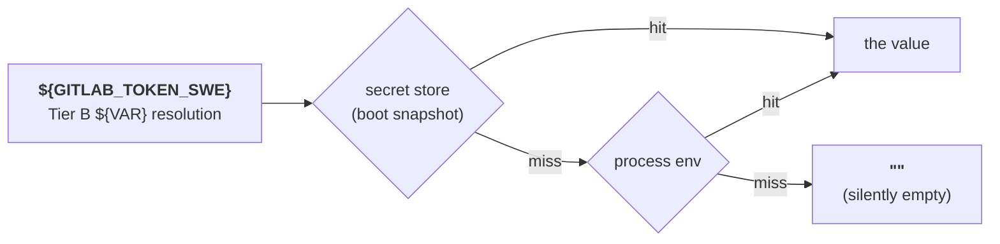

# Secret Store

The **secret store** is the company's encrypted credential store: one sealed value per `${VAR}` name, held on the coordination KV where **every node reads the same rows**, and consulted ahead of the process environment. A provisioner that mints a credential can hand it straight to the engine instead of writing a file a human must source, and a rotation reaches the whole fleet.

It is optional and inert until used. With nothing stored, `${VAR}` resolution is the process environment alone.

> Related: [Configuration § Secrets](configuration.md#secrets) covers whole-config encryption at rest, a *different* mechanism with the same keyring. See [Which one do I want?](#which-one-do-i-want) below.

---

## The problem

`${VAR}` substitution has one choke point, and only `os.Getenv` answered it (the stored config keeps the *reference*, `"${GITLAB_TOKEN_SWE}"`). So provisioning CLIs write `.env` files, leaving a manual seam:

```
crewlet gitlab provision company.yaml    # mints PATs → .env.gitlab
source .env.gitlab                       # ← a human, in the right shell
crewlet run                              # ← restarted, in that same shell
```

The failure is silent: a `${VAR}` nothing answers resolves to `""`, an empty Bearer token that looks live until the provider rejects it.

## The design

One record per environment-variable name, each value sealed with the Tier A keyring before it leaves the process:

```
_secrets (a coordination KV bucket, no TTL)
  name        the key            -- "GITLAB_TOKEN_SWE"
  value       "enc:v1:<key_id>:<base64>"
  key_id      which keyring entry sealed it
  updated_at
  updated_by       the author: the seat's handle for a person (every person
                   holds one) or a credential bound to a seat, the login of
                   a credential bound to none — `token:<id>` for a Tier A
                   token — the engine's own name for a key or a pass it
                   wrote itself, or the shell's user ($CREWLET_OPERATOR,
                   else $USER, else $LOGNAME) for a command that wrote the
                   store itself with its node's engine stopped; at most
                   64 bytes, as operator_id is, and refused past it
  updated_by_kind  agent | human | operator | system
  operator_id      the credential it was stored through — `pat:<id>`,
                   `session:<lineage>`, a Tier A token's login — and empty
                   for a write no credential made: the engine's own, or a
                   command's that reached the store directly
  source      the write path's own word, never the caller's:
              "api" | "setup" | "provision" | "cli" | "llm-login",
              and "iam" on the engine's own keys
```

**Who stored a value is three facts** (author, credential such as `pat:<id>`, source), **and a rekey keeps all of them**: a **rekey** re-seals a value it did not choose, so it leaves every provenance field as found. The credential alone cannot name the author, since a machine token's own row is swept a week after it lapses.

**`source` is provenance, never location**: every record is sealed in this bucket whichever path wrote it. **It is the write path's own word, and no request names it.** Each write replaces it, so it names the LAST writer.

| Word | Stamped by |
|---|---|
| `api` | `PUT /secrets/{name}`, whoever calls it: the dashboard, `crewlet secrets set` and every provisioning command against a running node, any other client. It refuses a write carrying a query string at all (`400 invalid_query`). |
| `setup` | an integration's setup in the dashboard |
| `provision` | an integration's provisioning pass; also a vendor's `provision -secret-store` run with the engine stopped |
| `iam` | the engine's mint of one of its own keys |
| `cli` | `crewlet secrets set` run with the engine stopped ([Which store the CLI writes](#which-store-the-cli-writes)) |
| `llm-login` | the headless token `crewlet llm login` stores and the bundle `crewlet llm export -secret-store` packs, engine stopped |

The listing shows `api`, `setup`, `provision`, `cli` and `llm-login`. A rekey writes no value of its own and leaves the word as found.

**Why the request cannot choose it:** `?source=` and `-source` no longer exist; a caller-chosen word would let any writer make a row claim any path. Author and credential come from the authenticating credential; each path stamps its own word and the stores refuse any other.

**The name is the reference grammar's, at most 255 bytes, and a write that is not one is refused.** A record is keyed by the name a `${VAR}` resolves through: letters, digits and underscores, starting with a letter or an underscore. A store accepting `gitlab-token` would seal, list and report it done, yet resolve it from nowhere. The name is also the key its record is stored under and a field of the record, so it is bounded as the value is, and the record has a widest form its coordination class holds it to (`secrets.MaxNameBytes`, the engine's own names included; [Coordination § What one key holds](coordination.md#what-one-key-holds)). `PUT /secrets/{name}` answers `400 invalid_name`, and `crewlet secrets set` refuses against a running and a stopped node alike. Reading and removing take the name as given, so nothing becomes unremovable; a name past 255 bytes names no row, so a read of one answers that nothing holds it.

**A value is at most 64 KiB, on every write path and in every store.** Real credentials are a few kilobytes, so the limit refuses mistakes (`crewlet secrets set X < backup.tar`). One limit covers the API and direct writes with the engine stopped, because every read back through a node is sized from it; a larger value could be stored yet unreadable.
- `PUT /secrets/{name}` answers a longer body `413 body_too_large`.
- `crewlet secrets set` refuses a longer value on both routes before it is sent or stored; it and `crewlet llm login -token-stdin` stop reading a pipe at the limit.
- A bundle `crewlet llm export -secret-store` packs is held to it too; one past it is refused before anything is written, naming the routes that carry it instead: stdout into your own secret manager, or a login on each host.

**Coordination owns the bytes; the engine owns the key.** A peer that can read the bucket learns which names exist and when they changed, not what they are. The bucket has **no TTL** (unlike the delivery dedupe and notification valve beside it): an expiring secret is an outage on a timer.

At boot the engine loads every record into a process-local snapshot and installs it as the **secret source**. From then on `${VAR}` resolution asks the store first and falls back to the process environment:



Because substitution has a single choke point, this covers LLM API keys, per-role `mcp_env`, sandbox env, webhook secrets, contact identities and knowledge-search tokens.

The boot takes the snapshot **before it builds its company, and waits for it**. A store that does not answer (a group still electing, a leaf link not yet up) is asked again (`secret_store_unreadable`, every few seconds rising to every 15) while `/health` answers `200 preparing` and `/ready` `503 starting`, since a company built without the store would resolve from the environment alone. A record the node's keyring cannot open ends the boot, naming the secret; only putting the key back in `secrets.keys` or setting the value again changes that. Once a node holds a snapshot, a later failed read keeps it serving.

### Store wins; the environment is the fallback

Deliberately, and not negotiable: env-first would let a stale `.env` shadow a freshly rotated secret, so a rotation would seem to succeed yet not take effect.

When a name exists in both with **different** values, its first read logs `secret_shadowed_env` at WARNING with the names (never the values): the variable, the source that answered (`answered_by`) and the one it hid (`shadowed`). It is said once per resolution chain (rebuilt on every apply), and is a cue to delete the stale value. An agent's own GitHub App token, which the engine issues for its seat and lays in front of both, is one more source: a stale value stored or exported under its `GITHUB_APP_TOKEN_<HANDLE>` is hidden by it, and the warning names the issued token as the answerer and the stored or exported value as the one to remove.

### A keyring is required

There is **no plaintext mode**: every node's Tier A carries a keyring (`crewlet validate` refuses a file without one, and a node refuses to start), and a company document stored unsealed is refused by every reader. The one exception is a provisioning run given no Tier A file at all, which opens no store, resolves from the environment alone, and says so.

Each value is sealed with AES-256-GCM with the record's own `name` bound in as associated data, so a ciphertext moved to another name fails to decrypt. **A read fails closed**: skipping an unopenable record would let the environment answer for it (the stale-`.env` shadowing), so it refuses the whole snapshot, loudly, and the previous one keeps serving.

### Two things that can never live in the store

The **store's own address** and the **keyring** itself. Tier A carries exactly what is needed to reach and decrypt the store, so it cannot source values from it; Tier A resolves through `config.EnvOnly()`.

```yaml
# crewlet.yaml (Tier A) — always env/file-sourced, never from the store
store:
  path: /var/lib/crewlet/index.db
secrets:
  active_key_id: "2026-01"
  keys:
    - id: "2026-01"
      material: "${CREWLET_SECRET_KEY_2026_01}"
```

A key's `id` is letters, digits, `.`, `_` and `-`, at most 255 of them (a sealed stream names its key in a one-byte length); `crewlet validate` refuses a longer one.

### The engine's own keys share the bucket, and never the namespace

The bucket also holds key material the **engine** keeps for itself, since every node must derive under the same key. It is **not your secret**:

| Name | What it is |
|---|---|
| `iam/blind-index-key` | The key an address is blinded under in the identity directory |

A person's own values (name, address, a second factor's seed) are not keyed here: they are sealed under the keyring in the identity estate's rows (see [Identity and Access](identity-and-access.md#what-is-in-the-clear-and-what-is-not)).

The namespace has one owner, the identity directory (`iam/`), reserved before it writes its first key. A name with a `/` is one no `${VAR}` can spell, so no document can resolve one into a provider, an `mcp_env` or a child process. Every operator surface refuses them by name, whatever the caller holds: `GET`, `PUT` and `DELETE /secrets/{name}` (a reveal included) answer `403 reserved_name`, and `crewlet secrets get`, `set` and `unset` refuse before opening anything.

The listing does not name them; it **counts** them per keyring key as `engine_keys`, because a rotation has to move them too. A **rekey** reports them as a count (`engine_keys_moved`) beside the names of yours. Counts by surface:

- **Through a running node**, the listing also counts per key:
  - the identity estate's sealed values (`identity_values`), which the rekey moves (see [Rotating the keyring](#rotating-the-keyring-with-nothing-in-flight-lost));
  - Ask Crewlet's sealed conversations (`assistant_values`, each file counted by the key its content is sealed under in the object store), which a rekey does not move;
  - the seats' executor sessions (`executor_values`, each session a turn's row names, counted by the key its object is sealed under), which a rekey does not move;
  - the SSH commands the access log recorded (`access_values`, each command's text counted by its key), which a rekey moves with a record per command.
- **The store reached directly**, engine stopped, holds no identity estate, so none of these is counted or moved, and the rekey says so.

A dry run counts whatever it reached still under an old key, so "nothing to move" is never said while something is sealed under the key you are about to retire.

The blind-index key is never minted over one that was deleted: it comes back with the coordination store it lived in, from the backup that holds it ([Backups § Restoring](../guides/backup.md#restoring)).

---

## Using it

### From the CLI

```bash
crewlet secrets keygen                           # a fresh key for the keyring
echo "$TOKEN" | crewlet secrets set GITLAB_TOKEN_SWE
crewlet secrets set SLACK_BOT_TOKEN_CEO          # reads stdin
crewlet secrets list                             # names + metadata, never values
crewlet secrets unset STALE_TOKEN
crewlet secrets get TOKEN -reveal                # break-glass; logged
crewlet secrets rekey                            # after a keyring rotation: every row, every person's values
```

### The keyring is not optional, and it does four jobs

A deployment has one keyring, and everything authenticated across a fleet derives from it. Each job derives its own key from the material, so signatures and credentials never share bytes.

- **Seals** the company config and the secret store's rows. A sealed company document is an authenticated one, so a node refuses one its peers published unsealed. It also seals, each in a key domain of its own so none opens as another:
  - a person's answer to a parked executor, onto the executor's row (`seat.run.answer`), opened by whichever node resumes the executor before the turn is handed anything of it;
  - each note a person sends a turn whose executor is in its box, onto the executor's row (`seat.steer.note`), beside an anchor naming the seat it serves (`seat.steer.seat`);
  - each message the engine hands such an executor as a wake about its work, onto the same row (`seat.wake.item`).
- **Signs** the three per-run tokens a sandbox carries: its telemetry's, its tool bridge's and a coding box's git credential. Also signs, in their own domains:
  - what carried each session of an executor on, kept beside the run's record for the job whose brief told it (`seat.run.lead`), an answer's words among it, which a later brief to a session that may lack that brief tells again;
  - every box read one node asks of the node whose host a `direct` or `container` box is on (`sandbox.box_read`).
- **Signs every record on every state log**: the tracker's, the knowledge base's, and any domain a later build registers.
- **Keys an embedded fleet's broker**: a route, a leaf link and the operator's nats tool are admitted only on a credential derived from one of its keys ([The fleet's broker admits only its own nodes](../guides/deployment.md#the-fleets-broker-admits-only-its-own-nodes)).

The third job is why a node with no keyring refuses to start: a record on a log is an *instruction* the next node applies, and broker admission vouches for a connection, never a record.

A record's frame **names the key that signed it**, and a verifier looks that id up. A key it does not hold means "not yet": the record is retained and applied once the key arrives. A key it *does* hold whose signature fails means "not this fleet": the applier stops, because continuing would apply whatever it was written to precede.

### Rotating the keyring, with nothing in flight lost

Besides the secrets, the keyring covers the three **per-run tokens** (the OTLP receiver's, the MCP bridge's, a coding box's git credential), every **session cookie**, and every person's **answer to a parked executor** and **note to a turn whose executor is in its box** while each waits on the executor's record. Tokens are minted on the node that launches an executor and verified on whichever node the box can reach; an executor holds one for its whole launch, which outlives a rollout.

A token **names the key that signed it**, and a verifier looks that id up. A key it does not hold is refused, not retried against the active key, which is what makes dropping a key mean something.

The rotation is a runbook with no window in it:

1. **Add** the new key to `secrets.keys`, leaving `active_key_id` where it is.
2. **Restart** every node. Nothing minted changes; every node now holds both keys.
3. **Flip** `active_key_id` to the new key and restart every node again. New tokens name the new key; outstanding ones still name the old one, which is still on the ring.
4. **Re-seal both halves** under the new active key. A key dropped while either still holds something under it leaves that thing unreadable on every node:
   - **The secret store and the identity estate**: run `crewlet secrets rekey`, once for the fleet, through a running node, because it moves the identity estate's values too. Every person's name, address and second factor is sealed under the keyring in rows derived from the identity log, which only a record can change, so the node publishes one per person still under an old key and reports how many (`identity` in the answer; every data node holds the identity estate from boot). Counted and left:
     - An **outstanding invitation's** address (only a re-issue could carry it again); the rekey says how many are still under an old key.
     - **Ask Crewlet's conversations**, counted through a running node: each value leaves with its conversation, once untouched for 30 days or cleared by its owner. A conversation still in use keeps what it sealed before step 3, so the count can stay above zero while somebody uses a conversation started before the flip.
     - **The seats' executor sessions**: a session leaves with its row, when a later turn of its conversation ends, when its seat's `turn_engine.conversation_session.max_bytes_per_seat` releases it, or once untouched for `turn_engine.conversation_session.retention_days`. Dropping a key while sessions are sealed under it costs no data a person wrote: each reads as none, and its conversation's next turn starts its harness fresh.

     Run with this node's engine stopped, the command reaches the store itself and re-seals every row in it (yours and the engine's own `iam/` keys) but not the identity estate, which only the engine holding it can re-seal; it says so, and the rekey is run again through a running node for those values. Its dry run counts no person's values and no invitation either, for the same reason.
   - **The company document**: `POST /config/reload` to a node that is up stores the fleet's document again, sealed under that node's active key, and activates it. On a stopped node, [`crewlet config rekey`](../reference/cli.md#crewlet-config-rekey) re-seals the revision **this node boots on** instead. The node publishes the result at its next start only while the fleet still runs the revision it re-sealed (or, for an offline change the fleet has not taken, the one that change was built on); otherwise the copy is this node's alone and a reload re-seals the fleet's. A reload re-seals only the fleet's revision, and a node that **refused** it boots on what its boot row names (as [`GET /fleet`](../reference/api-endpoints.md#get-fleet)'s `config_boot_revision_id` shows; its `crewlet config revisions` marks a `boots` row that is not the `fleet's`). Run `crewlet config rekey` on that node too, engine stopped, or its first start after the old key goes cannot open that revision and is refused. After it, every start warns `offline_revision_not_published` until the node applies the fleet's revision; that is expected. Without this half, dropping the old key makes the company configuration unreadable at the next apply.
5. **Drop** the old key only once all of these hold:
   - both halves of step 4 have run;
   - the longest token lifetime has passed (below);
   - every state log has trimmed past the records signed under it;
   - the longest session lifetime (`api.auth.limits.max_session_lifetime`) has elapsed since step 3;
   - `crewlet secrets rekey -dry-run`, through a running node, reports no outstanding invitation under it (each is redeemed or lapses within a week of being issued) and no Ask Crewlet value under it (dropped while a conversation is sealed under it, that conversation no longer opens for its owner for the rest of its retention);
   - no answer to a parked executor recorded before step 3 is still waiting on its resume. One is resumed within minutes unless its seat is paused or held for budget; a node that cannot open one logs `sandbox_answer_key_unknown`, and dropped under it, that answer waits, with its seat's mail behind it, until the key is back on the ring;
   - no note to a turn whose executor is in its box, filed before step 3, is still waiting on the executor's record. A note is read at the executor's next step or by its review, so it waits as long as its turn runs; a node that cannot open one logs `steer_note_key_unknown`, naming the keys it holds, and dropped under it, the note waits until the key is back on the ring or expires with its turn.

   **The longest token lifetime is the longest of the per-run tokens'**, each its own:
   - a coding box's git credential lives `host.RunTokenTTL`, seven days (dropped sooner, every running box's pushes and fetches are refused, so the drop waits at least that long after step 3);
   - the tool bridge's has no expiry of its own and lives as long as its run, ended only by the run's end (a scheduled turn's run ends at the collection after its `timeout_seconds`): an executor launched before step 3 and still working, or parked on a person's answer, holds one, and dropped sooner its every tool call and note is refused;
   - the OTLP receiver's, four hours from its job's start, once its box is provisioned (`sandbox.OtelTokenTTL`);
   - an artifact view ticket's, at most an hour and ten minutes.

   Wait out whichever is longest in your configuration, and every executor run launched before step 3. After the drop, a token, record or cookie signed under the key is refused. Records still in a log become unappliable on a node replaying from the floor (reported as retained records, not data loss; adding the key back applies them), and a person's value a rekey did not move renders as *sealed* until the key is back.

   **Dropping it early is what signs people out.** A browser holding a session cookie minted before step 3 is refused the moment the key leaves the ring and sees a sign-in screen. A cookie is re-issued under the *active* key the first time it is used after step 3, so waiting out the absolute lifetime is waiting for sessions nobody has touched since the flip.

Nodes may restart in any order at every step: tokens name the key they need, so no two nodes disagree about a token they both hold the key for.

**The broker follows the same steps, with none of its own.** Every node's broker accepts a credential derived from any key of its ring and presents the active key's: after step 2 every node accepts both and presents the old, after step 3 the restarted nodes present the new to peers that hold it, and by step 5 every node presents the new one. Adding and flipping in ONE restart strands a leaf restarted before any member (it presents a key no member holds yet and fails its boot naming it), which is why the flip is a step of its own. A node restarted onto a keyring sharing no key with the others is refused by every peer, counted, and named by key in their `broker_peer_refused` lines. An operator key written by `crewlet fleet broker credential` is admitted until its key is dropped; write it again after step 5.

The value is read from **stdin** by default rather than from `-value`, because an argv value is visible in `ps` output and lands in shell history. Exactly one trailing newline is stripped, so `echo "$TOKEN" | ...` works, and no more, because a secret may legitimately end in whitespace.

Reading a value back is **break-glass on both sides**. `crewlet secrets get` refuses without `-reveal`, and the route behind it (`GET /secrets/{name}`) serves only metadata unless the request carries an explicit `?reveal=true`, a spelling a crawl or link cannot reach by accident. Both log the access by name (the command as `secret_revealed` in its own log, the node against the operator its API guard authenticated), and the answer is marked `Cache-Control: no-store` so no shared proxy keeps it. The refusal points at `list`, since the common need, "is X set and when did it last change", is answered without putting a credential into a terminal, scrollback and screen-share.

`get -reveal` is that route's only CLI caller. The other value route, `POST /secrets/reveal`, is a POST no link or crawl can make; its one CLI caller prints nothing it reads: a command that resolves the company beside a running engine (`crewlet llm`, the provisioning commands), because the rows are inside the engine's process. Such a run lists the node's names first (revealing nothing), then asks only for the variables its command reads, at most 64 to a request: one entry's sign-in for `crewlet llm login`, a GitLab provision's instance and signing secret, none of the rest. A provisioning run's `-secret-store` sink also reads back each planned seat's token to decide whether to mint (for Slack, each seat whose app the ledger records installed), in the same batch. The node logs every name asked as it logs a `get -reveal`, and both routes take `admin` with a person present, so the token such a run carries is one of Tier A's ([CLI reference](../reference/cli.md#where-a-command-reads-the-companys-values)).

With this node's engine **stopped**, the same commands read the same values from the fleet's store itself ([below](#which-store-the-cli-writes)), and **no node logs those reads**; `crewlet secrets get -reveal` is logged as `secret_revealed` on the command's own log alone. That is deliberate: whoever reaches the store directly holds the node's Tier A, which opens every value without any API, so an audit line would record nothing they could not have done unrecorded. What is guarded is who holds Tier A.

### Which store the CLI writes

There is one store, the fleet's, whether or not this node's engine runs; the engine decides only the way in. While it runs, `crewlet secrets` goes through its **authenticated API**, because on the default topology the coordination KV lives inside the engine's process and listens on no socket. While it is stopped, the command reaches the **store itself**. The engine holds an exclusive lock on its database while it runs (from the moment its start reads the store, before its broker starts, [step 6](configuration.md#bootstrap-sequence)), so a locked database means "the engine is up or coming up: go through it" with a pid attached. A node still starting answers `503 starting` until it serves; run again then. The command only asks: it never opens the database or keeps a claim on it. What keeps the engine out while the command works is the lock on the broker's store directory.

| The engine on this node is | `crewlet secrets` writes | Reaches |
|---|---|---|
| **running** | its `/secrets` API | every node, each at its next apply |
| **stopped** | the fleet's store itself, through this node's own broker or the external one | every node: this one when it starts, any already running at its next apply |

**Reaching the store itself** depends on where the store lives:

- **A solo node** (an embedded broker with no `stream.cluster`): the command starts the node's own broker on `stream.store_dir`, with no listener at all (not even the leaf listener `stream.leaf.port` names), reads and writes the secrets bucket, and stops it. On a node that has never booted it creates the fleet's coordination buckets as the engine's first boot would, through the same constructor, and the engine adopts them; so a credential can be set, or an LLM token captured, before the first `crewlet run`.
- **A node on an external broker** (`stream.type: nats`): the command dials it, with Tier A's credentials and TLS. The store lives there whether or not any engine runs, and where none ever has, the command creates its buckets through the same constructor.
- **A member of a cluster** (`stream.cluster` set) is **refused**: alone it never reaches quorum, beside peers it would rejoin and leave the cluster. Name a running member with `-api` (below), or start this node's engine and re-run.
- **A node that holds no data** (`store.scratch`: a seats node, a leaf) has no store to start, and is refused, whether or not its own engine runs, unless `-api` names a node that does.

One invocation starts **one** broker, deciding its route once for everything it reads and writes (a provisioning run's reads and `-secret-store` sink; `crewlet llm` reading the company then storing a token). While that broker holds the store directory, an engine started there is refused at the lock, naming the command's pid, and a second command is told to re-run once the first has finished. So is a command started part way through an engine's start with `-import-company`, the one start that takes the store directory before the database; it is told to re-run once the engine is up. On an external broker the command starts no broker and holds nothing.

The CLI says which way it went after every write, and who reads the value when, with the engine stopped:

```
stored GITLAB_TOKEN_SWE (51 bytes) as alice
written to the fleet's store, reached through this node's broker on /var/lib/crewlet/stream (this node's engine is stopped)
This node's engine reads it when it starts; a node already running on the same store reads it at its next configuration apply, and POST /config/reload to it re-activates the current revision now.
```

or `the external broker at <host:port>` in place of the node's own. Through a running node the second line names that node instead, and the third says what the node's [re-activation](#a-write-through-a-node-re-activates-what-reads-it) did: the revision and epoch the running fleet reads the value at, that nothing the running company reads names it, or why it was not re-activated and that `POST /config/reload` does it once that is fixed.

Several values are stored as **one** write with `crewlet secrets set NAME NAME...`, which reads one `NAME=value` line per name from stdin (never from arguments, which land in shell history) and refuses the whole set if a name it was given is missing, repeated or joined by one it was not. Through a running node it is one `PUT /secrets`, so a rotation of every credential one model reads lands as one activation.

Every other command that touches the store (each command that reads the company document, a provisioner's `-secret-store` sink, `crewlet llm login` and `export`) decides its way in the same way, **once per run**, and everything the run reads and writes goes there: its values, what its sink records and reads back, what it stores ([CLI reference](../reference/cli.md#where-a-command-reads-the-companys-values)).

`-api URL` writes through a named node instead: from a machine that is not the node at all, from a node that holds no data, and from a cluster member whose engine is stopped. It authenticates with `CREWLET_API_TOKEN`, and nothing else: `api.auth.tokens` is what a node **accepts**, not a wallet the CLI picks from. Export the variable: one of the Tier A values, or a machine token minted with `crewlet iam token`. The credential's own identity is recorded as the author, and the source is the route's `api`. A write made directly records the shell's user instead (`$CREWLET_OPERATOR`, else `$USER`, else `$LOGNAME`), of the `operator` kind and with no credential (none made it), under the command's own source word ([above](#the-design)).

`crewlet secrets keygen` needs no config and no store: an operator runs it *before* either exists, and it prints the base64 form the keyring's `material` field takes.

Every other command reads the **Tier A** config for its keyring, never the company document; key material lives in the bootstrap file, never in the store it opens. Through `-api` a machine needs no Tier A file, because the node seals and opens every value under its own keyring, so every subcommand runs there but `rekey`, which judges the rows against the `secrets.active_key_id` the file names and, in its real pass, sends that id for the node to check against its own ([CLI reference](../reference/cli.md#crewlet-secrets)).
### From the dashboard

Settings › **Secrets** (`#/settings/secrets`) lists what the fleet holds and can store, rotate and remove a row, over the same routes the CLI uses (the listing and every write on `admin`). It never shows a value: the routes that return one are break-glass, and a click in a page anyone who may list credentials can open is the wrong place for it. `crewlet secrets get -reveal` stays the deliberate path. A rotation asks for the new credential rather than editing the old one.

Before a removal the screen lists, by path, **which config fields point at the row**, read from [`GET /config/references`](../reference/api-endpoints.md#config--live-config-management-auth-gated). The config keeps `${VAR}` pointers, so removing a row a seat's `bot_token` still names leaves the pointer resolving to `""` at the next activation, and the webhook route or transport holding it refuses deliveries with nothing naming the removed row. Removing a referenced row takes an explicit acknowledgement, and so does removing one when the check did not answer: **"the configuration could not be read" is never rendered as "nothing points at this"**. A rotation is safe by construction, since the pointer still names an existing row.

The API's own bearer tokens are NOT in this store: they are Tier A (`api.auth.tokens`), the root of trust the store's keyring comes from. Settings › **API tokens** (`#/settings/tokens`) lists the answering node's labels, never a value, each beside the directory row holding its `token:<id>` login, that row's stage and the seat it binds the token to, read from [`GET /iam/node-tokens`](../reference/api-endpoints.md#get-iamnode-tokens-joins-this-nodes-tier-a-labels-to-the-directory) on `admin`. A label no row holds is a token acting as itself, under its own login.

A model's credentials are `${VAR}` pointers into this store too: a `providers.llm` entry's `auth.token`, `auth.api_key` and `auth.credential_bundle`, and the keys in its `env`. Settings › **Models & keys** (`#/settings/models`) draws each entry off the company document: harness, model, mode, and how it signs in by the variable its credential names, never a value. An entry that names no credential reads its harness's own variable from this store first, then the environment: `CLAUDE_CODE_OAUTH_TOKEN` for a Claude Code subscription (which `crewlet llm login <key> -capture-token` writes here), and under `auth.mode: api-key` the harness's key variable (`ANTHROPIC_API_KEY` for Claude Code, `CODEX_API_KEY` for Codex). A variable other vendors' keys are kept under too (Qwen Code's `OPENAI_API_KEY`) is never read this way: such an entry names its key. One whose named reference resolves to nothing runs on nothing rather than borrowing it.

### Write-only values

A value stored from Settings › MCP & tools, a server's header or variable, is sealed on a row marked **write-only** ([Storing a header or variable](../guides/tools-and-mcp.md#storing-a-header-or-variable)). The engine's resolver opens it, so its `${VAR}` resolves on every node as any stored value does. Every read that would hand it to a person or a command refuses, naming why: `GET /secrets/{name}?reveal=true`, `POST
/secrets/reveal`, `crewlet secrets get -reveal` and a command resolving its
company document, through a node or with the engine stopped. The listing marks them: `crewlet secrets list` shows the source as `(write-only)`.

The mark belongs to the row: storing the same name again, from the page or through `PUT /secrets/{name}`, keeps it, and a rekey re-seals the row with it. Only removing the row clears it.

### From a provisioner

Every provisioning CLI takes `-secret-store` in place of `-env-file`:

```bash
GITLAB_ADMIN_TOKEN="$GITLAB_ADMIN_TOKEN" crewlet gitlab provision company.yaml \
  -public-url https://engine.example.com \
  -secret-store
```

Minted PATs and the generated webhook signing secret go straight into the encrypted store under the `${VAR}` names the config already references: no file to source, one command.

`-secret-store` records through the route the run's reads take, decided once per run, with the same routing and the same `-api URL` flag as `crewlet secrets`. Against a running node it writes through that node's API. Against a stopped one it writes the fleet's store itself, through the node's own broker or the external one. Either way it is the store every node reads. The values the run reads (the signing secret it must not mint over, each seat's token it checks before minting) come from that same store, and a node that holds no data, or a cluster member whose engine is stopped, is refused as `crewlet secrets` is, before it reads, plans or mints anything ([CLI reference](../reference/cli.md#where-a-command-reads-the-companys-values)). The row's `source` follows the route: the node's `api`, or the command's own `provision` written directly. The row's author and credential say who ran the command.

Slack's app configuration token goes here too, as one value (`SLACK_APP_CONFIG_TOKEN`): its refresh token works once, so the engine seals each rotated pair back under that name before using it.

It pays off most for a credential the third-party app shows **once**: the recorded copy *is* the credential.

### Propagation

| When | What picks up a new value |
|---|---|
| `crewlet run` boot (every node role) | Reads the whole store before resolving any Tier B `${VAR}` |
| A config revision activates (`PUT /config`, `crewlet config import`) | Every node re-reads the **fleet's** store as it converges on the new activation epoch, engine and API halves alike |
| A provisioning pass seals a credential | The node that ran it refreshes its snapshot **and re-activates the current revision**, so every node rebuilds against the minted value, coalesced into one apply per 15 seconds (below) |
| A write through a running node's `/secrets` (the dashboard, `crewlet secrets set`, crewlet-operator, a model's credential route) of a name the active revision reads | That node **re-activates the current revision** in the same request, once per write however many values it carried ([below](#a-write-through-a-node-re-activates-what-reads-it)) |
| Otherwise | The running process keeps its snapshot |

**A pass that mints a credential re-activates itself.** Sealing makes a value *resolvable*, but seat identities, parsers, transports, provider clients and MCP children were built at the last apply and still hold the old one. So the provisioning pass re-activates the current revision unchanged, as an operator would. A node with **no config surface** (a worker-only one) seals and logs the outstanding rebuild instead, naming `POST /config/reload`.

Re-activations are **coalesced**: the first in a quiet period runs at once, and any within 15 seconds of it fold into one apply at the end of that window, instead of each costing a whole-company rebuild and a permanent revision. It also bounds a vendor pass that can never converge (its own minted credential is refused), which would otherwise seal on every tick. See [Integration Reconcile](integration-reconcile.md#what-the-loop-does-and-what-it-leaves-alone).

**A write reaches every node.** `crewlet secrets set` puts one sealed record on the coordination KV, through a running node or directly with this node's engine stopped; every peer reads it at its next boot or activation. Nothing is run once per node or copied to a node that scales up.

> **Two locks keep a command and an engine off one store.** The engine takes an exclusive lock on its database while it runs: the database is **one file, one process**, and the driver does not reliably refuse a second writer. That lock is also the *routing* signal: a locked database sends the command to the node's API, an unlocked one means the engine is stopped and the command may reach the store itself.
>
> The second is the broker's. An embedded member takes `crewlet-broker.lock` inside its `stream.store_dir` before its broker is built, and releases it once the broker has stopped, for the engine's broker and a command's alike. nats-server **accepts** a second server on one store directory and corrupts it silently, so a second broker is refused here, naming the holder (`pid N (PROGRAM) on HOST since T`, the program being `crewlet run` or the command, such as `crewlet secrets set`). The database's lock cannot stand in for it: a start with `-import-company` starts its broker before taking the database's lock, and `store.path` and `stream.store_dir` are independent settings.
>
> The kernel releases both when their holder exits, however it exits (crash, `kill -9`, OOM), so there is no stale lock to clear by hand.

#### A write through a node re-activates what reads it

A value sealed and left there changes nothing running, so every write through a running node's `/secrets` re-activates the current revision when it reads a name the write stored or removed ([ADR-0070](../../adr/0070-a-secret-write-re-activates-the-revision-that-reads-it.md)):

1. The node asks which paths of the active revision read each name, from the same index [`GET /config/references`](../reference/api-endpoints.md#config--live-config-management-auth-gated) answers, counting the variables an entry reads without naming them.
2. When any does, it asks `config.write` of the caller **before** sealing anything, on top of `secrets.write`. Both are an administrator's with a recent proof, so nobody who could write a secret before is refused now.
3. It seals, then re-activates the active revision once, **synchronously**, and answers `read_by` (the paths) and `reload` (`{"revision_id", "epoch"}`) in the same response.
4. **The answer stays 200 whatever the re-activation did.** The value is already sealed, so a re-activation that lost a race with another configuration write, found the company unrunnable or went unanswered is said in `reload.error` and `reload.detail`, and `POST /config/reload` re-activates once that is fixed. A name nothing reads answers `"reload": null` and moves nothing.

A provisioning run through a running node seals each credential as it mints it, with the re-activation deferred (`"defer_reload": true`). Its end re-activates once for every value it sealed, with `POST /config/reload` and no second seal (a value rotated meanwhile is not written back over), retrying a moment's failure (a node failing over, the coordination store electing a leader). A re-activation that still fails never rolls the run back, since its values are sealed and its accounts good: its `Next:` line names the reload left to make. A run that dies before its end leaves its values sealed and inactive until the company is next re-activated by anyone: `POST /config/reload`, or any apply.

`PUT /secrets` takes up to 64 values at once and re-activates **once** for all of them, so rotating every credential one model or integration reads moves the fleet through one epoch, not a mix of old and new values. `crewlet secrets set NAME NAME...` and crewlet-operator's secret sync use it.

Written with this node's engine stopped, the store is reached directly and nothing is re-activated: this node's engine reads the value when it starts, and a node already running on the same store (an external broker's fleet) reads it at its next configuration apply, which `POST /config/reload` to it brings forward; the CLI says so after each such write. Re-activating the *current* revision is how a running engine picks up a rotated credential: the apply re-reads the store before building anything, and the pointer's KV sequence is the epoch (a new one on every write), so a re-activation still moves what every node watches (see [Control Plane](control-plane.md)).

**What "picks up" means.** Things that *captured* the value must be rebuilt: an MCP child baked it into its spawn environment, an LLM provider holds it in a constructed client, a transport in a header. A node's reconciler skips on the *epoch* it has applied, never on the payload, so a re-activation of a byte-identical revision always applies. `${VAR}` references stay verbatim in the stored revision and are resolved where a provider is **constructed**, with the secret snapshot re-read immediately before.

**The MCP children are reached too, per-role ones included.** A per-role child belongs to its seat's lease, but the node holding the seat reconciles its children on every apply: one whose resolved credential moved is restarted with the new value, the others keep running. The Slack transport is rebuilt on every apply, and the Mattermost transport whenever a value it is built from moved, a rotated bot token included. [Control Plane § Rotation](control-plane.md#rotation) has the full table of what a re-activation does and does not replace.

> One surface is out of the engine's hands: a **running code sandbox** received its credentials in the box's environment at launch, and no engine-side refresh reaches a live box. The effective bound there is the run's duration plus any clarification pause. Tear the run down if a rotation is a revocation.

---

## Which one do I want?

Two mechanisms share the Tier A keyring and are easy to confuse:

| | [Whole-config encryption](configuration.md#secrets) | Secret store (this page) |
|---|---|---|
| **What is encrypted** | The entire `company_config` payload as one blob | One value per row |
| **Keyed by** | Revision | Environment-variable name |
| **Where the secret lives** | Inline in the config document | In the `_secrets` coordination bucket, referenced by `${VAR}` |
| **Rotation** | New revision (a full immutable copy) | One write to one record |
| **Written by** | `PUT /config`, `crewlet config import` | `PUT /secrets/{name}`, `crewlet secrets set`, provisioners |

They compose: encrypt the config document *and* keep credentials in the store. That is the recommended shape for any provisioned deployment, on one node or twenty; both travel the same replicated path, sealed with the same keyring.

**Why credentials belong in the store rather than inlined in the config**, even though the config is encrypted:

- **Rotation would archive the old secret forever.** Every revision is an immutable full copy and never scrubbed, so each rotation leaves the superseded credential readable in history.
- **One credential, several pointers.** `role.integrations.slack.bot_token` and `role.mcp_env.slack.SLACK_MCP_XOXB_TOKEN` reference the *same* variable. Inlined literals would have to update atomically across pointers or the identity split-brains; keying by variable name keeps it one row.
- **Blast radius.** Losing the keyring with inlined literals loses your credentials, not just your config.

---

## How a node gets its secrets in the first place

The store is an **overlay**, not the source of truth.

Resolution order on any node, for any `${VAR}`:

1. **Tier A** (`crewlet.yaml`) resolves from the **process environment alone**: it holds the keyring that opens the store, so it cannot read from the store.
2. The engine connects to coordination and takes a **snapshot** of the whole secret store. A value a command wrote while the engine was stopped is already in it ([Which store the CLI writes](#which-store-the-cli-writes)).
3. **Tier B** (the company document) resolves **store first, environment second**.

So a node with an empty store resolves everything from the environment and runs normally; that is not a degraded mode. **A brand-new node starts from the environment and the store every node reads**: nothing is copied to it, there is no first-boot step that reads a peer, and a value set on a solo node before its first boot is already in the store that boot opens. (Every node needs a keyring: see [the four jobs above](#the-keyring-is-not-optional-and-it-does-four-jobs).)

### Which one to use

| | Where credentials live | Rotation | New node starts |
|---|---|---|---|
| **One node** | Store (env as the fallback) | `crewlet secrets set`, which re-activates through a running engine | From the env, then the store overlays it |
| **A fleet** | Store (env as the fallback) | `crewlet secrets set` through any running node, which re-activates | From the env, then the same store every peer reads |

**The two columns are the same, on purpose.** A credential is company-wide state: one sealed copy on the coordination KV, written through any running node's authenticated API (or by the command itself, with the engine stopped on a solo node or on an external broker) and read by all of them.

The **environment stays the bootstrap path** and is a fine place to keep credentials if your platform already does: a Kubernetes `Secret` projected as env, systemd's `EnvironmentFile=`, Compose's `env_file:`. What is no longer true is that a fleet *has* to work that way.

> **Provisioner-minted credentials work fleet-wide too.** `crewlet gitlab provision` and the rest MINT credentials, and `-secret-store` records them where every node reads them: through a running node's API, or, with the node **stopped**, in the fleet's store itself through the node's own broker or the external one. So a first provisioning run before the first `crewlet run` works on a solo node. A stopped cluster member cannot reach the store alone, so the run goes through a running member with `-api`, or waits for this node's engine. `-env-file
> PATH` and `-print` remain for feeding a secret manager, for names the store does not hold, since the store outranks them (below).

---

## What still has to be in the environment

Most `${VAR}` resolution funnels through one function, so the store covers it. A few places read a variable by name instead:

| Site | Source | Why |
|---|---|---|
| A `providers.llm` entry's conventional credentials — its harness's token variable (`CLAUDE_CODE_OAUTH_TOKEN`), under `auth.mode: api-key` its key variable (`ANTHROPIC_API_KEY` for Claude Code, `CODEX_API_KEY` for Codex; never a shared one such as Qwen Code's `OPENAI_API_KEY`), its bundle's `CREWLET_LLM_CLI_<KEY>_CREDENTIALS` — and the embeddings key fallback (`OPENAI_API_KEY`) | **Store, then env** | Otherwise `crewlet secrets set ANTHROPIC_API_KEY` would work through a config reference but not the fallback, and the token `crewlet llm login -capture-token` writes into this store would sign nothing in |
| Everything a provisioning command reads out of the company document (`integrations.*.url`, `.workspace`, `.token`, `.signing_secret`), and everything `crewlet llm` reads | **Store, then env** | The engine's own chain. Env alone reads empty for every rotated value, and for the GitLab signing secret empty means *mint*, replacing a working webhook secret. Each command takes `-config` for this. Beside a running engine it lists the node's names through the API, then reveals the variables it reads that the node holds, at most 64 to a request. With the engine stopped it reads them from the fleet's store itself, through the node's own broker or the external one, and no node logs those reads |
| Sandbox launch credential check | **Store, then env** | A seat whose token lives only in the store must not read as unresolved |
| Tier A bootstrap (`secrets.keys[].material`, an external broker's `stream.token`) | **Env/file only** | Root of trust: this is what reaches and decrypts the store |
| Operator provisioning credentials (`GITLAB_ADMIN_TOKEN`, `MATTERMOST_ADMIN_TOKEN`) | **Env only** | Human operator credentials, never persisted by Crewlet **and never read back from the store**: a GitLab admin PAT carries `api` scope over the whole group, and every node holding the keyring reads the store. Reading one from it would imply it may be kept there |
| OTLP endpoint / protocol / headers, `CREWLET_SANDBOX_OTEL_RECEIVER_URL` | **Env only** | Deployment-environment settings that belong to the host, not the company; several are read before the store loads |
| `CREWLET_TOOL_SKILLS_SPACE` | **Env only** | Not a secret: a flag default for the import/resync commands |
| MCP stdio subprocess environment | **Declared only, over an allowlist** | A child gets the host allowlist (`PATH`, locale, TLS trust, proxy), the engine user's `HOME`, `TMPDIR` and XDG directories, and exactly what its `env:` and the seat's `mcp_env` declare, already resolved; **never** the engine's own environment, where Tier A's keyring, token values and client secret resolve from. A server that reads an undeclared variable names it in `env:` with a `${VAR}` reference (store, then environment). Store values are **not** poured in either: that would hand every seat's token to every subprocess. See [What a stdio server's environment is](../guides/tools-and-mcp.md#what-a-stdio-servers-environment-is) |

Nothing writes a minted value back into the process environment. **The sink is the only durability path** and a value minted this run is read back through it, so a run must name one before it touches the third-party app, and `-print` reports itself as holding nothing.

A `-print` run that ROLLS BACK emits `unset VAR` for every value it printed, then a comment saying why. The stream is meant to be sourced (it emits `export` lines) and a comment is a no-op to a shell, so without the `unset` lines an operator who sourced it would keep a revoked token exported. Sourcing the stream to its end leaves the environment as it started.

**No sink feeds the engine directly.** `-env-file` writes a file to `source` before the engine starts; the engine reads `${VAR}` from this store, then the process environment, and nowhere else. `-secret-store` needs no file and no restart: the values land in the fleet's store, and a run through a running node ends by re-activating the revision that reads them once. Recorded with this node's engine stopped, [`POST /config/reload`](../reference/api-endpoints.md#post-configreload-after-a-secret-changes) to a node that is up makes a running fleet re-read them, as a run that recorded something says: on its `Next:` line for GitLab, Mattermost and Slack, and in the note naming the minted secret for GitHub, Jira and Confluence. They are also in the store this node's engine reads when it starts ([where a command reads the company's values](../reference/cli.md#where-a-command-reads-the-companys-values)). [`crewlet config activate`](../reference/cli.md#crewlet-config-activate) opens the node's own store, so it runs only while that engine is stopped and is never what a running fleet needs.

**And the store outranks the other two.** A value an `-env-file` or `-print` run mints for a name this store already holds is never read: the third-party app holds the new value, the engine goes on with the stored one, and a seat's earlier token or a hook's earlier key is retired under it. So such a run is refused before it reaches the third-party app, naming the names, wherever its store (through a running node, or directly with this node's engine stopped) holds a name it can mint into: record with `-secret-store`, or remove the stored value first ([a sink the store outranks](../reference/cli.md#a-sink-the-store-outranks)).

---

## Operational notes

- **A missing value still resolves to `""`.** The store removes the most common cause, not the failure mode. A tool server whose reference resolves to nothing is not started, and says which variable, unless the key holding it is listed under `optional_keys` ([Tools & MCP](../guides/tools-and-mcp.md#a-key-that-may-go-without-its-value)). An executor run starts without it and logs `sandbox_env_unresolved` (names only, nothing for a key under `optional_keys`; [Code sandbox](code-sandbox.md#credentials-and-the-run-environment)), and the sandbox credential check refuses to launch a harness on an empty credential. A `providers.llm` entry's `env` is not held: it resolves when the company's providers are built, where a refusal would take the whole company down rather than one entry, so an unset reference there reaches the CLI empty, with a `harness_env_unresolved` warning naming it.
- **Backups.** The bucket holds only ciphertext; the keyring is the sole root of trust and lives in Tier A. Back them up separately: a coordination backup alone is unrecoverable, which is the point. With the keyring, a backup opens everything it held when taken: the bucket's values, and the identity estate's sealed names and addresses in its rows and log, those of every person removed since included. Removing somebody cannot reach an existing backup, so an erasure is finished only once every backup taken before the identity log's trim passed their records is gone ([what a removal reaches](identity-and-access.md#removing-somebody-erases-what-is-theirs-from-every-data-nodes-rows)).
- **Key rotation.** Follow [the rotation runbook](#rotating-the-keyring-with-nothing-in-flight-lost): add the new key on every node and restart, flip `active_key_id` and restart again, re-seal both halves (`crewlet secrets rekey`, and the company document with `POST /config/reload` or, on a stopped node, `crewlet config rekey`, which a node booting on another revision than the fleet's needs either way), and only then drop the old key. Flipping `active_key_id` in the same restart that adds the key is safe on a single node, not on a fleet: a node that flips first signs records, cookies and requests under a key its peers do not hold yet. Each record's envelope names the key that sealed it, so mixed-key states stay readable. The store is shared, so run `crewlet secrets rekey` **once** for the fleet; it refuses if the node it reaches seals under a different `active_key_id` than the config it was given. Run with this node's engine stopped it reaches the store itself and re-seals every row under the keyring in the Tier A it was given. It aborts rather than half-completing if any record cannot be opened with the keyring in hand. Each record is re-sealed only at the version the pass read, so a rotation or deletion that lands meanwhile is never undone (a deleted credential stays deleted). Through a running node the same command moves every person's sealed values in the identity estate, one record per person; a run that cannot confirm one says so and is run again. A run made directly cannot reach them, says so, and is run again through a running node.
- **The `_secrets` bucket is created on demand** by the first process to open the fleet's store (a node at first boot, or a command that reached a solo node's store or an external broker first, through the same constructor, so the engine adopts it). It is durable: on the embedded topology it lives under `stream.store_dir` like every other bucket. Back that directory up alongside the keyring.
- **A command holding the store keeps the engine out.** While `crewlet secrets`, `crewlet llm` or a provisioner works on a stopped node's store through the node's own broker, that broker holds `crewlet-broker.lock`, so a `crewlet run` started then is refused, naming the command's pid: start it again once the command has finished. The command never holds the node's database, only asks its lock whether the engine runs, so nothing it does reads as a running engine to a second command. A command started while the engine is still starting goes through its API, since the start holds the node's database, and is answered `503 starting` until the node serves; only a start with `-import-company`, which reads no store first, refuses it at the directory's lock instead. Either way, re-run it once the engine is up. The directory's lock holds any two brokers apart: two engines on one host given one `stream.store_dir`, by a copied Tier A, are refused at the second one's start.

---

## See also

- [Configuration](configuration.md) — the two-tier split and whole-config encryption
- [CLI reference](../reference/cli.md#crewlet-secrets) — every `crewlet secrets` subcommand
- [Environment variables](../reference/environment-variables.md) — what still has to be in the environment
- [GitLab](../integrations/gitlab.md#provisioning) — the provisioning CLIs and their sinks
