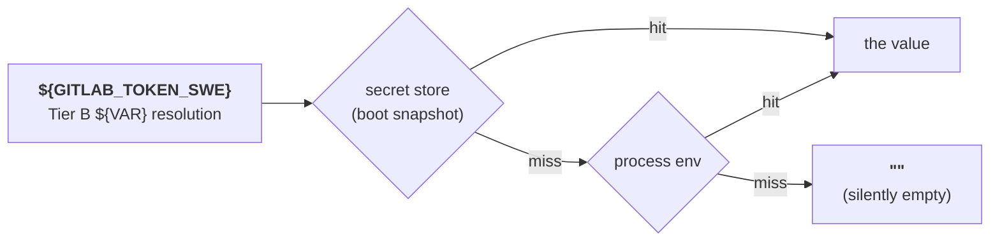

# Secret Store

The **secret store** is the company's encrypted credential store: one sealed value per `${VAR}` name, held on the coordination KV where **every node reads the same rows**, and consulted ahead of the process environment. It gives Crewlet a place to *keep* a secret that the engine can read back — so a provisioner that mints a credential can hand it straight to the engine instead of writing a file a human must source, and a rotation reaches the whole fleet rather than the one node an operator pointed a command at.

It is optional and inert until used. With nothing stored, `${VAR}` resolution is byte-for-byte what it has always been: the process environment.

> Related: [Configuration § Secrets](configuration.md#secrets) covers whole-config encryption at rest — a *different* mechanism with the same keyring. See [Which one do I want?](#which-one-do-i-want) below.

---

## The problem

`${VAR}` substitution has exactly one choke point in the engine, and its only source used to be the process environment. The stored config keeps the *reference* (`"${GITLAB_TOKEN_SWE}"`); only `os.Getenv` could answer it.

That is why the provisioning CLIs write `.env` files: the environment was the only address the reader knew. It leaves an awkward seam in an otherwise automated flow —

```
crewlet gitlab provision company.yaml    # mints PATs → .env.gitlab
source .env.gitlab                       # ← a human, in the right shell
crewlet run                              # ← restarted, in that same shell
```

— and every step in the middle is a way to get it wrong. The failure is silent: a `${VAR}` nothing answers resolves to `""`, which produces an empty Bearer token that looks live to every layer until the provider rejects it.

## The design

One record per environment-variable name, each value sealed with the Tier A keyring before it leaves the process:

```
_secrets (a coordination KV bucket, no TTL)
  name        the key            -- "GITLAB_TOKEN_SWE"
  value       "enc:v1:<key_id>:<base64>"
  key_id      which keyring entry sealed it
  updated_at
  updated_by       the author: the seat's handle for a person (every person
                   holds one) or a credential bound to a seat, the login of
                   a credential bound to none — `token:<id>` for a Tier A
                   token — the engine's own name for a key or a pass it
                   wrote itself, or the shell's user ($CREWLET_OPERATOR,
                   else $USER, else $LOGNAME) for a command that wrote the
                   store itself with its node's engine stopped
  updated_by_kind  agent | human | operator | system
  operator_id      the credential it was stored through — `pat:<id>`,
                   `session:<lineage>`, a Tier A token's login — and empty
                   for a write no credential made: the engine's own, or a
                   command's that reached the store directly
  source      the write path's own word, never the caller's:
              "api" | "setup" | "provision" | "cli" | "llm-login",
              and "iam" on the engine's own keys
```

**Who stored a value is three facts, and a rekey keeps all of them.** The author
is whose authority the write exercised and the credential is what it was
exercised through; a row that kept only one used to keep the credential, so a
value stored through a person's machine token named `pat:<id>` — and that
token's own row, the only thing saying whose it was, is swept a week after it
lapses. A **rekey** re-seals a value it did not choose, so it leaves every
provenance field as it found it: it used to stamp its own caller and `rekey`
over each row, and after a rotation every credential in the company read as
set by whoever rotated the keyring.

**`source` is provenance, never location**: every record is sealed in this
bucket whichever path wrote it. **It is the write path's own word, and no
request names it.** `PUT /secrets/{name}` stamps `api` whoever calls it — the
dashboard, `crewlet secrets set` and every provisioning command run against a
running node, any other client — and refuses a write that carries a query
string at all (`400 invalid_query`). An integration's setup in the dashboard
stamps `setup`, an integration's provisioning pass `provision`, and the
engine's mint of one of its own keys `iam`. A command that writes the store
itself, with its node's engine stopped ([Which store the CLI
writes](#which-store-the-cli-writes)), records its own word — `cli` for
`crewlet secrets set`, `provision` for a vendor's `provision -secret-store`,
`llm-login` for the headless token `crewlet llm login` stores and the bundle
`crewlet llm export -secret-store` packs — so the listing shows `api`, `setup`,
`provision`, `cli` and `llm-login`. Each write replaces the word, so it names
the LAST writer — and a rekey, which writes no value of its own, leaves it as
it found it, like the three facts above.

**Why the request cannot choose it.** `?source=` and `-source` once stored
whatever word they were sent, so anybody holding the write could make a row
claim any path, and a client that recognised its own rows by their word took a
row somebody else had written over, under that word, for its own. Who wrote a
row is what the author and the credential say, and both come from the
credential the write authenticated with; the source only says which path
carried it, so each path stamps its own and the stores refuse any other word.

**The name is the reference grammar's, and a write that is not one is refused.** A record is keyed by the name a `${VAR}` resolves through, so the two rules are one rule: letters, digits and underscores, starting with a letter or an underscore. A store that accepted `gitlab-token` would seal the value, list it, report the write as done, and resolve it from nowhere: the operator's only evidence a provider failing to authenticate hours later, far from the name they chose. Every write path checks: `PUT /secrets/{name}` answers `400 invalid_name`, and `crewlet secrets set` refuses against a running node and a stopped one alike. Reading and removing take the name as given, so nothing becomes unremovable.

**A value is at most 64 KiB, on every write path and in every store.** A real credential — a PEM key, a service account's JSON — is a few kilobytes, so the limit refuses a mistake (`crewlet secrets set X < backup.tar`) rather than any credential. It is one limit rather than one per route because a value reaches the store by more than one path — through a node's API, or written directly by a command run with the engine stopped — and every read of a value back through a node — `crewlet secrets get -reveal`, a provisioning run reading the company's values through a node, either reveal route — is sized from it, spelled in the characters JSON escapes longest. When only the API held a value to it, a `crewlet secrets set` run with the engine stopped stored one of any size, and a value past the limit could be longer than any of those reads takes: stored, and possibly unreadable through the node. `PUT /secrets/{name}` answers a longer body `413 body_too_large`; `crewlet secrets set` refuses a longer value on both routes before it is sent or stored, and it and `crewlet llm login -token-stdin` stop reading a pipe at the limit. A credential bundle `crewlet llm export -secret-store` packs is held to it too, and one past it is refused before anything is written, naming the routes that carry it instead: stdout into your own secret manager, or a login on each host.

**Coordination owns the bytes; the engine owns the key.** The bucket holds an envelope whose key it does not have, which is what makes a shared store safe to put credentials in: a peer that can read the bucket learns which names exist and when they changed, not what they are. It is the same cipher, the same keyring and the same bucket family the company config already travels through.

The bucket has **no TTL**, unlike the delivery dedupe and the notification valve beside it. Retention elsewhere in coordination is a bucket's age; a credential is not short-horizon state, and an expiring secret is an outage on a timer.

At boot the engine loads every record into a process-local snapshot and installs it as the **secret source**. From then on `${VAR}` resolution asks the store first and falls back to the process environment:



Because substitution has a single choke point, that one change covers everything downstream: LLM API keys, per-role `mcp_env`, sandbox env, webhook secrets, contact identities, knowledge-search tokens.

The boot takes that snapshot **before it builds its company, and waits for it**. A store that does not answer — a coordination group still electing its leader, a leaf link not yet up — is asked again (`secret_store_unreadable`, every few seconds rising to every 15) while `/health` answers `200 preparing` and `/ready` `503 starting`, because a company built without the store would resolve every reference from the environment alone: a stale token wherever the environment held one, nothing wherever it did not. A record the node's keyring cannot open ends the boot instead, naming the secret, since only putting the key back in `secrets.keys` or setting the value again changes that answer. Once a node holds a snapshot, a later read that fails keeps it serving rather than falling back.

### Store wins; the environment is the fallback

Deliberately, and not negotiable: env-first would let a stale `.env` shadow a freshly rotated secret, which is exactly the failure this removes. A rotation would appear to succeed and then quietly not take effect, surfacing days later as an auth error far from its cause.

When a name exists in both with **different** values, its first read logs `secret_shadowed_env` at WARNING with the names (never the values): the variable, the source that answered it (`answered_by`) and the one it hid (`shadowed`). It is said once for the chain the node resolves through, which every apply rebuilds, however many seats and turns read the name. That is a cue to delete the stale value, not a problem in itself. An agent's own GitHub App token, which the engine issues for its seat and lays in front of both, is one more source: a stale value stored or exported under its `GITHUB_APP_TOKEN_<HANDLE>` is hidden by it, and the warning names the issued token as the source that answered and the stored or exported value as the one to remove.

### A keyring is required

The secret store has **no plaintext mode**, and neither does anything else any more: every node's Tier A carries a keyring (`crewlet validate` refuses a file without one, and a node refuses to start), and a company document stored unsealed is refused by every reader. A store whose whole purpose is holding secrets should not be able to hold them in the clear. The one place a command runs with no keyring is a provisioning run given no Tier A file at all, which opens no store and resolves from the environment alone — and says so.

Each value is sealed with AES-256-GCM and the record's own `name` bound in as associated data, so a ciphertext moved to another name fails to decrypt rather than silently impersonating a different secret. That is also what makes a **read fail closed**: a snapshot that skipped a record it could not open would let the environment answer for it, which is exactly the stale-`.env` shadowing the store exists to prevent — so an unopenable record refuses the whole snapshot, loudly, and the previous one keeps serving.

### Two things that can never live in the store

The **store's own address** and the **keyring** itself. Tier A carries exactly what is needed to reach and decrypt the store, so it cannot source values from it. That boundary is explicit in the code — Tier A resolves through `config.EnvOnly()` — not an accident of boot ordering.

```yaml
# crewlet.yaml (Tier A) — always env/file-sourced, never from the store
store:
  path: /var/lib/crewlet/index.db
secrets:
  active_key_id: "2026-01"
  keys:
    - id: "2026-01"
      material: "${CREWLET_SECRET_KEY_2026_01}"
```

A key's `id` is letters, digits, `.`, `_` and `-`, at most 255 of them: it is
stamped into every value the key seals, and a sealed stream — the format a
seat's executor session is kept in — names its key in a one-byte length, so
`crewlet validate` refuses a longer one rather than the first capture.

### The engine's own keys share the bucket, and never the namespace

The same bucket holds key material the **engine** keeps for itself: the
identity directory's blind-index key, which every stored address is matched
under. It lives here because every node must derive under the same key and this
is the one store every node reads — and it is **not your secret**:

| Name | What it is |
|---|---|
| `iam/blind-index-key` | The key an address is blinded under in the identity directory |

A person's own values — their name, their address, a second factor's seed —
are not keyed here at all: they are sealed under the keyring itself, in the
identity estate's rows (see [Identity and
Access](identity-and-access.md#what-is-in-the-clear-and-what-is-not)).

The namespace has one owner, the identity directory (`iam/`); an owner is
reserved before it writes its first key, so no engine key is ever briefly an
ordinary operator row. A name with a `/` in it is one no `${VAR}` can spell, so
none of them can be resolved into a provider, an `mcp_env` or a child process
by any document.
And every operator surface refuses them by name, whatever the caller holds:
`GET`, `PUT` and `DELETE /secrets/{name}` — a reveal included — answer
`403 reserved_name`, and `crewlet secrets get`, `set` and `unset` refuse before
they open anything. The listing does not name them; it **counts** them, per
keyring key, as `engine_keys`, because a rotation has to move them too — and a
**rekey** does, reporting them as a count (`engine_keys_moved`) beside the
names of yours. Through a running node, the listing counts the identity
estate's sealed values per key the same way (`identity_values`), and the rekey
moves those too (see
[Rotating the keyring](#rotating-the-keyring-with-nothing-in-flight-lost)); the
store reached directly, with the engine stopped, holds no identity estate, so
neither is counted or moved there, and the rekey says so. Through a running
node it counts Ask Crewlet's sealed conversations per key as well
(`assistant_values`, each file a conversation keeps counted by the key its
content is sealed under in the object store), and the seats' executor sessions
(`executor_values`, each session a turn's row names counted by the key its
object is sealed under), neither of which a rekey moves. A dry run counts
whatever it reached still under an old key, so an operator is never told
"nothing to move" while the address index's key, every person's name,
somebody's conversation or a seat's session is still sealed under the key they
are about to retire.

The blind-index key is never minted over one that was deleted — it comes back
with the coordination store it lived in, from the backup that holds it
([Backups § Restoring](../guides/backup.md#restoring)).

---

## Using it

### From the CLI

```bash
crewlet secrets keygen                           # a fresh key for the keyring
echo "$TOKEN" | crewlet secrets set GITLAB_TOKEN_SWE
crewlet secrets set SLACK_BOT_TOKEN_CEO          # reads stdin
crewlet secrets list                             # names + metadata, never values
crewlet secrets unset STALE_TOKEN
crewlet secrets get TOKEN -reveal                # break-glass; logged
crewlet secrets rekey                            # after a keyring rotation: every row, every person's values
```

### The keyring is not optional, and it does three jobs

A deployment has one keyring, and everything that has to be authenticated
across a fleet derives from it. It **seals** the company config and the secret
store's rows — and a sealed company document is an authenticated one, so a
node refuses one its peers published unsealed. It **signs** the two per-run tokens a sandbox carries. And it
**signs every record on every state log** — the tracker's, the knowledge
base's, and any domain a later build registers. The same material also seals a
person's answer to a parked executor onto the executor's row, in a key domain of
its own (`seat.run.answer`), which whichever node resumes the executor opens before
the turn is handed anything of it, signs every box read one node asks of
the node whose host a `direct` or `container` box is on (`sandbox.box_read`),
and seals each note a person sends a turn whose executor is in its box onto the
executor's row (`seat.steer.note`) beside an anchor naming the seat it serves
(`seat.steer.seat`), each in a domain of its own so neither opens as the
other or as anything else.

That third job is why a node with no keyring now refuses to start. The
embedded broker has no auth of its own; on a fleet it clusters its members over
a port, and a record on a domain's log is not a message but an *instruction* —
the next node applies it and derives rows from it. Unsigned, such a record is
whatever anyone who can reach that port writes. Each of the three derives a
different key from the same material, each binding its own label in, so a
record signature and a token signature over one key are never the same bytes.

A record's frame **names the key that signed it**, and a verifier looks that id
up. A key it does not hold means "not yet" — the record is retained and applied
once the key arrives. A key it *does* hold whose signature fails means "not
this fleet" — the applier stops, because continuing past it would be applying
whatever it was written to precede.

### Rotating the keyring, with nothing in flight lost

The keyring seals the company's secrets and also signs the two **per-run
tokens** a sandbox carries — the OTLP receiver's and the MCP bridge's — every
**session cookie** a signed-in browser holds, every person's **answer to a
parked executor** while it waits on the executor's record, and every person's
**note to a turn whose executor is in its box** while it waits on that record. The tokens travel in a URL
path, are minted on the node that launches an executor and verified on whichever node
the box can reach, and an executor in its box holds one for as long as its launch
lasts, which outlives a rollout. A cookie is the same shape of problem with a
longer life and a person on the other end of it.

So a token **names the key that signed it**, the same way a sealed value's
envelope carries the id of the key that sealed it, and a verifier looks that id
up. A key it does not hold is refused rather than retried against the active
key, which is what makes dropping a key mean something.

That makes the rotation a runbook with no window in it:

1. **Add** the new key to `secrets.keys`, leaving `active_key_id` where it is.
2. **Restart** every node. Nothing has changed about what is minted; every node
   now holds both keys.
3. **Flip** `active_key_id` to the new key and restart every node again. New
   tokens name the new key; outstanding ones still name the old one, which is
   still on the ring.
4. **Re-seal both halves** under the new active key. The keyring seals two
   stores, and a key dropped while either still holds something under it
   leaves that thing unreadable on every node:
   - **The secret store and the identity estate** — run `crewlet secrets
     rekey`, once for the fleet, through a running node, because it moves the
     identity estate's values too: every person's name, address and second
     factor is sealed under the keyring in rows derived from the identity log,
     which only a record can change, so the node publishes one per person
     still under an old key and reports how many (`identity` in the answer —
     every data node holds the identity estate from boot, company or none). An
     **outstanding invitation's** address is counted and left — only a re-issue
     could carry it again — so the rekey says how many are still under an old
     key. Run with this node's engine stopped, the command reaches the store
     itself and re-seals every row in it — yours and the engine's own `iam/`
     keys — but not the identity estate, which only the engine holding it can
     re-seal; it says so, and the rekey is run again through a running node
     for those values. Its dry run counts no person's values and no
     invitation either, for the same reason. **Ask Crewlet's
     conversations** are counted, through a running node, and left too: each
     value leaves with its conversation, once it is untouched for
     `assistant.retention_days` or its owner clears it, so the rekey says how
     many are still under an old key. A conversation still in use keeps what
     it sealed before step 3, so this count can stay above zero for as long
     as somebody keeps using a conversation started before the flip. **The
     seats' executor sessions** are counted and left the same way: a session
     leaves with its row, when a later turn of its conversation ends, when its
     seat's `turn_engine.conversation_session.max_bytes_per_seat` releases it,
     or once it is untouched for
     `turn_engine.conversation_session.retention_days`. A key dropped while
     sessions are still sealed under it costs no data a person wrote: each of
     those sessions reads as none, and its conversation's next turn starts its
     coding CLI fresh.
   - **The company document** — `POST /config/reload` to a node that is up
     stores the fleet's document again, sealed under that node's active key,
     and activates it. On a stopped node, [`crewlet config rekey`](../reference/cli.md#crewlet-config-rekey)
     re-seals the revision **this node boots on** instead, and the node
     publishes the result at its next start only while the fleet still runs
     the revision it re-sealed (or, re-sealing an offline change the fleet has
     not taken, the one that change was built on); if the fleet has moved on,
     the re-sealed copy is this node's alone, and the fleet's document is
     re-sealed by a reload. A reload re-seals only the fleet's revision, and a
     node that **refused** that revision boots on what its boot row names —
     the one it ran before, or one older still while a write to that row was
     being retried, as [`GET /fleet`](../reference/api-endpoints.md#get-fleet)'s
     `config_boot_revision_id` shows; its
     `crewlet config revisions` marks a `boots` row that is not the `fleet's`
     — so run `crewlet config rekey` on that node too, with its engine
     stopped: otherwise its first start after the old key goes cannot open
     the revision it boots on, and is refused. After the rekey, every start of
     that node warns `offline_revision_not_published` until it applies the
     fleet's revision, and that is expected: the re-sealed copy is what the
     node runs, not the company. Without this half the document stays sealed
     under the old key, and dropping that key makes the company configuration
     unreadable at the next apply.
5. **Drop** the old key once both halves of step 4 have run, the longest token
   lifetime has passed, every state log has trimmed past the records signed
   under it, the absolute session lifetime (`api.auth.session.absolute`) has
   elapsed since step 3, *and* `crewlet secrets rekey -dry-run`, through a
   running node, reports no outstanding invitation under it — each is redeemed
   or lapses within a week of being issued. It must also report no
   Ask Crewlet value under it: dropped while a conversation is still sealed under
   it, that conversation no longer opens for its owner for the rest of its
   retention. And no answer to a parked executor recorded before step 3 may
   still be waiting on its resume — one is resumed within minutes unless its
   seat is paused or held for budget, and a node that cannot open one logs
   `sandbox_answer_key_unknown`: dropped under it, that answer waits, with its
   seat's mail behind it, until the key is back on the ring. Nor may a note to
   a turn whose executor is in its box filed before step 3 still be waiting on
   the executor's record — a note is read at the executor's next step or by its review, so one
   waits for as long as its turn runs — and a node that cannot open one logs
   `steer_note_key_unknown`, naming the keys it holds: dropped under it, the
   note waits until the key is back on the ring, or expires with its turn.
   From that moment a token, a record or a cookie signed under it is refused,
   which is the point. Dropping it while a log still holds such records leaves
   those records unappliable on a node replaying from the floor, which reports
   itself as retained records rather than as data loss — add the key back and
   they apply. The same holds for a person's value a rekey did not move: it
   renders as *sealed* until the key is back on the ring.

   **Dropping it early is what signs people out.** A session cookie names the
   key it was signed under, so every browser still holding one minted before
   step 3 is refused the moment that key leaves the ring, and its owner sees a
   sign-in screen. Sessions move onto the new key by themselves — a cookie is
   re-issued under the *active* key the first time it is used after step 3 —
   so waiting out the absolute lifetime is waiting for the sessions nobody has
   touched since the flip.

Nodes may restart in any order at every step, because a key is either on a
node's ring or it is not, and tokens name which one they need. There is no
state in which two nodes disagree about a token they both hold the key for.

The value is read from **stdin** by default rather than from `-value`, because an argv value is visible in `ps` output and lands in shell history. Exactly one trailing newline is stripped, so `echo "$TOKEN" | ...` does the right thing — and no more than one, because a secret may legitimately end in whitespace and altering it silently is a failure nobody can see.

Reading a value back is **break-glass on both sides**. `crewlet secrets get` refuses without `-reveal`, and the route behind it (`GET /secrets/{name}`) serves only metadata unless the request carries an explicit `?reveal=true` — a spelling a crawl or a link cannot reach by accident. Both log the access by name — the command as `secret_revealed` in its own log, and the node against the operator its API guard authenticated; the answer is marked `Cache-Control: no-store` so it cannot sit in a shared proxy. The refusal points at `list`, because the common need is "is X set and when did it last change" — which the listing answers without putting a credential into a terminal, a scrollback buffer and a screen-share. In the CLI that route has one caller, `get -reveal` itself. The node's other route that returns values, `POST /secrets/reveal`, is a POST no link or crawl can make, and its one CLI caller prints nothing it reads: a command that resolves the company beside a running engine — `crewlet llm`, the provisioning commands — because the fleet's rows are inside the engine's process while it runs. Such a run lists the node's names first, which reveals nothing, then asks for the variables its command reads that the node lists, at most 64 to a request: one entry's sign-in for `crewlet llm login`, a GitLab provision's instance and signing secret, and none of the rest of the company's credentials. A provisioning run's `-secret-store` sink reads back each planned seat's token to check the credential the seat holds before it decides whether to mint — for Slack, the token of each seat whose app the ledger records installed, since an app nobody has installed has no token to keep — and those names go into the same batch. The node logs every name asked as it logs a `get -reveal`, and both routes take `admin` with a person present, so the token such a run carries is one of Tier A's ([CLI reference](../reference/cli.md#where-a-command-reads-the-companys-values)).

With this node's engine **stopped**, the same commands read the same values — those they read and no others — from the fleet's store itself ([below](#which-store-the-cli-writes)), and **no node logs those reads**; a `crewlet secrets get -reveal` made that way is logged as `secret_revealed` on the command's own log alone. That is deliberate rather than a gap: a command that reaches the store directly holds the node's Tier A — its keyring, and the broker's own files or credentials — which open every value without any API, so an audit line about it would record nothing its holder could not have done unrecorded. What is guarded is who holds Tier A, not this route.

### Which store the CLI writes

There is one store, the fleet's, whether or not this node's engine runs; what the engine decides is only the way in. While it runs, `crewlet secrets` goes through its **authenticated API**, because on the default topology the coordination KV lives inside the engine's own process and listens on no socket, and a second broker on its store directory is refused (below). While it is stopped, the command reaches the **store itself**. There is nothing to guess about which: the engine holds an exclusive lock on its database for as long as it runs — from the moment its start reads the store to decide what to boot on, before its broker starts ([step 6](configuration.md#bootstrap-sequence)) — so a locked database means "the engine is up, or coming up: go through it" with a pid attached, and an unlocked one means it is not. A command that meets a node still starting is answered `503 starting` by its listener until the node serves, and is run again then. The command only asks: it never opens the database and keeps no claim on it, because it does not use the file — a claim kept would make a second command read the first as a running engine. What keeps the engine out while the command works is the lock on what the command does use, the broker's store directory.

| The engine on this node is | `crewlet secrets` writes | Reaches |
|---|---|---|
| **running** | its `/secrets` API | every node, each at its next apply |
| **stopped** | the fleet's store itself, through this node's own broker or the external one | every node: this one when it starts, any already running at its next apply |

**Reaching the store itself** depends on where the store lives:

- **A solo node** (an embedded broker with no `stream.cluster`): the command starts the node's own broker on `stream.store_dir` — with no listener at all, not even the leaf listener `stream.leaf.port` names, since nothing a leaf asks of a broker about to stop is the command's to answer — reads and writes the secrets bucket, and stops it. On a node that has never booted it creates the fleet's coordination buckets exactly as the engine's first boot would, through the same constructor, and the engine adopts them; that is what lets a credential be set, or an LLM token captured, before the first `crewlet run`.
- **A node on an external broker** (`stream.type: nats`): the command dials it, with Tier A's credentials and TLS. The store lives there whether or not any engine runs, and where none ever has, the command creates its buckets through the same constructor.
- **A member of a cluster** (`stream.cluster` set) is **refused**. Started alone it never reaches the quorum every read and write of a replicated bucket needs, and started beside running peers it would rejoin the cluster as this node — catching up every replicated group, for a command that wanted one value — and leave it again moments later. Its peers run the store, so name a running member with `-api` (below), or start this node's engine and re-run, which then goes through its API.
- **A node that holds no data** (`store.scratch`: a seats node, a leaf) has no store to start, and is refused — whether or not its own engine runs — unless `-api` names a node that does.

One invocation starts **one** broker, because it decides its route to the store once and everything it reads and writes goes that way — a provisioning run's reads and its `-secret-store` sink, `crewlet llm` reading the company and then storing a token; a second broker on the directory would be refused in the same process as in another. For as long as that broker holds the store directory, the engine cannot start there: one started then is refused at the directory's lock, naming the command's pid. A second command on the node meets the same lock and is told to re-run once the first has finished. So does a command started part way through an engine's start with `-import-company` — the one start that takes the store directory before the database; any other holds the database from the read it decides on, and the command goes through its API — and it is told to re-run once the engine is up. On an external broker the command starts no broker and holds nothing: an engine starting beside it is one more client of the store.

The CLI says which way it went after every write, and who reads the value when — with the engine stopped:

```
stored GITLAB_TOKEN_SWE (51 bytes) as alice
written to the fleet's store, reached through this node's broker on /var/lib/crewlet/stream (this node's engine is stopped)
This node's engine reads it when it starts; a node already running on the same store reads it at its next configuration apply, and POST /config/reload to it re-activates the current revision now.
```

or `the external broker at <host:port>` in place of the node's own. Through a running node the second line names that node instead, and the third says what the node's [re-activation](#a-write-through-a-node-re-activates-what-reads-it) did: the revision and epoch the running fleet reads the value at, that nothing the running company reads names it, or why it was not re-activated and that `POST /config/reload` does it once that is fixed.

Several values are stored as **one** write with `crewlet secrets set NAME NAME...`, which reads one `NAME=value` line per name from stdin (never from arguments, which land in shell history) and refuses the whole set if a name it was given is missing, repeated or joined by one it was not. Through a running node it is one `PUT /secrets`, so a rotation of every credential one model reads lands as one activation.

Every other command that touches the store — each command that reads the company document, a provisioner's `-secret-store` sink, `crewlet llm login` and `export` — decides its way in the same way, **once per run**, and everything the run reads and writes goes there: its values, what its sink records and reads back, what it stores ([CLI reference](../reference/cli.md#where-a-command-reads-the-companys-values)).

`-api URL` writes through a named node instead, which is how the command works from a machine that is not the node at all, from a node that holds no data, and from a cluster member whose engine is stopped. It authenticates with `CREWLET_API_TOKEN`, and with nothing else: `api.auth.tokens` is what a node **accepts**, not a wallet the CLI helps itself from, and a write whose author was whichever credential happened to be listed first landed under a name the operator had not chosen. Export the variable — one of the Tier A values, or a machine token minted with `crewlet iam token`. The credential's own identity is recorded as the author of the write, and the source is the route's `api`. A write made directly records the shell's user instead (`$CREWLET_OPERATOR`, else `$USER`, else `$LOGNAME`), of the `operator` kind and with no credential — none made it — under the command's own source word ([above](#the-design)).

`crewlet secrets keygen` needs no config and no store: it is what an operator runs *before* either exists, and it prints the base64 form the keyring's `material` field takes.

Every other command reads the **Tier A** config for its keyring, never the company document. The store holds only ciphertext; the key material lives in the bootstrap file — on disk or in the environment, never in the store it opens. Through `-api` a machine needs no Tier A file, because the node seals and opens every value under its own keyring, so every subcommand runs there but `rekey`, which judges the rows against the `secrets.active_key_id` the file names and, in its real pass, sends that id for the node to check against its own ([CLI reference](../reference/cli.md#crewlet-secrets)).

### From the dashboard

Settings › **Secrets** (`#/settings/secrets`) lists what the fleet holds and can store, rotate and remove a row, over the same routes the CLI uses — the listing and every write on `admin`. It never shows a value: the routes that return one are break-glass on both sides, and putting that behind a click in a page anyone who may list the credentials can open is not a trade worth making. `crewlet secrets get -reveal` stays the deliberate path, and a rotation asks for the new credential rather than editing the old one.

Before a removal the screen says **which config fields point at the row**, read from [`GET /config/references`](../reference/api-endpoints.md#config--live-config-management-auth-gated) and listed by path. That is the failure this confirmation exists to prevent: the config keeps `${VAR}` pointers, so removing a row a seat's `bot_token` still names leaves that pointer resolving to `""` at the next activation, and the webhook route or transport holding it starts refusing deliveries with nothing naming the row that went away. Removing a referenced row takes an explicit acknowledgement, and so does removing one when the check itself did not answer, **"the configuration could not be read" is never rendered as "nothing points at this"**, because the second is a reassurance the screen has not earned. A rotation is safe by construction, since the pointer keeps naming a row that still exists.

The API's own bearer tokens are NOT in this store: they are Tier A
(`api.auth.tokens`), the root of trust the store's keyring comes from. Settings
› **API tokens** (`#/settings/tokens`) lists the answering node's labels,
never a value — each beside the directory row holding its `token:<id>` login,
that row's stage and the seat it binds the token to, read from
[`GET /iam/node-tokens`](../reference/api-endpoints.md#get-iamnode-tokens-joins-this-nodes-tier-a-labels-to-the-directory)
on `admin`. A label nobody's row holds is a token acting
as itself, under its own login, which is what that listing exists to show.

A model's credentials are `${VAR}` pointers into this store too: a
`providers.llm` entry's `auth.token`, `auth.api_key` and
`auth.credential_bundle`, and the keys in its `env`. Settings › **Models &
keys** (`#/settings/models`) draws each entry off the company document — its
CLI, model and mode, and how it signs in by the variable its credential names,
never a value. An entry that names no credential reads its CLI's own variable
from this store first, then the environment: `CLAUDE_CODE_OAUTH_TOKEN` for a
Claude Code subscription (which `crewlet llm login <key> -capture-token` writes
here), and under `auth.mode: api-key` the CLI's key variable —
`ANTHROPIC_API_KEY` for Claude Code, `CODEX_API_KEY` for Codex. A variable other
vendors' keys are kept under too — Qwen Code's `OPENAI_API_KEY` — is never read
this way: such an entry names its key. One whose named reference resolves to
nothing runs on nothing rather than borrowing it.

### From a provisioner

Every provisioning CLI takes `-secret-store` in place of `-env-file`:

```bash
GITLAB_ADMIN_TOKEN="$GITLAB_ADMIN_TOKEN" crewlet gitlab provision company.yaml \
  -public-url https://engine.example.com \
  -secret-store
```

Minted PATs and the generated webhook signing secret go straight into the encrypted store under the same `${VAR}` names the config already references. The three-step dance collapses to one command — no file to source, no shell to be in.

`-secret-store` records through the route the run's reads take, decided once
for the run — the same routing as `crewlet secrets`, and it takes the same
`-api URL` flag: against a running node it writes through that node's
API, and against a stopped one it writes the fleet's store itself, through the
node's own broker or the external one — the same store either way, so the
minted credential is in the store every node reads. The values the run reads —
the signing secret it must not mint over, each seat's token it checks before
minting — come from that same store over the same broker, and a node that
holds no data, or a cluster member whose engine is stopped, is refused as
`crewlet secrets` is, before it reads, plans or mints anything ([CLI
reference](../reference/cli.md#where-a-command-reads-the-companys-values)). The
row's `source`
follows the route: the node's `api`, or the command's own `provision` written
directly. Who ran the command is what the row's author and credential say,
either way.

Slack's app configuration token goes here too, as one value
(`SLACK_APP_CONFIG_TOKEN`): its refresh token works once, so the engine seals
each rotated pair back under that name before it uses it.

Where it pays off most is a credential the third-party app shows **once**. Every third-party app
here returns a token's value once and never again — so the recorded copy *is*
the credential. A file someone has to remember to source is a worse home
for that than an encrypted store the engine reads back itself.

### Propagation

| When | What picks up a new value |
|---|---|
| `crewlet run` boot (every node role) | Reads the whole store before resolving any Tier B `${VAR}` |
| A config revision activates (`PUT /config`, `crewlet config import`) | Every node re-reads the **fleet's** store as it converges on the new activation epoch — engine and API halves alike |
| A provisioning pass seals a credential | The node that ran it refreshes its snapshot **and re-activates the current revision**, so every node rebuilds against the minted value — coalesced into one apply per 15 seconds (below) |
| A write through a running node's `/secrets` (the dashboard, `crewlet secrets set`, crewlet-operator, a model's credential route) of a name the active revision reads | That node **re-activates the current revision** in the same request, once per write however many values it carried ([below](#a-write-through-a-node-re-activates-what-reads-it)) |
| Otherwise | The running process keeps its snapshot |

**A pass that mints a credential does the re-activation itself**, and the row above is the whole of why. Sealing makes a value *resolvable*; it does not touch anything that already resolved the old one, and everything a company actually routes through — seat identities, parsers, transports, provider clients, MCP children — was built at the last apply. So the provisioning pass performs the same gesture an operator would: it re-activates the current revision unchanged. Before it did, a pass could create an agent's Jira account, seal its token, report the integration ready, and leave the running engine routing every issue for that agent to a project lead, for ever. A node with **no config surface** (a worker-only one) seals and logs the outstanding rebuild instead, naming `POST /config/reload`.

The re-activations are **coalesced**: the first in a quiet period runs at once, and any that arrive within 15 seconds of it fold into a single apply at the end of that window rather than each costing a whole-company rebuild and a permanent revision. Connecting one integration seals several values within a second or two, so without it a single button press wrote several. It is also a **bound**, and one the mechanism needs rather than merely benefits from: an apply wakes the reconcile pass that caused it, so a vendor pass that can never converge — one whose own minted credential is refused — seals on every tick, and inline that ran as fast as an apply could complete. See [Integration Reconcile](integration-reconcile.md#what-the-loop-does-and-what-it-leaves-alone).

**A write reaches every node, and the value is a value rather than a file to copy.** `crewlet secrets set` puts one sealed record on the coordination KV, whether it went through a running node or reached the store itself with this node's engine stopped; every peer reads that same record at its next boot or activation. Nothing has to be run once per node, and nothing has to be copied to a node that scales up at 3am.

> **Two locks keep a command and an engine off one store.** The engine takes
> an exclusive lock on its database for as long as it runs — the database is
> **one file, one process**, and the driver does not reliably refuse a second
> writer, so before the lock existed a `crewlet secrets` against a live node
> corrupted the database silently. That lock is also the *routing* signal: a
> locked database sends the command to the node's API, and an unlocked one
> means the engine is stopped and the command may reach the store itself.
>
> The second is the broker's. An embedded member takes `crewlet-broker.lock`
> inside its `stream.store_dir` before its broker is built, and lets it go once
> the broker has stopped — the engine's broker and a command's alike. nats-server
> takes no lock of its own and **accepts** a second server on one store
> directory, which then corrupts it silently, so a second broker is refused
> here instead, naming the holder (`pid N (PROGRAM) on HOST since T`, the program
> being `crewlet run` or the command, such as `crewlet secrets set`). The database's
> lock could not stand in for it: a start with `-import-company` starts its
> broker before it takes the database's lock (any other start takes it first,
> with the read it decides on), and `store.path` and `stream.store_dir` are
> independent settings.
>
> Both are released by the kernel when their holder exits, however it exits —
> a crash, a `kill -9` and an OOM all free them, and there is no stale lock to
> clear by hand.

#### A write through a node re-activates what reads it

A value sealed and left there changes nothing that is running, so every write through a running node's `/secrets` re-activates the current revision when it reads a name the write stored or removed ([ADR-0070](../../adr/0070-a-secret-write-re-activates-the-revision-that-reads-it.md)):

1. The node asks which paths of the active revision read each name, from the same index [`GET /config/references`](../reference/api-endpoints.md#config--live-config-management-auth-gated) answers, counting the variables an entry reads without naming them.
2. When any does, it asks `config.write` of the caller **before** sealing anything, on top of `secrets.write`. Both are an administrator's with a recent proof, so nobody who could write a secret before is refused now.
3. It seals, then re-activates the active revision once, **synchronously**, and answers `read_by` (the paths) and `reload` (`{"revision_id", "epoch"}`) in the same response, so the page or the command that made the write shows the epoch the running fleet reads it at.
4. **The answer stays 200 whatever the re-activation did.** The value is already sealed, so a re-activation that lost a race with another configuration write, found the company unrunnable or went unanswered is said in `reload.error` and `reload.detail`, and `POST /config/reload` re-activates once that is fixed. A name nothing reads answers `"reload": null` and moves nothing.

A provisioning run through a running node seals each credential the moment it mints it, with the re-activation deferred (`"defer_reload": true`), and its end re-activates once for every value it sealed, with `POST /config/reload` and no second seal (a value rotated while the run went on is not written back over), retrying a moment's failure (a node failing over, the coordination store electing a leader). A re-activation that still fails never rolls the run back, since its values are sealed and its accounts good: its `Next:` line names the reload left to make. A run that dies before its end leaves its values sealed and inactive until the company is next re-activated, by anyone: `POST /config/reload`, or any apply.

`PUT /secrets` takes up to 64 values at once and re-activates **once** for all of them, which is how a rotation of every credential one model or integration reads avoids moving the fleet through an epoch per value, each running a mix of the old and the new ones. `crewlet secrets set NAME NAME...` and crewlet-operator's secret sync use it.

Written with this node's engine stopped, the store is reached directly and nothing is re-activated: this node's engine reads the value when it starts, and a node already running on the same store (an external broker's fleet) reads it at its next configuration apply, which `POST /config/reload` to it brings forward; the CLI says so after each such write. Re-activating the *current* revision is how a running engine picks up a rotated credential: the apply re-reads the store before it builds anything precisely so that gesture works, and the pointer's own KV sequence is the epoch (the store assigns a new one on every write) precisely so a re-activation still moves what every node is watching (see [Control Plane](control-plane.md)).

**What "picks up" means.** A rotated value is not useful until the things that *captured* it are rebuilt — an MCP child baked the resolved value into its spawn environment, an LLM provider holds it inside a constructed client, a transport holds it in a header. So re-activating an unchanged revision has to rebuild them, even though its payload is byte-identical.

It reaches most of them, and the reason is the shape of the control plane rather than a comparison. The pointer's KV sequence is the epoch and the store assigns a new one on every write, so re-activating a revision mints a new epoch; a node's reconciler skips on the *epoch* it has applied, never on the payload, so a re-activation always applies. `${VAR}` references stay verbatim in the stored revision and are resolved where a provider is **constructed** — and the secret snapshot is re-read immediately before that. There is no payload-equality shortcut for a rotation to slip through.

**The MCP children are reached too, per-role ones included.** A per-role child belongs to its seat's lease rather than to the epoch, but the node holding the seat reconciles its children on every apply: one whose resolved credential moved is restarted with the new value, and every other is left running. The chat transports are reached as well: the Slack transport is rebuilt on every apply, and the Mattermost transport whenever a value it is built from moved, a rotated bot token included. [Control Plane § Rotation](control-plane.md#rotation) has the full table of what a re-activation does and does not replace.

> One more surface, and it is out of the engine's hands entirely rather than merely off the apply path: a **running code sandbox** received its credentials in the box's environment at launch, and no engine-side refresh reaches a live box. There the effective bound is the run's duration plus any clarification pause, not seconds. Tear the run down if a rotation is a revocation.

---

## Which one do I want?

Two mechanisms share the Tier A keyring and are easy to confuse:

| | [Whole-config encryption](configuration.md#secrets) | Secret store (this page) |
|---|---|---|
| **What is encrypted** | The entire `company_config` payload as one blob | One value per row |
| **Keyed by** | Revision | Environment-variable name |
| **Where the secret lives** | Inline in the config document | In the `_secrets` coordination bucket, referenced by `${VAR}` |
| **Rotation** | New revision (a full immutable copy) | One write to one record |
| **Written by** | `PUT /config`, `crewlet config import` | `PUT /secrets/{name}`, `crewlet secrets set`, provisioners |

They compose: encrypt the config document *and* keep credentials in the store. That is the recommended shape for any provisioned deployment, on one node or twenty — both travel the same replicated path, sealed with the same keyring.

**Why credentials belong in the store rather than inlined as literals in the config**, even though the config is itself encrypted:

- **Rotation would archive the old secret forever.** Every revision is an immutable full copy and revisions are never scrubbed, so each rotation leaves the superseded credential readable in history.
- **One credential, several pointers.** `role.integrations.slack.bot_token` and `role.mcp_env.slack.SLACK_MCP_XOXB_TOKEN` reference the *same* variable — one credential with two readers. Inlining literals duplicates it across pointers that must then update atomically or the identity split-brains. Keying by variable name keeps it one row.
- **Blast radius.** Losing the keyring with inlined literals loses your credentials, not just your config.

---

## How a node gets its secrets in the first place

The store is an **overlay**, not the source of truth, and knowing which is
which answers most operational questions about it.

Resolution order on any node, for any `${VAR}`:

1. **Tier A** (`crewlet.yaml`) resolves from the **process environment alone**.
   It has to: this file holds the keyring that opens the store, so a resolver
   reaching into the store would have Tier A reading from the thing it
   describes.
2. The engine connects to coordination and takes a **snapshot** of the whole
   secret store. A value a command wrote while the engine was stopped is
   already in it: the command wrote this same store — see [Which store the CLI
   writes](#which-store-the-cli-writes).
3. **Tier B** (the company document) resolves **store first, environment
   second**.

So a node with an empty store resolves everything from the environment and
runs normally. That is not a degraded mode. **A brand-new node starts from
the environment and the store every node reads.** Nothing has to be copied to
it, and there is no first-boot step that reads a peer; a value set on a solo
node before its first boot is already in the store that boot opens. (What a
node cannot do is start with no keyring at all: every node needs one — see
[the three jobs above](#the-keyring-is-not-optional-and-it-does-three-jobs).)

### Which one to use

| | Where credentials live | Rotation | New node starts |
|---|---|---|---|
| **One node** | Store (env as the fallback) | `crewlet secrets set`, which re-activates through a running engine | From the env, then the store overlays it |
| **A fleet** | Store (env as the fallback) | `crewlet secrets set` through any running node, which re-activates | From the env, then the same store every peer reads |

**The two columns are the same, and that is the point.** A credential is company-wide state, so it lives where the company config lives: one sealed copy on the coordination KV, written through any running node's authenticated API — or by the command itself, with the engine stopped on a solo node or on an external broker — and read by all of them.

The **environment stays the bootstrap path**, and it is a perfectly good place to keep credentials if your platform already does — a Kubernetes `Secret` projected as env, systemd's `EnvironmentFile=`, Compose's `env_file:`. A node whose store is empty resolves everything from the environment and runs normally. What is no longer true is that a fleet *has* to work that way.

> **Provisioner-minted credentials work fleet-wide too.** `crewlet gitlab
> provision` and the rest MINT credentials, and
> `-secret-store` records them where every node reads them — through a
> running node's API, or, with the node **stopped**, in the fleet's store
> itself, through the node's own broker or the external one. So a first
> provisioning run before the first `crewlet run` works on a solo node, and
> nothing a run writes is ever one node's alone. A stopped cluster member is
> the exception: it cannot reach the store alone, so the run goes through a
> running member with `-api`, or waits for this node's engine. `-env-file
> PATH` and `-print` remain for feeding a secret manager instead — for names
> the store does not hold, since the store outranks them (below).

---

## What still has to be in the environment

Most `${VAR}` resolution funnels through one function, so the store covers it. A handful of places read a variable by name instead, and each was decided deliberately:

| Site | Source | Why |
|---|---|---|
| A `providers.llm` entry's conventional credentials — its CLI's token variable (`CLAUDE_CODE_OAUTH_TOKEN`), under `auth.mode: api-key` its key variable (`ANTHROPIC_API_KEY` for Claude Code, `CODEX_API_KEY` for Codex; never a shared one such as Qwen Code's `OPENAI_API_KEY`), its bundle's `CREWLET_LLM_CLI_<KEY>_CREDENTIALS` — and the embeddings key fallback (`OPENAI_API_KEY`) | **Store, then env** | Otherwise `crewlet secrets set ANTHROPIC_API_KEY` would work through a config reference but not through the fallback, and the token `crewlet llm login -capture-token` writes into this store would sign nothing in |
| Everything a provisioning command reads out of the company document (`integrations.*.url`, `.workspace`, `.token`, `.signing_secret`), and everything `crewlet llm` reads | **Store, then env** | The same chain the engine resolves through. A command that saw only the environment read an empty string for every value already rotated into the store, and for the GitLab signing secret, empty is the signal to *mint*, so a re-run replaced a working webhook secret at the third-party app. Each command takes `-config` for this, and beside a running engine reads the store through its API: it lists the node's names, then reveals the variables that command reads that the node holds, at most 64 to a request; with the engine stopped it reads the same variables from the fleet's store itself, through the node's own broker or the external one, and no node logs those reads |
| Sandbox launch credential check | **Store, then env** | A seat whose token lives only in the store must not read as unresolved |
| Tier A bootstrap (`secrets.keys[].material`, an external broker's `stream.token`) | **Env/file only** | Root of trust — this is what reaches and decrypts the store |
| Operator provisioning credentials (`GITLAB_ADMIN_TOKEN`, `MATTERMOST_ADMIN_TOKEN`) | **Env only** | Human operator credentials, never persisted by Crewlet **and never read back from the store**: a GitLab admin PAT carries `api` scope over the whole group, and the store is read by every node holding the keyring. Reading one from it would imply it may be kept there |
| OTLP endpoint / protocol / headers, `CREWLET_SANDBOX_OTEL_RECEIVER_URL` | **Env only** | Deployment-environment settings that belong to the host, not the company; several are read before the store loads |
| `CREWLET_TOOL_SKILLS_SPACE` | **Env only** | Not secrets — flag defaults for the import/resync commands, read by nothing else |
| MCP stdio subprocess environment | **Declared only, over an allowlist** | A child is handed the host allowlist (`PATH`, locale, TLS trust, proxy), the engine user's `HOME`, `TMPDIR` and XDG directories, and exactly what its `env:` and the seat's `mcp_env` declare, already resolved — **never** the engine's own environment, which is where Tier A's keyring, token values and client secret resolve from. A server that reads an undeclared variable names it in `env:` with a `${VAR}` reference, which resolves through the store and then the environment like any other. Store values are **not** poured in either: injecting the whole store would hand every seat's token to every subprocess. See [What a stdio server's environment is](../guides/tools-and-mcp.md#what-a-stdio-servers-environment-is) |

Nothing writes a minted value back into the process environment. **The sink is the only durability path**, and a value minted this run is read back through the sink, which is why a run must name one before it touches the third-party app, and why `-print` reports itself as holding nothing rather than pretending otherwise.

A `-print` run that ROLLS BACK emits `unset VAR` for every value it printed,
followed by the comment saying why. The stream is meant to be sourced — that
is the whole reason it emits `export` lines — and a comment is a no-op to a
shell, so an operator who piped the output into `source` and then hit a
rollback would keep a revoked token exported in their session. Sourcing the
stream to its end now leaves the environment as it started.

**No sink feeds the engine directly.** `-env-file` writes a file to `source`
before the engine starts; the engine itself reads `${VAR}` from this store and
then from the process environment, and from nowhere else. `-secret-store` is
the one that needs no file and no restart: the values land in the fleet's
store, and a run through a running node has nothing left to do, since the
node re-activates the revision that reads the values once, at the end of the run. Recorded
with this node's engine stopped, [`POST /config/reload`](../reference/api-endpoints.md#post-configreload-after-a-secret-changes)
to a node that is up makes a running fleet re-read them, as a run that
recorded something says — on its `Next:` line for GitLab, Mattermost and
Slack, and in the note naming the minted secret for GitHub, Jira and
Confluence. They are also in the store this node's
engine reads when it starts
([where a command reads the company's values](../reference/cli.md#where-a-command-reads-the-companys-values)).
[`crewlet config activate`](../reference/cli.md#crewlet-config-activate) opens
the node's own store, so it runs only while that engine is stopped, and is
never what a running fleet needs.

**And the store outranks the other two.** A value an `-env-file` or `-print`
run mints for a name this store already holds is never read: the third-party
app holds the new value, the engine goes on with the stored one, and a seat's
earlier token or a hook's earlier key is retired under it. So such a run is
refused before it reaches the third-party app wherever its store — through a
running node, or reached directly with this node's engine stopped — holds a
name it can mint into, naming them: record with `-secret-store`, or remove the stored value
first ([a sink the store
outranks](../reference/cli.md#a-sink-the-store-outranks)).

---

## Operational notes

- **A missing value still resolves to `""`.** The store removes the most common cause, not the failure mode itself. A tool server and an executor are held to theirs: a tool server whose reference resolves to nothing is not started — and says which variable, by name — unless the key holding it is listed under `optional_keys` ([Tools & MCP](../guides/tools-and-mcp.md#a-key-that-may-go-without-its-value)); an executor run starts without it and logs `sandbox_env_unresolved` (names only, and nothing for a key under `optional_keys`; [Code sandbox](code-sandbox.md#credentials-and-the-run-environment)); and the sandbox credential check refuses to launch a coding agent on an empty credential. A `providers.llm` entry's `env` is not held: it is resolved when the company's providers are built, where a refusal would take the whole company down rather than one entry, so an unset reference there reaches the CLI empty, with a `cli_agent_env_unresolved` warning naming it.
- **Backups.** The bucket holds only ciphertext; the keyring is the sole root of trust and lives in Tier A. Back them up separately — a coordination backup alone is unrecoverable, which is the point. With the keyring, though, a backup opens everything it held when it was taken — the bucket's values, and the identity estate's sealed names and addresses in its rows and its log, those of every person removed since included. Removing somebody cannot reach a backup that already exists, so an erasure is finished only once every backup taken before the identity log's trim passed their records is gone ([what a removal reaches](identity-and-access.md#removing-somebody-erases-what-is-theirs-from-every-data-nodes-rows)).
- **Key rotation.** Follow [the rotation runbook](#rotating-the-keyring-with-nothing-in-flight-lost): add the new key on every node and restart, flip `active_key_id` and restart again, re-seal both halves (`crewlet secrets rekey`, and the company document with `POST /config/reload` or, on a stopped node, `crewlet config rekey` — which a node booting on another revision than the fleet's needs either way), and only then drop the old key. Flipping `active_key_id` in the same restart that adds the key is safe on a single node and not on a fleet: a node that flips first signs records, cookies and requests under a key its peers do not hold yet. Each record's envelope names the key that sealed it, so mixed-key states are readable throughout. The store is shared, so `crewlet secrets rekey` is run **once** for the fleet, not once per node — and it refuses if the node it reaches seals under a different `active_key_id` than the config it was given, because a silent success there would report a rotation that did not happen. Run with this node's engine stopped it reaches the store itself and re-seals every row there, under the keyring in the Tier A it was given. It aborts rather than half-completing if any record cannot be opened with the keyring in hand. Each record is re-sealed only at the version the pass read, so a rotation or a deletion that lands while it runs is never undone — a credential an operator deleted in particular stays deleted rather than being written back as the value the pass read before. Through a running node the same command moves every person's sealed values in the identity estate, one record per person, and a run that cannot confirm one says so and is run again; a run made directly cannot reach them, says so, and is run again through a running node.
- **The `_secrets` bucket is created on demand** by the first process to open the fleet's store — a node at its first boot, or a command that reached a solo node's store, or an external broker, before any engine had, through the same constructor, so the engine adopts it — and it is durable: on the embedded topology it lives under `stream.store_dir` like every other bucket, so a restart does not lose it. Back that directory up alongside the keyring.
- **A command holding the store keeps the engine out.** While `crewlet secrets`, `crewlet llm` or a provisioner works on a stopped node's store through the node's own broker, that broker holds the store directory's lock (`crewlet-broker.lock`), so a `crewlet run` started then is refused, naming the command's pid: start it again once the command has finished. The command never holds the node's database — it only asks its lock whether the engine runs — so nothing it does reads as a running engine to a second command. A command started while the engine is still starting goes through its API, since the start holds the node's database from the read it decides on, and is answered `503 starting` until the node serves; only a start with `-import-company`, which reads no store first, refuses it at the directory's lock instead. Either way, re-run it once the engine is up. The directory's lock holds any two brokers apart, not only a command and an engine — two engines on one host given one `stream.store_dir`, by a copied Tier A, are refused at the second one's start rather than both writing the store.

---

## See also

- [Configuration](configuration.md) — the two-tier split and whole-config encryption
- [CLI reference](../reference/cli.md#crewlet-secrets) — every `crewlet secrets` subcommand
- [Environment variables](../reference/environment-variables.md) — what still has to be in the environment
- [GitLab](../integrations/gitlab.md#provisioning) — the provisioning CLIs and their sinks
