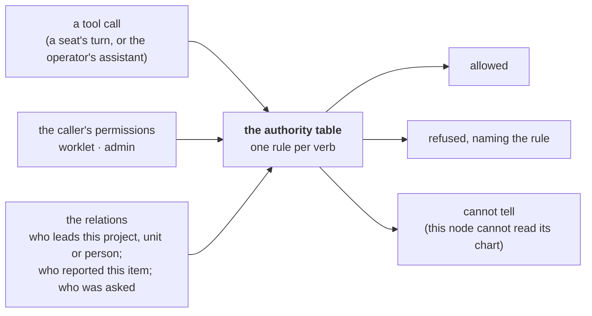
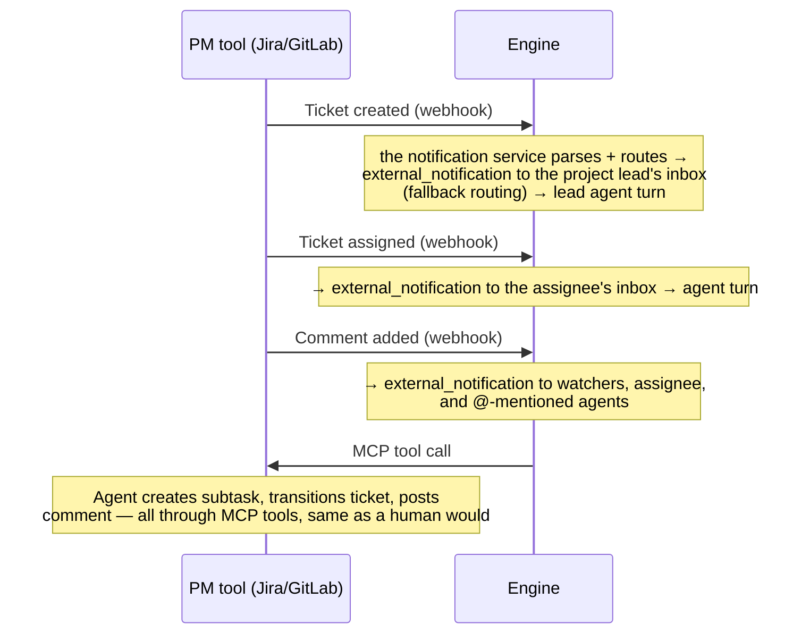
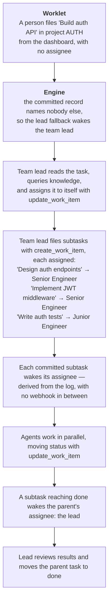
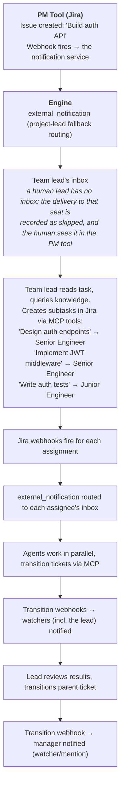
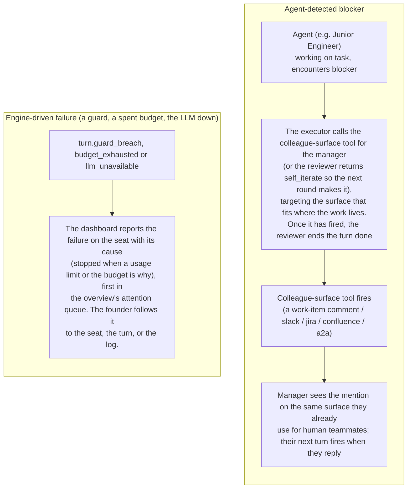

# The Tracker

A company's work lives in one of two shapes, chosen with one field:

```yaml
tracker:
  backend: worklet   # the default: the engine is the tracker
# backend: jira      # the tracker is Jira, and the engine mirrors none of it
```

They are opposite answers to the same question, each coherent on its own.

## `worklet`: the engine is the tracker

Every change to the company's work is one **record on an ordered log the whole fleet shares**, and every data node derives the same SQL tables from it; see [the log and the copies](#the-log-and-the-copies). There is a dashboard board, tools a seat calls, and an [MCP surface](../reference/api-endpoints.md#operatormcp--your-own-assistant) for your own AI assistant.

**It is not a mirror.** The log is the source of truth, so the staleness argument below does not apply: no other copy to disagree, no webhook to miss, no reconciliation poller. A node's tables can be behind the log; every answer carries how far this node has applied and what it could not account for, and a read that cannot be served refuses rather than answering "there is no such item", which somebody would act on.

It is deliberately **not** a Jira: **no workflow engine, no permission scheme**, and nothing to configure before the first ticket. Declaring a unit with a project key in the config creates the project on every data node.

It carries what an agent company uses: a key, a type from a per-project catalogue, a status from a closed set of six in four groups, an assignee, a thread, a history, subtasks, tags, typed custom fields, saved views in five shapes, and a project's **files** (rows are the tracker's; the bytes live in the fleet-wide [object store](object-store.md)). The line is between **structure a company records** (here) and **process a tool enforces** (not here): no gate refuses a transition, no scheme hides a field from a role, no setup form precedes the first task.

The whole surface is in **[Worklet](../guides/worklet.md)**.

### Who may change what

One **authority table**, fixed in the engine, answers "may this caller do that" for every surface: a seat's tools and the operator's assistant decide through the same function over the same chart. Inputs are the permissions a caller carries (`admin`, and the `worklet` app) and the relations the org chart and the work draw.



- **Reading the board, filing, updating, commenting, declaring a tag**: anybody with the `worklet` app, which every agent seat holds. Somebody a colleague asked a question on an item reads it and answers **without** the app, and nothing more.
- **A project's policy** (field declarations, default assignee, renaming or archiving a tag) and **re-routing a task** at another team: the project **lead's**, because each decides for everybody who files there.
- **Archiving a project**: the lead's, **never an agent's**; a project nobody can file into again is a company decision.
- **Saved views**: a personal view is its owner's; a shared one is its container's lead's (a project's, a unit's, or the person whose page it sits on).
- **Removing and restoring an item**: its project lead's and its **reporter's** (whoever filed a duplicate removes it). Moving it to another project stays the lead's; a purge stays an administrator's.
- **The workspace catalogue** (task types, workspace fields): `admin`, as company configuration.
- **Somebody's queue**: theirs and their lead's; their inbox and pins are theirs alone.

`admin` overrides every relation, and no seat carries it; every relation on a Worklet verb also asks for the `worklet` app. A node that cannot read its chart answers **cannot tell**, not no, so a lead is never told they lead nothing because a node was behind. Full table: [Worklet § Who may do
what](../guides/worklet.md#who-may-do-what); rules beyond Worklet: [Identity and
Access](identity-and-access.md#the-authority-table-one-function-decides).

### Why the engine grew one

The alternative costs a founder an Atlassian site, a project, six service accounts and a webhook before the company can record anything. The vendor path stays fully supported.

## `jira` — the tracker is somebody else's

Task lifecycle lives entirely in Jira and **the engine mirrors none of it**: no task table, status field, assignee map, dependency graph or reconciliation poller. A ticket's state is what Jira says, read live through an agent's own MCP tools.

That is the design, not a gap: a mirror of somebody else's state is a cache with no invalidation story. Missed webhooks, edits in the PM tool's UI and out-of-order retries leave the engine confidently wrong. Keeping nothing means nothing goes stale.

Jira is the one external tracker the field names. Work in **GitHub or GitLab issues** needs no tracker setting: the [GitHub](../integrations/github.md) and [GitLab](../integrations/gitlab.md) integrations route issue webhooks to seats whatever `tracker.backend` says, and agents act through those vendors' MCP tools, beside Worklet or with `tracker.backend: none` (the engine runs no tracker).

## What is identical either way

Routing, who assigns, hand-offs, the lead fallback and a change becoming a turn are the same **decision** on either backend. A unit's `project` key names its project on whichever tracker runs, hence not `jira_project`.

Only the **write** and the following signal differ. On `worklet` a seat writes through Worklet's tools and the committed record wakes the next seat. On `jira` it writes through Jira's MCP tools and Jira's webhook wakes it.

## The log and the copies

On Worklet a write is **published as a record** onto the domain's log, on the subject of the object it changes (one task, project or saved view); the broker arbitrates: writers racing on one task contend and exactly one wins, writers on different tasks never contend. Every data node consumes the log in order and applies the records into its own SQL tables, committing **the rows and its log position in one transaction**. No node's copy is the real one, no leader; all arrive at the same rows by replaying the same order.

A copy can say exactly how far along it is, which a cache cannot:

- **Every answer carries the level it was actually served at**, never the one asked for. A read never silently downgrades; the two differ only by a visible refusal.
- **A write's outcome has three values.** `applied`: durable *and* in this node's rows. `pending`: durable, not yet consumed by this node; a fact about this node, not a failed write, never to retry. `unknown`: the acknowledgement was lost and the record may or may not be there; the one worth retrying, with the operation id the reply carries, which collapses a duplicate rather than filing one. The id carries the instant it was minted, so a retry (a turn re-run included) is judged by when the operation began: on a node whose record of landed operations may have lost that row to its thirty-day sweep, it answers `unknown` rather than applying twice (see [Replication](../guides/replication.md#what-a-retry-is-judged-by-the-instant-its-operation-was-minted)).
  A gesture writing **several** records in order (a cross-project move, a merge, a dependency change, a subtree's removal or restore, a write that declares its labels first (`labels_create_missing`), an update changing the item and its dependencies) stops at the first `unknown` step: nothing after it is written, a mid-move or mid-merge mark stays up, and the caller is told it stopped and under which operation id. Running it again under that id (a seat by repeating the call, the operator's assistant by sending back the `op_id` its answer carried) answers the landed steps and finishes the rest. Exception: a step this node's ledger cannot vouch for; the answer says so, since rerunning here stops at the same step. A create in that position answers from its own item's row: the item where this node holds it, and `unknown` with no key minted where it does not.
- **A write can wait for itself.** The write's position becomes the floor of the reads after it, so a turn that files a task then lists the project sees it: whichever copy answers (this node's, or a data node's when this one holds none or is out of service) waits until it has applied that far. A gesture writing one item *twice* waits the same way: a dependency change naming both directions records the two edge sets as two commits on the same item, and the second carries the first's position, so it decides from a state containing it. When the answering copy is too far behind for the wait to finish, the refusal names **your own** write and the position to retry against, distinct from a colleague editing the same item.
- **An answer that could not account for everything says so.** A node holding a record a newer build wrote, which this build cannot decode, reports the answer as incomplete, names how many records and which objects, and the board renders that above the rows. It differs from staleness, which alone would look confidently right.
- **A node claims no new seats until every domain that gates admission is established.** Otherwise a seat reading incomplete tables would answer "no such task" and act on it (a duplicate, a "dead" link). The node keeps seats it already holds, and the fleet view reports how many of its copies are ready.

**A node too far behind adopts a peer's snapshot.** The log does not keep records for ever (below), so a node down long enough, or never run, can be below the oldest record held. At boot it asks the fleet, verifies the offer against its own requirements and checksum, and installs it wholesale before anything reads. A company with no peer able to donate starts anyway, on the history it has, and says what it cannot account for.

Retention: tasks, comments and pages are kept **for ever**; a domain's log keeps only the replay window, bounded by durability not age: a record is trimmed once every data node has applied past it, a complete backup covers it, and it is at least a week old. A company that never backs up never trims, deliberately.

---

## How it works with webhooks

A Jira webhook and a Worklet item's own change record both arrive at the notification service as a delivery and become an `ExternalNotification`; nothing above that seam knows which.

PM-tool webhooks do **not** become dedicated task events. The notification service parses each into an `external_notification` delivered to the routed agents' inboxes: the assignee, watchers, @-mentioned agents, or the project lead as fallback (see [Jira Integration](../integrations/jira.md)). The woken agent acts through the tracker's own tools: the builtins (`update_work_item`, `comment_on_work_item` and the rest) on `worklet`, MCP tools on Jira.



`task_assigned` (`types.TaskAssigned`) is for engine-internal work injection: the [Scheduler](scheduling.md) publishes it to a seat's inbox for cron-style recurring tasks (`internal/schedule/scheduler.go`). `work_pickup` (`types.WorkPickup`) is for the [work pickup](scheduling.md#the-work-pickup) handing an idle seat its next ready item (`internal/pickup`). The webhook pipeline uses neither, producing `external_notification`: those are the engine giving a seat work, this is the world telling a seat something happened.

---

## Assignment: Team Lead as Decision Maker

See [Organization Model](organization-model.md#unit-lead) for how unit leads and rosters are configured.

Assignment is **not** algorithmic: it is a **team lead agent's reasoning decision**, on either backend. A new work item reaches the lead through the lead fallback when it names nobody else, or because the lead is assigned, watching or mentioned. The lead reasons from the roster in its prompt (each direct report's background, goal and responsibilities) and assigns. Only the write differs:

- **`worklet`**: the lead calls `update_work_item` with an `assignee` (or files the item already assigned with `create_work_item`), and may add a one-line `reason` that the new assignee is woken with and the history shows beside the hand-off. The committed record wakes the assignee, derived from the log: no webhook to wait for or miss. An agent moving the assignee spends one of the task's **8 hand-offs**; any touch by a person or an operator returns them all (see [Hand-offs are bounded on the task](../guides/worklet.md#hand-offs-are-bounded-on-the-task)).
- **`jira`**: the lead sets the assignee in Jira through its MCP tools, and the assignment webhook wakes the agent.

A human can also assign directly, waking the same agent. On `worklet`: from the dashboard, which writes as the principal the session resolves to (a person as the seat they hold, a credential bound to no seat under its own login: [`/operator/act`](../reference/api-endpoints.md#operatoract--the-dashboards-write-surface)), or through their own assistant over the [operator MCP](../reference/api-endpoints.md#operatormcp--your-own-assistant). On `jira`: in Jira. For **top-level tasks** (no team lead above), the founder assigns directly, or a C-level agent role acts as top-level assigner.

---

## Manager handoffs (no special escalation)

There is no special escalation mechanism. A blocked or out-of-depth agent hands off as a human would:

- The executor reaches its manager with the colleague-surface tool that fits where the work lives: a comment on the work item (`comment_on_work_item` on `worklet`, a Jira comment on `jira`), a Slack mention, or `a2a_ask` for tight-loop sync. If the blocker only becomes clear at review, the reviewer returns `self_iterate` with a note, and the executor's next round makes the outreach. Once the handoff *has* been made, the reviewer ends the turn `done`: the manager's reply re-triggers the agent, so no further round can produce it.
- The `getting-unstuck` tool skill (`examples/tool-skills/getting-unstuck.md`) teaches the discipline: what you tried, options you see, your recommendation, urgency. Never hand a naked problem.
- The identity prompt names the manager, so the target is always resolvable.

When the engine itself stops a turn it ends it as `failed` and publishes the cause: `turn.guard_breach` (a fired guard: stall, max-iteration exhaustion, the delegation-depth cap, a scheduled turn's wall-clock cap), `budget_exhausted` (spent token budget), or `llm_unavailable` (exhausted provider chain). The failure is kept on the seat as its `last_error` with a cause-specific status line. A provider chain with every member at its usage limit also parks the seat: `stopped` with reason `provider` until the limit lifts; a spent budget reads `stopped`/`budget` while its window refuses (see [Agent States](agent-runtime.md#agent-states)).

---

## Data Flow Examples

### Task Created in Worklet



### Task Created in Jira



### Manager-handoff Flow


