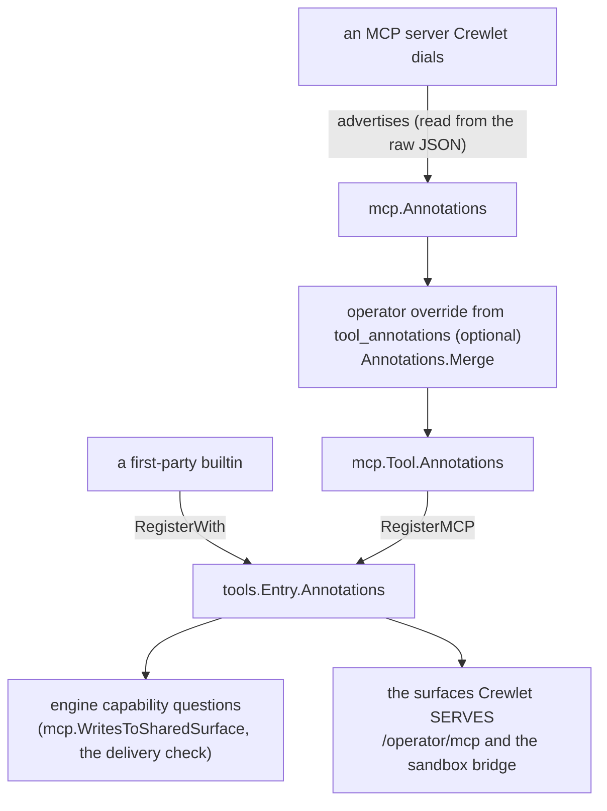

# Tool Capabilities

Crewlet is **tool-stack agnostic**. The engine ships zero hardcoded
knowledge of any specific integration — not in its prompts, not in its
runtime logic. When the engine needs to reason about *what a tool does*
(rather than *that a particular named tool exists*), it derives the
answer from the tool's **capabilities**, sourced from the MCP server
that advertises the tool. The LLM, in turn, chooses *which* tool to call
from the descriptions in its catalogue.

This is what lets the same engine run a company on Slack + Jira +
Confluence + GitHub, or on Microsoft Teams + Linear + Notion + GitLab,
with no code change — only different MCP servers in config.

---

## Two halves of the decoupling

| Concern | Coupled approach (rejected) | Crewlet's approach |
|---|---|---|
| *Which* tool should the LLM call to deliver a reply? | Name `slack_conversations_add_message` etc. in the prompt | Prompt names the **capability** ("the reply tool for the channel the trigger arrived on"); the LLM maps it to a tool in its catalogue by the tool's description |
| *May a sub-agent call this tool?* | A hardcoded denylist of `slack_*` / `jira_*` / `confluence_*` / `*copilot*` names | Derived from the tool's **MCP annotations** (`readOnlyHint` / `destructiveHint` / `openWorldHint`) |

The first half is "let the LLM reason from descriptions." The second is
"let the engine reason from annotations." Neither requires the engine to
know a single concrete tool name.

---

## Tool annotations

The [MCP spec](https://modelcontextprotocol.io) lets a server advertise
behavioural *hints* per tool. Crewlet captures them as `mcp.Annotations`
(`internal/mcp/annotations.go`), carries them on every bridged tool
(`mcp.Tool.Annotations`) and beside the tool in the registry
(`tools.Entry.Annotations`), and advertises them again on the two MCP
surfaces it *serves*:

| Field | MCP hint | Meaning |
|---|---|---|
| `read_only` | `readOnlyHint` | The tool does not modify state |
| `destructive` | `destructiveHint` | The tool may perform irreversible updates |
| `idempotent` | `idempotentHint` | Repeat calls have no additional effect |
| `open_world` | `openWorldHint` | The tool touches entities outside the local system (the network, external services, shared surfaces a human can see) |
| `title` | `title` | Human-friendly name |

Every hint has **three values**, `mcp.Yes`, `mcp.No` and `mcp.Unknown`
(the server did not say). `Unknown` is never coerced to `No`: "unknown"
and "explicitly safe" are different facts, and every classifier below
depends on the distinction. The MCP Go SDK's own struct cannot hold it
(two of its four hint fields are plain booleans), so Crewlet reads a
server's annotations off the wire rather than out of the decoded struct
and trusts only an explicit `true`. A value that is not a JSON boolean is
read as `Unknown`.

First-party builtins declare their own annotations in code, registered
with `tools.Registry.RegisterWith`, so the same classification works for
them. The [code tools](../guides/tools-and-mcp.md#the-companys-code)' eleven
reads, for one, are each a proven, idempotent read: a worker may be handed any
of them, a turn that only read code delivered nothing, and the operator
catalogue records no call to one. Two of them read a repository's changes —
`code_list_changes`, and `code_get_change`, a change a part at a time — and
are reads like the rest: a reviewer woken about a change that has read its
diff and its findings has delivered nothing yet, and only a write it makes in
answer reaches anybody. Each change tool also names, in one table its tests
hold to the tool list, the access its call needs on the change's repository —
of its caller, and in a turn a colleague seat woke of that seat too; a read's
is read, which the node that answers judges both at, and a write's is the
least access at which the node that decides it may admit the call — the rest
is the relation that node judges from its own chart, which no access alone
names (an open's push of its branch, a change's owner steering it). Their
eighteen writes — `code_commit_files`,
`code_revert`, `code_cherry_pick`, `code_create_branch`, `code_delete_branch`,
`code_create_repo`, `code_update_repo`, `code_delete_repo`,
`code_restore_repo`, `code_protect_branch`, a change's `code_open_change`,
`code_update_change` and `code_close_change`, and its conversation's
`code_request_review`, `code_review_change`, `code_comment_on_change`,
`code_resolve_finding`, its findings' `code_apply_suggestions` and its
`code_rebase_change` — are each `read_only: false`
with `open_world: true`: a branch, a repository or a change is a surface every
colleague reads, so `mcp.WritesToSharedSurface` keeps every one from a worker,
which would write under its parent's grant; each is registered as a delivery
to the code host, so a turn woken about a repository that moved a branch or
opened a change delivered; and each but two is `idempotent: true`, since every
one is held to what its caller read — a commit to the head it names, a create
to a free name, a change's edit and close to the version its caller read, an
open to the one live change a branch may head, an ask of a reviewer already
asked and an answer a finding already holds to nothing — and the same call
made again is the same operation. `code_review_change` and
`code_comment_on_change` are `idempotent: false`: a review and a comment are
additive, and two saying the same are two, as `comment_on_work_item`'s are —
the engine makes a re-run of the same call the same write, but the hint
describes the tool a model is offered. `code_delete_branch`,
`code_delete_repo` and `code_resolve_finding` are also `destructive: true`:
each takes away what somebody else made with nothing the same tool keeps to
undo it — a finding dismissed is a reviewer's blocker cleared, which no write
moves back. `code_apply_suggestions` is a commit like `code_commit_files`,
held to the head its caller read, and the CALLER's: whoever applies a
review's suggestions becomes an author of the change, whose approval of it
then counts for nothing, and answers the findings applied `resolved` — an
author's answer, which leaves a blocker standing for its raiser to judge.
`code_rebase_change` is a forced push of the change's branch, held to the
head its caller read, whose replayed commits keep their own authors: the
rebaser becomes an author of the change as any pusher of a revision does. A
seat holding the
writes is also told, in its executor prompt's `code_writes` section, the one
choice no description can carry: a small change is committed on the server,
and anything to build or test belongs in a checkout. The operator-only
`code_repo_readers` beside them is a proven, idempotent read like the eleven,
which no seat's registry ever holds: annotations say what a tool does,
never who may call it, and who read a unit's repository is an admin's — a
person's — question, decided by the authority table before anything is read
([Who read it](code-host.md#who-read-it)). And so are the
[health tools](../guides/fleet.md#the-health-tools), `fleet_health` and
`code_status`: proven, idempotent reads of the deployment, which every seat's
registry holds and a seat is offered only where its role carries the health
grant — again the authority table's decision, never an annotation's.

### Where annotations come from, and where they go



**The outbound half is not optional.** Both MCP surfaces this engine serves —
`/operator/mcp`, which hands a company's tracker and knowledge base to an
operator's own assistant, and the sandbox bridge, which hands a seat's tools to
a coding agent — advertise each tool's hints alongside its schema. A surface
that published only names and schemas would give those clients no way to tell
`search_work_items` from `remove_work_item`: a client that asks a person before
an irreversible call would have nothing to ask on, and one that skips the
prompt for a read would prompt on every one.

A tool the engine has **not** classified advertises no annotations at all,
rather than four "false" hints it would be read as having asserted. Only an
explicit yes ever sets a hint on the wire, in the same direction and for the
same reason as the inbound rule above.

---

## The classifiers

The engine asks annotations two questions, and they deliberately fail in
opposite directions.

### `mcp.WritesToSharedSurface`: may a worker call this?

*Would a worker calling this tool write to a surface a human reads, under
the parent agent's identity?* A worker posting to a channel or commenting
on an issue as its parent would leak identity onto a transcript, so the
[worker guard](turn-engine.md#runtime-invariants) (`subagent.Permit`)
denies such tools.

`mcp.WritesToSharedSurface` answers it, conservatively about unknowns:

- `ReadOnly` is `Yes` → **no** (a pure read).
- `Destructive` is `Yes` → **yes**.
- `ReadOnly` is `No` and `OpenWorld` is not `No` → **yes** (a write to
  the outside world).
- everything else, including all-unknown → **no**. The engine does not
  block what it cannot classify; the task's (or its template's) explicit
  allowlist already curates the worker surface.

First-party control tools (`delegate`, `run_sandbox`, `a2a_ask` and the
parent's `activate_tool` / `list_mcp_server_tools` pair) are denied
separately by name, because they are Crewlet's *own* tools and naming them
is not a third-party coupling. `run_sandbox` is on that list because a
detached coding run is keyed to the **parent** turn: the pending row
carries the parent's `turn_id` and a completion resumes the parent's
suspended executor, while a worker's loop cannot suspend. The parent turn
would finish without persisting a suspended conversation, and the run
would come back with nothing to resume into.

### The delivery check: did this answer reach anybody?

The [delivery check](turn-engine.md#three-checks-in-increasing-cost) asks
the opposite question and fails closed. `turn.Deliverable` is one
membership test against the map `tools.Registry.Deliveries` computes, and
two kinds of tool are in it: an MCP-served tool whose own annotations do
**not positively** call it a read, and a first-party tool the engine
registered as one that reaches somebody. So an unannotated server tool
counts, and so does commenting on a native work item, while a diary write
does not. The read side of that test is `mcp.ReadOnlyProven`, which exists
beside `mcp.WritesToSharedSurface` precisely because the two questions fail
in opposite directions: reusing the worker guard's answer here would read
every under-annotated write tool as having reached nobody.

### `open_world` is a tri-state, and unset is not `false`

Read the third rule again: `ReadOnly` is `No` **and** `OpenWorld` *not
explicitly* `No`. A tool that writes only *private* state (an agent's
own diary, its own learned skills, its own onboarding marker) is not a
write to a surface a human reads, but saying so takes an explicit
`open_world: false`. Leaving the hint unset classifies it with the public
writes.

That is deliberate for a third-party server, where "nobody said" has to
mean "assume the worst" — it is the fail-closed default, and the engine reads a
server's annotations off the wire because the MCP Go SDK flattens the absent case for
`readOnlyHint` and `idempotentHint`, which would otherwise make every
under-annotated tool look exactly like a public write.

It is a trap for **first-party** tools, and Crewlet fell into it twice. Three
builtins that write nothing but the agent's own memory (`reflect_and_persist`,
`refine_skill`, `mark_onboarded`) declared `read_only: false` and said nothing
about `open_world`, so the guard denied them to workers their parent had
explicitly granted them — blaming a write to a shared surface that never
happens. The three person tools (`mark_inbox`, `set_pins`, `set_priorities`)
did the same: each is written only on behalf of the person whose it is, so
there is no second party to be surprised by one. All six say what they mean
now, and `set_priorities` is the one that genuinely *is* open-world — a lead
may set the queue of somebody in their line, and that person opens their day on
work they did not choose.

The same applies to `tool_annotations`: a server tool that genuinely stays
inside your network needs the key written out, because omitting it is a claim
in the other direction.

---

## Operator overrides for under-annotating servers

Most modern MCP servers (the official GitHub server, recent
`mcp-atlassian`) advertise annotations. For a server that does not, an
operator can supply them in config — without touching engine code — via
`tool_annotations` on an `mcp_servers` entry, keyed by **bare tool
name**. `tavily-mcp` 0.2.22 is such a server: its five tools search and
read the web and advertise no hints at all, so without these keys each
counts as a possible delivery, and a turn that only searched can pass the
delivery check as one that reached somebody:

```yaml
mcp_servers:
  - name: tavily
    command: npm
    args: ["exec", "--yes", "--", "tavily-mcp@0.2.22"]
    env: { TAVILY_API_KEY: "${TAVILY_API_KEY}" }
    tool_annotations:
      tavily_search:   { read_only: true, open_world: true }
      tavily_extract:  { read_only: true, open_world: true }
      tavily_crawl:    { read_only: true, open_world: true }
      tavily_map:      { read_only: true, open_world: true }
      tavily_research: { read_only: true, open_world: true }
```

Keys accept snake_case (`read_only`) or the MCP camelCase
(`readOnlyHint`). Overrides win over whatever the server advertised
(`mcp.Annotations.Merge`), and a hint the override leaves unset keeps
the server's value. The **tool-name key** matches either the server's raw
name or the catalogue name with the entry's `tool_prefix` applied (for a
Slack server with `tool_prefix: slack_`, `conversations_add_message`
**or** `slack_conversations_add_message`; the raw name wins when both are
present), so keying by the name you see in the catalogue never silently
no-ops. A key that is neither — a tool the server does not list, or one
it lists under another name — overrides nothing. The server's row on
**Settings › MCP Tools** names every key no started instance lists
(`unlisted_annotations` in [`GET /mcp-servers`](../reference/api-endpoints.md#get-mcp-servers)),
and each instance's `tools_discovered` log line names the keys its own
listing does not answer (`annotation_keys_unlisted`). Only the first is a
mistake: one instance's listing is not the server's. A per-role child
serves what its seat's credentials reach — `mcp-atlassian` lists no
Confluence tool to a seat holding only a Jira credential — so a
`confluence_*` key is right for one seat and absent from another's, while
a key no instance lists is a misspelling or a tool the server no longer
serves. Take the names from the server's own listing, which its
`tools_discovered` line carries.

Every tool server — including Jira/Confluence (`atlassian`), Slack, and
GitHub — is an `mcp_servers` entry, so `tool_annotations` is declared
there for all of them, the same way:

```yaml
mcp_servers:
  - name: atlassian          # shared by Jira + Confluence
    shared: false
    command: uvx
    args: ["mcp-atlassian==0.23.1"]
    tool_annotations:
      jira_add_comment:       { read_only: false, open_world: true }
      confluence_create_page: { read_only: false, open_world: true }
  - name: slack
    shared: false
    command: npm
    args: ["exec", "--yes", "--", "slack-mcp-server@1.3.0", "--transport", "stdio"]
    # without these the server registers no tool that posts or reacts; each
    # seat's mcp_env.slack adds its token and its own SLACK_MCP_CHANNELS_CACHE
    env: { SLACK_MCP_ADD_MESSAGE_TOOL: "true", SLACK_MCP_REACTION_TOOL: "true" }
    tool_annotations:
      conversations_add_message: { read_only: false, open_world: true }
  - name: github
    transport: http
    shared: false
    url: "https://api.githubcopilot.com/mcp/"
    tool_annotations:
      create_pull_request: { destructive: true }
```

Jira and Confluence share one `mcp-atlassian` server: declare it once as
`atlassian` and put both products' overrides on that single entry. The
official GitHub server and recent `mcp-atlassian` already annotate their
tools, so these overrides are usually unnecessary — they exist so an
under-annotating build of any server is correctable without engine
changes.

If a server under-annotates and no override is supplied, the worker
guard cannot auto-deny that server's write tools (the parent's explicit
allowlist remains the curation), and the delivery check counts every one
of its tools, reads included, as a possible delivery.

---

## Why not classify with an LLM, or by tool name?

- **By tool name** couples the engine to one vendor's tool catalogue
  and silently fails open for every other.
- **By an LLM pass at boot** would be non-deterministic and add latency
  and cost to startup for a yes/no the MCP spec already answers
  declaratively.

MCP annotations are the right primitive: declarative, per-tool, supplied
by the party that actually knows the tool's behaviour (the server),
overridable by the operator when the server falls short.

---

## See also

- [Turn Engine](turn-engine.md): the worker guard, the delivery check and the runtime invariants.
- [Tool Skills](tool-skills.md): the *how-to* half of tool decoupling (knowledge-base-sourced per-tool guidance).
- [Agent Runtime](agent-runtime.md): the tool registry and MCP bridge.
- [Tools & MCP guide](../guides/tools-and-mcp.md): `mcp_servers[].tool_annotations` config.
