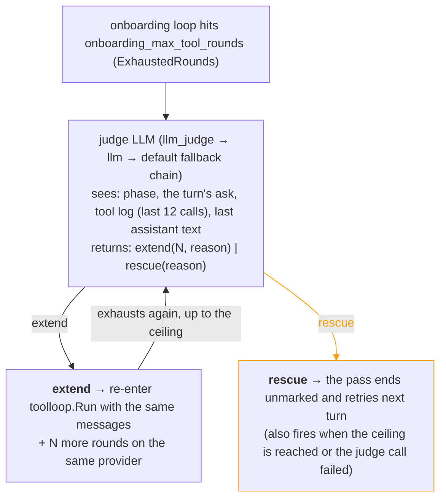
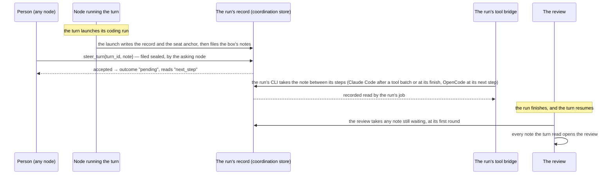

# Turn Engine

Each agent turn in Crewlet runs through a two-stage **Executor → Reviewer** loop orchestrated by the turn engine (`internal/agent/turn/loop.go`). Each stage is an LLM call with its own system prompt, its own tool surface, and optionally its own model. The turn engine also owns delegation to short-lived **workers** and enforces the delegation-depth / stall / worker-allowlist invariants in code.

---

## Why two stages?

The engine used to plan in one conversation and act in another. That split cost the actor everything the planner learned: tool RESULTS were not forwarded, so content had to be smuggled through the plan's own steps, and the planner had to NAME the tools it expected to call — against a catalogue it was never shown, so it guessed. Every guess that missed became a "phantom" the engine then had to reason about, and the delivery gate was built entirely out of reconciling those guesses with reality. Both recorded delivery incidents came from that reconciliation.

One agentic loop removes the reconciliation rather than improving it. What remains:

- **Onboarding** (first turn only, conditional) runs *before* the executor when the agent has no onboarding marker for its current org chain. It reads the team's `Onboarding` pages, captures conventions via `reflect_and_persist`, and calls `mark_onboarded`. It has its **own** round budget (`turn_engine.onboarding_max_tool_rounds`, default 10) so onboarding never competes with the turn's own budget — if it ran inside the executor it could consume every round before the agent ever called `submit_work`, silently dropping a first-turn request. Skipped on resume turns and once the agent is marked. See [First-turn onboarding](#first-turn-onboarding).
- **Executor** decides what to do and does it, in one conversation. It starts with every first-party tool in its reach — all but `mark_onboarded` — and its MCP servers by name; it discovers and activates MCP tools as it turns out to need them. It ends by calling `submit_work` with an outcome, a summary, and the deliveries it claims.
- **Reviewer** judges the work. No domain tools; a single `submit_review` structured-output tool forces the decision enum. There is no handoff decision, and no *waiting* decision either. When the turn cannot finish without a manager or peer, the reviewer splits on whether they have been told — a fact the tool log settles, not the agent's prose. **Not yet** → `self_iterate`, and the note tells the next round to reach them with its own colleague-surface tools, the same tools a human teammate would use (there is no special escalation mechanism). **Already asked** → `done`: their reply is what re-triggers the agent, so no further round of *this* turn can produce it, and sending it back burns the iterations the real work needs while posting the same question a second time. Being blocked is the **executor's** word for what happened — the `blocked` outcome, whose `evidence` the schema demands — and `done` / `self_iterate` / `failed` are the **reviewer's** for whether that was good enough. One thing a handoff never buys: whoever triggered the turn is still owed a reply where *they* asked, which is why a turn that asks a colleague while the requester hears nothing is overturned (see [Who is waiting](#who-is-waiting-and-how-they-get-an-answer) below).

**Workers** (`delegate`) are short-lived helpers the executor hands narrowly-scoped work to — web research, a bounded read, summarising something large — without it counting as colleague delegation. See [Workers](#workers) below.

---

## Phase-specific tool surfaces

Each phase gets a filtered view over the shared `tools.Registry` through a `tools.Surface` (`internal/tools/surface.go`). This is the key constraint that keeps LLM payloads tight while still letting the executor recover from an under-specified catalogue.

| Phase | Tools | System prompt | Notes |
|-------|---------------|---------------|-------|
| **Onboarding** | `reflect_and_persist` and `mark_onboarded` active from the first round, plus the `activate_tool` / `list_mcp_server_tools` discovery meta-tools | One-line identity + the onboarding instructions (which pages to read, persist conventions, then `mark_onboarded`) + `## Tools to discover` | Runs only on a first turn for an unmarked agent, on its own budget. Activates its knowledge-base tools from `## Tools to discover`, which lists every tool it can reach and does not hold: a first-party one (`search_knowledge` on either backend, `get_page` on Doclet) by name and description, an MCP server (the Confluence server's page tools) by name, its tools listed with `list_mcp_server_tools` first. **No required-skill guard**: onboarding is a fixed read → persist → mark workflow and the prompt is its own guidance, so the load-before-use tax is skipped. Terminates on `mark_onboarded`; on budget exhaustion the agent stays unmarked and retries next turn. |
| **Executor** | Every first-party tool except `mark_onboarded`, plus `submit_work`, `activate_tool`, `list_mcp_server_tools`, `delegate` where the seat may hand work to [workers](#workers), and any MCP tool it has activated this turn | Identity + **full policy text** + role profile + skills metadata + roster (leads) + the executor's contract + prefetch blocks + `## Tools to discover` (its MCP servers by name) | The system prompt lists **no tool the executor holds**: every one it is offered reaches the model as a tool definition with every request — a tool of the CLI's `crewlet` MCP server, on this host or over the bridge — so a second copy of each description in the system prompt was the same words paid for twice, ~17 KB with every builtin wired. `## Tools to discover` names what it can reach and does not hold yet, which on the executor is its MCP servers; `delegate` has a `## Your workers` block beside it where the company publishes worker templates. A tool left out of the universe the surface is built from is out of that list too, and `activate_tool` cannot reach it; individual MCP tool names (often 50 to 150 per role) stay out of the prompt. To use one the agent calls `list_mcp_server_tools(server)` for discovery, then `activate_tool(name)` to make it callable from the next round. Nothing is named in advance, so nothing has to be reconciled afterwards. Mission, vision, backstory, full policy text, and behavioral guidelines render directly into the prompt from the in-memory `Organization` model, with no database seed step. `mark_onboarded` is the whole phase-scoped denylist, kept from every executor: a seat that could mark itself here would permanently skip orientation. `run_sandbox` is left out only where the seat is offered no box. |
| **Review** | `submit_review` meta-tool only | One-line identity + the rules that decide its decision + the round's intent, outcome, tool log and produced text | No catalogue, no policies, no prefetch. Whether anything was DELIVERED is settled before this prompt is built — the reviewer's question is whether the work is any good, and neither its prompt nor `submit_review`'s schema asks the other question. What each decision means is the schema's to say, beside the field; the rule for judging a sandbox run's report renders only where the executor was offered `run_sandbox`, and `a2a_ask` is named only where the seat holds it. |
| **Worker** | The task's (or its template's) allowlist minus the engine-control denylist (`delegate`, `run_sandbox`, `a2a_ask`, the discovery meta-tools) **and** minus any tool whose [MCP annotations](tool-capabilities.md) mark it a write to a shared surface, **and** minus anything the parent cannot itself call — plus `submit_result` always | Persona (template or inline) + `## Tools to discover` (what it can reach and was not granted) + mandated preamble | Fresh context; a wall-clock timeout; runtime-clamped `max_turns`. A worker CAN discover and activate more *read-only* tools itself, against the safety-filtered universe its grant was cut from — so discovery cannot widen it into a write or a control tool. External writes are denied by *capability* (derived from MCP annotations), not by a hardcoded name list, so the guard holds for any tool stack. |

---

## First-turn onboarding

A fresh agent (no onboarding marker for its current org chain) needs to read its team's `Onboarding` knowledge-base pages and internalise the conventions before doing real work. This runs as a **dedicated phase before the executor** (`internal/agent/runner/onboarding.go`), gated on the marker store (`agent_onboarding_markers`):

1. The engine checks the marker (`Runner.Onboard`). The read has **three answers**: marked for the current chain skips; definitively unmarked runs the pass; a lookup that *failed* (`onboarding_state_unknown_skipping`) **skips this turn and retries the check next turn**. Collapsing a failed lookup into "not onboarded" would re-run a full onboarding pass for an already-marked agent on any transient database error. Two further guards make onboarding run once per org chain: a **process-local latch** (`runner.Latch`, the chain hash this process has seen marked, set the moment a pass marks or a read confirms the marker) short-circuits before any database read, and a **cross-process pass lease** (`Markers.Claim`, held for at most `runner.ClaimTTL`, 15 minutes, and released explicitly when the pass ends) lets exactly one turn run the pass when two turns for the same unmarked seat start at once, for example on two nodes during a rolling restart. A turn that loses the lease skips the pass (`onboarding_claimed_elsewhere_skipping`). The lease also excludes a concurrent pass inside one process, so there is no separate in-process lock.
2. Otherwise it runs the onboarding pass with its **own** round budget (`turn_engine.onboarding_max_tool_rounds`, default 10). The agent activates its knowledge-base tools (`activate_tool` on a first-party one listed under `## Tools to discover`, after `list_mcp_server_tools` on an MCP server's), reads the pages, captures conventions with `reflect_and_persist`, and calls `mark_onboarded` (which terminates the phase). Onboarding is a **discovery-capable phase**: its prompt lists the tools it can reach and its surface supports `activate_tool` exactly like the executor. (Without that, the agent could *see* its knowledge-base tools but every `activate_tool` would hit an "availability gate", so it would never read its pages, never mark, and the pass would re-fire every turn.) Its header names its knowledge-base tools by capability, never by product or tool name: it once said they were always MCP tools, which on Doclet, the default backend, sent every seat to list a server for a first-party tool it could have activated by name. Its rounds are governed by the same round-cap **extension judge** as the executor: the base cap can be extended up to `onboarding_max_tool_rounds_ceiling` (default 20) when the agent is still making progress, so a near-done pass isn't cut off mid-read.
3. The turn then proceeds to the executor, whatever became of the pass — a pass that failed leaves the seat un-onboarded, which is where it already was, and it retries next turn. **The one exception is a pass the budget refused**: its refused round is counted, so every later call of the turn is certain to be refused (on the turn's own clock — see [invariant 4](#runtime-invariants)), and the turn ends there — published as `budget_exhausted` like a refusal inside the loop, its seat [parked](agent-runtime.md#the-budget-park) — with no executor phase opened. The executor is never told to onboard and never reaches `mark_onboarded`, so onboarding cannot also happen inside it and re-spend the turn's budget: a turn whose pass did not run — the marker unreadable, the lease held elsewhere — leaves onboarding to a later turn's pass.

**Why a separate phase.** If onboarding were only a hint injected into the executor's prompt, the agent would do the page-reads + `reflect_and_persist` + `mark_onboarded` inside its own round budget — on a first turn that could burn every round before it ever called `submit_work`, and the turn would fall through to a silent skip (the request dropped). Giving onboarding its own budget means a first turn always has its full budget for actual work.

The marker invalidates itself when the org chain changes (`learning.ChainHash`, a hash of the seat's path through the organization), so a role move or a reorganization re-triggers onboarding for the new context. Set `onboarding_max_tool_rounds: 0` to turn onboarding off: the dedicated pass is all of it, and no seat is then told to onboard anywhere. When no marker store is wired (a node with no store), onboarding is skipped, because there is no way to record completion and the pass would otherwise run every turn. A human seat never onboards.

On the dashboard, onboarding renders as its own phase within the turn it rode in on, on the same neutral tag every phase takes — a phase is a category, and a category is its word rather than a colour. Inside a chart it is counted in the Auxiliary band: it is one-time setup that happens to ride the first turn, not part of that turn's task.

---

## The work submission

The executor ends by calling `submit_work` (the tool and its decoder are in `internal/agent/runner/submit.go`), which is where the turn's account of itself becomes something the engine can act on. The submission decodes into `turn.Work` (`internal/agent/turn/loop.go`):

```go
type Work struct {
    // Outcome is the executor's own account: delivered | no_action |
    // blocked, or the engine-written `incomplete` when it never submitted.
    Outcome Outcome
    Summary string

    // Deliveries are the tools it cites as having delivered. Reported
    // rather than trusted — the engine's own record is what decides.
    Deliveries []string

    Evidence      string // required when blocked: what was tried, what stopped it
    OpenQuestions string

    Text  string        // the final prose
    Calls []ledger.Call // engine-recorded, not self-reported

    // Also engine-set: MissingTools (names called that the surface did
    // not have), ExhaustedRounds, Suspended and Rescued.
}
```

**A field the schema does not declare is refused, naming it**, and goes back to the model like any other rejected submission — at any depth, and in `submit_review` and a [`delegate`](#one-call-a-graph-of-tasks) call too, which decode the same way. Decoded the obvious way it was dropped, so a misspelt optional field was accepted as an answer the model did not give: a reviewer's misspelt `completed_work` never told the next round what had already landed, so it could fire the same post a second time, and a delegated task's `afer` for `after` ran at once, on input it was told to wait for.

To hand a task off to a colleague the executor reaches them where the work lives — a chat mention, an issue comment or reassignment, or `a2a_ask` — and reports that as the delivery. There is no dedicated `delegate` outcome: a handoff is just a colleague-surface tool call.

**Real code work** is the executor's own run. Every agent seat's executor is its coding CLI's own agentic run (Claude Code / OpenCode) in a box, with a real shell, a real editor and a real checkout, and the seat's tools reaching it over the [tool bridge](llm-backends.md#the-tool-bridge). The launch **suspends** the turn (detached run); when the run completes the engine **resumes the same turn** with the run's report, so the engine's check and the reviewer judge it in the same turn. See [Code Sandbox](code-sandbox.md).

### Who is waiting, and how they get an answer

Whether a turn OWES an answer is derived by the engine at dispatch, from the trigger's own type, before any model runs (`engine.ReplyFor`). It is the half of the delivery question a model cannot get wrong — the old engine asked the planner to declare its own intent, and a turn that declared `skip` on a direct @mention read to the person who sent it exactly like the message never arriving.

| `Reply` | Trigger | What delivery means |
|---|---|---|
| `none` | A schedule fired, a broadcast mentioned the seat in passing, an internal event woke it | Nothing is owed. The turn may end having done nothing at all, which is what makes triage cheap |
| `tool` | An assignment, or a notification the source's own routing marks as an ask — a direct message, a personal mention | The answer only exists if a tool put it there |
| `engine` | A colleague asked over A2A | The engine returns the turn's artifact on the channel the ask opened; there is no tool to call |

A source's reading of its own routing is [`notify.Prompt.Addressed`](../index.md#integrations) — a tracker answers from its routing reason (assigned, mentioned), a chat backend from the channel type and whether the seat was named. The conservative answer is FALSE: a seat wrongly told nobody is waiting keeps the freedom to stay silent, while one wrongly told somebody is must post on every broadcast it observes. A coalesced trigger takes the STRONGEST obligation of its constituents — a merge must not be able to launder an ask.

**There is no fourth value, and no default.** A turn started without one is refused before any phase runs, because none of the three is a safe reading of "the caller did not say": permissive exempts a turn that owes somebody an answer, strict loops every unaddressed turn to exhaustion. That refusal exists because the omission shipped — the dispatch path derived the obligation correctly, handed it to the runner, and dropped it before the loop, so the decode-time check below stayed armed while **both** of the engine-side gates were skipped on every non-sandbox turn. Nothing about the result said so: the turn simply had no delivery gate.

### Three checks, in increasing cost

The turn engine checks the executor's account against its own record three times, and the order is the design (`internal/agent/turn/verify.go`):

1. **At decode time**, inside the loop. A `delivered` on a `tool`-awaited turn must cite a call the engine recorded that reached the surface the ask came from; a `no_action` on any awaited turn is refused outright ("silence is not a decline"); a `blocked` needs evidence. A wrong claim costs one bounced tool call the model can fix — not a review round, and not a silently accepted no-op. The refusal lists what IS citable, because the failure this catches is usually a model naming the tool it MEANT to call.
2. **Before the reviewer** (`Check`). Two of its three answers cost no model call: a `no_action` nobody asked for and nothing acted on ends the turn as skipped; a claim the record refutes loops back with an engine correction. What it cannot do is judge whether the work was any GOOD — everything that passes goes to the reviewer.
3. **After the reviewer** (`OverrideDone`). A `done` on a `tool`-awaited turn where nothing reached the party waiting is overturned to `self_iterate`. This is the recorded failure: the reviewer's model judges the produced TEXT, finds a good answer in it, and says done even though nothing put that answer anywhere a person can see. The engine's correction is appended LAST, because on this path the reviewer wrote none of its own — and where the turn did reach *somewhere*, just not the asker, the correction says so by name, because "no tool was called" reads as plainly false to a model looking at its own successful write and gets argued with rather than acted on. It says so *only* where the record shows such a write: telling a turn that only read that it "reached somebody" sends the model looking for a write it never made.

**All three read the whole turn's record, not the current round's** (`turn.Record`: every call the closed rounds made, then this round's). The obligation is the turn's: somebody waiting is answered once, and a round the reviewer sends back for something else does not un-answer them. The [prior-work ledger](#prior-work-ledger-across-self_iterate-rounds) tells every later round exactly that — an earlier round's successful write already ran, do not issue it again — so a check reading the round alone demanded the one thing the round was forbidden to do. That shipped: a seat answered a founder's comment on a work item with a comment of its own; its reviewer sent the round back to re-read the item first; the second round re-read it, cited the comment, and had that citation refused eleven times as "nothing delivered" until its round cap ran out; the reviewer's `done` was overturned for the same reason; and the third round, told to find the tool that delivers on `work` through MCP discovery, posted the same acknowledgement in a chat channel — which could never count — and the turn ended on the iteration cap, recorded as failed for having answered in its first round. An earlier round's delivery is now citable in a later round's `deliveries`, and the ledger's header says so. Whether a later round *also* owed a delivery — a correction the first answer needs — is a judgement about the work, which is the reviewer's; the review prompt says the engine's check covers every round so a reviewer does not read a round with no write of its own as a turn that reached nobody. The one thing that still reads the last round alone is `Result.Delivered`, because its question — does the person waiting know how the turn *ended* — is a different one (see [what a conversation entry holds](conversation-sessions.md#what-an-entry-holds)).

**Every refusal ends by naming how to deliver where the asker is** (`turn.Remedy`). On the engine's own surfaces — `work` for the tracker, `page` for the knowledge base — that is the first-party tools that deliver there (`comment_on_work_item`, `update_work_item`, …), which the executor holds from its first round and which no discovery call lists. On a vendor's surface it is the MCP server of the same name, through `list_mcp_server_tools` and `activate_tool`. Only where the asker's surface cannot be named does it fall back to the general instruction. It used to send every seat to discovery, which is the misdirection in the incident above.

**What counts as a delivery, and where it lands** is one rule, applied everywhere. A tool delivers (`turn.Deliverable`) when it is **MCP-served and not positively annotated read-only**, or when it is a **first-party tool the engine registered as one that reaches somebody**: Worklet's writes and Doclet's do, `reflect_and_persist` and `use_skill` do not, and the flag is set at registration rather than derived from annotations, because a diary write and a work-item comment are annotated identically. "Not a known read" is POSITIVE: an unannotated MCP tool counts as a possible delivery, which is the fail-closed direction, since the alternative exempts every tool a server forgot to [annotate](tool-capabilities.md). Only SUCCESSFUL calls count: a failed post did not post, and counting it would close the check on exactly the turn that needs to iterate.

Each delivering tool also declares **which surface it reaches**: an MCP tool's is its own server (`mattermost`, `slack`, `github`), and an engine builtin's is the change feed's own source: `work` for Worklet, `page` for Doclet. Those are the same names an inbound notification reports its source under, and the gate compares the two, because "did this turn reach anybody" and "did the person waiting get told" are different questions, and only the second one matters to the asker. Asking the first is how a founder's Mattermost DM was closed out by a row in the tracker: the seat filed a work item instead of answering, every check passed, and the thread's last message stayed a clarification question the founder had already been answered out from under.

**A notification may owe a surface other than its own source.** The answer to a [decision](../guides/worklet.md#asking-for-a-decision) whose asker promised to report the outcome in a chat channel arrives from Worklet (`work`), and on its source alone a comment on the item would close the turn. So the asker's copy carries `owes` (the chat surface the decision's `inform` named), and the obligation is raised on that surface instead: the turn is sent back until a tool on `slack` or `mattermost` has run, whether or not Worklet read the wake as addressed. Only the asker's copy owes it, and a merge of wakes carries it through; Worklet partitions an owing wake apart from the rest of the item's conversation, so one turn never owes two surfaces.

The surface check **narrows only where it can**, and the two fallbacks are the design rather than leniency:

- An obligation with **no named surface** is one the engine could not place. An assignment is the honest case: moving the item, commenting on the ticket and replying in the thread the work came from are all real answers, and nothing can pick between them. Only a notification names a surface, because only a notification knows one.
- A surface **this seat holds no tool for** leaves nothing to enforce. The seat could not have answered there however many rounds it spent, so insisting would turn an operator's missing integration into a seat that never finishes a turn.

That second fallback is also where the rule is currently weakest, and deliberately so rather than by oversight: a vendor's surface is its **MCP server's name**, which holds only while one server serves one source. The shipped Atlassian setup breaks that — one `atlassian` server serves both Jira and Confluence while inbound events carry `jira` or `confluence` — so those two obligations find no matching surface and take the fallback, which is the pre-existing "any delivery counts". Nothing regresses there; the check simply does not yet narrow for them. Closing it needs the server to declare which sources it serves, which is a config change rather than a derivation.

In both, the flat question is the answer — so the check is strictly stricter than the one it replaces, and never stricter than the seat can satisfy. The decode-time refusal uses the same rule and the same fallbacks, or a model would be told one thing at submission and judged by another.

`no_action` is narrowly scoped: it means **"nobody was actually asking the agent to do anything"** — informational triggers, passing references, broadcasts where the addressee was clearly someone else. When the agent *was* directly asked / @mentioned / assigned but is declining (out of scope, wrong owner, already handled, deferring), it must instead post a brief explanation via the originating channel's reply tool and report that as `delivered`. A direct request answered with silence looks like the ping was lost; the one-line decline closes the loop. The `outcome` field's own description states the rule, the executor's contract says where the decline goes, and the decoder enforces it in code, so the notification prompts do not restate it. What a source's prompt adds is what only the source knows: how something the agent *holds* is declined *there* — a task or issue assigned to it is reassigned to whoever should own it, a review request is moved to the right reviewer — and, on chat, which messages are addressed at all. An agent asked about somebody else's task or issue is not told to move it, since it is not the agent's to move: it declines the way the contract says, with a reply naming who should answer. And no prompt tells an agent it reads as addressed to stay silent. A chat message the engine reads as addressed (a direct message, a mention of the seat, a reply in a thread it follows) carries that verdict in place of the triage guidance, because the triage tells an unaddressed seat that silence beats noise, and on an addressed message that is the one answer the decoder refuses.

**The per-phase headers say only what the model cannot learn elsewhere, each rule once.** A seat's phase runs inside a vendor's coding CLI whose model and harness already know how to be an agent, so the engine states what nothing else can: the seat's identity and chart, the company's own words, what it prefetched, and the phase's contract. A rule about a tool or a submission field lives in that tool's description or that field's schema, which reach the model beside the tool on every round; a rule about the turn (act with tool calls, finish the arc and discover what is missing, stay reachable, how to judge a blocked round) lives in the header. Each rule left traces to an observed turn-ending failure, and it is written once: the review contract was once three copies that drifted until the submission schema asked the reviewer about delivery in words its prompt had retired. `internal/agent/prompts/budget_test.go` holds the prompts under explicit token budgets (executor < 870, review < 590, the whole turn < 2,430), each measured with every section a tool on the seat's surface turns on (the escalation guidance Worklet brings by default, the workers list, the sandbox rules, the MCP servers left to discover) rather than against a synthetic catalogue, so the prose cannot grow unchecked.

**Prompt caching does not make repetition free.** A phase on this host is a run of its CLI's own loop, handed one prompt: the system prompt on the CLI's system channel where it has one, then the conversation so far as one user text, the seat's tools reaching it as an MCP server rather than in any prompt (see [how the prompt itself travels](llm-backends.md#how-the-prompt-itself-travels)). Within a run the CLI re-sends that prefix on every request; a phase that needs another run — after a person's note, a corrective, a call too long to hold the CLI for — starts a fresh process handed the whole conversation again. What can be reused across requests and runs is the system prompt above all, and only if its bytes do not move — which is why every builder is a pure function of turn-start inputs and what grows during a phase rides the conversation. Across turns even that does not hold: the prefetch blocks (the thread, memory, knowledge, similar prior work, the counterparty) are resolved per turn and sit inside the system prompt. And a seat's budget charges cached input in full, so every byte of a header is paid on every round whether a cache served it or not.

---

## The roster allowance

One section does not grow with the diff — it grows with the company. A lead's direct reports are rendered **twice**: as a name list on the identity block's `Direct reports:` line, and as a profile block each under `## Your Team`. Both used to render every report, and neither stopped. A full agent profile measures ~119 tokens and a human's ~148 (a person also carries contact IDs and availability), so a lead of 25 measures ~3,494 tokens of roster alone — more than the *whole turn's* budget is. **A lead of an ordinary unit could not be prompted at all.**

The two renderings now share **one allowance of 1,000 tokens**, spent from a single counter. One counter and not one each, because two caps of a thousand let the prompt pay two thousand: neither knows what the other spent, and nothing above them adds the two up. The counter is charged for *both* renderings of every report it admits, which is also why the two sections can never name different people.

What the counter buys is a ladder, and a lead reads it in this order:

| Rung | What renders | What it buys |
|---|---|---|
| **1 — full profile** | name, handle, background, goal, responsibilities; for a human, contact IDs and availability — and, for a person no message can reach, how their work reaches them instead | What a lead actually assigns work from. Capped at **half** the allowance, because a profile costs 119–148 tokens against 11–18 for a name: undivided, it buys seven profiles and one name, and then cannot afford the ninth colleague's *name* |
| **2 — name and handle** | `- **Ana Ruiz** (ana-ruiz)`, and `— **human teammate**` where the seat is a person | That the team does not end at the last profile. The human marker survives the cap deliberately: it is how the lead knows this colleague answers asynchronously rather than taking an engine turn |
| **3 — the closing line** | ``and 457 more — `lookup_colleague` names them`` | The only rung that gives the lead a **move**. It names the tool because a model told only that colleagues were omitted has nothing to do about it, and invents the missing names instead. Its cost is reserved *before* the first profile, so a truncated roster can never claim to be the whole team |

The ladder only ever descends: a report that will not fit at rung 1 sends every later one to rung 2, so the profiles are the head of the chart's own order rather than whichever colleagues happened to have a short backstory. What this costs in practice: a lead of 25 gets three full profiles and **names every one of its reports**; a lead of 500 gets three full profiles, ~40 more names, and a lookup for the rest.

**The allowance caps rendering, never authorization.** `manages` is untouched — it is read from the chart on every lookup, a seat still manages every report the allowance had no room to describe, `lookup_colleague` resolves any of them, and the dashboard's own chart still shows the whole team. A cap read as an authorization cap would be a lead silently stripped of reports it is still accountable for; `TestCappingTheRosterDoesNotCapManages` exists to keep that reading from ever becoming true.

The whole turn's budget is the allowance plus the prose: the turn's own prose measures ~1,258 tokens (both prompts, with every gated section rendered), the allowance spends ~987 of its 1,000 on a lead of 500, a mixed company pays another ~93 for the `## Human colleagues` note, and the whole measures ~2,338 against a budget of 2,430. The review prompt is unmoved by the roster — it renders a one-line identity naming the reviewer's *manager*, not its reports, so a lead of 500 and a lead of one measure the same ~545.

---

## The review

The reviewer's `submit_review` decodes into `turn.Review`:

```go
type Review struct {
    Decision phase.Decision // "done" | "self_iterate" | "failed"
    Notes    string

    // CompletedWork is what already landed, in the reviewer's own words.
    CompletedWork string

    // FinalArtifact is what the reviewer wants returned. Empty reuses the
    // executor's text.
    FinalArtifact string
}
```

- `done` → return `FinalArtifact` (fallback: the executor's text), unless the post-review override overturns it.
- `self_iterate` → record the round in the [prior-work ledger](#prior-work-ledger-across-self_iterate-rounds) and loop back. Capped at `turn_engine.max_iterations` (default 3); two unchanged-artifact rounds publish a `turn.guard_breach(kind="stall")` and terminate the turn as `failed` (engine-driven, not an LLM decision).
- `failed` → the reviewer's own judgement that another round would not change the answer. No guard fired, so none is reported.

When a turn cannot finish without a manager or peer — a capability gap requiring someone else's identity / credentials, or a decision above the agent's authority — the reviewer asks **whether they have been told**. The tool log settles that, not the agent's prose:

- **Not asked yet** → `self_iterate`, naming who to reach in `notes`. The next round reaches them directly with its own colleague-surface tools (a Slack mention, a Jira comment, `a2a_ask`) — the same way a human teammate asks for help, and the same way an agent reaches a [human seat](humans-in-the-org.md).
- **Already asked** → `done`. The colleague replies asynchronously and that reply re-triggers the agent, so no further round of *this* turn can produce it. Sending it back spends the iterations the real work needs and posts the same question a second time at somebody who has not had a chance to answer.
- **Nothing anyone replies would finish it** → `failed`.

Being blocked is the **executor's** word for what happened — `submit_work`'s `blocked` outcome, whose `evidence` the schema demands — and `done` / `self_iterate` / `failed` are the **reviewer's** for whether that was good enough. There is deliberately no fourth decision meaning *blocked, and rightly so*: it would copy one axis onto the other, and the next kind of blocked would want a fifth. What the turn was blocked on is carried forward on the [conversation entry](conversation-sessions.md) instead, so the seat's next turn on that thread can tell a question it asked from work it finished.

A handoff never excuses leaving the requester in silence: whoever triggered the turn is owed a reply where *they* asked, so a turn that asks a colleague on one surface while the requester hears nothing on another is overturned to `self_iterate`.

There is **no** engine-side handoff dispatcher, **no** `ask_colleague` decision, and **no** `role.fallback` chain: escalation is ordinary tool use.

### Prior-work ledger across `self_iterate` rounds

Every phase rebuilds its LLM conversation from scratch on each round — the executor starts from `[system, user]` every time. Without a record kept *outside* that conversation, a `self_iterate` round starts blind: it cannot tell that round 1 already posted to Slack, so it does it again and the side effect fires twice.

The turn's iteration ledger is that record. The engine appends one `ledger.Iteration` (`internal/agent/ledger/iteration.go`) immediately before each loop-back, and renders the accumulated records into two places:

| Consumer | Where | Why |
|---|---|---|
| **Executor** | `## Already done earlier in this turn` in the **user** message | Do the gap, not the whole task again — and it is what actually fires side effects, so it holds the evidence |
| **Review** | `## Earlier rounds (already delivered)` in the system prompt | Makes the duplicate-delivery rule work turn-wide instead of only inside one round |

The block rides the **user** message for the executor, never its system prompt: that prompt is frozen at turn start (the prefetch blocks) so its prefix stays byte-stable for provider prefix caching, and a section that grows each round would invalidate that cache on every loop. The boundary is what a value VARIES WITH, not how big it is: the chat thread a turn was woken in is the largest block the prefetch renders — up to 8000 bytes, its middle condensed past that — and it sits in the *system* prompt, because it is resolved once at turn start and never moves again, while a three-line ledger that grows each round sits in the user message. (The trigger's own `## Thread context` guidance still rides the user message, inside the notification body — a different section under a deliberately different name from the system prompt's `## The thread so far`, so the model is never shown two sections with one heading saying different things.) On round 1 the ledger is empty and the message is byte-identical to a single-pass turn.

**ONE call list per round**, because one phase makes the calls. It was two while the turn planned in one conversation and acted in another, and the split was load-bearing then: the delivery gate took a different view of each. Nothing takes two views of one list.

**Two layers, deliberately.** The tool-call list is *engine-recorded*, so it cannot be forgotten — which matters most on the post-review `done` → `self_iterate` override, where the reviewer decided `done` and therefore wrote no prose at all, yet a partial delivery may already have landed. `Review.CompletedWork` is the reviewer's gloss on top, expressing what the mechanical log cannot: *"the post landed and reads fine — follow up in that thread rather than re-posting."* Same trust order the reviewer already applies to `## What the agent did` over `## What the agent produced`.

**A delivery the ledger records still counts.** The engine's delivery checks read the whole turn's record, closed rounds included (see [Three checks](#three-checks-in-increasing-cost)), so a round that is told not to repeat an earlier round's comment may — and should — name it in `submit_work`'s `deliveries`; the executor's header says so. Before, the ledger forbade the write and the check demanded it, and a round sent back for a re-read could satisfy neither.

**Reads are marked, not merged with writes.** Tool *results* are deliberately not carried across rounds, so a read the next round needs must be re-run — telling it "do not repeat" a `jira_get_issue` would push it to invent the data instead. Each record carries the positively-known read names the delivery check resolves from [MCP annotations](tool-capabilities.md), reads render as `→ success (read)`, and the prompt permits re-running exactly those. Failed calls stay marked `→ error`: they did not take effect and may be retried. Only the reads the round actually CALLED are recorded, not the whole surface's annotation set: the row is persisted across a sandbox suspend, and carrying every read-only tool on a large MCP surface makes it grow with the catalogue rather than with what the round did.

### What the ledger budgets, and why

One principle decides every budget: **budget payloads, never structure — and rewrite a payload, never cut it.**

A *payload* is a tool **argument** — a message body, page HTML, a diff — or a failed call's error document. It is unbounded, gets re-authored next round, and can never answer "did this already fire" on its own, so carrying it whole only buries the two lines that can. *Structure* is everything else — the round's own account of what it set out to do, the draft under review, the reviewer's correction, the trigger, the reply that was sent — and it is carried **verbatim**: it is exactly what the next round must act on, and the ledger is its only carrier.

It used not to be. Six further limits sat beside the ones below, cutting each of those at 400–2000 runes — the principle above applied to the half it excludes. A reviewer's correction trimmed mid-instruction loses the engine-critical part of the only carrier it has, and unlike a chat message or an issue comment there is no surface to go back and re-read: on the cross-turn ledger the cut was applied at **write** time, so the stored row was the only copy.

**A payload past its budget is rewritten, not cut.** The budgets below were once where a payload was cut, and what survived was its opening — a message body's greeting, an error page's preamble — read by the next round as though it were the call. The ledger now only *names* the payloads past their budget; the runner has each one rewritten to fit by the seat's auxiliary model (`internal/compact`, on `llm_auxiliary`, charged to the seat's token windows like any auxiliary call) and marked `(condensed)`, so what survives is what the payload *said*. A rewrite is cached by its input, so the block re-rendered for the executor and again for the reviewer pays for each payload once per turn. Where no rewrite can be had, an argument or an error is shown by its **size and digest** — never a fragment of it — which still tells two identical calls from two different ones, and a round's own produced text is shown **whole**, because it is the draft the next round exists to revise.

| Budget | Value | Anchored on |
|---|---|---|
| `ValueLimit` | 200 | A Confluence/GitHub URL with query params runs ~180 chars, so an identifier is always carried as itself; only a body, a document or an error page is past it, and it is rewritten to about thirty words |
| `MaxReadCalls` | 12 | The recon a normal round does; only reads are ever omitted — they are re-runnable by construction — and the line says how many |
| `RenderedArtifactLimit` | 4000 | A full draft; past it a round's output is rewritten deliverable-first, reasoning compressed hardest |

Whether a value is past its budget is judged in **characters**, so an identifier in a script whose characters are several bytes each — a channel name, a page title — is never handed to a model to paraphrase. There is no longer a budget on a call's serialised argument object as a whole: it existed to drop whole keys once every value had been *cut*, and with each value rewritten to its own budget a call's line is bounded by its argument count.

A prior round's **produced text** is kept whole in the record and rewritten at `RenderedArtifactLimit` only when *rendered* into the next round's block — `Work.Text` is every assistant message of that round's tool loop concatenated, and the block accumulates one of those per `self_iterate` and is re-sent on every round of both phases that follow, so the product is what the bound answers.

The full text of every payload is on the phase event the ledger line summarises.

**The ledger survives a sandbox suspend.** A detached `run_sandbox` ends the turn and its completion resumes it in another process, so the records are serialised into the pending run's `execute_state` (`internal/agent/execstate`) and rehydrated onto the resumed turn. Without that round-trip, a turn that self-iterated before suspending would forget those rounds and re-fire their deliveries after the resume. That blob carries an explicit version, and a version the reading build does not know is refused loudly and the row left for a node that understands it, because a parked run can outlive the build that suspended it and nothing rewrites a parked row; a reshape takes a new version and a reader for the old one. It is also carried EXACTLY: the sandbox layer holds it as bytes it never decodes, and the reader keeps every number as the digits it was written in — read as a double, a nineteen-digit id a model passed as a tool argument resumed as a different id.

**So does the round count.** The parked round travels in the same blob and the
resumed loop starts its counter there rather than at one, so `max_iterations`
bounds the **turn** rather than each half of it: a turn that suspended at round
three of three comes back with that round to finish and no more. The counter
restarted at one before, which handed every resumed turn a second full budget
and re-used iteration numbers the suspended half had already spent — so the
resumed phases' records collided with the pre-suspend rounds' on the
`turn_id` + phase + iteration key every screen files a phase under, and the
prior-work block rendered two sections numbered the same. The one round the cap
cannot refuse is the re-entered one itself: it is the second half of a round
whose executor pass already ran and whose `run_sandbox` call is still
unanswered, so it runs even where `max_iterations` has been lowered past it
while the box worked — refusing it would throw away a coding run that has
already been paid for and leave that conversation answered by nobody.

The **task description** is not mutated by a `self_iterate` round: the correction is prefixed to the user MESSAGE instead. Appending review notes to the task leaked them into the knowledge-search query builders, the sandbox brief, and the episode / turn-completed publishers — all of which want the requester's actual ask.

### The same ledger, one scope wider

Everything above is scoped to a single turn. The cross-turn counterpart —
what this seat already said in *this Slack thread / issue / pull request*,
carried into that conversation's next turn — is
[Conversation Sessions](conversation-sessions.md). It inherits this section's
doctrine wholesale (budget payloads never structure, rewrite rather than cut,
writes never dropped, reads marked so they are re-run rather than trusted) and rides the same user
message, immediately above `## Task`. The executor receives it; the reviewer does
not, because the reviewer judges *this* turn's work and the ledger above already
carries its duplicate-delivery rule.

### Engine-driven `failed` outcome

A turn can also end `failed` without the reviewer choosing it. Every failed turn publishes `agent_turn_completed` with `failed: true` and a classified `error` / `error_kind`, and the engine publishes one dedicated event beside it naming the cause (`Engine.publishFailure`):

| Cause | Dedicated event | `error_kind` on the summary |
|---|---|---|
| A turn guard fired: `stall`, `max_iter`, `depth_cap`, or a scheduled turn's `scheduled_timeout` | `turn.guard_breach` with that `kind` | the guard's kind |
| A panic, in a phase or around one | `turn.guard_breach` with `unhandled_exception` | `unhandled_exception` |
| The token budget refused a charge | `budget_exhausted` | `budget_exhausted` |
| Every member of the provider chain failed retryably | `llm_unavailable`, with the chain it tried | the last member's kind (`rate_limit`, `server`, …) |
| Any other broken phase | none | the provider's classified kind where there is one, else `error` |

The `error_kind` on the turn's summary is the **same classifier** the failed phase's record uses (`runner.ErrorKind`), so the two records of one failure name it alike. It used to read `error` for every cause but a guard, while the phase record beside it said `auth` or `rate_limit`.

Those dedicated events are what the seat's `last_error` is taken from, and `llm_unavailable` is also what reads the seat as `stopped` with the reason `provider` (see [Agent States](agent-runtime.md#agent-states)). A reviewer's own `failed` fired no guard, so it publishes none of them.

A panic is the one cause that is both an error and a breach: the error says what broke and names the phase and round, the breach names the guard. The summary carries both, keeping the error's own text and taking the guard as its `error_kind`.

**The phase that died publishes too.** A phase that returns an error never reaches its ordinary completion record, so a failed phase used to leave nothing behind but the `agent_phase_started` that opened it: the dashboard showed an in-flight LLM call whose response never arrived, and read "No response text yet" where the error belonged. Every operator-visible phase runs through one body (`Runner.runPhase`), and its failure path publishes the missing `agent_phase_completed` with `failed: true`, the error, and whatever the loop managed before it died: the conversation, the tool calls that ran, the tokens already billed, the round it was on, folded onto the rounds of any earlier extension. It then returns the original error unchanged, so the failure classification above is unaffected.

**A panic is an unhandled exception, not a crash and not a retry.** A panic in a phase (a provider SDK, an MCP client, a tool handler) is recovered at the turn loop, logged as `turn_phase_panicked` with its stack, and ends the turn as `failed` with `turn.guard_breach(kind="unhandled_exception")`. The published detail carries the panic's value and never its stack, because the event store is readable by anyone the dashboard serves. A panic outside a phase, in the dispatcher's own stages or in a turn's set-up and tear-down, is recovered one frame further out (`dispatch_panicked`, or `sandbox_resume_panicked` on the resume path) and publishes the same breach. That breach names the run the panic ended in `turn_id` — the id the turn's own `agent_turn_started` was published under, so the row saying it began and the row saying why it stopped are one turn's — and its unit of work in `work_key`; a panic in a screening stage, before any run was minted, names no run. Either way the trigger is recorded and acknowledged rather than redelivered: a redelivery runs the same defect on the same input. Only what the delivery still holds is recorded: when a partition that would not merge has already requeued its tail, a panic in the head's turn records the head, and the tail's copies still run. See [A turn that broke halfway](seat-ownership.md#a-turn-that-broke-halfway).

A delegated worker is the one exception, and it is contained one frame nearer. `delegate` runs its workers on goroutines of their own, where a panic the turn loop cannot see would end the whole process, so each worker recovers its own and hands it back to the executor as that worker's result, with status `failed` and the panic's value as its error, logged as `subagent_panicked` with its stack. The executor reads it beside its siblings' answers and the turn goes on.

The dashboard renders that record as a failed invocation (error first, partial work beneath it) and keeps it on screen. The failure is held until the agent does real work again: the projection clears it only on a new phase or turn activity, or a new instance of the seat, so the `agent_turn_completed` published beside the failure cannot erase its cause — nor flip a seat stopped on its provider back to a healthy idle one.

---

## Workers

An executor hands narrowly-scoped work to short-lived **workers** with the `delegate` tool. A worker runs its own tool loop with a slice of the parent's tools, cannot delegate further, cannot contact colleagues, cannot write to any shared surface, and reports back inside the same turn — the parent still finishes the job itself.

Use it for work that is genuinely separable: several independent reads, a bounded research task, summarising something large, or a gather-then-synthesise shape. Do **not** use it for something one or two of your own tool calls would do — a worker costs a whole prompt and a model call — and do not use it to reach a colleague. That is what the [colleague-surface tools](#colleague-surface-tools) are for.

### One call, a graph of tasks

`delegate` takes one shape: a `tasks` array. Each task carries an `id`, a `prompt`, and either a `worker` template or an inline `system_prompt`; optionally `tools`, `model`, `max_turns`, `output`, and `after`.

```json
{"tasks": [
  {"id": "api",  "worker": "researcher", "prompt": "What does the billing API expose for refunds?"},
  {"id": "docs", "worker": "researcher", "prompt": "What do our runbooks say about refund failures?"},
  {"id": "plan", "worker": "synthesist", "prompt": "Draft the fix", "after": ["api", "docs"]}
]}
```

Tasks with no `after` run concurrently, bounded by `max_parallel`. A task with `after` waits for those tasks and is given their **submitted answers** in its own first user message — so the parent writes the shape of the work once instead of making two calls and re-typing the first call's results into the second's prompts.

Execution is by **topological wave**: everything whose dependencies have settled runs, then the next wave. It is not the tightest possible schedule — a long task in wave one holds back a short one in wave two — and that is deliberate: a wave boundary is a barrier, and a barrier is checkable, where a per-task readiness queue's failure modes (a task started while its dependency was mid-write; a deadlock when a wave's last worker is queued behind a dependent) are the ones nobody finds in review.

The whole graph is validated **before anything runs**: unique ids, resolvable `after`, no cycles, no more than `max_tasks_per_call` tasks, every named worker visible to this seat, every named model configured. A graph that cannot run must not run half of itself — three workers' tokens spent on work whose consumer will never execute is a report the parent cannot act on. Every refusal names the task and says what to write instead, including the members of a cycle.

### A worker submits, it does not narrate

A worker ends by calling `submit_result` with typed arguments, the same way every other phase in this engine ends. What comes back is **fields the parent can index** rather than prose it has to re-parse with another model call. The shape is the task's own `output`, else the worker template's `output` schema, else a default `{result, notes}` — so a task's `output` is also the one way an **inline** worker, which has no template, answers in fields. A task's `output` is held to the rule a template's is held to at load (below) and refused **before anything runs**, naming the task: a schema no submission can satisfy would spend the worker's whole round budget failing to answer.

A worker that answers in prose is asked again — at most twice in a row — to call `submit_result`, since text is not recorded (the [tool loop's finishing corrective](#round-cap-extension-judge)); one that still never submits reports `no_result` **with its prose attached**. Nothing is synthesised from the transcript: that would put words in the worker's mouth on the one question the parent asked, and a dependent fed a fabricated answer produces a confident wrong one. A task whose `after` did not **succeed** is `skipped_dependency_failed`, and the skip names which dependency broke the chain and how.

Statuses: `ok`, `no_result`, `skipped_dependency_failed`, `never_started`, `timed_out`, `budget_exhausted`, `cancelled`, `failed`. A skip is classified **before** the deadline is consulted, so the same graph under the same deadline reports the same statuses — a call that ran out of time reports the broken chain rather than a scattering of timeouts. Results always come back in the order the parent wrote the tasks.

### Worker templates

The stable half of a worker — persona, tool set, model, answer shape — lives in top-level `workers:` config, where a founder can read it, edit it live and version it with the rest of the company. What stays per call is the only thing that genuinely varies: the task.

```yaml
workers:
  researcher:
    description: reads sources and reports findings with citations   # what the executor reads
    system_prompt: |
      You research things carefully and report only what you can point at.
    tools: [confluence_search, confluence_get_page]
    model: fast              # a providers.llm key; omit to take the seat's llm_subagent chain
    max_turns: 12            # omit to take turn_engine.delegation.max_turns
    output:                  # omit for the default {result, notes}
      type: object
      properties:
        findings:  {type: string}
        citations: {type: array, items: {type: string}}
      required: [findings]

roles:
  - name: Senior Engineer
    handle: alex-kim
    workers: [researcher]    # omit to see EVERY template
```

Visible templates render as a sorted `## Your workers` block in the executor's prompt and are named in the `delegate` tool's own description, so a model choosing one mid-loop does not have to scroll back.

**A template is a request, not a grant.** Naming a tool in `workers:` confers nothing: every name still passes the same filter as a task's own list — the parent's live tools, minus the engine-control denylist, minus shared-surface writes. `workers:` is founder-owned Tier B config, and Tier B is never a privilege-escalation path.

Templates are validated at **load**, not at spawn: a description and a system prompt are required, the model key must exist, `max_turns` must fit `max_turns_ceiling`, and an `output` schema must be an object with at most 12 named properties, at most 3 levels deep, whose `required` entries are properties it actually has. A keyword the engine does not read is passed through untouched — the provider implements JSON Schema, not the engine.

---

## Colleague-surface tools

Agents collaborate per surface through the upstream MCP tools directly, not a generic `ask_colleague` tool or engine-side wrappers (thin `slack_message` / `jira_comment`-style 1:1 MCP forwards would only accumulate maintenance debt). Each tool description encodes when to use that surface — workplace manners live in tool descriptions, not a routing layer. Agents call these tools during Execute for every kind of collaboration — questions, status updates, handoffs, and manager escalation alike.

The engine prompts never name these tools (see [Tool Capabilities](tool-capabilities.md)) — they describe the *capability* ("the reply tool for the channel the trigger arrived on") and the LLM picks the matching tool from its catalogue. The table below is an example for the common Slack + Atlassian + GitHub stack; a deployment on Linear / Teams / GitLab gets the same behaviour with its own tools.

| Tool (example) | Surface | Purpose |
|------|---------|---------|
| `slack_conversations_add_message` | Slack | DM or channel post; conversational updates, questions, handoffs |
| `jira_add_comment` / `jira_update_issue` | Jira | In-ticket collaboration and reassignment |
| `confluence_add_comment` / `confluence_reply_to_comment` | Confluence | Page discussion; an `@mention` is Atlassian user markup in the comment's body (see [Confluence](../integrations/confluence.md#mentioning-other-agents-in-confluence-comments)) |
| `request_copilot_review` | GitHub | Request an automated review on an existing PR (an un-promoted lightweight option; code authoring goes through the [code sandbox](code-sandbox.md), not here) |
| `a2a_ask` | Private A2A channel | The one engine builtin (`internal/agent/builtin/a2a.go`). Narrowly scoped: tight-loop or mechanical sync only, one ask and one answer, then the channel closes. The answering turn's final response *is* the reply; there is no send/close tool. See the tool description |

### What a delegation records

Delegation bookkeeping rides on the event envelope (`events.Event`, `internal/events/event.go`) rather than on an event of its own: `delegation_depth`, `parent_turn_id` and `delegation_chain` are stamped onto every event the turn engine publishes for a turn, so each one names the turn it descends from and the handles the work has already passed through. A chain that reaches `turn_engine.delegation_depth_limit` ends the turn with `turn.guard_breach(kind="depth_cap")` before any phase runs.

`a2a_ask` is the only colleague call the engine itself mediates, so it is the only one that also records the *edge*: `a2a.Service.Open` publishes `a2a_channel_opened` (`channel_id`, `requester`, `target`, `participants`) and an `a2a_message_sent` for the brief, then wakes the target with an `a2a_request` carrying `delegation_depth + 1` and the requester appended to the chain. The answer is a second `a2a_message_sent` plus an `a2a_message` wake on the asker's inbox (`Service.Reply`), and `a2a_channel_closed` records the channel ending with its message count, its duration and the participant who closed it.

All three audit records carry the `turn_id` and `work_key` of the turn that **published** them — the asking turn for the channel and the brief, the answering turn for the reply and the close. That is what puts an ask on its turn's own page: the Turn screen reads `WHERE turn_id = ?`, so a record without the key is in no turn's answer however the client bands it. It is a separate idea from the envelope's `parent_turn_id`, which the two *wakes* carry to point back at what asked for them; they hold the same value because the frame calling the service is both the turn writing the record and the parent of the wake it triggers.

A delegation graph drawn from this is therefore an **A2A graph, not a company-wide one**. Every other row above is an upstream MCP tool called like any other: the engine records that `jira_update_issue` ran, not who now holds the ticket, so a handoff across a shared surface is observed at neither end. It comes back as an inbound webhook, and no shipped integration round-trips the delegation metadata through the external surface, so that trigger arrives at depth 0 with an empty chain — a cross-surface hop breaks the chain rather than extending it.

---

## Per-phase LLM models

`llm` IS the executor's chain — the seat's model, and what its own work runs
on. There is no `llm_execute` beside it: the turn's work happens in one
conversation, so a second field naming the model that conversation runs on
would be two spellings of one setting.

What a role CAN route separately are the satellites, each of which an operator
may point somewhere cheaper:

```yaml
roles:
  - name: Senior Engineer
    handle: sarah-chen
    llm:
      default: claude-sonnet   # the executor
      review: claude-haiku
      subagent: claude-haiku
      auxiliary: claude-haiku  # memory / knowledge / summary passes
      judge: claude-haiku      # the round-cap extension judge
      sandbox: claude-sonnet   # the coding agent inside a box
```

Or the shorthand string form (everything runs on one model):

```yaml
roles:
  - name: Senior Engineer
    llm: claude-sonnet
```

Resolution order for a satellite (`phase.Registry.Chain`): the role's per-phase chain, which is the flat `role.llm_<phase>` field (`llm_review`, `llm_subagent`, `llm_auxiliary`, `llm_judge`) or else the same key inside the `llm` mapping → the role's own `llm` chain (the mapping's `default`, or the plain string or list) → the provider keyed `"default"` → the first provider configured. The flat field wins over the same key inside the mapping, so a seat can take a shared mapping and override one phase without restating the block.

---

## Round-cap extension judge

The first-turn onboarding pass, which runs on the engine's own tool loop,
has a tool-call round cap (`onboarding_max_tool_rounds`, 10 by default). When
the LLM exhausts it before finishing, the pass ends unmarked and retries next
turn, which throws away in-progress work whenever the agent was actually close
to done — the cap is a static guess, not a progress check.

The executor is not judged. It is its coding CLI's own run, whose rounds the
CLI counts against `role.sandbox.max_turns` /
`providers.sandbox.default_max_turns` ([Code Sandbox](code-sandbox.md)), so
there is no engine loop for a judge to extend. A run that stops without
submitting — on that cap or any other way — is rescued: the engine writes an
`incomplete` outcome and the reviewer judges the record.

The **extension judge** interposes between exhaustion and rescue: a
cheap LLM call inspects the tool log and the last assistant message and
decides:

- `extend`: the agent is making meaningful progress; grant the
  rounds it asked for (`AdditionalRounds`, advisory, bounded by the
  per-phase ceiling and `extension_round_step`).
- `rescue` — the agent is thrashing / stuck; fall through to the
  existing rescue path.

Extensions chain: when an extended run exhausts again, the judge fires
once more, up to the configured ceiling. Token budget cascade still
bounds the whole thing economically; the ceiling is a sanity check.

**A phase that submitted on its last round is finished, not exhausted.**
Exhaustion means the budget ran out with the model still *asking for
tools*, and a submission on the last round is a call too — so it used to
read as one, the judge was asked (and charged) about a phase that had
nothing left to do, and its grant ran more priced rounds after the
submission. A loop its terminator ended never reports exhaustion.



**Nothing the judge is shown is cut.** The last 12 calls are a window,
and the line says how many it shows of how many — the question is whether
the phase is repeating itself *now*. Within it, every call renders exactly
as the [prior-work ledger](#what-the-ledger-budgets-and-why) renders it: its
arguments as sorted JSON, a payload past the ledger's budget rewritten by
the seat's auxiliary model (from the same cache, so a payload the ledger
already condensed costs nothing here) or, with no rewrite, shown by its
size and digest — which is what still tells two identical calls from two
different ones. The turn's ask past 8 KiB and the phase's last words past
4 KiB are rewritten the same way, and shown whole if no rewrite can be had.
They used to be cut — the arguments at 200 bytes, so two posts sharing an
opening read as one call repeated, and "what it last said" at its first 800
bytes, so the judge read what the phase said *first*.

The judge is best-effort: any failure (timeout, provider error, parse
error) maps to a conservative `rescue` decision so a flaky judge can
never block the host phase. The judge's own LLM call is published as
an `AgentPhaseCompleted` event with `phase="judge"`, `host_phase` and
`host_iteration` naming the round that asked, the verdict in `decision`
and the judge's own wording in `notes` — so a dashboard groups it under
that round and an operator can see how often it fires and what it
decides. **A judge that was never asked publishes nothing**: the policy
declining to ask and the judge saying no are different facts, and an
event for the first would claim a model call that did not happen.

**And it is charged.** The judge runs outside the tool loop, which is
where every other model call is metered, so its tokens go through the
turn's shared budget explicitly. A refusal there does not fail the
phase — the extension is a generosity on a phase that has already run
out of rounds, so a seat at its cap simply stops extending, which is
the same outcome as the judge saying no. But the refused judgement is
counted, so the window reads past its ceiling and the turn makes no
further model call: the next phase's first round is refused before it
is sent, and the turn ends `budget_exhausted` (see invariant 4 below).
And a judge is **not called at all** once a refusal is already certain —
a worker the phase's last round delegated to was refused by the seat,
say — and the phase ends unextended with `budget_exhausted` as its
reason. Its spend is reported apart from the turn's own totals for the
same reason a worker's is: it is already counted once by the meter, and
folding it in would stop the phase events summing to the turn's
number.

**A phase that finishes by a call is asked again, not rescued.** Every
phase but the judge finishes by calling a tool, and says so to the tool
loop by naming it (`TerminateAfter`): the **executor** and a resumed
executor by `submit_work`, the **reviewer** by `submit_review`,
**onboarding** by `mark_onboarded`, every **worker** by `submit_result`. A
successful call to that tool ends the phase; a failed one goes back to
the model to fix. So a round that ends with **no tool call** is never a
finish there, however it reads — no submission can have succeeded yet,
or the phase would already have ended. It is a model that wrote its
report where nobody reads it. The measured case was an executor on a
CLI entry, driven on this host, whose last reply was one fenced JSON block
holding `submit_work`'s *arguments*: the phase ended on it, the engine
rescued it as `incomplete`, and the reviewer then read the fenced JSON
as "what the agent produced".

The loop follows a run that ended that way with another, opened by a
**finishing corrective** naming the tool, verbatim (one tool shown; several are
offered as "one of …"):

> Your last reply ended without calling `submit_work`, so this phase has
> not finished. Nothing written in a reply is read or delivered — a report
> written out as text, JSON included, is not a submission. If the work is
> done, call `submit_work` now with that report as its arguments; if
> something is still left to do, call the tool that does it.

It is bounded by `maxFinishingCorrectives` = **2** per run of rounds
without the call — prose or nothing at all, one allowance for both — and
each corrective is a full priced round charged like any other: against
the executor's 24 rounds that is at most two; against the reviewer's four
(`reviewRounds`) it leaves one for the submission; a worker with
`max_turns: 1` has no round left to read one and gets none. The second
send is the same message as the first, and is still worth its round:
in a phase that finishes by a call, a round without the call cannot end
the phase except into its rescue — `incomplete` for the executor, a
whole extra executor round for the reviewer, an unmarked seat that
re-runs onboarding on every turn — so the second attempt is weighed
against that rather than against nothing. A model that still has not
called after two correctives ends the phase without its submission, and
the rescue below takes over.

**No request forces a call, the corrective included.** A request offers
tools and never names a tool choice — the provider contract has no field
for one, and no CLI takes one: the tools reach the CLI as an MCP server
and its own loop decides whether to call one — so the reviewer, onboarding
and every worker get the model deciding, on their corrective rounds too. The
loop is what enforces the call. The forced choice was retired from the
contract while the engine still called vendors' APIs itself, because
several current models refuse a forced one outright — Claude Opus 5.5,
Sonnet 5.5, Fable 5.1 and Mythos 5.1 among them — and the reviewer and
onboarding, which used to ask for one, failed on those models before the
corrective that actually enforces the call could run.

Before the finishing corrective, a reviewer that thought and stopped fell through
to the rescue, which sends the whole turn back for another executor
round — a whole extra turn spent on the one failure a model reliably
fixes when it is asked again.

**The round says so on the record.** A round that answered with prose
and no tool call in a phase that had to end in one carries
`declined: true` on its `round_narration` entry, on the live frame and on
`agent_phase_completed` alike (and across a parked coding run). Whether
the engine asked again needs no second flag: a later round exists exactly
when it did, and a declined round that is the phase's last is one the
bound or the budget left unanswered — the phase ended without its
submission, and `rescue_fired` says what the engine wrote instead.

**No corrective is sent that nothing will read — and none is lost
either.** On the last round of a loop's budget no round follows, so the
loop appends no corrective there, finishing or empty alike, rather than
leave an unanswered message at the end of the recorded conversation. A
finishing corrective the round earned is **handed back** to the phase
instead. That round matters: the round a budget ends on is the one a
phase most naturally submits on — the extension nudge tells it to — and
without the hand-back the outcome turned on *which* round a decline
landed on, the same fenced JSON re-asked one round earlier and rescued
as `incomplete` on the cap with the ceiling's rounds unspent.

Where the phase may run past its budget — extensions on and the ceiling
above the rounds used — the engine sends the corrective itself and
continues the phase **without the judge**. The judge's question is
whether a phase still working deserves more rounds; this one has done
its work and is missing only the call that reports it. What bounds the
continuation instead is the finishing allowance itself: it is *shared*
with the rounds before it rather than reset, so a phase split across the
cap is asked no more often than one that was not; it is as long as the
correctives left to read, so a continuation that turns back to work and
exhausts is the judge's question again; and the rounds a phase runs past
its budget this way are capped at that same two, so working and
declining by turns cannot extend a phase round by round on nobody's
decision. With extensions off, or a ceiling equal to the budget, the cap
stays hard: the phase ends on the declined round, and is rescued.

**The executor is not covered.** An executor runs
[detached in a box](llm-backends.md#the-executors-run-in-a-box) and makes its
rounds inside a CLI the turn does not drive — the turn is parked until the run reports — so
the engine's loop never sees a run end in prose and cannot start another. Its submission arrives over the
bridge or not at all; a run that ends without one is rescued exactly as
a native phase whose correctives ran out.

**A round that said nothing at all is not a finish either.** The other
half of "think then stop" is a round with **no tool call and no prose** —
a model that spent its whole output budget on hidden reasoning. It costs
real tokens (Claude Code on `haiku` bills hundreds for one) and reaches
nobody, and the loop used to take the same branch it takes for a model
that answered. It now re-prompts once, naming what went wrong — but only in a
loop that does not finish by a call, which today is only a worker whose
submission tool a granted tool of the same name shadowed. Every phase
that finishes by a call gets the **finishing corrective** above instead,
on its allowance: that is the better instruction for a phase whose output
*is* a call, and the empty-answer corrective — "write it in the response
itself, or call a tool" — would steer a submission phase straight into
its rescue. The empty round is still counted either way:

> Your last reply was empty: you produced no visible response and called
> no tool. Whatever you worked out, write it in the response itself, or
> call a tool to act on it.

The bound is **one**, not two, and the asymmetry with the finishing
corrective is keyed on the loop's **contract**, not on the round. Where
the empty-answer corrective fires, a prose answer is a legitimate finish,
so whatever the model writes next *is* the phase's result: there is no
rescue for a second nudge to be weighed against, and a phase that still
answers nothing simply ends with nothing, which its record counts. In a
loop that finishes by a call the same empty round draws on the finishing
allowance of two, because there the alternative is the rescue. Neither
corrective is ever sent on a round with no round after it, so neither can
eat a delegated task's whole allowance.

Both allowances bound a **run** of rounds that produced nothing, not the
phase's lifetime: a round that emits a tool call clears them, so the
model's next stall is a new stall and earns its own nudge. Counted for
the phase instead, they bound a different quantity — how many times a
model may *ever* stall — and one stall early disarms the corrective for
every round after it. That was the shape of a real incident: an executor
on a 24-round budget stalled at round 2, filed a work item at round 3,
had a submission bounced at round 4, and broke on the stall at round 5
with nineteen rounds unspent, one round before the message it had just
said it was about to send. The allowance clears on the **call**, not on
the call's success — a tool that returned an error is a round the model
has to read and answer, which is the opposite of one that has stopped
responding.

Rounds that reached nobody are still counted on the phase record as
`empty_answer_rounds` — that stays a phase **total**, since it measures
what the turn cost rather than what the loop will tolerate — and the
dashboard badges them.

The **judge** takes no tools at all — it answers in two lines of text,
and a tool on its surface would invite a model to call it and answer
nothing. It does not run in the tool loop, so none of the correctives
above apply to it. Inside the loop, a text answer is a legitimate finish
only where the loop names no submission.

**No submission never goes silent.** An executor that ran out of rounds, or
stopped and kept answering in prose through both correctives, has produced
text and no account of itself. Discarding the
turn wastes everything it did; calling it delivered puts words in its mouth on
the one question that matters. So the engine writes the outcome `incomplete`
and marks the round RESCUED — both load-bearing. `incomplete` is its own value
rather than a defaulted `delivered` because the two must stay
distinguishable: an engine-written word carries none of the model's
commitment. The mark is what makes the pre-review checks stand down (there is
nothing anybody committed to) and what tells the reviewer, in prose, that the
word it is reading is the engine's.

**Configuration** (per `turn_engine`):

| Field | Default | Purpose |
|-------|---------|---------|
| `extension_enabled` | `true` | Master switch |
| `onboarding_max_tool_rounds_ceiling` | `20` | Hard cap on total onboarding rounds with extensions (2x base 10) |
| `extension_round_step` | `8` | Max rounds the judge may grant per call |

The judge covers **onboarding** alone: the executor is its coding CLI's own run, whose rounds the CLI counts against `max_turns`, so there is no engine loop for a judge to extend. (The reviewer has no knob: it holds one submission tool, so its budget is a structural fact rather than an operator preference.) (Onboarding has no rescue path — a `rescue`/ceiling outcome just ends the pass unmarked and it retries next turn — so the judge is purely additive there.)

**Per-role provider**: set `role.llm_judge` to a small/fast model
(Haiku-class). Resolution follows the standard phase chain:
`role.llm_judge` → `role.llm` → `"default"` → first provider. If
unset, the judge runs on whatever the role's primary model is.

### How a round ends

A round is one model request, as the CLI's own record shows it, and it carries a **stop reason** (`llm.StopReason`) where the record names one: `end` — the model answered — `tool_use` — it asked for calls to run — or `cap` — the CLI's own turn cap ended its run at that request with the model still working. Those are what a CLI can honestly report; the profile maps its record's own words onto them (`requests.stops`), and recognises its cap by its exit status and what it printed (`cap`). A run its cap ended is the phase out of rounds by another name, never a failure. A missing reason reads as an ordinary end, because a record that names none has not said the response was cut short. Every round records its reason (`rounds[].stop_reason` on the phase record), and a CLI whose record shows no requests has its whole run recorded as one round ([Rounds, runs and the CLI's record](llm-backends.md#rounds-runs-and-the-clis-record)).

There is no reason for a response cut short. A CLI whose model hit its output ceiling, filled its context window or declined the request says so its own way — as prose, which the loop reads like any other answer (and a phase that has to end in a call meets the [finishing corrective](#round-cap-extension-judge) over it), or as a failed run, which the backend reports as `server` — unless the CLI's words match one of its profile's limit or login markers — so the seat's chain hands the call to its next model. What each model does at those edges is its vendor's harness to keep current, which is the reason the CLI is the backend.

**A call whose arguments did not parse is answered, not run.** A tool call whose arguments are not one JSON object carries the parse error (`llm.ToolCall.ArgumentsError`), and the loop answers it with a **failed** tool result saying why instead of running the tool with `{}` — a write the model never asked for. The model reads it and calls again. The tool session marks such a call as the CLI's `tools/call` request arrives, and a box's bridge answers it in the same words; where the CLI handed the server an object of its own making instead — Claude Code turns an array into one — the call's entry in the CLI's record, which keeps what the model wrote, marks it (`llm.TurnCall.ArgumentsError`). Some CLIs never send one — Qwen Code repairs the arguments first, and Kimi Code reads them as `{}` and calls only a tool that requires no argument — so a tool validates its own arguments as well ([per CLI](llm-backends.md#what-each-cli-does-with-the-seats-tools)). Every failed tool result is marked as failed on the conversation (`llm.Message.Failed`), not only this one.

---

## Runtime invariants

Every invariant is enforced in code, not in prompts (`internal/agent/turn/guards.go`, `internal/tools/surface.go`, `internal/agent/skills/guard.go`):

1. **Workers cannot delegate, contact colleagues, or write to shared surfaces.** `subagent.Permit` denies the first-party control tools (`delegate`, `run_sandbox`, `a2a_ask`, the discovery pair) and any tool whose [MCP annotations](tool-capabilities.md) classify it a write to an external shared surface — regardless of what the task or its template named. It also denies anything the parent cannot itself call, read LIVE: a tool the executor activated mid-phase is inheritable, and one it never had is not. The latter is derived from capability, not a tool-name list, so it covers any tool stack. **A `workers:` template is subject to every one of these**, which is what keeps founder-owned Tier B config out of the privilege-escalation path. Workers **can** discover and activate *read-only* tools themselves (see invariant 7): the discovery catalogue is built from the same three filters as the grant, so a worker can find the read tool it needs (e.g. a Jira JQL search) but can never widen itself into a write or a control tool.
2. **No recruitment.** Colleague tools require an explicit handle / channel / issue_key / PR URL. There is no "find someone to help me" primitive that would auto-create a role.
3. **Delegation depth cap.** The trigger event carries `delegation_depth`. When it meets `turn_engine.delegation_depth_limit` (default 3), the engine publishes a `turn.guard_breach(kind="depth_cap")` and terminates the turn as `failed` before any phase runs. This is the always-on backstop against runaway / circular delegation: it is checked at the top of every turn regardless of how the turn was triggered, and `a2a_ask` propagates the chain so the recipient's turn inherits the accumulated depth.
4. **Per-turn budget cascade.** Agent budget → phase budgets → the delegation slice (default 20% of the parent's remaining). Exhaustion publishes `budget_exhausted` — naming the refusing window and when it resets — and marks the turn failed; the seat is then [parked](agent-runtime.md#the-budget-park) until that window turns over or a revision raises the ceiling, and a delivery that reaches a seat whose window is already refusing is parked before any turn starts. ONE slice covers a whole `delegate` call whatever its task count, so a fan-out cannot multiply the operator's fraction by N; the wrapper judges and records each worker round on the slice in one step under a lock before it charges the parent's counter, so concurrent workers can't both pass the cap check and overshoot. A worker round is charged once its reply is in, so a round the slice refuses has already been billed: it is still charged to the seat's and the company's counters and still counts against the slice, and the worker stops (`budget_exhausted`). Where the company or the seat refuses the same round, theirs is the refusal reported, and the worker is `failed` on the seat's or the company's budget — whichever refused — rather than its own slice. A call whose slice divided by its task count falls below `min_tokens_per_task` is refused UP FRONT — N workers that each die mid-round have spent the whole slice and produced nothing. And a capped seat whose remaining budget cannot be read, or has nothing left, is not offered `delegate` for the phase at all: the slice is a fraction of that remainder, and a remainder of zero would otherwise read as no ceiling.

   **A refusal also stops every later model call of the turn, before it is made.** A refused round is counted, so the window it was refused in reads past its ceiling, and the turn's ceilings are pinned: every later charge in that window is refused, whatever its size, until the window turns over on the turn's own clock. The turn's one meter — every phase, the judge and every worker charge it, and every [auxiliary call](../guides/budgets-and-spend.md#auxiliary-spend) the turn makes (its context assembly, the conversation block's condensation, and every rewrite its ledgers, the judge's evidence and its tools ask for) is post-charged through it — keeps each window it has seen with no room left (the one a refusal named, any other window of either scope the same refused round filled, one an admitted round filled exactly, and one an auxiliary call's post-charge took to or past its ceiling), and every call asks it first: the tool loop before each round, the first included; the round-cap judge, before it is consulted and again once its evidence is condensed; an executor before each launch, again once its brief is built; and each of the turn's auxiliary calls, which is not made at all while a window is full, since the rewrite would feed a round that is never sent — all but the task card's, which is written after the segment's last round as the turn's record rather than an input to one, so a turn the budget ended still gets its card. So the reviewer after a refused judgement, the executor after a correction, the executor's first round after a context assembly that took the seat past its day, the parent's next round and every sibling's after a worker's refusal, and a worker that starts once its call's slice is spent (in a later wave, or behind `max_parallel`) are each refused without being sent — they used to send a whole round the vendor billed and the meter then refused. Each is a refusal as surely as a refused charge, so the meter records it on the shared counter as one: the first call it holds in a window stamps that window's `refused_at` — the "last refused" every screen and `crewlet budgets show` read — on the scope the refusal names, judged against the counter as it stands, and once per window for each part of the turn however often it asks (a turn resumed from a coding run records again in a window still full). Before it did, the stamp was written only by the charge a hold prevents, and a window the turn's own context assembly had filled refused every call while saying it had refused none. The refusal they are told is named as the counter names one, the company's before the seat's, so a seat's refusal that left the company's day full is reported as the company's: that is the refusal every later charge meets, since the company is judged first. What the meter has not seen is spend outside the turn — another seat spending the company's last room since this turn last charged, a background pass on the seat's own counter — and that is left to the next charge, which is the gate. And what it holds is certain on the turn's own calendar only: a peer that moved the shared counter onto the next window sooner — a node whose clock runs ahead, or one that applied a company `timezone` moved east while this turn ran — can end the refusal before the turn's clock does, and the turn then stops on a refusal the counter no longer makes. That fails closed: the turn ends `budget_exhausted`, the [budget park](agent-runtime.md#the-budget-park) reads the counter, finds nothing refusing and parks nothing, and the delivery runs again (or is recorded, if the turn had already written outside the engine, as after any refusal) — so it costs the turn's work so far, never a call billed and then refused.
5. **Worker timeouts.** A per-task deadline from `turn_engine.delegation.task_timeout_seconds` (default 300 s) and an aggregate `call_timeout_seconds` (default 900 s) over the whole call, waves included, plus a `max_parallel` concurrency limit. Hitting the aggregate cap does *not* discard the workers that already finished — they come back with their real answers, and only the ones still running are reported as timed out. Their tokens were spent either way.
6. **Stall detection.** Two `self_iterate` decisions with the same artifact hash publish a `turn.guard_breach(kind="stall")` and terminate the turn as `failed`. The threshold is a constant, not a knob: two identical rounds is the earliest point at which "unchanged" is a fact rather than a single sample, and the round cap already bounds how long a turn that IS changing may run. Max-iteration exhaustion (the executor/reviewer loop hit `max_iterations` without `done`) publishes `turn.guard_breach(kind="max_iter")` with the same terminal effect.
7. **Tool surface isolation between phases.** Each phase builds its tool list from scratch. The executor, the onboarding pass and a discovery-capable worker each carry `## Tools to discover` — what their universe holds and their surface does not offer yet, rendered by one function (`tools.Snapshot.Discoverable`) — and the same `activate_tool` / `list_mcp_server_tools` discovery meta-tools. A worker's universe is the safety-filtered one the grant was cut from (read-only / non-control / non-shared-write), so discovery cannot breach invariant 1. Review and Judge list nothing to discover and cannot discover tools. A `self_iterate` builds a fresh surface, which is correct: its LLM context started over too. A RESUMED executor is the exception — it replays the surface and the skill-guard state it suspended with, because it is re-entering the same conversation.
8. **Required-skill guard (load-before-use).** A [tool skill](tool-skills.md) gates the tools its trigger covers (the `required: true` default; `required: false` opts out for advisory content): within one phase session, calls to those tools are rejected (with an instructive error and a `phase.tool_skill_blocked` event) until the LLM has loaded the skill body via `load_tool_skill`. Enforced at the shared dispatch gate; tracked per LLM session because the executor and each worker run on separate message histories — and replayed across a sandbox suspend, since the resumed executor is the same session and the bodies it loaded are still in its transcript.
9. **A busy seat queues, it never drops.** A seat's inbox is one pull consumer that fetches again only after its handler returns, so a trigger that arrives during a minutes-long turn waits on the broker rather than erroring. Erroring instead would NAK it into bounded redelivery (25 deliveries, then the dead-letter topic) and spend that budget on events whose only problem is when they arrived. A seat HELD by a detached sandbox job (potentially hours, `sandbox.Coordinator.SeatHeldBySandbox`) is handled differently: its inbox is **held** (`inbox.HoldSandbox`) by the sandbox coordinator for as long as a run holds the seat — taken at the transition that makes the run hold it, including the recovery a new owner runs before the mailbox opens, and lifted at the one that ends it — so the consumer fetches nothing and the mail waits on the broker in order, against no ack window and with nothing running. A delivery that reaches a held seat anyway (it raced the hold, or the queue refused it) asks for the hold again and is deferred at the head of the inbox (`inbox.ActionHoldAndDefer`), never requeued: a republish lands back on the inbox the consumer is still reading. A seat busy coding takes no other work, a person's answer to another of its runs included — a chat reply or an answer by turn alike, one that raced the hold being deferred under it: the agent is busy with that job, and a second run resumed beside it would put two of the seat's turns in flight at once. The answer waits with its mail and is offered first when the job settles or parks. A run waiting on such an answer holds nothing at all, so its seat keeps working and every delivery is simply offered to that match before it becomes a turn. The offer answers one of three things — the delivery was **consumed** (the answer is recorded on the run it answers, which owns its resume from there), is **still owed** to a run because the answer could not be recorded, or is **nobody's**, so it becomes an ordinary turn. A delivery still owed to a run is **deferred** back to the broker, never NAK'd and never requeued: a NAK and a requeue both put it behind the person's next message, which would then be offered to the question first. The hand-backs are bounded by three clauses, whichever ends first: the deliveries the *message* has left (the offer stops with five of them in reserve for the ordinary route, which is the only clause a seat handoff does not reset), 10 attempts within one process, and the run's own `pause_ttl_seconds`. See [Mid-run clarification](code-sandbox.md#mid-run-clarification-crewlet-ask).
10. **A phase that breaks is not one case.** `turn.Run` returns an error only when a *phase itself* broke; a failed turn, an exhausted round budget and a not-done review are all results. What the dispatcher does with that error depends on what broke and on what the turn's own record proves it already did: a turn that **panicked** is **recorded and acked** whatever its record says, because a redelivery runs the same defect on the same input; a turn that reached outside the engine (an MCP write, a colleague ask, a coding run) is **recorded and acked** too, because a redelivery would repeat writes it cannot take back; one that proved nothing is **redelivered** exactly as before, which keeps the retry for every pre-effect failure — except a refused budget, whose delivery is deferred and its seat [parked](agent-runtime.md#the-budget-park) until the window turns over, because a redelivery would only be refused again. A redelivery comes back **behind** the conversation's newer mail, so in a chat thread the newer message's turn usually runs first and answers the thread with the failed message in front of it; that turn records the waiting messages its thread block showed it as worked through, and the failed message is dropped when it comes round rather than answered a second time, out of order (see [the completion ledger](seat-ownership.md#the-completion-ledger)). A failure that is the *node's* rather than the message's — a hold or a budget park the queue refused to take — is deferred rather than NAK'd, so its delivery keeps its place at the head of the seat's inbox. `turn.Abandon` is that one rule, read by the dispatcher and by the sandbox resume alike. See [A turn that broke halfway](seat-ownership.md#a-turn-that-broke-halfway) for the predicate and why it is deliberately narrow.

11. **A suspended turn's seat is busy from the launch's own write.** The launch counts the run into the seat's busy set, and takes the seat's inbox hold, in the step that opens the run's row (`Coordinator.Launch`) — before the box is provisioned, so before the turn can return and the seat's consumer move on. A turn whose executor suspended then writes its conversation to that row before its frame unwinds (`Engine.persistSuspension`, which is also what opens the run to the completion poll). The launch also publishes `sandbox_run_started` to the seat's control topic, and processing it recounts the seat's busy count from the pending store's own list of the seat's active runs (`Coordinator.syncSeat`), so a redelivered start, a restart and a seat takeover converge on the same answer; a recount that a launch moved the seat under is read again rather than written back. The seat used to count as busy only once that event was processed — asynchronously, on a subscription nothing orders before the suspended turn returns — so a delivery the inbox handed out in that window started a turn beside the run. A launch that fails after opening the row gives the seat back as it ends the row. A run parked on a clarification question does not hold the seat at all, because the answer arrives on its inbox; the first reply posted after the question is recorded on the run, and while its resume is owed the coordinator holds the seat's inbox so its later mail waits behind it (see [Mid-run clarification](code-sandbox.md#mid-run-clarification-crewlet-ask)). On completion the coordinator claims the row and marks the seat busy through result collection; a resume that fails un-claims the row so a redelivery can retry (the suspended executor loop is never lost), unless the resumed turn must not be resumed again (`sandbox.ErrResumeAbandoned`: it had already written outside the engine, or it panicked), in which case the run is settled instead of un-claimed (its box reclaimed, its record deleted and the seat's busy count recounted), so the completion is not redelivered into a conversation a retry must not re-enter and the seat is not left parked on a turn that is over. A resume abandoned *before its turn began* (a panic re-entering the conversation) is settled the same way, but nothing ran, so a person's reply that drove it is handed on rather than spent, and the run is announced lost (`sandbox_run_failed`, reason `resume_broken`) — no completion of the turn's own will ever say what became of it. **A resume becomes a turn at one write**: once the segment is certain to run, and before any of it does, the engine calls the coordinator's commit (`sandbox.ResumeRequest.Begin`), which for a person's recorded answer records on the run that this turn took it (`answer.taken_at`), under the claimant's own seat lease, and records the reply's delivery as worked in the completion ledger — a commit that cannot be made is a retry, and the turn does not run. It is what the seat's next holder reads when it finds a claim whose node stopped mid-resume: an answer no turn took is given back to the run and the run resumed with it — or, after 3 such revivals or past the run's `pause_ttl_seconds`, handed back to the seat as the ordinary message it is, once — and one a turn took is spent; the take, the revival and the hand-back are exclusive in the store's own write, so never two of them (see [Mid-run clarification](code-sandbox.md#mid-run-clarification-crewlet-ask)). **A claim that cannot be given back is settled too**, and for a reason that has nothing to do with repeated writes: a row left in the claim is read by no completion poll, re-claimed by no redelivery, matched by no answer and expired by no pause reaper, so "leave it for the next attempt" is a turn destroyed in silence with its box paused and billed until the seat happens to change hands. That covers every write the claim is given back for — the park a completion asked for, the revert a failed resume makes, and the hand-back of a collect held because what the run spent is not yet recorded — and it is announced as `sandbox_run_failed` with reason `claim_unreverted`. It is settled only while the run is still that claim, which the store checks as it decides the run's ending (and the box goes after the decision): a hand-back that reported a failure may have landed, and a run it reached is owed its retry, not an ending. Every ending is decided on the run's record before any of it is done, and the record takes no other write from then on, so whichever node finishes it announces the loss once, under the identity the decision recorded (see [Code Sandbox](code-sandbox.md#how-a-coding-task-runs)).

---

## Steering a running turn

A person watching a turn sometimes sees it heading the wrong way — about to
post to the wrong channel, re-reading what it already has, missing the one
constraint nobody wrote down. Stopping it (a [pause with
`stop_running`](agent-runtime.md#pausing-a-seat)) throws away what it has done;
waiting for it to finish costs a second turn. A **steer** is the third answer:
a short note, sent with [`steer_turn`](../reference/api-endpoints.md#steering-a-running-turn),
that the turn reads at its **next step** and keeps to for the rest of the turn.

### Where a turn's notes wait

A turn's notes wait in one of two places, and which one is decided by whether
the turn has launched its executor's [coding run](llm-backends.md#the-executors-run-in-a-box)
yet:

- **Before the launch, in the first segment's box** on the node running the
  turn. The request is scattered, signed, on `crewlet.steer.note`; that node is
  the only one holding the turn's box, so it is the only one that answers.
- **From the launch until the turn ends, on the run's record** in the
  [coordination store](coordination.md), which every node reads. The node
  that takes the request files the note there itself and asks nobody — the
  turn may move to another node with its seat, or resume on one after a
  restart, and the note is on the record whichever node that is. Every note on
  a record is **sealed** under the fleet keyring by the node that files it, and
  the record carries a sealed anchor naming the seat the run serves, which a
  person's authority is decided on; a reader opens both before using either
  ([ADR-0059](https://github.com/crewlet/crewlet/blob/main/adr/0059-a-note-to-a-coding-run-waits-sealed-on-its-record.md)).

The launch **hands the box over** the moment it has written the record — as
the store names the run's job, before any box or CLI exists: every note the box
held and the brief did not carry is filed on the record then, ahead of any note
a person files there directly once the record exists, so the record holds a
turn's notes in the order they were sent and every reader takes them in that
order. A note that read "no record" a moment before the launch wrote one is
scattered to the node that held the box, which files it on the record — so a
note to a turn that is running is never answered `closed`. A launch that fails
after the hand-over gives its brief's notes back to the box, which reports them
expired with the turn.



### Where a note lands

- **A round of the engine's own loop.** At the opening of a CLI run,
  immediately after the seat fence. The CLI drives its own requests and the
  engine never writes inside a run, so a note that arrives while one is going
  ends it once every call of the response it arrived during has its answer, and
  the next run — handed the conversation so far — opens with the note. That is
  the one point where the conversation is complete, so a note can never sit
  between a call and its result, which a provider rejects and a model would
  read as the tool's output; and it is never folded into a tool's result,
  which any tool's output could imitate. After the fence, so a turn whose seat
  moved or that a person stopped is not handed an instruction it will never act
  on. And as a **user** message, never a system message: the system prompt is
  the frozen prefix a provider caches on.
- **A coding run's brief.** A note waiting when the turn launches a run — the
  first one, or a relaunch the reviewer sends back — goes into the run's brief,
  recorded read by the write that opens the run's job. A brief that starts a
  fresh session carries every note the turn has read; one that continues the
  run's own session carries only the new ones, which the session lacks.
- **Between the run's own steps.** The run's [tool bridge serves its
  notes](code-sandbox.md#notes-to-a-running-run) to its coding CLI, and a CLI
  that takes them there reads a note after its current step; the take is
  recorded on the record by the write that hands it over, so a note is never
  handed to a model twice. **Claude Code** takes them through hooks the run is
  started with: once every tool call of a batch the main agent made has its
  result (`tool_batch`) — the model reads the note after those results — and
  as the run is about to finish (`finish`), when a note continues the turn and
  the run's result is the answer given after it. A subagent's batch takes
  nothing, because a note handed to a delegated loop binds that piece of work
  alone; the note waits for the main agent's next step. **OpenCode** takes
  them through a plugin its run's server loads, which hands each note to the
  run's own session while it works; OpenCode puts it before the model at the
  session's next step (`step`) — after the tool results of the step in flight,
  or after a final step that called no tool, so a note sent while the run
  writes its answer still reaches it, and the run's result is the answer given
  after it. A note that arrives once the session has settled waits for the
  review.
- **The review's first round.** A note the run never took is read by the
  segment that reviews the run, before its first provider call — so the work
  is always judged against the note.
- **A run parked on its question** holds its notes: `steer_turn` answers
  `reads: "after_answer"`, its CLI takes nothing while it waits, and the launch
  that carries the answer carries the notes in its brief.

### Rules

- **It binds the rest of the turn.** A note read once is carried, as the same
  message, into every later phase: the reviewer that judges the work opens with
  it, and so does every executor iteration after it. A segment that resumes the
  turn from its run carries every note the run's record says the turn read —
  the record is the carry, whichever node resumes it. Without that the
  reviewer would grade the work against the task the person had corrected.
- **Not every loop reads it.** A [worker](#workers) is a leaf its parent
  directs, so a note offered while a worker runs waits for the executor's next
  round. A coding run's subagents take nothing: a note handed to a delegated
  loop would bind that piece of work alone. The onboarding pass and the
  extension judge do not read notes either.
- **Whose turn it is to steer.** The seat's holder, whoever leads the seat,
  or an administrator (`admin`) — never a seat, and never any reader,
  since everybody signed in holds a credential. Once the turn's run is out the
  seat is the one the record's sealed anchor names, read by the asking node
  itself. Before that the seat is the one thing the asking node cannot know,
  because the turn runs wherever its seat is held, so the decision takes two
  steps: first on the turn as named — `admin` admits there and then, and a
  caller who leads nobody is refused with exactly the answer a seat they do not
  lead gets — and otherwise a **probe** asks the node running the turn which
  seat it is, and the note is decided on that seat before it is offered. A
  probe nobody answers is `unavailable`, never a refusal: no answer says nothing
  about whose turn it was. An anchor that does not open decides nothing, and
  the note is refused `unavailable` with the reason.
- **One node answers a scatter.** Every node serves the subject and the note
  names the turn; the node running it is the only one that can answer, so
  nothing has to know where a turn runs. It keeps answering `closed` (the
  tool's `not_running`) for the last 256 turns it ended, because a note races a
  turn's end by seconds. No answer at all inside the two-second budget is
  `unknown`, never `not_running`: a reply lost on the way back looks exactly
  like none.
- **Only a note the fleet signed reaches a turn.** The scatter and every answer
  to it are signed under the fleet keyring and bound to one request — an id and
  a deadline inside the signature, the answer naming the id — and every note on
  a run's record is sealed under the same keyring, by the same rule every
  state-log record and every estate request is held to
  ([ADR-0031](https://github.com/crewlet/crewlet/blob/main/adr/0031-every-state-log-record-is-signed.md)).
  A note whose seal does not open is never handed to a model, carried or
  recorded as anybody's (`steer_note_unverified`, at ERROR); one under a key a
  node does not hold waits for a node that holds it (`steer_note_key_unknown`,
  naming the keys this node holds).
- **A note is one note.** Its id is the person's request id, so a retry of one
  request is answered `accepted` without being read twice. A turn holds at most
  **five** unread notes and takes at most **ten** in all — each refused past its
  bound with `conflict` and a sentence saying which — and each note is at most
  **2,000 characters**: a paragraph re-points work in flight, and more than that
  is a brief that belongs on the work item.
- **What became of it is on the record.** A note the turn reads is recorded
  `agent_turn_steered{delivered}` with the phase, iteration and round that first
  read it, the kind of step that read it (`boundary`: `round`, `brief`,
  `tool_batch`, `finish` or `step`) and, for a read by a coding run, the run's
  job (`launch_id`); the phase's `steers[]` and the live call's say the same. A
  note a first segment's box held when the segment ended without launching a
  run is recorded `expired` as the box closes; one still waiting on a run's
  record when the turn ends is recorded `expired` by the node that finishes the
  run's ending, before the record is deleted, under an id derived from the
  ending — so a retried ending records it once. A park is never an ending: a
  question can wait days, and the segment that resumes reads what waited. A
  note is not carried to a later turn: it is about the work in flight.

---

## The working status

A turn triggered by a chat message raises a **working status** in that
thread — "*Agent SWE is thinking…*" under the composer — for as long as the
agent is on it. The turn engine owns the lifecycle, and it is the same on both
chat backends; what differs is only what the indicator can *say* (see
[Mattermost § Working status](../integrations/mattermost.md#working-status),
whose indicator carries no text):

| Point in the turn | Effect |
|---|---|
| Turn start, before the turn assembles anything | Indicator raised, so the thread read, the knowledge search and the runner build all happen with the agent visibly on it. Not while the trigger is still queued behind a busy agent: nothing is running yet, and the indicator says one is |
| Each phase opening | Next line drawn from that phase's pool — *is getting crewleted in…* → *is crewleting…* → *is marking its own homework…* (see [Slack § Behaviour](../integrations/slack.md#behaviour)) |
| Turn end (a reply, a skipped turn, a failure, a guard breach, budget exhaustion, a runner that could not be built) | Indicator cleared |
| The executor suspended for a detached sandbox run, and the run's row landed | Indicator **held** — the agent has neither replied nor given up, and the same `turn_id` resumes when the job completes |
| A suspension the engine could not record | Indicator cleared: the run is settled and its box reclaimed on the spot, so nothing is coming back. A store that could not say whether the write landed keeps it instead, because a run it moved to running is one the completion poll resumes |
| That run parked on a clarification question | Indicator cleared — the agent has stopped and a person may take days to answer. One turn's hold, so a second turn working in the same thread keeps its own |
| A park the engine could not record | **Held where the claim went back, cleared where it could not.** A park arrives holding the run's claim, and the claim is the promise that a tail will run: given back, the completion is polled, collected and parked again, so the box really is still working and the indicator is honest. Unable to go back, the row would sit in a claim nothing re-takes — no poll, no redelivery, no answer, no reaper — so the run is settled like any other lost turn and the hold goes down with it |
| That run settled instead of resuming — its box could not be read back, its row carried none of its turn's parked state, or a claim it took could not be given back | Indicator cleared: the record is deleted and the box reclaimed, so the suspended turn is never resumed. The same hold and the same rule as a park; only the reason differs |
| The resumed turn came back, the run's record could not be READ to find out which box to settle, and the store ended the run anyway | Indicator cleared. The store is asked to end the run while it is still the claim the tail took, and a claim it does end is a turn nothing will resume. Staying quiet would leave the row in a claim no poll, redelivery, answer or reaper picks up, with the indicator over it |
| That same settle DECLINED, because the resumed turn had called `run_sandbox` again before it returned | Indicator **left standing**, and what it now describes is the relaunched job. The ending is licensed for the claim alone, so a row the relaunch took back through launching is left to whoever moved it, no stop is reported, and that turn is coming back after all: the relaunched job's completion resumes the same `turn_id`, exactly as the suspended-for-a-run row above says |
| The seat leaves the company's agent seats — removed from the chart, or made a person's and not an agent's again within the retirement grace | Indicator cleared as each of its runs is ended. The hold has usually gone down with the seat already; this covers the order in which it has not |
| That run's resume | The hold taken back, never a second indicator over the first — and cleared when the resumed turn ends. A resume driven by a person's ANSWER has no hold left to take back and raises a fresh indicator off the answer's own thread |
| A resume that never reached its turn — a reply this build cannot read, a runner it could not build — or one whose turn broke without writing outside the engine | **Held where a box's completion drove it, cleared where a person's answer did.** The claim reverts to exactly where it was taken from, and the two routes came from opposite facts: a live run, so the retry finds a box still working and nothing could put a cleared indicator back; or a question still open, so the run is awaiting that same person again — and nothing is left claiming otherwise, because this frame is the only thing that clears it: the coordinator's revert reports no stop (the same revert on the completion route puts a run back to a box that *is* still working), and the message that carried the answer is **handed back rather than run**, so no fresh turn comes along to raise an indicator in its place. The next attempt at that message raises its own. It used to fall through and be worked as an ordinary chat message, which answered the person with a turn instead of with the coding run they were replying to. Where the revert itself cannot be written there is no retry on either route — the row is stuck in the claim — so the run is settled and the indicator cleared |
| This node hands the seat to a peer, or shuts down | Indicator cleared, because a kept-alive one would otherwise be re-asserted by a node that is no longer running the turn |

A trigger that is not a chat message raises nothing at all: a schedule tick, an
`a2a_ask`, a work-item assignment and a sandbox completion carry no channel and
no thread, so there is no composer for an indicator to appear under.

The mechanism is Slack's
[`assistant.threads.setStatus`](https://docs.slack.dev/reference/methods/assistant.threads.setStatus/)
(there is no public typing API for bots —
[slackapi/bolt-js#885](https://github.com/slackapi/bolt-js/issues/885)),
driven by `internal/notify` and posted with the
agent's own bot token. Sessions are keyed by `(handle, channel, thread_ts)`
and reference-counted by `turn_id`, so two *different* turns for one agent in
one thread — a queued follow-up, a colleague's ask arriving mid-conversation —
share one heartbeat and the indicator comes down when the last of them
finishes. A suspend/resume pair is one `turn_id` rather than two, so the
resumed half takes that single hold back instead of counting it twice.

Every call is best-effort — the indicator is cosmetic and can never fail a
turn, and it never delays one either: a raise and a phase change write the
session's state and wake its own goroutine, so a chat instance that is slow to
answer costs the agent's work nothing. What bounds an indicator whose turn
never came back is the backend's own expiry (about two minutes on Slack) plus
the points above where this node takes its own down — a run that parked or was
settled, a seat handed to a peer, and shutdown. A process that is killed
outright leaves the last one to lapse.

Taking an indicator down stops its heartbeat **between** posts rather than in
the middle of one: a request already sent is finished, and only then is the
clear sent. Abandoning it instead would not withdraw it — the chat server
still holds it, and could apply it after the clear, leaving "is thinking…" over
a turn that had ended (or, on Mattermost, a typing indicator shown after the
reply). Each request — the raise, a re-assertion, the clear — has five seconds,
so a teardown waits at most one of each however many indicators it takes down,
and the clear goes out even when the turn, the drain or the shutdown that asked
for it has already been cancelled. A request that runs out of time is the one
case left that can land late, and the backend's own expiry then takes it down.

Whether it appears at all is the org-wide `typing_status` setting on the chat
block that triggered the turn (`always` by default, and the only other value is
`addressed` — there is no `off`, because a reader who sees nothing cannot tell
an agent working from an agent that is dead). The decision is the backend
driver's, not the turn's: the turn says who it is and what woke it, and each
chat surface answers for its own conversations, so a company running both is
one wiring rather than two. On Slack the wording comes from per-phase pools
that `integrations.slack.status_phrases` can replace. See
[Slack § Working Status](../integrations/slack.md#working-status-is-thinking)
and [Mattermost § Working status](../integrations/mattermost.md#working-status).

---

## A turn's two identities

A turn carries **two ids, and they are not the same value**. Getting this
round the right way is what stops a retry being invisible.

| | What it names | Reproduced by a redelivery? |
|---|---|---|
| **run id** (`turn_id` on every event) | ONE execution of a turn | **No** — minted per dispatch |
| **work key** (`work_key`) | the unit of work: the trigger events the dispatch derived it from | **Yes** — that is what it is for |

A turn that breaks *before* it reached outside the engine is not abandoned:
its trigger is NAK'd and the broker redelivers it, backing off from one second
to thirty across twenty-five attempts (invariant 10 above). **So one unit of
work legitimately runs more than once** — a seat whose LLM credentials were
missing fails, an operator fixes them, and the next redelivery succeeds.

Each of those runs is its own turn: its own `turn_id`, its own phase records,
its own row in **Turns**, its own outcome and its own token count. That is why
a turn that failed and then recovered shows as two rows rather than one row
that is somehow both — and the dashboard marks the second one `re-run` so the
two read as what they are. The work key is what relates them: ask for
`work_key` on `/events` or on the turns list to get every attempt at one
trigger.

Everything that must happen **once per unit of work however many times it
runs** keys on the work key, never on the run: the completion ledger, the
[episode row](agent-learning.md), the counterparty interaction count, the
[conversation entry](conversation-sessions.md), and the derived ids that make
a re-run's tracker comment, work-item update and **filed work item** land once.
A create's id is derived from the work key, the project and the title, so a
turn that filed its work and then broke files it once, not again on the retry;
two creates of the same title into the same project in one run are the one
pair that collapses, and that pair is a repetition rather than two pieces of
work. Everything that
describes **one execution** keys on the run: the phase records, the live view,
a [detached sandbox run](code-sandbox.md) and its MCP bridge session.

Those derived ids name the **call** as well as the work: the unit of work, the
verb, the item, and a digest of the tool call's own arguments. So a re-run that
makes the same call writes once, while two different calls in one turn — an
item moved to `in_progress` and later to `done`, two comments on one item —
are two writes. Each id also carries **how many different calls to the same
tool the run made before it**, so a call made again after a different one is a
new write: an item moved to `in_progress`, then `done`, then back to
`in_progress` ends `in_progress`, where the third move used to be answered as
the first one's retry and the item stayed `done`. A call repeated with nothing
different in between — an executor that asks twice, a retry after `unknown` —
keeps its count and stays one write. Each id also carries **when the unit of
work began** (the earliest trigger it was derived from), which a re-run
reproduces exactly; that instant is what lets a node whose operation ledger may
have lost the first run's row since answer a re-run `unknown` rather than apply
it twice (see
[Replication](../guides/replication.md#what-a-retry-is-judged-by-the-instant-its-operation-was-minted)).
A wake Worklet or Doclet produces is stamped with the
instant of the change it announces rather than the moment it was delivered, so
every copy of it — a change-feed redelivery, a delivery retried after a failed
publish — carries the same instant as well as the same id, and a re-run woken
by a later copy derives the first run's ids.

**A unit of work older than the ledger is rebased.** The instant an id carries
is only useful while every node's operation ledger still covers it: the ledger
keeps its rows thirty days, and an id minted before what a node's ledger swept,
whose row is gone, is answered `unknown` and never published. Two things put a
turn past that point. A trigger can be **dispatched** a month after it arrived
— a seat's mailbox keeps what is published while nothing consumes it, so a seat
nobody placed for a month, or a fleet that was down, is handed a backlog that
old — and a turn can be **resumed** a month after it parked (below). Minted at
the start, every write such a turn made would be lost on every node. So an
attempt that finds its work's start **more than twenty-nine days** behind its
own clock is rebased: its writes are minted at the attempt instead, and that
instant is recorded in the fleet's [coordination store](coordination.md) under
the unit of work — or under the run, for a turn with none — and logged as
`turn_rebased`. A later attempt at the same work — the re-run a redelivery is,
a retried resume, the next half of a turn a coding run parked, on whichever
node takes it — inherits the recorded instant while it lies within the same
twenty-nine days of its own clock, so a write the attempt before it made still
collapses onto the first copy; past that it is rebased again. Every attempt is
judged against its **own** clock, never against a decision an earlier attempt
took: a retry weeks later is exactly as far past the ledger as if nobody had
judged it before. The line sits a day short of the thirty because an attempt is
judged when it starts and goes on deciding writes while it runs, and a day is
far more than one attempt's rounds. What the rebase costs is the collapse
across the line: an attempt judged just short of it and a retry judged just past
it write under two instants, so a write the first made and the second repeats
is written twice — the cheaper failure by far against every write lost. The
ordinary turn pays nothing for any of this: the coordination store is read only
by an attempt whose start is past the line, since no earlier attempt can have
rebased before it. An attempt that needs the store and cannot read it does not
run; its delivery is handed back and retried.

**A re-run is recognised call for call, and only when its calls are the same.**
Everything a derived id is made of — the work, the verb, the item, the
arguments, the count — is something a re-run reproduces only by making the
same calls, with the same arguments, in the same order. The model behind a
re-run is sampled again, and where it words a title or a comment differently,
that call is a different write: the re-run files a second item or posts a
second comment beside the first run's. Nothing can soundly tell a reworded
call from a new one — the arguments *are* the write, and two different sets of
them may be one intent phrased twice or two intents — and a run that crashed
leaves nothing a re-run could compare against: what it had called lived in
that process, and only a *suspended* run's calls are written down. A call the
re-run makes identically is still collapsed onto the first run's, and a
re-run's `update_work_item` that sets fields to values they already hold
changes nothing either way.

A **resumed** turn is not a re-run. A detached coding job re-enters the run
that parked it, carrying that run's id, its work key and when that work began
on its own row, so a suspend/resume pair is one turn on every screen and writes
under the same ids in both halves — unless the resume comes **more than
twenty-nine days after that work began**, when it is rebased like any other
attempt (above): every attempt at the resume is judged against its own clock,
and a resumed half whose earlier half was rebased inherits that instant rather
than taking one of its own (see
[Code Sandbox](code-sandbox.md#how-a-coding-task-runs)). The resume also starts from what the run
already called — the rounds before the suspension, the parked round's own calls
and whatever the executor's run called over the bridge — so the counts in its
ids continue rather than start again. A delegated worker counts from the run's
calls and its own, never a sibling's, and the run counts every worker's calls
once their wave is done.

Where that shows on the screens:

| Screen | What a re-run looks like |
|---|---|
| **Turns** | two rows, the later one tagged `re-run` |
| A seat's **Turns** tab | two cards, the later one tagged `attempt 2/2` |
| A **turn's own page** | the badge, plus a button to each other attempt saying whether it failed |
| **Cost** and a seat's spend | two rows with their own real bills, each tagged `re-run` — the tokens are not summed, because each attempt genuinely spent them |

`adr/0017` records the decision and what folding the two into one value cost.

## Which work a turn is on

A turn is charged to **one work item or to none** — never split between two —
and every turn-level record says which, as `work_item{backend, id, key,
project}` beside `work_item_basis`, the rule that named it. `backend` is
`native` (Worklet), `jira`, `github` or `gitlab`; `id` is the identity (`key` is the label
a person reads, and a rename or a move changes it); and
`<backend>:<id>` is what is unique across trackers. The rules are tried in
order, and the first that names an item wins:

| Basis | When | Where the item comes from |
|---|---|---|
| `trigger` | the wake is about one item | a Worklet wake names its task; a Jira webhook names its issue by **issue id**; a GitHub event names `<repository id>#<number>` and a GitLab one `<project id>!<iid>` (or `#<iid>` for an issue). A code host's numeric repository or project id is what a rename or a transfer does not change, and GitHub's own global id is not used because a pull request has two: a comment carries its issue face's and a review its pull request face's |
| `asked_by` | the turn answers a colleague's `a2a_ask` | the item the **asking** turn was on, carried on the `a2a_request` wake: help given on a task is work on it, and the colleague's own trigger names nothing |
| `resume` | the turn re-enters a parked coding run | the item the run's row recorded at launch — the event that resumes it, a box's completion or a person's chat answer, names none |
| `sole_write` | nothing above named an item, and the turn's own writes committed to **exactly one** task | resolved at completion only, because only then is "exactly one" a fact |

Otherwise the turn is on nothing, which is the ordinary case for a chat wake,
and the keys are **absent** rather than null. A wake that names no item — a
person's priority list changing, a branch build, a Jira delivery that carried
an issue key and no issue id — names nothing rather than an item keyed on a
label.

The first three are known before the turn runs, so `agent_turn_started`, every
phase record and the live frames carry them from the start. The fourth appears
only on the two completion records. **What counts as a write** is a task record
Worklet's writer *committed* (`applied` or `pending`), made through any of
the turn's tools or its delegated workers; a write the broker refused, one whose
outcome is `unknown`, and a write to something that is not a task (a project's
settings, somebody's list) count for nothing.

**A turn that parks on a coding run** is one turn in several segments. What it
wrote before the park travels on its suspended conversation, and a segment that
parks concludes no sole write — the resumed half may write a second item — so
the segment that finishes the turn judges "exactly one" over the whole turn.

**A Worklet item is charged for the turn.** Each completed segment adds what it
spent to the task's own counters — its phases, its delegated workers, the
round-cap judge, the auxiliary calls made inside it (tallied by the segment as
each returns, its card's rewrite included) and, on a resumed segment, the
coding run it collected and what the engine spent on that run while no segment
was running (the run's bridged tools and delegated workers, and the
condensing of the run's report, failure or question at collection) — under
an id naming the segment (`turn/<turn_id>/dispatch`,
`turn/<turn_id>/resume/<launch_id>`), so a segment recorded twice counts once
and only the dispatch segment counts a turn. A parked segment on nothing hands
what it spent on with its suspended conversation, and the segment that finishes
the turn pays it if a sole write charges the turn. See
[Spend is on the task](../guides/worklet.md#spend-is-on-the-task) and
[ADR-0022](https://github.com/crewlet/crewlet/blob/main/adr/0022-a-turn-is-charged-to-one-work-item.md).

### A turn's stages

One `turn_id` moves through four stages, and the records say which it is in:

| Stage | What says so |
|---|---|
| **context** | `agent_turn_started` published, no phase open yet — the prefetch is reading its thread and knowledge |
| **phases** | an `agent_phase_started` open, `agent_turn_progress` frames streaming |
| **parked** | the newest `agent_turn_completed` / `turn_completed` carries `suspended: true` — the segment ended on a detached coding run, and the same `turn_id` completes again when the run is collected |
| **done** | a completion **without** `suspended`, or a `sandbox_run_failed` for the run a parked turn was waiting on: nothing resumes a turn whose run was lost |

A reader that took any completion for the end listed a parked turn as finished,
with its first segment's duration. The turns list (`GET /turns`) reads the
stages this way. The newest end makes a turn `complete` or `parked`, never
both. An end is a completion or a lost run, and a lost run used to leave its
turn parked for good. The turn's `duration_ms` is the sum of every segment's own
measurement, which is the time the turn worked and not the time its coding run
took between segments. A segment is measured to the instant its work ended —
the same instant its task's turn row takes its wall time from — even though its
completion is published after its card has been rewritten to fit the task, so
the two agree and neither counts the rewrite. The live projection reads the same four stages onto each
seat's `turn`, from `context` to `parked`, so a seat whose turn is parked says
so rather than saying it is idle (see [Agent States](agent-runtime.md#agent-states)).

### Finding everything on one item

The event log promotes the item into a column (`work_item`, node migration
`0033`) holding `<backend>:<id>`, so `GET /events?work_item=` and
`GET /turns?work_item=` answer "everything that happened on this item" with an
index seek rather than a read of every payload in the window. It is a column
of the node's own audit log, derived by the writer from each event it stores
exactly as `turn_id` and `work_key` are. The episode memory files a turn
under the same identity, in a column of the same name.

---

## Events and tracing

Every turn opens one `agent.turn` OTel span with child spans `agent.turn.execute`, `agent.turn.review`, `agent.turn.judge` (one per extension-judge call, nested under the phase that fired it). A worker does not open a span of its own; it reports as an `agent_phase_completed` event with `phase=subagent`, `host_phase=execute`, its `task_id`, its `worker` template and the `host_round` whose `delegate` call spawned it, so a dashboard groups it under the executor round that delegated it and can pair it with a node of the graph. Each call also emits one `subagent_batched` carrying that graph and every task's status. The trigger event's OTel context is restored exactly once at the turn boundary so the span hierarchy is stable across agents.

The extension judge additionally emits an `AgentPhaseCompleted` event with `phase="judge"` carrying its model, token counts, duration and decision (`extend` / `rescue`), with the judge's own reason in `notes` — the same event as the executor / review phases, so **Turns** and the seat's own transcript render judge calls alongside the main phases without any frontend change. It carries no prompt and no response: the reason is the part of the answer a reader needs, and the evidence the judge read is the host phase's own record.

### What streams during a turn

A phase is not one LLM call — it is a loop of them, run by the seat's CLI in
one or more CLI runs, and an operator watching the dashboard is watching that
loop. Two events carry it:

| Event | When | Persisted |
|---|---|---|
| `AgentTurnProgress` | Once before the first request; as each CLI run opens; as each model request is read; before and after each tool call; and as each run ends | No — stream only |
| `AgentPhaseCompleted` | Once, when the phase ends | Yes |

**Before the first request**, because the phase's prompt exists before its
answer does. `AgentPhaseStarted` cannot carry it — every phase runner
publishes that event and only then builds its prompt — so the projection
seeds a placeholder call with no messages, and a live row showed "No
prompt recorded" for the whole of the phase's first and largest LLM call.
The opening update carries `prompt_messages` and nothing else, tagged
`round_num = -1` (consumers read `round_num + 1` as "rounds so far", so
the sentinel keeps it at zero rather than claiming a round).

**As each run opens, and as each request is read**, because a round has more
than one moment worth showing. A run's opening frame carries
`run_started_at`, its launch, which a reader draws the run in flight from — the
CLI's own requests are timed only once its record shows them, and a run's
first moments are a process starting. A request's frame fires the instant the
CLI's record shows the model has answered, before any of the calls it asked for
run: the model's prose is what explains the tool call that is about to happen,
and holding it back until the round's slowest tool returns is holding it back
for exactly as long as it is most useful. Then one frame **before each call**,
listing it in `running_calls` — each `{id, round, name, arguments,
started_at}` — because an execution is recorded only once its call has
answered: a sandbox launch or a slow MCP server takes minutes, and a live view
that learned of a call only when it returned showed a seat doing nothing for
exactly the stretch somebody was watching it. A **list**, because a CLI may make
a response's calls at once, and `id` — the call's id, the CLI's own where it
named one — is what tells two calls of one response apart and what the call's
`tool_executions[]` row carries once it has answered. A frame after each call
drops it from the list. A run that reads a person's
[note](#steering-a-running-turn) publishes once more as it opens, the moment it
takes the note, with the note's `{round, note_id}` in `steers`. And a frame
fires as each run ends, adding it to `invocations` — the runs that have ended,
each with its first and last round — and clearing `run_started_at`. The final
request — the one that ends the phase by making no tool call — publishes when
it is read, which is how a phase's closing answer streams at all.

**The same text either way.** Both events build their `response` with
`internal/agent/toolloop` over the same
message list, so what streams live is what you read when you expand the
finished turn — not a second assembly of it that can disagree.

**A round is published while it is being written.** `llm.Request.OnDelta` asks
a backend to stream; the tool loop accumulates the fragments into the round in
flight and republishes at most five times a second, which is below the rate at
which appearing text stops reading as live and well inside what the socket hub
can carry. The fragment rides `partial_round` on `agent_turn_progress` —
live-only, so nothing persists a half-written sentence — and is cleared the
instant the round commits, because from then on its narration is
authoritative. Watching is opt-in per CALL: only the tool loop sets `OnDelta`,
because every other provider call in the engine (reflection, summaries, the
extension judge) wants an answer rather than a running commentary. And a
round streams only as finely as its CLI's record does: a record that carries
the model's text as it is written (Claude Code's `text_delta` events) streams
it in fragments, and one that writes a response's prose only once it is
finished delivers it in one piece ([what streams](llm-backends.md#finding-the-answer-in-the-clis-output)).
Nothing above the backend reads the absence of fragments as a failure.

**A tab is sent what moved.** Five frames a second would otherwise mean the
whole call five times a second to every open dashboard — the prompt, every
committed round's narration, every tool call — when only the round being
written and the call in flight are moving. So a seat's `agents` push carries a
call's heavy fields only when their version moved since the last push for the
same call, and names every version always: a tab keeps the copy it holds of a
field the push left out, and a tab that missed the push which moved one — the
socket drops a slow tab's oldest frame — knows from the next push, and asks
for the call whole. See [What the projection carries, and what the wire
sends](../reference/api-endpoints.md#what-the-projection-carries-and-what-the-wire-sends).

**`response` is a join, so the split travels beside it.** That string is
the rounds' assistant turns joined with a blank line — every round's but a
corrective's repeats: in a run of rounds that called nothing, the first
answer is kept and the later ones, which re-wrote the same report in reply
to a finishing corrective rather than to the task, are not, so a rescued
executor hands its reviewer its report once rather than three times, and a
worker's `no_result` hands its parent the same. Every one of those rounds is
still in `round_narration`, marked `declined`. And the join cannot
be undone — its parts are separated by a blank line and prose contains
blank lines, so a reader handed only the string cannot say which round
said what. So both events also carry
`round_narration`: one `{round, content}` per round, recorded
where the round's assistant message is appended, which is the last frame
that knows which round the turn belongs to — plus `declined: true` on a
round that answered in prose where the phase had to end in a call (see
[a phase that finishes by a call is asked again](#round-cap-extension-judge)). Its `round` matches
`tool_executions[].round`, and that shared number is the whole contract —
it is what lets a consumer interleave the two lists into one ledger of
"what it said, what it called" without a second ordering
rule. The three builders of that field used to be three hand-written
assemblies, and the live one streamed a round's tool calls against an
empty response whose prose arrived only once the phase was over.

**A prompt carries its outline.** `agent_phase_completed` publishes
`system_sections` and `user_sections` beside `system_prompt` and
`user_prompt`, and every message of the live opening frame's
`prompt_messages` carries its own `sections` — one
`{key, title, bytes, headed?}` per part of the prompt, in order, recorded
by the builder in
`internal/agent/prompts` as it appends each part. The text alone cannot
say where a part ends: a chat trigger's body carries the engine's own
`## Triage — decide BEFORE replying` and `## Thread context`, a pull
request's description opens on its own `# Title`, a reviewer's evidence
quotes a model's `## Summary`, and a reader splitting on `##` lines files
each of those beside the task, review evidence or ledger that holds it.
The builder knows, so the builder says: the whole trigger is the `task`
section of the user message, each ledger and each piece of review
evidence is one section, and a part with no heading of its own (the
identity line, a worker's mandated rules) gets a title the builder chose.

**`headed: true` marks a part that opens on its own heading line**, whose
text is its `title`; it is absent on every other part. A reader cannot
tell the two kinds apart from the text, because a part the builder named
often *opens* with somebody else's heading: a worker's persona, a task
prompt the executor wrote and a trigger's body are other people's
markdown, and "## Goal" or "# Fix the login bug" as their first line is
the content's heading, nested under the part's title — not the part's
own. A reader that took it for the part's own drew the builder's title
in its place and lost the heading's words, so a reader takes a part as
headed only when the map says so.

| Prompt | Section keys, in the order they can appear |
|---|---|
| Executor system | `identity`, `company_context`, `background`, `responsibilities`, `behavioral_guidelines`, `unit`, `policies`, `team`, `human_colleagues`, `your_turn`, `escalation`, `untrusted_text`, `sandbox`, `thread_context`, `personal_memory`, `synthesized_skills`, `relevant_knowledge`, `episode_recall`, `counterparty`, `workers`, `tool_skills`, `discoverable_tools` |
| Executor user | `conversation_history`, `task`, `prior_work` |
| Review system | `identity`, `review_phase`, `tool_skills`, `earlier_rounds`, `intent`, `outcome`, `blocked_by`, `tool_log`, `open_questions`, `produced` |
| Review user | `reference`, `task` |
| Onboarding system / user | `identity`, `onboarding_phase`, `what_to_do`, `discoverable_tools` / `instruction` |
| Worker system / user | `task`, `tool_skills`, `discoverable_tools`, `worker_rules` / `dependencies`, `dependency_1` … `dependency_N`, `task` |

The prefetched blocks are keyed on the [`prefetch_summary`](agent-runtime.md#system-prompts-per-phase)
field that measured each one (`thread_context_hit`, `thread_context_bytes`,
…), so a reader can put a block beside what the prefetch recorded about it.
A key is a stable identifier; a title may carry the seat's own words (a
unit's name). The map never changes a byte of the prompt — it is carried
beside it, and the prompt's bytes are its cache key.

**The sections tile the prompt exactly**: the prompt is valid UTF-8, the
sections' `bytes` sum to its length in UTF-8 bytes, every boundary falls
on a rune boundary, every section is at least one byte, and no key
repeats. The first rule is the one external content can break — a
vendor's body with a stray byte — and JSON delivers such text with each
invalid byte rewritten to U+FFFD, three bytes for one, so a map measured
over what the builder joined no longer tiles what a reader receives. A separator between two parts
belongs to the section before it, so a headed section starts with its own
heading line. A prompt with no map — a resumed executor's, which re-entered
a conversation rather than opening one — omits the field, and a reader derives the outline from the prompt's own headings; a
reader that finds a map breaking any of the rules above must do the same
rather than slice by it. The engine never publishes one: a map that fails
the check is withheld, and the node logs `prompt_outline_withheld` at
warn naming the phase — a builder that started producing broken maps
would otherwise degrade every screen with no symptom anybody could
find.

**Every phase, workers included.** A [delegated worker](#workers) publishes
the same `subagent` phase event with the same pair, because its card is the
same round ledger and reads it the same way: its narration is what puts the
worker's prose beside the tool calls each round made, where its
executions alone would leave the ledger as bare tool rows with nothing that
asked for them.

**And one scale per phase, not per loop invocation.** The tool loop numbers
its rounds from 1 each time it is *entered*, and an extended phase enters it
again — so every publisher folds the invocation onto the rounds behind it.
All three do it through one function, because they were three places that had
to agree and did not: the live frame carried the invocation alone (an
extension's first frame collapsed a twenty-round ledger to one), the round in
flight was never renumbered (its streaming text overwrote the block of a
committed round twenty rounds earlier), and the completed record took the
invocation's token counters (every round before the extension billed, then
dropped from the report).

**Never load-bearing.** Every phase telemetry publish is a live view of
the phase, not part of it: a failure is logged
(`phase_telemetry_publish_failed`) and not returned, so a broker hiccup
cannot kill an otherwise healthy turn, and cannot stand in for the real
error when the phase is already dying. This matters most for the opening
update, which fires before the provider is called at all: a publish error
returned there would end a phase that had not yet run.

On a **resumed** executor phase — one that suspended on `run_sandbox` and
picked up when the detached run landed — both events cover the **whole
phase**, the pre-suspend rounds included and numbered where they were: a
suspending phase publishes no `agent_phase_completed` of its own (it returns
before the record is written) and its progress frames are never stored, so
the resumed record is the only durable account those rounds will ever have.
Their narration, their calls, their tokens, their timing and their cache
share are carried across the suspend on the parked state, and the live row
and the record therefore still agree across it.

### What a turn records about its time

Every figure below is measured by the process doing the work, at the frame
that makes the call, and carried on the record as a start and a duration. A
reader that reconstructed timing from when events arrived subtracted two
publishers' clocks and a queue's latency, and a phase started on one node and
finished on another had no honest answer at all. Starts are UTC instants;
durations are milliseconds on the publishing node's monotonic clock, so a
wall-clock correction mid-call cannot report a negative or inflated one.

| Where | Field | What it measures |
|---|---|---|
| `agent_phase_completed` | `started_at` | When **this segment** of the phase began. A resumed executor is one phase in two segments and its `duration_ms` covers both, so `started_at` is deliberately not "published minus duration" — that instant is when the first segment began, possibly a day earlier on another node, and the gap between the segments was the coding run rather than this phase |
| | `duration_ms` | The phase's own wall clock, extensions and a suspend's pre-resume half included |
| | `rounds[]` | One entry per model request, as the CLI's record showed it: `{round, started_at, duration_ms, model, input_tokens, output_tokens, cache_read_tokens, cache_write_tokens, tool_calls, stop_reason}` — `stop_reason` is `end`, `tool_use` or `cap`, absent where the record named none. A run whose record shows no requests is one entry, untimed. The **model's half** of the round only — its tool calls are timed on their own rows — so a slow model and a slow tool are never one number. `round` is the scale `tool_executions[].round` and `round_narration[].round` share, across an extension and a resume. A collected executor states **one** round — the engine's one request, the launch, and its one answer, the collection — timed from the launch to the collection with the run's calls inside it, and carrying no tokens: the run's own turns and tokens are on its `phase: sandbox` record |
| | `max_rounds` / `round_ceiling` | The round cap the phase **ended** under (its base budget plus every extension the judge granted) and the most it could ever have been raised to. Never a ceiling below the cap: with extensions off the ceiling is the cap. An executor states `1` for both — its one round is the run, whose own turns are bounded by `max_turns`, not by this |
| | `cache_read_tokens` / `cache_write_tokens` | The provider's prompt cache's share of `input_tokens`, summed over the rounds. A **breakdown** of the input, never an addition to it: `total_tokens` is still input plus output, and the cache's share is `cache_read_tokens / input_tokens` |
| | `provider_key` | The `providers.llm` entry that **served** the phase — the operator's name beside the vendor's `model`. The chain reports the member that answered, so after a hand-off it is the entry that took over rather than the head that failed; latched with `model` by the same rule (the first completion that names one), and stated by the head until then. Empty on a phase no entry answered, exactly as its `model` is. A judge names its entry, and a worker the member of its own chain that answered |
| | `host_round` | On a worker (`phase=subagent`): the round of the executor whose `delegate` call spawned it. On a judge: the round the host phase ran out on. `host_iteration` names the turn iteration, which one phase of forty rounds spans whole |
| | `launch_id` | On a resumed executor that collected a detached coding run: which launch it collected, since one turn can launch more than once. On a `phase: sandbox` record — the run itself, published when it is collected — it is part of the record's identity, `(turn_id, phase, iteration, launch_id)` |
| | `activity_transcript` | On a `phase: sandbox` record only: the run's own account of what it did, redacted; a long one keeps its first 64 KiB and its last 192 KiB in whole lines, with a note line where its middle was. `activity_transcript_elided_lines` and `activity_transcript_elided_bytes` count what that left out (absent on a transcript kept whole). See [each run is published as a phase](code-sandbox.md#runs-are-uncapped-each-run-is-published-as-a-phase) |
| | `cli_turns` | On a `phase: sandbox` record only: the model turns the run's CLI reported its own loop took — the run's provider calls, which the engine neither made nor timed, and what every spend figure's `calls` counts the record as. Claude Code reports them; OpenCode's stream carries no count a reader can trust, so its runs report none and count as one call. The executor's own record counts none |
| | `work_item` | The item the turn is charged to, as the turn knew it when the record was published — absent while nothing named one |
| | `invocations[]` | One entry per CLI run of the phase, in order: `{started_at, duration_ms, provider_key, model, outcome, first_round, last_round, requests_observed, input_tokens, output_tokens, cache_read_tokens, cache_write_tokens, tool_calls}`. `outcome` is `end` (its model stopped), `cap` (its CLI's own turn cap), `stopped` (the engine ended it: the phase finished, parked, paused for a note, handed a call to the next run, needed a re-list, ran out of rounds or was stopped) or `failed`. `first_round` and `last_round` name the run's rounds on the `rounds[].round` scale, both 0 on a run that made no request; `requests_observed` is false where the CLI's record showed none and the run is one round. `tool_calls` counts the seat's tools it called. The dashboard groups a phase's rounds under "CLI run N" by it |
| `tool_executions[]` | `call_id` | The call's id — the CLI's own where it named one (and the id its record joined the call by), the loop's otherwise — what pairs the call with its result in the conversation |
| | `started_at` / `duration_ms` | When the call was handed to the surface and how long the surface took to answer — an executor run's call, which ran inside its CLI's own loop, as the bridge it was made over timed it. **Absent** on a row nothing timed — a call whose arguments did not parse, one refused before any tool ran, one its run ended before — because absent means "not recorded" and a zero would mean "instant" |
| | `origin` / `server` | Who **answered**: `builtin` or `mcp:<server>`, and the bare server name for the second. Absent on a call no tool answered — an unknown name, one not offered to the surface, one the skill guard refused — since the surface refused it before any server saw it |
| `agent_turn_progress` | `rounds[]`, the cache tokens | As on the record, so far |
| | `max_rounds` / `round_ceiling` | The cap the phase is running under **now** — an extension raises it mid-phase — and on the opening frame, before the model has answered once |
| | `round_started_at` | When the latest round's provider call was made: the round being written while the model answers, the round whose tools are running after it has. Every round publishes a frame the moment its call is made, so a start later than every entry in `rounds[]` is a model call in flight and one equal to the last is that round's tools; the frame names the new round (`round_num`) and nothing from the one before it. Without it a unary round said nothing until it answered, and for the whole of a slow call a reader saw the previous round as the one in flight |
| | `run_started_at` | When the CLI run in flight was launched — the run whose rounds are past every entry in `invocations[]`, which lists only the runs that have ended. Absent between runs |
| | `running_calls` | The calls in flight, in the order they arrived, each `{id, round, name, arguments, started_at}`: listed by the frame published immediately before a call runs and gone from the frame after it returns. Absent whenever no call is running |
| | `invocations[]` | As on the record: the runs that have ended so far |
| `agent_phase_started` | `work_item` | As on the record |
| `subagent_batched` | `started_at` / `round` | When the delegate call began and the executor round that made it, so a fan-out is placed under its call; each worker's `host_round` matches it |
| `prefetch_summary` | `started_at` / `duration_ms` | The context assembly — the stretch between `agent_turn_started` and the first phase opening, which reads a diary, a thread and a knowledge base and calls an auxiliary model for two of them |

Every one of these is **additive and optional**: a figure nothing measured (a
call whose arguments did not parse) is absent, decodes as absent and re-encodes as
absent (a zero start is omitted rather than written as the year 1), so a
timeline reads a missing figure as "not recorded". The cache counts are the one producer of that
figure in the engine — every backend reports them on its completion, and until
the loop kept them they reached nothing past the round's span attribute. The
runner's own tally of a turn carries them too, beside the delegated workers'
input and output kept apart from the turn's own totals.

### Turn source (the triggering event)

Every per-phase telemetry event (`AgentPhaseStarted`, `AgentPhaseCompleted`, `AgentTurnProgress`) and the `AgentTurnCompleted` aggregate carries a compact `trigger` descriptor, built by `types.DescribeTrigger` from the turn's trigger event. It records the `{id, type, summary, actor, timestamp}` of the event that *caused* the turn (a task assignment, notification, A2A request, or schedule tick). When the trigger is an external notification it additionally carries the originating `integration` (slack, jira, github and so on), the human `sender`, and the `source_event_type`, so the dashboard labels the source with the actual integration (a branded Slack or Jira badge with the sender) instead of a generic "external notification". **Turns** renders this as the turn's own header line (what woke it, and the integration badge when one did) and the seat's transcript carries the same, linking to the full event when the trigger was persisted (`#/live/events/{id}`). The descriptor is empty for engine-internal turns with no trigger.

Each phase row in that view leads with its **phase word** on the neutral pill (execute / review / auxiliary / subagent / judge / sandbox / onboarding): a phase is a category, and the dashboard spends colour only on state, so a row that FAILED is the one that carries a hue — the danger rail — and every other row reads by its word. The standalone per-phase detail card is drawn the same way. Inside a chart a phase takes the series of the band the engine counts it in (see the [dashboard design](../reference/dashboard-design.md#the-one-rule)).

| Event | Purpose |
|-------|---------|
| `agent_turn_started` | A turn beginning, published **before** its context is gathered, so a seat whose prefetch is reading a long thread is visibly working and a turn that dies there still leaves a row naming its run. Carries `turn_id`, `work_key`, the seat (`agent_id`, `agent_handle`, `role`), the `trigger` descriptor, `conversation_key` and `started_at` (the same instant `turn_completed` reports), plus `work_item` / `work_item_basis`, which are **absent** while nothing named the item the turn is on. Its depth and chain are the envelope's `delegation_depth` / `delegation_chain`. A resumed coding run publishes one per segment with `resumed: true` under the **same** `turn_id`, once the segment is certain to run and the coordinator has recorded that it began (for a person's answer, that this turn took it) — a resume that could not start is retried as the same run, so it announces nothing. Every start is paired with the turn's `agent_turn_completed`, a turn whose runner could not be built included. A start with no completion is a turn that died in its own frames: a panic recovered outside the loop, which the `turn.guard_breach` under the same `turn_id` names, or a process that died under it |
| `agent_turn_completed` | Extended with top-level fields `turn_id`, `execute_model`, `review_model`, `subagent_count`, `subagent_tokens` (and its halves `subagent_input_tokens` / `subagent_output_tokens`; on a resumed segment these include the workers its executor run delegated to over the tool bridge, which ran while no segment was running), `cache_read_tokens` / `cache_write_tokens` over the turn's own phases, `work_item` / `work_item_basis` (see [Which work a turn is on](#which-work-a-turn-is-on) — the one record that can name a `sole_write`), `suspended` on a segment that parked rather than ended, `iterations`, `decision`, `trigger` (the turn's source descriptor) (inherits `delegation_depth` / `parent_turn_id` / `delegation_chain` from the `Event` base). `turn_completed`, the learning subsystem's record of the same turn, carries the same `work_item`, `work_item_basis` and `suspended`, and `ask` — what the turn was asked, without the integration's wrapping — on a wake whose `interactions` do not already say it (a colleague's question, a schedule's task, a resumed segment); it has no `task_id` |
| `turn.guard_breach` | A runtime invariant stopped the turn; `kind` names which one (`depth_cap`, `stall`, `max_iter`, `scheduled_timeout`, `unhandled_exception`) and `detail` carries its message |
| `a2a_channel_opened` / `a2a_message_sent` / `a2a_channel_closed` | The channel an `a2a_ask` opened and its traffic, the only *recorded* delegation edge (see [What a delegation records](#what-a-delegation-records)). The target's `a2a_request` wake carries `delegation_depth + 1` and the requester appended to `delegation_chain`. Each record names the turn that published it in `turn_id` / `work_key`, which is what draws the exchange on that turn's page; a close performed by the idle sweep carries neither, because no turn finished it |
| `prompt.size` | The size of one phase's OPENING prompt — the system and user text, and the **tool-definition array** (as compact JSON, with its count), plus a ~4-bytes-per-token approximation over all of it — so prompt growth is measurable across builds without reading every phase payload back. The figures are **bytes**, under keys that say so (`system_bytes`, `user_bytes`, `tool_bytes`): that is what the engine can measure without a tokenizer and what a vendor bounds a request body in, and a byte count agrees with a character count on ASCII while diverging on a prompt carrying non-Latin names, emoji or CJK. The array is counted because a CLI is handed it literally wherever it runs — over its run's tool session on this host, and over the tool bridge for the executor's run in a box — and sends it to its model with every request; the figure is the **opening** array's, since a mid-phase `activate_tool` adds to what later requests send. It is measured in one **canonical** shape (`{name, description, parameters}` per tool) rather than in any CLI's own, so that one number is comparable across a chain that moved a seat between CLIs — which makes it a **floor**: every CLI reads the same definitions in its vendor's own wrapping, so the backend always sends more than the row says |
| `phase.tool_skill_blocked` | The required-skill guard rejected a tool call: the session tried a tool covered by a required [tool skill](tool-skills.md) (the default; `required: false` opts out) before loading it via `load_tool_skill`. Carries the tool name and the missing skill keys; the LLM recovers by loading and retrying |
| `budget_exhausted` | The token budget ended the turn: a charge it refused, or a call the turn did not make because its meter already knew the budget would refuse it ([invariant 4](#runtime-invariants)); published by the engine beside `agent_turn_completed` when the tool loop's budget check returns `toolloop.BudgetError`. Names the scope, the refusing window (`period`, `window`, `resets_at`) and that window's spend and ceiling — the spend with the refused round counted, so a window a charge refused reads past its ceiling by that round, and one a round filled reads at or past it. Where the company's window and the seat's are both full the company's is named, because the company is judged first: a seat's refusal that left the company's day full is reported as the company's |
| `llm_unavailable` | Every member of the seat's provider chain failed retryably; carries the chain it tried and the last error |

---

## Configuration

```yaml
turn_engine:
  max_iterations: 3
  onboarding_max_tool_rounds: 10         # dedicated first-turn onboarding pass (0 = disabled)
  delegation:                            # bounds on every `delegate` call
    max_parallel: 3                      # workers running at once
    max_tasks_per_call: 8                # tasks one call may contain
    max_turns: 20                        # tool rounds one worker may run
    max_turns_ceiling: 40                # highest max_turns a template may declare
    budget_fraction: 0.2                 # ONE slice for the whole call, not per task
    min_tokens_per_task: 500             # call refused if the per-task share falls below this; 0 = no floor
    task_timeout_seconds: 300            # wall-clock cap on one worker
    call_timeout_seconds: 900            # wall-clock cap on the whole call, waves included
  executor_min_budget_tokens: 25000      # refuse an executor launch below this remaining
                                         #   budget; a ceiling below it is refused
  delegation_depth_limit: 3
  extension_enabled: true                # round-cap extension judge (onboarding)
  onboarding_max_tool_rounds_ceiling: 20 # hard cap on total onboarding rounds with extensions
  extension_round_step: 8                # max rounds the judge may grant per call

roles:
  - name: Senior Engineer
    handle: alex-kim
    llm:
      default: claude-sonnet             # the executor's chain — `llm` IS the seat's model
      review: claude-haiku
      subagent: claude-haiku
      judge: claude-haiku                # cheap model for the extension judge
      sandbox: claude-sonnet             # the coding agent inside the box
```

All fields are optional; defaults apply when absent.

---

## Implementation map

| Package / file | Role |
|--------|------|
| `internal/agent/turn/loop.go` | The turn entry point and phase orchestrator |
| `internal/agent/turnctx/` | Per-turn state (ids, depth, chain, budgets, model keys), carried as a context value |
| `internal/agent/phase/registry.go` | Which provider chain serves a role's phase — `Chain` and `Head` |
| `internal/agent/turn/verify.go` | Who is waiting, what counts as a delivery, the turn-wide record every delivery check reads (`Record`), the two engine checks around the reviewer, and the remedy each refusal ends with (`Remedy`) |
| `internal/agent/prompts/` | The per-phase prompt builders: `executor.go`, `review.go`, `subagent.go`, `onboarding.go`, and `sections.go` for the org detail every one of them shares — plus `outline.go`, the `Prompt` / `Section` / `Builder` contract every builder returns its text through, so each prompt carries the [outline](#what-streams-during-a-turn) of the parts it was assembled from |
| `internal/agent/runner/phases.go` | The executor and reviewer runners, and the one `runPhase` body they share |
| `internal/agent/runner/submit.go` | The `submit_work` / `submit_review` meta-tools and what a valid submission IS |
| `internal/agent/structured/` | How a phase gives a typed answer at all: schema → tool → decoder, and the three rules that travel with it |
| `internal/agent/runner/discovery.go` | The `activate_tool` / `list_mcp_server_tools` meta-tools |
| `internal/agent/runner/resume.go` | Re-entering a suspended executor loop when a detached run completes |
| `internal/agent/execstate/` | The wire format that suspended loop is serialised into |
| `internal/agent/subagent/` | `delegate`: the worker boundary (`subagent.go`), the task graph (`workflow.go`), how a worker answers (`result.go`), the tool (`tool.go`) |
| `internal/agent/turn/guards.go` | Depth cap, stall detector, and the breach kinds the engine publishes |
| `internal/agent/ledger/iteration.go` | Prior-work ledger: the iteration record and how it renders into the next round |
| `internal/agent/ledger/conversation.go` | The cross-turn ledger — what this seat already said in one thread |
| `internal/agent/skills/guard.go` | Required-skill guard: load-before-use enforcement for `required: true` tool skills |
| `internal/agent/extension/` | Round-cap extension judge |
| `internal/agent/toolloop/` | The shared tool loop — one call plus its tool round-trips, across every phase — and the suspend primitive a detached run returns through. Also the correctives that decide how a phase finishing by a call ends: the [finishing corrective](#round-cap-extension-judge) that re-asks a round ended without the submission the round offered (and hands one back when the budget has no round left), the empty-answer corrective for a loop whose prose is a finish — and the failed result a call whose arguments did not parse is answered with (see [How a round ends](#how-a-round-ends)) |
| `internal/agent/steer/` | A running turn's note box: what an offer is answered, the bounds on a note, and the wire a note crosses to reach the node running the turn |
| `internal/engine/steer.go` | Each node's desk of its running turns' boxes: serving the scatter, answering only for its own turns, and recording the notes a turn never read |
| `internal/tools/surface.go` | Phase-specific tool surface (filter + catalogue) |
| `internal/agent/builtin/a2a.go` | `a2a_ask`, the only colleague wrapper; outreach to a third-party app goes through that app's MCP tools directly (`colleague.go` beside it is `lookup_colleague`) |
| `internal/notify/status.go` | Working-status sessions: conversation resolution, `addressed` gating, heartbeat + clear |
| `internal/engine/worksubject.go` | Which work item a turn is on: the four rules, in order, and the sources whose wakes can name one |

---

## Further reading

- [Agent Runtime](agent-runtime.md): the seat lifecycle, its states and graceful shutdown.
- [Organization Model](organization-model.md): hierarchy, roles, handles.
- [Event System](event-system.md): the queue contract, topics, routing.
- [Tools & MCP](../guides/tools-and-mcp.md): the tool registry, built-ins, MCP.
