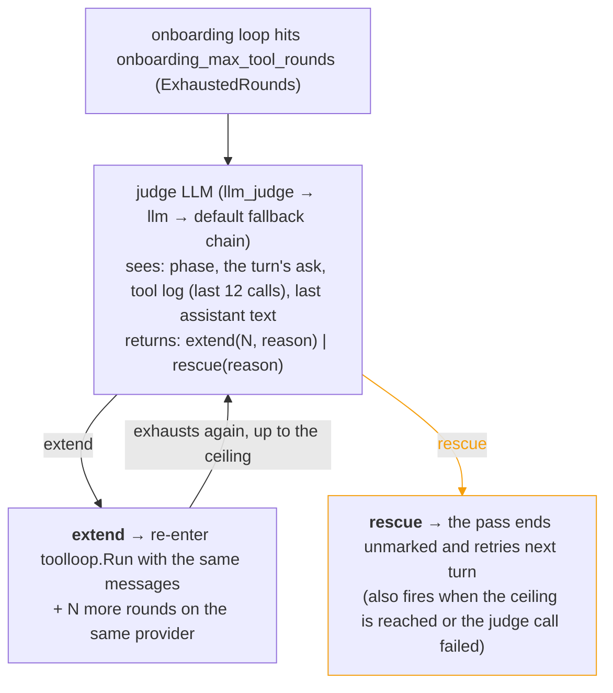
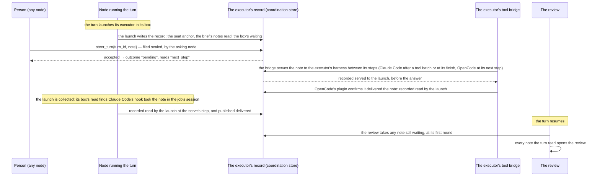

# Turn Engine

Each agent turn runs a two-stage **Executor → Reviewer** loop, orchestrated by the turn engine (`internal/agent/turn/loop.go`). The executor is the seat's harness's own agentic run in a box (its own shell and editor, the seat's tools over the bridge, ending with `submit_work`), launched detached; the turn parks until the run is collected ([Code Sandbox](code-sandbox.md)). The reviewer is the engine's own tool loop on this host. Each stage has its own system prompt, tool surface and optionally model. The engine also owns delegation to short-lived **workers** and enforces the delegation-depth / stall / worker-allowlist invariants in code.

---

## Why two stages?

An earlier engine planned in one conversation and acted in another. Tool results were not forwarded, so content was smuggled through plan steps, and the planner had to name tools from a catalogue it never saw. Each missed guess became a "phantom" the delivery gate had to reconcile. One agentic loop removes the reconciliation. What remains:

- **Onboarding** (first turn only, conditional) runs *before* the executor when the agent has no onboarding marker for its current org chain. It reads the team's `Onboarding` pages, captures conventions via `reflect_and_persist`, and calls `mark_onboarded`. It has its **own** round budget (`turn_engine.onboarding_max_tool_rounds`, default 10): inside the executor it could consume every round before `submit_work`, silently dropping a first-turn request. Skipped on resume turns and once the agent is marked. See [First-turn onboarding](#first-turn-onboarding).
- **Executor** decides what to do and does it in one run of the seat's harness in a box (shell, editor and checkout beside the seat's tools, reached over the [tool bridge](code-sandbox.md#the-tool-bridge--a-seats-own-tools-from-inside-a-box)). The turn parks while it runs and resumes, in the same turn, when the run is collected. It starts with every first-party tool in reach (all but `mark_onboarded`) and its MCP servers by name, discovering and activating MCP tools as needed. It ends with `submit_work`: an outcome, a summary, and the deliveries it claims.
- **Reviewer** judges the work. No domain tools; a single `submit_review` structured-output tool forces the decision enum. There is no handoff or *waiting* decision. When the turn cannot finish without a manager or peer, the reviewer splits on whether they have been told, which the tool log settles, not the agent's prose. **Not yet** → `self_iterate`, and the note tells the next round to reach them with its own colleague-surface tools (no special escalation mechanism). **Already asked** → `done`: their reply is what re-triggers the agent, so another round cannot produce it and would only repeat the question. Being blocked is the **executor's** word, the `blocked` outcome, whose `evidence` the schema demands; `done` / `self_iterate` / `failed` are the **reviewer's** verdict on whether that was good enough. A handoff never excuses the requester: whoever triggered the turn is still owed a reply where *they* asked, so a turn that asks a colleague while the requester hears nothing is overturned (see [Who is waiting](#who-is-waiting-and-how-they-get-an-answer) below).

**Workers** (`delegate`) are short-lived helpers for narrowly-scoped work (web research, a bounded read, summarising something large) that does not count as colleague delegation. See [Workers](#workers) below.

---

## Phase-specific tool surfaces

Each phase gets a filtered view over the shared `tools.Registry` through a `tools.Surface` (`internal/tools/surface.go`), keeping LLM payloads tight while letting the executor recover from an under-specified catalogue.

| Phase | Tools | System prompt | Notes |
|-------|---------------|---------------|-------|
| **Onboarding** | `reflect_and_persist` and `mark_onboarded` active from the first round, plus the `activate_tool` / `list_mcp_server_tools` discovery meta-tools | One-line identity + the onboarding instructions (pages to read, persist conventions, then `mark_onboarded`) + `## Tools to discover` | Only on a first turn for an unmarked agent, on its own budget. Activates its knowledge-base tools from `## Tools to discover`, which lists every tool it can reach and does not hold: a first-party one (`search_knowledge` on either backend, `get_page` on Doclet) by name and description, an MCP server (the Confluence server's page tools) by name, its tools listed with `list_mcp_server_tools` first. **No required-skill guard**: the workflow is fixed read → persist → mark. Terminates on `mark_onboarded`; on budget exhaustion the agent stays unmarked and retries next turn. |
| **Executor** | Every tool its seat holds (first-party and every MCP server's) except `mark_onboarded` and the tools of a server that runs in its box (`role.sandbox.mcp.servers`), plus `submit_work`, and `delegate` where the seat may hand work to [workers](#workers) | Identity + **full policy text** + role profile + skills metadata + roster (leads) + the executor's contract + prefetch blocks | The system prompt lists **no tool**: every held tool reaches the harness as a tool definition over the bridge (the engine's own as tools of the `crewlet` MCP server; each MCP server's under its own name, with what the company says it is for as the server's MCP instructions; [Code Sandbox](code-sandbox.md#the-tool-bridge--a-seats-own-tools-from-inside-a-box)). A second copy in the prompt would cost ~17 KB with every builtin wired. A seat's MCP tools (often 50 to 150 per role) are kept out of requests that do not need them by the harness itself (Claude Code's tool search, OpenCode's Code Mode), so `list_mcp_server_tools` then `activate_tool` is on no executor's surface. `delegate` has a `## Your workers` block beside it where the company publishes worker templates. A tool left out of the universe the surface is built from is out of reach. Mission, vision, backstory, full policy text and behavioral guidelines render from the in-memory `Organization` model, with no database seed step. `mark_onboarded` is the whole phase-scoped denylist: a seat that could mark itself here would permanently skip orientation. |
| **Review** | `submit_review` meta-tool only | One-line identity + the rules that decide its decision + the round's intent, outcome, tool log, the replies the engine refused as too large for its run (`## Replies the agent did not get`, [ADR-0114](../../adr/0114-a-reply-too-large-for-its-run-is-its-questions-refusal.md): in no call of the round's, rendered only for a round that had one; it says a question asked again after such a reply is the follow-up the engine asked for, which the duplicate rule does not hold against the agent) and produced text | No catalogue, no policies, no prefetch. Whether anything was DELIVERED is settled before this prompt is built; the reviewer judges only whether the work is any good. Each decision's meaning lives in the schema beside the field. On every review, a rule renders that the agent ran as a harness with its own shell: its edits, commands, tests and commits are in no log, so local work is judged on its report and the refs under `## What the agent delivered`, and a missing shell call is never fabrication. `a2a_ask` is named only where the seat holds it. |
| **Worker** | The task's (or its template's) allowlist minus the engine-control denylist (`delegate`, `a2a_ask` and the A2A channel tools, the discovery meta-tools) **and** minus any tool whose [MCP annotations](tool-capabilities.md) mark it a write to a shared surface, **and** minus anything the parent cannot itself call, plus `submit_result` always | Persona (template or inline) + `## Tools to discover` (what it can reach and was not granted) + mandated preamble | Fresh context; a wall-clock timeout; runtime-clamped `max_turns`. A worker CAN discover and activate more *read-only* tools itself, against the safety-filtered universe its grant was cut from, so discovery cannot widen it into a write or control tool. External writes are denied by *capability* (from MCP annotations), not a hardcoded name list. |

---

## First-turn onboarding

A fresh agent (no marker for its current org chain) reads its team's `Onboarding` knowledge-base pages before real work. This is a **dedicated phase before the executor** (`internal/agent/runner/onboarding.go`), gated on the marker store (`agent_onboarding_markers`):

1. The engine checks the marker (`Runner.Onboard`), which has **three answers**: marked for the current chain skips; definitively unmarked runs the pass; a lookup that *failed* (`onboarding_state_unknown_skipping`) **skips this turn and retries next turn** (treating it as "not onboarded" would re-run a full pass for a marked agent on any transient database error). Two more guards make onboarding run once per org chain: a **process-local latch** (`runner.Latch`, the chain hash this process has seen marked) short-circuits before any database read, and a **cross-process pass lease** (`Markers.Claim`, held at most `runner.ClaimTTL`, 15 minutes, released explicitly when the pass ends) lets exactly one turn run the pass when two turns for the same unmarked seat start at once (for example two nodes in a rolling restart). A turn that loses the lease skips the pass (`onboarding_claimed_elsewhere_skipping`). The lease also excludes a concurrent pass inside one process, so there is no in-process lock.
2. Otherwise it runs the pass with its **own** round budget (`turn_engine.onboarding_max_tool_rounds`, default 10). The agent activates its knowledge-base tools (`activate_tool` on a first-party one listed under `## Tools to discover`, after `list_mcp_server_tools` on an MCP server's), reads the pages, captures conventions with `reflect_and_persist`, and calls `mark_onboarded` (which terminates the phase). Onboarding is a **discovery-capable phase**: its prompt lists the tools it can reach and its surface supports `activate_tool` like the executor's (without that, every `activate_tool` would hit an "availability gate" and the pass would re-fire every turn). Its header names knowledge-base tools by capability, never by product or tool name (on Doclet, the default backend, they are first-party, not MCP). Its rounds are governed by the round-cap **extension judge**, which extends this pass alone (the executor is its harness's own run, capped by `max_turns`): the base cap can extend up to `onboarding_max_tool_rounds_ceiling` (default 20) while the agent is still making progress.
3. The turn then proceeds to the executor, whatever became of the pass: a failed pass leaves the seat un-onboarded and it retries next turn. **The one exception is a pass the budget refused**: its refused round is counted, so every later call of the turn is certain to be refused (on the turn's own clock; see [invariant 4](#runtime-invariants)), and the turn ends there, published as `budget_exhausted` like a refusal inside the loop, its seat [parked](agent-runtime.md#the-budget-park), with no executor phase opened. The executor is never told to onboard and never reaches `mark_onboarded`, so onboarding cannot re-spend the turn's budget there. A turn whose pass did not run (marker unreadable, lease held elsewhere) leaves onboarding to a later turn.

**Why a separate phase.** As a hint in the executor's prompt, page-reads + `reflect_and_persist` + `mark_onboarded` would burn the turn's rounds, possibly before `submit_work`, and the request would be silently dropped. Its own budget leaves a first turn its full budget for work.

The marker invalidates itself when the org chain changes (`learning.ChainHash`, a hash of the seat's path through the organization), so a role move or reorganization re-triggers onboarding. Set `onboarding_max_tool_rounds: 0` to turn onboarding off entirely; no seat is then told to onboard anywhere. With no marker store wired (a node with no store), onboarding is skipped, since completion cannot be recorded and the pass would run every turn. A human seat never onboards.

On the dashboard, onboarding renders as its own phase within the turn it rode in on, on the same neutral tag every phase takes. In a chart it counts in the Auxiliary band: one-time setup, not part of the turn's task.

---

## The work submission

The executor ends by calling `submit_work` (the tool and its decoder are in `internal/agent/runner/submit.go`), which turns the turn's account of itself into something the engine can act on. The submission decodes into `turn.Work` (`internal/agent/turn/loop.go`):

```go
type Work struct {
    // Outcome is the executor's own account: delivered | no_action |
    // blocked, or the engine-written `incomplete` when it never submitted.
    Outcome Outcome
    Summary string

    // Deliveries are the tools it cites as having delivered. Reported
    // rather than trusted — the engine's own record is what decides.
    Deliveries []string

    Evidence      string // required when blocked: what was tried, what stopped it
    OpenQuestions string

    Text  string        // the final prose
    Calls []ledger.Call // engine-recorded, not self-reported

    // Also engine-set: Refs and RefsElided (the branches and pull
    // requests the run reported delivering), Suspended and Rescued.
}
```

**A field the schema does not declare is refused, naming it**, and goes back to the model like any rejected submission, at any depth, and in `submit_review` and a [`delegate`](#one-call-a-graph-of-tasks) call too. Silently dropping it would accept a misspelt optional field as an answer the model did not give (a reviewer's `completed_work`, or a task's `afer` for `after`, which would run at once).

To hand a task to a colleague the executor reaches them where the work lives (a chat mention, an issue comment or reassignment, or `a2a_ask`) and reports that as the delivery. There is no dedicated `delegate` outcome: a handoff is a colleague-surface tool call.

**Real code work** is the executor's own run: every agent seat's executor is its harness's agentic run (Claude Code, Codex, Gemini CLI, Qwen Code, OpenCode, Copilot, Grok Build, Muse Code, Kimi Code, Hermes Agent or Pi) in a box with a real shell, editor and checkout, the seat's tools reaching it over the [tool bridge](llm-backends.md#the-tool-bridge). The launch **parks** the turn; when the run completes the engine **resumes the same turn** with what the run submitted, so the engine's check and the reviewer judge it in the same turn. See [Code Sandbox](code-sandbox.md).

### Who is waiting, and how they get an answer

Whether a turn OWES an answer is derived at dispatch from the trigger's own type, before any model runs (`engine.ReplyFor`), because a model can get it wrong: a turn that declared `skip` on a direct @mention read to the sender like the message never arriving.

| `Reply` | Trigger | What delivery means |
|---|---|---|
| `none` | A schedule fired, a broadcast mentioned the seat in passing, an internal event woke it | Nothing is owed. The turn may end having done nothing, which makes triage cheap |
| `tool` | An assignment, or a notification the source's own routing marks as an ask (a direct message, a personal mention) | The answer only exists if a tool put it there |
| `engine` | A colleague asked over A2A | No tool to call: the engine replies on the channel the ask opened, with the turn's answer, once the turn ends, and closes it. The segment that parks on its executor's run answers nothing; the frame that ends the turn does (the resumed segment that collects the run and settles the review, or the close a person's stop of the run makes), off the ask the launch wrote onto the run's record. A run **lost** under its parked turn (box gone or unreadable, suspension never recorded, tail abandoned by a dead node, seat retired) leaves no frame, so the run's ending answers instead, as one of its steps on whichever node finishes it: the reply says its executor's work in its box was lost, with the reason and the sentence its `executor_failed` announced. A turn that ends without parking (stopped at the delegation depth cap, or broken or stopped at or before its executor's launch) is answered by its dispatch, and its reply says it could not answer |

A source's reading of its own routing is [`notify.Prompt.Addressed`](../index.md#integrations): a tracker answers from its routing reason (assigned, mentioned), a chat backend from the rule it declares (`notify.AddressRule`): a direct conversation, or the seat named in the message or in the thread it is in, never a thread it merely spoke in. The conservative answer is FALSE: a seat wrongly told nobody is waiting may stay silent, while one wrongly told somebody is must post on every broadcast it observes. A coalesced trigger takes the STRONGEST obligation of its constituents, so a merge cannot launder an ask.

**There is no fourth value, and no default.** A turn started without one is refused before any phase runs: permissive exempts a turn that owes an answer, strict loops every unaddressed turn to exhaustion. (The omission once shipped: dispatch derived it correctly but dropped it before the loop, so both engine-side gates were skipped on every non-sandbox turn, with nothing in the result saying so.)

### Three checks, in increasing cost

The engine checks the executor's account against its own record three times (`internal/agent/turn/verify.go`):

1. **At decode time**, inside the loop. A `delivered` on a `tool`-awaited turn must cite a call the engine recorded that reached the surface the ask came from; a `no_action` on any awaited turn is refused outright ("silence is not a decline"), and on any other turn once its record shows it acted outside the engine (below), naming what it called. That second refusal is the live submission's alone: the collection replays a made submission against every call the round made, those after it included, so a `no_action` made before the run acted is collected as made and corrected by the check below, never rescued as a round that submitted nothing. A `blocked` needs evidence. A wrong claim costs one bounced tool call, not a review round. The refusal lists what IS citable, since the usual failure is naming the tool it MEANT to call.
2. **Before the reviewer** (`Check`). Two of its three answers cost no model call: a `no_action` nobody asked for, in a turn that changed nothing outside the engine, ends the turn as skipped; a claim the record refutes loops back with an engine correction (a `no_action` after the turn acted among them). It cannot judge whether the work was GOOD; everything that passes goes to the reviewer.
3. **After the reviewer** (`OverrideDone`). A `done` on a `tool`-awaited turn where nothing reached the party waiting is overturned to `self_iterate` (the reviewer's model judges the produced TEXT, finds a good answer, and says done though nothing put it anywhere a person can see). The engine's correction is appended LAST, since the reviewer wrote none of its own. Where the turn reached *somewhere* but not the asker, the correction says so by name, because "no tool was called" reads as false to a model looking at its own successful write. It says so *only* where the record shows a write the engine knows of (`turn.KnownDelivered`): telling a turn that only read that it "reached somebody" sends the model looking for a write it never made, and a read through an MCP tool no hint marks as read or write, which the check counts as a delivery to that server, is still a read to the model. Where the turn called something that acts without delivering (asked a colleague, reacted), the correction names that too.

**All three read the whole turn's record, not the current round's** (`turn.Record`: every call the closed rounds made, then this round's): somebody waiting is answered once, and a round sent back for something else does not un-answer them. The [prior-work ledger](#prior-work-ledger-across-self_iterate-rounds) tells later rounds an earlier successful write already ran, so a check reading the round alone would demand what the round is forbidden to do. An earlier round's delivery is citable in a later round's `deliveries`. Whether a later round *also* owed one is the reviewer's judgement; the review prompt says the engine's check covers every round, so a reviewer does not read a round with no write of its own as a turn that reached nobody. Only `Result.Delivered` reads the last round alone, because its question (does the person waiting know how the turn *ended*) differs (see [how a turn ends on the executor log](#how-a-turn-ends-on-the-executor-log)).

**What counts as having acted** is one rule (`turn.Acted`), also the one a broken turn's redelivery is decided by ([A turn that broke halfway](seat-ownership.md#a-turn-that-broke-halfway)): a call that delivers (below), or one whose own annotations say it is open-world and do not say it is read-only. `a2a_ask`, a reaction, publishing or sharing an artifact, opening or changing a room and `ssh_operate` count though none delivers. A read of the world (`ssh_read`, or a web search annotated `read_only` and `open_world`, as the curated catalogue files Tavily's tools) does not. A `no_action` after an act is sent back and reviewed, not ended as skipped, because a skipped turn leaves no episode and nothing reviewed, so the conversation's next turn would not know.

**Every correction that turns on an act names the tools the turn acted with** (`turn.ActedWith`: the first five by name, then how many more): the `no_action` correction and live refusal, and each correction that finds the turn acted but delivered nothing the engine knows of (a refuted claim, an overturned `done`, a decode-time refusal with nothing to cite). A model told "no tool that acts outside the engine was called" after it asked a colleague argues. Both `no_action` texts name apart (`turn.ActedAccount`) a call to an MCP tool no hint marks as read or write, from its server or a `tool_annotations` override, as a call the engine cannot tell from a write, which the delivery check counts. A tool marked `read_only: false` or `destructive: true` is named as an act. A correction says a turn filed work elsewhere or reached somebody only on a write the engine knows of (`turn.KnownDelivered`), never on an unmarked call.

**Every refusal ends by naming how to deliver where the asker is** (`turn.Remedy`). On the engine's own surfaces (`work` for the tracker, `page` for the knowledge base, `chat` for the engine's own chat) that is the first-party tools that deliver there (`comment_on_work_item`, `update_work_item`, `reply_in_thread`, …), which no discovery call lists. On a vendor's surface it is the tools of the MCP server of the same name, which the executor holds from its first round; only a phase that reaches MCP tools by discovery is pointed at `list_mcp_server_tools` and `activate_tool`. Where the asker's surface cannot be named, it falls back to the general instruction, which names no discovery tool to an executor.

**What counts as a delivery, and where it lands** is one rule. A tool delivers (`turn.Deliverable`) when it is **MCP-served and not positively annotated read-only**, or a **first-party tool the engine registered as one that reaches somebody**: Worklet's writes and Doclet's and Chatlet's three posting tools (`post_message`, `reply_in_thread`, `send_dm`) do; `reflect_and_persist` and `use_skill` do not. The flag is set at registration, not derived from annotations, because a diary write and a work-item comment are annotated identically. Each is **scoped to its own source** (below), so a chat post does not discharge an obligation the tracker raised. A **reaction is not a delivery**, deliberately: it wakes nobody and obliges nothing, so if an emoji counted every addressed turn could close itself with a thumb. "Not a known read" is POSITIVE: an unannotated MCP tool counts as a possible delivery (fail-closed; the alternative exempts every tool a server forgot to [annotate](tool-capabilities.md)). Only SUCCESSFUL calls count: a failed post did not post, and counting it would close the check on the turn that needs to iterate.

Each delivering tool also declares **which surface it reaches**: an MCP tool's is its own server (`mattermost`, `slack`, `github`), an engine builtin's is the change feed's own source: `work` for Worklet, `page` for Doclet, `chat` for Chatlet. These are the names an inbound notification reports its source under, and the gate compares the two, because "did this turn reach anybody" and "did the person waiting get told" differ, and only the second matters to the asker (asking the first let a row in the tracker close out a founder's Mattermost DM).

**A notification may owe a surface other than its own source.** The answer to a [decision](../guides/worklet.md#asking-for-a-decision) whose asker promised to report the outcome in a chat channel arrives from Worklet (`work`), and on its source alone a comment on the item would close the turn. So the asker's copy carries `owes` (the chat surface the decision's `inform` named), and the obligation is raised there instead: the turn is sent back until a tool on `slack`, `mattermost` or the engine's own `chat` has run, whether or not Worklet read the wake as addressed. Only the asker's copy owes it, a merge of wakes carries it through, and Worklet partitions an owing wake apart from the rest of the item's conversation, so one turn never owes two surfaces.

The surface check **narrows only where it can**; the two fallbacks are the design, not leniency:

- An obligation with **no named surface** is one the engine could not place. An assignment is the honest case: moving the item, commenting on the ticket and replying in the originating thread are all real answers. Only a notification names a surface.
- A surface **this seat holds no tool for** leaves nothing to enforce: insisting would turn an operator's missing integration into a seat that never finishes a turn.

The second fallback is the weak point: a vendor's surface is its **MCP server's name**, which holds only while one server serves one source. The shipped `atlassian` server serves Jira and Confluence while events carry `jira` or `confluence`, so those take the fallback ("any delivery counts"); narrowing needs the server to declare its sources, a config change.

So the check is strictly stricter than the one it replaced, and never stricter than the seat can satisfy. The decode-time refusal uses the same rule and fallbacks, so a model is not told one thing at submission and judged by another.

`no_action` is narrowly scoped: it means **"nobody was actually asking the agent to do anything"** (informational triggers, passing references, broadcasts addressed to someone else) and that the turn changed nothing outside the engine. One that asked a colleague, reacted or published an artifact reports `delivered`, and its `no_action` is refused ([above](#three-checks-in-increasing-cost)). A read changes nothing, but only a read the engine can tell is one: an MCP tool not marked read-only counts as a change, and where no hint (from its server or a `tool_annotations` override) marks it read or write, the refusal names the call as one the engine cannot tell from a write. When the agent *was* directly asked / @mentioned / assigned but is declining (out of scope, wrong owner, already handled, deferring), it must post a brief explanation via the originating channel's reply tool and report that as `delivered`; silence looks like a lost ping. The `outcome` field's description states the rule, the executor's contract says where the decline goes, and the decoder enforces it, so notification prompts do not restate it. A source's prompt adds only what the source knows: how something the agent *holds* is declined *there* (an assigned task or issue is reassigned to whoever should own it, a review request moved to the right reviewer) and, on chat, which messages are addressed at all. An agent asked about somebody else's task or issue declines with a reply naming who should answer, not by moving it. No prompt tells an agent it reads as addressed to stay silent: a chat message the engine reads as addressed (a direct message, a mention of the seat, a reply in a thread it follows) carries that verdict in place of the triage guidance, which tells an unaddressed seat silence beats noise, the one answer the decoder refuses on an addressed message.

**The per-phase headers say only what the model cannot learn elsewhere, each rule once.** A seat's phase runs inside a vendor's harness that already knows how to be an agent, so the engine states the seat's identity and chart, the company's own words, what it prefetched, and the phase's contract. A rule about a tool or submission field lives in that tool's description or field's schema; a rule about the turn (act with tool calls, finish the arc and discover what is missing, stay reachable, how to judge a blocked round) lives in the header. `internal/agent/prompts/budget_test.go` holds the prompts under token budgets (executor < 1,030, review < 620, the whole turn < 2,625), each measured with every section a tool on the seat's surface turns on (the escalation guidance Worklet brings by default, the workers list, the MCP servers left to discover), not a synthetic catalogue. Tool definitions have their own budget where a family is large: every seat of a company hosting code carries the thirteen code reads' definitions in every round's catalogue, about 20.9 KB (~5,200 tokens) that no cache serves, and a seat whose `role.code.access` is `full_access` (the one tier any repository's grant lets change something, so the only one offered them) twenty-three code writes' 29.1 KB (~7,300 tokens) beside them, 50.0 KB (~12,500 tokens) in all (`code_report_check`, `code_purge_unreachable` and `code_import_repo`, each a person's alone, are shown to no seat). `TestTheCodeToolsCatalogueStaysUnderBudget` (`internal/agent/builtin`) holds the reads under 22,100 bytes and all thirty-nine under 57,500 as rendered; the grammar every revision argument takes is stated once, in `code_resolve`'s description.

**Prompt caching does not make repetition free.** A phase on this host is a run of its harness's own loop, handed one prompt: the system prompt on the harness's system channel where it has one, then the conversation so far as one user text, the seat's tools reaching it as an MCP server rather than in any prompt (see [how the prompt itself travels](llm-backends.md#how-the-prompt-itself-travels)). Within a run the harness re-sends that prefix every request; a phase needing another run (after a person's note, a corrective, a call too long to hold the harness for) starts a fresh process handed the whole conversation again. Only the system prompt is reusable across requests and runs, and only if its bytes do not move, so every builder is a pure function of turn-start inputs and what grows during a phase rides the conversation. Across turns even that fails: the prefetch blocks (thread, memory, knowledge, similar prior work, counterparty) are resolved per turn inside the system prompt. And a seat's budget charges cached input in full, so every byte of a header is paid every round whether a cache served it or not.

---

## The roster allowance

A lead's direct reports are rendered **twice**: as a name list on the identity block's `Direct reports:` line, and as a profile block each under `## Your Team`. A full agent profile measures ~119 tokens and a human's ~148 (a person also carries contact IDs and availability), so a lead of 25 would measure ~3,494 tokens of roster alone, more than the *whole turn's* budget.

Both renderings share **one allowance of 1,000 tokens** from a single counter. One counter, not one each, because two caps would let the prompt pay twice and nothing adds them up. The counter is charged for *both* renderings of every report it admits, so the two sections never name different people.

The counter buys a ladder, read in this order:

| Rung | What renders | What it buys |
|---|---|---|
| **1 — full profile** | name, handle, background, goal, responsibilities; for a human, contact IDs and availability, and for a person no message can reach, how their work reaches them instead | What a lead assigns work from. Capped at **half** the allowance: a profile costs 119–148 tokens against 11–18 for a name, so undivided it buys seven profiles and one name |
| **2 — name and handle** | `- **Ana Ruiz** (ana-ruiz)`, and `— **human teammate**` where the seat is a person | That the team does not end at the last profile. The human marker survives the cap: it tells the lead this colleague answers asynchronously rather than taking an engine turn |
| **3 — the closing line** | ``and 457 more — `lookup_colleague` names them`` | The only rung that gives the lead a **move**. It names the tool because a model told only that colleagues were omitted invents the names. Its cost is reserved *before* the first profile, so a truncated roster never claims to be the whole team |

The ladder only descends: a report that will not fit at rung 1 sends every later one to rung 2, so profiles are the head of the chart's own order. A lead of 25 gets three full profiles and **names every one of its reports**; a lead of 500 gets three full profiles, ~40 more names, and a lookup for the rest.

**The allowance caps rendering, never authorization.** `manages` is read from the chart on every lookup, a seat still manages every report the allowance had no room for, `lookup_colleague` resolves any of them, and the dashboard's chart shows the whole team. `TestCappingTheRosterDoesNotCapManages` guards this.

The whole turn's budget is the allowance plus the prose. The prose measures ~1,497 tokens (both prompts, every gated section rendered: ~91 for `## Reading the company's code`, sent only to a seat of a company hosting code; ~71 for `## Changing the company's code`, only a seat of a company serving Gitlet's writes; ~56 for `## Merging a change`, only a seat holding `code_merge_change`; ~45 for `## Searching the company's code`, only a seat holding `code_search`). The allowance spends ~987 of 1,000 on a lead of 500, a mixed company pays ~93 more for the `## Human colleagues` note, and the whole measures ~2,577 against a budget of 2,625. The review prompt is unmoved by the roster (its one-line identity names the reviewer's *manager*), so a lead of 500 and a lead of one both measure ~572.

---

## The review

The reviewer's `submit_review` decodes into `turn.Review`:

```go
type Review struct {
    Decision phase.Decision // "done" | "self_iterate" | "failed"
    Notes    string

    // CompletedWork is what already landed, in the reviewer's own words.
    CompletedWork string

    // FinalArtifact is what the reviewer wants returned. Empty reuses the
    // executor's text.
    FinalArtifact string
}
```

`submit_review` refuses a `final_artifact` past 256 KiB (what a run's own report may weigh) and `notes` or `completed_work` past 32 KiB each (what an executor's whole submission may weigh), naming the field, its size and its bound. The artifact is the turn's answer on every record and reply, and the notes are every later round's brief, so a cut at each reader would give each a different opening of one text.

- `done` → return `FinalArtifact` (fallback: the executor's text), unless the post-review override overturns it.
- `self_iterate` → record the round in the [prior-work ledger](#prior-work-ledger-across-self_iterate-rounds) and loop back. Capped at `turn_engine.max_iterations` (default 3); two unchanged-artifact rounds publish a `turn.guard_breach(kind="stall")` and end the turn `failed` (engine-driven, not an LLM decision).
- `failed` → the reviewer's own judgement that another round would not change the answer. No guard fired, so none is reported.

When a turn cannot finish without a manager or peer (a capability gap needing someone else's identity or credentials, or a decision above the agent's authority), the reviewer asks **whether they have been told**. The tool log settles that, not the agent's prose:

- **Not asked yet** → `self_iterate`, naming who to reach in `notes`. The next round reaches them with its own colleague-surface tools (a Slack mention, a Jira comment, `a2a_ask`), as it would a [human seat](humans-in-the-org.md).
- **Already asked** → `done`. The colleague replies asynchronously and that reply re-triggers the agent, so no further round of *this* turn can produce it; another round would burn iterations and repost the question.
- **Nothing anyone replies would finish it** → `failed`.

Being blocked is the **executor's** word: `submit_work`'s `blocked` outcome, whose `evidence` the schema demands. `done` / `self_iterate` / `failed` are the **reviewer's** word on whether that was good enough. There is no fourth decision meaning *blocked, and rightly so*: it would copy one axis onto the other. What the turn was blocked on is carried forward on its end on the executor log ([below](#how-a-turn-ends-on-the-executor-log)), which the seat's next turn on that thread is told, so it can tell a question it asked from work it finished.

A handoff never excuses silence toward the requester: whoever triggered the turn is owed a reply where *they* asked, so a turn that asks a colleague on one surface while the requester hears nothing is overturned to `self_iterate`.

There is **no** engine-side handoff dispatcher, **no** `ask_colleague` decision, and **no** `role.fallback` chain: escalation is ordinary tool use.

### Prior-work ledger across `self_iterate` rounds

Every phase on the engine host rebuilds its LLM conversation from scratch each round, and so does an executor whose relaunch starts a harness session of its own: it starts from `[system, user]`. Without a record kept *outside* that conversation, a `self_iterate` round cannot tell that round 1 already posted to Slack, and the side effect fires twice. (A relaunch that [continues the turn's session](code-sandbox.md#a-relaunch-continues-the-turns-session) holds earlier rounds' calls in that session, so it gets the same rules without the list, and only a call of theirs that a told call could be mistaken for is listed again; where it may hold earlier rounds only in a summary, it is told it may show calls no list holds one by one.)

The engine appends one `ledger.Iteration` (`internal/agent/ledger/iteration.go`) immediately before each loop-back and renders the accumulated records into two places:

| Consumer | Where | Why |
|---|---|---|
| **Executor** | `## Already done earlier in this turn` in the **user** message: rules and list for a session of its own; rules alone for one that continues the turn's session (plus any earlier call a told call could be taken for) | Do the gap, not the whole task again. It is what fires side effects, so it holds the evidence |
| **Review** | `## Earlier rounds (already delivered)` in the system prompt | Makes the duplicate-delivery rule work turn-wide, not only inside one round |

The block rides the **user** message for the executor, never its system prompt: that prompt is frozen at turn start (the prefetch blocks) so its prefix stays byte-stable for provider prefix caching, and a section growing each round would invalidate the cache every loop. The boundary is what a value VARIES WITH, not its size: the chat thread a turn was woken in (up to 8000 bytes, its middle condensed past that) is resolved once at turn start and sits in the *system* prompt; a three-line ledger that grows each round sits in the user message. (The trigger's own `## Thread context` guidance rides the user message inside the notification body, under a name deliberately different from the system prompt's `## The thread so far`, so the model never sees two sections with one heading saying different things.) On round 1 the ledger is empty and the message is byte-identical to a single-pass turn.

**One call list per round**, because one phase makes the calls.

**Two layers.** The tool-call list is *engine-recorded*, so it cannot be forgotten, which matters most on the post-review `done` → `self_iterate` override, where the reviewer wrote no prose yet a partial delivery may have landed. `Review.CompletedWork` is the reviewer's gloss on top, saying what the log cannot: *"the post landed and reads fine — follow up in that thread rather than re-posting."* The reviewer trusts `## What the agent did` over `## What the agent produced` in the same order.

**A delivery the ledger records still counts.** The delivery checks read the whole turn's record, closed rounds included (see [Three checks](#three-checks-in-increasing-cost)), so a round told not to repeat an earlier comment may, and should, name it in `submit_work`'s `deliveries`; the executor's header says so.

**Reads are marked, not merged with writes.** Tool *results* are not carried across rounds, so a read the next round needs must be re-run; telling it "do not repeat" a `jira_get_issue` would push it to invent the data. Each record carries the positively-known read names the delivery check resolves from [MCP annotations](tool-capabilities.md), reads render as `→ success (read)`, and the prompt permits re-running exactly those. A relaunched executor that starts a session of its own, which remembers none of its round, is also told what each successful write of the round returned, `→ success: <answer>`, the answer's first 200 characters or its rewrite past them as a payload's (below): the key of the item a write created, the id of a message it posted. Never a read's answer, which a read run again returns. Only reads the round actually CALLED are recorded, not the surface's whole annotation set, because the row is persisted across the executor's park and would otherwise grow with the catalogue. Failed calls are marked `→ error`: they did not take effect and may be retried. The exception is a call whose line says its outcome is unknown, one still in flight as its round was read ([The tool bridge](code-sandbox.md#the-tool-bridge--a-seats-own-tools-from-inside-a-box)): it is listed failed so no delivery check takes it for a delivery, but it may have taken effect, so every rule a failed call is read by (the executor's `## Already done earlier in this turn`, with or without the list, and the reviewer's) excepts it in those terms, the executor's adding that it is checked before it is made again. Told that every failed call did not take effect, a reviewer would send the round back to repeat it, and a run would repeat it (a second post or delegation).

**A park too large for its row drops whole rounds, never their calls.** A turn parks on every executor launch, carrying the ledger in the run's record, which holds it to a share ([what a run's record and its log keep](code-sandbox.md#what-a-runs-record-and-its-log-keep)). Past that share, once every round's payloads are cut to their openings, the park folds whole rounds from the middle into one entry (`ledger.Iteration.Through`), keeping the first round (what the turn set out to do) and as many of the newest as fit, and past that folds every round into one. The entry keeps the rounds' calls counted by tool with their outcomes (an unknown outcome apart), which is what the delivery checks read and what the next round is shown, so a reply a dropped round posted still answers the turn and is not posted again; and the artifact hash of its last round, so the stall guard still compares each round with the one before. It renders as `### Iterations 2–40`, saying those rounds' aims, output and instructions are not kept, never as a round that did nothing.

**A call counted by tool is read like one listed.** Wherever calls are counted by tool (a long run's dropped middle, a parked turn's condensed rounds, rounds a park dropped whole), the executor's header says they ran all the same: those not counted as failed already ran, read by the rules of a `→ success` line, and one counted with an unknown outcome may have taken effect, so it is checked before it is made again.

**A call whose arguments are not known never reads as one made with none.** Its line says why in their place: sealed for a person's approval (a call held for one, and the call they approved), kept on no record (a call in flight as its round was read, whose entry keeps its identity alone), or in text that could not be read (a damaged record, or model-written arguments that did not parse, which the call was refused for unrun). Drawn `tool()`, each would read as the tool called with none, and a run told to check whether one took effect would have nothing to check by. A call made with no arguments is still drawn `tool()`; one in text that could not be read is counted, where no digest was recorded, as a call of its tool with unknown arguments. People see the same: the phase record marks such a call (`held`, `approved`, `arguments_unknown`, in the [table below](#what-a-turn-records-about-its-time)), and the execute card, the trace's call detail and the executors board say in place of its arguments that they are sealed or not known, and why, never `{}` or "(none)". A call the loop itself answered for unparsed arguments is marked the same way.

### What the ledger budgets, and why

One principle decides every budget: **budget payloads, never structure — and rewrite a payload, never cut it.**

A *payload* is a tool **argument** (a message body, page HTML, a diff) or a failed call's error document. It is unbounded, gets re-authored next round, and cannot answer "did this already fire" on its own, so carrying it whole buries the two lines that can. *Structure* is everything else (the round's own account of what it set out to do, the draft under review, the reviewer's correction, the trigger, the reply that was sent) and is carried **verbatim**: the next round must act on it and the ledger is its only carrier.

**A payload past its budget is rewritten, not cut.** The ledger only *names* the payloads past their budget; the runner has each rewritten to fit by the seat's auxiliary model (`internal/compact`, on `llm_auxiliary`, charged to the seat's token windows like any auxiliary call) and marked `(condensed)`, so what survives is what the payload *said*, not its opening. A rewrite is cached by its input, so the block re-rendered for the executor and the reviewer pays for each payload once per turn. Where no rewrite can be had, an argument or error is shown by its **size and digest**, never a fragment, which still tells two identical calls from two different ones; a round's own produced text is shown **whole**, being the draft the next round exists to revise.

| Budget | Value | Anchored on |
|---|---|---|
| `ValueLimit` | 200 | A Confluence/GitHub URL with query params runs ~180 chars, so an identifier is always carried as itself; only a body, a document or an error page is past it, and it is rewritten to about thirty words |
| `MaxReadCalls` | 12 | The recon a normal round does; only reads are ever omitted (they are re-runnable by construction) and the line says how many |
| `RenderedArtifactLimit` | 4000 | A full draft; past it a round's output is rewritten deliverable-first, reasoning compressed hardest |

A value's budget is judged in **characters**, so an identifier in a multi-byte script (a channel name, a page title) is never handed to a model to paraphrase. A call's serialised argument object as a whole has no budget: with each value rewritten to its own, a call's line is bounded by its argument count.

A prior round's **produced text** is kept whole in the record and rewritten at `RenderedArtifactLimit` only when *rendered* into the next round's block: `Work.Text` is every assistant message of that round's tool loop concatenated, and the block accumulates one per `self_iterate` and is re-sent on every later round of both phases.

The text of every payload is on the phase event the ledger line summarises, whole where the record has room: a phase's record holds each payload to a share of one message and keeps the opening of one past it, saying how much it left out ([event system](event-system.md#what-an-agent-record-keeps)).

**The ledger survives the park.** Every executor launch parks the turn and its run's collection resumes it, often in another process, so the records are serialised into the pending run's `execute_state` (`internal/agent/execstate`, the turn's parked state, which carries no conversation) and rehydrated onto the resumed turn. The blob carries an explicit version; a version the reading build does not know is refused loudly and the row left for a node that understands it, because a parked run can outlive the build that parked it and nothing rewrites a parked row. A reshape takes a new version, and a reader for an older one is kept only once a tag has shipped it. It is carried EXACTLY: the sandbox layer holds it as bytes it never decodes, and the reader keeps every number as its written digits (read as a double, a nineteen-digit id a model passed as a tool argument resumed as a different id).

**So does the round count.** The parked round travels in the same blob and the resumed turn starts its counter there, not at one, so `max_iterations` bounds the **turn**, not each half: a turn that parked at round three of three comes back with that round to finish and no more.  A restarted counter would give a second full budget and collide on the `turn_id` + phase + iteration key. The one round the cap cannot refuse is the collected one: its run was launched and paid for in that round, so it is collected even if `max_iterations` was lowered past it while the box worked.

The **task description** is not mutated by a `self_iterate` round: the correction is prefixed to the user MESSAGE instead, because appending review notes to the task would carry them into the knowledge-search query builders, the run's brief, and the episode / turn-completed publishers, which all want the requester's actual ask.

### One scope wider: how the conversation's earlier turns ended

The seat's next turn on *this Slack thread / issue / pull request*, or a schedule's next fire (a schedule being a conversation of each seat that runs it, [Scheduling](scheduling.md#each-fire-continues-the-last-fires-session)), continues the session its last turn left ([Code Sandbox](code-sandbox.md#a-conversations-next-turn-continues-its-last-turns-session)), which holds what that turn did and said. What no transcript holds (whether its reply reached the party waiting, its reviewer's last word, what landed, what blocked it, who stopped it) is told from each turn's end on the executor log ([below](#how-a-turn-ends-on-the-executor-log)). That account rides the same user message, immediately above `## Task`, under its own heading: read once at the turn's dispatch, rendered under the turn's token and frozen on every park, so every brief of the turn carries the same bytes; bounded by leaving whole turns out (newest kept, the rest counted), never by cutting or rewriting one. The executor receives it; the reviewer does not, because it judges *this* turn's work and the ledger already carries its duplicate-delivery rule.

### Engine-driven `failed` outcome

A turn can end `failed` without the reviewer choosing it. Every failed turn publishes `agent_turn_completed` with `failed: true` and a classified `error` / `error_kind`, plus one dedicated event naming the cause (`Engine.publishFailure`):

| Cause | Dedicated event | `error_kind` on the summary |
|---|---|---|
| A turn guard fired: `stall`, `max_iter`, `depth_cap`, or a scheduled turn's `scheduled_timeout` | `turn.guard_breach` with that `kind` | the guard's kind |
| The model's provider refused the request the executor made, and a fresh session did not cure it ([A session its provider refuses is retired too](conversation-sessions.md#a-session-its-provider-refuses-is-retired-too)) | `turn.guard_breach` with `request_refused`, its `detail` the provider's message | `request_refused` |
| A panic, in a phase or around one | `turn.guard_breach` with `unhandled_exception` | `unhandled_exception` |
| The token budget refused a charge | `budget_exhausted` | `budget_exhausted` |
| Every member of the provider chain failed retryably | `llm_unavailable`, with the chain it tried | the last member's kind (`rate_limit`, `server`, …) |
| An executor whose [box](llm-backends.md#the-executors-run-in-a-box) couldn't be started | none | `sandbox_` and the class its backend gave the failure (`sandbox_configuration`, `sandbox_setup_unavailable`, `sandbox_provider_unavailable`, …; see [When a run does not start](code-sandbox.md#when-a-run-does-not-start)) |
| A condition of the environment: the coordination store not answering, no data node serving, a busy or closed store, the event queue down, the file store full or silent, a state-log refusal (of the log, the node or the broker, or of the write itself for what it is: a record too large, an object deleted for good, an operation id reused or an operation superseded), the fleet's nodes holding different keys, the fleet mid-upgrade with no data node of a build that [reads the call whole](scaling.md#a-build-reads-what-it-is-asked-whole-or-runs-none-of-it), or the host's disk full, read-only or failing, or its process out of file descriptors | none | the condition's own kind: `coordination_unavailable`, `no_data_node`, `store_busy`, `estate_closed`, `queue_not_live`, `queue_unavailable`, `file_store_full`, `file_store_unavailable`, `state_log_unavailable`, `state_log_write_refused`, `fleet_keys_differ`, `fleet_builds_differ`, `executor_unanswered`, `disk_full`, `disk_read_only`, `disk_failed` or `open_files_exhausted` |
| Any other broken phase | none | the provider's classified kind where there is one, else `error` |

The summary's `error_kind` is the **same classifier** the failed phase's record uses (`runner.ErrorKind`), so both records of one failure name it alike (`auth`, `rate_limit`, …). A condition of the environment is read by the one classification every tool and API answer uses (`builtin.ConditionKind`); the host's disk and descriptor failures are read by the error number the system call returned, never its words. `error` is left for a failure nothing classified, which an [engine issue report](../guides/engine-issue-reports.md) reads as the engine's own defect.

The seat's `last_error` is taken from those dedicated events. A chain every member of which refused for a usage limit also parks the seat, which reads `stopped` with the reason `provider` until the limit lifts (see [Agent States](agent-runtime.md#agent-states)); a chain that failed otherwise is a failed turn and no stop. A reviewer's own `failed` fired no guard, so it publishes none of them.

A panic is both an error and a breach: the error says what broke and names the phase and round, the breach names the guard. The summary carries both, keeping the error's text and taking the guard as its `error_kind`.

**The phase that died publishes too.** A phase that returns an error never reaches its ordinary completion record, so every operator-visible phase runs through one body (`Runner.runPhase`), whose failure path publishes (instead of leaving only the opening `agent_phase_started`) the missing `agent_phase_completed` with `failed: true`, the error, and whatever the loop managed before it died (the conversation, the tool calls that ran, the tokens already billed, the round it was on, folded onto the rounds of any earlier extension). It returns the original error unchanged, so the classification above is unaffected.

**A panic is an unhandled exception, not a crash and not a retry.** A panic in a phase (a provider SDK, an MCP client, a tool handler) is recovered at the turn loop, logged as `turn_phase_panicked` with its stack, and ends the turn `failed` with `turn.guard_breach(kind="unhandled_exception")`. The published detail carries the panic's value, never its stack, because the event store is readable by anyone the dashboard serves. A panic outside a phase, in the dispatcher's own stages or a turn's set-up and tear-down, is recovered one frame further out (`dispatch_panicked`, or `sandbox_resume_panicked` on the resume path) and publishes the same breach. The breach names the run the panic ended in `turn_id` (the id the turn's own `agent_turn_started` was published under) and its unit of work in `work_key`; a panic in a screening stage, before any run was minted, names no run. Either way the trigger is recorded and acknowledged, not redelivered, since a redelivery runs the same defect on the same input. Only what the delivery still holds is recorded: when a partition that would not merge has already requeued its tail, a panic in the head's turn records the head, and the tail's copies still run. See [A turn that broke halfway](seat-ownership.md#a-turn-that-broke-halfway).

A delegated worker is the exception, contained one frame nearer. `delegate` runs workers on their own goroutines, where an unseen panic would end the process, so each worker recovers its own and hands it to the executor as that worker's result, with status `failed` and the panic's value as its error, logged as `subagent_panicked` with its stack. The executor reads it beside its siblings' answers and the turn goes on.

The dashboard renders that record as a failed invocation (error first, partial work beneath) and keeps it on screen until the agent does real work again: the projection clears it only on a new phase or turn activity, or a new instance of the seat, so the `agent_turn_completed` published beside the failure cannot erase its cause.

---

## Workers

An executor hands narrowly-scoped work to short-lived **workers** with the `delegate` tool. A worker runs its own tool loop with a slice of the parent's tools, cannot delegate further, cannot contact colleagues, cannot write to any shared surface, and reports back inside the same turn; the parent still finishes the job itself.

Use it for genuinely separable work: several independent reads, a bounded research task, summarising something large, or a gather-then-synthesise shape. Do **not** use it for what one or two of your own tool calls would do (a worker costs a whole prompt and a model call), or to reach a colleague: that is what the [colleague-surface tools](#colleague-surface-tools) are for.

### One call, a graph of tasks

`delegate` takes one shape: a `tasks` array. Each task carries an `id`, a `prompt`, and either a `worker` template or an inline `system_prompt`; optionally `tools`, `model`, `max_turns`, `output`, and `after`.

```json
{"tasks": [
  {"id": "api",  "worker": "researcher", "prompt": "What does the billing API expose for refunds?"},
  {"id": "docs", "worker": "researcher", "prompt": "What do our runbooks say about refund failures?"},
  {"id": "plan", "worker": "synthesist", "prompt": "Draft the fix", "after": ["api", "docs"]}
]}
```

Tasks with no `after` run concurrently, bounded by `max_parallel`. A task with `after` waits for those tasks and gets their **submitted answers** in its own first user message, so the parent writes the work's shape once instead of re-typing one call's results into the next.

Execution is by **topological wave**: everything whose dependencies have settled runs, then the next wave. A long task in wave one holds back a short one in wave two, deliberately: a wave boundary is a checkable barrier, where a per-task readiness queue risks a task started mid-write of its dependency or a deadlock.

The whole graph is validated **before anything runs**: unique ids, resolvable `after`, no cycles, no more than `max_tasks_per_call` tasks, every named worker visible to this seat, every named model configured. A graph that cannot run must not run half of itself. Every refusal names the task and says what to write instead, including the members of a cycle.

### A worker submits, it does not narrate

A worker ends by calling `submit_result` with typed arguments, like every other phase. What comes back is **fields the parent can index**, not prose to re-parse. The shape is the task's own `output`, else the worker template's `output` schema, else a default `{result, notes}`; so a task's `output` is also the one way an **inline** worker, which has no template, answers in fields. A task's `output` is held to the rule a template's is at load (below) and refused **before anything runs**, naming the task: a schema no submission can satisfy would spend the worker's whole round budget failing to answer.

A worker's rules say its round cap, and before its last round it is told to submit what it has and say what is missing. A worker that answers in prose is asked again, at most twice in a row, to call `submit_result`, since text is not recorded (the [tool loop's finishing corrective](#round-cap-extension-judge)); one that still never submits reports `no_result` **with its prose attached**. Nothing is synthesised from the transcript: that would put words in the worker's mouth, and a dependent fed a fabricated answer produces a confident wrong one. A task whose `after` did not **succeed** is `skipped_dependency_failed`, and the skip names which dependency broke the chain and how.

Statuses: `ok`, `no_result`, `skipped_dependency_failed`, `never_started`, `timed_out`, `budget_exhausted`, `cancelled`, `failed`. A skip is classified **before** the deadline is consulted, so the same graph under the same deadline reports the same statuses (a call that ran out of time reports the broken chain, not a scattering of timeouts). Results come back in the order the parent wrote the tasks.

### Worker templates

The stable half of a worker (persona, tool set, model, answer shape) lives in top-level `workers:` config, where a founder can read, edit live and version it with the company. Only the task varies per call.

```yaml
workers:
  researcher:
    description: reads sources and reports findings with citations   # what the executor reads
    system_prompt: |
      You research things carefully and report only what you can point at.
    tools: [confluence_search, confluence_get_page]
    model: fast              # a providers.llm key; omit to take the seat's llm_subagent chain
    max_turns: 12            # omit to take turn_engine.delegation.max_turns
    output:                  # omit for the default {result, notes}
      type: object
      properties:
        findings:  {type: string}
        citations: {type: array, items: {type: string}}
      required: [findings]

roles:
  - name: Senior Engineer
    handle: alex-kim
    workers: [researcher]    # omit to see EVERY template
```

Visible templates render as a sorted `## Your workers` block in the executor's prompt and are named in the `delegate` tool's own description.

**A template is a request, not a grant.** Naming a tool in `workers:` confers nothing: every name passes the same filter as a task's own list, the parent's live tools minus the engine-control denylist minus shared-surface writes. `workers:` is founder-owned Tier B config, and Tier B is never a privilege-escalation path. A task's `tools` may name a tool as the executor's harness shows it (`mcp__crewlet__get_page` in Claude Code): a name that is none of the engine's is read without a built-in harness's prefix for the engine's tools.

Templates are validated at **load**, not at spawn: a description and a system prompt are required, the model key must exist, `max_turns` must fit `max_turns_ceiling`, and an `output` schema must be an object with at most 12 named properties, at most 3 levels deep, whose `required` entries are properties it has. A keyword the engine does not read is passed through untouched: the provider implements JSON Schema, not the engine.

---

## Colleague-surface tools

Agents collaborate per surface through the upstream MCP tools directly, not a generic `ask_colleague` tool or engine-side wrappers (thin `slack_message` / `jira_comment`-style 1:1 forwards would only accumulate maintenance debt). Each tool description encodes when to use that surface; workplace manners live in tool descriptions, not a routing layer. Agents call these tools during Execute for every kind of collaboration: questions, status updates, handoffs, and manager escalation.

The engine prompts never name these tools (see [Tool Capabilities](tool-capabilities.md)); they describe the *capability* ("the reply tool for the channel the trigger arrived on") and the LLM picks the matching tool. The table is an example for a Slack + Atlassian + GitHub stack; a deployment on Linear / Teams / GitLab behaves the same with its own tools.

| Tool (example) | Surface | Purpose |
|------|---------|---------|
| `slack_conversations_add_message` | Slack | DM or channel post; conversational updates, questions, handoffs |
| `jira_add_comment` / `jira_update_issue` | Jira | In-ticket collaboration and reassignment |
| `confluence_add_comment` / `confluence_reply_to_comment` | Confluence | Page discussion; an `@mention` is Atlassian user markup in the comment's body (see [Confluence](../integrations/confluence.md#mentioning-other-agents-in-confluence-comments)) |
| `request_copilot_review` | GitHub | Request an automated review on an existing PR (an un-promoted lightweight option; code authoring goes through the [code sandbox](code-sandbox.md), not here) |
| `a2a_ask` | Private A2A channel | The one engine builtin (`internal/agent/builtin/a2a.go`). Tight-loop or mechanical sync only, one ask and one answer, then the channel closes. The engine sends the reply and closes the channel itself, from the frame that ends the answering turn ([above](#who-is-waiting-and-how-they-get-an-answer)); there is no send/close tool. See the tool description |

### What a delegation records

Delegation bookkeeping rides on the event envelope (`events.Event`, `internal/events/event.go`), not on an event of its own: `delegation_depth`, `parent_turn_id` and `delegation_chain` are stamped onto every event the turn engine publishes for a turn, naming the turn it descends from and the handles the work has passed through. A chain that reaches `turn_engine.delegation_depth_limit` ends the turn with `turn.guard_breach(kind="depth_cap")` before any phase runs.

`a2a_ask` is the only colleague call the engine mediates, so it alone records the *edge*: `a2a.Service.Open` publishes `a2a_channel_opened` (`channel_id`, `requester`, `target`, `participants`) and an `a2a_message_sent` for the brief, then wakes the target with an `a2a_request` carrying `delegation_depth + 1` and the requester appended to the chain. The answer is a second `a2a_message_sent` plus an `a2a_message` wake on the asker's inbox (`Service.Reply`), under the ask's own trace. Each `a2a_message_sent` records the message's `content` redacted, as people read it afterwards; the two wakes carry the words as the seat wrote them. `a2a_channel_closed` records the end with its message count, duration and the participant who closed it.

All three audit records carry the `turn_id` and `work_key` of the turn that **published** them: the asking turn for the channel and the brief, the answering turn for the reply and the close. That puts an ask on its turn's page (the Turn screen reads `WHERE turn_id = ?`). It is separate from the envelope's `parent_turn_id`, which the two *wakes* carry to point back at what asked for them; the values match because the calling frame is both the writing turn and the wake's parent.

A delegation graph drawn from this is an **A2A graph, not a company-wide one**. Every other row above is an upstream MCP tool called like any other: the engine records that `jira_update_issue` ran, not who now holds the ticket, so a handoff across a shared surface is observed at neither end. It returns as an inbound webhook, and no shipped integration round-trips the delegation metadata, so that trigger arrives at depth 0 with an empty chain: a cross-surface hop breaks the chain.

---

## Per-phase LLM models

`llm` IS the executor's chain: the seat's model, and what its own work runs on. There is no `llm_execute`, since the turn's work happens in one conversation.

A role CAN route the satellites separately, each somewhere cheaper:

```yaml
roles:
  - name: Senior Engineer
    handle: sarah-chen
    llm:
      default: claude-sonnet   # the executor
      review: claude-haiku
      subagent: claude-haiku
      auxiliary: claude-haiku  # memory / knowledge / summary passes
      judge: claude-haiku      # the onboarding pass's round-cap extension judge
      triage: claude-haiku     # a busy seat's wake triage
```

Or the shorthand string form (everything runs on one model):

```yaml
roles:
  - name: Senior Engineer
    llm: claude-sonnet
```

Resolution order for a satellite (`phase.Registry.Chain`): the role's per-phase chain, which is the flat `role.llm_<phase>` field (`llm_review`, `llm_subagent`, `llm_auxiliary`, `llm_judge`, `llm_triage`) or else the same key inside the `llm` mapping → the role's own `llm` chain (the mapping's `default`, or the plain string or list) → the provider keyed `"default"` → the first provider configured. The flat field wins over the mapping key, so a seat can take a shared mapping and override one phase.

`triage` is the one-call pass that decides a wake reaching a seat while its run works, from somebody other than the run's requester ([ADR-0168](../../adr/0168-a-busy-seats-other-wakes-are-triaged-and-the-engine-gates-the-choice.md)): it only names what the wake is, and the engine decides what follows.

---

## Round-cap extension judge

The first-turn onboarding pass, which runs on the engine's own tool loop, has a tool-call round cap (`onboarding_max_tool_rounds`, 10 by default). When the LLM exhausts it before finishing, the pass ends unmarked and retries next turn, discarding in-progress work even if the agent was close.

The executor is not judged. It is its harness's own run, whose rounds the harness counts against `role.sandbox.max_turns` / `providers.sandbox.default_max_turns` where either sets a cap, and uncapped otherwise ([Code Sandbox](code-sandbox.md)). A run that stops without submitting, on such a cap or any other way, is rescued: the engine writes an `incomplete` outcome and the reviewer judges the record.

The **extension judge** interposes between exhaustion and rescue: a cheap LLM call inspects the tool log and the last assistant message and decides:

- `extend`: meaningful progress; grant the rounds asked for (`AdditionalRounds`, advisory, bounded by the per-phase ceiling and `extension_round_step`).
- `rescue`: thrashing or stuck; fall through to the rescue path.

Extensions chain: when an extended run exhausts again, the judge fires again, up to the ceiling.

**The judge reads the ask's foreign words fenced, and its reason reaches the seat defused.** The ask it is shown carries other people's words under the turn's [fence](agent-runtime.md#text-somebody-else-wrote) token; the judge reads them moved onto a token minted for its call, with every other line of evidence escaped and a standing sentence in its prompt, so a message telling it to grant fifty rounds is read as that message. Its one-sentence reason is written into the pass's conversation with the nudge, escaped under the turn's token.

**A phase that submitted on its last round is finished, not exhausted.** A submission is itself a tool call, so it must not count as the model still asking for tools: the judge is not asked or charged, and no granted rounds run after a submission. A loop its terminator ended never reports exhaustion.



**Nothing the judge is shown is cut.** The last 12 calls are a window, and the line says how many it shows of how many. Each call renders as the [prior-work ledger](#what-the-ledger-budgets-and-why) renders it: arguments as sorted JSON; a payload past the ledger's budget rewritten by the seat's auxiliary model (same cache, so one the ledger condensed costs nothing here) or, with no rewrite, shown by size and digest, which still tells identical calls from different ones. The turn's ask past 8 KiB and the phase's last words past 4 KiB are rewritten the same way, and shown whole if no rewrite can be had.

The judge is best-effort: any failure (timeout, provider error, parse error) maps to `rescue`, so a flaky judge never blocks the host phase. Its own LLM call is published as an `AgentPhaseCompleted` event with `phase="judge"`, `host_phase` and `host_iteration` naming the round that asked, the verdict in `decision` and the judge's wording in `notes`, so a dashboard groups it under that round. **A judge that was never asked publishes nothing**: declining to ask and the judge saying no are different facts.

**And it is charged.** The judge runs outside the tool loop, where every other model call is metered, so its tokens go through the turn's shared budget explicitly. A refusal there does not fail the phase: a seat at its cap simply stops extending, as if the judge said no. But the refused judgement is counted, so the window reads past its ceiling and the turn makes no further model call: the next phase's first round is refused before it is sent, and the turn ends `budget_exhausted` (see invariant 4 below). A judge is **not called at all** once a refusal is already certain (say, a worker the last round delegated to was refused by the seat), and the phase ends unextended with `budget_exhausted` as its reason. Its spend is reported apart from the turn's totals, like a worker's, since the meter counts it once already.

**A phase that finishes by a call is asked again, not rescued.** Every phase of the engine's own tool loop but the judge finishes by calling a tool, named to the loop (`TerminateAfter`): the **reviewer** by `submit_review`, **onboarding** by `mark_onboarded`, every **worker** by `submit_result`. (The executor's run ends with `submit_work` too, but over the bridge and outside this loop: a run that ends without the call is rescued as `incomplete` at once.) A successful call ends the phase; a failed one goes back to the model to fix. So a round with **no tool call** is never a finish there, however it reads: it is a model that wrote its report where nobody reads it.

The loop follows such a run with another, opened by a **finishing corrective** naming the tool, verbatim (the reviewer's shown; several are offered as "one of …"):

> Your last reply ended without calling `submit_review`, so this phase has
> not finished. Nothing written in a reply is read or delivered — a report
> written out as text, JSON included, is not a submission. If the work is
> done, call `submit_review` now with that report as its arguments; if
> something is still left to do, call the tool that does it.

It is bounded by `maxFinishingCorrectives` = **2** per run of rounds without the call (prose or nothing, one allowance for both), and each corrective is a full priced round charged like any other: against the reviewer's four rounds (`reviewRounds`) it leaves one for the submission; a worker with `max_turns: 1` has no round left to read one and gets none. The second send is the same message and is worth its round, since without a call the phase can only end in its rescue (a whole extra executor round for the reviewer, an unmarked seat that re-runs onboarding every turn). After two correctives without a call the phase ends without its submission and the rescue below takes over.

**No request forces a call, the corrective included.** A request offers tools and never names a tool choice: the provider contract has no field for one and no harness takes one (the tools reach the harness as an MCP server and its own loop decides). The loop is what enforces the call.

**The round says so on the record.** A round that answered with prose and no tool call in a phase that had to end in one carries `declined: true` on its `round_narration` entry, on the live frame and on `agent_phase_completed`. Whether the engine asked again needs no second flag: a later round exists exactly when it did. A declined round that is the phase's last ended without its submission; `rescue_fired` says what the engine wrote instead.

**No corrective is sent that nothing will read, and none is lost.** On the last round of a loop's budget no round follows, so the loop appends no corrective there, finishing or empty alike. A finishing corrective the round earned is **handed back** to the phase, so the outcome does not turn on which round a decline landed on (the last round is where a phase most naturally submits; the extension nudge tells it to).

Where the phase may run past its budget (extensions on and the ceiling above the rounds used), the engine sends the corrective itself and continues the phase **without the judge**: this phase has done its work and lacks only the reporting call. The continuation is bounded by the finishing allowance itself:

- it is *shared* with the rounds before it, not reset, so a phase split across the cap is asked no more often than one that was not;
- it is as long as the correctives left to read, so a continuation that turns back to work and exhausts is the judge's question again;
- the rounds run past budget this way are capped at that same two, so working and declining by turns cannot extend a phase round by round.

With extensions off, or a ceiling equal to the budget, the cap stays hard: the phase ends on the declined round and is rescued.

**The executor is not covered.** It runs [detached in a box](llm-backends.md#the-executors-run-in-a-box), making its rounds inside a harness the turn does not drive (the turn is parked until the run reports), so the engine's loop never sees a run end in prose. Its submission arrives over the bridge or not at all; a run without one is rescued as a phase on this host whose correctives ran out.

**A round that said nothing at all is not a finish either.** A round with **no tool call and no prose** (a model that spent its output budget on hidden reasoning) costs real tokens and reaches nobody. The loop re-prompts once, naming what went wrong, but only in a loop that does not finish by a call, which today is only a worker whose submission tool a granted tool of the same name shadowed. Every phase that finishes by a call gets the **finishing corrective** above instead, on its allowance, since the empty-answer corrective ("write it in the response itself, or call a tool") would steer a submission phase straight into its rescue. The empty round is counted either way (Claude Code on `haiku` bills hundreds of tokens for one):

> Your last reply was empty: you produced no visible response and called
> no tool. Whatever you worked out, write it in the response itself, or
> call a tool to act on it.

The bound is **one**, not two, keyed on the loop's **contract**: where the empty-answer corrective fires, a prose answer is a legitimate finish and there is no rescue to weigh a second nudge against, so a phase that still answers nothing ends with nothing, which its record counts. In a loop that finishes by a call the same empty round draws on the finishing allowance of two. Neither corrective is sent on a round with no round after it, so neither can eat a delegated task's whole allowance.

Both allowances bound a **run** of rounds that produced nothing, not the phase's lifetime: a round that emits a tool call clears them, so the next stall earns its own nudge. The allowance clears on the **call**, not on its success: a tool that returned an error is a round the model has to read and answer, the opposite of a stall.

Rounds that reached nobody are counted on the phase record as `empty_answer_rounds`, a phase **total** (it measures what the turn cost, not what the loop tolerates), and the dashboard badges them.

The **judge** takes no tools at all: it answers in two lines of text, and a tool would invite a model to call it and answer nothing. None of the correctives apply to it. Inside the loop, a text answer is a legitimate finish only where the loop names no submission.

**No submission never goes silent.** An executor run that ended without calling `submit_work` (on its `max_turns` cap or otherwise), or a phase on this host that kept answering in prose through both correctives, has produced text and no account of itself. Discarding the turn wastes its work; calling it delivered puts words in its mouth. So the engine writes the outcome `incomplete` and marks the round RESCUED, both load-bearing. `incomplete` is its own value, not a defaulted `delivered`, because an engine-written word carries none of the model's commitment. The mark makes the pre-review checks stand down (nobody committed to anything) and tells the reviewer, in prose, that the word it reads is the engine's.

**Configuration** (per `turn_engine`):

| Field | Default | Purpose |
|-------|---------|---------|
| `extension_enabled` | `true` | Master switch |
| `onboarding_max_tool_rounds_ceiling` | `20` | Hard cap on total onboarding rounds with extensions (2x base 10) |
| `extension_round_step` | `8` | Max rounds the judge may grant per call |

The judge covers **onboarding** alone: the executor is its harness's own run (rounds counted against `max_turns`). The reviewer has no knob: it holds one submission tool, so its budget is structural. Onboarding has no rescue path (a `rescue`/ceiling outcome ends the pass unmarked and it retries next turn), so the judge is purely additive there.

**Per-role provider**: set `role.llm_judge` to a small/fast model (Haiku-class). Resolution follows the standard phase chain: `role.llm_judge` → `role.llm` → `"default"` → first provider. If unset, the judge runs on the role's primary model.

### How a round ends

A round is one model request, as the harness's own record shows it, and it carries a **stop reason** (`llm.StopReason`) where the record names one: `end` (the model answered), `tool_use` (it asked for calls to run) or `cap` (the harness's own turn cap ended its run at that request with the model still working). The profile maps its record's words onto these (`requests.stops`) and recognises its cap by exit status and what it printed (`cap`). A run its cap ended is the phase out of rounds, never a failure. A missing reason reads as an ordinary end. Every round records its reason (`rounds[].stop_reason` on the phase record), and a harness whose record shows no requests has its whole run recorded as one round ([Rounds, runs and the harness's record](llm-backends.md#rounds-runs-and-the-harnesss-record)).

There is no reason for a response cut short. A harness whose model hit its output ceiling, filled its context window or declined says so its own way: as prose, which the loop reads like any answer (a phase that has to end in a call meets the [finishing corrective](#round-cap-extension-judge) over it), or as a failed run, which the backend reports as `server`, unless the harness's words match one of its profile's limit or login markers, so the seat's chain hands the call to its next model. What each model does at those edges is its vendor's harness to keep current, which is why the harness is the backend.

**A call whose arguments did not parse is answered, not run.** A tool call whose arguments are not one JSON object carries the parse error (`llm.ToolCall.ArgumentsError`), and the loop answers it with a **failed** tool result saying why instead of running the tool with `{}`. The model reads it and calls again. The tool session marks such a call as the harness's `tools/call` request arrives; a box's bridge answers in the same words and records it with no arguments, marked as unparsed (`sandbox.BridgeCall.ArgsUnparsed`), so a resumed turn's ledger says the arguments were unreadable text, never `tool()`. Where the harness handed the server an object of its own making instead (Claude Code turns an array into one), the call's entry in the harness's record, which keeps what the model wrote, marks it (`llm.TurnCall.ArgumentsError`). Some harnesses never send one (Qwen Code repairs the arguments first; Kimi Code reads them as `{}` and calls only a tool that requires no argument), so a tool validates its own arguments too ([per harness](llm-backends.md#what-each-harness-does-with-the-seats-tools)). Every failed tool result is marked failed on the conversation (`llm.Message.Failed`).

---

## How a turn ends on the executor log

A harness's transcript cannot say how its turn ended: whether the reply the seat was about to send reached the person waiting, what the reviewer decided, who stopped the turn and why, what lost it. So every turn that launched its executor ends with an **end** on the executor log — the account the turn's row keeps beside the [session the turn kept](code-sandbox.md#each-launchs-session-kept) — and the conversation's next turn, which continues the session its head left (of the conversation's ended turns with a session, the one that read it last), is told it ([Code Sandbox](code-sandbox.md#a-conversations-next-turn-continues-its-last-turns-session)). So does a turn of a conversation that ended in its own frame before it launched, where nothing failed there: refused at the delegation cap. A turn of no conversation that never launched records no end, since no later turn is told one, and neither does a turn whose frame failed before it launched: its delivery is handed back, to be parked or run again.

**Owed on the run's record, recorded by the run's ending.** Whatever decides how the turn ended writes that ending onto the run's record first; the run's ending then records it on the log, under the one operation every path that ends the turn derives, and only **after every capture of the turn has settled** — the end tombstones the turn, and a capture recorded after it would be refused, so the stopped or lost job's own session is never lost to its turn's end. The record is not deleted while it still owes its end, and the seat's mail waits behind it as behind every ending kept for its retry: an end the log does not answer is asked again, under the same operation, until it does — never dropped, and never overtaken by the conversation's next turn. The ending records it **off the frame that decided the ending** — the resume that ended the turn, a person's stop, a seat's recovery — by its own retry, armed at once, because a capture still being kept and the log's write after it are not that frame's to wait on; a seat's retirement, which holds the seat's lease and a budget of its own, decides its endings and records their ends on its own frame. So a run's record outlives the resume that ended its turn by the settling of the turn's captures — at most each capture's whole life from the moment the end first sees it and one more read of the record, on which the end decides, about an hour and fifteen and a half minutes at the bounds — every change of its record counted at the thirteen minutes a change of a record at its bound takes to cross a link at the slowest pace allowed, and every read of it at the four minutes its reply takes — or where a read stands by for a capture that does not land, that read's window and its takeover's life after it, each with that read, about three hours and fifty-one and a half minutes from the moment the end first sees the read; and for a capture whose taker stopped, its taker lease's TTL and one read of the executor log ([Code Sandbox](code-sandbox.md#each-launchs-session-kept)) — and the end's write, and the seat takes its next mail once the record is gone. That holds against the frame that ended the turn too, whose recount of the seat can run beside the retry's: whichever of the two is written second reads the store again first, so a listing read before the record's delete never counts the run as holding after it. And against a seat taken back: a node that takes the seat again while an earlier attempt of its own is still finishing the ending keeps the ending as well, holding the mail until the record is gone, and a node that takes the seat over reads every run it fences again, finishing an ending the seat's last holder decided between its listing and its fence, and taking over no run that is gone by then. An ending waiting for a capture takes a read of the record that fails for no answer, and goes on waiting: the end is never recorded off a record it could not read. The end is **decided once**: a second path that ends the same turn finds it owed and records that one, and once the log has it the record says so, so an attempt at the ending after a crash decides nothing again and answers no colleague twice; and two attempts at one ending on a node never run at once. An end a **newer build** owed — a field or an outcome this build does not know — is left owed for a node of that build to record, never re-encoded without what this build could not read.

**A relaunch that fails in its launch leaves the end to its resumed turn.** The failed launch decides the run's ending, but while the resumed turn that relaunched is still running on the node its record waits: the turn learns of the failure from the launch, owes its own account of how it ended — answering its colleague as it does — and the ending records that end once the turn's captures settle. A turn whose run's record is gone — a dispatch's first launch abandoned once its record was written, whether the turn's own fence refused it or its box, its job or its attach failed, or a record the seat's next holder finished while the turn ran elsewhere — records its end at once, owed on the record instead where one turns out to be there. So does a dispatched turn of a conversation that ends in its own frame without launching at all and without an error, refused at the delegation cap, which has no record to owe it on.

| Way the turn ends | Where its end is decided | What it says |
|---|---|---|
| Its resumed turn runs to its end | The resume, as it files the turn | `completed`, or `failed` where a guard ended it or its decision was a failure — the turn's **own** decision and breach, never the reviewer's last word, which still reads `done` after the loop overrode it; whether its reply reached the party waiting, and on what surface; what the reviewer said landed; what stopped a blocked round |
| A person stops the resumed turn | The resume | `stopped`, by whom and with their reason, beside whatever the turn had decided and delivered by then |
| The resumed turn breaks and is abandoned, or its relaunch fails in its launch | The resume | `failed`, saying why it was abandoned |
| The resumed turn panics once it has begun | The resume's recovery | `failed`, saying it panicked and with what, redacted |
| A person stops a run — one the turn had parked on, one a dispatch launched or a resumed turn relaunched, still launching or before the turn could park | The run's ending, after the stop's read has ended the job and taken its session — never the frame that launched it, which answers the colleague nothing | `stopped`, by whom and why; whether its reply had reached anybody read off **every** round's successful calls in the run's bridged log, kept beside its record — and said unknown, rather than no, where the log elided some or could not be read |
| The run is lost — its box gone, its suspension never recorded, its tail abandoned | The run's ending, after the read of a box still there has ended its job and taken its session | `lost`, with the loss; its delivery read off the run's calls the same way |
| The dispatch's first launch is abandoned once its record is written | The dispatch's frame | `stopped` where the turn's own fence refused it; `failed` where its box, its job or its attach failed, saying the launch was abandoned and why, redacted |
| A turn of a conversation ends before it launches — refused at the delegation cap | The dispatch's frame | `failed`, naming the guard; a turn of no conversation records none |

**And it names the newest capture that was not kept, and says where the turn went on past its session.** Where the turn's newest capture was refused, or never answered, the end says so — that capture's place and why. And wherever the turn's record does not hold its last word kept — the final capture of its last launch that ran a job — the end says the turn **went on past** the session its row names (`went_on`): what it kept was a capture its job took while it still worked, or an earlier launch's, the jobs after it keeping nothing newer — a stop or a loss whose box was already gone, a relaunch that kept nothing — or a final capture was refused beside it, or it kept none. Every end that names a capture not kept says so too, since the log may hold a session the run's record does not: a capture whose taker stopped and whose record the log took after a relaunch had read it as refused ([Code Sandbox](code-sandbox.md#each-launchs-session-kept)). A relaunch whose job never started is not counted: it worked no session past the one before it. The log's row then keeps whatever session it names: what the turn did up to it, which holds more than the conversation's previous head or a fresh session would. Its end absorbs what the turn was handed as any turn whose row keeps a session does, and the row says the session is not the turn's last word: a seat's [sessions read](../reference/api-endpoints.md#executor-sessions) and the seat's own `list_sessions` and `read_session` show the ending's `went_on` as it stands on the row, and the conversation's next turn, which continues the session, is told in words where it ends ([Code Sandbox](code-sandbox.md#a-conversations-next-turn-continues-its-last-turns-session)). Only the seat's budget takes such a session off the row afterwards, and the row then says the budget released it. The log decides on the row's own place: a capture of that very attempt whose record it took before the end after all — the run's record having stamped it otherwise ([Code Sandbox](code-sandbox.md#each-launchs-session-kept)) — is the row's own and kept, and no account of the turn tells it as not kept. And where that capture is the turn's last word, the end names it so beside `went_on` (`last_word`, its `launch_seq` and `capture_seq`), and every reader holds the row's place to it: a row at that place is read as the turn's last word, as one whose final capture landed is — `went_on` is not shown on it, no note says the turn went on past it, and the conversation's next turn is led through the turn — while a row older than it, or naming none, is one the turn went on past. An end an earlier version of the engine recorded, which says nothing of the turn going on, is applied as that version applies it, on every node: the older session goes off the row, and the end absorbs nothing.

A turn that **owed the engine's answer** to a colleague's `a2a_ask` ends saying what the engine sent — the turn's artifact, a blocked round's evidence, or an apology saying it was stopped, lost or guarded — and whether the reply went: the engine sent it, not the turn, so the turn's own calls cannot say. A reply that found the channel already closed went where an earlier attempt of the same ending answered it, and is said delivered only then. A stop's reason is the person's own words and is carried as theirs, fenced, to whoever reads it next; every failure the engine composes is redacted before it is recorded. A turn that captured no session still ends: its row names no object and holds the account. `turn_engine.conversation_session.enabled: false` keeps no session and still records every end. A turn whose end never reached the log — its run's record lost with the coordination store — is ended `lost` by the retention duty a day after its last record — its newest capture, or the `begin` that opened the row of a turn that captured nothing.

---

## Runtime invariants

Every invariant is enforced in code, not in prompts (`internal/agent/turn/guards.go`, `internal/tools/surface.go`, `internal/agent/skills/guard.go`):

1. **Workers cannot delegate, contact colleagues, or write to shared surfaces.** `subagent.Permit` denies the first-party control tools (`delegate`, `a2a_ask` and the A2A channel tools, the discovery pair) and any tool whose [MCP annotations](tool-capabilities.md) classify it a write to an external shared surface, whatever the task or its template named. It also denies anything the parent cannot itself call, read LIVE: a tool the executor activated mid-phase is inheritable, one it never had is not. This is derived from capability, not a tool-name list. **A `workers:` template is subject to all of it**, keeping founder-owned Tier B config out of the privilege-escalation path. Workers **can** discover and activate *read-only* tools (invariant 7): the discovery catalogue uses the same three filters as the grant, so a worker finds the read tool it needs (e.g. a Jira JQL search) but never widens itself into a write or control tool.
2. **No recruitment.** Colleague tools require an explicit handle / channel / issue_key / PR URL. No primitive auto-creates a role to help.
3. **Delegation depth cap.** The trigger event carries `delegation_depth`. When it meets `turn_engine.delegation_depth_limit` (default 3), the engine publishes `turn.guard_breach(kind="depth_cap")` and ends the turn `failed` before any phase runs. Checked at the top of every turn; `a2a_ask` propagates the chain so the recipient inherits the depth.
4. **Per-turn budget cascade.** Agent budget → phase budgets → the delegation slice (default 20% of the parent's remaining). Exhaustion publishes `budget_exhausted` (naming the refusing window and when it resets) and fails the turn; the seat is then [parked](agent-runtime.md#the-budget-park) until that window turns over or a revision raises the ceiling, and a delivery reaching a seat whose window already refuses is parked before any turn starts.
   - ONE slice covers a whole `delegate` call whatever its task count, so a fan-out cannot multiply the fraction by N. Each worker round is judged and recorded on the slice in one step under a lock before the parent's counter is charged, so concurrent workers cannot overshoot.
   - A worker round is charged once its reply is in, so a round the slice refuses was already billed: it still counts against the seat's, company's and slice's counters, and the worker stops (`budget_exhausted`). Where the company or seat refuses the same round, that refusal is reported and the worker is `failed` on that budget.
   - A call whose slice divided by its task count is below `min_tokens_per_task` is refused UP FRONT: N workers dying mid-round spend the slice for nothing.
   - A capped seat whose remaining budget cannot be read, or is zero, is not offered `delegate` for the phase: zero would read as no ceiling.

   **A refusal also stops every later model call of the turn, before it is made.** A refused round is counted, so its window reads past its ceiling, and the turn's ceilings are pinned: every later charge in that window is refused, whatever its size, until the window turns over on the turn's own clock.
   - The turn's one meter is charged by every phase, the judge and every worker, and post-charged by every [auxiliary call](../guides/budgets-and-spend.md#auxiliary-spend) (context assembly and every rewrite its ledger, the judge's evidence and its tools ask for). It remembers each window seen with no room left: the one a refusal named, any other window of either scope the same refused round filled, one an admitted round filled exactly, and one an auxiliary post-charge took to or past its ceiling.
   - Every call asks it first: the tool loop before each round (the first included); the round-cap judge before it is consulted and again once its evidence is condensed; an executor before each launch and again once its brief is built; each auxiliary call, not made at all while a window is full, except the task card, written after the last round as the turn's record so a budget-ended turn still gets one.
   - So the reviewer after a refused judgement, the executor after a correction or after a context assembly that took the seat past its day, the parent's and siblings' next rounds after a worker's refusal, and a worker starting once its slice is spent (later wave, or behind `max_parallel`) are refused without being sent.
   - Each hold is recorded on the shared counter as a refusal: the first held call in a window stamps that window's `refused_at` (the "last refused" every screen and `crewlet budgets show` read) on the scope the refusal names, once per window per part of the turn (a turn resumed from its executor records again in a window still full).
   - The refusal reported is named as the counter names one, the company's before the seat's, since the company is judged first.
   - Spend outside the turn (another seat spending the company's last room, a background pass) is not seen; the next charge, the gate, handles it.
   - The hold is certain on the turn's own calendar only: a peer that moved the shared counter to the next window sooner (clock ahead, or a company `timezone` moved east mid-turn) can end the refusal early. That fails closed: the turn ends `budget_exhausted`, the [budget park](agent-runtime.md#the-budget-park) finds nothing refusing and parks nothing, and the delivery runs again (or is recorded, if the turn had already written outside the engine). It costs the turn's work so far, never a call billed then refused.
5. **Worker timeouts.** A per-task deadline `turn_engine.delegation.task_timeout_seconds` (default 300 s), an aggregate `call_timeout_seconds` (default 900 s) over the whole call, waves included, and a `max_parallel` concurrency limit. Hitting the aggregate cap does *not* discard finished workers: they return real answers and only those still running are reported timed out (their tokens were spent either way). The aggregate cap also counts toward how long an executor's box waits for any call over the [tool bridge](code-sandbox.md#the-tool-bridge--a-seats-own-tools-from-inside-a-box): its harness waits as long as the bridge can take, the longest bound the seat's tools declare, `delegate`'s among them.
6. **Stall detection.** Two `self_iterate` decisions with the same artifact hash publish `turn.guard_breach(kind="stall")` and end the turn `failed`. A constant, not a knob: two identical rounds is the earliest point where "unchanged" is a fact. Max-iteration exhaustion (the executor/reviewer loop hit `max_iterations` without `done`) publishes `turn.guard_breach(kind="max_iter")` with the same effect.
7. **Tool surface isolation between phases.** Each phase builds its tool list from scratch.
   - The onboarding pass and a discovery-capable worker carry `## Tools to discover` (what their universe holds and their surface does not offer yet, rendered by `tools.Snapshot.Discoverable`) and the `activate_tool` / `list_mcp_server_tools` meta-tools. The executor carries neither: it holds every tool its seat does from launch. A worker's universe is the safety-filtered one its grant was cut from, so discovery cannot breach invariant 1. Review and Judge cannot discover.
   - A `self_iterate` builds a fresh surface, correct where its LLM context started over too (a relaunch whose run starts a harness session of its own). A relaunch that [continues the turn's session](code-sandbox.md#a-relaunch-continues-the-turns-session), in whatever box, offers every tool its seat holds and arms its skill guard with what that session loaded (invariant 8), because the continued model remembers it.
   - A parked executor run is the exception: its calls run against the surface its launch built, which outlives the segment. Every segment re-entering the run rebuilds it the same way: the surface and skill-guard state the launch recorded (every tool the run can reach), then every skill the run's own job loaded over the bridge replayed onto them, never an earlier job's, whose session the run's may not be. This holds where the run goes on calling (a node reopens a working run's bridge session after a restart or seat move) and where it is collected; a relaunch carrying the round on keeps the surface and arms its guard for the session it takes up.
   - The collection makes no gated call: it reads the run's bridged calls as its call log and submission, and its phase record states the tools the run held as `tools_available`, with no `tool_catalogue` beside it.
8. **Required-skill guard (load-before-use).** A [tool skill](tool-skills.md) gates the tools its trigger covers (`required: true` default; `required: false` opts out for advisory content): within one phase session, calls to those tools are rejected (instructive error and a `phase.tool_skill_blocked` event) until the LLM has loaded the skill body, via `load_tool_skill` or, for a seat's executor, its harness's own skill tool, whose loads the bridge records as that call ([the executor's skills](tool-skills.md#the-executors-skills-are-its-harnesss-own)). Enforced at the shared dispatch gate; tracked per LLM session because the executor and each worker have separate message histories.
   - **Across a park:** the parked state holds the keys the launch armed the guard with before the run started. The guard a person-approved call is made under (rebuilt by the answer's resume before its relaunch) and that of a run reopened by a node taking it over have every skill the run loaded over the bridge replayed onto them too.
   - **A relaunch's guard** is that of the session its run takes up, armed once the launch knows its box, before the run starts.
   - One that continues the session of the job it follows (a send-back as much as a run carried on; from the job's kept capture in any box, or as the job's own box holds it, see [Code Sandbox](code-sandbox.md#a-relaunch-continues-the-turns-session)) continues a transcript still holding the bodies loaded. Its guard holds the skills that job's launch was armed with and those its session loaded: through the point the capture was saved where the capture is restored, and, where the job's own box's copy is, only where the job's harness ended its own run. Never an earlier round's or job's loads.
   - A relaunch whose run starts its own session starts with an empty guard, as does a launch that found it could not continue the session after all.
   - A run whose box finds only as it starts that it cannot restore the session (an archive that does not unpack, an import OpenCode refuses) starts its own session and says so by the bridge token its harness dials, before its first call, so its guard is reset to empty. Every later rebuild (the collection's, a relaunch, a node taking over) reads what the box said off the run's record, holding the skills the launch armed only where the box took the session up, and none where it said nothing ([Which session the box started](code-sandbox.md#which-session-the-box-started)).
9. **A busy seat queues, it never drops.** A seat's inbox is one pull consumer that fetches again only after its handler returns, so a trigger arriving during a long turn waits on the broker. Erroring would NAK it into bounded redelivery (25 deliveries, then the dead-letter topic) and spend that budget on events whose only problem is timing.
   - **Executor runs working** (potentially hours; `sandbox.Coordinator.SeatCount`): the inbox is **held** (`inbox.HoldSandbox`) by the sandbox coordinator while the seat's runs hold every slot of its cap (`sandbox.max_concurrent_runs`, two by default), or its inbox holds as many deliveries aside as it keeps (64), taken at the transition that makes the run hold it (including the recovery a new owner runs before the mailbox opens) and lifted at the one that ends it. The consumer fetches nothing; mail waits on the broker in order, against no ack window.
   - A delivery reaching a held seat anyway (it raced the hold, or the queue refused it) asks for the hold again and is deferred at the head of the inbox (`inbox.ActionHoldAndDefer`), never requeued: a republish lands back on the inbox the consumer is still reading.
   - Below the cap a delivery that waits on one of the seat's runs (of a conversation one works, or related to one by the router's rule or triage) is routed to it and **set aside** in flight (`queue.OutcomeAside`), the mail behind it flowing; the coordinator readmits it at the head of the inbox as that run leaves. Any other delivery starts a turn beside the runs.
   - A seat at its cap takes no other work, a person's answer to another of its runs included, and no conversation runs two turns at once ([Code Sandbox](code-sandbox.md)). A chat reply waits with its mail and is offered when the run settles or parks. An answer by turn travels on the seat's control topic, so it is recorded at once and its resume waits for the run, then runs ahead of the held mail.
   - A seat runs up to its cap of turns on its node, one per conversation, whichever road the turn arrives by (`node.ErrSeatFull`, `node.ErrConversationBusy`): a mailbox delivery finding no room waits for it, a completion is handed back, a recorded answer's resume waits.
   - A run waiting on an answer holds nothing, so its seat keeps working and every delivery is first offered to that match. The offer answers: **consumed** (answer recorded on the run, which owns its resume), **still owed** to a run because the answer could not be recorded, or **nobody's**, so it becomes an ordinary turn.
   - A delivery still owed is **deferred** back to the broker, never NAK'd or requeued: both put it behind the person's next message, which would then be offered to the question first. Hand-backs end at whichever comes first: the deliveries the *message* has left (the offer stops with five in reserve for the ordinary route; the only clause a seat handoff does not reset), 10 attempts within one process, and the run's `pause_ttl_seconds`. See [Mid-run clarification](code-sandbox.md#mid-run-clarification-ask_and_wait).
10. **A phase that breaks is not one case.** `turn.Run` returns an error only when a *phase itself* broke; a failed turn, an exhausted round budget and a not-done review are results. The dispatcher's action depends on what broke and what the turn's record shows it already did:
    - **Recorded and acked:** a turn that **panicked**, whatever its record says (a redelivery runs the same defect on the same input); a turn whose phase refused for a reason a redelivery would meet again (`turn.ErrPermanent`: its executor's round lost with its host past its limit); a turn that reached outside the engine (a delivery, a colleague ask, a reaction, never a read), since a redelivery would repeat writes it cannot take back.
    - **Redelivered:** a turn whose record shows nothing of the kind (the retry for every pre-effect failure).
    - **Deferred instead**, where a redelivery would only be refused again: a refused budget, whose seat is [parked](agent-runtime.md#the-budget-park) until the window turns over; a chain every model of which is at its usage limit, whose seat is [parked](llm-backends.md#falling-back-between-entries) until the first is tried again; a failure a retry cannot cure, the second time in a row, which [pauses its seat](agent-runtime.md#pausing-a-seat) until its settings change or a person resumes it.
    - A redelivery comes back **behind** the conversation's newer mail, so in a chat thread the newer message's turn usually runs first and answers with the failed message in front of it; that turn records the waiting messages its thread block showed as worked through, and the failed message is dropped when it comes round rather than answered twice, out of order (see [the completion ledger](seat-ownership.md#the-completion-ledger)).
    - A failure that is the *node's* rather than the message's (a hold, park or pause the queue refused to take) is deferred rather than NAK'd, keeping the delivery's place at the head of the seat's inbox.
    - `turn.Abandon` is that one rule, read by the dispatcher and the sandbox resume alike. See [A turn that broke halfway](seat-ownership.md#a-turn-that-broke-halfway) for the predicate and why it is deliberately narrow.

11. **A parked turn's seat is busy from the launch's own write.** The launch counts the run into the seat's busy set, and takes the seat's inbox hold, in the step that takes the answer to the write that opens the run's row (`Coordinator.Launch`), before the box is provisioned, so before the turn can return and the seat's consumer move on. The write is recorded before it is sent, so a recount between the two counts the run where it was: no row, or the claim a resumed turn relaunches, which holds the seat already. The turn then writes its parked state to that row before its frame unwinds (`Engine.persistSuspension`, which also opens the run to the completion poll). Waiting for the asynchronous `executor_launched` event would let a delivery start a turn beside the run.
    - **Recounts.** The launch publishes `executor_launched` to the seat's control topic; processing it recounts the seat's busy count from the pending store's own list of its active runs (`Coordinator.syncSeat`), so a redelivered start, a restart and a seat takeover converge. A node taking the seat over counts each run its recovery takes over through the same record, made before any fence and answered once the recovery is done with the run, starting the counts afresh, so a recount off the control topic (attached first) never counts a run beside it. A recount that a launch moved the seat under is read again, not written back.
    - **Writes in flight count where they were.** A recount counts a run whose claim this node is giving back, or parking on its question, as the claim it still is, since the release's or park's own answer moves that count once, in the step that settles the write; reading the row after the write landed would count the run twice. Likewise for each write a person's answer moves its run by (the record taking it off its question, the claim that resumes it, a decline putting it back): until the write's answer is taken, a recount counts the run where it was, so a seat with a second question is never read as having none open, which would run that question's answer as an unrelated turn.
    - **Ordering.** Two writes out on one run move its count in the order made, whatever order their answers return, and each that lands puts the run in the set its own status names, never by the sets it was made from and to, since an earlier write whose answer was lost may have landed. A claim's release is one such write: a reply recorded to a park's question while that park's release is owed moves the run from the claim to its answer once the release is found moved on, and never takes a question the seat never counted out of the question set.
    - A write answered after the node let the seat go moves nothing, so a node taking the seat back counts the run once, where its recovery finds it. A write whose store call panics (the queue's handler recovers), or a claim's release whose answer was never taken, is answered as one that did not land, so neither holds a later write's move behind it nor refuses every later claim of its job.
    - **Endings.** A launch that fails after opening the row gives the seat back as the delete that ends the row lands, as does the ending of a run the node settles as lost or a person stops: the delete is recorded before it is sent, a recount meanwhile counts the run where it was whether or not its listing still has the row, and the delete's answer takes it out once. A delete that did not land moves nothing: the run stays counted where a recount reads its row, while the ending kept for retry holds the seat's mail behind it. Every other ending moves no count at its delete: its caller recounts once it returns, the recovery that ends a run counts it in no set, and a retired seat's counts go with it.
    - **A run parked on a clarification question does not hold the seat**, because the answer arrives on its inbox; the first reply posted after the question is recorded on the run, and while its resume is owed the coordinator holds the seat's inbox so later mail waits behind it (see [Mid-run clarification](code-sandbox.md#mid-run-clarification-ask_and_wait)).
    - **Completion and resume.** On completion the coordinator claims the row and marks the seat busy through result collection. A failed resume un-claims the row so a redelivery can retry (the parked turn is never lost), unless the turn must not be resumed again (`sandbox.ErrResumeAbandoned`: it had written outside the engine, panicked, a person stopped it, its relaunch failed and ended its run, or it was refused for a reason every retry would meet, `turn.ErrPermanent`). Then the run is settled instead (box reclaimed, record deleted, seat's busy count recounted), so the completion is not redelivered into a turn that must not be re-entered and the seat is not left parked on a finished turn.
    - A resume abandoned *before its turn began* (a panic re-entering the turn, or a run no build will resume: parked in a format no running build reads, or whose question is about a work item finished since) is settled the same way, but since nothing ran, a person's reply that drove it is handed on rather than spent, and the run is announced lost (`executor_failed`, reason `resume_broken`, `state_retired` or `item_finished`), as no completion of the turn's own will say what became of it.
    - **A resume becomes a turn at one write.** Once the segment is certain to run, before any of it does, the engine calls the coordinator's commit (`sandbox.ResumeRequest.Begin`). For a person's recorded answer it records on the run that this turn took it (`answer.taken_at`), under the claimant's own seat lease, and records the reply's delivery as worked in the completion ledger. A commit that cannot be made is a retry and the turn does not run. The seat's next holder reads this when it finds a claim whose node stopped mid-resume: an answer no turn took is given back to the run, which is resumed with it (or, after 3 such revivals or past `pause_ttl_seconds`, handed back to the seat once as the ordinary message it is); one a turn took is spent. The take, revival and hand-back are exclusive in the store's own write (see [Mid-run clarification](code-sandbox.md#mid-run-clarification-ask_and_wait)).
    - **A claim that cannot be given back is settled too.** A row left in the claim is read by no completion poll, re-claimed by no redelivery, matched by no answer and expired by no pause reaper, so "leave it for the next attempt" silently destroys the turn, its box paused and held until the seat changes hands. This covers every hand-back of a claim (a collection's, a completion's park, a resume's revert) where the store refuses it, and is announced as `executor_failed` with reason `claim_unreverted`.
    - A hand-back the store did not answer is no refusal, and often the same silence the claim was handed back for. The node keeps the claim, repeats the release at most 30 seconds apart with the seat's mail held behind it, counts the seat held by the claim, and claims nothing of the job meanwhile (a person's answer is claimed only once the series that owes the release has made it, then that series resumes the answer). It never ends the run for the store's silence; a seat that moves first has the claim reaped by its next holder, as a claim whose node stopped is (see [Code Sandbox](code-sandbox.md#failure-modes)).
    - The run is settled only while it is still that claim, which the store checks as it decides the ending (the box goes after): a hand-back that reported a failure may have landed, and a run it reached is owed its retry, not an ending. Every ending is decided on the run's record before any of it is done and the record takes no other write after, so whichever node finishes it announces the loss once, under the identity the decision recorded (see [Code Sandbox](code-sandbox.md#how-a-coding-task-runs)).

---

## Steering a running turn

A person watching a turn sometimes sees it heading the wrong way. Stopping it (a [pause with
`stop_running`](agent-runtime.md#pausing-a-seat)) throws away its work;
waiting costs a second turn. A **steer** is the third answer:
a short note, sent with [`steer_turn`](../reference/api-endpoints.md#steering-a-running-turn),
that the turn reads at its **next step** and keeps to for the rest of the turn.

### Where a turn's notes wait

A turn's notes wait in one of two places, and which one is decided by whether
the turn has launched its [executor in its box](llm-backends.md#the-executors-run-in-a-box)
yet:

- **Before the launch, in the first segment's box** on the node running the
  turn. The request is scattered, signed, on `crewlet.steer.note`; that node is
  the only one holding the turn's box, so it is the only one that answers.
- **From the launch until the turn ends, on the run's record** in the
  [coordination store](coordination.md), which every node reads. The node
  that takes the request files the note there itself and asks nobody — the
  turn may move to another node with its seat, or resume on one after a
  restart, and the note is on the record whichever node that is. Every
  person's note on a record is **sealed** under the fleet keyring by the node
  that files it, and the record carries a sealed anchor naming the seat the run
  serves, which a person's authority is decided on; a reader opens both before
  using either
  ([ADR-0067](https://github.com/crewlet/crewlet/blob/main/adr/0067-a-note-to-an-executor-waits-sealed-on-its-record.md)).
  The two other entries are items for the job working on its round: one
  handing it a late call, the tool log's own account, unsealed and never
  handed as anybody's note ([A relaunch continues the turn's
  session](code-sandbox.md#a-relaunch-continues-the-turns-session)); and a
  wake, somebody's message about its work, signed in a key domain of its own
  and handed in its writer's fence, never as a note ([Notes to a running
  run](code-sandbox.md#notes-to-a-running-run)).

The launch **hands the box over in the write that creates the record**: the
box stops taking notes just before that write, and every note it held that the
brief did not carry rides the write, waiting, after the brief's own — so no note
a person files on the record once it exists can land ahead of one the box took
first, nor use up the five that may wait before the box's are counted. The
record holds a turn's notes in the order they were sent, and every reader takes
them in that order. A note that reaches the box's node while that write is in
flight waits for it and is then filed on the record; one that read "no record"
a moment before the launch wrote one is scattered to the node that held the
box, which files it on the record — so a note to a turn that is running is
never answered `closed`. A launch that fails before its write gives the box its
notes back; one that fails after it ends the record, and that ending reports
every note no job ran with as expired — the ones waiting, and the ones the
failed launch's brief read — once, and nothing else reports them.



### Where a note lands

- **A round of the engine's own loop.** At the opening of a harness run,
  right after the seat fence. The engine never writes inside a run, so a note arriving during one
  ends it once every call of the response it arrived during has its answer, and
  the next run, handed the conversation so far, opens with the note. That is
  the one point where the conversation is complete, so a note never sits
  between a call and its result (a provider rejects that; a model would
  read it as the tool's output) and is never folded into a tool's result,
  which any tool's output could imitate. After the fence, so a turn whose seat
  moved or that a person stopped is not handed an instruction it will never act
  on. As a **user** message, never a system message: the system prompt is
  the frozen prefix a provider caches on.
- **A launch's brief.** A note waiting when the turn launches its executor
  (first launch or relaunch) goes into the brief, recorded read
  by the write that opens the launch. A brief starting a fresh session
  carries every note the turn has read; one that [continues the turn's
  session](code-sandbox.md#a-relaunch-continues-the-turns-session) carries the
  notes the session has not read (every note read after the session was saved,
  by the run that went on in it or by a review, which is never the session's)
  and then the new ones. A continued session is told again, as notes it may already show:
  - every note the turn has read, if its harness was cut off or is not known
    to have ended its own run (it is not known to hold its job's brief, which told the notes the session it continued lacked);
  - if its harness ended its own run, every note from the first
    read its record marks unanswered (a review's take whose answer never
    reached it, below) or restarted (a note its session shows a hook took only
    before its last restart), or from the first note a hook served that no step
    has read, since it may lack that note and holds the ones after it;
  - a note the run's bridge served its harness (OpenCode's or a hook's, below),
    which it may hold with nothing yet saying so, among the new ones as much as among the read;
  - in a box running a Claude Code release whose resume the engine has not read,
    every note from the first one a hook's step read.

  Such a session is also told again, apart and before its calls, the messages its job's
  brief opened with (the answer, review or turn's task that carried it
  on), which the engine keeps beside the run's record ([A relaunch
  continues the turn's session](code-sandbox.md#a-relaunch-continues-the-turns-session));
  a note is never among them.
- **Between the executor's own steps.** The executor's [tool bridge serves its
  notes](code-sandbox.md#notes-to-a-running-run) to its harness, which reads a note after its current step. Each note is
  recorded **served** to the run's job by a write before the answer, so a note
  its harness may hold is never one the record says nothing of, and is
  recorded read only once that
  is known: OpenCode's plugin confirms it, and a Claude Code hook's note once
  the job's own session shows the hook took it, which the read of the job's
  box finds as the job is collected, stopped or lost. A serve the store did
  not answer within the hook's five seconds hands the harness nothing and is
  removed, its notes waiting for the next step; one the harness gave up is
  served again at the job's next step, three times at most.
  - **Claude Code** takes
    notes through hooks the run is started with: once every tool call of a batch
    the main agent made has its result (`tool_batch`), the model reads the note
    after those results, as context the harness adds (a system message, or on some
    models a reminder at the end of the last result); and as the run is about to
    finish (`finish`), when a note continues the turn and
    the run's result is the answer given after it. A subagent's batch takes
    nothing, because a note handed to a delegated loop binds that piece of work
    alone; the note waits for the main agent's next step.
  - **OpenCode** takes
    them through a plugin its run's server loads, which hands each note to the
    run's own session while it works, each recorded **served** before the plugin gets it, and read only once the plugin confirms
    OpenCode delivered it. OpenCode puts it before the model at the
    session's next step (`step`), after the tool results of the step in flight,
    or after a final step that called no tool, so a note sent while the run
    writes its answer still reaches it, and the run's result is the answer given
    after it. A note arriving once the session has settled waits for the
    review.
- **The review's first round.** A note the run never took is read by the
  segment that reviews the run, before its first provider call, so the work
  is always judged against the note.
- **A run parked on its question** holds its notes: `steer_turn` answers
  `reads: "after_answer"`, its harness takes nothing while it waits, and the launch
  that carries the answer carries the notes in its brief.

A message the turn's own requester sends about its work while the run works
(in its conversation, about its work item, or about a record the run created
or wrote, such as a review of the change it opened) reaches it the same way
without anybody steering: the seat's router hands it over from the held inbox
as a wake, rendered as that writer's message rather than a note
([ADR-0167](../../adr/0167-a-busy-seats-wake-from-its-requester-joins-the-running-run.md)).
**A lead's chat message steers like `steer_turn`**: a message to the busy seat
from a person who leads it, which the seat's triage finds redirects the work,
is filed as that person's note, under a note's seal and bounds, several in one
read as one note; anybody else's information about the work joins as a wake,
and a request waits for a turn of its own
([Code Sandbox](code-sandbox.md#notes-to-a-running-run),
[ADR-0168](../../adr/0168-a-busy-seats-other-wakes-are-triaged-and-the-engine-gates-the-choice.md)).
**An approved fold-in steers too**: another person's or seat's request waiting
behind the run is put to the run's requester and the seat's leads, and once
one of them approves it, it is filed as that approver's note saying who asked
and who approved, the asker's words in their fence, so the run takes it up as
part of the work on the requester's apps. Refused or unanswered when the job
ends, it waits for a turn of its own; the model never decides it
([Code Sandbox](code-sandbox.md#folding-another-writers-request-in),
[ADR-0109](../../adr/0109-a-turn-somebody-woke-is-held-to-the-apps-they-use.md)).

### Rules

- **It binds the rest of the turn.** A note read once is carried, as the same
  message, into every later phase: the reviewer opens with it, and so does every
  later executor iteration. A segment that resumes the turn from its run carries
  every note the run's record says the turn read, in the order the record's own
  writes read them, never by any node's clock (launch, bridge and resumed
  segment can each be on a different node); a later note wins. Otherwise the
  reviewer would grade the work against the task the person had corrected.
- **Not every loop reads it.** A [worker](#workers) is a leaf its parent
  directs, so a note offered while a worker runs waits for the executor's next
  round. An executor's subagents take nothing: a note given to a delegated loop
  would bind that piece alone. The onboarding pass and the extension judge read
  no notes.
- **Whose turn it is to steer.** The seat's holder, whoever leads the seat, or
  an administrator (`admin`) — never a seat, and never any reader, since
  everybody signed in holds a credential. Once the turn's run is out, the seat
  is the one the record's sealed anchor names, read by the asking node. Before
  that the asking node cannot know the seat (the turn runs wherever its seat is
  held), so the decision takes two steps: first on the turn as named — `admin`
  is admitted there and then, and a caller who leads nobody is refused with
  exactly the answer a seat they do not lead gets — and otherwise a **probe**
  asks the node running the turn which seat it is, and the note is decided on
  that seat before it is offered. A probe nobody answers is `unavailable`,
  never a refusal: no answer says nothing about whose turn it was. An anchor
  that does not open decides nothing, and the note is refused `unavailable`
  under no wait, the tool's sentence saying why. An anchor sealed under a key
  the asking node does not hold means the fleet's nodes do not hold the same
  keys (as for a note the running node cannot verify); the sentence says only
  that an administrator needs to give the fleet's nodes the same keys. That
  sentence is the calling assistant's; a person steering from the dashboard is
  answered in the refusal's code alone (ADR-0060). The keys that node holds are
  in its log (`steer_seat_key_unknown`, `held_keys`), where whoever administers
  the keyring reads them.
- **One node answers a scatter.** Every node serves the subject and the note
  names the turn; only the node running it can answer, so nothing has to know
  where a turn runs. It keeps answering `closed` (the tool's `not_running`) for
  the last 256 turns it ended, because a note races a turn's end by seconds. No
  answer inside the two-second budget is `unknown`, never `not_running`: a
  reply lost on the way back looks like none.
- **Only a note the fleet signed reaches a turn.** The scatter and every answer
  to it are signed under the fleet keyring and bound to one request (an id and
  a deadline inside the signature, the answer naming the id), and every
  person's note on a run's record is sealed under the same keyring (a late
  call's item, the log's own account, is not, and speaks for nobody), by the
  rule every state-log record and estate request is held to
  ([ADR-0031](https://github.com/crewlet/crewlet/blob/main/adr/0031-every-state-log-record-is-signed.md)).
  A note whose seal does not open is never handed to a model, carried or
  recorded as anybody's (`steer_note_unverified`, at ERROR); one under a key a
  node does not hold waits for a node that holds it (`steer_note_key_unknown`,
  naming the keys this node holds), and the run's harness confirming it to such
  a node is turned away to ask again (`steer_read_key_unknown`).
- **A note is one note.** Its id is the person's request id, so a retry is
  answered `accepted` without being read twice. A turn holds at most **five**
  unread notes and takes at most **ten** in all; past them it refuses with
  `notes_full` (send again once the turn has read what it holds) and
  `notes_spent` (nothing more this turn). Each note is at most **2,000
  characters**: more than a paragraph is a brief that belongs on the work item.
- **What became of it is on the record.** A note the turn reads is recorded
  `agent_turn_steered{delivered}` with the phase, iteration and round that first
  read it, the kind of step that read it (`boundary`: `round`, `brief`,
  `tool_batch`, `finish` or `step`) and, for a read by the executor in its box,
  its launch (`launch_id`); the phase's `steers[]` and the live call say the
  same. A note a Claude Code hook served is recorded `delivered` at the hook's
  step once the job's session shows the hook took it, by the node that read the
  job's box. A note a review's take recorded read while its answer was lost has
  no `delivered` record of that take, and the execute phase's `steers[]` does
  not list it there (its harness was never handed it); the review carried it,
  as it carries every note the turn has read, recording nothing anew. A note a
  first segment's box held when the segment ended without launching a run is
  recorded `expired` as the box closes. Every note on a run's record that no
  step reported reading is recorded by the node that finishes the run's ending,
  before the record is deleted, under an id derived from the ending (a retried
  ending records it once):
  - `delivered` with `retold`: a later launch's brief told a note a take had
    never handed over, and that launch's job started; recorded at that brief.
  - `unconfirmed`: the run's harness was handed it and never confirmed it
    (OpenCode's plugin, or a hook's job's session, which may hold it); also, at
    the last serve, where every lost serve was one its harness gave up, since
    the answer can outrun the cancel.
  - `missed`: a take whose answer was lost recorded it read and no later launch
    whose job started told it, at that take's step (a launch that told it again
    and failed before its job started is among them); or every serve of it to a
    job's hooks was lost and one of those serves' sessions proves it absent, at
    the last of them.
  - `expired`: it still waits, or was read first into the brief of a job that
    never started.

  A park is never an ending: a question can wait days, and the resuming segment
  reads what waited. A note is not carried to a later turn: it is about the work
  in flight.

---

## The working status

A turn triggered by a chat message raises a **working status** in that thread
("*Agent SWE is thinking…*" under the composer) while the agent is on it. The
turn engine owns the lifecycle, the same on both chat backends; only what the
indicator can *say* differs (see
[Mattermost § Working status](../integrations/mattermost.md#working-status),
whose indicator carries no text):

| Point in the turn | Effect |
|---|---|
| Turn start, before the turn assembles anything | Indicator raised, so the thread read, knowledge search and runner build happen with the agent visibly on it. Not while the trigger is queued behind a busy agent: nothing is running yet |
| Each phase opening | Next line from that phase's pool — *is getting crewleted in…* → *is crewleting…* → *is marking its own homework…* (see [Slack § Behaviour](../integrations/slack.md#behaviour)) |
| Turn end (a reply, a skipped turn, a failure, a guard breach, budget exhaustion, a runner that could not be built) | Indicator cleared |
| The executor launched its run — every turn's — and the run's row landed | Indicator **held**: the agent has neither replied nor given up, and the same `turn_id` resumes when the run completes |
| A suspension the engine could not record | Indicator cleared: the run is settled and its box reclaimed, so nothing is coming back. A store that could not say whether the write landed keeps it, because a run it moved to running is one the completion poll resumes |
| That run parked on a clarification question | Indicator cleared: a person may take days to answer. One turn's hold, so a second turn in the same thread keeps its own |
| A park the engine could not record | **Held where the claim went back, cleared where it could not.** A park arrives holding the run's claim, the promise that a tail will run: given back, the completion is polled, collected and parked again, so the box is still working and the indicator honest. Unable to go back, the row would sit in a claim nothing re-takes (no poll, redelivery, answer or reaper), so the run is settled like any other lost turn and the hold goes down with it |
| That run settled instead of resuming — its box could not be read back, its row carried none of its turn's parked state, or a claim it took could not be given back | Indicator cleared: the record is deleted and the box reclaimed, so the parked turn is never resumed. Same rule as a park; only the reason differs |
| The resumed turn came back, the run's record could not be READ to find out which box to settle, and the store ended the run anyway | Indicator cleared. The store is asked to end the run while it is still the claim the tail took, and a claim it does end is a turn nothing will resume; staying quiet would leave the row in a claim nothing picks up, with the indicator over it |
| That same settle DECLINED, because the resumed turn had relaunched its executor (a reviewer's send-back, or an answer carrying the run on) before it returned | Indicator **left standing**, now describing the relaunched job. The ending is licensed for the claim alone, so a row the relaunch took back through launching is left to whoever moved it, no stop is reported, and the turn is coming back after all: the relaunched job's completion resumes the same `turn_id` |
| The seat leaves the company's agent seats — removed from the chart, or made a person's and not an agent's again within the retirement grace | Indicator cleared as each of its runs is ended. The hold has usually gone down with the seat already; this covers the order in which it has not |
| That run's resume | The hold taken back, never a second indicator over the first — cleared when the resumed turn ends. A resume driven by a person's ANSWER has no hold left to take back and raises a fresh indicator off the answer's own thread |
| A resume that never reached its turn — a reply this build cannot read, a runner it could not build — or one whose turn broke without writing outside the engine, unless it is given up (it panicked, its relaunch failed and ended its run with it, or it was refused for good: `turn.ErrPermanent`, its round lost with its host past its limit), which settles the run and clears the indicator like any other turn end | **Held where a box's completion drove it, cleared where a person's answer did.** The claim reverts to where it was taken from. Completion route: a live run, so the retry finds a box still working and nothing could put a cleared indicator back. Answer route: a question still open, so the run is awaiting that person again; the coordinator's revert reports no stop and the answering message is **handed back rather than run**, so no fresh turn raises an indicator, and the next attempt at that message raises its own (it is never worked as an ordinary chat message). Where the revert itself cannot be written there is no retry on either route (the row is stuck in the claim), so the run is settled and the indicator cleared |
| This node hands the seat to a peer, or shuts down | Indicator cleared, because a kept-alive one would be re-asserted by a node no longer running the turn |

A trigger that is not a chat message raises nothing: a schedule tick, an
`a2a_ask`, a work-item assignment and a sandbox completion carry no channel or
thread, so there is no composer to show an indicator under.

The mechanism is Slack's
[`assistant.threads.setStatus`](https://docs.slack.dev/reference/methods/assistant.threads.setStatus/)
(there is no public typing API for bots —
[slackapi/bolt-js#885](https://github.com/slackapi/bolt-js/issues/885)),
driven by `internal/notify` and posted with the agent's own bot token. Sessions
are keyed by `(handle, channel, thread_ts)` and reference-counted by `turn_id`,
so two *different* turns for one agent in one thread (a queued follow-up, a
colleague's ask mid-conversation) share one heartbeat and the indicator comes
down when the last finishes. A suspend/resume pair is one `turn_id`, so the
resumed half takes that single hold back instead of counting it twice.

Every call is best-effort: the indicator is cosmetic, can never fail a turn and
never delays one (a raise and a phase change write the session's state and wake
its own goroutine). An indicator whose turn never came back is bounded by the
backend's own expiry (about two minutes on Slack) plus the points above where
this node takes its own down. A process killed outright leaves the last one to
lapse.

Taking an indicator down stops its heartbeat **between** posts, not in the
middle of one: a request already sent is finished, and only then is the clear
sent. Abandoning it would not withdraw it, since the chat server could apply it
after the clear, leaving "is thinking…" over an ended turn (on Mattermost, a
typing indicator after the reply). Each request (raise, re-assertion, clear)
has five seconds, so a teardown waits at most one of each however many
indicators it takes down, and the clear goes out even when the turn, drain or
shutdown that asked for it is already cancelled. A request that times out is
the one case that can land late; the backend's expiry then takes it down.

Whether it appears is the org-wide `typing_status` setting on the chat block
that triggered the turn: `always` by default, the only other value `addressed`
(there is no `off`: a reader who sees nothing cannot tell a working agent from a
dead one). The decision is the backend driver's: the turn says who it is and
what woke it, and each chat surface answers for its own conversations. On Slack
the wording comes from per-phase pools that `integrations.slack.status_phrases`
can replace. See
[Slack § Working Status](../integrations/slack.md#working-status-is-thinking)
and [Mattermost § Working status](../integrations/mattermost.md#working-status).
On the engine's [own chat](chatlet.md) the setting is
`chat.chatlet.typing_status`, same two values and default; the indicator shows
in the dashboard room, raised on the node running the turn as the seat's member
of the room's
[presence](chatlet.md#presence-typing-and-the-working-indicator), never written
to the log (true for minutes, worthless once the turn ends). Every node raises
it for its own seats, including one that serves no HTTP API, and the room's
presence carries it to whichever node holds the sockets looking at the room. Its
wording is the default phrase pools.

---

## A turn's two identities

A turn carries **two ids, and they are not the same value**; this is what keeps
a retry visible.

| | What it names | Reproduced by a redelivery? |
|---|---|---|
| **run id** (`turn_id` on every event) | ONE execution of a turn | **No** — minted per dispatch |
| **work key** (`work_key`) | the unit of work: the trigger events the dispatch derived it from | **Yes** — that is what it is for |

A turn that breaks *before* it reached outside the engine is not abandoned: its
trigger is NAK'd and the broker redelivers it, backing off from one second to
thirty across twenty-five attempts (invariant 10 above). **So one unit of work
legitimately runs more than once** (a seat's missing LLM credentials fail the
turn, an operator fixes them, the next redelivery succeeds).

Each run is its own turn: its own `turn_id`, phase records, row in **Turns**,
outcome and token count. A turn that failed and then recovered shows as two
rows, the second marked `re-run` on the dashboard. The work key relates them:
ask for `work_key` on `/events` or on the turns list to get every attempt at one
trigger.

Everything that must happen **once per unit of work however many times it
runs** keys on the work key, never the run: the completion ledger, the
[episode row](agent-learning.md), the counterparty interaction count, and the
derived ids that make a re-run's tracker comment, work-item update and **filed
work item** land once. A create's id is derived from the work key, the project
and the title, so a turn that filed its work and then broke files it once; two
creates of the same title into the same project in one run are the one pair
that collapses, being a repetition rather than two pieces of work. Everything
that describes **one execution** keys on the run: the phase records, the live
view, an [executor's launch](code-sandbox.md) and its MCP bridge session.

Derived ids name the **call** as well as the work: the unit of work, the tool,
the verb, the item, and a digest of the call's own arguments. A re-run making
the same call writes once; two different calls in one turn (an item moved to
`in_progress` and later `done`, two comments on one item, one write two tools
each make with the same arguments) are two writes. Every id a call's writes
carry derives from **one key per call**, the same for tracker, knowledge base
and chat, digest included, so one object named two ways (a page by its id and
by `ENG/Runbook`, a room by its id and by its name) is two different calls, to
the digest and to the count below alike. Each id also carries **how many
different calls to the same tool the run made before it**, so a call made again
after a different one is a new write: an item moved to `in_progress`, then
`done`, then back to `in_progress` ends `in_progress`. Where two tools write one
state in opposite directions (`join_channel` and `leave_channel` on a room's
membership) the count is kept across the pair, so a join after a leave is a new
write. A call repeated with nothing different in between (an executor that asks
twice, a retry after `unknown`) keeps its count and stays one write. Each id
also carries **when the unit of work began** (the earliest trigger it was
derived from), which a re-run reproduces exactly; that instant lets a node whose
operation ledger may have lost the first run's row answer a re-run `unknown`
rather than apply it twice (see
[Replication](../guides/replication.md#what-a-retry-is-judged-by-the-instant-its-operation-was-minted)).
A wake Worklet, Doclet or Chatlet produces is stamped with the instant of the
change it announces, not its delivery, so every copy (a change-feed redelivery,
a delivery retried after a failed publish) carries the same instant and id, and
a re-run woken by a later copy derives the first run's ids.

**A unit of work older than the ledger is rebased.** The ledger keeps rows thirty
days; an id minted before what a node's ledger swept is answered `unknown` and
never published. A trigger **dispatched** a month after it arrived (a backlog in
a seat's mailbox, a fleet that was down) or a turn **resumed** a month after it
parked (below) would lose every write. So an attempt that finds its work's start
**more than twenty-nine days** behind its own clock is rebased: its writes are
minted at the attempt instead, that instant is recorded in the fleet's
[coordination store](coordination.md) under the unit of work (or the run, for a
turn with none) and logged as `turn_rebased`. A later attempt at the same work
(a re-run, a retried resume, the next half of a parked turn, on any node)
inherits the recorded instant while it lies within twenty-nine days of its own
clock; past that it is rebased again. Every attempt is judged against its
**own** clock, never an earlier attempt's decision. The line is a day short of
thirty because an attempt decides writes while it runs. The cost: an attempt
judged just short of the line and a retry just past it write under two instants,
so a write both make is written twice, the cheaper failure against every write
lost. A comment on a work item, an item `create_work_item` files and a view
`save_work_view` creates are spared: each id is the key of its own row, derived
as the work began even in a rebased attempt, so the first attempt's result is
found by its id and answered from its row (an answer, edit or unwatch since
then stands, nobody is woken twice, no second item takes a second key). The ordinary turn pays nothing: the
coordination store is read only by an attempt past the line. An attempt that
needs the store and cannot read it does not run; its delivery is handed back and
retried.

**A re-run is recognised call for call, and only when its calls are the same.**
Everything a derived id is made of (work, tool, verb, item, arguments, count) is
reproduced by a re-run only by making the same calls, with the same arguments,
in the same order. The model is sampled again, and where it words a title or
comment differently, that call is a different write: the re-run files a second
item or posts a second comment beside the first run's. Nothing can soundly tell
a reworded call from a new one (the arguments *are* the write), and a run that
crashed leaves nothing to compare against: only an executor run's bridged calls
are written down. A call the re-run makes identically is still collapsed onto
the first run's, and a re-run's `update_work_item` that sets fields to values
they already hold changes nothing either way.

A **resumed** turn is not a re-run. The collection of an executor's run
re-enters the turn that parked on it, carrying the turn's id, work key and when
that work began on the run's row, so a park/resume pair is one turn on every
screen and writes under the same ids in both halves — unless the resume comes
**more than twenty-nine days after that work began**, when it is rebased like
any other attempt (above): each attempt at the resume is judged against its own
clock, and a resumed half whose earlier half was rebased inherits that instant
(see [Code Sandbox](code-sandbox.md#how-a-coding-task-runs)). Every segment that
carries the executor's run on starts from what the turn already called: its
collection once the run reports, its relaunch after a person
[answers the run's question](code-sandbox.md#mid-run-clarification-ask_and_wait),
and the session a node
[re-opens](code-sandbox.md#the-tool-bridge--a-seats-own-tools-from-inside-a-box)
for a run still going when it takes the seat over; so the counts in its ids
continue. It starts from the rounds the turn closed before the run and every
call the run made over the tool bridge, each read by its canonical arguments
(a first-party tool's value from a fixed set is read as its schema spells it, so
`Draft` after `draft` is the same call). A delegated worker counts from the
run's calls and its own, never a sibling's, and the run counts every worker's
calls once their wave is done.

Where that shows on the screens:

| Screen | What a re-run looks like |
|---|---|
| **Turns** | two rows, the later one tagged `re-run` |
| A seat's **Turns** tab | two cards, the later one tagged `attempt 2/2` |
| A **turn's own page** | the badge, plus a button to each other attempt saying whether it failed |
| **Cost** and a seat's spend | two rows with their own real bills, each tagged `re-run`; tokens are not summed, because each attempt spent them |

`adr/0017` records the decision and what folding the two into one value cost.

## Which work a turn is on

A turn is charged to **one work item or to none**, never split, and every
turn-level record says which, as `work_item{backend, id, key,
project}` beside `work_item_basis`, the rule that named it. `backend` is
`native` (Worklet), `jira`, `github` or `gitlab`; `id` is the identity (`key` is
the label a person reads; a rename or move changes it); `<backend>:<id>` is
unique across trackers. The rules are tried in order, and the first that names
an item wins:

| Basis | When | Where the item comes from |
|---|---|---|
| `trigger` | the wake is about one item | a Worklet wake names its task; a Jira webhook its issue by **issue id**; a GitHub event `<repository id>#<number>` and a GitLab one `<project id>!<iid>` (or `#<iid>` for an issue). A code host's numeric repository or project id survives a rename or transfer; GitHub's global id is not used because a pull request has two (a comment carries its issue face's, a review its pull request face's) |
| `asked_by` | the turn answers a colleague's `a2a_ask` | the item the **asking** turn was on, carried on the `a2a_request` wake: help given on a task is work on it, and the colleague's own trigger names nothing |
| `resume` | the turn resumes after its executor parked it | the item the executor's row recorded at launch (the resuming event, a box's completion or a person's chat answer, names none) |
| `sole_write` | nothing above named an item, and the turn's own writes committed to **exactly one** task | resolved at completion only, because only then is "exactly one" a fact |

Otherwise the turn is on nothing (the ordinary case for a chat wake), and the
keys are **absent**, not null. A wake that names no item (a person's priority
list changing, a branch build, a Jira delivery that carried an issue key and no
issue id) names nothing rather than an item keyed on a label.

The first three are known before the turn runs, so `agent_turn_started`, every
phase record and the live frames carry them from the start. The fourth appears
only on the two completion records. **A write** is a task record Worklet's
writer *committed* (`applied` or `pending`), made through any of the turn's
tools or delegated workers; a write the broker refused, one whose outcome is
`unknown`, and a write to something that is not a task (a project's settings,
somebody's list) count for nothing.

**Every turn parks on its executor's run**, so a turn is one turn in several
segments. What it wrote before the park travels on its parked state
(`execstate`, `Written`), and a segment that parks concludes no sole write (the
resumed half may write a second item), so the segment that finishes the turn
judges "exactly one" over the whole turn.

**A Worklet item is charged for the turn.** Each completed segment adds what it
spent to the task's own counters: its phases, delegated workers, the round-cap
judge, the auxiliary calls made inside it (tallied as each returns, its card's
rewrite included) and, on a resumed segment, the launch it collected and what
the engine spent on that launch while no segment was running (the executor's
bridged tools and delegated workers, and condensing its report or failure at
collection). The charge is under an id naming the segment
(`turn/<turn_id>/dispatch`, `turn/<turn_id>/resume/<launch_id>`), so a segment
recorded twice counts once and only the dispatch segment counts a turn. A parked
segment on nothing hands what it spent on its parked state (`execstate`,
`Uncharged`), and the segment that finishes the turn pays it if a sole write
charges the turn. See
[Spend is on the task](../guides/worklet.md#spend-is-on-the-task) and
[ADR-0022](https://github.com/crewlet/crewlet/blob/main/adr/0022-a-turn-is-charged-to-one-work-item.md).

### A turn's stages

One `turn_id` moves through four stages, and the records say which:

| Stage | What says so |
|---|---|
| **context** | `agent_turn_started` published, no phase open yet — the prefetch is reading its thread and knowledge |
| **phases** | an `agent_phase_started` open, `agent_turn_progress` frames streaming |
| **parked** | the newest `agent_turn_completed` / `turn_completed` carries `suspended: true` — the segment ended on its executor's detached run, and the same `turn_id` completes again when the run is collected |
| **done** | a completion **without** `suspended`, or an `executor_failed` for the run a parked turn was waiting on: nothing resumes a turn whose run failed (a run whose job was lost with its host resumes its turn, to carry the round on) |

The turns list (`GET /turns`) reads the stages this way: the newest end makes a
turn `complete` or `parked`, never both, and an end is a completion or a lost
run. The turn's `duration_ms` is the sum of every segment's own measurement:
the time the turn worked, not the time its executor took between segments. A
segment is measured to the instant its work ended (the instant its task's turn
row takes its wall time from), so the card rewrite published before the
completion is not counted. The live projection reads the same four stages onto
each of a seat's `turns`, from `context` to `parked`, so a parked seat says so rather
than idle (see [Agent States](agent-runtime.md#agent-states)).

### Finding everything on one item

The event log promotes the item into a column (`work_item`, node migration
`0033`) holding `<backend>:<id>`, so `GET /events?work_item=` and
`GET /turns?work_item=` answer "everything that happened on this item" with an
index seek rather than a payload scan. It is a column of the node's own audit
log, derived by the writer from each stored event as `turn_id` and `work_key`
are. The episode memory files a turn under the same identity, in a column of the
same name.

---

## Events and tracing

Every turn opens one `agent.turn` OTel span with child spans `agent.turn.execute`, `agent.turn.review`, `agent.turn.judge` (one per extension-judge call, nested under the phase that fired it). A worker opens no span; it reports as an `agent_phase_completed` event with `phase=subagent`, `host_phase=execute`, its `task_id`, its `worker` template and the `host_round` whose `delegate` call spawned it, so a dashboard groups it under the executor round that delegated it and can pair it with a graph node. Each call also emits one `subagent_batched` carrying that graph and every task's status. The trigger event's OTel context is restored exactly once at the turn boundary so the span hierarchy is stable across agents.

The extension judge also emits an `AgentPhaseCompleted` event with `phase="judge"` carrying its model, token counts, duration and decision (`extend` / `rescue`), with its own reason in `notes` — the same event as the executor / review phases, so **Turns** and the seat's transcript render judge calls alongside the main phases. It carries no prompt and no response: the reason is what a reader needs, and the evidence the judge read is the host phase's own record.
### What streams during a turn

A phase is a loop of LLM calls, run by the seat's harness in one or more harness runs; the dashboard shows that loop. Two events carry it:

| Event | When | Persisted |
|---|---|---|
| `AgentTurnProgress` | Once before the first request; as each harness run opens; as each model request is read; before and after each tool call; and as each run ends | No — stream only |
| `AgentPhaseCompleted` | Once, when the phase ends | Yes |

**Before the first request**, because the prompt exists before its answer. `AgentPhaseStarted` cannot carry it (every phase runner publishes that event and only then builds its prompt). The opening update carries `prompt_messages` only, tagged `round_num = -1` (consumers read `round_num + 1` as "rounds so far", so the sentinel keeps it at zero).

**As each run opens, and as each request is read:**
- A run's opening frame carries `run_started_at`, its launch, which a reader draws the run in flight from.
- A request's frame fires the instant the harness's record shows the model has answered, before any call it asked for runs: the prose explains the coming tool call.
- One frame **before each call** lists it in `running_calls` — each `{id, round, name, arguments, started_at}` — because an execution is recorded only once its call has answered, and a slow MCP server or delegated worker takes minutes. A **list**, because a harness may make a response's calls at once. `id` is the call's id (the harness's own where it named one); it tells two calls of one response apart and is what the call's `tool_executions[]` row carries. A frame after each call drops it.
- A run that reads a person's [note](#steering-a-running-turn) publishes once more as it opens, with the note's `{round, note_id}` in `steers`.
- A frame fires as each run ends, adding it to `invocations` (the runs that have ended, each with first and last round) and clearing `run_started_at`.
- The final request, the one that ends the phase by making no tool call, publishes when read, which is how a phase's closing answer streams.

**The same text either way.** Both events build `response` with `internal/agent/toolloop` over the same message list, so what streams live is what you read in the finished turn.

**A round is published while it is being written.** `llm.Request.OnDelta` asks a backend to stream; the tool loop accumulates fragments into the round in flight and republishes at most five times a second. The fragment rides `partial_round` on `agent_turn_progress`, live-only (nothing persists a half-written sentence), cleared the instant the round commits. Watching is opt-in per CALL: only the tool loop sets `OnDelta`; reflection, summaries and the extension judge want an answer, not commentary. A round streams only as finely as its harness's record: Claude Code's `text_delta` events stream fragments; a record that writes prose only once finished delivers it in one piece ([what streams](llm-backends.md#finding-the-answer-in-the-harnesss-output)). Nothing above the backend reads absent fragments as a failure. The frame shows the round in flight redacted, a line at a time as its lines complete ([the live frame](event-system.md#what-an-agent-record-keeps)).

**A tab is sent what moved.** A seat's `agents` push carries a call's heavy fields only when their version moved since the last push for the same call, and names every version always. A tab keeps the copy it holds of a field the push left out; a tab that missed the push which moved one (the socket drops a slow tab's oldest frame) sees it from the next push and asks for the call whole. See [What the projection carries, and what the wire
sends](../reference/api-endpoints.md#what-the-projection-carries-and-what-the-wire-sends).

**`response` is a join, so the split travels beside it.** `response` is the rounds' assistant turns joined with a blank line, except that every round's but a corrective's repeats: in a run of rounds that called nothing, the first answer is kept and later ones (re-written reports answering a finishing corrective) are not, so a worker's `no_result` hands its parent its report once, and a reviewer's prose reaches its verdict's record once. Every such round is still in `round_narration`, marked `declined`. The join cannot be undone (prose contains blank lines), so both events also carry `round_narration`: one `{round, content}` per round, recorded where the round's assistant message is appended, plus `declined: true` on a round that answered in prose where the phase had to end in a call (see [a phase that finishes by a call is asked again](#round-cap-extension-judge)). Its `round` matches `tool_executions[].round`; that shared number is the whole contract for interleaving the two lists into one ledger of "what it said, what it called".

**A prompt carries its outline.** `agent_phase_completed` publishes `system_sections` and `user_sections` beside `system_prompt` and `user_prompt`, and every message of the live opening frame's `prompt_messages` carries its own `sections` — one `{key, title, bytes, headed?}` per part, in order, recorded by the builder in `internal/agent/prompts` as it appends each part. Text alone cannot say where a part ends: a chat trigger's body carries the engine's own `## Triage — decide BEFORE replying` and `## Thread context`, a pull request's description opens on its own `# Title`, a reviewer's evidence quotes a model's `## Summary`, so splitting on `##` lines misfiles them. The whole trigger is the `task` section of the user message, each ledger and each piece of review evidence is one section, and a part with no heading of its own (the identity line, a worker's mandated rules) gets a title the builder chose.

**`headed: true` marks a part that opens on its own heading line**, whose text is its `title`; absent on every other part. A part the builder named often *opens* with somebody else's heading (a worker's persona, an executor-written task prompt, a trigger's body: "## Goal" is the content's heading, nested under the part's title). A reader takes a part as headed only when the map says so.

| Prompt | Section keys, in the order they can appear |
|---|---|
| Executor system | `identity`, `company_context`, `background`, `responsibilities`, `behavioral_guidelines`, `unit`, `policies`, `team`, `human_colleagues`, `your_turn`, `escalation`, `untrusted_text`, `thread_context`, `open_asks`, `personal_memory`, `synthesized_skills`, `relevant_knowledge`, `episode_recall`, `counterparty`, `workers`, `tool_skills`, `discoverable_tools` |
| Executor user | `conversation_endings`, `task`, `prior_work` |
| Review system | `identity`, `review_phase`, `tool_skills`, `earlier_rounds`, `intent`, `outcome`, `blocked_by`, `tool_log`, `refused_replies`, `open_questions`, `produced`, `delivered_refs` |
| Review user | `reference`, `task` |
| Onboarding system / user | `identity`, `onboarding_phase`, `what_to_do`, `discoverable_tools` / `instruction` |
| Worker system / user | `task`, `tool_skills`, `discoverable_tools`, `worker_rules` / `dependencies`, `dependency_1` … `dependency_N`, `task` |

The prefetched blocks are keyed on the [`prefetch_summary`](agent-runtime.md#system-prompts-per-phase) field that measured each one (`thread_context_hit`, `thread_context_bytes`, …). A key is a stable identifier; a title may carry the seat's own words (a unit's name). The map never changes a byte of the prompt (its bytes are its cache key).

**The sections tile the prompt exactly**: the prompt is valid UTF-8, the sections' `bytes` sum to its length in UTF-8 bytes, every boundary falls on a rune boundary, every section is at least one byte, and no key repeats. External content can break the first rule: JSON rewrites each invalid byte to U+FFFD (three bytes for one), so a map measured over what the builder joined would no longer tile what a reader receives. A separator between two parts belongs to the section before it, so a headed section starts with its own heading line. A prompt with no map omits the field, and a reader derives the outline from the prompt's own headings; a reader that finds a map breaking any rule must do the same rather than slice by it. The engine withholds a map that fails the check and logs `prompt_outline_withheld` at warn naming the phase.

**Every phase, workers included.** A [delegated worker](#workers) publishes the same `subagent` phase event with the same pair, because its card is the same round ledger: its narration puts its prose beside the tool calls each round made.

**And one scale per phase, not per loop invocation.** The tool loop numbers its rounds from 1 each time it is *entered*, and an extended phase enters it again, so every publisher folds the invocation onto the rounds behind it, all through one function. Otherwise a live frame would carry the invocation alone, the round in flight would overwrite a committed round's block, and the completed record would take only the invocation's token counters.

**Never load-bearing.** Every phase telemetry publish is a live view, not part of the phase: a failure is logged (`phase_telemetry_publish_failed`) and not returned, so a broker hiccup cannot kill a healthy turn or stand in for the real error of a dying one. This matters most for the opening update, which fires before the provider is called.

Every **executor** phase is one phase in two segments. The launch publishes `agent_phase_started`, carrying the fresh brief (the prompt a run that starts its own session is sent; a relaunch that continues a session publishes the continuation it handed its run, once it has its box, before the run starts), and parks without an `agent_phase_completed`. The collection publishes the completion covering both: **one round**, from launch to collection, with the run's bridged calls inside it at the instants the bridge measured, and a duration that is both segments' work and never the run between them (the launching segment's half travels on the parked state). The collected record carries no prompt (the launch's records have it) and no tokens of the run: those are on each launch's `executor_collected` record, which is **no phase** but the round's work. Every spend reader files it under `execute`, and the dashboard draws a round's launches inside its card ([each launch is published as its own record](code-sandbox.md#what-ends-a-run-each-launch-is-published-as-its-own-record)).

### What a turn records about its time

Every figure below is measured by the process doing the work, at the frame that makes the call, and carried as a start and a duration; timing reconstructed from event arrival would subtract two publishers' clocks and a queue's latency. Starts are UTC instants; durations are milliseconds on the publishing node's monotonic clock, so a wall-clock correction cannot report a negative or inflated one.

| Where | Field | What it measures |
|---|---|---|
| `agent_phase_completed` | `started_at` | When **this segment** of the phase began. An executor is one phase in two segments (launch, collection) and its `duration_ms` covers both, so `started_at` is deliberately not "published minus duration": that instant is when the first segment began, possibly a day earlier on another node |
| | `duration_ms` | The phase's own wall clock, extensions and an executor's launching segment included |
| | `rounds[]` | One entry per model request, as the harness's record showed it: `{round, started_at, duration_ms, model, input_tokens, output_tokens, cache_read_tokens, cache_write_tokens, tool_calls, stop_reason}` — `stop_reason` is `end`, `tool_use` or `cap`, absent where the record named none. A run whose record shows no requests is one entry, untimed. The **model's half** of the round only (tool calls are timed on their own rows). `round` is the scale `tool_executions[].round` and `round_narration[].round` share, across an extension and a resume. A collected executor states **one** round, timed from launch to collection with the run's calls inside it, carrying no tokens (those are on each launch's `executor_collected` record) |
| | `max_rounds` / `round_ceiling` | The round cap the phase **ended** under (base budget plus every extension granted) and the most it could ever have been raised to. With extensions off the ceiling is the cap. An executor states `1` for both: its one round is the run, whose own turns are bounded by `max_turns` |
| | `cache_read_tokens` / `cache_write_tokens` | The provider's prompt cache's share of `input_tokens`, summed over the rounds. A **breakdown** of the input, never an addition: `total_tokens` is still input plus output, and the cache's share is `cache_read_tokens / input_tokens` |
| | `provider_key` | The `providers.llm` entry that **served** the phase, beside the vendor's `model`. After a hand-off it is the entry that took over, not the head that failed; latched with `model` (the first completion that names one), the head until then. Empty on a phase no entry answered, as its `model` is. A judge names its entry, and a worker the member of its own chain that answered |
| | `host_round` | On a worker (`phase=subagent`): the round of the executor whose `delegate` call spawned it. On a judge: the round the host phase ran out on. `host_iteration` names the turn iteration, which one phase of forty rounds spans whole |
| | `launch_id` | On a collected executor: which launch it collected, since one turn can launch more than once |
| | `work_item` | The item the turn is charged to, as the turn knew it when the record was published — absent while nothing named one |
| | `invocations[]` | One entry per harness run of the phase, in order: `{started_at, duration_ms, provider_key, model, outcome, first_round, last_round, requests_observed, input_tokens, output_tokens, cache_read_tokens, cache_write_tokens, tool_calls}`. `outcome` is `end` (its model stopped), `cap` (its harness's own turn cap), `stopped` (the engine ended it: the phase finished, parked, paused for a note, handed a call to the next run, needed a re-list, ran out of rounds or was stopped) or `failed`. `first_round` and `last_round` are on the `rounds[].round` scale, both 0 on a run that made no request; `requests_observed` is false where the harness's record showed none and the run is one round. `tool_calls` counts the seat's tools it called. The dashboard groups a phase's rounds under "harness run N" by it |
| `tool_executions[]` | `call_id` | The call's id — the harness's own where it named one (and the id its record joined the call by), the loop's otherwise — pairing the call with its result in the conversation |
| | `started_at` / `duration_ms` | When the call was handed to the surface and how long it took to answer (an executor run's call as the bridge it was made over timed it). **Absent** on a row nothing timed (arguments that did not parse, a call refused before any tool ran, one its run ended before): absent means "not recorded", zero would mean "instant" |
| | `origin` / `server` | Who **answered**: `builtin` or `mcp:<server>`, and the bare server name for the second. Absent on a call no tool answered (an unknown name, one not offered to the surface, one the skill guard refused) |
| | `source` | Whose tool the call **named**, in the same grammar, on every call whose name resolved to a registered tool, refused ones included; a server's count of refused calls reads it. Absent on a name nothing registered |
| | `refusal` | The class of a failure the engine classified (`forbidden` for a call refused where it was made, `unavailable` for an MCP server that was not running, and the rest of the classes a first-party tool states). Absent on a success and on a third-party server's own failure |
| | `held` / `approved` | An executor run's call held for a person's approval (recorded `success: false`, since nothing it asked for happened, and no failure: the run's question for a person), and the call they let be made. Both withhold their arguments, which ride the run's record sealed, so `arguments` on either is `{}` and the dashboard says they are sealed. Absent on every other call |
| | `arguments_unknown` | Why no record holds what the call was made with: `unread` (arguments in text that could not be read: the model's did not parse and the call was answered unrun, or an executor run's record of the call does not read back) or `unkept` (an executor run's call still in flight as its round was read, whose entry kept its identity alone). `arguments` on such a row is not what the call sent, and the dashboard says the arguments are not known, and why, rather than drawing `{}`. Absent on every other call |
| `agent_turn_progress` | `rounds[]`, the cache tokens | As on the record, so far |
| | `max_rounds` / `round_ceiling` | The cap the phase is running under **now** (an extension raises it mid-phase), including on the opening frame |
| | `round_started_at` | When the latest round's provider call was made: the round being written while the model answers, the round whose tools are running after it has. Every round publishes a frame the moment its call is made, so a start later than every entry in `rounds[]` is a model call in flight and one equal to the last is that round's tools; the frame names the new round (`round_num`) and nothing from the one before |
| | `run_started_at` | When the harness run in flight was launched — the run whose rounds are past every entry in `invocations[]`. Absent between runs |
| | `running_calls` | The calls in flight, in arrival order, each `{id, round, name, arguments, started_at}`: listed by the frame published immediately before a call runs and gone from the frame after it returns. Absent whenever no call is running |
| | `invocations[]` | As on the record: the runs that have ended so far |
| `agent_phase_started` | `work_item` | As on the record |
| `executor_collected` | `started_at` / `duration_ms` | One launch of the executor's run, from its launch (dated by the store when it named the job) to its collection on the node that read the result, so the completion poll's interval is inside it. **Not a phase**: the round's work, published once per launch when collected ([each launch is published as its own record](code-sandbox.md#what-ends-a-run-each-launch-is-published-as-its-own-record)) |
| | `iteration` / `launch_id` | The executor round that launched it and the job: a round can launch more than once, so a launch is `(turn_id, iteration, launch_id)` |
| | `activity_transcript` | The launch's own account of what it did, redacted; a long one keeps its first 64 KiB and its last 191 KiB in whole lines, with a note line where its middle was, all within 256 KiB. `activity_transcript_elided_lines` and `activity_transcript_elided_bytes` count what that left out (absent on a transcript kept whole) |
| | `harness_turns` | The model turns the launch's harness reported its own loop took (its provider calls, which the engine neither made nor timed), and what every spend figure's `calls` counts the record as. Claude Code reports them; OpenCode's stream carries no trustworthy count, so its launches report none and count as one call. The executor's own record counts none |
| | `cost_usd` | What the launch's harness said it billed, where it says so — the one figure that sees a subscription harness's spend, which never passes through the engine's token meter. The dashboard draws tokens and never money |
| | `harness_session` / `harness_version` | The harness's own session the launch ran, and its release — each absent where the box named none of the shape a harness gives it |
| | `brief` / `harness_session_continued` / `session_not_continued` | Which brief the launch handed its run — `continued`, `continued_new_box`, `continued_conversation` or `fresh` ([a relaunch continues the turn's session](code-sandbox.md#a-relaunch-continues-the-turns-session), [a conversation's next turn continues its last turn's session](code-sandbox.md#a-conversations-next-turn-continues-its-last-turns-session)) — whether the run took up the session it was asked to continue, and the launch's verdict on the newest session it did not continue: its loss, what it did instead and the engine's detail cut to 1 KiB ([when a run does not continue its session](conversation-sessions.md#when-a-run-does-not-continue-its-session)) |
| | `session_taken_bytes` / `session_not_kept` | What the collection [took of the launch's session](code-sandbox.md#each-launchs-session-kept) to be kept: its sealed size, or why none was taken, cut to 1 KiB; whether it then landed is logged after the read (`executor_session_kept`, `executor_session_not_kept`); absent where nothing was taken |
| `subagent_batched` | `started_at` / `round` | When the delegate call began and the executor round that made it, so a fan-out is placed under its call; each worker's `host_round` matches it |
| `prefetch_summary` | `started_at` / `duration_ms` | The context assembly: the stretch between `agent_turn_started` and the first phase opening, which reads a diary, a thread and a knowledge base and calls an auxiliary model for two of them |

Every one of these is **additive and optional**: a figure nothing measured is absent, decodes as absent and re-encodes as absent (a zero start is omitted, not written as the year 1), so a timeline reads a missing figure as "not recorded". Every backend reports the cache counts on its completion; the runner's own tally of a turn carries them too, beside the delegated workers' input and output kept apart from the turn's own totals.

### Turn source (the triggering event)

Every per-phase telemetry event (`AgentPhaseStarted`, `AgentPhaseCompleted`, `AgentTurnProgress`) and the `AgentTurnCompleted` aggregate carries a compact `trigger` descriptor, built by `types.DescribeTrigger` from the turn's trigger event. It records the `{id, type, summary, actor, timestamp}` of the event that *caused* the turn (a task assignment, notification, A2A request, schedule tick, or [work pickup](scheduling.md#the-work-pickup), whose `work_pickup` names the work item under the origin reason `pickup`, so the turn is filed on the item). An external notification additionally carries the originating `integration` (slack, jira, github and so on), the human `sender`, and the `source_event_type`, so the dashboard shows a branded badge with the sender instead of a generic "external notification". **Turns** renders this as the turn's header line and the seat's transcript carries the same, linking to the full event when the trigger was persisted (`#/live/events/{id}`). The descriptor is empty for engine-internal turns with no trigger.

Each phase row leads with its **phase word** on the neutral pill (execute / review / auxiliary / subagent / judge / onboarding): the dashboard spends colour only on state, so a FAILED row alone carries a hue (the danger rail). The standalone per-phase detail card is drawn the same way. Inside a chart a phase takes the series of the band the engine counts it in (see the [dashboard design](../reference/dashboard-design.md#the-one-rule)).

| Event | Purpose |
|-------|---------|
| `agent_turn_started` | A turn beginning, published **before** its context is gathered, so a seat whose prefetch reads a long thread is visibly working and a turn that dies there still leaves a row naming its run. Carries `turn_id`, `work_key`, the seat (`agent_id`, `agent_handle`, `role`), the `trigger` descriptor, `conversation_key` and `started_at` (the same instant `turn_completed` reports), plus `work_item` / `work_item_basis`, **absent** while nothing named the item. Its depth and chain are the envelope's `delegation_depth` / `delegation_chain`. A turn resumed from its executor publishes one per segment with `resumed: true` under the **same** `turn_id`, once the segment is certain to run and the coordinator has recorded that it began (for a person's answer, that this turn took it); a resume that could not start is retried as the same run and announces nothing. Every start is paired with the turn's `agent_turn_completed`, a turn whose runner could not be built included. A start with no completion is a turn that died in its own frames: a panic recovered outside the loop, which the `turn.guard_breach` under the same `turn_id` names, or a process that died under it |
| `agent_turn_completed` | Extended with top-level fields `turn_id`, `execute_model`, `review_model`, `subagent_count`, `subagent_tokens` (and its halves `subagent_input_tokens` / `subagent_output_tokens`; on a resumed segment these include the workers its executor run delegated to over the tool bridge, which ran while no segment was running), `cache_read_tokens` / `cache_write_tokens` over the turn's own phases, `work_item` / `work_item_basis` (see [Which work a turn is on](#which-work-a-turn-is-on) — the one record that can name a `sole_write`), `suspended` on a segment that parked rather than ended, `iterations`, `decision`, `trigger` (the turn's source descriptor) (inherits `delegation_depth` / `parent_turn_id` / `delegation_chain` from the `Event` base). `turn_completed`, the learning subsystem's record of the same turn, carries the same `work_item`, `work_item_basis` and `suspended`, and `ask`, redacted — what the turn was asked, without the integration's wrapping — on a wake whose `interactions` do not already say it (a colleague's question, a schedule's task, a resumed segment); it has no `task_id` |
| `turn.guard_breach` | A runtime invariant stopped the turn; `kind` names which one (`depth_cap`, `stall`, `max_iter`, `scheduled_timeout`, `request_refused`, `unhandled_exception`) and `detail` carries its message |
| `a2a_channel_opened` / `a2a_message_sent` / `a2a_channel_closed` | The channel an `a2a_ask` opened and its traffic, the only *recorded* delegation edge (see [What a delegation records](#what-a-delegation-records)). The target's `a2a_request` wake carries `delegation_depth + 1` and the requester appended to `delegation_chain`. Each record names the turn that published it in `turn_id` / `work_key`, which draws the exchange on that turn's page; a close by the idle sweep carries neither, because no turn finished it |
| `prompt.size` | The size of one phase's OPENING prompt: the system and user text, and the **tool-definition array** (compact JSON, with its count), plus a ~4-bytes-per-token approximation over all of it, so prompt growth is measurable across builds. Figures are **bytes** (`system_bytes`, `user_bytes`, `tool_bytes`): measurable without a tokenizer, and what a vendor bounds a request body in (bytes diverge from characters on non-Latin names, emoji or CJK). The array is counted because a harness is handed it literally wherever it runs (over its run's tool session on this host, over the tool bridge for an executor's run in a box) and sends it with every request; the figure is the **opening** array's, since a mid-phase `activate_tool` on a phase that discovers its tools adds to later requests. It is measured in one **canonical** shape (`{name, description, parameters}` per tool), so one number is comparable across a chain that moved a seat between harnesses. For a phase on this host it is a **floor** (each harness wraps the definitions its own way, so the backend sends more); for an executor it is what the run **holds** rather than what each request carries, since its harness keeps a large MCP server's definitions out of requests that do not need them (Claude Code's tool search, OpenCode's Code Mode) |
| `phase.tool_skill_blocked` | The required-skill guard rejected a tool call: the session tried a tool covered by a required [tool skill](tool-skills.md) (the default; `required: false` opts out) before loading it via `load_tool_skill`. Carries the tool name and the missing skill keys; the LLM recovers by loading and retrying |
| `budget_exhausted` | The token budget ended the turn: a charge it refused, or a call the turn did not make because its meter already knew the budget would refuse it ([invariant 4](#runtime-invariants)); published beside `agent_turn_completed` when the tool loop's budget check returns `toolloop.BudgetError`. Names the scope, the refusing window (`period`, `window`, `resets_at`) and that window's spend and ceiling — the spend with the refused round counted, so a window a charge refused reads past its ceiling by that round, and one a round filled reads at or past it. Where the company's window and the seat's are both full the company's is named, because the company is judged first (a seat's refusal that left the company's day full is reported as the company's) |
| `llm_unavailable` | Every member of the seat's provider chain failed retryably; carries the chain it tried and the last error |

---

## Configuration

```yaml
turn_engine:
  max_iterations: 3
  onboarding_max_tool_rounds: 10         # dedicated first-turn onboarding pass (0 = disabled)
  delegation:                            # bounds on every `delegate` call
    max_parallel: 3                      # workers running at once
    max_tasks_per_call: 8                # tasks one call may contain
    max_turns: 20                        # tool rounds one worker may run
    max_turns_ceiling: 40                # highest max_turns a template may declare
    budget_fraction: 0.2                 # ONE slice for the whole call, not per task
    min_tokens_per_task: 500             # call refused if the per-task share falls below this; 0 = no floor
    task_timeout_seconds: 300            # wall-clock cap on one worker
    call_timeout_seconds: 900            # wall-clock cap on the whole call, waves included;
                                         #   also counts toward an executor box's wait for a call
  executor_min_budget_tokens: 65000      # refuse an executor launch below this remaining
                                         #   budget with the launch's brief beside it; a
                                         #   ceiling below it is refused
  delegation_depth_limit: 3
  extension_enabled: true                # round-cap extension judge (onboarding)
  onboarding_max_tool_rounds_ceiling: 20 # hard cap on total onboarding rounds with extensions
  extension_round_step: 8                # max rounds the judge may grant per call

roles:
  - name: Senior Engineer
    handle: alex-kim
    llm:
      default: claude-sonnet             # the executor's chain — `llm` IS the seat's model
      review: claude-haiku
      subagent: claude-haiku
      judge: claude-haiku                # cheap model for the onboarding pass's extension judge
```

All fields are optional; defaults apply when absent.

---

## Implementation map

| Package / file | Role |
|--------|------|
| `internal/agent/turn/loop.go` | The turn entry point and phase orchestrator |
| `internal/agent/turnctx/` | Per-turn state (ids, depth, chain, budgets, model keys), carried as a context value |
| `internal/agent/phase/registry.go` | Which provider chain serves a role's phase — `Chain` and `Head` |
| `internal/agent/turn/verify.go` | Who is waiting, what counts as a delivery and what counts as having acted (`Acted`; `ActedWith` and `ActedAccount` name it in every correction that turns on an act), the turn-wide record every delivery check reads (`Record`), the two engine checks around the reviewer, and the remedy each refusal ends with (`Remedy`) |
| `internal/agent/prompts/` | The per-phase prompt builders: `executor.go`, `review.go`, `subagent.go`, `onboarding.go`, and `sections.go` for the org detail every one of them shares — plus `outline.go`, the `Prompt` / `Section` / `Builder` contract every builder returns its text through, so each prompt carries the [outline](#what-streams-during-a-turn) of the parts it was assembled from |
| `internal/agent/runner/phases.go` | The executor and reviewer runners, and the one `runPhase` body the phases on this host share |
| `internal/agent/runner/agentrun.go` | The executor as its harness's own run: the launch that parks the turn and the collection that resumes it |
| `internal/agent/runner/submit.go` | The `submit_work` / `submit_review` meta-tools and what a valid submission IS |
| `internal/agent/structured/` | How a phase gives a typed answer at all: schema → tool → decoder, and the three rules that travel with it |
| `internal/agent/runner/discovery.go` | The `activate_tool` / `list_mcp_server_tools` meta-tools |
| `internal/agent/runner/resume.go` | Collecting the run a parked turn waits on, and carrying it on with a person's answer (`asked.go`) |
| `internal/agent/execstate/` | The parked turn's state, versioned and carrying no conversation |
| `internal/agent/subagent/` | `delegate`: the worker boundary (`subagent.go`), the task graph (`workflow.go`), how a worker answers (`result.go`), the tool (`tool.go`) |
| `internal/agent/turn/guards.go` | Depth cap, stall detector, and the breach kinds the engine publishes |
| `internal/agent/ledger/iteration.go` | Prior-work ledger: the iteration record and how it renders into the next round |
| `internal/agent/skills/guard.go` | Required-skill guard: load-before-use enforcement for `required: true` tool skills |
| `internal/agent/extension/` | Round-cap extension judge |
| `internal/agent/toolloop/` | The shared tool loop — one call plus its tool round-trips, across every phase — and the suspend primitive Ask Crewlet's turn parks a proposal through (no phase of a seat's turn suspends the loop). Also the correctives that decide how a phase finishing by a call ends: the [finishing corrective](#round-cap-extension-judge) that re-asks a round ended without the submission the round offered (and hands one back when the budget has no round left), the empty-answer corrective for a loop whose prose is a finish — and the failed result a call whose arguments did not parse is answered with (see [How a round ends](#how-a-round-ends)) |
| `internal/agent/steer/` | A running turn's note box: what an offer is answered, the bounds on a note, and the wire a note crosses to reach the node running the turn |
| `internal/engine/steer.go` | Each node's desk of its running turns' boxes: serving the scatter, answering only for its own turns, and recording the notes a turn never read |
| `internal/tools/surface.go` | Phase-specific tool surface (filter + catalogue) |
| `internal/agent/builtin/a2a.go` | `a2a_ask`, the only colleague wrapper; outreach to a third-party app goes through that app's MCP tools directly (`colleague.go` beside it is `lookup_colleague`) |
| `internal/notify/status.go` | Working-status sessions: conversation resolution, `addressed` gating, heartbeat + clear |
| `internal/engine/worksubject.go` | Which work item a turn is on: the four rules, in order, and the sources whose wakes can name one |

---

## Further reading

- [Agent Runtime](agent-runtime.md): the seat lifecycle, its states and graceful shutdown.
- [Organization Model](organization-model.md): hierarchy, roles, handles.
- [Event System](event-system.md): the queue contract, topics, routing.
- [Tools & MCP](../guides/tools-and-mcp.md): the tool registry, built-ins, MCP.
