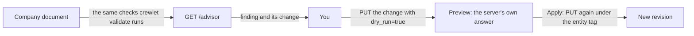

# The Setup Advisor

The setup advisor is one list of what your company's setup costs it, why each item matters, and the change that fixes it. It is for administrators. The engine builds each change; you preview it and send it. **The engine never applies a fix on its own**, because a grant, a model, a schedule or a policy is your company's decision.



## Where you see it

**The go-live check** heads Settings › Advisor: the three things to do before your agents start, each done when nothing of its kind is left. Fix what blocks the company, look at what costs it, and read what is worth knowing. It is counted from the same answer as the list under it, one count for each row of it (a class raised for nine agents is one thing to do), and a part of the setup the server could not read leaves its step unsaid rather than done. When you create a company in the organization builder, its last step opens it.

Under it, **Review what each agent can do** lists, for every agent, what its turns are told about its own access: the vendors it acts at, with its level, the permissions it may write with (who can merge pull requests, for example) and where (the repositories, projects or hosts, and an SSH host's read commands), its tool servers with the tools each level names and what every other tool does (a server granted by its default runs every tool at that level), and the sandbox its runs use, with its memory and, once a run has read the box, whether it has a browser and a container runtime. These are facts to check against what you want each agent to do; whether they match your policies is your reading. `GET /advisor/review` returns the same for a script (administrators).

**Settings › Advisor** lists every finding, the most costly first, with what the engine is handling listed apart so it never reads as yours to do. **Review the change** opens the preview: pick an option where there is more than one, and the screen asks the engine to check the exact write (the fields it changes, before and after, and any warning it would add). Nothing is saved until you press **Apply**, which saves it as a revision by you.

A finding that **blocks** the company and is yours to fix also waits in every administrator's **Inbox** under **Needs you**, and counts on **Home**, with what to do and a button that opens the advisor, as a [platform notice](#platform-notices). It leaves both once the setup no longer raises it. Findings that cost or are worth knowing stay on the advisor alone, so they never crowd the decisions your agents are waiting on.

## Platform notices

A platform notice is how something only an administrator can fix, or something the engine is holding, reaches every administrator, whether or not any agent holds `health_tools`. There are three kinds:

| Notice | Raised while | Opens |
|---|---|---|
| A finding that blocks the company and is yours to fix | The advisor lists it. | The advisor, with the finding's fix. The no-verified-backup finding opens **Take a backup** on Backups & retention instead. |
| An alarm that has not cleared (`alarm`) | An alarm has stood on any server for at least 30 minutes (the deferral grace, where the engine itself stops waiting for a condition to clear on its own). One notice names every server it stands on, and a restart keeps when it was raised. An alarm raised again less than 30 minutes after it cleared counts from its first raise, so a condition that keeps coming back still reaches you. | Where the alarm is fixed: **Take a backup** for `backup_age`, File storage for `objects_bucket_near_ceiling`, and otherwise the section that draws the alarm (Backups & retention's alarm list, Models, or Gitlet). An MCP server's alarm is already its own row in Needs you. |
| A conversation the engine holds (`conversation.held`) | An agent's conversation whose context did not fit its models twice in a row, the second time on a fresh session, whose models' provider refused the request its runs make twice in a row, the second time on a fresh session (`cause` `request_refused`: a schedule whose every fire is refused is held this way), or whose work ran out of its sandbox's memory twice in a row: the engine stopped starting turns on it ([Agent runtime § Pausing a seat](../concepts/agent-runtime.md#pausing-a-seat)). Its subject is the seat, and `name` the conversation. There is nothing to decide: writing on the conversation, or changing what it failed on (the seat's models, its sandbox, or for a refused request the models or the company's tool servers), releases it. | The item the conversation is about, where there is one, or the seat. |

A condition both raise is one notice: the `backup_age` alarm is the advisor's no-verified-backup finding, with that finding's fix. A notice has nothing to answer and nothing to mark read: it ends when its condition does. Whoever is an administrator when the Inbox is read sees it, so a person made an administrator sees every notice already open ([ADR-0116](../../adr/0116-an-administrator-notice-is-read-off-its-condition.md)).

**Putting a notice off.** A condition you have read and accept for now, a bucket you will move next week, can be put off from its row in the Inbox **for a day, 3 days or a week**. It leaves Needs you and stops counting on the Inbox badge, and stays listed under **Put off on this browser**, with **Bring back now**. It comes back by itself when the time is up, and sooner if the condition worsens: if it cleared and was raised again, or now stands on more servers than when you put it off. The mark is yours and kept on that browser, as your Home's layout is: the engine keeps no mark over a notice, so it is still open for every other administrator, and on your other devices.

**A backup taken outside the engine** (a copy of the data directory, a disk snapshot) is not one the engine can see, so it does not clear the no-verified-backup notice: only a backup the engine took and verified does (`crewlet backup`, or **Take a backup**).

## What it lists

Every finding has a **title** (what is wrong), a **why** (what it costs), the **path** in the company document it sits at, a **severity** and its **fix**. The title and why are the same for every finding of one class, so a class is **one row** naming everything it is about, however many agents raise it: the **subject** (the seat, schedule or repository), the **item** (the one thing within it, such as a schedule's name and how often it runs, `health-check (12 a day)`, or how many runs and tokens), for a finding about several agents their **names**, its **evidence** as counts, and at most five **records** behind it, each a link: a work item, a turn, a pull request or a Gitlet change.

| Severity | Meaning |
|---|---|
| `blocks` | The company cannot work as configured. |
| `costs` | It works, and pays for the setting in spend, waiting or work nobody sees. |
| `note` | Worth knowing, and may be exactly what you meant. |

The advisor reads the same checks `crewlet validate`, every `/config` write and every node's apply log raise, so a finding here is never a second opinion. Three of them come with a change the advisor builds:

| Finding | When | The change it offers |
|---|---|---|
| No agent watches the engine's own alarms (`grant.health_unheld`) | No agent seat holds `health_tools`, so an alarm that fires on a server wakes nobody. | Give one agent `health_tools`: one option per agent seat, in the chart's order. No agent gets any other access. |
| Agents that learn on their main model (`learning.auxiliary_model`) | A seat's reflection, summaries and memory (`llm_auxiliary`) run on the same model as its own work, so learning costs a share of its spend at that price. | Point `llm_auxiliary` at another `providers.llm` entry: one option per entry on a different model. With none, add a smaller model first. |
| Schedules run 12 or more times a day (`schedule.frequent`) | Each fire starts a turn whether or not anything changed. The item names the schedule and how many times a day it runs, and the evidence counts, from the last 7 days, how many times it fired (`fires`) and how many of those fires moved any work (`moved`). A check that waits for an event, such as a deploy or a merge, is better as a work item dated for when to look. | Run it once a day at 09:00 on the days it runs now, or remove it. Its task stays as written. |

One more is listed in its own words, with the setting to open rather than a change: **agents run directly on the engine's own server** (`sandbox.direct_box`, `note`), for a company hosting code on Gitlet whose model entry, or the sandbox default its entries take, runs an agent's work in the `direct` cell, where the work runs as the engine's own user and can read every repository and act as any other agent. Running it in `container` or `e2b` holds each agent to its own access.

Every other warning the document raises is listed too, with the setting to open (`config.advisory`, `config.reference`, `config.admission`): under its rule's own title, with the one thing it is about as its item and its words for a person as the why, or in the words `crewlet validate` prints where its rule wrote none.

So is everything your integrations' last check reported (`integration.<kind>`, for example `integration.credential_rejected` or `integration.approval_required`), in the integration's own words. Who acts follows the integration's own verdict: a credential that was refused or is missing, an app waiting for you to approve its permissions, or a delivery path that cannot be set up is yours, with the step to take and, where the vendor names one, the page to take it on; an account the engine is still creating is listed apart as the engine's. If a server cannot read the integrations' state, the answer's `unread` names `integrations` and the screen says so, so a short list never reads as nothing to do.

## Patterns the engine is handling

Beside the document's findings, the advisor reads what the company did over the last 7 days, from the tracker's records and the agents' turn ledger alone and with no model call, and lists the patterns the engine is reducing. Each is `actor: engine`, `source: evidence` and `note`, names at most five records behind it (`records`, empty for a pattern that is a count) and offers nothing to send (`fix.kind: none`): it is information, never a to-do.

| Finding | Listed when (last 7 days) |
|---|---|
| Agents woke each other with comments that asked nothing (`wake.agent_mentions_without_ask`) | Agents' comments that asked nothing woke an agent they named at least 5 times, and at least once per 100 agent comments. |
| Agents asked a person for something without asking them a question (`person.requests_without_ask`), one per person | Agents' comments asked the person for an answer or an action (`asks: true`) at least 5 times without putting a question to them with `ask`, so nothing in them reached their Inbox as a decision. This is the same rule `comment_on_work_item` refuses such a comment by, so it counts comments an older build wrote. A comment that only mentions the person (`asks: false`) is not counted. |
| People answered questions that no longer needed an answer (`ask.overtaken`) | At least 3 answers, and at least 5% of a person's answers to an agent's question, went to a question its asker had asked again on the item since, or whose item had already finished. |
| Work in review waited a day (`review.idle`), one per party it waits on | An item in review is held by an agent that has taken no turn on it in the last 24 hours, counted from the later of its entering review and its being handed to that agent. A turn on a linked pull request counts on the change, not the item. The finding names whom the review waits on: the agent holding it ("for the agent holding it"); the person the holder asked to review it, one finding per person ("for a person's answer"); or nobody, for an item its holder moved into review itself with no question open on it ("has no reviewer"), which the work pickup hands back to its holder. |
| A person was sent more notices than anyone reads (`person.notice_load`), one per person | The person was sent at least 350 notices, and fewer than a quarter of them asked something of them, so what does ask them waits among the rest. |
| An agent was woken for turns that changed nothing (`wake.noop_share`), one per agent | The agent took at least 20 turns, and at least a quarter of them committed nothing: no work moved and no words written. A schedule's turns are left out: a check that finds nothing is the schedule working. |
| Agents picked up work and moved none of it (`work.pickup_still_waiting`) | Agents picked up work handed to them at least 10 times, and at least a fifth of those turns ended with words only (a comment or a chat post) and nothing typed on the item, as when an agent says the item still waits on something. A pickup answered with a question put with `ask` counts as moved, as a change to the item does, by the same reading the pickup's delivery check makes ([ADR-0122](../../adr/0122-a-pickup-is-answered-with-a-typed-outcome-and-a-wait-on-a-person-is-an-ask.md)). An item handed back because nothing moves the pull request it waits on counts as a pickup too ([ADR-0128](../../adr/0128-a-wait-nothing-moves-is-handed-back-once-per-head.md)). |
| An agent spent a large share of its tokens on auxiliary calls (`spend.auxiliary_share`), one per agent | The agent's turns spent at least 1,000,000 tokens, and more than 15% of them went to auxiliary calls inside its turns rather than to the turns' own work. It is a share of tokens, cached input included, not of spend. |
| Wakes repeated changes an agent had already read (`wake.redelivered_seen`), one per agent | At least 10 of the agent's wakes, and at least a fifth of all that woke it, came for changes a completed turn of it had already read, so the engine absorbed them instead of starting turns ([ADR-0120](../../adr/0120-a-wake-a-completed-turn-already-read-past-starts-no-turn.md)). |

One finding read from the engine's own state is yours: **Your company has no recent verified backup** (`durability.no_verified_backup`, `blocks`), listed while the `backup_age` alarm stands, at the backup policy's own age. Its fix is a step taken on a page of the dashboard (`fix.kind: open_page`, `fix.page: backups`): the row's **Take a backup** opens Backups & retention's own dialog to take one now; then schedule backups that are copied off the server ([Backups](backup.md)). A fix of this kind names the page its step is taken on, never a command, since the dashboard takes the step with one press.

So is an agent the engine paused. When a failure a retry cannot cure happens twice in a row, the engine pauses the agent rather than retrying it ([ADR-0117](../../adr/0117-a-failure-a-retry-cannot-cure-pauses-its-seat.md)), and the advisor lists it as a blocking finding (`blocks`), one per kind of failure, its title the kind's (**Paused because** the sandbox could not start as configured, for example) and every agent it holds in its `names`:

| Finding | The fix |
|---|---|
| The sandbox could not start as configured (`sandbox.image_unstartable`) | Correct the sandbox settings (`providers.sandbox`), such as its image or template. Saving the change resumes the agents. If the fix was made at the provider instead, resume each agent from its page. |
| The sandbox provider refused the engine's credential (`sandbox.credential_refused`) | Replace the provider's key, then resume each agent from its page. |
| The sandbox provider refused for billing (`sandbox.billing_refused`) | Settle the account's billing with the provider, then resume each agent from its page. |
| No model accepted the credential (`models.credential_refused`) | Replace the models' credentials under Settings, Models, then resume each agent from its page. Changing the models they run on resumes them as well. |

Work sent to a paused agent waits; nothing is dropped.

An agent whose sandbox keeps running out of memory is yours to size: **agent sandboxes ran out of memory this week** (`sandbox.out_of_memory`, `costs`), one per agent, its item saying how many runs stopped and at what ceiling, when the kernel stopped two or more of its runs at the box's memory ceiling in the last 7 days. Each such run's work was lost and started again, and a second one in a row on a conversation holds it. Its fix opens the sandbox settings (`providers.sandbox`): give the box more memory, such as a larger `--memory` in its run arguments; saving the change releases a conversation the engine held for it.

A schedule that rarely changes anything is yours to weigh: **schedules that rarely change anything** (`schedule.unproductive`, `costs`), one per schedule, its item naming the schedule and how many of its runs changed something (`health-check (changed something once in 12 runs)`), and its evidence counting them (`fires`, `moved`), when a schedule still in the document fired seven or more times in the last 7 days and one in ten of those fires or fewer moved any work. A fire moved work when its turn changed anything in the tracker or the pages other than comments and watchers (a new item, a status, an assignee, a field, a link, a file, or a page created, saved, renamed, moved, labelled or removed), pushed code, opened a change or gave a review; a turn that only commented, or wrote nothing, did not. A fire from the last hour is left out, as its turn may still be running. An agent granted a vendor home for work (GitHub with a write permission, GitLab, Jira or Confluence) writes where the engine keeps no record of each turn, so a schedule that runs on it is not judged, and neither is any schedule of a company whose tracker is a vendor's. Each fire still started a turn on the agent's models. It takes the place of that schedule's `schedule.frequent` finding, and offers the same change: run it once a day at 09:00 on the days it runs now, or remove it. If a server cannot read the week's fires or what their turns wrote, the answer's `unread` names `fires` and the schedules' fires are left out.

One more is yours to weigh, read from the decisions your agents asked: **a person chose one agent's recommendation in nearly every decision it asked** (`approval.rubber_stamp`, `note`), when an agent asked one person 20 or more decisions in the last 7 days and nine in ten or more were answered with its recommended option. It is one finding per agent, naming every person for whom that holds. Each still costs a press and makes the agent wait; whether the agent may act on some kinds of them without asking is your call. Its fix is a draft (`fix.kind: draft_with_assistant`): **Draft with Ask Crewlet** asks Ask Crewlet, in the engine's words (`fix.prompt`), to read those decisions and draft a policy change, which you review in its own preview before anything is saved. Nothing changes until you approve it.

And one is yours to fix, read from the pull requests your work waited on: **pull requests your work waited on reached it only through the engine's poll** (`integration.inbound_silent`, `costs`), when the poll settled a pull request in the last 7 days and no GitHub delivery has settled one since. A merge or close reaches a waiting item within a minute when the webhook delivers it; the poll catches what it missed ten minutes or more late. Its fix is a step outside the company document (`fix.kind: external_step`, `fix.setting: github`): open GitHub's settings and check that its webhook reaches the engine. Nothing else changes meanwhile: the poll keeps settling what the webhook misses ([ADR-0121](../../adr/0121-a-pull-request-a-task-waits-on-reaches-it-as-the-engines-record.md)).

## Work that stalls where nothing else says so

Six more are read from the week's records, each the owner's (`costs`), each with its numbers and records, and the fix the engine can build where one exists. They are read with no model call, as every finding above is.

| Finding | Listed when (last 7 days, or now) | The fix |
|---|---|---|
| Agent runs ended on their round cap before they finished (`run.round_cap`), one per agent | An agent's executor runs ended on their round cap (`role.sandbox.max_turns`, else `providers.sandbox.default_max_turns`) twice or more, or once at 1,000,000 tokens or more, and a cap no higher than the rounds they reached still holds. The item says how many runs, at what cap, and what they spent; the records are the turns, the costliest first. A run's own record says it ended on its cap (`error_kind` `max_turns`); an OpenCode run at its `steps` answers in text and ends as one that finished, so it is not counted. | Raise the agent's cap to twice the one it runs under, or lift it for that agent (`sandbox.max_turns: 0`); or split its items into smaller ones. |
| Agents stopped on their token budget while holding open work (`budget.stopped`), one per agent | The agent's own budget refused its turns for 4 hours or more of the week, from each refusal to its window's reset, while it held open work, and its ceiling for that period is still the one it was refused at. The company's budget is one finding naming every agent it stopped. A seat held back before any turn ran leaves no record, so it is not counted. | Raise the agent's budget for that period to one and a half or twice what it is; for the company's budget, open `token_budget`. |
| One agent holds most of the open work (`work.concentrated`) | An agent holds 20 open items or more and at least half of all the open items agents hold, while another agent holds 2 or fewer. The item says how many, and how many wakes are queued for it now where its server reported them. | Open the agent's page: hand some of its items to another agent, or add a seat for this work. |
| Open work waits on one item (`work.bottleneck`), one per item | An open item an agent holds, or nobody does, that 5 or more open items wait on, directly or through each other. | Open the item: move it first, or take off the waits that need not be there. |
| Agent work that needs no decision waits behind a person (`work.held_by_person`), one per item | An item a person holds (it is theirs, or a question on it waits on their answer) that 3 or more items agents hold, with no question of their own open, wait on. The item names it and how many open questions hold it. | Open the item: answer what it waits on, or take the wait off the work behind it. |
| Merges a delegate allowed went to a person because the branch requires no check (`merge.no_required_checks`), one per repository | 3 or more merges into one repository that a [delegate](delegated-decisions.md) allowed were put to a person because its branch requires no check, so nothing shows the change passed CI. Each request is counted once, however many delegates answered it. | On GitHub, the repository's branch settings: run CI on its pull requests and require that check, or name the check in the rule's `required_checks`. On Gitlet, open `code.repos` and require a check on the protected branch. |

If a server cannot read the week's budget refusals or its merge decisions, the answer's `unread` names `budget_stops` or `merges`, and their findings are left out.

## Found by the analyst

The rules above name what somebody already wrote a rule for. The **analyst** reads the same week of records on the company's own models and lists problems no rule names, under the rule-based list, in a section of its own. It is off until you name a model for it ([ADR-0157](../../adr/0157-the-advisors-analyst-lists-only-what-the-engines-records-show.md)):

```yaml
advisor:
  analyst:
    llm: [assistant]        # providers.llm keys; absent is off
    cadence: daily          # daily (the default), weekly (on Mondays) or off
    hour: 6                 # the company-clock hour a scheduled run starts at
    max_tokens: 200000      # one run's token ceiling, at least 20000
```

**What it reads.** Only the engine's own records, through read tools served to the run: the company document's shape (each seat's model entries, round cap, budgets and schedules, and the delegation rules), the agents' turns by what woke them and what they did, the runs that ended on their round cap or for memory, the turns a budget refused, where open work sits and what waits on what, decisions and merges, schedule fires, what the rules above already list, and how people answered earlier findings. Every answer is numbers, closed words, times, handles and record ids. No comment, message, item title or transcript is read, so words somebody wrote cannot steer what you are told, and the document it reads is the redacted one.

**How it runs.** Daily at 06:00 on the company clock by default, or weekly, and whenever an administrator presses **Run now**; one run at a time across the fleet. A run its hour missed (the analyst just turned on, or every server down at that hour) starts at the next check, once. Each model entry is held to Ask Crewlet's rules for a member (the harness's local and web tools denied). Its rounds are charged to the company's budget windows and never a seat's, under the run's own `max_tokens`, and recorded as background spend with the purpose `advisor_analysis`. The section shows the last run's time, model entry and tokens. A run reads about ten tool answers of a few thousand tokens each beside its prompt, so the default ceiling leaves room to read twice.

**What reaches the list.** The run submits findings; the engine lists one only when:

- it cites at least one record (an item, a turn or a change) and one number, and every record and number is one this run's own tools answered, the number at the very place it names;
- it is not a rule finding said again: one about the same subject citing only a rule finding's records, or offering a change a rule finding offers, is left out;
- its fix is one the engine builds itself and checks against the company's rules: a seat's round cap, token budget or learning model, or opening an item it cites or an agent's page. The engine never applies one: it is previewed and applied as every fix here is;
- its words are plain, at most 120 characters for the title and 600 for the why.

What was left out is counted by why under the list, so a short list never hides a run that found more than it could prove.

**Your answers.** Each finding takes **Useful**, **Wrong** or **Already known**. A wrong one is never listed again and the next run is told; an already-known one stays off the list for 30 days. Answers are kept by what the finding is about (its subject, records and kind of fix), not its words. Analyst findings never reach the Inbox, Home or the go-live check.

**When it cannot say.** A model that declines, or does not submit findings the engine can read, is said as such; a run that reaches its ceiling says so; a model or a company budget that is not available fails the run in those words; a source a run could not read is named; a last run older than two of its periods is marked out of date. **Nothing found** is said only for a fresh run that read everything and found nothing the rules do not list.

`GET /advisor/analysis` answers the same for a script, and `POST /advisor/analysis` runs it now ([API reference](../reference/api-endpoints.md)).

## What the atlas shows

The advisor also lists what your company's [atlas](atlas.md) shows needs a person. Each is read from the atlas when the list is read and stored nowhere, so it leaves the list once it is fixed. None blocks the company.

| Finding | Listed when | The fix you send |
|---|---|---|
| Entries owned by a seat or a unit that left the chart (`atlas.owner_gone`, `costs`) | An entry on the map names an owner your chart no longer holds, so a question about it reaches nobody. | Name the seat or the unit that answers for it now (`atlas_set_owner`). |
| Services open to the internet that nothing watches (`atlas.unmonitored`, `costs`) | A confirmed service exposes an address outside your company's own networks, and no monitor is recorded for the service or for that address. A service behind a private address only is not listed. | Record the monitor, or the monitoring account, that watches it (`atlas_relate`, `monitored_by`). |
| A source the atlas has not read whole (`atlas.source_stale`, `costs`), one per source | A source was read whole at least once and has not been for three of its reads (3 hours on the default hourly read). What it last read still stands on the map and looks current. An entry leaves the map after two whole reads stop seeing it, so by the third missed read something that should have left may still be there. A source never read whole is not listed here: its row on the atlas's Sources page says why. | Ask for a read now (`atlas_refresh`). If it fails again, the source's row says what stopped it. |
| Services with no owner (`atlas.unowned`, `note`) | A confirmed service has no owner that a person or the engine's records name. A suggested owner does not count. | Name the seat or the unit that answers for it (`atlas_set_owner`). |
| Disagreements nobody has decided (`atlas.disagreement`, `note`) | An entry holds a fact or a relation its sources have disagreed on for 7 days, counted from the newest report in it: a full working week in the atlas's review. | Decide it: keep the value shown or take the other (`atlas_confirm`). |

A finding counts every entry it is about and names the first five, each linked to its page in the atlas. **Review the fix** opens them with the control each needs: an owner to pick, a monitor to pick, the values to choose between, or a button that asks for the read. Each is sent from your session as an atlas change by you, exactly as from the entry's own page, and is recorded in the entry's history.

**Entries are named only to someone who can read the atlas.** Reading the atlas takes the Atlas permission ([who can open it](atlas.md#who-can-open-it)). Without it the finding still says how many entries it is about, names none, and offers nothing to send. Repositories are counted only for a reader who uses Gitlet, as everywhere in the atlas.

Only what your company stands behind is listed: a service an agent reported that nobody confirmed, or one somebody retired, raises nothing. If the atlas or its sources' standings cannot be read, the answer's `unread` names `atlas` or `atlas_sources`, and the screen says so. Atlas findings are never part of the [insights](operating-insights.md) the engine can share.

## Access an agent asks for

An agent that needs more access asks for it with `request_access`, naming one grant from a closed list: watching the engine's health, or any permission its own GitHub App can hold, at any level the Agents tab offers it (`grant-github-<permission>-<read|write>`, for example `grant-github-workflows-write`). The list is derived from what the Agents tab offers, so every GitHub permission an agent can be given, it can ask for. Workflows at Read and write brings Contents at Read and write with it, which a workflow change needs, and the grant says so. A role, a level or a scope at another integration is not on the list, because there it replaces the agent's role at that vendor rather than adding to it; the agent asks for it in words, naming the integration's Agents tab under Settings, Integrations, where you set it. One permission beside its level at an integration that takes grants (Cloudflare) is asked for with the tool's second form and granted on that Agents tab: see [Giving one agent one more permission](../integrations/cloudflare.md#giving-one-agent-one-more-permission). It reaches you as a decision in your Inbox with the agent's reason: the grant, in the engine's own words (for example **Allow Ada to watch the engine's health and wake on its alarms**), or **Not now**. Choosing the grant opens the same preview as a fix here: the exact change to that agent's role, built by the engine for that agent alone, checked by the engine's dry run. Nothing is saved until you press **Apply**, and the engine accepts the answer only once the agent holds the grant, so an agent is never told yes with nothing changed. **Not now** answers at once and changes nothing. Only the engine can offer a grant: a decision any author writes is refused if an option's id begins with `grant-`. `GET /advisor/access?seat=<handle>&access=<grant>` returns the change for a script.

## Previewing and applying a change

A change is one entity write: `entity` (`roles` or `units`), `id` (a seat's handle or a unit's id), `set` (the top-level fields to replace), `merge` where a change sets a nested field (merged into the entity key by key, so every other field stays as you read it) and `summary`. To apply one:

1. `GET /config/{entity}/{id}`: the entity and its own `ETag`. Merge in `merge`, then replace the fields `set` names.
2. `PUT /config/{entity}/{id}?dry_run=true` with that body and `If-Match` set to that `ETag`. The answer is the preview: whether the company would still be valid and any warning the write would introduce. Nothing is stored.
3. Send the same `PUT` without `dry_run`, with the `summary` as `X-Summary`. It is recorded as a revision by you, like any change you make.

If the entity changed after your read, the write is refused for its `If-Match` instead of overwriting the change; read it again. A company whose document is managed elsewhere (Tier A's `api.auth.company_writers`) refuses the write; make the same change in its source instead.

## What never happens on its own

The engine does not grant access, change a model, move or remove a schedule, edit a policy or close anything because of a finding. The advisor only reads, and its package has no way to write (ADR-0115).

## Reading it

`GET /advisor` takes `admin`. From a script, with an administrator's token in `CREWLET_API_TOKEN`:

```sh
curl -s -H "Authorization: Bearer $CREWLET_API_TOKEN" https://crewlet.example.com/advisor
```

Or with `crewlet doctor`, which prints the classes, subjects by kind and ordinal, and counts (`-words` adds the handles and the reasons) and exits 2 while a finding blocks the company, or 1 while the node could not read a source, so a block it holds is never passed over ([CLI reference](../reference/cli.md#crewlet-doctor)).

The answer is `{"revision": "...", "findings": [...], "notices": [...], "unread": [...]}`, the most costly finding first and the longest-standing notice first; the patterns above are read over the 7 days before the request. A notice is `{"class", "subject", "since", "nodes", "alarm"}`: the finding's class and subject, or `alarm` with the alarm's kind as the subject's `name`, or `conversation.held` with the seat and the conversation. A finding's notice that an alarm raised (the backup alarm's) also carries the alarm's kind in `alarm`, so the Inbox still says the alarm stands while the answering server has not evaluated its own alarms and so lists no finding. A notice an alarm raised also carries the alarm's `title` and `person`, what is wrong and what to do in words for a company owner. `unread` names each source the server could not read, so a short list never reads as nothing to do: `integrations` (their last check), `work` (the week's comments, answers, reviews and notices, whose patterns are then left out), `ledger` (the agents' turns by what woke them and what they did, whose patterns are then left out), `pauses` (the seats' pauses, so an agent the engine paused is left out), `runs` (the week's failed executor runs, so a box that ran out of memory and runs that ended on their round cap are left out), `budget_stops` (the week's budget refusals, so an agent its budget stopped is left out), `merges` (the week's merge decisions, so a repository whose merges wait for want of a required check is left out), `fires` (the week's schedule fires and what their turns wrote, so a schedule that rarely changes anything is left out and `schedule.frequent` says no share), `alarms`, named once for either cause (the node's alarm table has not been evaluated yet, as right after a start, so the backup finding cannot be judged; or the fleet's alarms could not be read, or a live node has not evaluated its own yet, so a standing alarm may have no notice), and `holds` (the conversations the engine holds could not be read). `crewlet doctor` fails while any source is unread. See the [API reference](../reference/api-endpoints.md).
