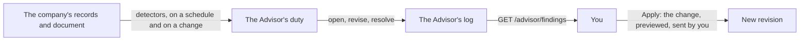

# The Advisor

The Advisor watches your company in the background and keeps a list of what its setup and its way of working cost it, why each item matters, and the change that fixes it. It is for administrators. It needs nothing but a model, and even that is optional: its rules run whether or not one is assigned. The engine builds each change; you preview it and send it. **The engine never applies a fix on its own**, because a grant, a model, a schedule or a policy is your company's decision ([ADR-0164](../../adr/0164-the-advisor-keeps-what-its-detectors-find-and-a-fix-is-applied-only-after-the-engine-re-checks-it.md)).



## Where you see it

**Advisor** in the sidebar (`g v`, administrators) is its page, and its row counts the open findings that block or cost the company (yours to act on, neither snoozed nor applied). The page says when all its checks last ran and offers one **Run**: it runs every check at once, so the findings update in seconds, then goes on into the investigation on the Advisor's model under the same line (see [The deep run](#the-deep-run)). While a run is going it says how long it has run and what it is doing, and the page stays in use. A run that investigated says what it spent of its tokens and minutes and, where it stopped at a limit, that its list may be short; one that kept an investigation from the last six hours says so and from when, and one that could not investigate says why. It counts what its model found and the engine mended to list (a fix it could not build, words reworded) and what it left out, and why. The model the Advisor explains findings with is chosen by an administrator in Settings › Models: as a model's use (*What this model does*, Advisor) or on By job's Advisor line. With no model its checks still run, with no explanations. It has three tabs, Findings, Reports and History, drawn for administrators alone.

**Findings** opens on the company's numbers over the range you pick (7, 14 or 30 days), as [`GET /advisor/snapshot`](#the-companys-numbers) states them: open work, the hours work waited, was held or stood blocked (with the pickup wait beside them), the hours seats lost to model limits, and the share of turns that changed nothing, each against the previous range and, where an open finding explains it, with a **Why** link to that finding. Beside them, the snapshot's charts of the same range, cost per turn headed by its figure. When its last run had a check that could not judge, the head says how many, and why each, folded. Under the numbers it lists what is worth changing now, the most costly first (what blocks the company, what costs it, what is worth knowing; within each, the largest measured cost, then the newest), with what the engine is handling listed apart so it never reads as yours to do. Each row is the finding in a line, one line of why, its numbers, and what became of it where that matters (snoozed, applied and checking its effect, not re-checked for a while, a change that did not clear it, seen before); its **Details** say when it was found and when its check last confirmed it (a run, or an Apply's re-check of that finding alone). Findings of one kind about several subjects (one per agent, for example) are one row that says how many, each subject inside it with its own fix. Each row offers one press that says what it does (such as **Take a backup**, **Open ENG-12**, or the name of the fix's first change), and a menu with the fix's other changes, **Snooze for 7 days**, **Dismiss** with a reason (won't fix, already known, or wrong; the toast offers **Undo**), and **Ask Crewlet about this**, which opens the finding's page with a question waiting in Ask Crewlet's box for you to send or change. A snoozed finding leaves the list for **Snoozed**, which says until when, and **End the snooze** brings it back. A finding's title opens its page: why it was raised, the model's explanation (headed as the model's, and a finding the model found is marked so), the facts it rests on and the window they were measured over, the records it cites, its fix, and everything that happened to it.

**Apply re-checks the finding first, in place.** A press that changes the company opens under the finding's own row (or its fix, on its page), never in a dialog. Before anything is sent, the engine derives the finding again from the latest records and builds the change you pressed again, and the panel says what it found: the finding still holds (the exact change, field by field in words, and what it clears; **Confirm** sends it), it changed since it was found (each value that moved, was beside now, and the updated change, which you confirm or cancel), it is no longer needed, or it no longer applies (closed, and nothing is sent). The change is then sent from your own session, checked first, under the exact revision the re-check read: if its target moved in between, or the re-check is more than ten minutes old and the engine no longer answers the same change, you are shown the new answer instead, or, where it was applied from another window or closed meanwhile, where it now stands. After it is sent, the row reads **Applied** until the engine has checked that the condition cleared.

While anything blocks the company, after the findings and folded until you open it, **Review what each agent can do** lists, for every agent, what its turns are told about its own access: the vendors it acts at, with its level, the permissions it may write with (who can merge pull requests, for example) and where (the repositories, projects or hosts, and an SSH host's read commands), its tool servers with the tools each level names and what every other tool does (a server granted by its default runs every tool at that level), and the sandbox its runs use, with its memory and, once a run has read the box, whether it has a browser and a container runtime. These are facts to check against what you want each agent to do; whether they match your policies is your reading. `GET /advisor/review` returns the same for a script (administrators). When you create a company in the organization builder, its last step opens the Advisor.

**History** lists what closed and why.

A finding that **blocks** the company and is yours to fix also waits in every administrator's **Inbox** under **Needs you**, and counts on **Home**, with what to do and a button that opens it, as a [platform notice](#platform-notices). It leaves both once a run no longer finds it. Findings that cost or are worth knowing stay on the Advisor's page alone, so they never crowd the decisions your agents are waiting on.

## When it runs

One server of the fleet at a time runs the Advisor, holding a lease it renews every minute; another takes over within three minutes of it stopping. Each minute it asks what is due:

- **Its rules**, every hour, and at once when the setup they read changes: a new revision of the company, a seat paused or resumed, an integration's reconcile. One run reads the company document, the integrations' last reconcile, the seats' pauses, the atlas and the last 7 days of work, and runs every rule over them.
- **Its model**, once a day at 06:00 on the company clock, where `advisor.model` names one ([Found by the Advisor's model](#found-by-the-advisors-model)).
- **Run**, from any server: the run is asked for on the Advisor's log (`POST /advisor/runs`, no body) and the server holding the lease takes it within a minute. It runs every check at once and records what they find, then goes on into the deep investigation under the same run, unless one concluded within the last six hours (then the run says that one is kept, and from when) or no model is assigned (then it says the investigation could not run, and why). The run is recorded once, with both parts.
- **Its weekly report**, on Monday at 06:00 on the company clock, after that hour's model pass ([The weekly report](#the-weekly-report)).

## A finding's life

Every run re-derives every finding of the classes it ran, so the list says what is true now rather than what was true when somebody last looked:

- **Found**: a condition no open finding holds opens one. A finding is one condition, its class and what it is about (a seat, a schedule, an item, a document path), so the numbers moving under it never make a second one.
- **Revised**: what the finding decides (its severity, who acts, what it names) or the change that fixes it moved. It keeps its place and says what moved; the model's explanation of it is hidden until rewritten.
- **Refreshed**: only its numbers moved. They are updated in place, with when.
- **Resolved**: a run no longer finds it, so it closes on its own; one you applied a fix for closes as fixed by it.
- **Retired**: what it was about is gone, a seat or a schedule the company no longer has.
- **Stale**: a source its class reads could not be read for three of its runs in a row (a run says nothing about a finding whose source it could not read). It is shown as not re-checked since then, and expires a week later.
- **Snoozed** for 7 days, and back if a run still finds it; **dismissed** as one you will not fix (held quiet 90 days), already known (30 days) or wrong (for good, and the model is told). A dismissed finding returns early only if it becomes more costly. **End the snooze** lifts a snooze at once. **Reopen** lifts a dismissal: the dismissed finding stays closed, and a run is asked for at once, so a condition that still stands is back on the list as a new finding within a minute.

A condition that comes back after closing is a new finding that says how many times it was seen before. Closed findings are kept 90 days, runs 30 days and reports 26 weeks.

## Platform notices

A platform notice is how something only an administrator can fix, or something the engine is holding, reaches every administrator, whether or not any agent holds `health_tools`. There are three kinds:

| Notice | Raised while | Opens |
|---|---|---|
| A finding that blocks the company and is yours to fix | The Advisor lists it open. | The Advisor's page, with the finding's fix. The no-verified-backup finding opens **Take a backup** on Backups & retention instead. |
| An alarm that has not cleared (`alarm`) | An alarm has stood on any server for at least 30 minutes (the deferral grace, where the engine itself stops waiting for a condition to clear on its own). One notice names every server it stands on, and a restart keeps when it was raised. An alarm raised again less than 30 minutes after it cleared counts from its first raise, so a condition that keeps coming back still reaches you. | Where the alarm is fixed: **Take a backup** for `backup_age`, File storage for `objects_bucket_near_ceiling`, and otherwise the section that draws the alarm (Backups & retention's alarm list, Models, or Gitlet). An MCP server's alarm is already its own row in Needs you. |
| A conversation the engine holds (`conversation.held`) | An agent's conversation whose context did not fit its models twice in a row, the second time on a fresh session, whose models' provider refused the request its runs make twice in a row, the second time on a fresh session (`cause` `request_refused`: a schedule whose every fire is refused is held this way), or whose work ran out of its sandbox's memory twice in a row: the engine stopped starting turns on it ([Agent runtime § Pausing a seat](../concepts/agent-runtime.md#pausing-a-seat)). Its subject is the seat, and `name` the conversation. There is nothing to decide: writing on the conversation, or changing what it failed on (the seat's models, its sandbox, or for a refused request the models or the company's tool servers), releases it. | The item the conversation is about, where there is one, or the seat. |

A condition both raise is one notice: the `backup_age` alarm is the advisor's no-verified-backup finding, with that finding's fix. A notice has nothing to answer and nothing to mark read: it ends when its condition does. Whoever is an administrator when the Inbox is read sees it, so a person made an administrator sees every notice already open ([ADR-0116](../../adr/0116-an-administrator-notice-is-read-off-its-condition.md)).

**Putting a notice off.** A condition you have read and accept for now, a bucket you will move next week, can be put off from its row in the Inbox **for a day, 3 days or a week**. It leaves Needs you and stops counting on the Inbox badge, and stays listed under **Put off on this browser**, with **Bring back now**. It comes back by itself when the time is up, and sooner if the condition worsens: if it cleared and was raised again, or now stands on more servers than when you put it off. The mark is yours and kept on that browser, as your Home's layout is: the engine keeps no mark over a notice, so it is still open for every other administrator, and on your other devices.

**A backup taken outside the engine** (a copy of the data directory, a disk snapshot) is not one the engine can see, so it does not clear the no-verified-backup notice: only a backup the engine took and verified does (`crewlet backup`, or **Take a backup**).

## What it lists

Every finding has a **title** (what is wrong), a **headline** that says it with its number ("Dev spent 400K of its 1.2M tokens on learning this week (33%)."), a **why** (what it costs), the **path** in the company document it sits at, a **severity** and its **fix**. Every class writes a headline from the numbers its finding states, and each number is a stat that says what it counts; only the document's own warnings, which measure nothing, lead with their title. **One cause is one finding**: a condition that holds on many seats (agents learning on their main model, schedules that run too often, runs a pause skipped, recommendations people always take) is one finding about the company with each affected seat inside it and its number, and its fix changes every one of them at once. The title and why are the same for every finding of one class, so a class is **one row** naming everything it is about, however many agents raise it: the **subject** (the seat, schedule or repository), the **item** (the one thing within it, such as a schedule's name and how often it runs, `health-check (12 a day)`, or how many runs and tokens), for a finding about several agents their **names**, its **evidence** as counts, and at most five **records** behind it, each a link: a work item, a turn, a pull request or a Gitlet change.

| Severity | Meaning |
|---|---|
| `blocks` | The company cannot work as configured. |
| `costs` | It works, and pays for the setting in spend, waiting or work nobody sees. |
| `note` | Worth knowing, and may be exactly what you meant. |

The advisor reads the same checks `crewlet validate`, every `/config` write and every node's apply log raise, so a finding here is never a second opinion. Three of them come with a change the advisor builds:

| Finding | When | The change it offers |
|---|---|---|
| No agent watches the engine's own alarms (`grant.health_unheld`) | No agent seat holds `health_tools`, so an alarm that fires on a server wakes nobody. The evidence counts the agents (`agents`). | Give one agent `health_tools`: one option per agent seat, in the chart's order. No agent gets any other access. |
| Agents that learn on their main model (`learning.auxiliary_model`), one finding with every such agent inside | A seat's reflection, summaries and memory (`llm_auxiliary`) run on the same model as its own work, so learning costs a share of its spend at that price. | Point every one of them at another `providers.llm` entry at once: one option per entry on a different model, its label saying how many of the agents it changes ("(all 9)", "(7 of 9)"). With none, add a smaller model first. |
| Schedules run 12 or more times a day (`schedule.frequent`), one finding with every such schedule inside | Each fire starts a turn whether or not anything changed. The headline says how many schedules and how many times a day they run between them; the evidence counts, from the last 7 days, how many times they fired (`fires`) and how many of those fires moved any work (`moved`). A check that waits for an event, such as a deploy or a merge, is better as a work item dated for when to look. | Run each once a day at 09:00 on the days it runs now, or remove them, every one at once: one change per seat or unit, since a change sets its whole list of schedules. Their tasks stay as written. |

A fix that changes several seats is **one action of several changes** (each option's `change` and its `also`): Apply re-checks them all, previews each, and sends them in turn (the re-check's `sends`), and the finding is applied only once every one of them holds.

One more is listed in its own words, with the setting to open rather than a change: **agents run directly on the engine's own server** (`sandbox.direct_box`, `note`), for a company hosting code on Gitlet whose model entry, or the sandbox default its entries take, runs an agent's work in the `direct` cell, where the work runs as the engine's own user and can read every repository and act as any other agent. Running it in `container` or `e2b` holds each agent to its own access.

Every other warning the document raises is listed too, with the setting to open (`config.advisory`, `config.reference`, `config.admission`): under its rule's own title, with the one thing it is about as its item and its words for a person as the why, or in the words `crewlet validate` prints where its rule wrote none.

So is everything your integrations' last check reported (`integration.<kind>`, for example `integration.credential_rejected` or `integration.approval_required`), in the integration's own words. Who acts follows the integration's own verdict: a credential that was refused or is missing, an app waiting for you to approve its permissions, or a delivery path that cannot be set up is yours, with the step to take and, where the vendor names one, the page to take it on; an account the engine is still creating is listed apart as the engine's. If a server cannot read the integrations' state, the answer's `unread` names `integrations` and the screen says so, so a short list never reads as nothing to do.

## Patterns the engine is handling

Beside the document's findings, the advisor reads what the company did over the last 7 days, from the tracker's records and the agents' turn ledger alone and with no model call, and lists the patterns the engine is reducing. Each is `actor: engine`, `source: evidence` and `note`, names at most five records behind it (`records`, empty for a pattern that is a count) and offers nothing to send (`fix.kind: none`): it is information, never a to-do.

| Finding | Listed when (last 7 days) |
|---|---|
| Agents woke each other with comments that asked nothing (`wake.agent_mentions_without_ask`) | Agents' comments that asked nothing woke an agent they named at least 5 times, and at least once per 100 agent comments. |
| Agents asked a person for something without asking them a question (`person.requests_without_ask`), one per person | Agents' comments asked the person for an answer or an action (`asks: true`) at least 5 times without putting a question to them with `ask`, so nothing in them reached their Inbox as a decision. This is the same rule `comment_on_work_item` refuses such a comment by, so it counts comments an older build wrote. A comment that only mentions the person (`asks: false`) is not counted. |
| People answered questions that no longer needed an answer (`ask.overtaken`) | At least 3 answers, and at least 5% of a person's answers to an agent's question, went to a question its asker had asked again on the item since, or whose item had already finished. |
| Work in review waited a day (`review.idle`), one per party it waits on | An item in review is held by an agent that has taken no turn on it in the last 24 hours, counted from the later of its entering review and its being handed to that agent. A turn on a linked pull request counts on the change, not the item. The finding names whom the review waits on: the agent holding it ("for the agent holding it"); the person the holder asked to review it, one finding per person ("for a person's answer"); or nobody, for an item its holder moved into review itself with no question open on it ("has no reviewer"), which the work pickup hands back to its holder. |
| A person was sent more notices than anyone reads (`person.notice_load`), one per person | The person was sent at least 350 notices, and fewer than a quarter of them asked something of them, so what does ask them waits among the rest. |
| Agents picked up work and moved none of it (`work.pickup_still_waiting`) | Agents picked up work handed to them at least 10 times, and at least a fifth of those turns ended with words only (a comment or a chat post) and nothing typed on the item, as when an agent says the item still waits on something. A pickup answered with a question put with `ask` counts as moved, as a change to the item does, by the same reading the pickup's delivery check makes ([ADR-0122](../../adr/0122-a-pickup-is-answered-with-a-typed-outcome-and-a-wait-on-a-person-is-an-ask.md)). An item handed back because nothing moves the pull request it waits on counts as a pickup too ([ADR-0128](../../adr/0128-a-wait-nothing-moves-is-handed-back-once-per-head.md)). |
| An agent spent a large share of its tokens on auxiliary calls (`spend.auxiliary_share`), one per agent | The agent's turns spent at least 1,000,000 tokens, and more than 15% of them went to auxiliary calls inside its turns rather than to the turns' own work. It is a share of tokens, cached input included, not of spend. |
| Wakes repeated changes an agent had already read (`wake.redelivered_seen`), one per agent | At least 10 of the agent's wakes, and at least a fifth of all that woke it, came for changes a completed turn of it had already read, so the engine absorbed them instead of starting turns ([ADR-0120](../../adr/0120-a-wake-a-completed-turn-already-read-past-starts-no-turn.md)). |
| An objective alarm fired and cleared within minutes, again and again (`objective.false_alarm`), one per node | The node's `objective_burn` alarm cleared within ten minutes of its raise at least 5 times: the node recovered from short bursts by itself, so they were not outages. Read from the alarms' history (below). |

One finding read from the engine's own state is yours: **Your company has no recent verified backup** (`durability.no_verified_backup`, `blocks`), listed while the `backup_age` alarm stands, at the backup policy's own age. Its fix is a step taken on a page of the dashboard (`fix.kind: open_page`, `fix.page: backups`): the row's **Take a backup** opens Backups & retention's own dialog to take one now; then schedule backups that are copied off the server ([Backups](backup.md)). A fix of this kind names the page its step is taken on, never a command, since the dashboard takes the step with one press.

So is an agent the engine paused. When a failure a retry cannot cure happens twice in a row, the engine pauses the agent rather than retrying it ([ADR-0117](../../adr/0117-a-failure-a-retry-cannot-cure-pauses-its-seat.md)), and the advisor lists it as a blocking finding (`blocks`), one per kind of failure, its title the kind's (**Paused because** the sandbox could not start as configured, for example) and every agent it holds in its `names`:

| Finding | The fix |
|---|---|
| The sandbox could not start as configured (`sandbox.image_unstartable`) | Correct the sandbox settings (`providers.sandbox`), such as its image or template. Saving the change resumes the agents. If the fix was made at the provider instead, resume each agent from its page. |
| The sandbox provider refused the engine's credential (`sandbox.credential_refused`) | Replace the provider's key, then resume each agent from its page. |
| The sandbox provider refused for billing (`sandbox.billing_refused`) | Settle the account's billing with the provider, then resume each agent from its page. |
| No model accepted the credential (`models.credential_refused`) | Replace the models' credentials under Settings, Models, then resume each agent from its page. Changing the models they run on resumes them as well. |

Work sent to a paused agent waits; nothing is dropped.

An agent whose sandbox keeps running out of memory is yours to size: **agent sandboxes ran out of memory this week** (`sandbox.out_of_memory`, `costs`), one per agent, its item saying how many runs stopped and at what ceiling, when the kernel stopped two or more of its runs at the box's memory ceiling in the last 7 days. Each such run's work was lost and started again, and a second one in a row on a conversation holds it. Its fix opens the sandbox settings (`providers.sandbox`): give the box more memory, such as a larger `--memory` in its run arguments; saving the change releases a conversation the engine held for it.

A schedule that rarely changes anything is yours to weigh: **schedules that rarely change anything** (`schedule.unproductive`, `costs`), one per schedule, its item naming the schedule and how many of its runs changed something (`health-check (changed something once in 12 runs)`), and its evidence counting them (`fires`, `moved`), when a schedule still in the document fired seven or more times in the last 7 days and one in ten of those fires or fewer moved any work. A fire moved work when its turn changed anything in the tracker or the pages other than comments and watchers (a new item, a status, an assignee, a field, a link, a file, or a page created, saved, renamed, moved, labelled or removed), pushed code, opened a change or gave a review; a turn that only commented, or wrote nothing, did not. A fire from the last hour is left out, as its turn may still be running. An agent granted a vendor home for work (GitHub with a write permission, GitLab, Jira or Confluence) writes where the engine keeps no record of each turn, so a schedule that runs on it is not judged, and neither is any schedule of a company whose tracker is a vendor's. Each fire still started a turn on the agent's models. It takes the place of that schedule's `schedule.frequent` finding, and offers the same change: run it once a day at 09:00 on the days it runs now, or remove it. If a server cannot read the week's fires or what their turns wrote, the answer's `unread` names `fires` and the schedules' fires are left out.

One more is yours to weigh, read from the decisions your agents asked: **a person chose one agent's recommendation in nearly every decision it asked** (`approval.rubber_stamp`, `note`), when an agent asked one person 20 or more decisions in the last 7 days and nine in ten or more were answered with its recommended option. It is one finding per agent, naming every person for whom that holds. Each still costs a press and makes the agent wait; whether the agent may act on some kinds of them without asking is your call. Its fix is a draft (`fix.kind: ask_crewlet`): **Ask Crewlet** asks Ask Crewlet, in the engine's words (`fix.prompt`), to read those decisions and draft a policy change, which you review in its own preview before anything is saved. Nothing changes until you approve it.

And one is yours to fix, read from the pull requests your work waited on: **pull requests your work waited on reached it only through the engine's poll** (`integration.inbound_silent`, `costs`), when the poll settled a pull request in the last 7 days and no GitHub delivery has settled one since. A merge or close reaches a waiting item within a minute when the webhook delivers it; the poll catches what it missed ten minutes or more late. Its fix is a step outside the company document (`fix.kind: external_step`, `fix.setting: github`): open GitHub's settings and check that its webhook reaches the engine. Nothing else changes meanwhile: the poll keeps settling what the webhook misses ([ADR-0121](../../adr/0121-a-pull-request-a-task-waits-on-reaches-it-as-the-engines-record.md)).

## Work that stalls where nothing else says so

More are read from the week's records, each the owner's (`costs` unless marked `note`), each with its numbers and records, and the fix the engine can build where one exists. They are read with no model call, as every finding above is.

| Finding | Listed when (last 7 days, or now) | The fix |
|---|---|---|
| Agent runs ended on their round cap before they finished (`run.round_cap`), one per agent | An agent's executor runs ended on their round cap (`role.sandbox.max_turns`, else `providers.sandbox.default_max_turns`) twice or more, or once at 1,000,000 tokens or more, and a cap no higher than the rounds they reached still holds. The item says how many runs, at what cap, and what they spent; the records are the turns, the costliest first. A run's own record says it ended on its cap (`error_kind` `max_turns`); an OpenCode run at its `steps` answers in text and ends as one that finished, so it is not counted. | Raise the agent's cap to twice the one it runs under, or lift it for that agent (`sandbox.max_turns: 0`); or split its items into smaller ones. |
| Agents stopped on their token budget while holding open work (`budget.stopped`), one per agent | The agent's own budget refused its turns for 4 hours or more of the week, from each refusal to its window's reset, while it held open work, and its ceiling for that period is still the one it was refused at. The company's budget is one finding naming every agent it stopped. A seat held back before any turn ran leaves no record, so it is not counted. | Raise the agent's budget for that period to one and a half or twice what it is; for the company's budget, open `token_budget`. |
| One agent holds most of the open work (`work.concentrated`) | An agent holds 20 open items or more and at least half of all the open items agents hold, while another agent holds 2 or fewer. The item says how many, and how many wakes are queued for it now where its server reported them. An agent whose twin holds little is `work.imbalance`'s instead. | Open the agent's page: hand some of its items to another agent, or add a seat for this work. |
| One seat holds most of its job's open work (`work.imbalance`), one per busy seat with its twins inside | Seats doing one job (in one place, stating one `goal` and `responsibilities`, or named alike but for a number, "Engineer" and "Engineer 2"): one holds 10 open items or more, three times and 8 more than the least loaded of them. | **Move the work**: in place, as Apply is, the items not yet started (at most five, the highest priority first) are re-checked, each shown going to the least loaded seat, which you may change, and Confirm moves each through the item's own Reassign. Work already started stays. The seat's page is beside it. |
| Work is blocked on something nobody holds (`work.blocked_no_cause`), one finding with the seats holding it inside | Open items blocked a day or more, unchanged, only on what no seat's turn will clear: an item nobody holds, an item removed, or a change nothing is moving. The evidence counts them (`blocked`) and how long the oldest stood (`unchanged_hours`); the records are the items. | Ask Crewlet to read each item and what it waits on, and draft what unblocks it: remove the wait, assign what it waits on, or ask its holder. Nothing changes until you approve it. |
| Open work waits on one item (`work.bottleneck`), one per item | An open item an agent holds, or nobody does, that 5 or more open items wait on, directly or through each other. | Open the item: move it first, or take off the waits that need not be there. |
| Agent work that needs no decision waits behind a person (`work.held_by_person`), one per item | An item a person holds (it is theirs, or a question on it waits on their answer) that 3 or more items agents hold, with no question of their own open, wait on. The item names it and how many open questions hold it. | Open the item: answer what it waits on, or take the wait off the work behind it. |
| Merges a delegate allowed went to a person because the branch requires no check (`merge.no_required_checks`), one per repository | 3 or more merges into one repository that a [delegate](delegated-decisions.md) allowed were put to a person because its branch requires no check, so nothing shows the change passed CI. Each request is counted once, however many delegates answered it. | On GitHub, the repository's branch settings: run CI on its pull requests and require that check, or name the check in the rule's `required_checks`. On Gitlet, open `code.repos` and require a check on the protected branch. |
| An agent was woken on the engine's alarms for turns that changed nothing (`wake.alarm_noop`), one per agent | Two or more agents hold the health grant (`health_tools`), so an alarm wakes each of them, and this one's alarm-woken turns numbered 10 or more, half or more of them committing nothing. The agent whose alarm turns changed the most keeps the watch and is never listed, nor is a company's only watcher: an alarm that fires too often is a finding of its own. The item says how many alarm turns, how many changed nothing, and what they spent. | Take the health grant off this agent (`health_tools: false`); the agent whose alarm turns changed the most keeps it and still wakes on every alarm. The finding is fixed once the grant is off, and is checked over the next 7 days. |
| Callers queued for a database connection on a node (`store.pool_waits`), one per node | The node's `pool_starved` alarm was raised 3 times or more in the last day, or stood an hour or more in all over the week; one still standing counts to now. The item says how many waits in the day and how many minutes in the week. | On that node, raise `store.max_open_conns` in its bootstrap file and restart it, or move work off it (`fix.kind: external_step`, `fix.setting: store.max_open_conns`). |
| A model entry's usage limit kept its seats from working (`capacity.model_limit`), one per entry with the seats it held inside | Read from the seats' park and release records over the week's company days: each stretch the entry was out, from its first park to its release, its seats' stretches merged and split at company midnight. Raised for an entry out three hours or more over the week; the headline names its worst day's hours and how often it hit its limit. | Give the seats a fallback on another account, or spread them across entries, in the providers setting. |
| A kind of wake mostly changed nothing (`wake.reason_waste`), one per kind of wake with the seats it woke inside | Read from the turn ledger over the week: a kind of wake (its reason, such as a lead fallback or an external notification) that started 50 turns or more, half of them or more changing nothing. Schedules' turns are the schedule classes'. The headline gives the share. | Ask Crewlet which seats those wakes reach and what routing change would stop the ones that change nothing. |
| Some seats' turns cost several times the others' (`cost.turn_outlier`), one finding with every such seat inside | Read from the turn ledger over the week: a seat with 10 turns or more whose tokens per turn are three times the company's median or more, among at least three seats to take a median of. The headline names the costliest and how many times the median it is. | Open the seat's turns: a long context, a large answer read again, or a run that loops. |
| A seat's schedules keep it busy while its work waits (`schedule.load`), one per agent | Read from the schedules' fires and the items' flow over the week: schedules firing 24 times a day or more while the seat's items waited 24 item-hours or more to start. | Open the seat: run its checks less often, batch what they start, or move work to a seat with room. |
| An agent's work waited on its model's limit (`capacity.model_held`), one per agent | Read from the items' flow ([ADR-0162](../../adr/0162-an-item-in-progress-says-why-it-is-not-moving.md)): the agent's items in progress stood held on its model's limit 14 item-hours or more over the week (two a day), and that is a quarter or more of the time they stood wanting the agent or held. Blocked and waiting work does not count: it would not move whatever the agent did. The item says the hours, and the model entry. | Add a fallback after the agent's model: an entry on another account (`state_dir`) or harness that the company's rules admit for it, the ones whose agents were held least on their own limit first (`llm`'s default chain gains it). With none, open `providers.llm` and add one. |
| Scheduled runs were skipped (`schedule.overdue`), one finding with every such schedule's seat inside | The schedule's dispatch record skipped 2 runs or more: while the agent it runs on was paused, or because no server ran the schedules when the run came due and it fell outside the catch-up window. The item says how many of each. | Where pauses skipped most, open the agent's page (`fix.kind: open_page`, `fix.page: seat`); where missed runs did, open `scheduling.catchup_max_seconds`: keep a server running when the schedule comes due, or widen the window so the latest missed run is made up after a restart. |
| Work waited for a group of seats that was busy all week (`capacity.add_seat`), one per group | A group is the agent seats of one unit whose roles state the same `goal` and `responsibilities`. Over the last 7 whole company days: work wanting the group's seats stood `due` 4 item-hours a day on average, at least an hour of it on 4 of the days; every seat was busy 60% or more of its available time and idle 10% or less; the work held for any cause was less than the work that waited; and the group worked 10 items or more. Busy time is the exact sum of each seat's turn durations; available time is the window less the time the seat's own records say it was paused, at its model's limit, stopped on its budget, or held by no server (from the `seat_released` a server writes as it lets the seat go to the next `seat_placed`); idle is what is left. The item names the window it read. Silent unless every seat's busy time was measured for every day it took turns, its stops were read whole, its placement is known over the whole window (a server that stopped without letting the seat go leaves a gap whose start nobody recorded), and the group was the same in every document active over the window. | Add one seat cloned from the group's busiest into its unit (`fix.kind: config_change` on the unit), named `<Name> 2` and `<handle>-2` (the first free), with the same job, model and limits; its contact, credentials and schedules are not copied. A group in no unit opens `roles`. |
| A group of seats sat idle most of two weeks (`capacity.remove_seat`, `note`), one per group of two seats or more | Over the last 14 whole company days every seat of the group was idle 60% or more of its available time, at most an hour of work waited for the group, and none was held. Measured and silent on the same terms as `capacity.add_seat`. | Remove the least busy seat (`fix.kind: config_change` on the unit); its open items are handed back after the tracker's grace for a seat that left. A group in no unit opens `roles`. |

If a server cannot read the week's budget refusals or its merge decisions, the answer's `unread` names `budget_stops` or `merges`, and their findings are left out.

**The alarms' history.** Every node keeps each of its alarms' fires and clears on the Advisor's log as it makes them: one episode per instance (the alarm, and the log or entry it stands on) from its raise to its clear, kept 30 days. The fleet's health says what stands now; the history says how often and how long, which is what `store.pool_waits` and `objective.false_alarm` read. A node that cannot write an episode retries it a few times and then logs `alarm_episode_not_kept`; one the Advisor cannot read is named `alarm_episodes` in `unread`.

## Found by the Advisor's model

The rules above name what somebody already wrote a rule for. The Advisor's **model** reads the same week of records and lists problems no rule names, beside the rules' findings with the same life. Its one setting is the model it runs on, any entry of the company's whose harness can run with no tool of its own (the engine turns the harness's own web and local tools off for it); absent, the rules still run and the model does not:

```yaml
advisor:
  model: assistant        # a providers.llm key
```

**What it reads.** Only the engine's own records, through read tools served to the pass: the company document's shape (each seat's model entries, round cap, budgets and schedules, and the delegation rules), the agents' turns by what woke them and what they did, the runs that ended on their round cap or for memory, the turns a budget refused, where open work sits and what waits on what, decisions and merges, schedule fires, what the rules above already list, and the findings of its own people dismissed. Every answer is numbers, closed words, times, handles and record ids. No comment, message, item title or transcript is read, so words somebody wrote cannot steer what you are told, and the document it reads is the redacted one.

**How it runs.** Once a day at 06:00 on the company clock, and with a **Run** whose investigation is kept or cannot run, where it is due. Its rounds are charged to the company's budget windows and never a seat's, under a ceiling of 200,000 tokens a pass, and recorded as background spend with the purpose `advisor_model`. Measured on a company of twelve agents with a busy week, every read together answers about 21,000 tokens; a pass that reads them in one round, as it is asked to, spends about 60,000 to 80,000, and one that reads them one round at a time reaches the ceiling, since each round sends everything read so far again. The latest run says what the pass did: its status, tokens, how many it listed and how many it left out, by why.

**What reaches the list.** The pass submits findings; the engine lists one only when:

- it cites at least one record (an item, a turn or a change) and one number, and every record and number is one this pass's own tools answered, the number at the very place it names and labelled in a few plain words with what it counts, the label its page shows beside it;
- it is not a rule finding said again: one about the same subject citing only a rule finding's records, or offering a change a rule finding offers, is left out;
- its fix is one the engine builds itself and checks against the company's rules: a seat's round cap, token budget or learning model, or opening an item it cites or an agent's page. The engine never applies one: it is previewed and applied as every fix here is;
- its words are plain, at most 120 characters for the title and 600 for the why.

A model finding is one condition by what it is about (its subject, records and kind of fix), not its words, so a pass that says it again in other words keeps it; one a pass that read and submitted does not list again is resolved. Model findings never reach the Inbox or Home.

**Explaining what is listed.** The same pass is handed every open finding, the rules' and its own, whose verdict has no explanation yet, up to 20 a pass, the most severe first, with that finding's title, why, numbers and records. For each it may write one to three plain sentences on why it matters to this company and what to look at first. The engine keeps an explanation only when every number it says is one that finding's own numbers or words say (spelled as digits, with commas, or as a token count such as 26.5M) and every record it names is one the finding cites, with no link or markup; any other is left out and counted with the pass's other drops. An explanation is written for the verdict the pass read: once the finding's verdict moves, the list hides it until the next pass explains the new one.

**When it cannot say.** A model that declines, or does not submit findings the engine can read, is said as such and resolves nothing; a pass that reaches its ceiling says so and resolves nothing, since its list may be short; a model or a company budget that is not available fails the pass in those words.

## What the atlas shows

The Advisor also lists what your company's [atlas](atlas.md) shows needs a person, read as the engine reads the whole atlas and kept with how many entries it counts. Which entries is never stored: an administrator holding the atlas app is named them when the finding is read, from the atlas as they read it (a repository only to a holder of Gitlet), and anyone else is told how many and never which (ADR-0141). Each leaves the list once a run no longer finds it. None blocks the company.

| Finding | Listed when | The fix you send |
|---|---|---|
| Entries owned by a seat or a unit that left the chart (`atlas.owner_gone`, `costs`) | An entry on the map names an owner your chart no longer holds, so a question about it reaches nobody. | Name the seat or the unit that answers for it now (`atlas_set_owner`). |
| Services open to the internet that nothing watches (`atlas.unmonitored`, `costs`) | A confirmed service exposes an address outside your company's own networks, and no monitor is recorded for the service or for that address. A service behind a private address only is not listed. | Record the monitor, or the monitoring account, that watches it (`atlas_relate`, `monitored_by`). |
| A source the atlas has not read whole (`atlas.source_stale`, `costs`), one per source | A source was read whole at least once and has not been for three of its reads (3 hours on the default hourly read). What it last read still stands on the map and looks current. An entry leaves the map after two whole reads stop seeing it, so by the third missed read something that should have left may still be there. A source never read whole is not listed here: its row on the atlas's Sources page says why. | Ask for a read now (`atlas_refresh`). If it fails again, the source's row says what stopped it. |
| Services with no owner (`atlas.unowned`, `note`) | A confirmed service has no owner that a person or the engine's records name. A suggested owner does not count. | Name the seat or the unit that answers for it (`atlas_set_owner`). |
| Disagreements nobody has decided (`atlas.disagreement`, `note`) | An entry holds a fact or a relation its sources have disagreed on for 7 days, counted from the newest report in it: a full working week in the atlas's review. | Decide it: keep the value shown or take the other (`atlas_confirm`). |

A finding counts every entry it is about and names the first five, each linked to its page in the atlas. **Review the fix** opens them with the control each needs: an owner to pick, a monitor to pick, the values to choose between, or a button that asks for the read. Each is sent from your session as an atlas change by you, exactly as from the entry's own page, and is recorded in the entry's history.

**Entries are named only to someone who can read the atlas.** Reading the atlas takes the Atlas permission ([who can open it](atlas.md#who-can-open-it)). Without it the finding still says how many entries it is about, names none, and offers nothing to send. Repositories are counted only for a reader who uses Gitlet, as everywhere in the atlas.

Only what your company stands behind is listed: a service an agent reported that nobody confirmed, or one somebody retired, raises nothing. If the atlas or its sources' standings cannot be read, the answer's `unread` names `atlas` or `atlas_sources`, and the screen says so. Atlas findings are never part of the [insights](operating-insights.md) the engine can share.

## Access an agent asks for

An agent that needs more access asks for it with `request_access`, naming one grant from a closed list: watching the engine's health, or any permission its own GitHub App can hold, at any level the Agents tab offers it (`grant-github-<permission>-<read|write>`, for example `grant-github-workflows-write`). The list is derived from what the Agents tab offers, so every GitHub permission an agent can be given, it can ask for. Workflows at Read and write brings Contents at Read and write with it, which a workflow change needs, and the grant says so. A role, a level or a scope at another integration is not on the list, because there it replaces the agent's role at that vendor rather than adding to it; the agent asks for it in words, naming the integration's Agents tab under Settings, Integrations, where you set it. One permission beside its level at an integration that takes grants (Cloudflare) is asked for with the tool's second form and granted on that Agents tab: see [Giving one agent one more permission](../integrations/cloudflare.md#giving-one-agent-one-more-permission). It reaches you as a decision in your Inbox with the agent's reason: the grant, in the engine's own words (for example **Allow Ada to watch the engine's health and wake on its alarms**), or **Not now**. Choosing the grant opens the same preview as a fix here: the exact change to that agent's role, built by the engine for that agent alone, checked by the engine's dry run. Nothing is saved until you press **Apply**, and the engine accepts the answer only once the agent holds the grant, so an agent is never told yes with nothing changed. **Not now** answers at once and changes nothing. Only the engine can offer a grant: a decision any author writes is refused if an option's id begins with `grant-`. `GET /advisor/access?seat=<handle>&access=<grant>` returns the change for a script.

## Previewing and applying a change

A finding may sit while the company changes under it, so **Apply re-checks it first**. The engine runs the finding's class again for it now, from the latest records and the current configuration, and answers one of four things (`POST /advisor/findings/{id}/recheck`):

- **It still holds**, with the same change: the preview shows each field the change writes, as it is and as it would be, read by the server now.
- **It changed**: the condition stands, but its numbers moved what it decides or the change that fixes it. The finding takes a new revision and the preview says what moved since it was found and which change replaced which. Nothing is sent until you confirm the updated change.
- **It is no longer needed**: the condition ended. The finding closes as resolved and nothing is sent.
- **It no longer applies**: what it was about left, or its change no longer builds against the configuration. The finding is retired and nothing is sent.

A change that still holds is sent from your own session, exactly as the preview shows it: `PUT /config/{entity}/{id}` with the entity as it would become, under `If-Match` of the entity as the re-check read it, after its dry run. If anything changed the entity between the re-check and the send, the write is refused for its `If-Match` rather than overwriting it, and the page re-checks again; an answer older than ten minutes is re-checked before it is sent. The change is recorded as a revision by you, like any change you make. A company whose document is managed elsewhere (Tier A's `api.auth.company_writers`) is told so, and the finding stays open: make the change in its source.

Once it is sent, the page reports it (`POST /advisor/findings/{id}/applied`). The engine checks that the configuration now holds the change and marks the finding **applied**. Its class's next runs then check the change for its effect: a condition they no longer find closes as fixed by it; one still found when its horizon passes (an hour for a setting, a week for a pattern of the week's work) reopens as **ineffective**, and that change is never offered for it again: the next option is, or Ask Crewlet is asked what else would clear it.

A fix that is not a change (opening a page or a setting, a step outside the engine, an atlas tool call, a draft with Ask Crewlet) is re-checked the same way before you act on it, and nothing is sent by the engine.

## The weekly report

Every Monday the Advisor writes one report of the week before, Monday to Monday on the company clock, and keeps it as written for 26 weeks, so it says what was true of that week however the list has moved since. A report holds:

- **The week's numbers**, each beside the week before's where that week has a report: how long work waited to be picked up (the median and 90th percentile of how long each item a seat picked up had stood due), the hours work waited for a seat, the hours it was held, each cause it was held for an hour or more by its own line, and the hours it stood blocked, read from the flow record; then turns started, turns that committed nothing, tokens, alarm turns that changed nothing and their tokens, turns refused on a budget, and runs ended on their round cap. A source that could not be read is named in the report's `unread` and its numbers are left out, never counted as nothing. A week nothing was picked up in has no pickup wait, and a company whose tracker keeps no flow record has no flow numbers.
- **What became of the findings**: how many the week opened, resolved, had a fix applied to, and dismissed.
- **The open findings that cost the most** when it was written, of those the week had opened: five at most, the most severe first and then the longest open. A note costs nothing and is not one.
- **The week day by day**: each day's turns, the turns that committed nothing and their tokens, counted as the week's totals are. A report whose turn ledger could not be read a day at a time is written without its days.
- **A summary** in at most five sentences, written by the Advisor's model from the report alone where `advisor.model` names one, and kept only when every number it says is one the report says. Without a model, or where the model's summary is not kept, `summary` is `null` and the report is written all the same.

**Reports**, the Advisor page's second tab, lists them as a timeline of weeks, the newest first: a card each, with the week's days, when it was written, and its turns, tokens, the share of turns that changed nothing and the findings it opened, each beside the week before. A week's page opens on the same four figures with their change (turns, tokens, the share that changed nothing with its count, and the hours work waited), then the week day by day (turns by whether they committed anything, and tokens, each naming its busiest day), what the week moved, the findings that cost the most, each opening its page, where you see what became of it since, and every other number with its change. A report the model summarized opens with that summary, one that left a source out says which, and the first week measured says so once rather than setting every number beside nothing. Each week's page links the weeks either side of it.

A server that was down on Monday writes the report when the Advisor next runs that week. A week the company did not exist through all of, such as the one before its first start, has no report: its numbers would read as a measured week. `GET /advisor/reports` lists the reports, the newest first, and `GET /advisor/reports/{week}` reads one, by its ISO week (`2026-W47`).

## The deep run

Where `advisor.model` names a model, the Advisor also investigates: nightly at 03:00 on the company clock, early on Monday at 05:00 so the weekly report reads a fresh one, and on a **Run**, after its checks, unless one concluded within the last six hours. Six hours because the nightly one serves the presses of the working morning, a press in the afternoon investigates again, and a company pressing all day pays for at most four investigations beside the nightly one, each within its bound. It reads the company's numbers, then the engine's own reads as the administrator sees them (findings, seats' activity, tokens, schedules, workload and flow), follows what looks wrong and tests it against the data, and writes findings that lead with their number. Every number a finding states must be one it read, and its headline may say no other; one that is not is dropped, and the run counts it. Each of its findings also states its premise, the one number it rests on and how it must compare (`premise_checked_at` says when it was last asked): every hourly run asks that read again, and a finding whose premise no longer holds is resolved, so it never outlives the fact it was about.

**It answers an agenda.** Before its first round it is handed what it must answer: the snapshot's numbers that moved the wrong way most, what every open rule finding says, and every source the rules could not read. Each item needs a verdict: confirmed or refuted with the numbers it read, each cited, or unreadable, naming the read that failed. Its findings are refused while an item has none, unless a bound is nearly spent; it may add items of its own, never drop one, and each verdict is one of the run's progress lines; the run's record keeps the agenda as a tally (`tally` on the run's model summary: how many items, and how many came to each verdict, `open` counting an item its bounds ran out on). A run always concludes: its record keeps its numbers, its last three lines and that tally, which fit whatever it did (the page reads a finished run's whole trail from its progress, every read and every verdict), and a run whose record the log still refuses is recorded as failed with a short reason, so its press is never run again from the start. Each read and each verdict is a progress line of its own ("reading work_items assignee=sre status_group=todo", "A2 confirmed: ..."). A large answer reaches the model as its outline, kept whole to cite and to look into, and nothing is read twice, so each round carries little more than the one before.

What the model finds reaches the page: a finding whose fix the engine cannot build is listed with no change to send and a line saying what to do instead, and words the wording rule refuses (a link, markup, past their length, a headline number no fact cites) are sent back once or twice in the same run for the model to rewrite, then said by the engine from the finding's own facts. Only a number not where it was cited, a record not read, or a finding a check already states is left out, and the run counts each by why (`dropped`) beside those it mended (`repaired`). Every number a finding states says what it counts (tokens, turns, hours, items) and, where it read it, the same number over the range before (`was` on the finding's stats). A finding about a seat's tokens cites the cache reads beside the total, since a jump in tokens is most often the cache; one that does not is dropped (`tokens_unsplit`). It offers a budget or a cap that cuts a seat's tokens only where that split shows fresh input or output drove them (their rise, where it read the range before); where cache reads drove them it says so and offers none, since a budget would stop the work without cutting much of what it costs. Raising a budget or a cap the work outgrew is offered as before. Its words say long numbers as the engine says a fact: a token count as 2.8M, any other with its thousands grouped. When a finding's premise no longer holds but a rule's finding of the same run is about the same work (it names the same items, as a finding that items are blocked on nothing anyone holds does), the finding closes as `replaced` by it rather than resolved. A model finding a rule's finding says with its numbers closes as a `duplicate`. A run its bound cut short lists what it found and closes nothing it did not get to.

It reads, never writes: no setting, item or message changes because of it, and it reads nothing about identity, sessions, credentials or conversations. It is bounded by `advisor.deep.tokens` (2,000,000 by default) and `advisor.deep.minutes` (20 by default), charged to the company and no seat; near either bound it submits what it has, and the run says which bound it stopped at. One runs at a time; while it does, the Advisor's other runs wait for it, and a server that stops holding the Advisor's lease stops its run, and the next one resumes it. Each time where the run stands moves (an item answered, a lead added, a read asked) it writes a checkpoint on its progress: its agenda with each verdict, and each read it asked. The next server starts the request from the newest: an item already answered keeps its verdict, the run is told which reads were made before, and it answers only the open items, reading again only what they need. While it runs, `GET /advisor/runs/latest` shows it as running with each progress line as it writes it ("reading capacity", "testing: releases pile up behind one seat"), from any server; when it ends, what it spent of its bounds and where it stopped.

## The company's numbers

`GET /advisor/snapshot` answers the company's numbers over the last 7, 14 or 30 company days (`range=7d`, `14d` or `30d`), today included, each beside the range before it: open items, the hours work waited for a seat, was held and stood blocked, the median pickup wait, the seat-hours lost to model limits, turns, the share of turns that changed nothing and tokens per turn; and the charts the Advisor page draws from them: where each seat's work stood, open items by who holds them, the hours each model entry was out on its usage limit per day, what each kind of wake led to, and tokens per turn by seat. `GET /advisor/capacity` answers the capacity lost per model entry and day, with the seats each held. A source that could not be read is named in `unread` and its numbers left out. From a script:

```sh
curl -s -H "Authorization: Bearer $CREWLET_API_TOKEN" "https://crewlet.example.com/advisor/snapshot?range=14d"
```

Every run also says what it concluded about each class (`classes` in `GET /advisor/runs/latest`): `found`, `clear`, `unread` (its source could not be read), or `silent` with why, for a class that read its sources and still could not judge all of the company, such as seat groups whose time was not measured every day of the window. A class is never skipped without saying so.

## What never happens on its own

The engine does not grant access, change a model, move or remove a schedule, edit a policy or close anything because of a finding. The Advisor keeps findings and nothing else; a fix is sent by a person (ADR-0115).

## Reading it

Every read takes `admin`. From a script, with an administrator's token in `CREWLET_API_TOKEN`:

```sh
curl -s -H "Authorization: Bearer $CREWLET_API_TOKEN" https://crewlet.example.com/advisor/findings
```

Or with `crewlet doctor`, which reads every open finding and prints the classes, subjects by kind and ordinal, and counts (`-words` adds the handles and the reasons), and exits 2 while a finding blocks the company, or 1 while the latest run could not read a source or the Advisor has not run yet, so a block it holds is never passed over ([CLI reference](../reference/cli.md#crewlet-doctor)).

`GET /advisor/findings` answers a page of findings, the open ones by default, the most costly first, with the open ones counted by severity and the latest run; `GET /advisor/findings/{id}` one finding with its history; `GET /advisor/runs/latest` the latest run; `GET /advisor/reports` and `GET /advisor/reports/{week}` the [weekly reports](#the-weekly-report); `POST /advisor/runs` runs everything now; and `POST /advisor/findings/{id}/decision` snoozes, dismisses, reopens or marks a finding useful ([API reference](../reference/api-endpoints.md)). A run's `unread` names each source it could not read, so a short list never reads as nothing to do: `integrations` (their last check), `work` (the week's comments, answers, reviews and notices), `ledger` (the agents' turns by what woke them and what they did), `pauses` (the seats' pauses), `runs` (the week's failed executor runs), `budget_stops` (the week's budget refusals), `merges` (the week's merge decisions), `fires` (the week's schedule fires and what their turns wrote), `alarms` (the node's alarm table has not been evaluated yet, as right after a start), `alarm_episodes` (the alarms' history), `flow` (how long the items in progress stood in each flow state), `staffing` (the seats' exact busy and stopped time and the documents active over the staffing windows), `capacity` (the seats' park and release records on their models' limits), `schedule_skips` (the schedules' skipped runs) and `atlas` (the company's atlas). The findings of a source it could not read are neither confirmed nor resolved by that run.

`GET /advisor/notices` answers the [platform notices](#platform-notices), `{"notices": [...], "unread": [...]}`, the longest-standing first. A notice is `{"class", "subject", "since", "nodes", "alarm", "finding"}`: the finding's class and subject, or `alarm` with the alarm's kind as the subject's `name`, or `conversation.held` with the seat and the conversation; `finding` is the finding whose fix ends it, `{id, title, fix}`, or `null`. A notice an alarm raised also carries the alarm's `title` and `person`, what is wrong and what to do in words for a company owner. Its `unread` adds `alarms` where the fleet's alarms could not be read or a live node has not evaluated its own yet, `holds` where the conversations the engine holds could not be read, and `findings` where the Advisor's own list could not be read.
