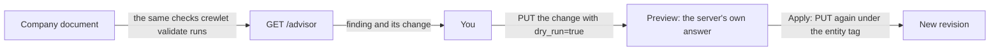

# The Setup Advisor

The setup advisor is one list of what your company's setup costs it, why each item matters, and the change that fixes it. It is for administrators. The engine builds each change; you preview it and send it. **The engine never applies a fix on its own**, because a grant, a model, a schedule or a policy is your company's decision.



## Where you see it

**The go-live check** heads Settings › Advisor: the three things to do before your agents start, each done when nothing of its kind is left. Fix what blocks the company, look at what costs it, and read what is worth knowing. It is counted from the same answer as the list under it, and a part of the setup the server could not read leaves its step unsaid rather than done. When you create a company in the organization builder, its last step opens it.

**Settings › Advisor** lists every finding, the most costly first, with what the engine is handling listed apart so it never reads as yours to do. **Review the change** opens the preview: pick an option where there is more than one, and the screen asks the engine to check the exact write (the fields it changes, before and after, and any warning it would add). Nothing is saved until you press **Apply**, which saves it as a revision by you.

A finding that **blocks** the company and is yours to fix also waits in every administrator's **Inbox** under **Needs you**, and counts on **Home**, with what to do and a button that opens the advisor, as a [platform notice](#platform-notices). It leaves both once the setup no longer raises it. Findings that cost or are worth knowing stay on the advisor alone, so they never crowd the decisions your agents are waiting on.

## Platform notices

A platform notice is how something only an administrator can fix, or something the engine is holding, reaches every administrator, whether or not any agent holds `health_tools`. There are three kinds:

| Notice | Raised while | Opens |
|---|---|---|
| A finding that blocks the company and is yours to fix | The advisor lists it. | The advisor, with the finding's fix. |
| An alarm that has not cleared (`alarm`) | An alarm has stood on any server for at least 30 minutes (the deferral grace, where the engine itself stops waiting for a condition to clear on its own). One notice names every server it stands on, and a restart keeps when it was raised. | The section that draws the alarm: Backups & retention's alarm list, Models, or Gitlet. An MCP server's alarm is already its own row in Needs you. |
| A conversation the engine holds (`conversation.held`) | An agent's conversation whose context did not fit its models twice in a row, the second time on a fresh session: the engine stopped starting turns on it ([Agent runtime § Pausing a seat](../concepts/agent-runtime.md#pausing-a-seat)). Its subject is the seat, and `name` the conversation. There is nothing to decide: writing on the conversation, or changing the seat's models, releases it. | The item the conversation is about, where there is one, or the seat. |

A condition both raise is one notice: the `backup_age` alarm is the advisor's no-verified-backup finding, with that finding's fix. A notice has nothing to answer and nothing to mark read: it ends when its condition does. Whoever is an administrator when the Inbox is read sees it, so a person made an administrator sees every notice already open ([ADR-0116](../../adr/0116-an-administrator-notice-is-read-off-its-condition.md)).

## What it lists

Every finding has a **title** (what is wrong), a **why** (what it costs), the **path** in the company document it sits at, a **severity** and its **fix**.

| Severity | Meaning |
|---|---|
| `blocks` | The company cannot work as configured. |
| `costs` | It works, and pays for the setting in spend, waiting or work nobody sees. |
| `note` | Worth knowing, and may be exactly what you meant. |

The advisor reads the same checks `crewlet validate`, every `/config` write and every node's apply log raise, so a finding here is never a second opinion. Three of them come with a change the advisor builds:

| Finding | When | The change it offers |
|---|---|---|
| No agent watches the engine's own alarms (`grant.health_unheld`) | No agent seat holds `health_tools`, so an alarm that fires on a server wakes nobody. | Give one agent `health_tools`: one option per agent seat, in the chart's order. No agent gets any other access. |
| An agent learns on the model it works on (`learning.auxiliary_model`) | A seat's reflection, summaries and memory (`llm_auxiliary`) run on the same model as its own work, so learning costs a share of its spend at that price. | Point `llm_auxiliary` at another `providers.llm` entry: one option per entry on a different model. With none, add a smaller model first. |
| A schedule runs twelve or more times a day (`schedule.frequent`) | Each fire starts a turn whether or not anything changed. A check that waits for an event, such as a deploy or a merge, is better as a work item dated for when to look. | Run it once a day at 09:00 on the days it runs now, or remove it. Its task stays as written. |

Every other warning the document raises is listed too, in the words `crewlet validate` prints, with the setting to open (`config.advisory`, `config.reference`, `config.admission`).

So is everything your integrations' last check reported (`integration.<kind>`, for example `integration.credential_rejected` or `integration.approval_required`), in the integration's own words. Who acts follows the integration's own verdict: a credential that was refused or is missing, an app waiting for you to approve its permissions, or a delivery path that cannot be set up is yours, with the step to take and, where the vendor names one, the page to take it on; an account the engine is still creating is listed apart as the engine's. If a server cannot read the integrations' state, the answer's `unread` names `integrations` and the screen says so, so a short list never reads as nothing to do.

## Patterns the engine is handling

Beside the document's findings, the advisor reads what the company did over the last 7 days, from the tracker's records and the agents' turn ledger alone and with no model call, and lists the patterns the engine is reducing. Each is `actor: engine`, `source: evidence` and `note`, names at most five records behind it (`records`, empty for a pattern that is a count) and offers nothing to send (`fix.kind: none`): it is information, never a to-do.

| Finding | Listed when (last 7 days) |
|---|---|
| Agents woke each other with comments that asked nothing (`wake.agent_mentions_without_ask`) | Agents' comments that asked nothing woke an agent they named at least 5 times, and at least once per 100 agent comments. |
| Agents named a person without asking them a question (`person.requests_without_ask`), one per person | An agent's comment named the person at least 5 times with no question attached, so nothing in it reached their Inbox as a decision. |
| People answered questions that no longer needed an answer (`ask.overtaken`) | At least 3 answers, and at least 5% of a person's answers to an agent's question, went to a question its asker had asked again on the item since, or whose item had already finished. |
| Work in review waited a day for the agent holding it (`review.idle`), one per agent | An item in review is held by an agent that has taken no turn on it in the last 24 hours, counted from the later of its entering review and its being handed to that agent. A turn on a linked pull request counts on the change, not the item. |
| A person was sent more notices than anyone reads (`person.notice_load`), one per person | The person was sent at least 350 notices, and fewer than a quarter of them asked something of them, so what does ask them waits among the rest. |
| An agent was woken for turns that changed nothing (`wake.noop_share`), one per agent | The agent took at least 20 turns, and at least a quarter of them committed nothing: no work moved and no words written. A schedule's turns are left out: a check that finds nothing is the schedule working. |
| Agents picked up work and moved none of it (`work.pickup_still_waiting`) | Agents picked up work handed to them at least 10 times, and at least a fifth of those turns ended with words only (a comment, a question or a chat post) and moved no work, as when an agent says the item still waits on something. |
| An agent spent a large share of its tokens on auxiliary calls (`spend.auxiliary_share`), one per agent | The agent's turns spent at least 1,000,000 tokens, and more than 15% of them went to auxiliary calls inside its turns rather than to the turns' own work. It is a share of tokens, cached input included, not of spend. |
| Wakes repeated changes an agent had already read (`wake.redelivered_seen`), one per agent | At least 10 of the agent's wakes, and at least a fifth of all that woke it, came for changes a completed turn of it had already read, so the engine absorbed them instead of starting turns ([ADR-0120](../../adr/0120-a-wake-a-completed-turn-already-read-past-starts-no-turn.md)). |

One finding read from the engine's own state is yours: **Your company has no recent verified backup** (`durability.no_verified_backup`, `blocks`), listed while the `backup_age` alarm stands, at the backup policy's own age. Its fix is a step outside the company document (`fix.kind: external_step`): take a backup now with `crewlet backup` or from the dashboard, then schedule it to a place off the server ([Backups](backup.md)).

So is an agent the engine paused. When a failure a retry cannot cure happens twice in a row, the engine pauses the agent rather than retrying it ([ADR-0117](../../adr/0117-a-failure-a-retry-cannot-cure-pauses-its-seat.md)), and the advisor lists it as a blocking finding (`blocks`), one per kind of failure, naming every agent it holds:

| Finding | The fix |
|---|---|
| The sandbox could not start as configured (`sandbox.image_unstartable`) | Correct the sandbox settings (`providers.sandbox`), such as its image or template. Saving the change resumes the agents. If the fix was made at the provider instead, resume each agent from its page. |
| The sandbox provider refused the engine's credential (`sandbox.credential_refused`) | Replace the provider's key, then resume each agent from its page. |
| The sandbox provider refused for billing (`sandbox.billing_refused`) | Settle the account's billing with the provider, then resume each agent from its page. |
| No model would accept its credential (`models.credential_refused`) | Replace the models' credentials under Settings, Models, then resume each agent from its page. Changing the models they run on resumes them as well. |

Work sent to a paused agent waits; nothing is dropped.

One more is yours to weigh, read from the decisions your agents asked: **a person chose one agent's recommendation in nearly every decision it asked** (`approval.rubber_stamp`, `note`), when an agent asked one person 20 or more decisions in the last 7 days and nine in ten or more were answered with its recommended option. It is one finding per agent, naming every person for whom that holds. Each still costs a press and makes the agent wait; whether the agent may act on some kinds of them without asking is your call. Its fix is a draft (`fix.kind: draft_with_assistant`): **Draft with Ask Crewlet** asks Ask Crewlet, in the engine's words (`fix.prompt`), to read those decisions and draft a policy change, which you review in its own preview before anything is saved. Nothing changes until you approve it.

## Access an agent asks for

An agent that needs more access asks for it with `request_access`, naming one grant from a closed list: watching the engine's health, or a write permission of its own GitHub App (pull requests, contents, checks, issues). It reaches you as a decision in your Inbox with the agent's reason: the grant, in the engine's own words (for example **Allow Ada to watch the engine's health and wake on its alarms**), or **Not now**. Choosing the grant opens the same preview as a fix here: the exact change to that agent's role, built by the engine for that agent alone, checked by the engine's dry run. Nothing is saved until you press **Apply**, and the engine accepts the answer only once the agent holds the grant, so an agent is never told yes with nothing changed. **Not now** answers at once and changes nothing. Only the engine can offer a grant: a decision any author writes is refused if an option's id begins with `grant-`. `GET /advisor/access?seat=<handle>&access=<grant>` returns the change for a script.

## Previewing and applying a change

A change is one entity write: `entity` (`roles` or `units`), `id` (a seat's handle or a unit's id), `set` (the top-level fields to replace), `merge` where a change sets a nested field (merged into the entity key by key, so every other field stays as you read it) and `summary`. To apply one:

1. `GET /config/{entity}/{id}`: the entity and its own `ETag`. Merge in `merge`, then replace the fields `set` names.
2. `PUT /config/{entity}/{id}?dry_run=true` with that body and `If-Match` set to that `ETag`. The answer is the preview: whether the company would still be valid and any warning the write would introduce. Nothing is stored.
3. Send the same `PUT` without `dry_run`, with the `summary` as `X-Summary`. It is recorded as a revision by you, like any change you make.

If the entity changed after your read, the write is refused for its `If-Match` instead of overwriting the change; read it again. A company whose document is managed elsewhere (Tier A's `api.auth.company_writers`) refuses the write; make the same change in its source instead.

## What never happens on its own

The engine does not grant access, change a model, move or remove a schedule, edit a policy or close anything because of a finding. The advisor only reads, and its package has no way to write (ADR-0115).

## Reading it

`GET /advisor` takes `admin`. From a script, with an administrator's token in `CREWLET_API_TOKEN`:

```sh
curl -s -H "Authorization: Bearer $CREWLET_API_TOKEN" https://crewlet.example.com/advisor
```

Or with `crewlet doctor`, which prints the classes, subjects by kind and ordinal, and counts (`-words` adds the handles and the reasons) and exits 2 while a finding blocks the company, or 1 while the node could not read a source, so a block it holds is never passed over ([CLI reference](../reference/cli.md#crewlet-doctor)).

The answer is `{"revision": "...", "findings": [...], "notices": [...], "unread": [...]}`, the most costly finding first and the longest-standing notice first; the patterns above are read over the 7 days before the request. A notice is `{"class", "subject", "since", "nodes", "alarm"}`: the finding's class and subject, or `alarm` with the alarm's kind as the subject's `name`, or `conversation.held` with the seat and the conversation. A finding's notice that an alarm raised (the backup alarm's) also carries the alarm's kind in `alarm`, so the Inbox still says the alarm stands while the answering server has not evaluated its own alarms and so lists no finding. `unread` names each source the server could not read, so a short list never reads as nothing to do: `integrations` (their last check), `work` (the week's comments, answers, reviews and notices, whose patterns are then left out), `ledger` (the agents' turns by what woke them and what they did, whose patterns are then left out), `pauses` (the seats' pauses, so an agent the engine paused is left out), `alarms`, named once for either cause (the node's alarm table has not been evaluated yet, as right after a start, so the backup finding cannot be judged; or the fleet's alarms could not be read, so a standing alarm may have no notice), and `holds` (the conversations the engine holds could not be read). `crewlet doctor` fails while any source is unread. See the [API reference](../reference/api-endpoints.md).
