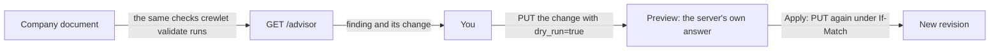

# The Setup Advisor

The setup advisor is one list of what your company's setup costs it, why each item matters, and the change that fixes it. It is for administrators. The engine builds each change; you preview it and send it. **The engine never applies a fix on its own**, because a grant, a model, a schedule or a policy is your company's decision.



## What it lists

Every finding has a **title** (what is wrong), a **why** (what it costs), the **path** in the company document it sits at, a **severity** and its **fix**.

| Severity | Meaning |
|---|---|
| `blocks` | The company cannot work as configured. |
| `costs` | It works, and pays for the setting in spend, waiting or work nobody sees. |
| `note` | Worth knowing, and may be exactly what you meant. |

The advisor reads the same checks `crewlet validate`, every `/config` write and every node's apply log raise, so a finding here is never a second opinion. Three of them come with a change the advisor builds:

| Finding | When | The change it offers |
|---|---|---|
| No agent watches the engine's own alarms (`grant.health_unheld`) | No agent seat holds `health_tools`, so an alarm that fires on a server wakes nobody. | Give one agent `health_tools`: one option per agent seat, in the chart's order. No agent gets any other access. |
| An agent learns on the model it works on (`learning.auxiliary_model`) | A seat's reflection, summaries and memory (`llm_auxiliary`) run on the same model as its own work, so learning costs a share of its spend at that price. | Point `llm_auxiliary` at another `providers.llm` entry: one option per entry on a different model. With none, add a smaller model first. |
| A schedule runs twelve or more times a day (`schedule.frequent`) | Each fire starts a turn whether or not anything changed. A check that waits for an event, such as a deploy or a merge, is better as a work item dated for when to look. | Run it once a day at 09:00 on the days it runs now, or remove it. Its task stays as written. |

Every other warning the document raises is listed too, in the words `crewlet validate` prints, with the setting to open (`config.advisory`, `config.reference`, `config.admission`).

## Patterns the engine is handling

Beside the document's findings, the advisor reads what the company did over the last 7 days, from the records alone and with no model call, and lists the patterns the engine is reducing. Each is `actor: engine`, `source: evidence` and `note`, names at most five records behind it (`records`) and offers nothing to send (`fix.kind: none`): it is information, never a to-do.

| Finding | Listed when (last 7 days) |
|---|---|
| Agents woke each other with comments that asked nothing (`wake.agent_mentions_without_ask`) | Agents' comments that asked nothing woke an agent they named at least 5 times, and at least once per 100 agent comments. |
| Agents named a person without asking them a question (`person.requests_without_ask`), one per person | An agent's comment named the person at least 5 times with no question attached, so nothing in it reached their Inbox as a decision. |
| People answered questions that no longer needed an answer (`ask.overtaken`) | At least 3 answers, and at least 5% of a person's answers to an agent's question, went to a question its asker had asked again on the item since, or whose item had already finished. |
| A review waited a day for the agent holding it (`review.idle`), one per agent | An item in review is held by an agent that has taken no turn on it in the last 24 hours. |

One finding read from the engine's own state is yours: **Your company has no recent verified backup** (`durability.no_verified_backup`, `blocks`), listed while the `backup_age` alarm stands, at the backup policy's own age. Its fix is a step outside the company document (`fix.kind: external_step`): take a backup now with `crewlet backup` or from the dashboard, then schedule it to a place off the server ([Backups](backup.md)).

## Previewing and applying a change

A change is one entity write: `entity` (`roles` or `units`), `id` (a seat's handle or a unit's id), `set` (the top-level fields to replace) and `summary`. To apply one:

1. `GET /config/{entity}/{id}` and replace the fields `set` names.
2. `PUT /config/{entity}/{id}?dry_run=true` with that body, the `summary` as `X-Summary`, and `If-Match: "<revision>"` from the advisor's answer. The answer is the preview: what the write would change and any warning it would introduce. Nothing is stored.
3. Send the same `PUT` without `dry_run`. It is recorded as a revision by you, like any change you make.

If the company changed since the advisor answered, the write is refused for its `If-Match` instead of overwriting the newer revision; read the advisor again for a change built on the current one. A company whose document is managed elsewhere (Tier A's `api.auth.company_writers`) refuses the write; make the same change in its source instead.

## What never happens on its own

The engine does not grant access, change a model, move or remove a schedule, edit a policy or close anything because of a finding. The advisor only reads, and its package has no way to write (ADR-0115).

## Reading it

`GET /advisor` takes `admin`. From a script, with an administrator's token in `CREWLET_API_TOKEN`:

```sh
curl -s -H "Authorization: Bearer $CREWLET_API_TOKEN" https://crewlet.example.com/advisor
```

The answer is `{"revision": "...", "findings": [...]}`, the most costly finding first; the patterns above are read over the 7 days before the request. See the [API reference](../reference/api-endpoints.md).
