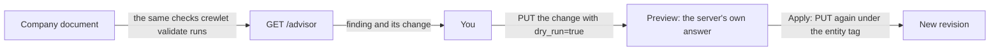

# The Setup Advisor

The setup advisor is one list of what your company's setup costs it, why each item matters, and the change that fixes it. It is for administrators. The engine builds each change; you preview it and send it. **The engine never applies a fix on its own**, because a grant, a model, a schedule or a policy is your company's decision.



## Where you see it

**Settings › Advisor** lists every finding, the most costly first, with what the engine is handling listed apart so it never reads as yours to do. **Review the change** opens the preview: pick an option where there is more than one, and the screen asks the engine to check the exact write (the fields it changes, before and after, and any warning it would add). Nothing is saved until you press **Apply**, which saves it as a revision by you.

## What it lists

Every finding has a **title** (what is wrong), a **why** (what it costs), the **path** in the company document it sits at, a **severity** and its **fix**.

| Severity | Meaning |
|---|---|
| `blocks` | The company cannot work as configured. |
| `costs` | It works, and pays for the setting in spend, waiting or work nobody sees. |
| `note` | Worth knowing, and may be exactly what you meant. |

The advisor reads the same checks `crewlet validate`, every `/config` write and every node's apply log raise, so a finding here is never a second opinion. Three of them come with a change the advisor builds:

| Finding | When | The change it offers |
|---|---|---|
| No agent watches the engine's own alarms (`grant.health_unheld`) | No agent seat holds `health_tools`, so an alarm that fires on a server wakes nobody. | Give one agent `health_tools`: one option per agent seat, in the chart's order. No agent gets any other access. |
| An agent learns on the model it works on (`learning.auxiliary_model`) | A seat's reflection, summaries and memory (`llm_auxiliary`) run on the same model as its own work, so learning costs a share of its spend at that price. | Point `llm_auxiliary` at another `providers.llm` entry: one option per entry on a different model. With none, add a smaller model first. |
| A schedule runs twelve or more times a day (`schedule.frequent`) | Each fire starts a turn whether or not anything changed. A check that waits for an event, such as a deploy or a merge, is better as a work item dated for when to look. | Run it once a day at 09:00 on the days it runs now, or remove it. Its task stays as written. |

Every other warning the document raises is listed too, in the words `crewlet validate` prints, with the setting to open (`config.advisory`, `config.reference`, `config.admission`).

So is everything your integrations' last check reported (`integration.<kind>`, for example `integration.credential_rejected` or `integration.approval_required`), in the integration's own words. Who acts follows the integration's own verdict: a credential that was refused or is missing, an app waiting for you to approve its permissions, or a delivery path that cannot be set up is yours, with the step to take and, where the vendor names one, the page to take it on; an account the engine is still creating is listed apart as the engine's. If a server cannot read the integrations' state, the answer's `unread` names `integrations` and the screen says so, so a short list never reads as nothing to do.

## Patterns the engine is handling

Beside the document's findings, the advisor reads what the company did over the last 7 days, from the records alone and with no model call, and lists the patterns the engine is reducing. Each is `actor: engine`, `source: evidence` and `note`, names at most five records behind it (`records`) and offers nothing to send (`fix.kind: none`): it is information, never a to-do.

| Finding | Listed when (last 7 days) |
|---|---|
| Agents woke each other with comments that asked nothing (`wake.agent_mentions_without_ask`) | Agents' comments that asked nothing woke an agent they named at least 5 times, and at least once per 100 agent comments. |
| Agents named a person without asking them a question (`person.requests_without_ask`), one per person | An agent's comment named the person at least 5 times with no question attached, so nothing in it reached their Inbox as a decision. |
| People answered questions that no longer needed an answer (`ask.overtaken`) | At least 3 answers, and at least 5% of a person's answers to an agent's question, went to a question its asker had asked again on the item since, or whose item had already finished. |

One finding read from the engine's own state is yours: **Your company has no recent verified backup** (`durability.no_verified_backup`, `blocks`), listed while the `backup_age` alarm stands, at the backup policy's own age. Its fix is a step outside the company document (`fix.kind: external_step`): take a backup now with `crewlet backup` or from the dashboard, then schedule it to a place off the server ([Backups](backup.md)).

## Previewing and applying a change

A change is one entity write: `entity` (`roles` or `units`), `id` (a seat's handle or a unit's id), `set` (the top-level fields to replace) and `summary`. To apply one:

1. `GET /config/{entity}/{id}`: the entity and its own `ETag`. Replace the fields `set` names.
2. `PUT /config/{entity}/{id}?dry_run=true` with that body and `If-Match` set to that `ETag`. The answer is the preview: whether the company would still be valid and any warning the write would introduce. Nothing is stored.
3. Send the same `PUT` without `dry_run`, with the `summary` as `X-Summary`. It is recorded as a revision by you, like any change you make.

If the entity changed after your read, the write is refused for its `If-Match` instead of overwriting the change; read it again. A company whose document is managed elsewhere (Tier A's `api.auth.company_writers`) refuses the write; make the same change in its source instead.

## What never happens on its own

The engine does not grant access, change a model, move or remove a schedule, edit a policy or close anything because of a finding. The advisor only reads, and its package has no way to write (ADR-0115).

## Reading it

`GET /advisor` takes `admin`. From a script, with an administrator's token in `CREWLET_API_TOKEN`:

```sh
curl -s -H "Authorization: Bearer $CREWLET_API_TOKEN" https://crewlet.example.com/advisor
```

Or with `crewlet doctor`, which prints the classes, subjects by kind and ordinal, and counts (`-words` adds the handles and the reasons) and exits 2 while a finding blocks the company ([CLI reference](../reference/cli.md#crewlet-doctor)).

The answer is `{"revision": "...", "findings": [...], "unread": [...]}`, the most costly finding first; the patterns above are read over the 7 days before the request. See the [API reference](../reference/api-endpoints.md).
