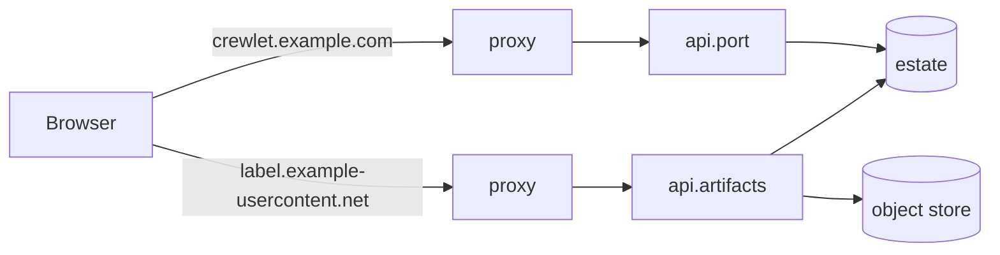

# Serving Artifacts

How to give [artifacts](../concepts/artifacts.md) an origin people can open
them on: the three shapes a self-hosted deployment can take, the DNS and TLS
each needs, what a reverse proxy in front of it must and must not do, and how
to size the object store the bytes live in.

Publishing works without any of this. Until a node serves the artifact
listener, the dashboard lists and versions artifacts but cannot open an `html`
one, and says which Tier A key to set.

---

## Why artifacts need a host of their own

An artifact is HTML and script that a person or an agent wrote. The dashboard
acts with a session cookie, and any page rendered on the dashboard's origin
could act as whoever opened it, so the engine never serves an artifact there.
It serves them from a **separate listener**, `api.artifacts`, which:

- serves the files of artifact versions, their assets, the embedded page
  runtime and kit, and the files of the company's adopted brand, and **nothing
  else**: no API route, no probe;
- holds **no credential**: it never reads a cookie and never sets one;
- opens a version only for a **view ticket** in the URL, minted by the
  dashboard for the signed-in viewer, re-checked on every document request.

**A design's artboards are framed documents too, one per ticket.** The
dashboard frames every artboard on screen on its own, each under a ticket
minted for that board (`POST /artifacts/{id}/tickets` with `document` naming
the board's page). A board's ticket opens that page and no other as a
document: a board that navigates or fetches another board's page gets an
empty `404`, counted under the `document` refusal reason, while its
stylesheets, scripts and images load as any page's do. An `html` page's single
frame still moves between the version's pages under one ticket. At most twelve
boards are framed at once, only those on screen, so a canvas of many boards
holds a dozen tickets rather than one per board.

The dashboard embeds the listener's pages in a sandboxed frame and talks to
them over a message port; every live call a page makes goes through the
dashboard, as the viewer. The decision is
[ADR-0035](https://github.com/crewlet/crewlet/blob/main/adr/0035-an-artifact-is-served-from-an-origin-that-holds-no-credential.md).



---

## Configuring the listener

```yaml
# crewlet.yaml (Tier A), on every ingress node
api:
  external_url: https://crewlet.example.com
  artifacts:
    host: 127.0.0.1          # bind; empty binds every interface
    port: 8001               # 0 (the default) serves no artifacts on this node
    external_url: https://{artifact}.example-usercontent.net
```

The listener is bound on **ingress** nodes only, like `api.port`, and with it:
before the boot, so a port somebody else holds fails the start at once, and
`api_bound` names it as `artifacts_addr`. Until the node serves, the listener
answers what a starting origin answers (an empty `503` with a `Retry-After` for
every route it will serve, see
[While a node is starting](../reference/api-endpoints.md#while-a-node-is-starting)),
and from the handover the origin itself, logged as `api_artifacts_listening`
with the origin mode. A node without `ingress` binds nothing there and says so
at `INFO` (`api_artifacts_not_bound`). In a fleet,
every ingress node that serves the dashboard should serve artifacts too, behind
the same load balancer, so a viewer's dashboard and its frames reach a node
either way. A node serving artifacts needs nothing else: it reads artifact rows
from its own copy of the estate (`ingress` requires `data`, so every node that
binds the origin holds one) and bytes from the object store, exactly as every
node does.

`external_url` decides the **origin mode**, and `crewlet validate` checks it:

| `external_url` | Mode | What a page gets |
|---|---|---|
| A template with `{artifact}` at the start of its leftmost label, on a registrable domain other than the dashboard's | **per artifact** | A real origin of its own: browser storage works, partitioned per artifact |
| A plain origin (one host, or one port) | **shared** | An opaque origin per document: browser storage throws, and pages keep per-viewer state through the runtime |
| A template on the dashboard's own registrable domain | **shared** (served opaque), with a warning | As shared |

`{artifact}` is replaced by the artifact's 26-character host label, so the
leftmost label of the template, rendered, must fit DNS's 63 bytes: both
`https://{artifact}.artifacts.example.net` and
`https://{artifact}--acme.example-usercontent.net` work.

Validation **refuses**:

- `{artifact}` anywhere but the start of the leftmost label, or twice;
- plain `http` on anything but a loopback host;
- a path in the URL;
- an origin equal to `api.external_url`'s, to `api.public.external_url`'s, or
  to any entry of `api.auth.allowed_origins` (the artifact host would be one
  the API trusts for cross-site writes);
- a host that is a parent domain of the API's host;
- a port with no `external_url` on an ingress node.

---

## The three self-hosted shapes

In order of preference.

### 1. A wildcard on a domain of its own

```yaml
api:
  artifacts:
    port: 8001
    external_url: https://{artifact}.example-usercontent.net
```

Each artifact gets its own origin on a site that is not the dashboard's, so no
request an artifact makes carries anything of the dashboard's, and browser
storage works per artifact as authors expect. This is the shape to choose when
you can register a second domain.

- **DNS:** a wildcard record, `*.example-usercontent.net`, pointing at your
  ingress (an `A`/`AAAA` or `CNAME`).
- **TLS:** a wildcard certificate for `*.example-usercontent.net`. Public CAs
  issue wildcards only through the DNS-01 challenge, so your proxy or
  certificate tool needs API access to the DNS zone.
- Use a domain you use for nothing else. Submitting it to the
  [Public Suffix List](https://publicsuffix.org/) as a private suffix makes
  every artifact host a site of its own in browsers, which also partitions
  storage and cookies between artifacts; it is optional for a self-hosted
  deployment and takes weeks to reach browsers.

### 2. A second hostname

```yaml
api:
  artifacts:
    port: 8001
    external_url: https://artifacts.example.com
```

One hostname, no wildcard, and it may be on the dashboard's own domain. Every
artifact document is served with an **opaque origin**, so it has no storage
and no origin to attack: its requests are cross-site for the dashboard's
cookie, the cookie is host-only, and the API refuses cross-site writes and
socket handshakes by their `Origin`.

- **DNS:** one record for `artifacts.example.com`.
- **TLS:** one ordinary certificate (HTTP-01 works).

### 3. A second port on the dashboard's host

```yaml
api:
  artifacts:
    port: 8443
    external_url: https://crewlet.example.com:8443
```

The fewest moving parts: no new name and no new certificate if the proxy
terminates TLS on both ports with the same one. A port is a different origin
but the same site, so this shape is always served opaque. Local development
is this shape: `http://127.0.0.1:8001` beside a dashboard on
`http://127.0.0.1:8000`.

**What is never offered** is serving artifacts on `api.port` under a path. A
path is not an origin.

---

## A reverse proxy in front of it

The listener speaks plain HTTP on its port; terminate TLS in front of it as
you do for the dashboard.

**Caddy**, for the wildcard shape (the DNS provider module is the one for your
zone):

```caddy
*.example-usercontent.net {
	tls {
		dns cloudflare {env.CLOUDFLARE_API_TOKEN}
	}
	reverse_proxy 127.0.0.1:8001 {
		flush_interval -1
	}
}
```

**nginx**, for the wildcard shape:

```nginx
server {
    listen 443 ssl;
    http2 on;
    server_name ~^[0-9a-z]{26}\.example-usercontent\.net$;

    ssl_certificate     /etc/ssl/wildcard.example-usercontent.net.crt;
    ssl_certificate_key /etc/ssl/wildcard.example-usercontent.net.key;

    location / {
        proxy_pass         http://127.0.0.1:8001;
        proxy_http_version 1.1;
        proxy_set_header   Host $host;
        proxy_buffering    off;
        proxy_cache        off;
    }
}
```

For the second-hostname shape, the same block with
`server_name artifacts.example.com;` and an ordinary certificate.

Whatever the proxy, it must:

- **pass the original `Host` header through.** In per-artifact mode the engine
  checks that the host's label is the artifact the ticket names, and refuses
  anything else with an empty `404`;
- **pass `Sec-Fetch-*` request headers through** unmodified: the engine tells a
  document request from a subresource request by them, and documents are
  re-authorized on every request;
- **leave the response headers alone**: `Content-Security-Policy`,
  `Permissions-Policy`, `Cross-Origin-*`, `Referrer-Policy` and
  `X-Content-Type-Options` are built per document, and a proxy that strips or
  rewrites them removes the page's isolation;
- **never cache `/t/` paths in a shared cache.** Documents are `private,
  no-store` and subresources `private`; a cache keyed without the ticket would
  serve a revoked viewer, and one keyed with it caches nothing useful. Only
  `/_crewlet/runtime/`, `/_crewlet/kit/` and `/_crewlet/brand/` are public. The
  first two are safe to cache anywhere, even keyed without the host: a kit
  release and a runtime named by its bytes (`runtime.<digest>.js`) are
  immutable and the same on every host, and a runtime at its contract's name
  (`runtime.js`) is revalidated on every use, so honour its `no-cache`.
  `/_crewlet/brand/<sha256>.<ext>` serves the company's adopted brand (its
  stylesheet, logos and faces), immutable for a year, and **keyed with the
  host**: it is one company's, so a cache rule that drops the host from the key
  for the kit must not drop it here;
- **never inject anything**: no analytics or rewriting of HTML, no challenge
  or captcha page (a challenge inside a frame cannot be solved), no added
  cookies.

Set HSTS at the proxy or let the engine send it: the listener sends
`Strict-Transport-Security` whenever its `external_url` is `https`.

---

## Checking it works

```sh
crewlet validate                       # mode, refusals, and the same-site warning
curl -sI https://abc.example-usercontent.net/_crewlet/runtime/1.0.0/runtime.js
```

The runtime answers `200` on any host the listener serves. At its contract's
name it says `Cache-Control: public, no-cache, must-revalidate`; the name a
page actually loads it by, `runtime.<digest>.js`, says `public,
max-age=31536000, immutable`. Then open an `html` artifact in the
dashboard: the frame loads, and the browser's developer tools show the document
with a `Content-Security-Policy` carrying a fresh `nonce-` on every reload.

| Symptom | Cause |
|---|---|
| The viewer says artifacts are not served | No node serves `api.artifacts`: set `port` and `external_url` on the ingress nodes |
| Every frame is an empty `404` | The ticket did not open, or in per-artifact mode the proxy did not pass the original `Host` |
| One design board shows an empty `404` after a click | The board followed a link to another board's page, which its ticket does not open; boards are separate documents |
| A frame shows `401` briefly, then loads | The ticket expired (they live an hour); the viewer mints another on its own |
| A frame answers `503` with `Retry-After` | This node's copy of the artifacts or identity log is stale or out of service and no peer answered; the engine refuses to serve from rows that may hold a revoked share. See [Read Consistency](consistency.md) |
| A page reports that storage is unavailable | The listener is in shared mode, where documents have opaque origins. Pages that declare `state` keep per-viewer state through the runtime instead |
| The frame is blank and the console names a policy | A proxy stripped or rewrote the engine's headers, or the dashboard was opened on an origin that is neither `api.external_url` nor an `api.auth.allowed_origins` entry, which the artifact's `frame-ancestors` does not admit |

The listener's traffic is in the `crewlet.artifacts.serve.*` and
`crewlet.artifacts.ticket.refusals` instruments (see
[Metrics](../reference/metrics.md)).

---

## Sizing the object store

Artifact files live in the company's [object store](../concepts/object-store.md),
beside project files, one object per uploaded file, under the same collection
and audit.

- On the default **`nats`** backend every broker member holds every object, so
  each artifact byte costs `stream.replicas` bytes of broker disk. The bucket
  has a reservation inside `stream.store_max_bytes`
  (`store.objects.nats_max_bytes`, derived when unset) so artifact growth can
  never take the space the fleet's coordination needs, and the
  `objects_bucket_near_ceiling` alarm fires at 80 percent of it. The default
  `artifacts.limits.company_bytes` of 10 GiB is 30 GiB of broker disk at three
  replicas. Replacing a broker member re-replicates every object, so past a
  few tens of GiB of objects, prefer `s3`.
- On **`s3`** the bucket holds the bytes once and the provider replicates them.
  When the bucket honours signed checksums and conditional puts, browsers and
  the harness upload straight to it; give the bucket a CORS rule admitting `PUT`
  from the dashboard's origin. An S3-compatible service you run yourself
  works the same way. See
  [Choosing a backend](../concepts/object-store.md#choosing-a-backend).

Datastore rows are not objects: they live in every data node's replicated
estate, in every snapshot and in every backup, bounded by
`artifacts.limits.data_bytes` and `artifacts.limits.data_store_bytes`. Budget
them like any other replicated table, and the two logs' ceilings
(`stream.artifacts_log_max_bytes`, `stream.artifact_data_log_max_bytes`) like
any other log (see [Retention](retention.md)).

The measured capacity of each path, and how it was measured, is
[Artifact Capacity](../reference/artifact-capacity.md).
